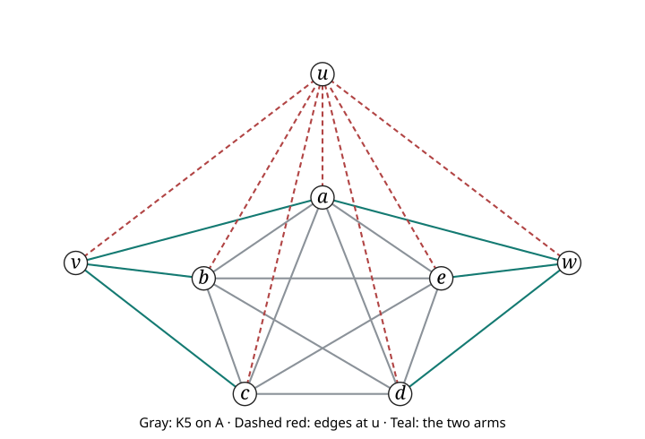

# Structural Results, Reductions, and Obstructions for Tuza’s Triangle Packing–Covering Conjecture

## A synthesis of TUZA-1–26

**AI Math Experiments**  
17 November 2026

**AI-developed mathematical research report.** The mathematical investigations, software, formalization, manuscript and internal reviews were produced using AI systems. The human participant supplied research objectives, coordination and publication authorization. No external human specialist peer review or certification of historical priority is claimed. The research series is paused. Unrestricted Tuza and the universal combined inequality/equality statement remain unresolved.

## Abstract

For a finite simple graph, Tuza’s conjecture asks whether the minimum number of edges meeting every triangle is at most twice the maximum number of edge-disjoint triangles. This paper consolidates the TUZA-1–26 programme around structural interfaces for that inequality and its stronger proposed equality classification. We give complete project proofs of triangle restoration under explicit tripartite or local structural hypotheses; literal equality classification in five-degenerate graphs and graphs of maximum average degree strictly below seven; gain-one completion and exact cover exchange; a common-vertex theorem for a specified maximum packing; forest-cover packing anchors and equality; an ordinary minimum-CS four-branch link exclusion and heavy-core localization; and uniform quantitative equivalences at explicitly stated error scales. Extended proofs retain the relevant case analyses and finite-domain completeness arguments.

The final reductions distinguish an actual selected residual of a hypothetical minimum counterexample from a separately minimized slack-one core. The latter has a strong high-degree, connectivity, cover-eligibility and resilience profile, but no available operation has been proved to eliminate it. Explicit obstructions explain the failure of several private-witness, rounding, local-marginal, odd-cover and descent mechanisms. A narrow twelve-model rigidity assertion is sufficient for the stronger combined statement through proved restoration; its converse and the sufficiency of a broader glued-family assertion are not claimed. Formal source builds, independently checked finite domains, ordinary arguments, bounded searches and unresolved conjectures are recorded separately.

## Reading the paper

Chapters 1–10 organize the mathematics by dependence. Appendix A records the missions; Appendix B contains complete extended project proofs and literal witnesses; Appendices C–G give formal correspondence, computations, barriers, notation/provenance/attribution and reproducibility. The large proof appendix is deliberately part of the paper: the central arguments do not depend on an inaccessible conversation. Deep named external theorems remain cited inputs. Secondary results included only by reference are explicitly identified in the claim ledger rather than silently asserted to have been re-proved here.

The source baseline is the reviewed archive published in PR10 at commit `e04d2b5d3a9eeb6f01f3724acc30607f7274bd62`. Earlier publications retain their own dates and evidence scopes. TUZA-27 mathematics is excluded. The canonical manuscript is `manuscript.md`; a deterministic build produces the readable citation-resolved Markdown, editable LaTeX and PDF.

# 1. Definitions, equality, and the logical scope

## The common mathematical interface

For a finite simple graph G, let T(G) be its complete family of actual triangles, ν(G) its maximum edge-disjoint triangle packing, and τ(G) the smallest number of actual graph edges meeting T(G). Write $s(G)=2\nu(G)-\tau(G)$ and $d(G)=\tau(G)-2\nu(G)$. A triangle component is a connected component of the graph on T(G) in which triangles are adjacent when they share a graph edge. Its support is the literal union of its triangle edges. Say B(G) holds when every nonempty triangle component has support K4 or K5.

This definition permits different blocks to share vertices. It permits background edges only if they create no triangle outside the stated blocks. A supplied collection of edge-disjoint cliques is not sufficient without checking that it contains every actual triangle. With that check, ν and τ add over the blocks. Their values are (1,2) for K4 and (2,4) for K5, so B(G) implies $\tau(G)=2\nu(G)$, even without a sparsity hypothesis.

Four operations require different hypotheses. Ordinary inequality-criticality means every proper edge subgraph satisfies Tuza. Combined-criticality means every proper edge subgraph satisfies both Tuza and the equality characterization B. A two-red argument fixes an actual globally minimum cover. A selected residual is only the graph produced by a stated deletion; it inherits neither kind of minimality automatically. The same symbols must not conceal these differences.

The edge-triangle hypergraph D(G) has graph edges as vertices and actual triangles as hyperedges. Its being tripartite is a coloring of graph edges making every triangle rainbow. It does not mean the graph itself is vertex-tripartite. Deletion preserves this property because surviving triangles form a subhypergraph. Aharoni's theorem gives τ≤2ν in this class. HNS supplies a home-base structure at equality. The graph-specific deductions from that structure, rather than the external theorems themselves, drive restoration.

## The proposed combined statement

Let $\mathcal B(G)$ mean that every nonempty triangle component, connected through shared graph edges, has literal support $K_4$ or $K_5$. Write $\mathrm{CS}(G)$ for

$$\tau(G)\le2\nu(G),\qquad \tau(G)=2\nu(G)\Longleftrightarrow\mathcal B(G).$$

The implication from $\mathcal B$ to equality is elementary. The reverse direction is an additional universal conjecture. Thus universal CS implies Tuza; this paper does not prove the converse. Throughout the main text $s=2\nu-\tau$ is slack and $d=\tau-2\nu=-s$ is violation defect. A historical “defect-one” support in the late programme has $s=1$, not $d=1$. Appendix F records the conversion. Local packing losses and matching deficiencies are separately defined and are not these signed graph parameters.

The principal claims have distinct scopes. Five-degenerate CS and the forest-cover theorem have unconditional formal source proofs within their stated classes. The maximum-average-degree equality proof and final three-edge restoration are ordinary proofs. The one-cycle cover and parts of the Q profile also use complete finite interfaces. Restoration from a tripartite triangle hypergraph imports Aharoni and HNS. A theorem about a hypothetical minimal failure does not assert that such a graph exists.

# 2. Equality and restoration

## Equality supplies compatible packings

**Rainbow equality lemma.** If D(H) is tripartite and $\tau(H)=2\nu(H)=2h$, all H-triangles are the faces of h edge-disjoint K4s. For every independent vertex set U of H, one can choose a maximum packing whose triangles avoid U.

**Proof.** The home-base partition contains h elementary pieces. Its three auxiliary bipartite graphs have matchings saturating the central triples. Select one such matching in each vertex class. The selected external vertices are distinct within their own class, distinct across classes, and outside the partition's central pieces. This produces h vertex-disjoint loose three-cycles in D(H), where disjointness refers to graph-edge resources. Three graph triangles that meet pairwise in distinct edges lie on four graph vertices and supply all six K4 edges. Hence the extracted supports are edge-disjoint K4s.

If an actual triangle Q were outside every extracted block, it would meet each block in at most one edge: two edges of Q in a clique force all three vertices, and hence Q, into that clique. In each K4 choose a face avoiding its possible intersection edge with Q. These h faces and Q would be an (h+1)-packing, a contradiction. Thus all triangles are exhausted. An independent U meets each K4 in at most one vertex; choose its opposite face, or any face if the intersection is empty. The blockwise choices are edge-disjoint. ∎

The extraction is ordinary mathematics using the exact HNS input; it is not a Lean proof of HNS. The original restoration formalization takes the needed inputs as explicit theorem parameters. In contrast, the later five-degenerate formalization proves its own combined result without additional mathematical axioms.

**Intersecting-family lemma.** A pairwise edge-intersecting family of graph triangles has an edge cover of size at most two. If there is no common edge, its triangles lie in one K4.

**Proof.** Choose distinct members abc and abd. If all members use ab, it alone covers. Otherwise a member avoiding ab must meet both of these triangles in edges, so it is acd or bcd. Every member is then a triangle on {a,b,c,d}, and {ab,cd} covers. ∎

**One-triangle restoration.** If T is a G-triangle and D(H) is tripartite for H=G−E(T), then $\tau(G)\le2\nu(G)$.

**Proof.** Put h=ν(H); adding T gives $\nu(G)\ge h+1$. If $\tau(H)\le2h-1$, add all three T-edges to a minimum old cover. Its size is at most 2h+2. Otherwise H is at equality. Its block packing can be chosen disjoint in vertices from U=V(T), because U is independent in H. Every new triangle uses a T-edge, and every edge of that triangle has an endpoint in U. Consequently the chosen old packing is edge-disjoint from every new triangle simultaneously. If the new family has packing number r, then $\nu(G)\ge h+r$. It contains T, so r≥1. For r=1 the intersecting-family lemma gives a two-edge cover; for r≥2 its triangles are covered by E(T), of size 3≤2r. Add this new-family cover to an old cover of size 2h. ∎

Every four-colorable graph has tripartite D(G): give its vertex colors distinct elements of F₂² and label an edge by the nonzero sum of endpoint colors. Every triangle receives the three nonzero labels. If G has an odd-cycle transversal S of size at most four and G[S] is triangle-free, G[S] is bipartite and a bipartition of G−S supplies four colors. If G[S] has a triangle T, deleting E(T) makes the remaining graph on S bipartite (a star plus isolates); four colors then apply to H. One-triangle restoration proves Tuza for odd-cycle transversal at most four. This does not establish the next transversal value.

For two edge-disjoint restored triangles T1,T2, the elementary bounds are $\nu(G)\ge h+2$ and $\tau(G)\le\tau(H)+6$. Only old slack zero or one and packing gain exactly two need work. At old equality, choose compatible old block packings separately for the two individual new families; neither the proof nor the statement requires a single old packing avoiding both terminal triples. Mixed triangles in a bowtie must be included. Appendix B.R contains the complete exact-equality, essential-edge, flat and star-core proofs; omitting its mixed-page cases would leave a gap.

## Closed boundaries turn equality loss into essential edges

Assume D(H) is tripartite. Let U and P be disjoint independent sets of H. Assume every actual edge px, with p∈P and x outside U∪P, has at most one common neighbor in U. Let A⊆E_H(U,P). Every lost triangle has the form upx, with a unique u∈U, p∈P and x outside U∪P, and exactly one edge in A. Partition by u. Different rows have disjoint edge supports: an edge incident with U identifies its row; a shared px in two rows would violate the uniqueness hypothesis. In row u, encode upx by the bipartite edge px, with parts P and outside vertices. Triangle packings are precisely matchings. A row vertex cover gives a triangle cover by u-spokes; any chosen rim edge px may be replaced by up, because it covers only one triangle in this row. König and disjoint supports give $\tau(L)=\nu(L)$ for the full lost family L.

When $\tau(H)=2h-1$ and K=H−A is tight with packing k, construct a single old block packing compatible with ALL lost triangles. A K4 block has at most one vertex on each independent side U,P. If it has at most one vertex in U∪P, choose a face avoiding that union. If it contains u,p, write its other vertices x,y and choose pxy. Its edge xy is in no lost triangle. A lost triangle on px would have another U-tip t and deleted edge pt; since both u,t are common U-neighbors of px, uniqueness gives t=u, contradicting survival of up. The same holds for py. Thus the blockwise choices avoid L. Splitting any H-packing into K-triangles and lost triangles, and using this compatibility for the reverse bound, gives $\nu(H)=k+\nu(L)$. Put $d=h-k=\nu(L)$. Covering K and L gives $2h-1\le2k+d$, hence $2d-1\le d$. Monotonicity rules out d=0 because $\tau(K)=2h$ would exceed τ(H). Therefore d=1. A minimum lost-family cover is a single actual edge e; H−e has only K-triangles, so its packing number is at most k=h−1. The one-edge packing-loss bound gives equality. This is a packing-essential edge of H.

If H is packing-edge-stable, no deletion with this boundary can produce a tight residual. Aharoni therefore gives $\tau(H-A)\le2\nu(H-A)-1$. Combining $\tau(H)\le\tau(H-A)+|A|$ gives $\nu(H-A)\ge h-\lfloor |A|/2\rfloor$. The companion theorem proves stability of a selected slack-one residual K=H−A when the FULL lost family has packing number at least d+2, where $d=\nu(H)-\nu(K)$. Its proof includes triangles lost both at A and at a candidate essential edge of K.

The four-spoke application has real extra hypotheses: exactly six pages at two nonadjacent apices; an actual intermediate cover increase of three; and, for a stable descendant, at least five triangle-bearing spokes. At the TUZA03 stage this is a conditional local descent. The later TUZA04 boundary argument proves all six spokes active under this exact interface, and then every compatible four-spoke descendant stable. If ap were inactive, delete the cover-preserving row {bp,bq}, the inactive ap, and cq; cover loss would be at most one, contradicting the exact two-unit loss of the compatible four-spoke deletion {ap,bp,bq,cq}. All three terminal rows are then active, so their disjoint lost-triangle supports yield the companion-stability premise. This still is not an iteration theorem: preservation of the expensive seven-triangle family at the next step has not been proved.

## From literal equality to restoration

Let \(\nu(G)\) be the maximum number of pairwise edge-disjoint triangles of a finite simple graph \(G\), and let \(\tau(G)\) be the minimum number of graph edges meeting every triangle. Triangle components are connected through shared graph edges. Write \(\mathcal B(G)\) when each nonempty component has edge support exactly a \(K_4\) or a \(K_5\), and write \(\mathrm{CS}(G)\) for the combined assertion
\[
 \tau(G)\le 2\nu(G),\qquad
 \tau(G)=2\nu(G)\ \Longleftrightarrow\ \mathcal B(G).
\]
The two directions have different roles: \(\mathcal B(G)\) always implies equality by component additivity, whereas the converse is part of the stronger open combined assertion. Set \(s(G)=2\nu(G)-\tau(G)\). Thus \(s=1\) is one unit of slack in Tuza's inequality. The violation defect used in the normalization arguments is \(d(G)=\tau(G)-2\nu(G)=-s(G)\); the late source notes call the positive slack a defect.

All restoration operations below retain the vertex set and every old edge not explicitly deleted. In particular, an old edge lying in no old triangle is still present. Such *background edges* may become supported after restoration; omitting them changes the theorem.

The elementary clique calculations are
\[
 (\nu,\tau)(K_4)=(1,2),\qquad (\nu,\tau)(K_5)=(2,4).
\]
A maximum \(K_4\) packing avoids every star. A maximum \(K_5\) packing avoids any two edges: up to symmetry, for forbidden \(12,13\) use \(145,234\), and for forbidden \(12,34\) use \(135,245\). Every edge of either clique belongs to a minimum cover. These facts apply independently in the literal triangle components of a graph satisfying \(\mathcal B\); shared vertices cause no conflict because their edge supports are disjoint.

**Whole-page lemma.** Suppose \(\mathcal B(H)\), and \(uv\notin E(H)\). For each vertex \(x\) with \(ux,vx\in E(H)\), call \(uvx\) an ordinary page on the missing base \(uv\). In each old clique component, the union of the spokes of *all* ordinary pages contains at most one edge.

*Proof.* An old clique cannot contain both \(u\) and \(v\). Two page spokes in it would therefore have the form \(ux,uy\), with distinct \(x,y\). The old edge \(xy\), together with \(vx,vy\), forms an actual old triangle sharing \(xy\) with that component. Its literal support would contain \(v\) as well as \(u\), forcing the supposedly absent edge \(uv\). This is impossible. ∎

A page is *bare* when both its spokes are background in \(H\). The lemma permits one simultaneous minimum \(H\)-cover meeting every nonbare page: in each affected component choose a minimum cover containing its unique page-spoke edge. It also permits a maximum old packing avoiding any one page's supported footprint.

**One-edge insertion (Lemma A).** If \(\mathcal B(H)\) and insertion of a nonedge \(uv\) creates a triangle, then
\[
 \nu(H+uv)\ge\nu(H)+1,
 \qquad \tau(H+uv)\le2\nu(H+uv)-1.
\]

*Proof.* The two old spokes of a new page cannot be in one clique component; otherwise \(uv\) would be old. Avoid the at most one spoke in each affected component and append the page to the resulting maximum \(H\)-packing. A minimum old cover together with \(uv\) has size \(2\nu(H)+1\). ∎

This simple insertion principle is important for minimality: it rules out equality in a one-edge residual without assuming an unrestricted theorem about near-tight graphs.

**Two-edge equality restoration (R2).** If \(\mathcal B(H)\), \(F\) is a set of at most two nonedges of \(H\), and \(G=H+F\), then
\[
 \tau(G)=2\nu(G)\quad\Longrightarrow\quad\mathcal B(G).
\]
When there are new triangles, equality can occur only with two disjoint inserted edges; their four endpoints support one new \(K_4\), all its old cross edges are background, and it is the complete new triangle family.

*Proof.* If there are no new triangles there is nothing to prove, and one-edge insertion is strict. Put \(m=\nu(H)\), and write \(F=\{e,f\}\). Any new triangle appends to a maximum old packing: with one new edge use the whole-page lemma; with two new edges its old footprint is a single edge. Thus \(\nu(G)\ge m+1\), while \(\tau(G)\le2m+2\). Equality implies exactly \((\nu,\tau)=(m+1,2m+2)\).

Each inserted edge has a bare ordinary page. Indeed, if every ordinary \(f\)-page were nonbare, the simultaneous old minimum cover supplied by the lemma, together with \(e\), would cover every new triangle, including those using both new edges, at cost at most \(2m+1\). Further, every ordinary \(e\)-page meets every bare \(f\)-page in an edge, and symmetrically: otherwise both pages append to an old maximum packing, giving \(m+2\).

If \(e=ab,f=ac\), ordinary opposite-base pages meet precisely when their outside apices coincide. Comparing all pages against fixed bare opposite pages forces a unique apex \(x\). The edge \(bc\) is absent in \(H\), since otherwise \(bcx\) would make the bare spokes supported. Thus the only new triangles are \(abx,acx\), both hit by \(ax\), a strict cover contradiction.

If \(e=ab,f=cd\) are disjoint, cross-intersection forces every new page onto \(\{a,b,c,d\}\). The two fixed bare pages force at least three old cross edges. Exactly three give two triangles with a common old edge, again a strict cover. All four give a \(K_4\). If one cross edge were old-supported, choose an old minimum cover containing it and add its opposite \(K_4\) edge; this costs only one extra edge. Hence all four cross edges are background. The new \(K_4\) is a complete separate triangle component, and old components are unchanged. ∎

The exact all-size formal result is `Tuza23.r2`. Its hypotheses and conclusion are those displayed above; the later full three-edge theorem is an ordinary theorem rather than a new formal export.

**Three-edge combined restoration (R3).** If \(\mathcal B(H)\) and \(F\) is any set of at most three old nonedges, then \(H+F\) satisfies \(\mathrm{CS}\). If equality holds and new triangles occur, either one new background-supported \(K_4\) component is created, or the inserted edges form a three-spoke star promoting an old \(K_4\) to a \(K_5\), with its fourth spoke old-background.

The complete proof is a symbolic five-shape argument, given in the restoration appendix. Its inequality step deserves emphasis. With \(m=\nu(H)\), a new triangle gives \(\nu(H+F)\ge m+1\), and insertion gives \(\tau(H+F)\le2m+3\). Packing gain at least two is already strict. In the remaining case assume
\[
 \nu(H+F)=m+1,\qquad \tau(H+F)\ge2m+2. \tag{R}
\]
Every subsequent contradiction in the shape proofs is either a packing of \(m+2\) triangles or a cover of at most \(2m+1\) edges. They therefore apply to (R), including the possible violation value \(2m+3\); the proof does not infer the inequality from an equality-only statement.

For completeness, the mechanisms in the five shapes are as follows. With a restored triangle \(abc\), its independent terminals make the whole footprint of two disjoint pages a star of at most two edges in every old block. Thus all pages must intersect; closure forces one common full apex, and a supported spoke would save a cover edge. For three spokes at one center, disjoint ordinary pages always append; a two-new-edge triangle can conflict with an ordinary page only through the opposite pair of one old \(K_4\). This is exactly the \(K_4\)-to-\(K_5\) promotion. Any outside page then appends to two carefully chosen \(K_5\) triangles and the other old maxima, a contradiction. A supported fourth spoke saves one cover edge.

For \(P_4\), adjacent-base page compatibility first excludes ordinary pages on the middle edge. Both ends must be active. A disjoint pair of end pages can fail to append only through opposite edges of one old \(K_4\); actual old triangles and the whole-page lemma then force both page families to be singletons already covered by an old minimum cover. Hence the end pages intersect, forcing the new \(K_4\). For a three-edge matching, three mutually disjoint pages would require three distinct old opposite-pair obstruction blocks, but the three page apices form an old triangle joining those blocks. An intersecting pair plus a third page similarly forces one old opposite pair and complete family uniqueness, giving a cover saving. One restored edge is therefore inactive. The \(P_3\)-plus-edge case uses the same obstruction geometry to exclude the two-new-edge triangle and simultaneous activity of both adjacent bases. Again an edge is inactive and R2 applies. The appendix supplies all endpoint and page-family cases, including arbitrary background and outside vertices.

The R1 triangle theorem is the triangle branch of this argument. The initial R1 source stated equality restoration; the full inequality assertion uses the stronger audit (R). Separately, two edge-disjoint missing triangles can be restored over \(\mathcal B\) with full CS. That is a six-edge theorem, not merely R3 applied twice to an unclassified intermediate. Its full lower and upper equality cases are also supplied in the restoration appendix.

# 3. Minimality, completion, and cover exchange

## Why the two minimality frameworks cannot be merged

**Inequality-critical package.** Suppose G is an edge-minimal graph with $\tau(G)>2\nu(G)$, and write k=ν(G). For every edge e,

$$
\nu(G-e)=k,\qquad \tau(G-e)=2k,\qquad \tau(G)=2k+1.
$$

For nonempty S⊆E(G),

$$
k-\nu(G-S)\le \left\lfloor\frac{|S|-1}{2}\right\rfloor.
$$

**Proof.** Proper-subgraph Tuza and the extension of a cover by e give τ(G)≤2ν(G−e)+1≤2k+1. Integrality of τ and the violation imply equality throughout. For general S, τ(G)≤τ(G−S)+|S|≤2ν(G−S)+|S| gives the second formula. ∎

A specified p-packing removes 3p edges and can always be appended to a residual maximum packing. Thus $\nu(G-E(P))\le k-p$. The displayed resilience gives equality when p=1 or p=2, so every specified one- or two-triangle packing extends to a maximum packing. For p=3 it gives only $k-4\le\nu(G-E(P))\le k-3$. No full extension assertion at p=3 follows. A single-triangle residual has τ=2k−2: adding its three deleted edges gives a cover of G, and proper-subgraph Tuza gives the reverse bound. Thus a minimum residual cover together with all three edges of the specified triangle is a minimum G-cover. This proves TF, meaning every actual triangle is contained in some minimum cover. Edge-minimality also excludes a WKE link component, since its proper residual and the standard balanced reduction would prove Tuza. None of these tight residuals is automatically a K4/K5 block graph.

**Combined-critical accounting.** In a subgraph-closed class suppose G is an edge-minimal failure of the combined statement “Tuza, and equality iff B.” The elementary block completion argument forces $\tau(G)=2\nu(G)=2h$, all edges triangle-bearing, one triangle component, and $\nu(G-e)=h$, $\tau(G-e)=2h-1$. If K is a proper residual, P is a compatible r-packing outside its full triangle support, and X covers all lost triangles with |X|≤2r, then

$$
2h=\tau(G)\le\tau(K)+|X|\le2\nu(K)+2r\le2h.
$$

Every inequality is an equality. In particular K is tight, hence B(K), and |X|=2r. This is the legal source of the block structure used by the combined proof. A strict reduction contradicts minimality immediately; a balanced reduction requires restoration inside these blocks and may otherwise only show equality again.

The required compatibility is blockwise on the UNION of all packed footprints. A K4 maximum packing avoids any star; a K5 maximum packing avoids any two edges. A K5 need not avoid an arbitrary three-edge star. Checking each added page separately does not establish compatibility for their union. Appendix B.D includes the full balanced local arguments, so equality is never inferred from a predecessor that proves only an inequality reduction.

## Completion and optimum-cover exchange

Let H≤G have full triangle support in literal K4/K5 blocks and h=ν(H). Every new triangle meets an old block in at most one edge. Therefore one can avoid its old footprint in every block and add it to an h-packing. For two edge-disjoint new triangles, the same construction works unless their old footprints are opposite edges of the same K4. This single exceptional pattern controls gain-one completion.

If some new triangle P uses an old support edge, choose it, take old minimum covers in touched blocks including its old support edges (and their opposite mates in K4), and add its remaining edges. The cost is at most2h+2, and at most2h+1 if P has at least two old support edges. If a new triangle Q remains uncovered, it is compatible with P and produces an (h+2)-packing. If no new triangle uses old support, two disjoint new triangles append directly; otherwise their family is intersecting and has a two-edge cover. This proves the constructive alternative: an (h+2)-packing or a cover of size at most2h+2. At equality with gain one, the complete new family is either the four faces of an unsupported K4 or precisely six pages of one new apex over one old K4, promoting it to K5. The spokes in the second alternative avoid ALL old triangle supports. Appendix B.C contains the full pair classification; “some K5 appears” is too weak to conclude equality.

Cover switching has another exact interface. Let H be the ambient graph. Suppose u,v,a,b are distinct, uv is absent, N(u)∩N(v)={a,b}, and actual triangle covers C_A,C_B have the same size t. Require A={ua,va}⊆C_A and B={ub,vb}⊆C_B, with each cover avoiding the opposite pair. Put D_A=C_A∖A, D_B=C_B∖B, D=D_A∩D_B, X=D_A∖D_B and Y=D_B∖D_A. Then |X|=|Y|=:r. In J=H−D, let X_u consist of edges of X lying in a triangle that contains ub and avoids A; define X_v using vb. Define Y_u,Y_v analogously using ua,va and triangles avoiding B. Set X_0=X∖(X_u∪X_v), Y_0=Y∖(Y_u∪Y_v), and n0=|X_0|+|Y_0|. These definitions give disjoint oriented and neutral classes.

The two crossed constructions in Appendix B.S.4 cover every triangle. Their average size gives a cover meeting both A and B of size at most $t+\lfloor n_0/2\rfloor$. An empty oriented class gives such a cover of size at most t. If both original covers are minimum and no mixed minimum exists, all four oriented classes are nonempty, $n_0\ge2$ and $r\ge3$. Appendix B.S.4 gives both covers and their triangle-by-triangle verification.

This bound is sharp but not a criticality theorem. The seven-vertex graph W7 in Appendix B.S has $\nu=4$, $\tau=5$, $r=3$ and $n_0=2$ with no mixed minimum, while both wedge-deleted residuals have $\nu=3$, $\tau=3$. Its strict slack prevents transplanting it into a tight critical-residual argument. The eight-vertex W8 counterexample concerns packing-only wedge exchange and does not refute the switching statement.

For a globally minimum cover C, color its edges red. For S⊆C, deleting S is admissible only if no all-red triangle is lost entirely. A two-red triangle with both red edges deleted forces its blue edge into the replacement F(S). Remaining one-red constraints form a graph H_S whose vertices are actual blue graph-edge resources. Its exact replacement cost is

$$
\beta(S)=|F(S)|+\operatorname{vc}(H_S).
$$

Indeed forced resources are mandatory; each remaining uncovered triangle asks for one of its two blue edges; after these are covered no triangle remains. Thus C is minimum iff $\beta(S)\ge|S|$ for all admissible S, and every other optimum is represented by equality and a minimum cover of H_S. This is an exact parametrization of covers, not a rainbow matching theorem: many H_S edges can carry the same red label. Appendix B.X gives the complete construction including removal of constraints already hit by F(S).

## Minimal combined failures and exact accounting

The correct parent object for the later reductions is a minimum failure of the *combined* statement, not an assumed minimum Tuza counterexample.

**Combined minimality (M0).** Let \(G\) fail CS, and suppose every strict edge-subgraph on the same finite vertex set satisfies CS. Then \(G\) has one nonempty shared-edge triangle component, every edge is supported, and, writing \(k=\nu(G)\),
\[
 \tau(G)=2k,\qquad
 \nu(G-e)=k,\quad \tau(G-e)=2k-1
 \quad(e\in E(G)). \tag{M0}
\]

*Proof.* Since \(\mathcal B\) implies equality universally, a CS failure has \(\tau\ge2\nu\). Deleting an unsupported edge preserves both optima and the component condition, contradicting minimality. If there were multiple triangle components, each support would satisfy CS by minimality; summing inequalities gives the inequality, and equality of the sum forces every component to be classified. Thus the support is nonempty and connected.

Deletion of an edge lowers packing by at most one. If it lowered \(k\) to \(k-1\), proper CS and the one-edge cover increment would imply \(\tau(G)\le2k-1\). Thus packing is preserved. If a residual had \(\tau=2k\), proper CS would give \(\mathcal B\), and Lemma A on reinsertion would increase packing, impossible. Therefore \(\tau(G-e)\le2k-1\). Finally
\[
 2k\le\tau(G)\le\tau(G-e)+1\le2k
\]
forces all equalities. ∎

This theorem is formalized with the explicit `MinimalCS` premise; it neither asserts existence of such a graph nor proves universal CS. In a hereditary class the same proof applies after its subgraph closure has been established.

The useful common accounting rule is immediate. Suppose a proper residual \(K\) admits an \(r\)-triangle extension disjoint from its triangle support, and an actual edge set \(X\) hits every lost triangle with \(|X|\le2r\). Then
\[
 2k=\tau(G)\le\tau(K)+|X|
 \le2\nu(K)+2r\le2k.
\]
All terms are equal: \(|X|=2r\), \(\nu(K)=k-r\), and \(K\) satisfies \(\mathcal B\). A strict cost saving is impossible. Only after this calculation is it legitimate to use the residual equality classification.

The earlier class-local codegree and robustness lemmas, proved in the sparse-equality part of the paper, use this rule and clique avoidance without a degeneracy premise: every edge of a minimal CS failure lies in at least two triangles, and every closed component of every vertex link has at least five vertices. These are the precise local inputs needed below.

# 4. Sparse equality and acyclic covers

## Equality in two incomparable sparse classes

The combined theorem holds for every five-degenerate graph. Its full ordinary proof is supplied in Appendix B.D, and the formal endpoint is `Tuza06.five_degenerate_combined`. The terminal declaration has only the ordinary Lean foundation axioms; historical replay covers 280 modules and 618 declarations. Its unchanged formal evidence is inherited here. It does not import HNS, Liu's finite theorem, or a global Tuza assumption.

The proof first establishes a local package for any combined-minimal obstruction in a subgraph-closed class: triangle codegree at least two, each link component of order at least five, degree-five links K5 or K5−e, independent degree-five vertices, every neighbor of a degree-five vertex of degree at least seven, and intersection at most three between the neighborhoods of two nonadjacent degree-five vertices. At intersection three both links are K5. The corresponding inequality reductions have explicit predecessors in Puleo and Botler–Fernandes–Gutiérrez; the equality repairs are additional arguments.

Here is the global use of degeneracy. Remove all degree-five vertices L and choose a vertex u of degree at most five in G−L. If u has r neighbors in L and original degree D, then D≥7 and $r\ge D-5\ge2$. For each such low neighbor v, the common-neighbor set A_v inside N(u)−L has size at least three; two such sets intersect in at most one point. They lie in a set of size at most five. Two triples therefore meet exactly once and fill the five-set, and no third triple can meet both in at most one. Thus $r=2$, $D=7$. The two low vertices and their five high neighbors form the final eight-vertex configuration. Balanced residual equality forces four additional cross edges. A seven-triangle packing gives the balanced budget 14; the residual block argument either augments to eight triangles or supplies a cover costing13. The exact pair-avoidance table and all external-page cases appear in Appendix B.D.8, not in a finite graph census. This closes the contradiction.

The same equality characterization holds under $\operatorname{mad}(G)<7$, an ordinary computer-assisted theorem whose inequality was already proved by Puleo. The local five-degenerate package remains valid because it did not use degeneracy. Six-link reductions and finite certificates leave only K6,K6−e,K6−3M. The finite domain has 32768 labelled graphs,11982 eligible graphs,57 orbits; its four symbolic exceptions require arbitrary-exterior arguments, so a small-link census alone is not the theorem.

For completeness, Appendices B.M, B.M7 and B.M8 include the symbolic low-neighbor, domination, degree-seven and degree-eight donor lemmas and the discharging calculation. Low vertices have degrees five or six and form an independent set. A degree-five vertex receives 2/3 from each of at least three subsuming high neighbors. A thin degree-six vertex receives 1/6 from each neighbor; another degree-six vertex receives 1/4 from each of at least four subsumers. Every low vertex finishes with charge at least 7. High vertices have at least four high neighbors. Degree-seven vertices donate nothing. A degree-eight vertex has at most four low neighbors and cannot subsume a degree-five vertex, so loses at most1. The explicit degree-nine and degree-at-least-ten estimates leave charge at least 7. Average degree is then at least 7, contradicting $\operatorname{mad}(G)<7$. The degree-eight exclusion is indispensable; its three cases are retained in full rather than hidden behind a reference to a search.

Neither sparse theorem implies the other. K7 has mad6 but is not five-degenerate. K5,12 is five-degenerate and has average degree $120/17>7$. The boundary $\operatorname{mad}(G)\le7$ and general six-degenerate graphs remain outside these results.

## Every forest triangle cover admits an anchored packing

A triangle cover may have complicated overlap with a maximum packing. The following theorem chooses its own packing, and that existential quantifier is essential.

**Forest anchor theorem.** Let \(C\subseteq E(G)\) meet every actual triangle, and suppose the selected-edge graph \((V(G),C)\) is a forest. Then there exist a packing \(I\) and an actual-edge triangle cover \(D\) such that
\[
 C\cap E(I)\subseteq D,\qquad |D|\le2|I|. \tag{A}
\]
No minimum-cover, connectedness, spanning, order or degree assumption is made. The packing is not prescribed and need not be maximum; the new cover may use edges outside \(C\).

We give the full construction. First, in any forest \(F\), matching number equals minimum vertex-cover size. If \(x\) is a leaf with neighbor \(y\), a minimum cover can be chosen to include \(y\) and omit \(x\); a maximum matching can be chosen to include \(xy\). Both optima are one plus those in \(F-\{x,y\}\), proving the claim by induction.

Fix a maximum forest matching \(N\). Let \(U\) be vertices reached from an unmatched root by an even alternating path, including the roots, \(A\) those reached by an odd alternating path, and \(Z\) the unreached vertices. Forest path uniqueness prevents a vertex from having both parities: two such paths would produce an augmenting path between unmatched roots. It follows that \(U\) is independent, \(A=N_F(U)\), there are no \(U\)-\(Z\) edges, every \(A\)-vertex is matched into \(U\), and \(N\) matches \(Z\) perfectly within \(Z\). Consequently
\[
 |N|=|A|+|Z|/2.
\]
Flipping an even alternating path exposes any prescribed member of \(U\) without changing matching size. If \(Z\ne\varnothing\), the forest on \(Z\), after its perfect matching is removed, has at most \(|Z|/2-1\) edges; one endpoint of each gives a residual cover of that size.

Now let \(L\) have a distinguished vertex \(w\) with \(F=L-w\) a forest. There is a matching \(M\) and vertex cover \(Q\) of \(L-M\) satisfying
\[
 |Q|\le|M|,\qquad w\in V(M)\Longrightarrow w\in Q. \tag{P}
\]
To prove this, use the preceding decomposition of \(F\), with \(r=\nu_{\rm match}(F)\). If \(w\) has a neighbor \(u\in U\), choose a maximum forest matching exposing \(u\), append \(wu\), and take \(Q=\{w\}\) plus a minimum cover of the forest after that matching; its size is at most \(r+1\). If there is no such neighbor and \(Z\ne\varnothing\), take \(M=N\) and \(Q=\{w\}\cup A\cup B_Z\), where \(|B_Z|\le|Z|/2-1\) covers the remaining \(Z\)-edges. Then \(|Q|\le r\). If \(Z=\varnothing\), take \(M=N,Q=A\): all neighbors of \(w\) are in \(A\), which also covers the forest. These cases exhaust \(L\), including disconnected and edgeless cases, and prove (P).

We prove (A) by induction on \(|C|\). An empty cover means there are no triangles. Otherwise choose a leaf \(v\) of a nontrivial selected component, with unique selected neighbor \(w\). In the full induced link \(L=G[N(v)]\), every edge away from \(w\) belongs to \(C\): its triangle at \(v\) cannot use any selected spoke. Thus \(L-w\) is a forest. Apply (P), delete every \(v\)-spoke and the rim edges of \(M\), and call the residual \(G'\). The restriction \(C'=C\cap E(G')\) is a forest cover with fewer selected edges. Induction supplies \(I',D'\).

Append the \(|M|\) triangles \(vab\), \(ab\in M\), to \(I'\); their edges are deleted from \(G'\), and they are mutually edge-disjoint because \(M\) is a matching. Put
\[
 I=I'\cup\{vab:ab\in M\},
 \qquad D=D'\cup M\cup\{vq:q\in Q\}.
\]
Every lost triangle on a removed rim is hit directly by that rim, including an arbitrary outside page. Every other lost triangle is a hub triangle and is hit by the residual link cover \(Q\). Hence \(D\) covers all actual triangles and
\[
 |D|\le2|I'|+|M|+|Q|\le2|I|.
\]
The old anchor is inherited. In an appended triangle its selected rim belongs to \(M\); its only possible selected spoke is \(vw\), and (P) puts this spoke into \(D\) whenever it is used. This proves (A). ∎

In particular, every graph admitting a forest triangle cover satisfies Tuza. The proof is not fractional rounding and uses no external solver or finite census. It has a separate all-size Lean realization, `Tuza24.forest_cover_anchor`, with the stated existential quantifiers.

## Equality throughout the forest-cover class

**Forest-cover equality theorem.** If \(G\) admits a forest triangle cover, then equality \(\tau(G)=2\nu(G)\) holds exactly when every nonempty shared-edge triangle component has literal \(K_4\) support.

The class is hereditary: for any subgraph \(H\le G\), restricting a forest cover to \(E(H)\) still covers every \(H\)-triangle. If combined CS failed in the class, choose a minimum failure \(G\). M0 and the class-local codegree/robustness lemmas apply. A selected cover leaf \(v\), with selected neighbor \(w\), gives a full link whose deletion of \(w\) is a forest. Any other link component would itself be a forest of minimum degree at least two, impossible. Thus the full link is one closed component \(L\), of order at least five, with \(F=L-w\) a forest.

We prove directly that this configuration cannot occur. For a link matching \(P\) and vertex cover \(Q\) of \(L-P\), deleting the hub spokes and \(P\) gives a proper residual \(K\). The hub triangles on \(P\) append, and \(P\cup vQ\) covers every lost triangle. Thus \(|Q|<|P|\) is impossible; if \(|Q|=|P|=s\), balanced accounting gives \(\mathcal B(K)\) and \(\nu(G)=\nu(K)+s\). We will always audit the *entire* surviving footprint of an augmenting family in each residual clique.

### The perfect forest branch

Suppose \(F\) has a perfect matching \(M\), with \(|V(F)|=2r\), and has \(c\) tree components. There are \(r-c\) remaining forest edges. One endpoint of each, together with \(w\), covers \(L-M\) in at most \(r-c+1\) vertices. If \(c\ge2\), the reduction is strict. If \(c=1\) but two remaining edges are adjacent, one common endpoint covers both and is again strict. Therefore the only remaining forest is the path \(1,\ldots,2r\), whose two alternating matchings are
\[
 M=\{12,34,\ldots,(2r-1)(2r)\},\quad
 N=\{23,45,\ldots,(2r-2)(2r-1)\}.
\]
Here \(r\ge2\); both endpoints are adjacent to \(w\) because \(L\) has minimum degree two.

If \(L\) is triangle-free, balance with \(P=M\). Any \(f\in M\) has an external page by codegree at least two. The \(r\) hub triangles on \(N\cup\{w1\}\), together with that external \(f\)-page, are edge-disjoint. A residual clique contains at most two link vertices. Its whole footprint is at most one matching edge and one page spoke, necessarily incident; it is avoided by an old maximum clique packing. This produces \(r+1\) triangles over \(K\), contradiction.

Otherwise an \(F\)-edge has both endpoints adjacent to \(w\). If such an edge \(f\) belongs to \(M\), balance with \(M\), choose a path endpoint \(t\) outside \(f\), and use the hub matching \(N\cup\{wt\}\) plus rim triangle \(wf\). If none belongs to \(M\), choose a triangular \(f\in N\), balance with \(P=N\cup\{w1\}\), and cover the remaining link by choosing one endpoint of every \(M\)-edge, including each surviving neighbor of \(w\). This is possible because no \(M\)-edge has both endpoints adjacent to \(w\). Augment with the hub triangles on \(M\) and rim triangle \(wf\).

In either case a residual clique contains at most two forest vertices, necessarily adjacent, and possibly \(w\). The deleted base of the rim triangle ensures it contributes at most one surviving spoke; a surviving matching edge in that clique must meet it, or four link vertices would be present. Thus every entire footprint is a star of at most two edges. The augmented \(r+1\) family appends to maximum residual clique packings, contradicting balance.

### The nonperfect forest branch

Write \(r=\nu_{\rm match}(F)\), \(n=|V(F)|\), \(\delta_F=n-2r>0\). There are no isolated forest vertices: such a vertex would have link degree at most one. Every forest leaf is adjacent to \(w\).

A nonperfect tree with at least two vertices has at least two leaves that can be exposed by a maximum matching. Starting from an unmatched vertex, follow alternating paths; an odd-distance vertex must be matched, and every nonleaf even-distance vertex continues along a nonmatching edge. Forest path uniqueness makes each branch end at an original leaf at even distance, and flipping the path exposes that leaf. From this observation follow two useful facts.

First, if an edge \(ab\) occurs in some maximum forest matching, one can retain it while exposing an original leaf. In \(F-\{a,b\}\), a component has at most one vertex whose degree changed; a nonperfect component has two exposable leaves, so one is original. A singleton is original as well, since two attachments to \(a,b\) would form a cycle. Second, if deleting \(ab\) preserves matching number and \(\delta_F\ge2\), there is a maximum matching of \(F-ab\) exposing an original leaf outside \(\{a,b\}\). A nonperfect nonsingleton component has such a leaf; if all nonperfect components were singletons, at most one could occur unless \(ab\) were a \(K_2\) component whose deletion lowers matching number, contradicting the hypotheses. These facts also give \(\nu_{\rm match}(L)=r+1\) by appending the spoke to an exposed leaf.

If some maximum matching \(M\) has \(\nu_{\rm match}(F-M)\le r-1\), forest matching-cover equality gives a tuple \(P=M\), \(Q=\{w\}\cup\text{cover}(F-M)\) of size at most \(r\). But a larger link matching of size \(r+1\) then appends over the balanced residual: each residual clique contains at most three link vertices, since \(L\) has no \(K_4\), and hence sees at most one edge of that larger matching. This is a contradiction. We may therefore assume
\[
 \nu_{\rm match}(F-M)=r
 \quad\hbox{for every maximum }M. \tag{F}
\]
Every forest edge is now avoidable by a maximum matching. No tree component has a perfect matching, whose edges would be compulsory by uniqueness of a perfect matching in a forest. Also \(\delta_F\ge2\): if \(\delta_F=1\), there is one tree of order \(2r+1\); (F) makes it the union of two matchings and hence an odd path. For \(r\ge2\), expose vertex three by the matching \(12,45,67,\ldots\); its complement has adjacent edges \(23,34\) and only \(r\) edges, violating (F). For \(r=1\), the whole link has only four vertices, excluded by robustness.

We use two augmentations at a balanced tuple of size \(s=r+1\). If \(ab\in P\), \(wab\) is a rim triangle, and \(L-E(wab)\) has an \(s\)-matching, its hub triangles plus \(wab\) augment. A residual clique sees at most one surviving rim-triangle edge and one matching edge; these cannot be disjoint because that would require four link vertices. Alternatively, if neither endpoint of \(ab\in P\) lies in any link triangle, codegree supplies an external page \(abz\). An \(s\)-matching in \(L-ab\) plus that page augments. A clique containing a page endpoint cannot contain three link vertices, so the page spoke and matching edge again meet. Every whole footprint is a two-edge star.

If a triangular forest edge \(ab\) occurs in a maximum matching, retain it while exposing a leaf \(x\), and choose \(P=M\cup\{wx\}\), \(Q=\{w\}\cup\text{cover}(F-M)\). The second leaf fact supplies an \((r+1)\)-matching avoiding the triangle \(wab\), and the internal augmentation contradicts balance. If \(L\) is triangle-free, the same tuple and any \(f\in M\) use the external augmentation. We are left with link triangles whose forest edges belong to no maximum forest matching.

Return to the alternating-reach decomposition \(U,A,Z\). The unreached set \(Z\) must be empty: its perfect forest matching is unique, and every maximum forest matching saturates \(Z\) internally, making its edges compulsory. For clarity, the latter statement follows by comparing maximum matchings through their symmetric differences: the vertices exposable by some maximum matching are exactly \(U\); a maximum matching therefore saturates \(A\) and \(Z\), and the matching-size count forbids \(A\)-\(A\) or \(A\)-\(Z\) edges. Thus every maximum forest matching pairs all \(A\) into \(U\), and \(r=|A|\). Every \(A\)-\(U\) edge is allowed in a maximum matching, by exposing its \(U\) endpoint and swapping its \(A\) partner; each \(A\) vertex has at least two \(U\) neighbors.

Choose a remaining triangle \(wab\). Its unallowed forest edge has both endpoints in \(A\), adjacent to \(w\). In the bipartite \(A\)-\(U\) forest, follow a path from \(a\) to a \(U\)-leaf \(x\). This is an original forest leaf and is adjacent to \(w\). The path has odd length. Mark vertices by whether they are neighbors of \(w\). Both endpoints are marked one; no consecutive pair is 11, since that would be an allowed triangular forest edge already excluded. Hence some consecutive pair is 00. Its allowed edge \(f\) has neither endpoint in any link triangle. Retain \(f\) while exposing an original leaf, form the same balanced tuple, and apply the second leaf fact and the external augmentation. This final contradiction excludes the nonperfect branch.

Both branches are now impossible, so the hereditary forest-cover class has no CS failure. Finally, \(K_5\) cannot have a forest cover: a bipartition of the selected forest on its five vertices has a class of size at least three, whose clique triangle is uncovered. Equality therefore has only \(K_4\) components; conversely those components give equality additively, including the empty family. ∎

The formal proof changes some internal proof organization but preserves these mathematical targets. `Tuza24.forest_cover_cs` and `forest_cover_equality_k4` are all-size statements; the independent historical audit includes private/generated helpers and reports only the standard foundational axioms. Reproduction against cached pinned dependencies is distinct from a cold compiler/Mathlib rebuild.

# 5. Specified packings and structural reduction

## Common-vertex packings: the decisive local exchange

**Theorem.** Fix ANY maximum triangle packing P, of size k, whose triangles share a vertex v. Let A(P) consist of its edges and the edges of all actual private K4 completions of its members. There is a triangle cover C⊆A(P) of size at most2k. Neither v being universal nor a choice of a more convenient maximum packing is required.

Let M be the matching of opposite bases, U=V(M), W=N(v)−U, and S⊆M the active bases belonging to a triangle avoiding v. Every such old triangle has exactly one M-edge; otherwise it could append to P. W is independent. F=G[U]−M is triangle-free. A two-page exchange says that, for edge-disjoint old pages on distinct active bases i,j, every F-edge joining i and j belongs to those pages: an unused edge would give an extra v-triangle and a $2\to3$ augmentation.

The $2\times2$ cross matrix on active pairs is therefore either empty, a two-edge star, or a three/four-edge mutual block. One edge and two disjoint edges are impossible. A star has a unique old-page tip at its center, so orient it from its base pair to the center's pair. A mutual block uses all old tips within the opposite pair and may be represented by opposite arcs. Each pair has outdegree at most one. Components are trees directed to sinks or directed cycles with incoming trees.

An independent set I in F on active endpoints can now be constructed with at least one vertex per active pair. On a sink take one endpoint; on a mutual block take both endpoints of one pair; on a directed cycle of length at least three, take in each pair the endpoint different from its incoming center. Reinsert incoming leaves in reverse deletion order: if the parent center is absent, add one leaf endpoint; if present, replace the center by both endpoints. Each step increases cardinality by one and preserves independence. This is not a transversal choosing one endpoint per pair; that stronger assertion is unnecessary and can be false.

If an active endpoint a has unmatched neighbor w∈W, any old page abx with x≠w would combine with vaw in a $1\to2$ augmentation. Hence its unique old page is abw, and vabw is a private K4 of the ORIGINAL packing. This active pair is a sink, unique in its component. For each of r such terminal sinks request both endpoints initially. The preceding construction retains a surplus r, giving $|I|\ge|S|+r$. Their unmatched tips form W0 with $|W_0|\le r$ and all edges vw in A(P). Then

$$
C=S\cup\{vx:x\in U\setminus I\}\cup\{vw:w\in W_0\}
$$

has size at most $|S|+2k-(|S|+r)+r=2k$. Old triangles meet S. A v-triangle on U has a base in S, an inactive pair with selected spokes, or an F-edge whose endpoints cannot both lie in I. A v-triangle meeting W has its inactive spoke selected or its unmatched tip in W0. No triangle has both other vertices in W. This exhausts the actual triangles, including old pages whose tips lie outside N(v). ∎

Appendix B.P contains the full cross-matrix proof and definitions. The proof uses only 0→1,1→2,2→3 packing improvements. Its extension to locally stable packings must retain that exact local condition and original A(P); it supplies no procedure reducing arbitrary maximum packings to this form.

## Link witnesses and the survivor core

A weak König–Egerváry witness for a graph L is a matching M and a vertex set Q covering L−M with $|Q|\le|M|$. This is Puleo's framework. In a G-link at v, the triangles vxy for xy∈M form a packing, while M∪{vq:q∈Q} covers every v-triangle. Delete the v-spokes and M. Residual packings extend by the displayed packing and covers extend with at most2|M| edges, so $d(G)\le d(R)$.

The TUZA19 theorem is that every graph with at most four vertices of degree at least three has such a witness. Its historical proof combines ordinary all-size reductions and 5375 finite witnesses; formalizing those finite witnesses alone does not formalize the unbounded reduction. Appendix B.W retains all reductions and the completeness proof. Replacing an edge uv by uabv adds one matching edge and one cover vertex to a witness. Leaves, cycles, returning paths, two nondirect parallel paths, and direct-plus-odd paths reduce. The remaining pair states are absent,D,E,O,D+E, yielding exactly 10 three-branch and 5365 four-branch canonical graphs. The later TUZA22 ordinary theorem has a different conclusion: every nonempty closed link of a minimum combined-CS failure has at least five branch vertices. Appendix BP121 proves that exclusion without the 5375 witnesses. It does not supply a new universal WKE-witness theorem for arbitrary links; the universal WKE result and the constructive signed-defect survivor argument below retain their stated finite-certificate premise.

Let H3 be the spanning graph of edges lying in at least three G-triangles, and K the vertex set of its ordinary five-core. Whenever a current vertex has at most four incident current heavy edges, its link has at most four branch vertices, so the reduction applies. Iteration terminates with a survivor $R\subseteq G[K]$ and $d(G)\le d(R)$: codegrees cannot increase, and every surviving vertex has at least five incident current heavy edges, hence lies in the original five-core. The survivor need not equal G[K]; matching edges may have been deleted. A sufficient condition imposed on G[K] must therefore hold for arbitrary subgraphs, including edge deletions. An induced-hereditary condition alone is insufficient. The empty-core case gives Tuza. Separately, the ordinary minimum-CS link exclusion yields the stronger combined-CS localization by hereditary minimality in Appendix B-heavy: if a subgraph-closed base class has CS, then CS holds whenever the induced heavy five-core lies in that class. This is a distinct proof route and does not construct the signed-defect survivor R. K5 shows the branch threshold four is sharp for this WKE lemma, not that no stronger global core theorem is possible.

# 6. Uniform normalization and exactness

## Three quantitatively different normalizations

Disjoint unions preserve ν,τ and signed defect additively. Thus a fixed positive-defect seed repeated m times has defect linear in order, which defeats a uniform o(n) error but does not defeat o(n²). Attaching disjoint tight K4s or balanced bipartite graphs likewise gives exact density-ratio normalizations; Chen–Diao–Hu–Tang and Liu–Zeng are explicit predecessors. These operations must not be confused with the next, near-quadratic construction.

Fix a seed S with r≥3 vertices, no isolates, and d(S)>0. A classical Behrend–Erdős–Frankl–Rödl incidence construction gives an unbounded sequence of linear r-uniform hypergraphs with no Berge triangle, at most N vertices and

$$
b\ge N^2\exp\!\left(-C_S\sqrt{\log N}\right)
$$

hyperedges. Place a role-labelled S on each hyperedge. Different copies share at most one vertex, hence no graph edge. An actual triangle with two edges in one copy belongs entirely to it; otherwise two owners would share two vertices. Three different owners would form a Berge triangle. Consequently EVERY triangle belongs to exactly one seed copy, and

$$
\nu(H)=b\nu(S),\quad \tau(H)=b\tau(S),\quad d(H)=bd(S),\quad N/r\le |V(H)|\le N.
$$

Appendix B.Q reconstructs the incidence construction with digits on one sphere, proves its weighted-average property without carries, excludes Berge triangles, and proves all these exact integral equalities. The incidence method is classical; historical novelty of its Tuza deductions is not asserted.

For each fixed ε>0, $b/N^{2-\varepsilon}$ tends to infinity. Hence a uniform additive $Cn^{2-\varepsilon}$ Tuza bound would imply exact Tuza. More sharply, for fixed $1/2<a<1$, put $E_a(n)=n^2\exp(- (\log n)^a)$. Then

$$
\frac{E_a(N)}{b}\le\exp\!\left(C_S\sqrt{\log N}-(\log N)^a\right)\longrightarrow0.
$$

Thus the existence of constants C,n0 applying to EVERY graph of order n≥n0 with error C E_a(n) is equivalent to exact Tuza. The seed is fixed before N tends to infinity; C,n0 must be uniform over graphs. A graph-dependent error coefficient is not enough. The exponent a=1/2 endpoint with an arbitrary fixed coefficient is not proved.

Write h=|V(H)|. A simple join $J=K_q\vee H$ gives at least q universal vertices and every edge codegree at least q. At most $L=qh+\binom q2$ new edges are introduced, every nonold triangle consumes at least two of them, and $d(J)\ge bd(S)-L$. For $q=\lceil(2N)^{1-\varepsilon}\rceil$, $L=o(b)$; this proves simultaneous power-scale universal-vertex and codegree normalization. It does not preserve triangle-full-cover or non-WKE links without further work.

For those extra conditions, batch old role classes into independent sets I_i of size $g_i\le q$. Add a universal clique A of size q and fresh disjoint cliques B_i of size q+g_i+6, each joined to A∪I_i. The local graph J_i is $K_{2(q+g_i+3)}$ with only I_i edges missing. A balanced cut containing A∪I_i on one side gives an exact local cover, and restriction to each local edge set yields the matching lower bound. Writing $a_0=\binom q2$ and t_i=τ(J_i),

$$
\begin{aligned}\tau(W)&=\tau(H)+\sum_i(t_i-a_0)+a_0,\\d(W)&\ge bd(S)-k(2q^2+4q+4)-qh+a_0.\end{aligned}
$$

Here $k\le h/q+r$, so the loss is $O_S(Nq)$. The exact triangle types, triangle-full-cover proof, and all three link-vertex types are retained in Appendix B.B. They prove every link component non-WKE without an order bound. Starting with an inequality-minimal counterexample ensures the seed TF premise. No resilience or minimality preservation of W is claimed.

Take $q=\lceil f_a(4N)\rceil$, where $f_a(n)=n\exp(- (\log n)^a)$. Then $q=o(N)$, the order bound gives $n_W\le4N$ eventually, and $q\ge f_a(n_W)$ by eventual monotonicity. The defect loss $O_S(Nq)=o(b)$. Consequently exact Tuza is equivalent to its restriction to the simultaneous class having at least f_a(n) universal vertices, minimum codegree at least f_a(n), triangle-full-cover, and all link components non-WKE. This is almost linear in n, but it is neither $n/(\log n)^C$ nor a positive linear proportion.

Finally, an unspecified o(n²) error can be larger than the guaranteed amplification scale: $N^2/\log N$ dominates $N^2\exp(-C_S\sqrt{\log N})$. No contradiction with Haxell–Rödl/Yuster arises; their additive o(n²) theorem lacks the rate needed here. Dense quadratic-copy constructions have separate mixed-triangle washing obstructions. These distinctions are mathematical, not merely limitations of the implementation.

# 7. Named supports and a sufficient rigidity route

## Explicit known supports and the global assertions

Define the twelve graphs \(\mathcal C_{12}\) by their exact edge unions. For each word
\[
 s\in\{4,5,44,45,55,444,445,455,555\},
\]
start with the clique on \(\{0,1,2,3\}\). For the \(i\)-th symbol \(s_i\), attach a clique on \(\{0,i\}\cup X_i\), where \(|X_i|=s_i-2\); the sets \(X_i\) are mutually disjoint and disjoint from the four root vertices. The graph contains exactly the edges of these cliques and no others. These are the nine central-\(K_4\) star graphs. The tenth graph is the exact union of cliques on \(\{0,1,2,3,4\}\) and \(\{0,1,5,6,7\}\). The eleventh has rim edges \(01,12,23,34,40\) and hub edges \(50,51,52,53,54\); throughout this paper \(W_5\) means this six-vertex wheel. The twelfth has vertex set \(\{0,1,2,3,4\}\) and all pairs except \(34\) as edges; it is \(K_5-e\).

This definition gives the exact labelled constructions of `TUZA-26/inputs/C12_frozen.json`, up to permutations of the fresh labels. It excludes additional cross edges and identifications. Membership for a larger graph refers to its triangle support only; background is still retained during restoration. In a star graph,
\[\begin{gathered}
 |V|=4+\sum_i(s_i-2),\\
 |E|=6+\sum_i\left(\binom{s_i}{2}-1\right),\\
 \nu=1+\#\{i:s_i=4\}+2\#\{i:s_i=5\},\quad \tau=2\nu-1.
\end{gathered}\]
The two-\(K_5\) graph has \((\nu,\tau)=(4,7)\); the wheel and \(K_5-e\) both have \((2,3)\). These numerical identities and single-edge resilience are inherited exact model properties, proved in the fresh edge-gluing classification and the wheel/diamond arguments in the graph appendix. The constructions, rather than the numbers alone, are essential for the later restoration proofs.

To prevent an ambiguity in the research notes, distinguish three universal assertions. **Tuza** is \(\forall G,\tau(G)\le2\nu(G)\). **Global CS** is \(\forall G,\mathrm{CS}(G)\), with the literal equality characterization defined above. Define **\(R_{12}\)** to mean: every graph with connected nonempty actual shared-edge triangle support, slack one and single-edge packing resilience has support isomorphic to one of the twelve graphs just defined. These are conjectural universal statements, not conclusions of this work.

The separately frozen **\(R_F\)** uses a larger class \(\mathcal F\). Its members are \(W_5\), or exact clique unions obtained from a \(K_4\) or \(K_5\) by repeatedly attaching a new \(K_s\), \(s\in\{4,5\}\), along an old complete subgraph of size between two and \(s-1\), with all other vertices wholly fresh. Thus triangle overlaps and \(K_5\)-on-\(K_4\) overlaps are allowed. \(R_F\) asserts that all connected resilient slack-one supports lie in this larger class. It was frozen before searches and must not be silently narrowed to \(R_{12}\). The original \(R_F\) source explicitly left restoration obligations for its larger overlap class open.

The implication directions used in this paper are
\[
 R_{12}\ \Longrightarrow\ \text{global CS}\ \Longrightarrow\ \text{Tuza},
 \qquad R_{12}\ \Longrightarrow\ R_F.
\]
For the first arrow, if global CS failed, the minimum-parent extraction proved next would produce an actual single-triangle residual with connected resilient slack-one support. \(R_{12}\) would name that support, and strict restoration over each named support would give a strict Tuza bound for the allegedly tight parent, a contradiction. Thus this is a sufficient route, dependent on the proved extraction and strict-restoration theorems. The second arrow is immediate from the definition of CS. The last follows because each explicit known support lies in \(\mathcal F\). No reverse arrow is claimed. In particular, the present archive does not establish \(R_F\Rightarrow\mathrm{CS}\); proving a leaf operation conditional on predecessor completion does not fill its universal availability gap. A graph refuting either rigidity conjecture would have slack one and would itself satisfy Tuza strictly.

The mixed formulation discussed at the end has two different equivalences: its universal inequality is equivalent to Tuza, while its stronger equality characterization is equivalent to global CS. Neither should be described as an equivalence between Tuza and global rigidity.

# 8. The minimum core and the actual residual

## A residual core is not the original residual

The later reductions use \(s=2\nu-\tau\) throughout. Assume a minimum-edge CS failure \(G\) exists, with \(\nu(G)=k\). The restored-triangle and two-edge theorems, together with the archived attachment results, imply
\[
 \tau(G)=2k,\quad
 \nu(G-S)=k\ (|S|\le2),\quad
 (\nu,\tau)(G-T)=(k-1,2k-3)
\]
for every actual triangle \(T\). Its single residual has connected, single-edge-resilient slack-one support and every triangle extends to a maximum packing. The strict restoration theorems exclude the twelve explicit known support models \(\mathcal C_{12}\), as defined above.

There is an exact separator descent. If a shared-edge-connected supported graph \(H\) is single-edge resilient and has a two-vertex separator \(\{u,v\}\), then \(uv\) is an edge; otherwise triangles on different sides could not share an edge. For the genuine sides \(A,B\), meeting in exactly that edge,
\[
 \nu(H)=\nu(A)+\nu(B),\qquad
 \tau(H)=\tau(A)+\tau(B)-\epsilon, \tag{S}
\]
where \(\epsilon=1\) precisely when \(uv\) belongs to some minimum cover of both sides. Indeed, put \(p_A=\nu(A)\), \(q_A=\nu(A-uv)\), and similarly for \(B\). Resilience gives \(\nu(H)=q_A+q_B\), while appending an avoiding packing on one side to an arbitrary maximum on the other forces \(p_A=q_A,p_B=q_B\). The same partition proves side resilience. Cover restrictions prove the second identity and its exact eligibility condition.

At slack one, proper CS on the two sides makes their slacks nonnegative, so
\[
 1=s(A)+s(B)+\epsilon.
\]
Either both sides are tight literal cliques, or one is a tight clique and the other a resilient slack-one support on which the separator edge is ineligible. Peeling the tight side strictly lowers supported-edge count. Iteration reaches a known fresh clique-gluing model or a three-vertex-connected core. This gives a reduction when a separator exists; it does not guarantee a new reducible region in the core. All background and attachment information must be retained for restoring the original parent.

To make subsequent smaller-core arguments legitimate, choose a second minimum:
\[
 Q\in\arg\min |E(Q)|
\]
among connected nonempty triangle-supported, single-edge-resilient, slack-one supports outside \(\mathcal C_{12}\) appearing in proper edge-subgraphs of the fixed \(G\). The collection is finite and nonempty by an actual triangle residual. Every strictly smaller qualifying support is named by this **second choice**. Proper CS alone names only slack-zero supports. In particular \(Q\) need not be \(G-T\); its minimum degree or boundary restrictions cannot be transferred back to an arbitrary actual residual.

The exact critical-edge reductions illustrate this discipline. Suppose every triangle of \(J\) lies in a \(K_4\), \(s(J)=2\), proper CS holds on the deleted graphs, and \(e\) is packing-critical. Then \(J-e\) is resilient and slack one. Tightness of \(J-e\) would place a surviving \(K_4-e\) diamond in a literal clique containing its absent edge. A second critical deletion similarly gives B; all \(K_4\) completions of lost triangles must contain both deleted edges. Two distinct fourth vertices for adjacent deleted edges force an old triangle joining the purported blocks. Thus all lost triangles lie in one \(K_4\), which cannot account for two packing units lost. If \(J\) has connected triangle support, every restored page meets the unique active component, proving connectedness of \(J-e\). Triangle extension and a missing-triangle parent are not conclusions.

For a K4-completed \(J\) of slack three, deletion of a specified opposite pair with packing and cover losses both two produces a resilient slack-one residual. The proof considers a hypothetical third critical deletion to B. In the three-edge matching and \(P_3\)-plus-edge shapes, lost triangles lie in at most two completion \(K_4\)'s. In the \(P_4\) shape, a packing gain of three is possible, but an old minimum cover can meet every middle-edge page while adding only the two outer edges. This cover saving is essential. The explicit counterexample in the appendix prevents replacing the argument by a false packing-only bound.

The resulting named reconstruction must preserve marked boundaries. When tight pieces are removed while their boundary edges \(F\) remain, the exact cover formula is
\[
 \tau(H)=2r+\tau(K-F),
 \qquad \nu(H)=r+\nu(K).
\]
The marked edges are free in the active cover problem; one cannot replace \(\tau(K-F)\) by \(\tau(K)\). A one-edge triangle boundary alone does not imply fresh vertex gluing. TUZA-25's completed conditional leaf reconstructions use these exact formulas and the independent 210-presentation named interface; they do not prove that an unknown \(Q\) contains such a leaf.

## The final necessary profile of the minimum core

The TUZA-26 chain progressively eliminates available low-complexity reductions. Its long geometry and finite terminal domains are included in the core appendix; the following argument explains the logical order and the key unrestricted-in-size steps.

First, an available deletion of at most two edges leaving B would place \(Q\) in the exact known resilient slack-one class, hence in \(\mathcal C_{12}\). Therefore a blocker pair \(\{e,f\}\), if present, has residual packing \(\nu(Q)-1\) and cover \(2\nu(Q)-3\). Its two edges lie jointly in a minimum \(Q\)-cover. If an edge \(e\) were ineligible, it would have no blocker partner, so \(Q-e\) would be resilient with unchanged slack one. Its unique active component is smaller and therefore named. A neutral triangle-bearing insertion over one named component and tight blocks either raises packing, or completes \(K_5-e\) to \(K_5\) and raises covering. It cannot preserve both optima. Thus every \(Q\)-edge is eligible.

A fragile blocker residual would give B after three deletions with gains \((\Delta\nu,\Delta\tau)=(2,3)\). The triangle, star, path, matching and disconnected-path shapes are all accounted for by ordinary proofs and complete finite terminal interfaces. The blocker residual is therefore resilient. Its active component is named by the explicit \(Q\)-minimum. Complete tight-piece boundary removal and the adjacent/disjoint two-edge reconstructions then exclude every blocker pair. This proof order does not use later degree-four exclusions to establish its own finite domain; the dependency appendix records the acyclic order.

Consequently \(Q\) is two-edge resilient. Every triangle \(T\) then extends: deleting its first two edges preserves packing and the third loses at most one, while an old packing appends \(T\), so \(\nu(Q-T)=\nu(Q)-1\). A separate lemma excludes B in this residual. If B held, each restored base would have a page because deleting the other two bases preserves packing. Any two pages with different apices append over the independent-terminal clique footprints. Thus all pages share one apex and form a new \(K_4\); deleting an opposite pair would destroy all new triangles, contradicting two-edge resilience. This no-B argument, together with proper CS, excludes slack zero; counting by itself permits zero, one and two.

The complete triangle-residual reconstruction then excludes slack one as well. Hence, for every actual triangle \(T\),
\[
 (\nu,\tau)(Q-T)=(\nu(Q)-1,2\nu(Q)-4),
 \qquad s(Q-T)=2. \tag{Q1}
\]
Adding \(E(T)\) to a minimum residual cover proves that **each triangle lies wholly in some minimum \(Q\)-cover**, with the cover allowed to depend on the triangle.

For every edge \(e\),
\[
 K=Q-e\text{ is supported, shared-edge connected, resilient, and }
 (\nu,\tau)(K)=(\nu(Q),2\nu(Q)-2). \tag{Q2}
\]
To see why connectedness is a theorem here, components of \(K\) have nonnegative slacks summing to two. Two slack-one components would both be smaller named supports; unchanged packing on reinsertion of \(e=uv\) forces every new page to have both spokes in one such component. The only named neutral insertion is a \(K_5-e\) completion. Connectedness of \(Q\) would then reconstruct two \(K_5\)'s on a common edge, a known model. Additional tight components cannot attach without an augmenting page, by the whole-footprint lemma and one-edge avoidance. Finally, every surviving edge retains a triangle: each had codegree at least two in \(Q\), whereas two graph edges lie together in at most one triangle. This proves (Q2), but does not name its slack-two graph.

The completed degree-four cases and the uniform two-hub link theorem give
\[
 \delta_{\rm graph}(Q)\ge5,
 \qquad \tau_{\rm vertex}(Q[N(v)])\ge3\quad(v\in V(Q)). \tag{Q3}
\]
The three degree-four link possibilities are \(C_4\), the diamond and \(K_4\), since link minimum degree is two; all require their separate complete payments. The uniform \(K_{2,t}\) exclusion permits the optional hub edge and has no bound on \(t\).

At least one edge of \(Q\) has codegree at least three. The exact-codegree-two theorem uses the ordinary Brooks and Tutte–Berge theorems: the actual-triangle dual is simple cubic, packing becomes independence and triangle covering becomes edge cover. A dual triangle forces an isolated primal \(K_4\); other dual components are triangle-free cubic. The proved matching lower bound \(7n/16\), Brooks' independence bound \(n/3\), and the explicit small-order/integrality cases show that every non-\(K_4\) contribution has slack at least two. Slack one is therefore impossible when all supported edges have codegree two. This does **not** prove the existence of an edge of codegree exactly two in \(Q\).

Equations (Q1)–(Q3), three-vertex connectivity, eligibility and two-edge resilience describe the final conditional core. The proof mixes ordinary arguments with independently verified finite interfaces; no complete Lean formalization of this chain is claimed. Its final missing implication is still
\[
 \text{a minimum }Q\text{ with the proved profile}
 \ \Longrightarrow\ \text{an available paid operation or a contradiction}.
\]
A correct operation on an unforced strip, cap or outside-packing interface does not establish that implication. The searches reached no previously unresolved slack-one core, so their absence of a successful move is not evidence of universal reducibility or impossibility.

## Two legitimate selections in the actual parent

There is a separate route that retains the actual parent instead of passing to a separately minimized core. Let \(T,U\) be any specified edge-disjoint triangles of the minimum-CS parent \(G\), and put \(R=G-T-U\). The established pair-extension theorem gives \(\nu(R)=k-2\). Cover accounting permits slacks zero, one or two. Slack zero is excluded by the full two-triangle restoration theorem over B, including its equality clause. Thus
\[
 s(R)\in\{1,2\}. \tag{D}
\]

If \(s(R)=1\), then R is single-edge resilient and every R-triangle extends to a maximum R packing. These are separate theorems, with separate proofs. For resilience, a critical edge would leave B, and the actual single-residual resilience supplies exact two-triangle intermediate gains. A bare critical-edge page rebases the graph to an **actual single residual**. The six cross-graph possibilities for its low-gain two-triangle restoration are either paid directly or have one of the twelve excluded support types. For extension, a failing R-triangle would leave tight B and force a bare \(K_5-e\) new family. Restoring the other actual triangle yields a paid shared-vertex/disjoint case or a named actual single residual. Both compositions preserve all background and use strict restoration only where the graph is genuinely a single residual of G. Their complete case proofs are in the actual-parent appendix.

Neither theorem proves R connected or named, and neither guarantees that a slack-one pair exists. They do imply that any failed prescribed triple must have all three of its double residuals of slack two.

The final selection argument is elementary and fully explicit.

**Selected-support lemma.** Let X contain a triangle. Choose T maximizing the number of supported edges in X-T over all actual triangles. If this selected T is wholly contained in some minimum X-cover, no ordinary restored T-page has two background spokes in X-T.

*Proof.* Write \(T=abc\) and suppose \(bcp\) is a page with spokes \(bp,cp\) background in \(H=X-T\). The residual \(H'=X-bcp\) deletes only those background spokes and restores \(ab,ac\); every H-triangle survives. A triangle on either restored edge would strictly increase support, contradicting maximality. If none exists, every X-triangle using \(ab\) or \(ac\) is among \(abc,abp,acp\): a triangle cannot contain two disjoint edges. In a minimum cover containing all of T, replace \(ab,ac\) by \(ap\) if present, retaining \(bc\). This saves at least one edge and still covers every triangle. Contradiction. ∎

Apply the lemma first by choosing T globally maximizing support of G-T. Every G-triangle is wholly minimum-cover eligible because \(\tau(G-T)=\tau(G)-3\). In the fixed first residual \(H=G-T\), choose U globally maximizing support of H-U. Both choices are unconditional finite maximizations. Let \(R=H-U\).

If \(s(R)=1\), the two actual-parent theorems give resilience and extension, with \((\nu,\tau)(R)=(k-2,2k-5)\). If \(s(R)=2\), then \(\tau(R)=2k-6=\tau(H)-3\); a minimum R-cover plus \(E(U)\) is a minimum H-cover containing the selected U. The lemma now gives a second no-bare-page property. This second application needs only the selected pair's response, not all partners through T or all pairs in G to have slack two.

The first outcome is an unnamed resilient extendable slack-one residual. The second is an explicit selected slack-two interface; it is not asserted resilient or classified. No third triangle, failed triple, tight triple residual or contradiction is supplied. Within a failed triple whose triple residual is tight, the cyclic intersection pattern has been fully paid, including the exceptional family; the common-center mixed and exceptional cases remain. Such a triple is not known to contain the selected pair or even to exist. This is the precise terminal point of the actual-parent route in TUZA-26.

# 9. Explicit obstructions and their limits

## Explicit barriers and unresolved interfaces

The following negative results constrain particular proof routes; none is a counterexample to Tuza. Full graph data and ordinary proofs appear in Appendices B.S and B.I.

* K5 with a zero multiplicity on12,34 and multiplicity one elsewhere has optimum integer two-cover cost 8 but no partition into two ordinary covers. Its four two-singleton constraints and two three-singleton constraints force contradictory colors. K6 with zero perfect matching and all other multiplicities one gives another optimum nonsplittable two-cover of cost 12; a specified packing trace reaches this vector in the inspected CKSU construction.
* For a cone over a triangle-free graph F, ν equals matching number of F and τ equals vertex-cover number of F. Two disjoint C5 cones have $(\nu,\tau,\nu^*,M_2)=(4,6,5,10)$. Hence even optimum multicover cost cannot always be halved into one ordinary cover.
* The properly colored Petersen support has an exact row forcing $x_{01}=1/3$, obstructing the proposed abstract rounding. It is not graphic support: a repeated-color path0−1−2−3 would force closing03, which is absent. A nonrealizable colored obstruction cannot refute a graph theorem.
* The Clebsch cone has $\nu=8$, $\tau=11$ and private-only optimum $5$ for every minimum cover, below $\lceil11/2\rceil=6$, while its eligible one/two-red packing is8. It refutes the private-only bridge, not either two-red conjecture.
* Nine-vertex $(\tau,\nu,q)=(6,4,3)$ shows that full eligible-packing preservation atν4 fails even though the two-red threshold holds. The exact frozen TUZA14B results are $q\ge\lceil\tau/2\rceil$ for every minimum cover when $\tau\le8$ or $\nu\le4$, with Liu'sν4 theorem used only where specified. General S and E remain open; $S\Rightarrow E\Rightarrow\mathrm{Tuza}$, with no reverse implication proved.
* Optional barrier results for order lifts, neutral diagonal restoration, forced boundary states and two-edge resilience are retained in the ledger with their exact domains. A scalar-optimum kernel does not preserve all boundary-constrained optima. An all-order probabilistic obstruction is not a finite exhaustive search on its enormous displayed order.

No source-backed bridge proves arbitrary maximum packings can be made common-vertex, that closed-boundary descent iterates indefinitely, that every survivor core has a Tuza certificate, that unrestricted two-red S/E holds, or that the normalized simultaneous class is solved. These remain obligations, not corollaries.

## Obstructions that explain the remaining quantifiers

Two explicit examples show why replacing global choices by compulsory local ones is unsafe.

For the compulsory-gain obstruction, take a K5 on \(\{0,1,2,4,5\}\) and the edges of triangles
\[
013,036,167,678,189,\{8,9,10\},\{1,10,11\},\{3,10,11\}.
\]
The prescribed packing
\(P=\{013,124,025,167,189,\{1,10,11\}\}\)
has size six and is maximum: every triangle belongs to one K5 family or one of four K4 families, contributing at most two plus four. Its six private bases are
\(03,14,05,67,89,\{10,11\}\), and the six distinct compulsory gains are
\(16,25,24,18,\{1,10\},13\).
Their twelve-edge union misses the actual triangle 012. Adding 01 gives a 13-cover; replacing gain 25 by 12 instead gives a permitted 12-cover. Six pairwise disjoint residual pair clauses force at least six spokes in addition to the bases, so the permitted optimum is exactly twelve. The conclusion is that a gain may have to be released and reassigned; no universal gain-release theorem follows from the example.

For the minimum-cover private-witness obstruction, let L have the sixteen even five-bit masks as vertices, with adjacency when their XOR has weight four, and let G be its cone. L is triangle-free and 5-regular. Translate an independent set to include zero; its other members are pairwise intersecting two-subsets, at most four, so its independence number is five, with maximum independent sets exactly the sixteen neighborhoods. An arbitrary cone cover chooses spokes outside W and all rim edges inside W, at cost
\[
 16-|W|+e(L[W]).
\]
Equality at eleven forces W to be a neighborhood: otherwise two incident edges save a vertex in a rim cover, or a vertex outside the resulting independent five-set has at least two neighbors inside, contradicting the required matching-plus-isolates structure. Thus every minimum cover has eleven spokes. Full triangle packings are matchings of L, with optimum eight, but private triangles for each such cover are the neighborhood-cut edges, whose matching number is five. Hence neither choosing an arbitrary minimum cover nor optimizing over all minimum covers guarantees \(2\nu(\text{private family})\ge|C|\). The graph still satisfies Tuza, \(11\le16\).

Finally, the mixed delete-or-forbid language does not remove the ordinary conjecture. If N is a triangle-free forbidden set, mixed packings share only N-edges and mixed covers avoid N. Choose any maximal packing of N-hit triangles and remove its allowed-edge support. At most two allowed edges are charged per chosen triangle, and the residual has no N-hit triangle; its ordinary Tuza bound pays the remainder. Thus the universal mixed inequality is equivalent to ordinary Tuza. The corresponding mixed equality classification is equivalent to **CS**, using its separate final restoration lemma. Confusing these two equivalences would import the stronger equality conjecture into the inequality problem without justification.

The project is paused at these explicit boundaries. The restoration and forest results are genuine all-size theorems, while the final core and actual-parent results are conditional structural reductions. Neither the lack of a found profitable operation nor the tested failure of particular local mechanisms settles unrestricted Tuza.

# 10. The unresolved frontier and the pause

The established structural classes do not cover every graph. A supplied forest cover cannot be assumed to exist; a specified maximum packing cannot be assumed to have a common vertex; the heavy survivor cannot be replaced by the induced heavy core; and the separately minimized core Q cannot replace an actual parent residual in an exchange argument. Each of these changes would add a hypothesis or require a new theorem.

The final selection arguments prove that certain maximizing choices can be made, including both ordered choices in the accepted second-selection theorem. They do not prove that either resulting branch is contradictory, that a third profitable triangle is available, or that an arbitrary sequence of locally valid operations terminates at a solved configuration. Conversely, the archived counterexamples refute their stated mechanisms, not the existence of every possible profitable operation. Failure to find a bridge remains a gap.

The sufficient narrow rigidity route has the direction R12 plus strict restoration implies universal CS, hence Tuza. The broad R-F family proposed earlier permits further gluings whose restoration is not settled. Neither an equivalence between R12 and Tuza nor sufficiency of R-F is a conclusion. The mixed statements also separate an inequality equivalence to Tuza from a stronger combined equivalence to CS.

The programme is paused by its owner after this consolidation. This paper does not propose another census or report later reconfiguration, entropy, algebraic or topological suggestions as tested TUZA-1–26 theorems. No general approximation-constant improvement or unrestricted solution follows from the results assembled here.

# Appendix A. Mission record and corrections

Every mission 01–26 and the subsidiary 14B branch is represented. The canonical-location and revision inventory is `MISSION_INVENTORY.json`; exact per-claim statuses are in `CLAIM_LEDGER.json`. A mission-level description never upgrades all its experiments to the status of its strongest theorem.

## TUZA-01

TUZA-01 proves a triangle-deletion criterion for Tuza's inequality: **if removing the three edges of a triangle leaves a 3-partite triangle hypergraph, then the original graph satisfies $\tau(G)\le2\nu(G)$.** It also establishes the OCT-at-most-four consequence and, by adapting Liu–Zeng's proof, a density corollary for each fixed $c\lt5/2$.

[Canonical scientific record](https://github.com/pappa211/ai-math-experiments/blob/e04d2b5d3a9eeb6f01f3724acc30607f7274bd62/problems/TUZA-01). Revision: `4b72b6d5b4f71fcefa3f0314483bf58ce809d7b4` (published baseline).

## TUZA-02

This archive preserves the curated TUZA-02 research record and its selected ordinary proofs. The earlier TUZA-02/03 consolidation and formal verification remain in TUZA-03.

[Canonical scientific record](https://github.com/pappa211/ai-math-experiments/blob/e04d2b5d3a9eeb6f01f3724acc30607f7274bd62/problems/TUZA-02). Revision: `4b72b6d5b4f71fcefa3f0314483bf58ce809d7b4` (published baseline).

## TUZA-03

The earlier TUZA-02/03 consolidated manuscript and its verification reports are preserved below. **Unrestricted two-triangle restoration, OCT-five, and the fixed-$`c<3`$ density extension remain UNPROVED.** Historical originality is not established.

[Canonical scientific record](https://github.com/pappa211/ai-math-experiments/blob/e04d2b5d3a9eeb6f01f3724acc30607f7274bd62/problems/TUZA-03). Revision: `4b72b6d5b4f71fcefa3f0314483bf58ce809d7b4` (published baseline).

## TUZA-04

The exact two-apex boundary argument forces all six spokes active under its stated cover-gain interface, completing the formerly conditional descendant-stability step. It does not prove iteration of that interface.

[Canonical scientific record](https://github.com/pappa211/ai-math-experiments/blob/e04d2b5d3a9eeb6f01f3724acc30607f7274bd62/problems/TUZA-06/history/tuza04). Revision: `4b72b6d5b4f71fcefa3f0314483bf58ce809d7b4` (published baseline).

## TUZA-05

Intermediate mixed-block stability-loss classification and sparse equality development are preserved in the TUZA-06 history. Conditional block hypotheses remain explicit.

[Canonical scientific record](https://github.com/pappa211/ai-math-experiments/blob/e04d2b5d3a9eeb6f01f3724acc30607f7274bd62/problems/TUZA-06/history/tuza05). Revision: `4b72b6d5b4f71fcefa3f0314483bf58ce809d7b4` (published baseline).

## TUZA-06

The mathematical development, proofs, code, formalization, manuscript and internal reviews were produced through AI systems. The human participant supplied goals, budgets, coordination and authorization.

[Canonical scientific record](https://github.com/pappa211/ai-math-experiments/blob/e04d2b5d3a9eeb6f01f3724acc30607f7274bd62/problems/TUZA-06). Revision: `4b72b6d5b4f71fcefa3f0314483bf58ce809d7b4` (published baseline).

## TUZA-07

The `notes/` directory contains curated complete ordinary proofs and meaningful
failures. Its historical status statements refer to discovery time, with current
formal status in the ledger. Historical unshipped script references are explicitly
labelled; use the public fixed-example checker for current reproduction.

[Canonical scientific record](https://github.com/pappa211/ai-math-experiments/blob/e04d2b5d3a9eeb6f01f3724acc30607f7274bd62/problems/TUZA-07). Revision: `4b72b6d5b4f71fcefa3f0314483bf58ce809d7b4` (published baseline).

## TUZA-08

The `notes/` directory contains curated complete ordinary proofs and meaningful
failures. Its historical status statements refer to discovery time, with current
formal status in the ledger. Historical unshipped script references are explicitly
labelled; use the public fixed-example checker for current reproduction.

[Canonical scientific record](https://github.com/pappa211/ai-math-experiments/blob/e04d2b5d3a9eeb6f01f3724acc30607f7274bd62/problems/TUZA-08). Revision: `4b72b6d5b4f71fcefa3f0314483bf58ce809d7b4` (published baseline).

## TUZA-09

The `notes/` directory contains curated complete ordinary proofs and meaningful
failures. Its historical status statements refer to discovery time, with current
formal status in the ledger. Historical unshipped script references are explicitly
labelled; use the public fixed-example checker for current reproduction.

[Canonical scientific record](https://github.com/pappa211/ai-math-experiments/blob/e04d2b5d3a9eeb6f01f3724acc30607f7274bd62/problems/TUZA-09). Revision: `4b72b6d5b4f71fcefa3f0314483bf58ce809d7b4` (published baseline).

## TUZA-10

The `notes/` directory contains curated complete ordinary proofs and meaningful
failures. Its historical status statements refer to discovery time, with current
formal status in the ledger. Historical unshipped script references are explicitly
labelled; use the public fixed-example checker for current reproduction.

[Canonical scientific record](https://github.com/pappa211/ai-math-experiments/blob/e04d2b5d3a9eeb6f01f3724acc30607f7274bd62/problems/TUZA-10). Revision: `4b72b6d5b4f71fcefa3f0314483bf58ce809d7b4` (published baseline).

## TUZA-11

Four-edge gluing is ordinary mathematics with HKT/Parker inputs. The later five-edge proof additionally uses Liu v1.0.2 with the documented Table 1 class 9 correction 378 to 389. Pieces must be actual flat subgraphs, pairwise shared edges must lie in the boundary, and every actual triangle must belong to a piece. The 46-triangle closed-instance kernel preserves ordinary optima, boundary and old triangle family, not every forced boundary state. The Clebsch cone refutes an existential private-only mechanism, not Tuza.

[Canonical scientific record](https://github.com/pappa211/ai-math-experiments/blob/e04d2b5d3a9eeb6f01f3724acc30607f7274bd62/problems/TUZA-11). Revision: `4b72b6d5b4f71fcefa3f0314483bf58ce809d7b4` (published baseline).

## TUZA-12

The exact labelled loopless matching-root/weighted-cover theorem assumes the full actual triangle-conflict graph is claw-free. Isolated K5/K5-e supports are treated separately; cost-two K4 hubs are independent. Arbitrary forced boundary-state equality and a general matching root are not proved. The all-orders non-Konig lift existence proof and the neutral-restoration witness refute auxiliary mechanisms. They do not refute Tuza.

[Canonical scientific record](https://github.com/pappa211/ai-math-experiments/blob/e04d2b5d3a9eeb6f01f3724acc30607f7274bd62/problems/TUZA-12). Revision: `4b72b6d5b4f71fcefa3f0314483bf58ce809d7b4` (published baseline).

## TUZA-13

For a globally minimum actual-edge cover C, eligible triangles have one or two red edges. Strong S quantifies over every minimum cover; E over some minimum cover. S implies E implies Tuza; general S/E remain open. Completed historical domains survived. Original generic timeouts and unresolved identities remain UNKNOWN. Large counts mostly lie in a counting-automatic range; use the later ratio audit to assess difficult-domain evidence.

[Canonical scientific record](https://github.com/pappa211/ai-math-experiments/blob/e04d2b5d3a9eeb6f01f3724acc30607f7274bd62/problems/TUZA-13). Revision: `4b72b6d5b4f71fcefa3f0314483bf58ce809d7b4` (published baseline).

## TUZA-14

Exact blue replacement cost parametrizes optimum covers. Unique actual private witnesses pack together, but cannot in general be forced into a maximum eligible packing. S-minimal pair and E-minimal graph statements have different quantifier orders. General S/E remain open; private-only sufficiency, safe prepacking, full-packing preservation and universal strict swap progress are refuted only as auxiliary mechanisms.

[Canonical scientific record](https://github.com/pappa211/ai-math-experiments/blob/e04d2b5d3a9eeb6f01f3724acc30607f7274bd62/problems/TUZA-14). Revision: `4b72b6d5b4f71fcefa3f0314483bf58ce809d7b4` (published baseline).

## TUZA-15

For every finite simple G with every nonempty subgraph of average degree strictly below seven, tau(G) <= 2 nu(G), with equality iff each nonempty full shared-edge triangle component has literal K4 or K5 support. Empty/triangle-free cases, background edges and vertex sharing are included. Puleo previously proved the inequality. The equality classification is an ordinary computer-assisted proof with separate internal AI verification; no new Lean result or historical novelty certification. Locally bipartite graphs with a triangle satisfy tau <= 2 nu - 1 without a sparsity restriction. General Tuza/equality, S/E and seven-regular equality remain open.

[Canonical scientific record](https://github.com/pappa211/ai-math-experiments/blob/e04d2b5d3a9eeb6f01f3724acc30607f7274bd62/problems/TUZA-15). Revision: `4b72b6d5b4f71fcefa3f0314483bf58ce809d7b4` (published baseline).

## TUZA-16

Fixed-palette deletion obstruction; exact saturated-twin and labelled-copy identities; finite K10/K11, GF4 and cone witnesses. No global availability theorem.

[Canonical scientific record](https://github.com/pappa211/ai-math-experiments/blob/e04d2b5d3a9eeb6f01f3724acc30607f7274bd62/problems/TUZA-16). Revision: `4b72b6d5b4f71fcefa3f0314483bf58ce809d7b4` (published baseline).

## TUZA-17

Apex compatibility for every eligible budget b≤6; criticality distinctions and private-ear reductions. The first remaining conditional window is b=7, m=6, lambda=8, after a declared catalogue-completeness input. Full eligible realization is UNKNOWN.

[Canonical scientific record](https://github.com/pappa211/ai-math-experiments/blob/e04d2b5d3a9eeb6f01f3724acc30607f7274bd62/problems/TUZA-17). Revision: `4b72b6d5b4f71fcefa3f0314483bf58ce809d7b4` (published baseline).

## TUZA-18

Original-packing common-vertex cover theorem, scoped apex/block and private-tip classes, connected-chain strict-descent obstruction, and finite six-vertex RoleWitness. No unrestricted PK or Tuza theorem.

[Canonical scientific record](https://github.com/pappa211/ai-math-experiments/blob/e04d2b5d3a9eeb6f01f3724acc30607f7274bd62/problems/TUZA-18). Revision: `4b72b6d5b4f71fcefa3f0314483bf58ce809d7b4` (published baseline).

## TUZA-19

Quantitative normalized equivalences, normalized odd-cover obstruction, four-branch WKE/core reduction, local-marginal barriers, positive square-cell/line-graph classes and plateau continuation. The 5,375-case finite kernel has separate Lean modules; all-size reductions remain ordinary.

[Canonical scientific record](https://github.com/pappa211/ai-math-experiments/blob/e04d2b5d3a9eeb6f01f3724acc30607f7274bd62/problems/TUZA-19). Revision: `4b72b6d5b4f71fcefa3f0314483bf58ce809d7b4` (published baseline).

## TUZA-20

The proposed fixed-packing improvements were refuted by exact witnesses. Ordinary refutations and finite certificates do not refute Tuza or PK-all. The reported through-ten census remains unverified; structured runs and cover prefixes remain bounded/partial.

[Canonical scientific record](https://github.com/pappa211/ai-math-experiments/blob/e04d2b5d3a9eeb6f01f3724acc30607f7274bd62/problems/TUZA-20). Revision: `62f522a9b0554ecfc92b1133cdbbfdd7f2eac7d7` (private canonical snapshot, exported without history).

## TUZA-21

The regenerated private-cover implication was refuted. Ordinary arguments and independent finite checks retain their exact full-triangle versus private-triangle scopes. The successor cover-family prefix remains UNKNOWN; the inherited through-ten census remains reported-unverified.

[Canonical scientific record](https://github.com/pappa211/ai-math-experiments/blob/e04d2b5d3a9eeb6f01f3724acc30607f7274bd62/problems/TUZA-21). Revision: `3b8759da5c530e52f24fe137827a79b25c804155` (private canonical snapshot, exported without history).

## TUZA-22

R1/R2/R3, Lemma A, forest and cover-component arguments are ordinary proofs at their final corrected scopes. R2 later receives the exact equality-only formalization in TUZA-23; forest CS later receives the full formalization in TUZA-24. The final ordinary four-branch theorem proves that every nonempty closed link in a minimum counterexample to combined CS has at least five branch vertices. It supersedes the historical 363/5375 finite premises for this minimum-CS closed-link exclusion and its heavy-core consequences. It does not replace the separate universal WKE or constructive signed-defect survivor theorem for arbitrary links with at most four branch vertices; that route retains the 5375-state finite certificate and its declared inputs. The one-cycle theorem retains its own 2018/2422/8220 finite interfaces. External verification-use data are not redistributed.

[Canonical scientific record](https://github.com/pappa211/ai-math-experiments/blob/e04d2b5d3a9eeb6f01f3724acc30607f7274bd62/problems/TUZA-22). Revision: `d048e6e8207d9dece8ee23af6e5085726d826db4` (private canonical snapshot, exported without history).

## TUZA-23

R2 assumes a literal K4/K5-support graph, at most two added old nonedges and equality in the resulting graph; it concludes literal K4/K5 support. It is equality restoration, not full CS restoration. M0 is a formal deduction with an explicit minimal failure/proper-subgraph CS premise, not a proof of a counterexample. Accepted closures allow only propext, Classical.choice and Quot.sound. The frozen specification records early pending review; final acceptance is in INDEPENDENT_REVIEW.md.

[Canonical scientific record](https://github.com/pappa211/ai-math-experiments/blob/e04d2b5d3a9eeb6f01f3724acc30607f7274bd62/problems/TUZA-23). Revision: `1c75228297205295bafa100564bebfe2e216988c` (private canonical snapshot, exported without history).

## TUZA-24

Any supplied actual-edge triangle cover whose selected-edge graph is a forest implies full CS. The supplied cover need not be minimum, connected or nonempty. The anchored packing is existential, not prescribed and not asserted maximum. The additional equality statement excludes K5 components under this forest-cover hypothesis. The final source proof has no extra mathematical axioms. Frozen plans/specifications are historical; final acceptance is in INDEPENDENT_REVIEW.md.

[Canonical scientific record](https://github.com/pappa211/ai-math-experiments/blob/e04d2b5d3a9eeb6f01f3724acc30607f7274bd62/problems/TUZA-24). Revision: `c77e4a1bc30cc74cb50162ba9a931f76c04d33d4` (private canonical snapshot, exported without history).

## TUZA-25

The accepted low-gain reconstruction exclusions are conditional ordinary results. General configuration availability and unrestricted CS remain open. The numerical UNKNOWN records are not verified hard-state coverage; no unknown defect-one core was reached.

[Canonical scientific record](https://github.com/pappa211/ai-math-experiments/blob/e04d2b5d3a9eeb6f01f3724acc30607f7274bd62/problems/TUZA-25). Revision: `04bdbfd9794d2218e096ddd90a039b41e80c6d8f` (private canonical snapshot, exported without history).

## TUZA-26

The full high-degree defect-one profile concerns a separately minimized Q under its explicit conditional universe. It does not transfer Q-minimality, connectedness or packing properties to an actual parent residual. Some edge has codegree at least three; no codegree-two edge is forced. Both actual support maximizations are unconditional in the final v2 selection theorem, but neither outcome is contradicted. Ordinary arguments, declared Brooks/Tutte–Berge inputs and complete finite interfaces remain separate; no full Lean theorem or unrestricted solution is asserted.

[Canonical scientific record](https://github.com/pappa211/ai-math-experiments/blob/e04d2b5d3a9eeb6f01f3724acc30607f7274bd62/problems/TUZA-26). Revision: `292557acc0252cd31659b7b62b8e9c401a875af9` (private canonical snapshot, exported without history).

## TUZA-14B

S holds for nu <= 4 or tau <= 8 with the declared Parker/Liu inputs. Full preservation for nu <= 3 and exact pairs (7,4),(8,4) has its stated independent proof. Block/slack theorems concern literal edge-disjoint cliques. Pendant roots must be distinct; book b is an integer >= 1 and its q value is designated-cover only. Fractional sufficient gaps are strict. Signed min-cut remains conditional on admissibility and bipartiteness of the combined clause graph. General S/E remain open.

[Canonical scientific record](https://github.com/pappa211/ai-math-experiments/blob/e04d2b5d3a9eeb6f01f3724acc30607f7274bd62/problems/TUZA-14B). Revision: `4b72b6d5b4f71fcefa3f0314483bf58ce809d7b4` (published baseline).

# Appendix B. Extended proofs and exact witnesses

The proof units below are organized by mathematical dependence. They preserve complete case arguments and explicit graphs from the accepted sources, with editorial notation and references reconciled. The provenance manifests distinguish copied proof content, rewritten deductions, final replacements and reviewer corrections. Early labels B.R–B.ODE and later labels BP001 onward are disjoint. Historical four-branch certificates remain an explicitly historical alternative; the later ordinary minimum-CS closed-link exclusion is included among the later units. It is not a new proof of universal WKE.

The notation is that of the main text. Labels beginning B.R concern restoration; B.D concerns equality and degeneracy; B.C completion; B.S switching; B.I integrality obstructions; B.X cover exchange; B.M, B.M7 and B.M8 maximum-average-degree equality; B.P common-vertex packings; B.W the historical four-branch proof; B.Q and B.B normalization. An unqualified source-local section or lemma reference inside a module refers to that module; explicitly attributed published theorem numbers retain the cited source numbering. The mathematical source and transformation map is recorded separately in `PROOF_PROVENANCE.json`.

## B.R. Restoration, closed boundaries, exact bowties, compression and density

### B.R.2. Definitions and the one-triangle criterion

All graphs are finite, simple, and undirected. A triangle is a three-vertex clique, identified with its three edges when discussing packing and covering. For a triangle family $\mathcal F$, let $\nu(\mathcal F)$ be the maximum number of pairwise edge-disjoint members, and let $\tau(\mathcal F)$ be the minimum number of graph edges meeting every member. Both parameters are zero for the empty family. Write $\nu(G),\tau(G)$ for the full triangle family. The odd-cycle transversal number $\mathrm{oct}(G)$ is the minimum number of *vertices* whose deletion leaves a bipartite graph.

The triangle hypergraph $\mathcal D(G)$ has vertex set $E(G)$ and a hyperedge for the edge set of every triangle. Its matching and vertex-cover numbers are $\nu(G)$ and $\tau(G)$. It is linear: distinct triangles share at most one edge. It is 3-partite precisely when the graph edges can be labeled with three labels so that every triangle receives all three. Labels on other incident edges need not differ. This condition is often called triangle-3-colorability and is broader than ordinary four-colorability.

**Theorem B.R.2.1 (Triangle-deletion criterion).**

<a id="b-r-thm-main"></a>

Let $T$ be a triangle of $G$ and put $H=G-E(T)$, retaining all vertices. If $\mathcal D(H)$ is 3-partite, then $\tau(G)\le2\nu(G)$.

### B.R.3. Equality structure and compatible packings

<a id="b-r-sec-equality"></a>

**Aharoni’s bound.** Every finite 3-partite 3-uniform hypergraph $\mathcal H$ satisfies $\tau(\mathcal H)\le2\nu(\mathcal H)$ [@Aharoni]. An accessible formulation and derivation also appear in HNS, Section 3, Proposition 3.2(iii) and the following paragraph (author-manuscript p. 9). Thus $\mathcal D(J)$ 3-partite implies $\tau(J)\le2\nu(J)$.

**HNS’s equality characterization.** HNS Theorem 1.1 characterizes 3-partite 3-uniform hypergraphs with $\tau=2\nu$ as home-base hypergraphs [@HNS]. We use the 18 March 2018 author manuscript: Definitions 7.1–7.4, pp. 19–20, and Proposition 7.5, p. 21. The earlier arXiv version has different numbering. HNS permits parallel hyperedges; simple hypergraphs are included.

Here are exactly the features of a home-base partition needed for extraction. The partition is denoted $(\mathcal A,\mathcal R,W)$: the disjoint pieces in $\mathcal A$, the disjoint triples in $\mathcal R$, and $W$ partition the hypervertices, and $|\mathcal A|+|\mathcal R|=\nu(\mathcal H)$. Each $\mathcal A$-piece is a truncated multi-Fano configuration on six vertices, containing four distinct underlying triples, any three of which form a loose 3-cycle. For a triple $R=\{r_1,r_2,r_3\}\in\mathcal R$, with $r_i$ in part $V_i$, each auxiliary bipartite graph $B_i$ has a matching saturating $\mathcal R$. A neighbor $w\in W\cap V_i$ of $R$ means that $(R\setminus\{r_i\})\cup\{w\}$ is a hyperedge. These are consequences of the cited definitions, not additional hypotheses.

**Lemma B.R.3.1 (Disjoint loose cycles).**

<a id="b-r-lem-cycles"></a>

If $\mathcal H$ is 3-partite and 3-uniform with $\tau(\mathcal H)=2\nu(\mathcal H)=2h$, then it contains $h$ loose 3-cycles with pairwise disjoint vertex supports. A loose 3-cycle here consists of three hyperedges on six vertices whose pairwise intersections are three distinct singletons.

*Proof.*

For $h=0$, take the empty collection. Otherwise use the HNS partition. Choose a saturating matching in each $B_i$, and write $w_i(R)$ for the vertex matched to $R$. For each $R$ the hyperedges

<a id="b-r-eq-cycles"></a>

$$
\{r_2,r_3,w_1(R)\},\quad
\{r_1,r_3,w_2(R)\},\quad
\{r_1,r_2,w_3(R)\}
$$

**(B.R.1)**

form the required loose cycle. Its six vertices are distinct since $W$ is disjoint from the central triples and the three $w_i(R)$ lie in different parts. Across different $R$’s, the same-part chosen vertices differ by the matching property; different-part vertices differ by the tripartition. None belongs to any central triple or $\mathcal A$-piece. Thus these supports are disjoint simultaneously; no compatibility between the three matchings is missing. Choose also three distinct underlying hyperedges in each $\mathcal A$-piece. These give disjoint cycles, for a total of $|\mathcal A|+|\mathcal R|=h$. This is the extraction also used in the proof of HNS Proposition 7.5. Isolated vertices may remain in $W$.

$\square$

**Lemma B.R.3.2 (Graphical equality consequence).**

<a id="b-r-lem-k4"></a>

If $\mathcal D(J)$ is 3-partite and $\tau(J)=2\nu(J)=2h$, then $J$ contains $h$ pairwise edge-disjoint copies of $K_4$.

*Proof.*

Apply Lemma [B.R.3.1](#b-r-lem-cycles) to $\mathcal D(J)$. Consider one loose cycle. Name two graph triangles $uvx$ and $uvy$, where the four vertices are distinct. The third shares with each an edge other than $uv$. Its two shared edges lie in $\{ux,vx\}$ and $\{uy,vy\}$, respectively. They must meet, since they belong to one triangle. The cross choices $ux,vy$ and $vx,uy$ are disjoint, so the third triangle is $uxy$ or $vxy$. The union therefore contains exactly the six edges $uv,ux,vx,uy,vy,xy$ of a $K_4$. Disjoint hypervertex supports mean disjoint graph-edge sets. The resulting $K_4$ copies may share graph vertices.

$\square$

**Lemma B.R.3.3 (Faces avoiding an independent set).**

<a id="b-r-lem-faces"></a>

Under the hypotheses of Lemma [B.R.3.2](#b-r-lem-k4), for every independent vertex set $U$ in $J$ there is a maximum triangle packing all of whose vertices lie outside $U$.

*Proof.*

Each $K_4$ meets $U$ in at most one vertex. Choose its opposite face if it meets $U$, and any face otherwise. The chosen faces are edge-disjoint, avoid $U$, and number $h=\nu(J)$. For $h=0$ use the empty packing.

$\square$

**Lemma B.R.3.4 (Equality exhaustion).**

<a id="b-r-lem-exhaustion"></a>

Suppose $J$ contains $h=\nu(J)$ pairwise edge-disjoint copies of $K_4$. Then every triangle of $J$ is a face of one of these copies.

*Proof.*

An additional triangle $Q$ shares at most one edge with each block: two shared triangle edges would place all three vertices in that complete block. Choose in each block a face avoiding its possible shared edge. The $h$ chosen faces are mutually edge-disjoint and avoid $Q$, contradicting maximality. Extra graph edges belonging to no triangle are harmless.

$\square$

### B.R.4. One-triangle restoration and odd-cycle transversals

**Lemma B.R.4.1 (Two-edge cover).**

<a id="b-r-lem-intersecting"></a>

Every nonempty pairwise edge-intersecting family of graph triangles has a cover consisting of at most two graph edges. The family need not be the full triangle family of its ambient graph.

*Proof.*

A single triangle needs one edge. Otherwise choose distinct members $abc,abd$ sharing $ab$. Any member avoiding $ab$ must share an edge from $\{ac,bc\}$ and one from $\{ad,bd\}$. The disjoint cross pairs cannot be edges of one triangle; hence it must be $acd$ or $bcd$. If there is no such member, $ab$ covers the family. Otherwise $cd$ is an actual graph edge and $\{ab,cd\}$ covers the family. This also gives the $k=3$ case of the known intersecting-family result in Aharoni–Zerbib, Propositions 3.2 and 3.7 [@AZ].

$\square$

*Proof of Theorem [B.R.2.1](#b-r-thm-main).*

Put $h=\nu(H)$ and $U=V(T)$. A maximum packing in $H$ together with $T$ gives $\nu(G)\ge h+1$. Aharoni gives $\tau(H)\le2h$. If the inequality is strict, integrality and a cover augmented by $E(T)$ give

<a id="b-r-eq-strict"></a>

$$
\tau(G)\le\tau(H)+3\le2h+2\le2\nu(G).
$$

**(B.R.2)**

Suppose instead $\tau(H)=2h$. The set $U$ is independent in $H$, since all three possible edges on it have been removed. Lemma [B.R.3.3](#b-r-lem-faces) gives a packing $\mathcal P$ of size $h$ avoiding $U$. Let $\mathcal F$ be the triangles of $G$ absent from $H$, and put $r=\nu(\mathcal F)$. Every member of $\mathcal F$ contains an edge of $T$, hence at least two vertices of $U$. Consequently every edge of every member touches $U$. Every edge of $\mathcal P$ has both endpoints outside $U$. The single fixed packing $\mathcal P$ is therefore edge-disjoint from *all* members of $\mathcal F$ simultaneously, and

<a id="b-r-eq-simultaneous"></a>

$$
\nu(G)\ge h+r.
$$

**(B.R.3)**

Since $T\in\mathcal F$, we have $r\ge1$. If $r=1$, any two members intersect in an edge, so Lemma [B.R.4.1](#b-r-lem-intersecting) gives $\tau(\mathcal F)\le2=2r$. If $r\ge2$, the three edges of $T$ give $\tau(\mathcal F)\le3\le2r$. Combining covers of $H$ and $\mathcal F$ yields

<a id="b-r-eq-equality"></a>

$$
\tau(G)\le\tau(H)+\tau(\mathcal F)\le2h+2r\le2\nu(G).
$$

**(B.R.4)**

This includes $h=0$, using an empty packing and no HNS invocation. A graph with no triangle cannot satisfy the stated premise on $T$.

$\square$

For clarity, the choice of packing matters: an arbitrary maximum packing of $H$ need not avoid the new triangles. For example, take a $K_4$ on $a,d,e,f$, add the edge $bd$, and then add $T=abc$. The old maximum packing $\{ade\}$ meets the new triangle $abd$, whereas the face $def$ avoids every new triangle. Lemma [B.R.3.3](#b-r-lem-faces) supplies the needed choice.

**Lemma B.R.4.2 (Four colors give three edge labels).**

<a id="b-r-lem-colors"></a>

If $J$ is four-colorable, then $\mathcal D(J)$ is 3-partite.

*Proof.*

Identify vertex colors with $\mathbb F_2^2$ and label an edge by the sum of its endpoint colors. Properness makes this one of the three nonzero vectors. A triangle has three distinct vertex colors, so its three edge labels are distinct. Empty edge classes cause no difficulty.

$\square$

**Corollary B.R.4.3.**

<a id="b-r-cor-oct"></a>

If $\mathrm{oct}(G)\le4$, then $\tau(G)\le2\nu(G)$.

*Proof.*

Choose $S\subseteq V(G)$ with $|S|\le4$ and $G-S$ bipartite. If $G[S]$ is bipartite, use two colors on $S$ and two different colors on its complement. Apply Lemma [B.R.4.2](#b-r-lem-colors) and Aharoni directly. Otherwise $G[S]$ contains an odd cycle, which on at most four vertices must be a triangle $T$. After deleting $E(T)$ the only remaining edges inside $S$ join the possible fourth vertex to $V(T)$, so they form a subgraph of a star. Both $H[S]$ and $H-S$ are bipartite. Thus $H$ is four-colorable, and Lemma [B.R.4.2](#b-r-lem-colors) and Theorem [B.R.2.1](#b-r-thm-main) apply. The argument includes all smaller transversals and all configurations on $S$.

$\square$

### B.R.5. Two-triangle restoration: conventions and reductions

<a id="b-r-sec-two-conventions"></a>

For a triangle restored on an independent terminal set $U=\{a,b,c\}$, a *page* on the *base* $ab$ is a triangle $abx$ with apex $x\in N_H(a)\cap N_H(b)$. Its old edges $ax,bx$ are its *spokes*; write $N_{ab}=N_H(a)\cap N_H(b)$ for the page-apex set. Every new triangle is the restored triangle itself or a page. We write $abc$ for the triangle on three distinct vertices and $ab$ for an edge. A *triangle component* is a connected component of the graph of triangles joined when they share an edge. Packing and covering *slack* means $2\nu-\tau$.

Let $T_1,T_2$ be edge-disjoint triangles of $G$. Write $H=G-(E(T_1)\cup E(T_2))$, $h=\nu(H)$ and $G_i=H+E(T_i)$. The individual family $F_i$ consists of all triangles of $G_i$ absent from $H$. The full new family consists of all triangles of $G$ absent from $H$, including triangles using edges from both restored triangles. Edge-disjoint restored triangles are either vertex-disjoint or meet in exactly one vertex; the latter configuration is called a bowtie.

**Lemma B.R.5.1 (Elementary bounds).**

<a id="b-r-lem-elementary"></a>

We have $\nu(G)\ge h+2$ and $\tau(G)\le\tau(H)+6$. Thus $\tau(H)\le2h-2$ suffices for $\tau(G)\le2\nu(G)$. If $\tau(H)\le2h$, a packing increase of at least three also suffices.

*Proof.*

Append $T_1,T_2$ to a maximum $H$-packing; augment an $H$-cover by their six edges. The asserted implications follow by substitution.

$\square$

### B.R.6. Restoration from exact equality

<a id="b-r-sec-exact"></a>

**Theorem B.R.6.1 (Exact-equality restoration).**

<a id="b-r-thm-exact"></a>

If $\mathcal D(H)$ is 3-partite, $\tau(H)=2\nu(H)$, and $H$ is obtained by deleting two edge-disjoint triangles of $G$, then $\tau(G)\le 2\nu(G)$.

*Proof.*

A maximum $H$-packing plus $T_1,T_2$ shows $\nu(G)\ge h+2$. A minimum $H$-cover plus the six restored edges shows $\tau(G)\le 2h+6$, settling $\nu(G)\ge h+3$. Assume $\nu(G)=h+2$. Then $\nu(G_i)=h+1$, since every $G_i$-packing can be appended by $T_j$, and $T_i$ can be appended to an $H$-packing.

$U_i=V(T_i)$ is independent in $H$. Each equality $K_4$ meets $U_i$ in at most one vertex, so choose its opposite face. The resulting fixed $h$-packing avoids all vertices of $U_i$. Every edge of a new triangle in $F_i$ meets $U_i$, so it is compatible simultaneously with every $F_i$-packing. Thus $\nu(F_i)=1$.

An edge-intersecting triangle family with no common edge is contained in the faces of one $K_4$. Indeed choose $abc,abd$ and a third triangle avoiding $ab$. The third is $acd$ or $bcd$. A further triangle containing $ab$ must then be $abc$ or $abd$ to meet the third; one avoiding $ab$ is among $acd,bcd$. Such a family can be covered by any chosen $K_4$ edge and its opposite edge. A family with a common edge has a one-edge cover.

If $T_1,T_2$ are vertex-disjoint, no triangle uses edges of both, and two two-edge covers suffice. In the bowtie case let $T_1=vab$ and $T_2=vcd$. The only mixed triangles are $vxy$, where $x$ in $\{a,b\}$, $y$ in $\{c,d\}$, and $xy$ is an $H$-edge. If both $F_i$ have one-edge covers, use these and $va,vb$. If $F_1$ needs two edges and $F_2$ one, the $K_4$ containing $F_1$ has its fourth vertex outside $\{v,a,b,c,d\}$: $vc$ and $vd$ are absent from $G_1$. Neither $abc$ nor $abd$ can be present in $G_1$, because it would belong to $F_1$ outside that $K_4$. Thus each of $c,d$ has at most one $H$-neighbor in $\{a,b\}$, so there are at most two mixed triangles. Include $va$ or $vb$ in a two-edge $F_1$-cover so as to hit one mixed triangle; the one-edge $F_2$-cover and one further edge cover the remainder. If both $F_i$ need two edges, the cross edges have maximum degree one on both sides. They are a matching of size at most two; choose one endpoint on each side covering the matching, and the corresponding spokes in the two two-edge covers. Again four edges cover all new triangles. Add an old cover to obtain $\tau(G)\le 2h+4$.

$\square$

The proof never needs one maximum $H$-packing avoiding $U_1 \cup U_2$. The two separate compatible packings establish separate bounds on $\nu(F_i)$; the final operation is a cover union. The mixed list is exhaustive because two restored edges from different triangles must meet at their unique common vertex. The argument includes $h=0$.

### B.R.7. Restoration with a packing-essential edge

<a id="b-r-sec-essential"></a>

**Definition 7.1.**

An edge $e\in E(H)$ is packing-essential if $\nu(H-e)=\nu(H)-1$. The graph is packing-edge-stable if $\nu(H-e)=\nu(H)$ for every edge. Equivalently, an essential edge is used by every maximum triangle packing.

**Theorem B.R.7.2 (Essential-edge restoration).**

<a id="b-r-thm-essential"></a>

If $\mathcal D(H)$ is tripartite and $H$ has a packing-essential edge, then $\tau(G)\le2\nu(G)$. If in addition $\tau(H)=2h-1$ and $\nu(G)=h+2$, at least one individual family $F_i$ has $\tau(F_i)\le2$.

*Proof.*

Aharoni’s bound on $H-e$ gives $\tau(H)\le\tau(H-e)+1\le2h-1$. Slack at least two is settled by Lemma [B.R.5.1](#b-r-lem-elementary), so assume $\tau(H)=2h-1$. **Free-page reconstruction.** Put $e=xy$, $J=H-e$, $k=h-1$. Cover deletion and Aharoni force $2h-2\le \tau(J)\le 2\nu(J)=2h-2$. Exhaustion gives $k$ $K_4$ blocks. A block contains at most one of $x,y$. If it contained $x$ and touched two different e-pages through $xw_1,xw_2$, then $yw_1w_2$ would be a $J$-triangle sharing the block edge $w_1w_2$ but not a block face; exhaustion rules this out. It cannot touch an x-spoke and y-spoke because then it would contain $x,y$ and the missing edge $xy$. Each block therefore touches at most one old e-page, in at most one edge. Cover that block by the touched edge and its opposite edge. If all e-pages touched blocks, these $2k$ edges would cover $H$, contradicting $\tau(H)=2k+1$. Hence some page $Q=xyw$ is edge-disjoint from every block.

**Hall classification.** Restore a triangle on independent $U=\{a,b,c\}$, with new family $F$. Let $N_{ab},N_{bc},N_{ca}$ be page-apex sets. Different-base, different-apex pages are disjoint, and all other page pairs meet. Thus page packings correspond exactly to matchings between bases and apices. If $\tau(F)=3$, every $N$ is nonempty (otherwise the other two bases cover F), and no two $N$ are the same singleton (their common spoke and the third base cover F). When $\nu(F)\le 2$, Hall’s three-set criterion therefore fails only on all three sets: their total union has exactly two elements $p,q$. A graph apex occurs in one or three base sets, never exactly two. All sets are nonempty and no two are the same singleton, so both $p$ and $q$ occur in all three. $F$ consists exactly of $T$ plus its six pages on $p,q$.

**Apex-edge forcing.** Suppose $\nu(H+T)\le h+1=k+2$ and $\tau(F)=3$. Faces of the $k$ blocks avoiding $U$ are compatible with all $F$, so $\nu(F)\le 2$ and the Hall classification applies. If $pq$ is not an $H$-edge, $Q$ meets $U$ and $\{p,q\}$ each in at most one vertex; thus $Q$ contains at most one of the six old spokes. Choose two pages on different bases and at different apices avoiding this possible spoke. If the forbidden spoke is $up$, take the p-page on the base opposite $u$ and any different q-base. The two pages, $Q$, and the $k$ faces form $k+3$ triangles, a contradiction. Hence $pq$ is an $H$-edge. If $pq$ differs from $e$, at least two of $pqu$ (u in U) avoid $e$; they are $J$-triangles sharing $pq$, hence faces of the same $K_4$. That $K_4$ would contain two independent $U$ vertices, impossible. Therefore $pq=e$.

**Compatibility and finish.** As in the exact-equality proof, only $\nu(G)=h+2$ requires work. If either $F_i$ has a two-edge cover, combine it with an old cover and all three edges of the other restored triangle, giving $2h+4$. This covers mixed triangles because every triangle absent from $G_i$ uses an edge of $T_j$. Otherwise both apex pairs are $\{x,y\}$. In the disjoint case $abc,def$ use $abx,acy,dex,dfy$. In the bowtie case $vab,vcd$ use $abx,vay,cdy,vcx$. These four triangles have disjoint edges. Each old block contains at most one of $x,y$, so its face avoiding those vertices avoids all four pages. This yields $k+4=h+3$ triangles, contradiction.

$\square$

Packing-essential means present in every maximum packing, equivalently $\nu(H-e)=h-1$. It is not a property of minimum covers. The theorem does not classify arbitrary stable slack-one remainders.

### B.R.8. The unique defective triangle component

<a id="b-r-sec-component"></a>

Two triangles belong to the same triangle component if they can be joined by a chain of triangles in which consecutive members share a graph edge. Components have disjoint edge supports but may share vertices.

**Proposition B.R.8.1 (Single defective component).**

<a id="b-r-prop-component"></a>

If $\mathcal D(H)$ is tripartite and $\tau(H)=2\nu(H)-1$, exactly one triangle component has slack one. Every other component consists precisely of the four faces of a $K_4$. Thus the triangle family is an edge-disjoint union of isolated $K_4$ face families and the full triangle family of a graph $R$ with connected triangle-intersection graph and $\tau(R)=2\nu(R)-1$.

*Proof.*

For each triangle component $C_j$, let $E_j$ be the union of its triangle edge sets and let $H_j$ have edge set $E_j$. The sets $E_j$ are disjoint. Every triangle using edges of $E_j$ is an $H$-triangle sharing an edge with a member of $C_j$, and hence belongs to $C_j$. Therefore

$$
\nu(H)=\sum_j\nu(H_j),\qquad \tau(H)=\sum_j\tau(H_j).
$$

**(B.R.5)**

The tripartition restricts to $H_j$. Aharoni gives nonnegative integer slacks $\delta_j=2\nu(H_j)-\tau(H_j)$. Their sum is one, so precisely one equals one and all others vanish. Equality extraction and Lemma [B.R.3.4](#b-r-lem-exhaustion) show that each equality component consists of edge-disjoint $K_4$ face families. Distinct such families are disconnected in the triangle-intersection graph; connectedness therefore leaves exactly one $K_4$.

$\square$

Edges belonging to no triangle do not affect this decomposition. Theorem [B.R.7.2](#b-r-thm-essential) implies that an unresolved slack-one remainder must be packing-edge-stable, in particular on its unique defective component. This does not bound that component’s order or classify it by a finite list. Restored triangles may interact with arbitrarily many equality components and with old triangle-free edges; the compatibility arguments below retain those interactions.

### B.R.9. Restoration from flat remainders

<a id="b-r-sec-flat"></a>

**Theorem B.R.9.1 (Flat-remainder restoration).**

<a id="b-r-thm-flat"></a>

If every edge of $H$ lies in at most two $H$-triangles, then restoring any two edge-disjoint triangles gives $\tau(G)\le 2\nu(G)$. No triangle-hypergraph tripartiteness is required.

*Proof.*

We use Haxell–Kostochka–Thomassé Theorem 2: a $K_4$-free flat graph satisfies $\tau\le3\nu/2$, and equality components containing triangles are five-wheels [@HKTFlat]. No planarity assumption is required.

**Structural reduction.** In a flat $H$ every $K_4$ is an isolated triangle component because each block edge already lies in two faces. Remove all such edge supports to get $K_4$-free flat $R$. Parameters add over triangle components. HKT gives $\tau(H)\le 2\nu(H)$. At slack one, $1=2\nu(R)-\tau(R)\ge \nu(R)/2$, so $\nu(R)=1$ or 2. For $\nu(R)=1$, $\tau(R)=1$ and all triangles share an edge, which supports at most two triangles. For $\nu(R)=2$, $\tau(R)=3$ is equality in HKT and precisely one five-wheel remains. At slack zero $R$ is triangle-free. No vertex-disjoint decomposition is asserted.

**Five-wheel augmentation, complete local check.** Let $F$ be a single restored family with $\tau(F)=3$ and independent terminals $U$. All page-apex sets are nonempty and each pair admits distinct representatives, by the cover argument in Section [B.R.7](#b-r-sec-essential). A five-wheel $W$ retains packing number two after any one edge deletion: in the triangle-cycle of length five, a deleted spoke forbids two consecutive triangles and a deleted rim edge forbids one, leaving two nonadjacent available triangles.

If $U$ meets $W$ at most once, choose two pages on different bases and with different apices, one base avoiding the possible W-terminal. They consume at most one W-edge; append two surviving wheel triangles. If $U$ meets $W$ twice, these are nonadjacent rim vertices $a,c$; write $U=\{a,b,c\}$, rim $a,r,c,s,t$, hub $z$, and $b$ outside $W$. $N_H(b) \cap V(W)$ is independent, since adjacent neighbors would create a nonwheel triangle sharing a W-edge. Consider the page sets $B=N_{ab}$ and $C=N_{cb}$. If either has an outside-W apex, choose distinct representatives with at least one outside $W$: if $C$ is the singleton containing the chosen B-apex, choose another B-apex and exchange the roles. This consumes at most one W-edge and the earlier argument applies.

Otherwise $B,C$ lie inside $W$ and are nonempty, not the same singleton. Their possible vertices are respectively $\{z,r,t\}$ and $\{z,r,s\}$. Independence and absence of neighbors $a,c$ force $N_H(b) \cap W=\{r,s\}$ or $\{r,t\}$; all other subsets make a set empty or make both the same singleton. By reflection take $\{r,s\}$. Then $acz,abr,cbs,zst$ are four edge-disjoint triangles: their edge sets are $\{ac,az,cz\}$, $\{ab,ar,br\}$, $\{bc,cs,bs\}$, $\{zs,zt,st\}$. This verifies the exceptional packing explicitly.

**Book core.** Suppose the residual component has $\nu=\tau=1$ and other components are $K_4$ copies. Choose block faces avoiding $U$. If $\nu(F)\ge 3$, append three $F$-triangles. Otherwise the essential-edge proof’s Hall classification gives apices $p,q$. Flatness forces $pq$ absent because otherwise $pq$ lies in the three old triangles $pqu$. Any old book triangle $Q$ therefore meets $U$ and $\{p,q\}$ each in at most one vertex, and has at most one page spoke. Two pages can avoid it as in the essential-edge proof, and append $Q$. In both cases packing increases by at least two over $H$.

**Restoration conclusion.** In slack one, if $\nu(G)=h+2$, each intermediate graph has packing $h+1$, so the augmentations force $\tau(F_i)\le 2$. Combine an old cover, one $F_i$-cover and the other restored triangle’s three edges. At slack at least two the old cover plus six edges suffices. At slack zero all triangles are isolated $K_4$ faces, and the exact-equality theorem’s elementary four-edge new-family cover argument applies. Hence the full theorem uses HKT and elementary arguments; neither Aharoni nor HNS is needed.

$\square$

The five-wheel augmentation is the substantive new local step; the book case under a tripartiteness hypothesis is already covered by the essential-edge theorem because a book spine is packing-essential. The flat result removes that tripartiteness requirement and covers the stable wheel core. Its slack-zero portion is the prior equality argument with $K_4$ witnesses supplied directly by flatness/HKT. That portion is an application of the equality mechanism.

### B.R.10. Three nonflat star cores

<a id="b-r-sec-star"></a>

**Theorem B.R.10.1 (Star-core restoration).**

<a id="b-r-thm-star"></a>

Suppose the nonempty triangle components of $H$ are isolated $K_4$ face families and one core consisting of a central $K_4$ with $r\in\{1,2,3\}$ leaf $K_4$s attached on distinct edges of a central star, using two fresh vertices per leaf. Then restoring two edge-disjoint triangles gives $\tau(G)\le2\nu(G)$.

*Proof.*

**The core and its parameters**

<a id="b-r-the-core-and-its-parameters"></a>

Take a central triangle $abc$. At each vertex $t$ in a nonempty subset A of $\{a,b,c\}$, optionally attach one triangle $t$ $p_t$ $q_t$, using two new vertices for each attachment. Let $F_0$ be this triangle cactus. Write $r=|A|$, so $1\le r\le 3$. Adjoin a hub $v$ adjacent to every vertex of $F_0$, obtaining the core $R$.

Equivalently, $R$ consists of a central $K_4$ on $\{v,a,b,c\}$ and $r$ leaf $K_4$ copies $\{v,t,p_t,q_t\}$, one on each selected central spoke $vt$. The leaf supports are pairwise edge-disjoint, and each shares just its selected spoke with the central $K_4$.

Put $d=r+1$. Every triangle of $R$ belongs to exactly one of these $d$ $K_4$ copies, so $\nu(R)\le d$. The $d$ triangles of $F_0$ are edge-disjoint, giving $\nu(R)=d$. Each leaf $K_4$ needs two cover edges, on disjoint supports. A cover of exactly $2r$ edges would therefore have all its edges in the leaf supports; its intersection with the central $K_4$ is contained in the hub star, which does not meet the central triangle $abc$. Thus $\tau(R)\ge 2r+1$. Conversely, take all $r$ attachment spokes $vt$, the $r$ leaf-opposite edges $p_t q_t$, and enough central edges to cover the central $K_4$. This last addition needs one edge if $r=1$, one if $r=2$, and one if $r=3$; when $r=1$ choose the central edge opposite the spoke $vt$. Hence $\tau(R)=2r+1=2d-1$.

The core is four-colorable: color $v$ with a fourth color, color $abc$ with three colors, and complete each attached triangle with the other two colors. Also $\nu(R-e)=d$ for every edge $e$. If $e$ is a hub spoke, the $F_0$ triangles avoid it. If $e$ is an $F_0$ edge, replace its $F_0$ triangle by a hub face of its $K_4$ avoiding $e$ and retain all other $F_0$ triangles. Thus none of the cores has a packing-essential edge.

**Two-edge avoidance**

<a id="b-r-two-edge-avoidance"></a>

Let $f,g$ be $F_0$ edges in different triangle blocks of $F_0$. There is a $d$-triangle packing of $R$ avoiding both, except possibly when one is a central edge and one is in a leaf block, and both edges are opposite that leaf’s attachment vertex.

To prove the assertion, retain every unaffected $F_0$ triangle. Replace the two affected triangles by hub faces avoiding their forbidden edges. For two different leaf blocks the possible hub spokes belong to disjoint sets of nonhub vertices, so any choices are compatible. For a central block and a leaf at $t$, the only possible shared spoke is $vt$. A hub face avoiding a forbidden edge can avoid $vt$ as well unless that edge is opposite $t$ in its block. Unless both forbidden edges are opposite $t$, make at least one of the two face choices avoid $vt$. This yields the desired packing.

**Single restoration**

<a id="b-r-single-restoration"></a>

Suppose $H$ has triangle components consisting of any $k$ isolated $K_4$ face components and one isolated copy of $R$. Additional edges belonging to no triangle are allowed. Let $U$ be independent in $H$, with $|U|=3$; restore $T$ on $U$ and let $F$ be the new triangle family. Then

$$
\tau(F)=3\quad\Longrightarrow\quad
\nu(H+E(T))\ge\nu(H)+2.
$$

**(B.R.6)**

It suffices to find $d+2$ compatible triangles from $R$ and $F$. Indeed, one face in each of the other $k$ $K_4$ copies can be chosen to avoid $U$, and these faces are compatible with every $F$-triangle and with $R$. The isolated copy of $R$ is induced on its vertices: any additional edge between two nonhub vertices would form a new hub triangle sharing an R-spoke, contrary to isolation. Its listed neighborhoods can therefore be used as $H$-neighborhoods restricted to $R$.

We repeatedly use the elementary fact that $\tau(F)=3$ forces each base edge of $T$ to have a nonempty page-apex set, and any two of these sets have distinct representatives. If two sets were the same singleton, the common spoke and the third base edge would cover $F$.

**At most one vertex of $U$ in $R$.**

<a id="b-r-at-most-one-vertex-of-u-in-r"></a>

Choose two pages with distinct apices, one whose base avoids the possible R-vertex and one on a different base. The first uses no $R$-edge and the second at most one. Since $\nu(R-e)=d$, these two pages are compatible with a $d$-packing of $R$.

**Exactly two vertices of $U$ in $R$.**

<a id="b-r-exactly-two-vertices-of-u-in-r"></a>

Write $U=\{u,w,z\}$, where $u,w$ are nonadjacent vertices of $R$ and $z$ lies outside $R$. Let $B$ and $C$ be the common-neighbor sets in $H$ for uz and wz. They are nonempty and admit distinct representatives.

If either contains an apex outside $R$, choose distinct representatives $b$ in $B$ and $c$ in $C$ with at most one in $R$. The two pages $uzb,wzc$ consume at most one $R$-edge between them, and a $d$-packing survives.

Otherwise both $B$ and $C$ lie in $R$. Since the $R$ triangle component is isolated, $N_H(z) \cap V(R)$ is independent in $R$: an adjacent pair there would give a new $H$-triangle on an $R$-edge. If this neighborhood contained the hub $v$, it would contain no other R-vertex, forcing $B=C=\{v\}$, which is excluded. Thus distinct $b$ in $B,c$ in $C$ lie in $F_0$. The pages $uzb,wzc$ use the $F_0$ edges $ub,wc$. These edges lie in different $F_0$ triangle blocks because $u,w$ are nonadjacent.

Apply the two-edge avoidance fact. If its exception does not occur, the two pages and a $d$-packing of $R$ suffice. In the exceptional case, relabel the central triangle as $abc$ and the exceptional leaf as $b$ $p$ $q$ so that $u=a,w=p$, and the two selected page apices are $c,q$. (Symmetry permits exchanging the two terminals and the two endpoints of either opposite edge.) Besides the two pages $azc,pzq$, the third page $apb$ exists, because $ab$ and $pb$ are $R$-edges. The three pages

$$
azc,\quad pzq,\quad apb
$$

**(B.R.7)**

are edge-disjoint. Omit the central $F_0$ triangle, replace the leaf $bpq$ by the hub face $vbq$, and retain every other leaf triangle. These $d-1$ old triangles are compatible with all three pages and with each other. Their total is $d+2$.

**All three vertices of $U$ in $R$.**

<a id="b-r-all-three-vertices-of-u-in-r"></a>

The hub $v$ is not in $U$. If there is any page with an apex outside $R$, combine it with a page on a different base having apex $v$. These two pages are edge-disjoint; their $R$-edges, if any, are hub spokes. They are therefore compatible with all $d$ triangles of $F_0$.

Assume all page apices lie in $R$. An independent triple of $F_0$ contains at most one central vertex and at most one private vertex from each leaf. If it contains no central vertex, its members lie in three distinct leaves and have no common neighbors in $F_0$; all their page apices are just $v$. This gives a two-edge cover of $F$, contrary to $\tau(F)=3$.

Thus, after relabeling, $U=\{a,p_b,p_c\}$, where $p_b$ and $p_c$ are private vertices of the leaves at $b$ and $c$. The three pages

$$
a p_b b,\quad a p_c c,\quad p_b p_c v
$$

**(B.R.8)**

are edge-disjoint. Omit the central triangle $abc$; replace the b-leaf by $vbq_b$ and the c-leaf by $vcq_c$; retain the a-leaf triangle if it exists. These $d-1$ old triangles are edge-disjoint and compatible with the three pages. Again the total is $d+2$. This completes the lemma.

**Completion of the proof**

<a id="b-r-completion-of-the-proof"></a>

Let $T_1,T_2$ be arbitrary edge-disjoint restored triangles whose deletion leaves $H$ as above. Write $h=\nu(H)=k+d$. Then $\tau(H)=2h-1$. If $\nu(G)\ge h+3$, the old cover plus the six restored edges suffices. Otherwise $\nu(G)=h+2$ and every individual intermediate graph has packing number at most $h+1$. The lemma forces $\tau(F_i)\le 2$ for both $i$. An old cover, one such two-edge cover, and the three edges of the other restored triangle cover $G$, mixed triangles included, with at most $2h+4$ edges.

Hence Tuza’s inequality holds for two-triangle restoration from any remainder whose triangle components are isolated $K_4$ copies plus one of these three $K_4$-star cores.

The $r=1$ case is the two-$K_4$ shared-edge core. The $r=2$ and $r=3$ cases are additional nonflat, packing-edge-stable examples. This is not a classification of every near-equality remainder.

$\square$

### B.R.11. Closed-boundary deletion and stability

<a id="b-r-sec-boundary"></a>

**Theorem B.R.11.1 (Closed-boundary equality deletion).**

<a id="b-r-thm-boundary"></a>

Suppose $\mathcal D(H)$ is 3-partite, $\nu(H)=h$, $\tau(H)=2h-1$. Let $U,P$ be disjoint independent graph-vertex sets, $W=U \cup P$. Assume that for every **actual $H$-edge** $px$ with $p$ in $P$ and $x$ outside $W$, at most one vertex of $U$ is adjacent in $H$ to both $p$ and $x$. Let A be any subset of $E_H(U,P)$, without any cardinality bound. If $K=H-A$ has $\tau(K)=2\nu(K)$, then $H$ has a packing-essential edge. Consequently, if $H$ is packing-edge-stable, every such A satisfies

$$
\begin{gathered}
\nu(H-A) \ge  h-\lfloor |A|/2\rfloor
\end{gathered}
$$

**(B.R.9)**

Independence of $P$ and the local uniqueness condition are both retained hypotheses; no theorem without them is asserted. The condition is not asserted automatically for the union of two restoration boundaries.

*Proof.*

Let $L$ be all $H$-triangles absent from $K$. A triangle containing $up$ in A cannot have its third vertex in $U$ or $P$ because both are independent. Thus every L-triangle is $upx$ with $u$ in $U$, $p$ in $P$, $x$ outside $W$, and it contains exactly one A-edge.

Write $k=\nu(K)$. In an equality $K_4$ there are at most two $W$ vertices, at most one from each independent side. If there are at most one, select a face avoiding $W$. Its edges have both endpoints outside $W$, whereas every edge in an L-triangle meets $W$. If there are two, call them $u,p$ and write the block $upxy$. The edge $up$ survives, hence is not in A. Select $pxy$. The edge $xy$ cannot lie in $L$. If $px$ lay in a lost triangle $ptx$, then $t$ is in $U$ and $pt$ is in A. The actual edge $px$ has both $u$ and $t$ as common U-neighbors, so $t=u$, contradicting that $up$ survives. The same handles $py$. All chosen faces are mutually edge-disjoint because block supports are disjoint. This gives one fixed $k$-packing compatible with **every** L-triangle, not merely with separately chosen witnesses.

Partition $L$ by its unique $U$ vertex: $L=\bigsqcup_{u\in U}L_u$. Distinct rows have disjoint edge supports. Edges meeting $U$ identify their row directly. A common $px$ edge in two rows would violate local uniqueness at $px$. For one row $u$, let $B_u$ be the bipartite graph with parts $P$ and outside vertices adjacent to $u$, and an edge $px$ precisely for the triangle $upx$ in $L_u$. Two $L_u$ triangles conflict exactly when their $B_u$ edges share an endpoint; hence $\nu(L_u)$ is the matching number of $B_u$. A vertex cover of $B_u$ gives the triangle cover consisting of its u-spokes. Conversely, every rim edge $px$ in a triangle cover can be replaced by $up$ (or ux): within the row it covers only that single triangle. This produces a $B_u$ vertex cover of no larger size. König gives $\tau(L_u)=\nu(L_u)$; disjoint supports give $\tau(L)=\nu(L)$.

The compatible $k$-packing and a maximum L-packing prove $\nu(H)\ge k+\nu(L)$. Conversely, splitting any $H$-packing into $K$ and $L$ portions proves the reverse inequality. Put $d=h-k=\nu(L)$. Monotonicity excludes $d=0$ because then $\tau(K)=2h>\tau(H)$. Separately covering $K$ and $L$ yields

$$
\begin{gathered}
2h-1 \le  2k+d, \\
2d-1 \le  d
\end{gathered}
$$

**(B.R.10)**

Thus $d=1$ and $\tau(L)=1$. Take an edge $g$ meeting all L-triangles. Every triangle of $H-g$ belongs to $K$, so $\nu(H-g)\le k=h-1$; deletion of one edge gives equality. This proves essentiality. For stable $H$ equality in $K$ is impossible, so Aharoni gives $\tau(K)\le 2\nu(K)-1$. Together with $\tau(K)\ge 2h-1-|A|$ this yields the floor bound.

$\square$

**Theorem B.R.11.2 (Companion stability).**

<a id="b-r-thm-stability"></a>

Assume $\mathcal D(H)$ is 3-partite and $\nu(H)=h$. Let $U,P,A$ satisfy exactly the independence and local boundary conditions above. Put $K=H-A$, and suppose

$$
\begin{gathered}
\nu(K)=h-d, \tau(K)=2(h-d)-1
\end{gathered}
$$

**(B.R.11)**

Let $L_A$ be the **full** family of $H$-triangles using A, including triangles that might also use an edge $g$ considered later. If $\nu(L_A)\ge d+2$, then $K$ is packing-edge-stable.

*Proof.*

If $g$ were essential in $K$, then $J=K-g$ has $\nu(J)=h-d-1$. The one-edge cover-loss bound gives $\tau(J)\ge 2(h-d)-2$, and Aharoni gives the reverse inequality. Thus $J$ is equality. The face-selection proof in Section [B.R.11](#b-r-sec-boundary) applies to every $J$ block with respect to the original $H,U,P,A$: a retained $up$ is still outside A, and local uniqueness is a statement about $H$. It produces $h-d-1$ faces compatible with every $L_A$ triangle, even if some $L_A$ triangle uses $g$. Appending a $(d+2)$-packing from $L_A$ gives $h+1$ $H$-triangles, contradiction.

This proof needs no hypothesis $\tau(H)=2h-1$ and does not use the integrality of $L_A$. A sufficient row condition is that at least $d+2$ $U$ rows contain an A-edge lying in an $H$-triangle. Pick one triangle in each row; the row supports are disjoint by local uniqueness.

$\square$

#### 11.1 A qualified four-spoke descent

<a id="b-r-sec-descent"></a>

**Corollary B.R.11.3 (Four-spoke descent and a stable descendant).**

<a id="b-r-cor-descent"></a>

Let $\mathcal D(H)$ be tripartite, $\nu(H)=h$, $\tau(H)=2h-1$, and suppose $H$ is packing-edge-stable. Let $U=\{a,b,c\}$ be independent. Suppose the complete new triangle family obtained by restoring $abc$ consists exactly of $abc$ and its six pages at distinct apices $p,q$, with $pq\notin E(H)$, and suppose
$$
\nu(H+abc)=h+1,\qquad \tau(H+abc)=2h+2.
$$
For any pair of compatible pages on different bases and at different apices, let $A$ be their four old spokes. Then
$$
\nu(H-A)=h-1,\qquad \tau(H-A)=2h-3.
$$
A spoke is called active if it lies in an $H$-triangle. If at least five of the six spokes are active, such a pair can be chosen so that $H-A$ is packing-edge-stable.

*Proof.*

Exactness gives the boundary condition for $U$ and $P=\{p,q\}$: any outside vertex adjacent to two terminals would itself be an additional page apex. The two compatible pages append to any $H-A$ packing, giving $\nu(H-A)\le h-1$. The set $A$, together with the unused base edge, covers the entire individual new family and all old triangles destroyed by $A$. Hence $\tau(H-A)\ge 2h-3$. Aharoni now forces $\nu(H-A)=h-1$ and $\tau(H-A)\in\{2h-3,2h-2\}$. Theorem [B.R.11.1](#b-r-thm-boundary) excludes equality because $H$ is stable.

With six active spokes, any four-spoke path has an active deleted spoke in every terminal row. With exactly five, make the deficient row the middle of the path: if $ap$ is inactive, use pages $abp$ and $acq$, so $A=\{ap,bp,aq,cq\}$ and $aq,bp,cq$ are active. The three nonempty rows supply three pairwise edge-disjoint lost triangles, by local uniqueness. Theorem [B.R.11.2](#b-r-thm-stability), with $d=1$, proves stability.

$\square$

The five-active-spoke premise is explicit. No general reduction to that premise, and no iterative descent, is claimed: deleting $A$ damages the expensive family and supplies no replacement family.

### B.R.12. Exact two-apex bowties

<a id="b-r-sec-bowtie"></a>

**Lemma B.R.12.1 (Nine-cycle page dichotomy).**

<a id="b-r-lem-cycle-pages"></a>

Let $L$ have induced $C_9$ on $W$, independent outside part $X$, and arbitrary W-X spokes, and assume $\nu(L)\le 4$. Then either $\tau(L)=\nu(L)$, or its entire triangle family is a single full nine-wheel, with $(\nu,\tau)=(4,5)$.

*Proof.*

Represent the triangle family using its base edges and outside apices. Represent a triangle by ($i,x$), its cycle base and outside apex. Its intersection graph $I$ has clique columns $i$, and adjacent columns are joined only between equal apex labels. The neighborhood of any vertex is the disjoint union of its same-column clique and at most two singletons. Hence no neighborhood contains an induced $P_3$; this excludes odd antiholes of length at least seven, whose vertex neighborhoods contain $P_3$.

Any induced cycle of $I$ of length at least five must visit all nine columns. Otherwise the used columns form a proper connected interval. An endpoint column cannot contain one cycle vertex (it has at most one neighbor in the sole adjacent used column). If it contains two, they are consecutive, their other cycle neighbors lie in the next column and are distinct, and the edge between those neighbors is a chord unless the cycle has length four. A clique column cannot contain three vertices of an induced cycle of length at least four. Thus $C_5$ and $C_7$ are absent. An induced $C_9$ uses one vertex per column and preserves its apex around the cycle, so it is a full nine-wheel. An odd hole of length at least eleven gives five independent vertices of $I$, hence a five-packing, contrary to $\nu(L)\le 4$.

If a full wheel at $x$ exists together with a further page at $y$, remove that page’s base from $C_9$ and take a four-matching of the remaining eight-edge path. Its x-pages plus the y-page give a five-packing. Thus at $\nu(L)\le 4$ the full wheel must be the whole triangle family; it has $(\nu,\tau)=(4,5)$, since every edge meets at most two of its nine pages and a five-spoke cover exists.

Without a wheel, the Strong Perfect Graph Theorem [@SPGT] applies (equivalently to the complement), so $I$ partitions into $\alpha(I)=\nu(L)$ cliques. Each clique has a common graph edge: a clique within one column has its base; a clique meeting two columns has exactly two vertices of the same apex and shares their joining spoke. There are no cliques spanning three columns. These common edges provide $\tau(L)\le \nu(L)$. This proves the dichotomy.

$\square$

**Theorem B.R.12.2 (Mixed or shared-apex restoration).**

<a id="b-r-thm-bowtie"></a>

Let $G$ be finite simple, $T_1=vab$ and $T_2=vcd$ edge-disjoint triangles sharing exactly $v$, and $H=G-(E(T_1) \cup E(T_2))$. Assume $\mathcal D(H)$ is 3-partite. For each $i$, the complete family of triangles in $H+E(T_i)$ but not in $H$ consists **exactly** of $T_i$ and its six pages at two distinct vertices $P_i$ adjacent to all three terminals. In particular there are no additional partial-apex pages. If $P_1$ intersects $P_2$, or if some $G$-triangle uses an edge of each $T_i$, then $\tau(G)\le 2\nu(G)$.

The second alternative is equivalent to an $H$-edge between $\{a,b\}$ and $\{c,d\}$. This theorem does not settle vertex-disjoint restored triangles, disjoint-apex unmixed bowties, or arbitrary families of packing three.

*Proof.*

**Critical reduction and necessary full-family bookkeeping**

<a id="b-r-critical-reduction-and-necessary-full-family-bookkeeping"></a>

Let $h=\nu(H)$. Appending $T_1,T_2$ gives $\nu(G)\ge h+2$; adding their six edges to an $H$-cover gives $\tau(G)\le \tau(H)+6$. Slack at least two settles immediately. The slack-zero branch is Section [B.R.6](#b-r-sec-exact). In a remaining counterexample,

$$
\begin{gathered}
\tau(H)=2h-1, \nu(G)=h+2, \tau(G)=2h+5
\end{gathered}
$$

**(B.R.12)**

Theorem [B.R.7.2](#b-r-thm-essential) excludes essential edges of $H$. Each individual restoration must have actual cover increase three, since adding the other restored triangle’s three edges completes a cover of $G$. This uses actual tau of intermediate graphs, not just the cover number of a chosen new-family subcollection.

The adjacent-apex lemma is independently proved as follows. For any terminal $u$, deleting its pair of spokes preserves $\tau(H)$, because those two spokes and the opposite base cover the individual new family at cost three. If $pq$ were present, delete triangle $upq$. Aharoni and cover loss force equality with $h-1$ $K_4$ blocks. The terminal set $\{u,p,q\}$ is independent in the remainder, so choose one face avoiding it from each block, compatible with every lost triangle. The lost family has packing one, and contains $pqa,pqb,pqc$. A triangle not containing $pq$ cannot meet all three in edges: it would need three edges of the bipartite graph between $\{p,q\}$ and $\{a,b,c\}$, impossible. Thus all lost triangles contain $pq$, so $pq$ is essential. This contradicts stable $H$. Therefore same-family apex pairs are nonadjacent.

All apices lie outside $W_0=\{v,a,b,c,d\}$; a terminal of the other restored triangle misses $v$ in $H$. Exactness forces cross edges between $\{a,b\}$ and $\{c,d\}$ to form a matching: two with a common endpoint would create an additional partial-apex page for the other base. Consequently the full new family is the two individual families plus $m$ mixed triangles, $m=0,1,2$. After relabeling their cross edges are $ac$ and possibly $bd$. In the disjoint-apex case, exactness also forbids every extra terminal-apex edge outside the twelve specified spokes.

**Equality-extraction rule**

<a id="b-r-equality-extraction-rule"></a>

If $Q$ is a q-packing of $G$, all of its old edges lie in A, and $B$ is a cover of **every** new triangle with A subset $B$ and $|B|=2q+1$, then $J=H-A$ satisfies

$$
\begin{gathered}
\nu(J)\le h+2-q, \\
\tau(J)\ge \tau(G)-|B|=2(h+2-q)
\end{gathered}
$$

**(B.R.13)**

Aharoni forces equality. If the right side for packing is negative, $Q$ itself already contradicts $\nu(G)=h+2$. The A subset $B$ requirement ensures that a $J$-cover plus $B$ also covers old triangles destroyed by A. Equality exhaustion, not just extraction, is needed subsequently.

**Shared apices: all cases**

<a id="b-r-shared-apices-all-cases"></a>

Write $P_1=\{p,q\}$, $P_2=\{p,r\}$, allowing $r=q$. If $m=0$, the two row-v covers have union $\{vp,vq,vr,ab,cd\}$ of size at most five. If $r=q$ and $m\le 1$, $\{vp,vq,ab,cd\}$ plus the mixed edge has size at most five. These save one cover edge and settle.

For $m=2$ use

$$
\begin{gathered}
Q = \{vac,vbd,abq,cdr\}, \\
A = \{ac,bd,aq,bq,cr,dr,vp\}, \\
B = A\cup \{ab,cd\}
\end{gathered}
$$

**(B.R.14)**

For $m=1$ and $r$ distinct from $q$ use

$$
\begin{gathered}
Q = \{vac,abq,cdr,vbp\}, \\
A = \{ac,aq,bq,cr,dr,vp,bp\}, \\
B = A\cup \{vb,cd\}
\end{gathered}
$$

**(B.R.15)**

In each case $Q$ is edge-disjoint, A contains all old edges of $Q$, and $B$ covers the full new family. Equality gives $h-2$ blocks in $J$. All $H$-edges inside $W_0$ were removed, so $W_0$ is independent in $J$; choose each block’s face avoiding $W_0$. If $r$ differs from $q$, the five-packing $\{vac,abp,vbq,cdp,vdr\}$ uses only edges touching $W_0$. If $r=q$ in the $m=2$ case, use $\{vcp,vaq,vbd,abp,cdq\}$. These are compatible with all selected faces and give $h+3$ triangles, contradiction. Optional edges between apices affect only old triangles and do not invalidate either the new-family covers or these packings.

**Disjoint apices, two mixed triangles, at least one cross-apex edge**

<a id="b-r-disjoint-apices-two-mixed-triangles-at-least-one-cross-apex-edge"></a>

Write $P_1=\{p,q\}$, $P_2=\{r,s\}$, and relabel a present cross edge as $pr$. Use

$$
\begin{gathered}
Q = \{vpr,vac,vbd,abq,cds\}, \\
A = \{vp,vr,pr,ac,bd,aq,bq,cs,ds\}, \\
B = A\cup \{ab,cd\}
\end{gathered}
$$

**(B.R.16)**

The first $Q$ triangle is old, which is allowed. Equality gives $h-3$ blocks, and $W_0$ is independent in $J$. Select faces avoiding $W_0$. The six-packing $\{vpr,vac,abp,vbq,cdr,vds\}$ is compatible: every edge touches $W_0$ except $pr$, and $pr$ was deleted. This contradicts critical packing.

**Common nine-cycle extraction and cross-apex matching**

<a id="b-r-common-nine-cycle-extraction-and-cross-apex-matching"></a>

For $m=1$ or 2 use

$$
\begin{gathered}
Q = \{vac,abp,vbq,cdr,vds\}, \\
A = \{ac,ap,bp,bq,vq,cr,dr,ds,vs\}
\end{gathered}
$$

**(B.R.17)**

The edge set A is the $C_9$ in order a-p-b-q-v-s-d-r-c-a. For $m=1$ let $B=A \cup \{ab,cd\}$; for $m=2$ let $B=A \cup \{vb,cd\}$. The second choice hits $vbd$ as well as the first restored base. Equality gives $k=h-3$ blocks in $J$.

If $pr$ is present, $vpr$ survives and forces a $K_4$ $vprx$ in $J$. Its fourth vertex is outside $W=\{v,a,b,c,d,p,q,r,s\}$: the terminals miss $v$, $q$ misses $p$, and $s$ misses $r$. Suppose $ps$ also exists. Swap $r,s$ in the extraction, obtaining a $K_4$ $vpsy$ in $H$ with $y$ outside $W$. Returning to the original $J$ removes exactly $vs$ from that $K_4$; $vpy$ and $psy$ survive and share $py$. Exhaustion forces them into one equality block, which would require missing edge $vs$. Contradiction. Exchanging families handles any shared endpoint, so the cross-apex graph is a matching of size at most two. This does not combine packings from distinct remainders; it combines two independently forced concrete subgraphs in $H$.

**Compatible faces and the remaining cases**

<a id="b-r-compatible-faces-and-the-remaining-cases"></a>

For the $C_9$ extraction let $\mathcal F_{\mathrm{out}}$ be lost $H$-triangles with a third vertex outside $W$. The graph consisting only of A and their W-to-outside spokes has **full** triangle family $\mathcal F_{\mathrm{out}}$: its base is $C_9$ and its outside part is independent. Outside-to-outside edges of $H$ are intentionally omitted and play no role in this family model.

The retained $J$ boundary contains $vp,vr,aq,cs$, all cross-apex edges, and possibly $bd$. The following compatibility checks are exhaustive except for the explicitly excluded $qs$ or $bd$ block:

- At most one $W$ vertex: choose the face avoiding $W$.

- A block $vprx$: exactness prevents $x$ adjoining $a,b,c,d$, because $x$ already adjoins $v$. Choose $prx$. No $\mathcal F_{\mathrm{out}}$ base is $pr$; possible conflicts on $px$ or $rx$ would require one of those forbidden terminal adjacencies.

- With $pr$ absent, a block $vpxy$ (or vrxy) has $x,y$ outside $W$. Exactness again forbids their adjacency to all four non-v terminals. Choose $pxy$ (or rxy). This covers the open-wedge case.

- A block $aqxy$ has $x,y$ outside $W$ and neither touches $v$ or $b$, by first-family exactness. Choose $qxy$. Its possible conflicts would require deleted bases $qv$ or $qb$ and hence a forbidden adjacency. The $cs$ case is symmetric.

For $m=1$ and zero or one cross edge, $H[W]$ has no lost internal triangle (the possible $vpr$ survives). Every block is compatible, so $\nu(\mathcal F_{\mathrm{out}})\le 3$. Lemma [B.R.12.1](#b-r-lem-cycle-pages) gives $\tau(\mathcal F_{\mathrm{out}})\le 3$ and hence $\tau(H)\le 2k+3=2h-3$, contradiction.

For $m=1$ and cross matching $pr,qs$, the only lost internal triangle is $vqs$. At most one equality block contains $qs$. If such a block exists, omit it to get $\nu(\mathcal F_{\mathrm{out}})\le 4$. The exceptional pure wheel is impossible, because its outside apex would be adjacent to $v,a,b$ and thus be an extra first-family apex. Therefore $\tau(\mathcal F_{\mathrm{out}})\le 4$. A minimum $J$-cover can contain $qs$: choose $qs$ and its opposite edge in that block and opposite pairs in all others. It also covers $vqs$. Total cover at most $2k+4=2h-2$ contradicts slack one. If $qs$ belongs to no block, all $k$ faces are compatible, $\tau(\mathcal F_{\mathrm{out}})\le 3$, and adding $qs$ gives the same contradiction.

For $m=2$ and no cross-apex edge, $H[W]$ is triangle-free. All lost triangles are $\mathcal F_{\mathrm{out}}$. Every equality block is compatible except possibly one containing $bd$. Omit it if present to obtain $\nu(\mathcal F_{\mathrm{out}})\le 4$; the wheel is again excluded by exactness. A $J$-cover plus at most four $\mathcal F_{\mathrm{out}}$ edges gives $2h-2$, contradiction. If there is no exceptional block, the stronger three-packing bound is available.

These branches exhaust the theorem: shared apices; disjoint apices with $m=2$ and a cross edge; disjoint apices with $m=1$ and cross matching of size 0,1,2; disjoint apices with $m=2$ and no cross edge.

$\square$

### B.R.13. Exact parameterized compression

<a id="b-r-sec-compression"></a>

**Theorem B.R.13.1 (Simultaneous compression).**

<a id="b-r-thm-compression"></a>

Let $H$ be finite simple, $\nu(H)=h$, and $\nu(H-e)=h$ for every $e$ in $E(H)$. Add six absent edges forming two edge-disjoint triangles to obtain $G$; let $S$ be their endpoints, $|S|\le 6$. There exists a **subgraph**, not necessarily an induced subgraph, $G'$ containing all added edges. With $H'$ equal to $G'$ minus those six edges,

$$
\begin{gathered}
\nu(G')=\nu(G), \tau(G')=\tau(G), \\
\nu(H')=\nu(H), \tau(H')=\tau(H), \\
|V(G')| \le  6h^2+3h+454
\end{gathered}
$$

**(B.R.18)**

$H'$ remains packing-edge-stable. If $\mathcal D(H)$ is 3-partite, so is $\mathcal D(H')$. More precisely, the nonisolated part of the old full triangle hypergraph is retained unchanged; deleted old graph edges are triangle-free hypergraph vertices. No claim of preserving the whole graph, induced structure, all covers, or all packings as literal subsets is made.

*Proof.*

For an edge $ab$, use an $h$-packing avoiding $ab$, available by stability. Every page $abx$ must meet this packing or could be appended. A packing triangle avoids $ab$ and therefore contains at most one of $a,b$; it can meet at most two distinct pages via its incident edges at that endpoint. Hence every $H$-edge lies in at most $2h$ triangles.

Fix any maximum $h$-packing $P$. Every $H$-triangle meets one of its $3h$ edges. Counting incidences bounds the number of triangles by $6h^2$. Every such triangle has at least two vertices in $V(P)$, so the set A of all old-triangle vertices has size at most $3h+6h^2$. This includes $h=0$, when A is empty.

Retain $A \cup S$. An outside vertex $w$ belongs to no old triangle. Any $G$-triangle through $w$ must use an added edge, which has both endpoints in $S$. Thus every edge incident to $w$ except an edge to $S$ lies in no $G$-triangle; remove all those edges. The remaining triangles through $w$ are exactly pages $wxy$ on added bases with $x,y$ in its exact S-neighborhood. Classify outside vertices by that neighborhood. There are at most $2^6=64$ types. Keep at most seven vertices per type, yielding

$$
\begin{gathered}
|A|+|S|+7\cdot 64 \le  6h^2+3h+454
\end{gathered}
$$

**(B.R.19)**

All old triangles survive, so both old optimization parameters remain equal. For any retained old edge $e$, its old triangle incidence is unchanged; an $h$-packing avoiding $e$ still lies wholly within A. Hence old packing-edge stability is preserved, including retained triangle-free edges. Tripartiteness restricts directly.

Any $G$-packing has at most six new triangles, since each consumes a distinct one of the six added edges. It therefore uses at most six distinct outside vertices. Within each truncated type injectively relabel the used outside vertices to retained representatives, fixing $A \cup S$. Neighborhood equality preserves triangles; injectivity preserves graph-edge disjointness. This sends every $G$-packing to a G’-packing of the same size; the reverse inequality follows from subgraph inclusion.

For covers, take a minimum G’-cover $C$ and any truncated type with seven retained vertices $W_N$. Let $D_N$ be the added bases whose endpoints lie in its common neighborhood, $|D_N|\le 6$. If some $xy$ in $D_N$ were absent from $C$, each of the seven pages $wxy$ would require a distinct incident spoke $wx$ or $wy$ in $C$. Thus $C$ has at least seven edges incident with $W_N$. Replace all $C$ edges incident with $W_N$ by $D_N$. No other triangle loses coverage, because every triangle using a $W_N$ edge is one of its added-base pages. This yields a smaller cover, contradiction. Hence $C$ contains every $D_N$, so the same $C$ also covers all deleted vertices’ pages. Therefore $\tau(G)\le \tau(G')$, and subgraph monotonicity gives equality.

$\square$

### B.R.14. A fixed-deficit density consequence

<a id="b-r-sec-density"></a>

The following is a derived corollary using the proof of Liu–Zeng [@LiuZeng2026], not a theorem quoted from their preprint. We give the modified estimates and the small-packing argument in detail, identifying the unchanged inputs. This section has not been formalized in Lean.

**Corollary B.R.14.1 (Adaptation of Liu–Zeng).**

<a id="b-r-cor-density"></a>

For every fixed real $c\lt 5/2$ there exists $N(c)$ such that, for every integer $n\ge N(c)$ and every $n$-vertex graph $G$, $e(G)\ge n^2/4-cn$ implies $\tau(G)\le2\nu(G)$.

**Imported approximation and elementary estimates.** Let $\nu^*(G)$ be the fractional triangle-packing optimum. We use $\nu^*(G)-\nu(G)=o(n^2)$, due to Haxell–Rödl [@HR]; alternatively Yuster’s Theorem 1.2 [@Yuster], with graph family $\{K_3\}$, suffices. Removing isolates leaves both optima unchanged. If the remaining order is large, its $o(m^2)$ error is bounded by the desired error in $n^2$; if bounded, its whole fractional optimum is a fixed constant. This handles Yuster’s convention excluding isolated vertices. Finite linear-programming duality identifies $\nu^*$ with the fractional edge-cover optimum.

We also use Liu–Zeng Lemma 2.4: if $S\subseteq E(J)$ has at most one edge per triangle, $C=E(J)\setminus S$, and $|C|\ge\beta n^2$ for $0\lt \beta\lt 1/2$, then

<a id="b-r-eq-saving"></a>

$$
\tau(J)\le |C|-\beta^3n^2/36.
$$

**(B.R.20)**

This lemma has no density-deficit parameter. Their proof deletes a suitable cut complement, starting from $\tau(J)\le|C|-e_C(A,B)+e_S(A)+e_S(B)$ for disjoint $A,B$. Its independent-neighborhood partition gives savings at least $\beta^3n^2/6$, $\beta^3n^2/36$, or $\beta n^2/24$ according to the location of a large class of $C$-edges. Thus the common constant in [(B.R.20)](#b-r-eq-saving) remains unchanged here.

*Proof of Corollary [B.R.14.1](#b-r-cor-density).*

It suffices to treat $0\le c\lt 5/2$, since a negative $c$ has a stronger hypothesis than $c=0$. Put $k=\nu(G)$, $t=\tau(G)$ and take $n$ sufficiently large, as specified below.

**Large packing: $k\ge10^{-5}n^2$.** This is Liu–Zeng’s Section 3, Case 1, unchanged: it uses no edge-count assumption or bound on $c$. Here is its quantitative core. If $t>2k$, choose the approximation error at most $10^{-18}n^2$ and write $d=\nu^*(G)-t/2$. The fractional-cover threshold argument in their equations (2)–(6) [@LiuZeng2026], applied to weights in decreasing order, gives $0\le d\lt 10^{-18}n^2$. Partition the edges into $L,M,F$ according as their weights lie in $[0,1/6)$, $[1/6,2/3)$, $[2/3,1]$. The same argument gives

<a id="b-r-eq-large"></a>

$$
|F|+|M|-t\le12d,\qquad |F|\le6d,\qquad |M|>10^{-5}n^2.
$$

**(B.R.21)**

For precision, the threshold inequalities are $2f_i+f_{2t+1-i}\ge1$ for $1\le i\le t$; summing bounds the weight after the first $t$ edges by $2d$, and clipping weights at $1/2$ bounds their total excess by $d$. These yield [(B.R.21)](#b-r-eq-large) exactly as in the cited case. A triangle in $G-F$ cannot have two $L$-edges, since their weights together with the third weight would sum to less than one. Apply [(B.R.20)](#b-r-eq-saving) with $\beta=10^{-5}$ to obtain

<a id="b-r-eq-contradiction"></a>

$$
t\le |F|+|M|-10^{-15}n^2/36 \lt t+(12\cdot10^{-18}-10^{-15}/36)n^2\lt t,
$$

**(B.R.22)**

a contradiction. All inputs to this case are independent of $c$.

**A triangle-free decomposition.** For subsequent cases let $H$ be triangle-free and put $\delta=n^2/4-e(H)$, where $0\le\delta\le10^{-4}n^2$. Take a maximum-degree vertex of degree $q$, set $V_1=N_H(v)$ and $V_2=V(H)\setminus V_1$. Since $V_1$ is independent, $e(H)+e_H(V_2)\le q(n-q)\le n^2/4$. The number of missing cross pairs is at most $2\delta$, and each part differs from $n/2$ by at most $\sqrt{2\delta}$. Remove into $A$ every vertex missing more than $n/5$ neighbors in the other part; put $B=V_1\setminus A$, $C=V_2\setminus A$. Counting missing pairs twice gives

<a id="b-r-eq-decomposition"></a>

$$
|A|\le20\delta/n\le n/500,\quad |B|,|C|>9n/20.
$$

**(B.R.23)**

Every distinct pair in $B$ has more than $n/20$ common $H$-neighbors in $C$, and conversely. Hence $B,C$ are independent in $H$ and the missing $B,C$-pairs number at most $2\delta$. These are Liu–Zeng’s equations (7)–(13), with the deficit retained explicitly.

**Intermediate packing: $n^{2/3}\lt k\lt 10^{-5}n^2$.** Remove a maximum packing $\mathcal P$ to form $H$. Then

<a id="b-r-eq-delta"></a>

$$
0\le\delta\le cn+3k\le3n+3k\le10^{-4}n^2
$$

**(B.R.24)**

eventually. The replacement of $2n$ by $3n$ is the first change to the source. Use the preceding decomposition. For $x\in A$, augment its $H$-neighbors in $B$ by the two vertices of each packing triangle $xbb'$; call this set $L_x$. Define $R_x$ analogously on $C$. There is no $H$-edge from $L_x$ to $R_x$. To see the exchange when such an edge $bc$ exists, if both $xb,xc$ are $H$-edges there is a triangle in $H$. If $xbb'$ is packed and $xc$ is in $H$, replace $xbb'$ by $xbc$ and $bb'z$, choosing a common $H$-neighbor $z\in C$ of $b,b'$ with $z\ne c$. The symmetric case is identical. If $xbb'$ and $xcc'$ are both packed, replace them by $xbc,bb'z,cc'w$, where $z\in C\setminus\{c,c'\}$ and $w\in B\setminus\{b,b'\}$ are appropriate common $H$-neighbors. The $n/20$ lower bounds permit these choices. The inserted triangles are edge-disjoint, and their new edges lie in $H$, so none meets a retained packing triangle. A packed triangle entirely in $B$ or $C$ similarly has a one-to-two exchange using two distinct common neighbors.

Place each $x\in A$ on the side of the smaller of $L_x,R_x$. Their product counts missing $B,C$-pairs, so its smaller size is at most $\sqrt{2\delta}$. A packed triangle contributes one internal edge, plus two if all its vertices lie on one side. The extra contributions from triangles meeting $A$ once are already counted by the augmented sets. Let $Q$ be the wholly internal packed triangles meeting $A$ at least twice. They can be charged to distinct edges on $A$ outside $H$. Thus the internal $H$-edges on $A$ plus $|Q|$ number at most $\binom{|A|}{2}$, and these edges plus $2|Q|$ number at most $|A|^2$. Deleting all internal edges therefore gives $t\le k+|A|\sqrt{2\delta}+|A|^2$, hence

<a id="b-r-eq-middle"></a>

$$
t\le k+\frac{20\sqrt2}{n}\delta^{3/2}+\frac{400}{n^2}\delta^2.
$$

**(B.R.25)**

Using $(a+b)^{3/2}\le\sqrt2(a^{3/2}+b^{3/2})$, $(a+b)^2\le2(a^2+b^2)$, and [(B.R.24)](#b-r-eq-delta), we obtain

<a id="b-r-eq-margin"></a>

$$
\begin{aligned}
\frac{t-k}{k}\le{}&120\sqrt3\,n^{-1/6}
 +120\sqrt{3\cdot10^{-5}}\\
 &+7200n^{-2/3}+7200\cdot10^{-5}\lt 1
\end{aligned}
$$

**(B.R.26)**

eventually. The two constant terms sum to approximately $0.729267069$. For example $n\ge10^{18}$ suffices for this estimate and the elementary size conditions here. This proves $t\le2k$ in the intermediate case.

**Small packing: $k\le n^{2/3}$, including equality.** Choose a spanning subgraph $G'$ with the fewest edges subject to $e(G)-e(G')=k-k'$, where $k'=\nu(G')$. Such a graph exists since $G$ qualifies, and

<a id="b-r-eq-restore"></a>

$$
\tau(G)\le k-k'+\tau(G').
$$

**(B.R.27)**

Every edge of $G'$ has codegree at most $2k'$. Indeed, if $uv$ had more common neighbors, any packing in $G'-uv$ rules out at most two such neighbors per packed triangle. One further page $uvw$ extends it, forcing $\nu(G'-uv)=k'-1$. This would contradict the edge-minimal choice of $G'$ (Liu–Zeng Lemma 2.5). If $k'=0$, [(B.R.27)](#b-r-eq-restore) settles the claim. Otherwise remove a maximum packing from $G'$ to obtain a triangle-free $H$ with

<a id="b-r-eq-small-deficit"></a>

$$
e(H)=e(G)-k-2k'\ge n^2/4-cn-3k\ge n^2/4-5n
$$

**(B.R.28)**

eventually. Thus the source’s constant $5n$ is unchanged for $c\lt 5/2$. The decomposition gives $|A|\le100$. Since $n/20>2k'$ eventually, its common-neighbor property and the codegree bound make $B,C$ independent even in $G'$.

Place each $x\in A$ on the side with fewer $H$-neighbors. Their product is at most $10n$, since all pairs between these neighbor sets are missing cross pairs. The resulting parts $X,Y$ satisfy

<a id="b-r-eq-small-partition"></a>

$$
\begin{aligned}
\bigl||X|-n/2\bigr|,\ \bigl||Y|-n/2\bigr|&\le\sqrt{10n}+100,\\
e_{G'}(X)+e_{G'}(Y)&\le4950+100\sqrt{10n}+3k'.
\end{aligned}
$$

**(B.R.29)**

The first term $4950$ bounds edges inside $A$; at most $100\sqrt{10n}$ internal $H$-edges meet its complement, and all remaining edges removed in forming $H$ number $3k'$.

Let $S_1,S_2$ be minimum vertex covers of the internal graphs on $X,Y$, and write $s=|S_1|+|S_2|\le100$; the parts of $A$ themselves cover these graphs. The following finite-witness fact is Liu–Zeng Lemma 2.6. A graph with a vertex cover of size $a$ has an induced subgraph on at most $a^2+2a$ vertices with the same minimum vertex-cover number: retain the cover and up to $a+1$ outside neighbors of each cover vertex. A cover of the retained graph of size at most $a$ extends to the whole graph. Otherwise a missed cover vertex with an omitted neighbor would have $a+1$ retained neighbors, a contradiction. The assertion also holds for $a=0$. Apply this to get witnesses $T_1\subseteq X,T_2\subseteq Y$ with their respective vertex-cover numbers $|S_1|,|S_2|$ and $|T_1|+|T_2|\le s^2+2s\le10200$.

For $y\in Y\setminus T_2$, its nonneighbors in $T_1$, together with one endpoint of each edge among its neighbors in $T_1$, cover $G'[T_1]$. Summing and using the codegree bound gives at least

<a id="b-r-eq-missing"></a>

$$
|S_1|(|Y|-|T_2|)-2k'e_{G'}(T_1)
$$

**(B.R.30)**

missing pairs in $T_1\times(Y\setminus T_2)$. The symmetric count lies in $(X\setminus T_1)\times T_2$, a disjoint set of pairs. Use

<a id="b-r-eq-witness-numbers"></a>

$$
\begin{aligned}
e_{G'}(T_1)+e_{G'}(T_2)&\le\binom{10200}{2}=52,014,900,\\
|S_1||T_2|+|S_2||T_1|&\le1,020,000.
\end{aligned}
$$

**(B.R.31)**

Subtracting both missing-pair counts from $|X||Y|\le n^2/4$ and adding the internal edges from [(B.R.29)](#b-r-eq-small-partition) yields

<a id="b-r-eq-upper"></a>

$$
e(G')\le\frac{n^2}{4}-\frac{s}{2}n
 +200\sqrt{10n}+1,034,950+104,029,803k'.
$$

**(B.R.32)**

The constant terms are $100s+1,020,000+4950\le1,034,950$; the coefficient of $k'$ is $2\cdot52,014,900+3$. Compare with $e(G')\ge n^2/4-cn-k+k'$ and use $k'\le k\le n^{2/3}$ to obtain

<a id="b-r-eq-key"></a>

$$
\left(\frac{s}{2}-c\right)n
\le104,029,803n^{2/3}+200\sqrt{10n}+1,034,950.
$$

**(B.R.33)**

For $n\ge1$ the right side is less than $106,000,000n^{2/3}$. Put $\varepsilon=5/2-c>0$. If $s\ge5$, [(B.R.33)](#b-r-eq-key) is impossible for $n>(106,000,000/\varepsilon)^3$. Hence $s\le4$. Deleting $S_1\cup S_2$ makes $G'$ bipartite. Corollary [B.R.4.3](#b-r-cor-oct) gives $\tau(G')\le2k'$, and [(B.R.27)](#b-r-eq-restore) gives $\tau(G)\le k+k'\le2k$.

One sufficient $N(c)$ is the maximum of $10^{18}$, the threshold for the imported fractional approximation with error $10^{-18}n^2$, and an integer strictly exceeding $(106,000,000/(5/2-c))^3$. For $c\lt 0$ use $N(0)$. No numerical threshold for the deep approximation is asserted. The strict positivity of $5/2-c$ is essential to the last step: this proof establishes neither the endpoint $c=5/2$ nor a threshold uniform as $c$ approaches it. This completes the adaptation.

$\square$

## B.R4. Exact two-apex boundary consequences

### Audited deduction: when cover-preserving deletion destroys edge stability

**Theorem B.R4.1.** Let D(H) be 3-partite, nu(H)=h, tau(H)=2h-1, and nu(H-g)=h for every graph edge g. Suppose tau(H-e)=tau(H), and H-e has a packing-essential edge f. Then the unique slack-one triangle component of H is exactly a central K4 with one or two leaf K4s attached on distinct spokes at a common central vertex, each leaf using two fresh vertices. All other triangle components are isolated K4 face families. Triangle-free background edges are permitted.

**Proof.** Put K=H-{e,f}. Essentiality of f in H-e gives nu(K)=h-1. Since a single deletion lowers tau by at most one, tau(K)>=2h-2; Aharoni forces equality. Let k=h-1. The full triangle family of K is exhausted by k edge-disjoint K4 face families.

Write f=xy. A K4 block contains at most one old spoke among all new xy-pages collectively. It cannot contain both x and y. If it contained xt1 and xt2, then yt1,yt2 and t1t2 make a K-triangle outside the block sharing its edge t1t2, contradicting exhaustion. Thus if every f-page met a block support, choose in each touched block the opposite-pair cover containing its unique touched spoke; the resulting 2k-cover would cover K+f=H-e, contrary to tau(H-e)=2k+1. Hence there is a free f-page Qf=xyz whose two old spokes lie in no K4 support.

Stability of f in H forces some e-page Qe in H-f. Every such e-page intersects Qf; otherwise choose one face of each K4 avoiding its possible single intersection with Qe and append Qe,Qf, obtaining k+2>h.

If e and f are adjacent, there are two cases. If their other endpoints are nonadjacent, their two-edge set is a closed boundary with independent singleton U equal to the shared center and independent P equal to its two leaves. The local uniqueness condition is automatic because U is a singleton. Theorem B.R.11.1, applied to equality K, forces an H-essential edge, contradicting stability.  If e=xy and f=xz close a wedge with old edge yz, a free f-page xzw has w!=y. Its only possible intersection with an e-page in H-f forces that page to be xyw. Then yzw is a K-triangle using the free spoke zw, contradiction.

Thus e,f are disjoint. Retain f=xy and Qf=xyz. Intersection of an e-page with Qf forces e=zw (w outside x,y,z), and its apex is x or y. Choose Qe=xzw. Its only old edge that can lie in a K4 support is xw, because xz is free. No f-page xyt with t outside {z,w} exists: it is disjoint from Qe, and every old block has a face avoiding their combined edges. The only possible nonavoidance would be opposite block edges xw and yt, which would put x,y together in a block and require missing f. Edges xw and xt are adjacent and admit an avoiding face. Thus such a page would yield k+2 triangles.

If xzw were the only e-page, then xyw could not be an f-page because it would also create yzw. All new triangles would be xyz and xzw, sharing xz; deleting xz leaves at most k packed old faces, contradicting H-stability. Hence both xzw,yzw exist, as do xyz,xyw, and these four K4 faces are the entire new family.

The new K4 can meet old block supports only on xw and yw. They belong to different blocks if both occur, because a block containing both would contain missing xy. At least one occurs, since otherwise H is an equality union of isolated K4s. An attached block has two vertices outside the central four: containing y or z would require a missing edge. Two attached blocks cannot share a further private vertex t, as they would share wt. Therefore the only nontrivial triangle component is the asserted one- or two-leaf fresh spoke star. QED.

### Audited lifting observation

A tau-preserving edge deletion cannot first arrive at a five-wheel, K5 minus an edge, or a fresh one-/two-/three-leaf spoke-star defect (plus isolated equality blocks). Reason: every newly recovered triangle Q must meet the stable defect R in at least two old edges; otherwise maximum packings in R and each isolated block can avoid Q and Q augments. Thus Q lies within R. Every missing internal edge in a spoke-star closes a hub triangle disjoint from the packing of opposite base faces; every missing rim chord in W5 produces a three-packing; completing K5 minus an edge raises tau from 3 to 4. Each contradicts preservation of nu or tau. 

Consequently, in an unresolved stable slack-one instance outside these settled defects, any deletion sequence whose total deletion is known to preserve tau preserves nu and edge stability at every intermediate stage and cannot first enter a settled defect. Individual cover-preserving deletions CANNOT be unioned without proving total preservation.

### Exact two-apex cover switching

Assume the precise Corollary B.R.11.3 configuration: independent U={a,b,c}, independent P={p,q}, exactly the seven new triangles abc and six universal-apex pages, stable H with (nu,tau)=(h,2h-1), restored J with (nu,tau)=(h+1,2h+2).

1. Every one of the six spokes is in no minimum H-cover. For example, if C contains ap, adding bc and aq covers every new triangle, contradicting actual cover gain three. Equivalently each individual spoke deletion preserves tau(H).
2. Deleting an entire row R_u={up,uq} preserves tau(H), because R_u plus the opposite base is a three-edge cover of all new triangles and all old triangles lost by deletion. Aharoni and monotonicity give nu(H-R_u)=h.
3. In H-R_u, each of the two opposite spoke pairs among the remaining two rows is contained jointly in a minimum cover. Indeed their deletion completes a compatible four-spoke path; Corollary B.R.11.3 gives tau=2h-3 and nu=h-1. Adding the opposite pair to a minimum descendant cover yields a minimum H-R_u cover containing that pair.
4. Thus removal of any row leaves the numerical optima unchanged but switches all other four spokes from excluded from EVERY minimum cover to included in SOME minimum covers, with either opposite pair jointly included. Combining the audited deletion/lifting deduction also preserves edge stability at H-R_u outside settled cores.

This exact switching is a necessary configuration, not an impossibility proof. It uses full actual cover gain, not merely tau of the new family. Its value is to expose the simultaneous-cover constraint missing from the older availability formulation.

### Stronger new deduction: all six spokes are active

**Theorem B.R4.2.** Under the exact Corollary B.R.11.3 hypotheses (stable tripartite slack-one H; independent terminal triple; exactly two nonadjacent universal apices; actual restored parameters nu(J)=h+1 and tau(J)=2h+2), every one of the six spokes belongs to an old H-triangle.

**Proof.** Suppose ap lies in no H-triangle. Choose the compatible pages abp and bcq. Their four-spoke path is

    A={ap,bp,bq,cq}.

The row {bp,bq} is cover-preserving: adding bp,bq,ac to any cover of H-{bp,bq} covers every J-triangle, so actual gain three forces tau(H-{bp,bq})=tau(H). Deleting ap changes no old triangle, including after that row deletion. Deleting the final edge cq decreases tau by at most one. Therefore

    tau(H-A) >= tau(H)-1 = 2h-2.

But Corollary B.R.11.3 applies to this compatible page pair and gives tau(H-A)=2h-3, contradiction. Relabeling treats every spoke. QED.

The proof does not require the two-edge-deletion classifications, the prior five-active footprint argument, or a five-active premise. The four-spoke value used here is the unconditional first conclusion of Corollary B.R.11.3, whose stability conclusion alone was qualified by activity. Thus this is not circular.

Because every spoke is excluded from every minimum H-cover, none can belong to an isolated equality K4 component. Hence all six lie in the unique defective triangle component. In particular all five boundary vertices belong to that defect.

Moreover every compatible four-spoke deletion has an active deleted spoke in each terminal row. Exactness makes different rows have disjoint old lost-triangle supports, supplying a three-packing. The companion stability (Theorem B.R.11.2) theorem (d=1) therefore shows that **every** compatible four-spoke descendant is packing-edge-stable, not merely some chosen descendant.

**Implication and limit.** This removes the activity qualification within the exact two-apex critical subclass and gives six stable descendants (one for each compatible four-spoke path). It still does not provide an intact expensive family in those descendants, so iteration to contradiction remains unproved.

### Further consequence: defective packing number at least five

For a terminal u, let L_u be all old triangles using up or uq. Exactness makes L_u a bipartite matching family between {p,q} and the outside neighbors of u. Different rows have disjoint edge supports. All six spokes are active by the new theorem, so each row matching number is either one or two.

**Elementary exclusion of two rank-one rows.** Suppose rows b,c each have matching number one. Because both spokes are active, each row consists precisely of two triangles with one common outside neighbor: bpx_b,bqx_b and cpx_c,cqx_c. Exactness ensures x_b!=x_c. The row spines bx_b,cx_c cover their respective old row families.

Deleting row {ap,aq} preserves tau(H). Let

    O=H-{ap,aq,bx_b,cx_c,qx_b,px_c}.

The final four edge deletions cost at most four, so tau(O)>=2h-5. Aharoni gives nu(O)>=h-2. Every surviving S-edge is triangle-free in O: row a was deleted, while both other rows lost their sole spines. Consequently every O-packing is compatible with the four pairwise edge-disjoint J-triangles

    abp, acq, bqx_b, cpx_c.

Their bases are new, their spines/rims were deleted, and their S-spokes are absent or triangle-free in O. Appending these four triangles gives h+2, contradiction. Thus at most one row has matching number one, and

    nu(L_a)+nu(L_b)+nu(L_c) >= 1+2+2 = 5.

Every S-edge belongs to the unique defective triangle component R (it is active and is excluded from all minimum covers, whereas every edge of an isolated K4 belongs to some minimum global cover). Hence all L-triangles lie in R and

    nu(R)>=5.

If K=H-S has nu(K)=h-2, the standard seven-edge cover bound and closed-boundary equality exclusion force tau(K)=2h-5. Since the full lost family L has packing at least five, companion stability (Theorem B.R.11.2) (d=2, threshold d+2=4) shows K is packing-edge-stable. This does not assert preservation of the expensive restored family after deletion.

### Exact cover-profile interface for the restored graph

Let S be the six spokes, K=H-S, and F the seven-triangle bipyramid family. For **any** edge cover C of all K-triangles with C subset E(K), define R(C) subset S by putting ur in R(C) exactly when some old H-triangle on ur is not met by C. These are required spokes if the rest of the cover is chosen within S. The optimization ranges over ALL K-covers, not merely minimum or inclusion-minimal ones; triangle-free K-edges may help cover lost triangles and cannot be discarded in advance.

For R subset S, define b(R) as the smallest size of D union B where R subset D subset S, B subset E(abc), and D union B covers F. Then

    tau(H) = min_C ( |C| + |R(C)| ),
    tau(J) = min_C ( |C| + b(R(C)) ).

**Proof.** Given C, adding its required spokes covers every old triangle, proving the first upper bound. Any old cover partitions into its K-edges C and its S-edges D; each old triangle missed by C forces its unique S-spoke into D, proving the reverse. For J the same partition includes restored bases B. All old triangles force R(C) subset D, and the remaining requirement is exactly that D union B cover F. This proves both equalities. No minimax interchange or fractional rounding is involved.

**Explicit table.** The value of b(R) is:

| Required set R | b(R) |
|---|---:|
| empty | 3 |
| one spoke | 3 |
| two spokes in one terminal row | 3 |
| any other two spokes | 4 |
| three spokes forming a full apex column | 5 |
| any other three spokes | 4 |
| four, five, or six spokes | cardinality(R)+1 |

For a selected superset D, write M_p,M_q for its missing terminal indices in each column. A restored base uv is mandatory precisely when it belongs to binom(M_p,2) union binom(M_q,2), since one of its pages then lacks a selected spoke. At least one restored base is required in all cases to cover abc. Thus the exact cost for D is

    cardinality(D) + max(1, cardinality(binom(M_p,2) union binom(M_q,2))).

Minimizing this elementary expression over D superset R proves the table. Explicitly, a single required spoke can be completed by its row mate and the opposite base; a required row pair needs that base only; a nonrow pair needs total four; a mixed three-set leaves at most one mandatory base; a full column of three needs either all three bases or one opposite-column spoke and one base, the latter giving five; at least four spokes leave at most one mandatory base and always require one base. None of the smaller table values is possible because the displayed mandatory-base expression accounts for all uncovered pages and abc.

**Critical profile restrictions.** Write t=tau(H)=2h-1 and d=t-tau(K). The seven-edge cover and four-spoke descendants give d in {2,3,4}. Actual cover gain three implies for every K-cover C

    cardinality(C)+b(R(C)) >= t+3.

For every minimum K-cover this yields:
- d=4: R(C) is ALL SIX spokes;
- d=3: at least five spokes are required;
- d=2: at least four are required, or exactly the three spokes in a full apex column.

More generally, when d=4, every K-cover of size tau(K)+1 still requires at least five spokes. Every old-optimal extension has R empty: b(R)-cardinality(R) is three only at the empty set, and at most two otherwise.

### Full-boundary loss-two branch: sharper local pattern

Suppose nu(K)=h-2 and write k=h-2. Then tau(K)=2k-1 and K is stable, as proved above. Let R_u be a complete terminal row of two S-spokes. For any distinct rows u,v, K+R_u+R_v is H with the third row deleted, hence has tau=t=tau(K)+4. Consequently, for EVERY subset A of those four spokes,

    tau(K+A)=tau(K)+cardinality(A).

The lower bound follows by adding the remaining 4-cardinality(A) spokes; the upper bound is the elementary deletion/addition bound. In particular every pair of spokes has cover gain two over K, and every three-spoke set using at most two rows has gain three.

For an opposite-column/different-row pair, label A={ap,bq}. A packing of size k+2 in K+A would consist of k K-triangles and two old pages, one using ap and one using bq: each new spoke can support at most one packed triangle. Add the restored pages acq and bcp. Their four old spokes aq,cq,bp,cp lie outside K and outside the two selected old pages; their bases are new. This gives k+4=h+2 packed J-triangles, a contradiction. Aharoni gives the lower bound k+1 from tau(K+A)=2k+1. Hence nu(K+A)=k+1.

For a three-spoke set A using at most two rows, nu(K+A)=k+2. Indeed tau=2k+2 forces nu>=k+1. Equality at nu=k+1 would give k+1 edge-disjoint K4 blocks. Since U and P remain independent, each block contains at most one S-edge, so selecting a face avoiding that edge in each block gives k+1 triangles already in K, contradiction. Monotonicity in H gives the upper bound k+2.

Each single-spoke addition also raises nu from k to k+1. Otherwise it has tau=2k and nu=k, hence is an equality union of K4 blocks. Removing its sole added spoke leaves one damaged K4 (a diamond), whose common remaining edge is essential in K; all other blocks are intact. This contradicts K-stability. These are necessary exact local rank patterns, not an impossibility proof.

## B.D5. Conditional mixed-block stability-loss classification

### Theorem B.D5.1: exact statement

Let K have nu(K)=k, tau(K)=2k-1, with nu(K-f)=k for every edge f. Let d be an edge with tau(K-d)=tau(K), and suppose K-d has a packing-essential edge e. Put Q=K-{d,e}. Assume Q satisfies Tuza and, at equality, has only K4/K5 triangle components. These assumptions are supplied when K is a proper edge-subgraph of a minimum failure of combined statement S in a hereditary class.

Then d and e are disjoint. The unique triangle component of K that is not an isolated K4 or K5 is a central K4 with either one or two clique leaves, each leaf K4 or K5, attached along one of two distinct central edges sharing a vertex. Each attached leaf meets the central K4 exactly in its attachment edge; if two leaves occur, their vertices outside the central K4 are disjoint. Other triangle components may share vertices, but not edges, with this component. Triangle-free background edges are retained and are not asserted absent.

The equality classification of Q is an explicit hypothesis.

### Forced equality and the free e-page

Stability gives nu(K-d)=k, and essentiality gives nu(Q)=k-1=q. As tau(K-d)=2k-1, one-edge cover loss and Tuza imply tau(Q)=2q. Thus the triangle components of Q are K4/K5 blocks.

Write e=xy. Each Q block contains at most one old spoke across all e-pages of K-d. A block cannot contain x and y. If it contained xt1 and xt2 from two pages, yt1t2 would be a Q triangle sharing t1t2 with the block, forcing y into that block and hence the absent edge xy. The same argument applies at y.

If every e-page touched a Q block, choose a minimum block cover containing its unique touched spoke. Their union would cover K-d with 2q edges, contrary to tau(K-d)=2q+1. Hence there is an e-page A=xyz in K-d whose spokes xz,yz lie in no Q triangle block. They are triangle-free edges of Q.

Since e is stable in K, K-e has packing k=q+1 and therefore has a d-page. Every d-page in K-e must intersect A: otherwise a maximum Q packing can avoid its at-most-one old edge per block, and append that page and A, giving q+2 triangles. Here A contributes no block edge because it is free.

### Adjacent d,e are impossible

Rename adjacent edges d=px and e=py. A free e-page has form A=pyr with r different from x, because d is absent in K-d. Any d-page in K-e that meets A must be B=pxr.

If xy exists, the edges xy,xr,yr form a Q triangle, contradicting that yr is a free A spoke. Thus the closing case is impossible.

Suppose xy is absent. Any other e-page C=pys, s different from r, is edge-disjoint from B. Its apex cannot be x because xy is absent. In Q, B has only the potentially active spoke xr, since pr is free. A block cannot contain both spokes ps,ys of C because py is absent. It also cannot contain xr together with ps, since that would require missing px, or together with ys, since that would require missing xy. Thus every Q block can avoid the old edges of B and C, and these two triangles append to a Q packing, contradiction. Therefore A is the only e-page. B is already the only possible d-page. There is no triangle using both d,e because xy is absent. All triangles outside Q are consequently A,B, which share the Q-triangle-free edge pr. Deleting pr leaves packing number at most q, contradicting the stability of K.

This argument uses only clique-block compatibility; no tripartite full triangle hypergraph or closed-boundary theorem is assumed.

### Disjoint d,e force the central K4

Return to e=xy and the free A=xyz. A d-page intersecting A, with d disjoint from xy, forces d=zw for a fourth vertex w, and its apex is x or y. Choose B=xzw, interchanging x,y if necessary.

There is no e-page C=xyt with t outside {z,w}. Such C is disjoint from B. Among B's old edges only xw may lie in a Q block, since xz is free. A Q block sees at most one of xt,yt, because xy is absent. If it also sees xw, the pair with xt is adjacent and can be avoided by a K4 face or a K5 maximum packing. The pair xw,yt cannot occur in a clique block because it would require missing xy. Therefore C and B append to a maximum Q packing, contradiction.

Every d-page has already been restricted to xzw or yzw. If xzw were the only one, then xyw could not be an e-page: its old edge yw together with yz and restored zw would force yzw. The only new triangles would then be xyz,xzw, both on free edge xz. Deleting xz would lower nu(K), contradicting stability. Thus both d-pages occur, and they force all four faces on {x,y,z,w}: xyz,xyw,xzw,yzw. These are exactly the triangles outside Q.

### Attachment structure and deficit

The central K4 can meet old block supports only on xw and yw: xy,zw are absent from Q, and xz,yz are free. The two possible attachment edges belong to different blocks, since a block containing both would contain the absent xy. A block attached on xw cannot also contain y or z, because this would require xy or zw; similarly for yw. Two attached blocks cannot share an additional vertex t, since both would then contain wt and belong to the same triangle component. Their private vertices are therefore distinct, as claimed.

At least one attachment occurs. Otherwise the central K4 is an independent triangle component and tau(K)=tau(Q)+2=2q+2, contradicting tau(K)=2q+1. All Q blocks not attached remain separate triangle components because the four central faces are the entire new triangle family.

For clarity, the resulting component has packing number one plus the sum of its leaf packing numbers. A central face avoiding the common attachment vertex is disjoint from every leaf block; conversely a packing uses at most one central face and at most each leaf's maximum. Its cover number is one plus the sum of leaf cover numbers: choose a minimum cover of one attached leaf containing the attachment edge and add the opposite central edge. The central face opposite the common attachment vertex requires an edge outside the leaf supports, giving the matching lower bound. Thus this component has deficit exactly one; the other K4/K5 components have deficit zero.

## B.D. Combined minimality and complete five-degenerate equality proof

**Theorem B.D.1.** Every finite simple five-degenerate graph satisfies $\tau(G)\le2\nu(G)$, with equality exactly when every nonempty shared-edge triangle component has literal $K_4$ or $K_5$ support.

### B.D.1. Elementary block facts

**Lemma B.D.2 (Clique parameters and compatibility).** The graphs $K_4$ and $K_5$ have packing/covering numbers (1,2) and (2,4). A maximum $K_4$ packing avoids a star; a maximum $K_5$ packing avoids any two prescribed edges. Every edge belongs to some minimum cover.

*Proof.*

$K_4$ has $(\nu,\tau)=(1,2)$. $K_5$ has $(\nu,\tau)=(2,4)$: two edge-disjoint triangles exist; three edge-disjoint triangles would use nine edges and leave one edge, impossible because every degree in a union of edge-disjoint triangles is even whereas removing one edge from $K_5$ creates two odd degrees. Each edge of $K_5$ meets three of its ten triangles, so three cover edges cannot cover them all; four edges inside a vertex bipartition of sizes two and three do cover all triangles.

A $K_4$ maximum packing can avoid any star of forbidden edges by choosing the face opposite the star center. A $K_5$ maximum packing can avoid any two edges. Up to relabeling, for forbidden adjacent edges 12,13 choose 145,234; for forbidden disjoint edges 12,34 choose 135,245. Each displayed pair is edge-disjoint. Zero or one forbidden edge follows by enlarging the forbidden set.

In either block there is a minimum cover containing any specified edge. In $K_4$ take it and its opposite edge. In $K_5$ take the four edges inside a $2+3$ vertex partition whose two-vertex class is that edge's endpoints. Independent choices combine across triangle components, whose edge supports are disjoint.

We also use the elementary intersecting-triangle lemma: a pairwise edge-intersecting triangle family has a two-edge cover; if it has no common edge, all its triangles are faces of a single $K_4$. Indeed, two distinct triangles can be written $abc$,$abd$. A triangle avoiding $ab$ must share another edge with each, hence is $acd$ or $bcd$. Once such a triangle is present, every further triangle lies among those four faces. The pair $ab$,$cd$ covers the family. Families with a common edge, or a single triangle, are immediate.

**Lemma B.D.2A (Block-packing compatibility).** Let $K$ be a subgraph of $G$ whose full triangle components have $K_4$ or $K_5$ supports, and let $P$ be a family of $k$ pairwise edge-disjoint $G$-triangles. For each component block $B$, let $D_B=E(B)\cap\bigcup_{T\in P}E(T)$. Suppose $D_B$ is contained in a star when $B$ is $K_4$, and $|D_B|\le2$ when $B$ is $K_5$. Then $\nu(G)\ge\nu(K)+k$.

*Proof.* By Lemma B.D.2 choose a maximum packing in each block avoiding $D_B$. The blocks have disjoint edge supports, so these packings combine into a packing of size $\nu(K)$. It is edge-disjoint from every member of $P$ by the definition of $D_B$. Appending $P$ proves the bound.

**Two-page use and its bound.** If a terminal set $S$ is independent in $K$, each clique block meets $S$ in at most one vertex. For two pages with bases in $S$, each page contributes at most one surviving edge to a block: a block containing both spokes would contain both base endpoints. The union of the surviving spokes is therefore a star with at most two edges, satisfying both cases of Lemma B.D.2A. A star alone is not sufficient for a $K_5$ block. In every application below we state the bound on the entire surviving footprint, including any contribution from local packed triangles.

### B.D.2. Minimal-obstruction framework in a hereditary class

**Lemma B.D.3 (Tight criticality).** An edge-minimal failure of the combined statement in a subgraph-closed class, after removing isolated vertices, has one nonempty triangle component, no triangle-free edges, and $\tau(G)=2\nu(G)$. Every edge deletion preserves $\nu$ and decreases $\tau$ by one.

*Proof.*

Call $S$ the assertion that Tuza's inequality holds and equality implies the $K_4$/$K_5$ component condition. The converse has already been proved in the introduction. A failure therefore means either $\tau(G)>2\nu(G)$, or $\tau(G)=2\nu(G)$ with an unclassified component. Let $C$ be any class closed under taking subgraphs, and suppose $G$ is a failure of $S$ in $C$ with as few edges as possible. Discard isolated vertices. Then every proper edge-subgraph satisfies $S$.

There are no triangle-free edges: deleting one preserves the triangle family and the failure. There is only one nonempty triangle component. Indeed, the support subgraph of a triangle component has exactly that component as its full triangle family: any triangle using its support edges shares an edge with a component member, so belongs to the same shared-edge component. If there were several nonempty components, each support subgraph would have fewer edges and minimality would apply $S$ to it. Summing their inequalities, equality of the sum forces equality and the block classification in every component. Thus $G$ has connected nonempty triangle support.

Write $h=\nu(G)$. A failure of $S$ has $\tau(G)\ge 2h$. If $\nu(G-f)=h-1$ for an edge $f$, induction gives $\tau(G)\le \tau(G-f)+1\le 2h-1$, impossible. Hence every edge deletion preserves $\nu$.

If $\tau(G-f)=2h$ for $f=xy$, then $G-f$ has only $K_4$/$K_5$ triangle components. Choose a triangle $xyw$ of $G$. The wedge edges $xw$,$yw$ cannot lie in the same residual clique block, since $xy$ is absent. Each residual block contains at most one of $xw,yw$ because $xy$ is absent. Thus its forbidden footprint is a star of size at most one. Lemma B.D.2A, with $P=\{xyw\}$, gives $h+1$ triangles, contradiction. Therefore $\tau(G-f)\le 2h-1$ for every edge $f$. Cover deletion changes $\tau$ by at most one, so

$$
\tau(G)=2h; \nu(G-f)=h; \tau(G-f)=2h-1 \quad\text{for every edge }f
$$

Thus every minimal $S$-obstruction in a hereditary class is tight-critical. This argument proves the reduction; it does not presume global Tuza.

**Lemma B.D.3A (Balanced-reduction accounting).** Let $G$ be the edge-minimal combined obstruction of Lemma B.D.3, write $h=\nu(G)$, and let $K$ be a proper subgraph in the same subgraph-closed class. Suppose that $P$ consists of $r$ pairwise edge-disjoint $G$-triangles, no edge used by $P$ lies in the triangle support of $K$, and $X\subseteq E(G)$ meets every $G$-triangle not belonging to the full triangle family of $K$. If $|X|\le2r$, then

$$\nu(K)=h-r,\qquad \tau(K)=2\nu(K),\qquad |X|=2r,$$

and $K$ has the component-block classification. In particular, $|X|<2r$ is impossible.

*Proof.* The support condition lets every $K$-packing append $P$, so $\nu(K)+r\le h$. A minimum $K$-cover together with $X$ covers every $G$-triangle by the stated lost-triangle condition. Minimality supplies both the inequality and the equality conclusion for $K$. Consequently

$$2h=\tau(G)\le\tau(K)+|X|\le2\nu(K)+2r\le2h.$$

Every inequality is an equality. This gives the displayed accounting and licenses the residual component classification. No residual equality is assumed before this chain is proved.

A useful instance is the reducible-set framework of Puleo [@Puleo2015, Definition 2.1 and Lemma 2.2]. For a nonempty vertex set $U$, a packing $P$ of size $r$, and an edge set $X$ hitting every triangle incident with $U$ and containing every $P$-edge with neither end in $U$, put $K=(G-X)-U$. The packing and lost-triangle hypotheses of Lemma B.D.3A then follow directly. The partial-spoke deletions below use the same hypotheses, checked on their displayed witnesses.

### B.D.3. An edge cannot belong to just one triangle

**Lemma B.D.4 (Triangle codegree).** Every edge of a minimal combined obstruction belongs to at least two triangles.

*Proof.*

Suppose $uv$ belongs only to $uvw$. Delete $uw$,$vw$ to get $K$. The edge $uv$ is triangle-free in $K$, so every $K$-packing can be appended by $uvw$. A $K$-cover plus $uw$,$vw$ covers $G$. Hence $\nu(K)=h-1$, $\tau(K)=2h-2$ and $K$ has the block classification. Each block meets $U_0=\{u,v,w\}$ at most once: $uw$,$vw$ are absent, and $uv$ is triangle-free in $K$.

Let $F$ be the full family of triangles lost in this deletion. They all contain $w$. If $F$ is intersecting, the preceding lemma says that $F$ has a common edge or is contained in $K_4$ faces. In the latter case, since $uvw$ belongs to $F$ and all $F$-triangles contain $w$, absence of a common edge forces $wuv$,$wux$,$wvx$ for a fourth vertex $x$. Their edges force the triangle $uvx$, contradicting uniqueness of $uvw$. Thus $F$ has a one-edge cover, giving $\tau(G)\le \tau(K)+1<2h$.

If $F$ is not intersecting, take two disjoint members. Each block meets $U_0$ in at most one vertex. The two selected triangles therefore have a star footprint there, with each triangle contributing at most one surviving edge. Its size is at most two, including for $K_5$. Lemma B.D.2A gives $h+1$ triangles, contradiction. Therefore every $G$-edge has triangle codegree at least two. Equivalently every vertex in every link $G[N(v)]$ has degree at least two.

### B.D.4. Every link component has at least five vertices

**Lemma B.D.5 (Robustness).** Every connected component of every vertex link in a minimal combined obstruction has at least five vertices; in particular the obstruction $G$ has minimum degree at least five.

*Proof.*

Let $C_0$ be a connected component of the link at $v$. In the following cases, deleting $v$ means deleting just the spokes into $C_0$; other neighbors of $v$ remain. There is no triangle through a deleted spoke with its third vertex outside $C_0$, because that would join link components. All listed covers therefore account for every lost triangle. External rim pages have apex outside $C_0\cup \{v\}$.

#### 4.1 Link component $K_3$

Write $C_0=abc$. Delete its three $v$-spokes and $ab$. The triangle $vab$ appends to any residual $K$-packing, and $\{ab,vc\}$ is a cover increment, so $K$ has equality blocks and $\nu(K)=h-1$.

An external $abx$ combines with $vbc$. Their edges present in $K$ are $bc$,$ax$,$bx$. Since $ab$ is deleted, no block contains both $a$ and $b$; the only possible two-edge overlap is $bc$,$bx$, a star at $b$. The whole footprint in a block is thus a star of size at most two; Lemma B.D.2A yields $h+1$ triangles, contradiction. By symmetry no rim edge of $abc$ has an external triangle. Thus the $K_4$ on $v$,$a$,$b$,$c$ is an isolated triangle component. Connectedness makes it the whole triangle support, which satisfies $S$, contradiction.

#### 4.2 Link component $K_4$

Write $C_0=abcd$. Delete its $v$-spokes and $ab$,$cd$. The packing $vab$,$vcd$ appends, and $\{ab,cd,va,vb\}$ is a four-edge cover increment. Hence $\nu(K)=h-2$ and $K$ has equality blocks.

An external $abx$ combines with $vac$,$vbd$. Its old forbidden edges are $ac$,$bd$,$ax$,$bx$. Because $ab$ is absent, a block sees at most two of these edges, necessarily adjacent at $a$ or $b$. The whole footprint is a star with at most two edges, so Lemma B.D.2A gives $h+1$ triangles. Varying the perfect matching $ab$,$cd$ excludes external triangles on every rim edge. The $K_5$ on $v$,$a$,$b$,$c$,$d$ is therefore an isolated triangle component, again impossible.

#### 4.3 Diamond link component

Write $C_0=K_4-ab$ on $a$,$b$,$c$,$d$. Delete its $v$-spokes and $ac$,$bd$. Use packing $vac$,$vbd$ and cover increment $\{ac,bd,vc,vd\}$; equality gives $\nu(K)=h-2$ and blocks.

An external $acx$ combines with $vad$,$vbc$. Its old forbidden edges are $ad$,$bc$,$ax$,$cx$. Since $ac$ is absent in $K$, a block sees at most two of these, with the only possible pairs $ad$,$ax$ or $bc$,$cx$. Each full block footprint is a star of size at most two; Lemma B.D.2A contradicts maximality. By symmetry, including use of the other matching $ad$,$bc$, no external triangle uses $ac$,$ad$,$bc$,$bd$. Returning to $K$ above, a $K$-cover plus $\{vc,vd,cd\}$ covers $G$: $vc$,$vd$ cover all $v$-triangles, and the only other lost triangles are $acd$,$bcd$, hit by $cd$. This gives $2h-1$ cover edges, contradiction.

#### 4.4 Four-cycle link component

Let $C_0$ be the cycle $abcd$. Delete its $v$-spokes and $ab$,$cd$,$da$, retaining $bc$. The packing $vab$,$vcd$ appends; all four rim edges are a cover increment. Thus $\nu(K)=h-2$, $\tau(K)=2h-4$ and $K$ has equality blocks.

By Section B.D.3, $bc$ has a triangle $bcx$ other than $vbc$. It survives in $K$: $x$ cannot be $a$ or $d$ since the diagonals $ac$,$bd$ are absent. Hence $bc$ lies in a residual block. Choose a minimum $K$-cover containing $bc$, and add only $ab$,$cd$,$da$. It covers $G$ with $2h-1$ edges, contradiction.

Since every link has minimum degree at least two, its connected components of order at most four are exactly $K_3$,$C_4$,diamond,$K_4$. All are excluded. Hence every link component has order at least five, and $\delta(G)\ge 5$.

### B.D.5. Complete classification of five-vertex links

**Lemma B.D.6 (Degree-five links).** The link of every degree-five vertex in a minimal combined obstruction is $K_5$ or $K_5$ minus one edge.

*Proof.*

Robustness forces the link of a degree-five vertex to be connected: its components each have at least five vertices, and its total order is five. We first exclude its 3-colorable possibilities, and then treat the non-3-colorable case.

Suppose a link component $L$ has five vertices, minimum degree at least two, and is 3-colorable. Its complement has maximum degree at most two. A 3-coloring gives either a size-three color class (a triangle in the complement) or two size-two classes (a matching of size two). There are eleven unlabeled graphs on five vertices of maximum degree at most two: $5I$, $K_2+3I$, $2K_2+I$, $P_3+2I$, $P_3+K_2$, $P_4+I$, $P_5$, $C_3+2I$, $C_3+K_2$, $C_4+I$, and $C_5$. Here $I=K_1$ and $+$ denotes disjoint union. The first, second, and fourth entries have non-3-colorable complements; the other eight are the possible complements here. Thus the possible complements are exactly

$$
2K_2+I, P_3+K_2, P_4+I, P_5, C_3+K_2, C_3+2I, C_4+I, C_5
$$

For a matching $M$ and vertex set $Q$ with $L-Q$ a subgraph of $M$, delete the local $v$-spokes and $M$. The $|M|$ triangles at $v$ on $M$ append to every residual packing, while $M$ plus the $v$-spokes to $Q$ is a cover increment. If $|Q|<|M|$ this is strict; if equality holds, the residual has $K_4$/$K_5$ blocks and packing $h-|M|$.

#### 5.1 Four dense types

In each dense case $|M|=|Q|=2$. The listed three triangles are mutually edge-disjoint. Their edges present in the residual are listed as their surviving footprint. The missing and deleted edges restrict a block's intersection as shown, so every whole block footprint is a star with at most two edges. Lemma B.D.2A appends all three triangles, contradiction.

**Dense case 1.** Let $L$ be $K_{2,3}$ with sides $\{p,q\}$,$\{b,c,x\}$, plus $bc$. Take $M=\{bc,px\}$ and $Q=\{p,q\}$. The three triangles are $pbc$; $vqb$; $vpx$; their surviving footprint is $\{pb,pc,qb\}$. Possible two-edge overlap in a block: none: $bc$ deleted and $pq$ absent.

**Dense case 2.** Let $L$ be $K_5$ minus $ab$,$bc$,$cd$; fifth vertex $e$. Take $M=\{bd,ce\}$ and $Q=\{a,e\}$. The three triangles are $ace$; $vad$; $vbe$; their surviving footprint is $\{ac,ae,ad,be\}$. Possible two-edge overlap in a block: only $ae$,$ad$.

**Dense case 3.** Let $L$ be $K_5$ minus $ab$,$bc$,$cd$,$de$. Take $M=\{ac,bd\}$ and $Q=\{a,e\}$. The three triangles are $ace$; $vad$; $vbe$; their surviving footprint is $\{ae,ce,ad,be\}$. Possible two-edge overlap in a block: none.

**Dense case 4.** Let $L$ be $K_{2,3}$ with sides $\{p,q\}$,$\{a,b,c\}$, plus $pq$. Take $M=\{ap,bq\}$ and $Q=\{p,q\}$. The three triangles are $apq$; $vbp$; $vcq$; their surviving footprint is $\{aq,pq,bp,cq\}$. Possible two-edge overlap in a block: only $pq$,$cq$.

Both allowed pairs are adjacent. For completeness, in dense case 2 $ac$ with $ae$ requires deleted $ce$; $ac$ with $ad$ requires absent $cd$; $ac$ with $be$ requires absent $ab$; $ae$ with $be$ requires absent $ab$; $ad$ with $be$ requires deleted $bd$. Only $ae$,$ad$ remains, precluding a triple. In dense case 3, the pairs respectively require deleted $ac$, absent $de$, absent $ab$, deleted $ac$, absent $bc$, or deleted $bd$. In dense case 4, every pair except $pq$,$cq$ requires deleted $ap$ or $bq$, or an absent pair among $a$,$b$,$c$. Dense case 1's three pairs require $bc$ or $pq$. These are all pair tests.

#### 5.2 Three sparse types

For a bowtie $L=abc\cup ade$, take $M=\{bc,de\}$, $Q=\{a\}$. The cover increment has size three for a compatible two-packing, immediately strict.

For $L=K_{2,3}$ with sides $\{a,b\}$,$\{c,d,e\}$, take $M=\{ac,bd\}$, $Q=\{a,b\}$. An external $acx$ combines with $vad$,$vbe$. The old forbidden edges are $ad$,$be$,$ax$,$cx$. Missing/deleted $ac$,$ab$,$cd$,$ce$ exclude every pair except $ad$,$ax$, adjacent at $a$. The footprint has at most two edges in each block and is a star, so Lemma B.D.2A excludes an external $ac$-page; symmetry handles every rim edge. There are no triangles within $L$, so each rim edge belongs only to its $v$-triangle, contradicting Section B.D.3.

For $L=C_5$ with rim $abcde$, take $M=\{ab,cd\}$, $Q=\{c,e\}$. An external $abx$ combines with $vbc$,$vde$. Old forbidden edges are $bc$,$de$,$ax$,$bx$. Deleted $ab$,$cd$ and absent $ad$,$bd$ leave only the possible pair $bc$,$bx$. The footprint in each block is a star of size at most two. Lemma B.D.2A excludes such an external page, and symmetry excludes all rim pages. Again each rim edge belongs to just its $v$-triangle, contradiction.

#### 5.3 The remaining type $K_{2,2,1}$

The local four-triangle/eight-edge witness is Puleo's [@Puleo2015, Proposition 5.1, proof Case 1]; the residual-equality and external-page compatibility extension is proved here.

Write the missing link edges $ab$,$cd$ and the fifth link vertex $e$. The local graph $B$ on $W=\{v,a,b,c,d,e\}$ is $K_6$ minus $ab$,$cd$. Delete all $B$-edges to $K$. The four edge-disjoint triangles $vac$,$vbd$,$ade$,$bce$ append to every $K$-packing. All eight rim edges cover every lost triangle through $v$ and every other lost triangle. Hence equality forces $\nu(K)=h-4$ and $\tau(K)=2h-8$, and $K$ has equality blocks. Each block meets $W$ at most once, since $W$ is independent in $K$.

Let $F$ be the external rim pages, triangles with a rim edge and apex outside $W$. The lost triangles are exactly the $B$-triangles and $F$. $B$ has the four-edge cover $\{va,vb,ec,ed\}$; therefore equality forces $\tau(F)\ge 4$.

Call the following four pairs of rim edges bad:

$$
\{ac,bd\}, \{ad,bc\}, \{ae,be\}, \{ce,de\}
$$

These four bad pairs form a perfect matching on the eight rim edges: every rim edge has exactly one bad partner. A third, distinct base is therefore good with both members of a bad pair.

Every other pair $f$,$g$ is good and $B-\{f,g\}$ has three edge-disjoint triangles. The symmetries swapping $a$,$b$, swapping $c$,$d$ and exchanging the two two-vertex parts reduce all good pairs to four cases:

| $f$,$g$ | Three triangles avoiding them |
|---|---|
| $ac$,$ad$ | $vae$; $bce$; $vbd$ |
| $ae$,$ce$ | $bde$; $vad$; $vbc$ |
| $ac$,$ae$ | $bde$; $vad$; $vbc$ |
| $ac$,$be$ | $ade$; $vbd$; $vce$ |

The four cases are adjacent pairs of cycle edges, spokes at $e$ to different parts, an incident mixed pair, and a nonincident mixed pair. The remaining cycle pairs and spoke pairs are precisely those listed as bad. Thus the list covers every good pair without an appeal to enumeration.

If $F$ has no edge-disjoint pair on good bases, then $\tau(F)\le 2$. To prove this, an intersecting $F$ already has a two-edge cover. Otherwise choose disjoint pages on bases $f$,$g$, which must be bad partners. Every page on a third base must intersect both, since a third base is good with each bad partner. Such intersections require a common external apex and bases meeting both $f$ and $g$.

For adjacent bad partners $ae$,$be$ (or $ce$,$de$), disjointness requires distinct apices, so no third base occurs; $f$,$g$ cover $F$. The same holds for disjoint partners with distinct apices. For disjoint partners $ac$,$bd$ with common apex $x$, a third base meeting both is only $ad$ or $bc$, and its page has apex $x$. Its presence forces every page on $ac$ or $bd$ to have apex $x$, or else it would form a good disjoint pair with that third page. The other possible third base likewise has apex $x$. Thus $F$ lies in the four pages at $x$ over the cycle $ac$,$cb$,$bd$,$da$, covered by $xa$,$xb$. If there is no third base, $ac$,$bd$ cover $F$. This proves the claim; symmetry handles $ad$,$bc$.

Since $\tau(F)\ge 4$, $F$ has a disjoint pair on good bases $f$,$g$. Combine these two pages with the displayed local three-packing avoiding $f$,$g$. Each residual block meets $W$ at most once, and hence meets each external page in at most one old spoke. If it meets both, the forbidden spokes share its unique $W$ vertex. The local three-packing has no surviving edges because all $B$-edges were deleted. Thus the entire footprint is the indicated star of at most two spokes, including for $K_5$. Lemma B.D.2A appends all five selected triangles, yielding $h+1$, contradiction.

This completes exclusion of every 3-colorable five-vertex link component.

#### 5.4 One additional non-3-colorable link

The link consisting of $K_4$ on $a$,$b$,$c$,$d$ and a fifth vertex $x$ adjacent exactly to $a$,$b$ is also excluded. Take $M=\{cd,ax\}$ and $Q=\{a,b\}$; $L-Q$ is the single edge $cd$. Deleting the local $v$-spokes and $M$ forces equality blocks with packing $h-2$. The triangles $acd$,$vax$,$vbd$ are edge-disjoint and have old forbidden edges $ac$,$ad$,$bd$. A block cannot contain both $ac$,$ad$ or both $ac$,$bd$ because $cd$ is deleted; the only possible pair is $ad$,$bd$, adjacent at $d$. The entire footprint is consequently a star with at most two edges. Lemma B.D.2A appends the three triangles, giving $h+1$, contradiction.

#### 5.5 The two remaining degree-five links

Every $K_4$-free graph on at most five vertices is 3-colorable. Indeed, a vertex-minimal graph that is not 3-colorable has minimum degree at least 3. On four vertices it is $K_4$; on five its complement is a matching. $K_5$ minus zero or one edge contains $K_4$, while $K_5$ minus two independent edges is $K_{2,2,1}$ and is 3-colorable.

Thus a degree-five link not already excluded contains $K_4$. Its fifth vertex has at least two neighbors there. Exactly two is the configuration excluded in Section B.D.5.4; three gives $K_5$ minus one edge, and four gives $K_5$. Hence every degree-five vertex of a minimal $S$ obstruction has one of these two links.

### B.D.6. Degree-five vertices are independent and have no degree-six neighbor

**Lemma B.D.7 (Low-neighbor restriction).** Degree-five vertices form an independent set in a minimal combined obstruction, and every neighbor of such a vertex has degree at least seven.

*Proof.*

**Attribution and extension.** The following packing/cover accounting is Puleo's reducible-set framework (Definition 2.1, Lemma 2.2). His Proposition 5.2 is the antecedent for low-degree adjacency, including the precise balanced witnesses in Section B.D.6.2. For the combined obstruction, only a strict reduction is an immediate contradiction. Every balanced case below explicitly supplies the additional equality argument.

We use the reducible-set instance of Lemma B.D.3A with the actual packing and cover witnesses displayed in each case. A strict cover bound contradicts that lemma; a balanced bound yields its exact residual equality and classification.

The singleton matching version takes a matching $M$ in a link and a vertex set $Q$ such that the link minus $Q$ is a subgraph of $M$. Delete the central vertex and $M$. The hub triangles on $M$ give $|M|$ packed triangles, and $M$ plus the spokes to $Q$ give a cover increment $|M|+|Q|$. The set $Q$ may contain endpoints of edges in $M$.

**Residual-support observation.** In each application, the residual graph $K$ has a five-vertex set $R$ such that $K[R]$ is $K_5$ with one edge or two independent edges deleted. These deleted pairs are nonedges of $K$. In each such induced graph all remaining edges lie in one triangle component with five vertices. It cannot lie in a $K_4$ block; it cannot lie in a $K_5$ block because the specified missing edge was deleted from the whole residual. This can also be seen by listing their triangles or starting with two overlapping $K_4$ copies in the one-edge case.

#### 6.1 Dominating neighbors of degree five or six

Let $v$ have degree 5 and let $u$ be a neighbor with $N[v]\subseteq N[u]$. Write $W=N(v)-\{u\}$, $B=G[\{u,v\}\cup W]$, and $Z=N(u)-N[v]$. Then $B$ is $K_6$ or $K_6$ minus one rim edge, and $|Z|=d(u)-5$.

Take $X=E(G[W])\cup \{uv\}\cup \{uz:z\in Z\}$. It meets every triangle at $u$ or $v$. If $B$ is $K_6-ab$ and $|Z|\le 1$, $X$ has at most 7 edges and $B$ has the four-packing $auv$,$acd$,$bud$,$bcv$ ($W=\{a,b,c,d\}$); this is strict. If $B=K_6$ and $Z$ is empty, $|X|=7$ and again a four-packing is strict.

If $B=K_6$ and $Z=\{p\}$, the edge $up$ belongs to a triangle, so $p$ has a neighbor $w$ in $W$ ($v$ has no neighbor $p$). Choose a four-packing of $K_6$ avoiding $uw$ and add $upw$. Add $pw$ to $X$. Its size is $9<10$, strict. The required four-packing exists because $K_6$ minus a perfect matching decomposes into four triangles: for nonedge pairs $ab$,$cd$,$st$, use $acs$,$adt$,$bct$,$bds$; extend $uw$ to such a matching.

Thus no dominating neighbor of a degree-five vertex has degree 5 or 6.

#### 6.2 Adjacent degree-five vertices

If two degree-five vertices $u$,$v$ are adjacent and have four common neighbors, they dominate each other and Section B.D.6.1 applies. Otherwise, their precise links force three common neighbors $W=\{w_1,w_2,w_3\}$. Both links are $K_5$ minus one edge. Let $p$ be the unique neighbor of $u$ outside $N[v]$ and $q$ the unique neighbor of $v$ outside $N[u]$. The vertices $p$,$q$ are distinct, each joins all of $W$, $vp$ and $uq$ are absent, and $W$ is a triangle. Whether $pq$ is present is irrelevant.

Use

$$
P=\{uw_1w_2, vw_1w_3, upw_3, vqw_2\},
$$

$$
X=E(W)\cup \{uv,up,vq,pw_3,qw_2\}
$$

This is a balanced four/eight reduction deleting $u$,$v$. Its residual $K$ has equality blocks and $W$ is independent there. The five triangles

$$
uvw_1, upw_2, vqw_3, pw_1w_3, qw_1w_2
$$

are edge-disjoint. Their surviving edges in $K$ are exactly $pw_1$,$pw_2$,$qw_1$,$qw_3$. A residual block meets $W$ at most once, so its whole surviving footprint has at most two edges sharing that vertex. Lemma B.D.2A appends all five triangles, contradiction. Hence the degree-five vertices form an independent set.

#### 6.3 A nondominating degree-six neighbor

Suppose $v$ has degree 5 with link $K_5-ut$, and $u$ is one of the missing-edge endpoints. Thus $N(v)=\{u,t,a,b,c\}$, $ut$ is absent, and $W=\{a,b,c\}$ is a triangle. If $d(u)=6$, write its two remaining neighbors $p$,$q$ outside $N[v]$. In $G-u$, the vertices $\{v,t,a,b,c\}$ induce $K_5$.

If $pq$ is present, in the link at $u$ take $M=\{pq,va,bc\}$ and $Q=W$. Outside $Q$ the only link edge is $pq$. This balanced three/six singleton reduction leaves that $K_5$ minus the two independent edges $va$,$bc$, impossible for residual equality blocks.

If $pq$ is absent, triangle codegree at least 2 for $up$ and $uq$ implies that $p$,$q$ each have at least two neighbors in $W$. Choose distinct $a\in N(p)\cap W$ and $b\in N(q)\cap W$, with $c$ the third vertex. Take $M=\{pa,qb,vc\}$ and $Q=W$. The link outside $Q$ is independent. This balanced three/six reduction leaves the $K_5$ with only $vc$ deleted, again impossible.

Together with the minimum-degree bound in Lemma B.D.5 and Sections B.D.6.1–6.2, this proves:

**Low-neighbor restriction.** Every neighbor of a degree-five vertex has degree at least 7.

### B.D.7. Overlap restriction for nonadjacent degree-five vertices

**Proposition B.D.8 (Overlap restriction; Proposition $O$).** Two nonadjacent degree-five vertices in a minimal combined obstruction have at most three common neighbors. If they have three, both links are $K_5$.

*Proof.*

**Attribution and extension.** Botler–Fernandes–Gutiérrez Lemma 3.3 proves the corresponding implication in irreducible robust graphs: degrees at most six and a neighborhood union of size at most seven force both degrees to be five, an intersection of size three, and both links $K_5$. For two degree-five vertices, an intersection of at least three meets that union hypothesis. Its balanced reductions cannot simply exclude a minimal combined-$S$ failure. The residual-block arguments in Sections B.D.7.2–7.4 discharge that extra requirement; this is the precise distinction between the predecessor and the version needed here.

Write $C=N(x)\cap N(y)$. The two links are $K_5$ or $K_5$ minus one edge by Section B.D.5. No assumption is made about other degrees.

#### 7.1 Five common neighbors

Their common neighborhood A has five vertices and is $K_5$ or $K_5-ab$. Delete $x$,$y$ and $E(A)$; the cover increment is $|E(A)|$.

When $A=K_5$ on $\{a,b,c,d,e\}$, the six triangles
$xbc$, $xde$, $ybd$, $yce$, $abe$, $acd$
are disjoint. The cover increment ten is strictly smaller than twelve.

When $A=K_5-ab$, omit $abe$ from that list. The remaining five triangles exist and the cover increment nine is strictly smaller than ten.

#### 7.2 Four common neighbors

Write $W=C$ and let $p$,$q$ be the respective unique neighbors outside the common neighborhood. The graph on $W$ is $K_4$ or $K_4$ minus one edge. It has two edge-disjoint perfect matchings, so four triangles, two at each center, form a packing.

Take $X=E(W)\cup \{xp,yq\}$. It meets all triangles at $x$,$y$ and contains the noncentral edges of this four-packing. If $W$ has five edges this is strict, with $|X|=7$.

If $W=K_4$, the reduction is balanced four/eight and the residual has equality blocks with $W$ independent. The vertex $p$ has at least three neighbors in $W$, because the link at $x$ misses at most one edge. Thus there is a page $p$ $f$ on some $W$-edge $f$. The graph on $\{x,y\}\cup W$ is $K_6-xy$. Since $xy$ and $f$ are disjoint, it has a four-packing avoiding $f$. The local four-packing has no surviving residual edges: all its edges are incident with $x,y$ or lie in $W$. A residual block meets the independent set $W$ at most once, so the page contributes at most one surviving spoke. Thus the whole footprint is a star of size at most one, also below the $K_5$ two-edge bound. Lemma B.D.2A appends the page and four-packing, giving $\nu(G)+1$, a contradiction.

#### 7.3 Three common neighbors, a missing edge inside $C$

If a common edge $ac$ is absent, write $C=\{a,b,c\}$, $N(x)-C=\{p,q\}$, $N(y)-C=\{r,s\}$. Both links are precisely $K_5-ac$; all edges required below therefore exist. The pairs $p$,$q$ and $r,s$ are disjoint, because $C$ is exactly the common neighborhood.

Use
$P=\{qab,bcr,xpa,xqc,yar,ycs\}$
and
$X=E(qab)\cup E(bcr)\cup \{qc,pa,ar,cs,xp,ys\}$.
The six triangles are disjoint and $|X|=12$. It covers every triangle incident to $x$ or $y$: $xp$ handles the $p$-pages at $x$, $qa$,$qb$,$qc$ handle its $q$-pages, $ab$,$bc$ handle its $C$-triangles; the $y$ side is analogous. Every noncentral $P$-edge lies in $X$. Thus the residual has equality blocks.

Now use the seven edge-disjoint triangles
$xpa$, $qab$, $pbc$, $xqc$, $yar$, $ysb$, $rsc$.
Their edges surviving in the residual are exactly $pb$,$pc$,$sb$,$rs$. Every pair of these except $pb$,$sb$ requires an absent residual edge to be in a common clique block: $pb$/$pc$ requires $bc$, $sb$/$rs$ requires $br$, $pb$/$rs$ requires $br$, $pc$/$sb$ requires $bc$, and $pc$/$rs$ requires $cr$. Those edges were deleted. Hence each block contains at most two forbidden edges and the only possible pair shares $b$. The entire footprint therefore meets both hypotheses of Lemma B.D.2A, which appends the seven-packing, contradiction.

#### 7.4 Three common neighbors, a missing edge outside $C$

Suppose $C$ is a triangle and at least one link is $K_5$ minus an edge; take that link to be the one at $y$. Let its missing edge be $e$. At least one endpoint of $e$ lies outside $C$. Choose an edge $f=ac$ of $C$ disjoint from $e$ and let $b$ be the third vertex.

Write $N(x)-C=\{p,q\}$. At least one of $p$,$q$ joins all three $C$ vertices; call it $p$. Relabel $a$,$c$ if necessary so that $qa$ exists. Then $pb$ also exists.

The core on $\{y\}\cup N(y)$ is $K_6-e$. Because $e$ and $f$ are disjoint, it has a four-packing $P_0$ avoiding $f$. Take
$P=P_0\cup \{xac,xpb\}$
and
$X=E(G[N(y)])\cup \{xp,xq,pb\}$.
This is a balanced six/twelve reduction deleting $x$,$y$. The nine edges of the near-clique link at $y$ cover all its triangles. Any $x$-triangle either contains $p$ or $q$, hit by $xp$ or $xq$, or has its other two vertices in $C$, whose edges are deleted. Noncentral packed edges all lie in $X$.

The residual has equality blocks and $N(y)$ is independent in it. Replace the two $x$-triangles by three triangles
$pac$, $xpb$, $xqa$.
Together with $P_0$ they form a seven-packing. Its surviving edges are $pa$,$pc$,$qa$: $pb$ and $ac$ were deleted. A residual block meets $N(y)$ at most once, so the whole footprint has at most two edges, with the only possible pair $pa$,$qa$, sharing $a$. Lemma B.D.2A gives the contradiction.

All cases with a near-clique link are excluded, proving Proposition $O$.

### B.D.8. The global peeling reduction and final local configuration

**Lemma B.D.9 (Final configuration and exclusion).** A five-degenerate minimal combined obstruction forces the eight-vertex configuration described below, with arbitrary outside attachments, and this configuration cannot occur.

*Proof.*

We now exclude the minimal obstruction in the subgraph-closed class of all 5-degenerate graphs.

Let $G$ be a minimal $S$ failure among 5-degenerate graphs. Let $L$ be its set of degree-five vertices. It is nonempty by degeneracy and Section B.D.4. Section B.D.6 makes $L$ independent and gives degree at least 7 for all its neighbors.

The subgraph $G-L$ is nonempty and 5-degenerate. Choose $u$ in it with at most five neighbors in $G-L$. Set $A=N(u)-L$, $D=d(u)$, $r=|N(u)\cap L|$. Then $|A|\le 5$ and $r\ge D-5$. Since $u$ is outside $L$ and $\delta(G)\ge 5$, $D\ge 6$, so $r\ge 1$. Thus $u$ does have a neighbor in $L$, and the low-neighbor restriction gives $D\ge 7$ and $r\ge 2$.

For each $v$ in $N(u)\cap L$, put $A_v=N(v)\cap A$. If $u$ dominates $v$, $|A_v|=4$; otherwise $|A_v|=3$, and $v$ has one further neighbor $p_v$ outside $N[u]$. These descriptions use the precise $K_5$/$K_5$-minus-edge links. For distinct low vertices $v$,$w$, the sets $A_v$,$A_w$ intersect in at most one vertex. Indeed two common $A$ vertices together with $u$ give at least three common neighbors. Proposition $O$ excludes this if either link is a near-clique. If both links are cliques, both $A$ sets have size four in an at-most-five-element set, so their intersection has size at least three and there are at least four common neighbors, again excluded.

There can be at most two subsets of an at-most-five-element set, each of size at least three, whose pairwise intersections have size at most one. To see this, two must each have size three, meet in one point and exhaust five points. Any third three-set would have total intersection size at least three with their union, whereas meeting each in at most one allows at most two. Thus $r=2$, $D=7$, $|A|=5$, and both $A$ sets are triples meeting in exactly one vertex.

Label
$A=\{a,b,c,d,e\}$,
$N(v)=\{u,p,a,b,c\}$,
$N(w)=\{u,q,a,d,e\}$,
$N(u)=\{v,w,a,b,c,d,e\}$.
The low vertices $v$,$w$ have near-clique links missing $up$,$uq$ respectively. The vertices $p$,$q$ lie outside $N[u]$ and are distinct: if they were equal, $v$,$w$ would have three common neighbors $u$,$a$,$p$ and Proposition $O$ would exclude them. The sets $\{a,b,c\}$ and $\{a,d,e\}$ are triangles.

#### 8.1 The four cross edges are forced

Suppose one of the four edges joining $\{b,c\}$ to $\{d,e\}$ is absent. Relabel within each pair so that $ce$ is absent.

In the link at $u$, choose $M=\{vc,we,ab\}$, $Q=\{a,b,d\}$. Outside $Q$ the vertices are $v$,$c$,$w$,$e$, whose only edges are $vc$ and $we$: $vw$,$ve$,$wc$ are absent by the displayed neighborhoods and $ce$ is absent by assumption. Hence this is a balanced singleton three/six reduction.

The residual graph induced on $\{v,p,a,b,c\}$ is $K_5$ with $vc$ and $ab$ deleted; both pairs are nonedges of that residual. The other deleted edge $we$ is outside this vertex set because $p$ lies outside $N[u]$. This is impossible for the equality block classification. Thus all four cross edges exist and $A$ is $K_5$.

#### 8.2 The final eight-vertex graph $B$

Let $B$ be the graph induced on $\{u,v,w,a,b,c,d,e\}$. It has $A=K_5$, $u$ joined to all other seven vertices, $v$ joined within $B$ precisely to $u$,$a$,$b$,$c$, and $w$ joined within $B$ precisely to $u$,$a$,$d$,$e$. The only further neighbors of $v$,$w$ in $G$ are $p$,$q$ respectively.



**Figure 1.** Exactly the 23 edges of $B$ are drawn. Gray edges give $A=K_5$, dashed red edges join $u$ to the other seven vertices, and teal edges give the two arms at $v,w$. Crossings are not additional vertices. The drawing excludes outside vertices: in $G$, $v,w$ also have the respective neighbors $p,q$, and vertices of $A$ may have unrestricted outside attachments. The displayed local graph does not bound those attachments.

A seven-packing of $B$ avoiding $ab$ is
$vua$, $vbc$, $wud$, $wae$, $uce$, $acd$, $bde$.
The two unused $B$ edges are $ub$,$ab$. By swaps inside $\{b,c\}$, inside $\{d,e\}$, and exchange of the two arms together with $v$,$w$, there is a seven-packing avoiding each $A$-edge incident with $a$.

**Pair-avoidance claim.** For any two distinct $A$-edges $f$,$g$, $B-\{f,g\}$ has six edge-disjoint triangles.

If one edge is incident to $a$, take a seven-packing avoiding it and discard the possible triangle using the other edge. It remains to consider pairs among the six edges on $\{b,c,d,e\}$. Up to the same symmetries their types and witnesses are:

| Avoided edges / type | Six edge-disjoint triangles |
| --- | --- |
| $bc$,$de$: two arm edges | $vub$, $vac$, $wud$, $wae$, $uce$, $abd$ |
| $bc$,$bd$: arm edge and cross edge | $vub$, $vac$, $wue$, $wad$, $ucd$, $abe$ |
| $bd$,$ce$: disjoint cross edges | $vub$, $vac$, $wue$, $wad$, $ucd$, $abe$ |
| $bd$,$be$: adjacent cross edges | $vua$, $vbc$, $wud$, $wae$, $uce$, $acd$ |

These four cases exhaust pairs: an arm edge and any cross edge meet; two cross edges either meet or are disjoint. Every displayed triangle uses only $B$ edges and the triangles in each row are pairwise edge-disjoint. Thus this is an ordinary finite certificate with an explicit symmetry reduction, not an appeal to an unperformed enumeration.

#### 8.3 External-page augmentation closes the configuration

Delete $u$,$v$,$w$ and every $A$-edge, obtaining $K$. The seven-packing of $B$ appends to every $K$-packing. The fourteen edges
$X=E(A)\cup \{uv,uw,vp,wq\}$
cover every triangle lost in the deletion. Triangles at $u$ are inside $B$; triangles at $v$ or $w$ are inside $B$ or use $vp$ or $wq$; other lost triangles use an $A$-edge. Equality therefore forces
$\nu(K)=\nu(G)-7$, $\tau(K)=2\nu(K)$,
and $K$ has $K_4$/$K_5$ triangle components. Since $A$ is independent in $K$, each block meets A at most once.

Let $F$ be the family of all triangles with an $A$-edge as base and apex outside $B$. If $F$ contains two edge-disjoint members on bases $f$,$g$, use a six-packing of $B$ avoiding $f$,$g$ and append those two pages. The local six-packing has no edges in $K$. Each page contributes at most one surviving spoke to a residual block, because its two base endpoints lie in the independent set $A$. Thus the whole footprint is a star at the block's unique $A$ vertex and has at most two edges, including for a $K_5$ block. Lemma B.D.2A applies. This constructs $\nu(K)+8=\nu(G)+1$ triangles, contradiction.

Thus $F$ is pairwise edge-intersecting and has a cover of size at most two by the elementary intersecting-triangle lemma.

The following nine edges cover $B$:
$\{ua,ub,ab,cd,ce,de,vc,wd,we\}$.
The first six are the within-part edges of the $3+3$ partition $\{u,a,b\}$/$\{c,d,e\}$ of the $K_6$ core. The only remaining $v$-triangles use $vc$; the only remaining $w$-triangles use $wd$ or $we$.

There are four separate cover contributions:

1. A minimum $K$-cover handles all triangles surviving in $K$.
2. The displayed nine-edge cover handles all triangles wholly in $B$.
3. An $F$-cover of size at most two handles all triangles with an $A$-edge and apex outside $B$.
4. The two edges $vp$,$wq$ handle every remaining triangle incident with the deleted low vertices $v$,$w$.

To check exhaustiveness, a lost triangle either meets $\{u,v,w\}$ or uses a deleted $A$-edge. Any triangle at $u$ is wholly in $B$ because $N(u)=\{v,w\}\cup A$. A triangle at $v$ either lies in $B$ or uses its unique outside-neighbor edge $vp$; similarly $w$ and $wq$. A triangle using an $A$-edge either has its third vertex in $B$, or is an external page in $F$. All graph edges chosen in the $F$-cover are actual edges of $G$. Contributions can overlap, which only reduces the size of their union; no disjointness is needed for the upper bound. Thus a minimum $K$-cover plus the other contributions has size at most $\tau(K)+9+2+2=\tau(K)+13$, contradicting $\tau(G)=\tau(K)+14$.

For the inequality alone, the earlier seven/fourteen reducing tuple already contradicts irreducibility, as reconstructed in the short credited proof. The saving from fourteen to thirteen and the argument for arbitrary outside pages are retained here to exclude equality obstructions.

Therefore the minimal failure cannot exist.

### B.D.9. Conclusion, converse and scope

The class of finite 5-degenerate graphs is closed under every vertex and edge deletion used above. If it contained a failure of $S$, choose one with the fewest edges and discard isolates. Sections B.D.1–5 give the minimal-obstruction premises. Sections B.D.6–8 exclude it. Hence every graph in this class satisfies the inequality and the asserted necessity at equality.

Conversely, packing and covering numbers add over triangle components because their edge supports are disjoint. $K_4$ has $(\nu,\tau)=(1,2)$, $K_5$ has (2,4), and triangle-free edges contribute zero. Thus the stated component condition implies equality, including the vacuous triangle-free case.

For an individual graph independently known to be 5-degenerate, this theorem supplies Tuza's inequality and the stated equality characterization. No unrestricted restoration, strictness, OCT-five, or density-class theorem is established here. Here OCT-five means the class of graphs made bipartite by deleting at most five vertices; no assertion for that entire class follows from the degeneracy theorem.

## B.D2. Credited inequality proof and small-link supplement

### B.D.A. A short credited proof of the inequality

#### B.D.A.1 Published inputs and exact scope

Puleo, [@Puleo2015], Definition 2.1 and Lemma 2.2, supplies the reducible-set framework. Lemma 2.6 gives robustness for a minimal inequality counterexample. In a robust graph with no reducible set, Lemma 2.7(a),($b$), equivalently Propositions 5.1 and 5.2, implies that degree-five links are $K_5$ or $K_5$ minus one edge, and vertices of degree at most six form an independent set. Here robustness means that every component of every vertex link has at least five vertices. The complement condition in Proposition 5.1 is part of its hypothesis.

Botler–Fernandes–Gutiérrez, [@BFG2021], Lemma 3.3, applies to irreducible robust graphs. For two degree-five vertices with at least three common neighbors it forces exactly three common neighbors and both links $K_5$. This is the published antecedent used below. Their theorem concerns treewidth; it is this local lemma that is used here.

#### B.D.A.2 Reduction accounting

Use the reducible-set witnesses $U,P,X$ specified after Lemma B.D.3A. Its packing and cover inequalities give $\nu(K)+r\le\nu(G)$ and $\tau(G)\le\tau(K)+|X|$. Therefore $\tau(K)\le2\nu(K)$ and $|X|\le2r$ already imply $\tau(G)\le2\nu(G)$. Equality of the cover bound is sufficient for this inequality-only induction; the residual equality conclusion of Lemma B.D.3A is needed only for the combined-obstruction proof.

Assume for a contradiction that a 5-degenerate counterexample exists. Choose one with the fewest edges, discard isolated vertices, and, if necessary, minimize the number of vertices among equal edge counts. Every proper subgraph satisfies the inequality: it is still 5-degenerate. Hence the published robustness lemma applies, and no reducible vertex set exists. Denote this graph by $G$. Robustness gives minimum degree at least five. The published low-degree facts above give:

- every degree-five vertex has link $K_5$ or $K_5$ minus one edge;
- degree-five vertices are independent and all their neighbors have degree at least seven;
- two degree-five vertices have at most three common neighbors, and if they have three then both links are cliques.

These are uses of inequality irreducibility. They are not asserted for a combined equality obstruction without further proof.

#### B.D.A.3 Degeneracy peeling

Let $L$ be the set of degree-five vertices. It is nonempty by 5-degeneracy and minimum degree five. It is independent. $G-L$ is nonempty because a vertex in $L$ has neighbors outside $L$. Choose $u$ in $G-L$ with degree at most five in $G-L$, and set

$$
A=N(u)-L,  r=|N(u)\cap L|,  D=d_G(u)
$$

Then $|A|\le 5$, $r=D-|A|\ge D-5$, and $D\ge 6$ because $u$ is outside $L$. Thus $r\ge 1$. A neighbor in $L$ forces $D\ge 7$, so $r\ge 2$. The second use of degeneracy bounds degree in $G-L$, not degree in $G$.

For each $v$ in $N(u)\cap L$, let $A_v=N(v)\cap A$. Because $L$ is independent, every neighbor of $v$ other than $u$ lies outside $L$. If the link at $v$ is a clique, $u$ dominates $v$ and $|A_v|=4$. If that link misses an edge not incident with $u$, the same conclusion holds. If its missing edge is $up_v$, then $|A_v|=3$ and $p_v$ is the unique neighbor of $v$ outside $N[u]$. These exhaust the cases. In all cases $|A_v|\ge 3$.

For distinct low neighbors $v$,$w$ of $u$, suppose $|A_v\cap A_w|\ge 2$. The common neighbors of $v$,$w$ include $u$ and those two vertices, so the published overlap lemma makes both links cliques and gives exactly three common neighbors. But then $A_v$ and $A_w$ are both four-subsets of the at-most-five-element set $A$, so they meet in at least three vertices. Together with $u$ this gives at least four common neighbors, a contradiction. Hence the sets $A_v$ have pairwise intersections at most one.

There are at most two subsets of a set of size at most five, each of size at least three and pairwise intersecting in at most one element. Indeed, any two must be three-sets meeting in one point and covering all five points; a third three-set cannot meet each of the first two in at most one point. Since $r\ge 2$, it follows that $r=2$, $D=7$, $|A|=5$, and the two sets $A_v$,$A_w$ are triples meeting in one point.

Label

$$
A=\{a,b,c,d,e\},
$$
$$
N(v)=\{u,p,a,b,c\},
$$
$$
N(w)=\{u,q,a,d,e\},
$$
$$
N(u)=\{v,w,a,b,c,d,e\}
$$

Both low links are near-cliques, missing $up$ and $uq$ respectively. The vertices $p$,$q$ lie outside $N[u]$. They are distinct, because otherwise $v$,$w$ would have common neighbors $u$,$a$,$p$ while their links were not cliques. The sets $\{a,b,c\}$ and $\{a,d,e\}$ are triangles, and $p$ joins $a$,$b$,$c$ while $q$ joins $a$,$d$,$e$.

#### B.D.A.4 The final reduction

If a cross edge between $\{b,c\}$ and $\{d,e\}$ is missing, swap labels within the two pairs so that $ce$ is absent. In the link at $u$ use the matching

$$
M=\{vc,we,ab\}
$$

and $Q=\{a,b,d\}$. The link after removing $Q$ has vertices $v$,$c$,$w$,$e$ and only edges $vc$,$we$: the other possible edges are absent from the displayed neighborhoods or by $ce$ being missing. Therefore the three triangles

$$
uvc, uwe, uab
$$

and the six edges

$$
X=\{vc,we,ab,ua,ub,ud\}
$$

make $\{u\}$ reducible. Every $u$-triangle either has a neighbor in $Q$, or uses a matching edge outside $Q$. The noncentral edges of all three packed triangles lie in $X$. This contradicts irreducibility. Thus all four cross edges exist and $A$ is $K_5$.

Let $B$ be the local graph on $\{u,v,w,a,b,c,d,e\}$. Its edges are the ten $A$-edges, all seven edges from $u$ to the other local vertices, $va$,$vb$,$vc$, and $wa$,$wd$,$we$. The following seven triangles exist and are pairwise edge-disjoint:

$$
vua, vbc, wud, wae, uce, acd, bde
$$

Take $U=\{u,v,w\}$ and

$$
X=E(A)\cup \{uv,uw,vp,wq\}
$$

There are fourteen edges in $X$. Every triangle at $u$ is wholly in $B$ and either uses $uv$, $uw$, or an $A$-edge. Every triangle at $v$ or $w$ either uses the corresponding outside-neighbor edge $vp$ or $wq$, or is local; its local case uses $uv$, $uw$, or an $A$-edge. Thus $X$ meets every triangle incident with $U$. Every edge of the displayed seven-packing outside $U$ is an $A$-edge and belongs to $X$. Hence this is a balanced seven/fourteen reduction, again contradicting irreducibility.

No minimal inequality counterexample exists, proving $\tau(G)\le 2\nu(G)$ for every finite simple 5-degenerate graph $G$. Empty and triangle-free graphs have both parameters zero and satisfy the assertion directly.

### B.D.B. A unified small-link reduction

The following argument treats the diamond and four-cycle links simultaneously.

Let $C=\{a,b,c,d\}$ be closed in the link at $v$, with $ab$ absent and $ac$,$ad$,$bc$,$bd$ present; $cd$ is unrestricted. Delete only the four $v$-spokes into $C$ and rim edges $ac$,$bd$. The two triangles $vac$,$vbd$ append to every residual packing, and $ac$,$bd$,$vc$,$vd$ cover every lost triangle. Balanced two/four accounting gives residual equality blocks and the exact increment $\nu(G)=\nu(H)+2$. Closure restricts only link edges; arbitrary external pages remain allowed at this point.

For an external $ac$-page with apex $x$, combine that page with $vad$,$vbc$. Their surviving footprint is $ad$,$bc$,$xa$,$xc$. Since $ac$ is absent in $H$, the two terminals $a$,$c$ are independent; each residual clique meets at most one terminal and sees at most two forbidden incident edges. The whole footprint is a star of size at most two, so Lemma B.D.2A gives $\nu(H)+3$, a contradiction. The $bd$ case is the same explicit relabeling with terminals $b$,$d$. Thus every lost triangle using $ac$ or $bd$ is local. The remaining lost hub triangles are covered by $vc$,$vd$. Every rim triangle must contain $c$,$d$ because $ab$ is absent. If $cd$ exists, adding $cd$ yields a three-edge lost-triangle cover; if $cd$ is absent, there is no rim triangle and $vc$,$vd$ suffice. Either contradicts the exact four-edge increment. This excludes both local link types.

## B.C. Gain-one completion and equality rigidity

### B.C.2. Block-type completion and gain-one equality

The mathematical headlines are B.C.B1 (constructive completion and scalar consequences) and B2 (full gain-one equality and converse). Historical notes used the label "B2" once for a four-edge corollary; this report consistently reserves B2 for equality rigidity. The three/four-edge statements are consequences.

#### Exact hypotheses

H and G are finite simple graphs on a common vertex set, with E(H) subset E(G). Adding isolated vertices to H permits arbitrary new vertices. Every nonempty triangle component of H, where triangles are joined through shared graph edges, has literal edge support a complete K4 or K5. All H edges not in these supports are allowed; they lie in no H triangle. Let h=nu(H), and let N be the family of G triangles that are not H triangles. Thus tau(H)=2h. No degeneracy or degree assumption is made on G or its triangle-free background.

##### Theorem B.C.B1 (packing-gain-one cover completion)

If nu(G)=h+1, then tau(G)<=2h+2.

More sharply, if N contains a triangle with two old edges in H triangle-block supports, then tau(G)<=2h+1. If there are no new triangles, both optima are unchanged. If there is any new triangle, nu(G)>=h+1.

##### Four-addition corollary

If |E(G) minus E(H)|<=4, then tau(G)<=2nu(G).

Consequently the first edge-addition frontier left by B.C.B1 is FIVE additions with packing gain exactly two; this does not claim that five additions fail.

#### Local facts and proofs

**Fact B.C.F1.** Each new triangle Q uses at most one old edge in any one H block. Indeed two edges of a triangle share a vertex and contain all its vertices. If two belong to one clique block, its third edge also belongs to that block and hence H, contradicting Q being new.

**Fact B.C.F2.** In K4 a maximum triangle packing has size one. It can avoid any one edge. It can avoid two distinct edges exactly when those edges are incident; if they are opposite, removing them leaves a 4-cycle. Every opposite pair is a minimum triangle cover of size two.

**Fact B.C.F3.** In K5 a maximum packing has size two and a minimum cover has size four. Every prescribed edge belongs to some minimum cover: partition the vertices into sizes 2 and 3 with the edge inside a part, and delete the internal edges. A maximum packing can avoid any set of at most two edges. Up to symmetry for two removed adjacent edges 12,13, the triangles 145 and 234 are edge-disjoint and avoid them. For two removed disjoint edges 12,34, triangles 135 and 245 do so. A singleton can be extended to a pair for this conclusion.

**Fact B.C.F4.** Block supports are edge-disjoint, every old triangle belongs to one block, and old triangle-free edges do not affect old optima. Thus maximum block packings and minimum block covers unite independently. Components may share vertices and arbitrary triangle-free attachments are retained.

#### Compatible pair principle

Two new triangles P,Q can be appended simultaneously to some maximum H packing provided (a) they are edge-disjoint and (b) there is no K4 block in which their respective old edges form an opposite pair. Each uses at most one edge per old block by Fact B.C.F1. In a K5 block the two old edges can be avoided by Fact B.C.F3; in K4 the allowed pair can be avoided by Fact B.C.F2. Taking a maximum packing in each block avoiding their old edges then appending P,Q proves nu(G)>=h+2.

This is only a sufficient statement for a two-triangle augmentation, not an assertion that every maximum G packing has this form.

#### Proof of B.C.B1

First, any individual new triangle can be appended to a maximum H packing because it uses at most one old edge per block. Hence any nonempty N raises nu by at least one.

Suppose nu(G)=h+1, so no pair satisfying the compatible pair principle exists.

Case I: some new triangle P has at least one edge in an old H block. For each block touched by P, choose a minimum block cover as follows: in K4 choose the opposite pair containing its P edge; in K5 choose a minimum cover containing its P edge. This is possible independently because P uses at most one edge per block. In every untouched block choose any minimum cover. Let C be their union, so |C|=2h. Put D=E(P) minus the union of all H block supports. Then |D|<=2 (and <=1 if P touches two block supports).

We claim C union D covers every G triangle. It covers H triangles because C does. If a new triangle Q avoids C union D, it is edge-disjoint from P, because every edge of P belongs to C union D. Further, Q cannot use the edge opposite the edge of P in any touched K4 block, because that opposite edge is included in C. Thus P,Q satisfy the compatible pair principle, yielding h+2 packed triangles, a contradiction. Therefore tau(G)<=|C|+|D|<=2h+2, and the sharpened <=2h+1 holds when P has two old block edges.

Case II: no new triangle uses an old block-support edge. Every maximum H packing is then edge-disjoint from every member of N. As nu(G)=h+1, N has no two edge-disjoint members. A pairwise edge-intersecting family of graph triangles has an edge transversal of size at most two, as shown below. Unite such a transversal with any minimum H cover, obtaining a G cover of size at most 2h+2.

This proves B.C.B1 in both cases, including arbitrary outside attachments.

#### Elementary pairwise-intersecting triangle-family lemma

Let F be any nonempty family of graph triangles with no edge-disjoint pair. If all triangles share one edge, that edge covers F. Otherwise choose two distinct triangles abc and abd, c!=d, sharing ab. Some R avoids ab and intersects both. Its meeting edges cannot be disjoint, so R is acd or bcd; exchange a,b to take R=acd. Any triangle meeting all three abc,abd,acd must lie on {a,b,c,d}: a triangle using an outside vertex cannot contain two different edges of the displayed triangle family, since any two such incident edges already contain three of a,b,c,d; a single such edge common to all three does not exist. Hence F is contained in the four faces of this K4. Any opposite edge pair covers it. Thus an edge cover of size at most two exists.

#### Proof of the four-addition corollary

If N is empty, both optima equal those of H and Tuza holds. Otherwise q=nu(G)-h>=1. If q=1, apply B.C.B1. If q>=2, any minimum H cover together with all at most four added edges covers G, so tau(G)<=2h+4<=2(h+q)=2nu(G). No assertion about general Tuza is used.

#### Constructive packing/cover dichotomy

Let H have only literal K4/K5 triangle components, G be any supergraph, and h=nu(H). There is a finite constructive procedure returning either (a) a G triangle packing of size h+2, or (b) a G triangle cover of size at most 2h+2.

If no new triangle exists, an old minimum cover gives (b). If some new triangle P uses an old block edge, construct C union D as above. If it covers G, return it. If not, choose an uncovered new triangle Q; the compatible-pair proof constructs blockwise avoiding maximum packings and appends P,Q, returning (a). If every new triangle avoids all old supports, search for two edge-disjoint new triangles. If found, append them to an old maximum packing for (a). Otherwise the pairwise-intersecting triangle-family lemma gives a two-edge new-family cover, yielding (b).

The alternatives need not be exclusive. The local clique choices in this procedure are finite and explicit.

#### Exact statement (B.C.B2: equality strengthening)

Let H be a finite simple graph whose nonempty shared-edge triangle components have literal K4 or K5 edge supports. Let G be any finite simple supergraph on the same vertex set (new vertices may first be adjoined to H as isolates). Write h=nu(H), so tau(H)=2h. Suppose
nu(G)=h+1 and tau(G)=2h+2.

Then G also has only K4/K5 triangle components. More precisely, let N be the full family of G triangles absent from H. Exactly one of the following holds:

(i) N consists of all four faces of a K4 whose edges lie outside all old H triangle-block supports. This is a new triangle component, and every old component is unchanged.

(ii) There is one old K4 block B and a vertex z outside B such that N consists exactly of the six triangles zxy for xy in E(B), and every spoke zb (b in V(B)) lies outside ALL old H triangle-block supports. That old block becomes the K5 on V(B) union {z}; every other old component is unchanged.

Arbitrary triangle-free background edges are allowed. New edges that lie in no G triangle do not matter.

Conversely, either displayed full-triangle-family configuration gives nu(G)=h+1 and tau(G)=2h+2 by additivity over triangle supports and the K4/K5 optima.

#### Inputs from B.C.B1

The proven gain-one cover-completion argument in the preceding completion proof supplies:

1. Every new triangle uses at most one old support edge per old block.
2. If a new triangle uses two old support edges in total, then tau(G)<=2h+1.
3. If two new triangles P,Q are edge-disjoint, they append simultaneously to a maximum H packing unless their old edges form an opposite pair in an old K4 block. K5 can avoid every two prescribed edges; K4 can avoid two incident edges, but not an opposite pair.

Under the equality assumption, the second input above says EVERY new triangle has at most one old support edge in total. Consequently every edge-disjoint pair of new triangles must be pages on opposite base edges of the SAME old K4. Here a page is a triangle with that old edge as base and apex outside the old block.

We also use the elementary fact that an edge-intersecting triangle family either has a common edge or lies among the four faces of a K4.

#### Case I: N is pairwise edge-intersecting

If every N triangle shares one edge, adjoining that edge to a minimum H cover gives tau(G)<=2h+1, contradiction.

Thus N is contained in the faces of a K4 U and has no common edge. At least three of its faces occur. If any N triangle uses an old support edge e, choose a minimum cover of its old block containing e and arbitrary minimum covers in all other blocks. Add the edge of U opposite e. The opposite pair covers every U triangle, so this covers all G triangles with at most 2h+1 edges, contradiction.

Therefore no N triangle uses any old support edge. At least three K4 faces force all six U edges to be present in G, so the fourth face is also a G triangle. It cannot be an H triangle: then its edges would be old support edges, all of which occur in the union of the other three faces, contrary to the preceding conclusion. Hence the fourth face is also in N.

Thus N is exactly all four U faces, and no U edge lies in old H supports. Since N is the full new triangle family, there are no further mixed triangles that could join this component to an old block. This is configuration (i).

#### Case II: N contains an edge-disjoint pair P,Q

The input above forces an old K4 B with vertices a,b,c,d and
P=abx, Q=cdy,
where ab,cd are opposite B edges, and x,y lie outside B. The only old support edge in P is ab, and in Q it is cd.

##### Different apices x!=y are impossible at equality

P and Q then have disjoint vertex sets.

A new triangle R having no B base must meet both P and Q in edges. Indeed if it were edge-disjoint from either, their old support edges could not be an opposite pair in B, so they would append to an H maximum packing. But no triangle can contain an edge from each of two vertex-disjoint triangles. Hence every new triangle has a B base.

A page on a cross edge of B, such as ac, must meet both P and Q, since its base is incident with both ab and cd and thus neither pair has opposite bases. Meeting P forces its apex to be x; meeting Q forces its apex to be y. This is impossible when x!=y. The same argument applies to the four cross bases ac,ad,bc,bd.

Therefore every new triangle is a page on ab or cd. Choose the old minimum B cover {ab,cd} and minimum covers of the other old blocks. This already covers all new triangles, yielding tau(G)<=2h, contradiction.

##### Equal apices x=y=z force exactly one K5

P=abz and Q=cdz show that z is adjacent in G to every B vertex. Because B is a K4, ALL six z-pages on B edges therefore occur in N.

A new triangle R without a B base must meet both P and Q. A triangle meeting both in edges must use two z-spokes, one to {a,b} and one to {c,d}; its third edge is consequently a B cross edge. (Using base ab or cd together with an edge of the other page would require four vertices.) Thus such a triangle in fact has a B base, contradiction. Therefore every new triangle is a B-page.

Suppose a new B-page R has an apex w!=z. Choose a B edge f incident with but different from R's base. The already-present z-page on f is edge-disjoint from R: their bases differ and their outside apices differ. Their bases are incident, so a maximum B packing avoids them simultaneously. All other old blocks are unaffected. This supplies two compatible new triangles and gives nu(G)>=h+2, contradiction.

Hence every new B-page has apex z. N is exactly the six z-pages. Every z-spoke lies outside all old supports: it occurs in a z-page whose base is already one old support edge, and equality excluded two old support edges in any new triangle. This proves the full configuration (ii), including its support-disjointness condition. No new triangle uses any other old block edge, so all other triangle components remain unchanged.

#### Corollary: three-edge combined preservation

If G is obtained from block-type H by adding at most THREE edges, then Tuza holds and equality occurs only with K4/K5 triangle components.

Proof. If there are no new triangles, both optima and triangle components are unchanged. Otherwise q=nu(G)-h>=1. If q=1, B.C.B1 proves the inequality and the theorem above classifies equality. If q>=2, a minimum H cover together with the three added edges gives
tau(G)<=2h+3<2h+4<=2nu(G),
so equality is impossible.

The converse equality direction is the elementary K4/K5 additivity statement. For at most TWO added edges, any nontrivial equality is configuration (i): turning an old K4 into a K5 needs at least three added edges, since an outside vertex can have at most one H neighbor in an old K4 (two neighbors would already create an H triangle joining it to that block).

Thus the third-addition frontier does not fail: even the combined inequality/equality statement survives three arbitrary additions. B.C.B1's separate four-addition inequality corollary remains valid. This result does not prove composability through arbitrary positive-slack states.

The full literal component identities and unchanged other components are conclusions of the exact family descriptions. The converse requires every new spoke to avoid all old support; dropping this was rejected during internal review. No composability through arbitrary positive-slack states follows.

## B.S. Exact switching, sharp graph and packing-only obstruction

### B.S.4. Arbitrary-graph cover switching and its limits

No block-type or counterexample hypothesis occurs in the switch theorem. Minimum-cover and no-mixed-minimum assumptions enter only its final obstruction clause. We use $n_0$ for the neutral count, as in the statement below.

#### Exact statement

Let H be any finite simple graph. Let u,v,a,b be distinct vertices, with uv absent and
N_H(u)  $\cap$  N_H(v) = {a,b}. Write
A={ua,va}, B={ub,vb}.
Every edge named in a cover is an actual H edge, and every graph triangle must be covered.

Let C_A and C_B be triangle covers of equal cardinality t such that
A  $\subseteq$  C_A, C_A  $\cap$  B= $\varnothing$ , B  $\subseteq$  C_B, C_B  $\cap$  A= $\varnothing$ .
Put D_A=C_A\A, D_B=C_B\B, D=D_A $\cap$ D_B, X=D_A\D_B, Y=D_B\D_A.
Then X,Y are disjoint, avoid A $\cup$ B, and have the same cardinality r. Let J=H-D, deleting the actual common cover edges. Both A $\cup$ X and B $\cup$ Y cover the full triangle family of J, and J still has exactly the two common neighbors a,b.

Define X_u to consist of x $\in$ X for which a triangle of J contains x and ub while meeting no edge of A. Define X_v similarly with vb. Define X_0=X minus (X_u $\cup$ X_v). Define Y_u,Y_v analogously using the spokes ua,va and triangles avoiding B; put Y_0=Y minus (Y_u $\cup$ Y_v). Set n_0=|X_0|+|Y_0|.

These are disjoint partitions. The following are triangle covers of J meeting both A and B:

Q_uv = {ua,vb}  $\cup$  X_u  $\cup$  Y_v  $\cup$  X_0  $\cup$  Y_0,
Q_vu = {va,ub}  $\cup$  X_v  $\cup$  Y_u  $\cup$  X_0  $\cup$  Y_0.

Consequently H has a triangle cover meeting both A and B of size at most

 t + floor(n_0/2).

A trivial alternative is to add one B-spoke to C_A, giving a mixed cover of size t+1. Thus the scalar bound can be written t+min(1,floor(n_0/2)); its improvement over that trivial bound occurs when n_0 $\le$ 1. The substantive content is the explicit switch and the resulting neutral-edge/orientation obstruction, not a broad quantitative improvement for large n_0. More precise bounds use |D|+min(|Q_uv|,|Q_vu|). If any of X_u,X_v,Y_u,Y_v is empty, H has such a cover of size at most t, independently of n_0.

In particular, if C_A,C_B are minimum covers and no minimum H cover meets both A and B, then

1. all four oriented classes X_u,X_v,Y_u,Y_v are nonempty;
2. |X_0|+|Y_0|  $\ge$  2;
3. r $\ge$ 3, so |C_A\C_B|=|C_B\C_A| $\ge$ 5 and |C_A $\triangle$ C_B| $\ge$ 10;
4. if r=3, each of the six classes X_u,X_v,X_0,Y_u,Y_v,Y_0 has exactly one member.

Thus cover incompatibility cannot arise from changing at most two outside edges of a pair-containing minimum cover. The radius-three obstruction is sharp, as proved below.

The word "neutral" may describe X_0,Y_0, but means only lack of these specifically oriented specific triangle incidences. Such edges can lie in many graph triangles. They are not asserted to be triangle-free or irrelevant.

#### Proof

Deleting D is legitimate without discarding outside triangles: precisely the triangles already hit by D disappear; every remaining triangle is an actual triangle of J. No member of A $\cup$ B is in D, so all four spokes remain. Deletion cannot create another common neighbor of u,v.

##### Local incidence fact

For an edge y outside A $\cup$ B, at most one triangle of J can contain y, an edge of A, and no edge of B.

Indeed, a triangle using ua and avoiding B has the form uas with s outside {u,v,a,b}. (s=b would use ub, and s=v would require uv.) Besides ua its edges are us and as. A triangle using va and avoiding B similarly has the form vat with t outside these four vertices. For a single outside edge y to belong to both triangles, it must be as=at, hence s=t. That vertex would be an additional common neighbor of u,v, a contradiction. For a fixed A spoke and y the triangle, if any, is uniquely determined. The same argument applies to x and B, avoiding A.

Therefore the oriented classes are disjoint. Moreover, if x $\in$ X_v and y $\in$ Y_u, choose their supporting triangles vbs and uat. Here s,t lie outside {u,v,a,b}, x is either vs or bs, and y is either ut or at. If s=t, it is an additional common neighbor of u,v. Otherwise the two displayed triples are disjoint, so the edges x,y are vertex-disjoint. Thus no graph triangle contains both x and y. Symmetrically no triangle contains both X_u and Y_v edges.

##### The two explicit covers

Suppose a triangle T of J avoids Q_uv. Because A $\cup$ X and B $\cup$ Y both cover J, T must meet both

 {va} $\cup$ X_v and {ub} $\cup$ Y_u.

There are four possibilities.

- T contains va and ub. Those two edges are vertex-disjoint, impossible in a triangle.
- T contains va and y $\in$ Y_u. Since T avoids vb and cannot contain the disjoint edge ub, it avoids B. It would therefore place y also in Y_v, contrary to the local incidence fact.
- T contains x $\in$ X_v and ub. It avoids ua, and cannot contain the disjoint edge va. It would place x also in X_u, again impossible.
- T contains x $\in$ X_v and y $\in$ Y_u. These edges are vertex-disjoint by the final observation in step 1.

Thus Q_uv covers every triangle. Reversing u,v proves the other cover.

All edges in these covers are actual J edges. The displayed unions are disjoint, so

 |Q_uv|+|Q_vu| = 4+2r+n_0.

One of them has size at most r+2+floor(n_0/2). Adding D gives a mixed cover of H with size at most |D|+r+2+floor(n_0/2)=t+floor(n_0/2).

##### Missing orientations

For example, if Y_v= $\varnothing$ , then {ua,vb} $\cup$ X covers J. Otherwise an uncovered triangle would meet A only through va, would avoid B (vb is selected and ub is disjoint from va), and would contain some y $\in$ Y. This would put y in Y_v, a contradiction. The other three empty-class cases are symmetric. The cover has size r+2, so adding D costs t.

##### Incompatible minimum covers

If there is no mixed minimum cover, every constructed mixed cover has size at least t+1. Step 2 yields n_0 $\ge$ 2; step 3 makes all four oriented classes nonempty. Hence 2r $\ge$ 4+n_0 $\ge$ 6, giving r $\ge$ 3. At r=3 there are exactly six outside edges, so all six required classes have one edge. Also C_A\C_B=A $\cup$ X, proving the stated distance.

No packing argument, optimum estimate, block decomposition, hereditary Tuza property, or counterexample assumption occurs in this proof.

#### Sharp seven-vertex graph (independent ordinary certificates)

Take vertices 0,1,2,3,4,5,6 with u=0,v=1,a=2,b=3 and edge set

02,03,05,12,13,16,23,24,25,26,34,35,36,45,46.

The full triangle list is

023,025,035,123,126,136,234,235,236,245,246,345,346.

Here uv=01 is absent and the common neighbors are exactly 2,3.

The covers

C_A={02,12,24,35,36},
C_B={03,13,25,26,34}

both have size five. They have no common edges. Their outside classes are

X_u={35}, X_v={36}, X_0={24},
Y_u={25}, Y_v={26}, Y_0={34}.

Thus r=3 and n_0=2. Every class is nonempty exactly as the lower bound allows.

##### Exact packing number

The four triangles 023,126,245,346 are edge-disjoint. There are fifteen edges. A packing of five triangles would use every edge, but vertices 0 and 1 each have odd degree three, whereas a union of edge-disjoint triangles using every edge has even degrees. Therefore  $\nu$ (H)=4.

##### Exact covering number

If a cover contains 23, it must also cover the eight triangles
025,035,126,136,245,246,345,346.
Every edge lies in at most two of these, so at least four additional edges are necessary.

If a cover omits 23, triangles 234,235,236 require at least one edge from each of the three disjoint pairs
{24,34}, {25,35}, {26,36}.
Choose one such edge from each pair. Of the two triangles 025,035, exactly one remains uncovered by those three choices, as does exactly one of 126,136. The two remaining triangles are edge-disjoint, so a single fourth edge cannot cover both. Thus no cover has size four. The displayed covers show  $\tau$ (H)=5.

##### No mixed minimum cover

If a size-five cover contains 23, its other four edges must cover all eight triangles above. An edge of A $\cup$ B lies in only one of those eight, while every other edge lies in at most two. Such a cover cannot contain any spoke.

If a size-five cover omits 23 and meets both A and B, it contains at least two spokes and the three core-pair choices above, so it has exactly two spokes and exactly one edge of each core pair. If both spokes have the same endpoint u or v, the other endpoint's two outer triangles cannot both be covered by the single corresponding core-pair choice. If the two spokes are 02 and 13, the uncovered outer triangles force the choices 35 and 26. Choice 24 then leaves 346 uncovered, while choice 34 leaves 245 uncovered. For spokes 12 and 03 the symmetric alternatives leave 345 or 246 uncovered. Thus no size-five cover meets both pairs.

Containing all of A forces the unique minimum cover C_A: a size-five cover containing A cannot contain 23 by the preceding count, so its other three edges must be exactly one from each core pair {24,34}, {25,35}, {26,36}. Within that budget, 035 and 136 force 35 and 36 (the alternative edges05 and16 cannot be extra choices), after which 245 and 246 force24. Containing all of B analogously forces C_B. The cover-distance lower bound is therefore attained, not merely approached.

##### Exact wedge losses, and the missing criticality

Deleting A leaves the size-three cover {24,35,36} and the packing 035,136,246 of size three. Deleting B leaves cover {25,26,34} and packing 025,126,345. Hence  $\nu$ (H-A)= $\nu$ (H-B)=3 and  $\tau$ (H-A)= $\tau$ (H-B)=3. Both wedge deletions lose one packing triangle and two cover edges, and both pairs individually belong to a minimum cover, but no minimum cover meets both.

This is not a Tuza counterexample:  $\tau$ (H)=5<8=2 $\nu$ (H). The example shows the covering incompatibility, exact wedge losses, and the sharp neutral-edge obstruction can coexist in a genuine graph. Tightness and stronger deletion resilience cannot silently be discarded.

#### Negative control: exactly two common neighbors is necessary

The conclusion with r $\le$ 2 is false if additional common neighbors are allowed. Let H=K5-01 on vertices 0,1,2,3,4 and retain A={02,12}, B={03,13}. Then

C_A={02,12,34}, C_B={03,13,24}

are minimum covers of size three with r=1, yet no size-three cover meets both pairs. There are seven triangles and each edge belongs to at most three, so two edges cannot cover all seven; the displayed covers prove  $\tau$ =3. The packing 034,124 has size two; a packing of three would decompose all nine edges but vertices 0,1 have odd degree three. Thus  $\nu$ =2.

To check cover incompatibility, a mixed cover must contain two selected spokes and at most one other edge. If the selected spokes share endpoint 0 (02,03), the K4 on {1,2,3,4} remains to be covered by one edge, impossible; the endpoint-1 case is symmetric. If they are the opposite pair 02,13, the two triangles 034 and 124 are both unhit and edge-disjoint; the pair 12,03 is symmetric. Adding further spokes cannot evade the same obstruction. Here 4 is a third common neighbor of 0,1. The edge 34 supports both B orientations, exactly the failure prohibited by the local incidence fact. This is a concrete refutation of an overgeneralized exchange theorem, not a Tuza counterexample.

#### W8 is a different obstruction

#### W8: packing-only exchange is false

Vertices0..7, missing01, common neighbors exactly2,3; edges:

```
02 03 06 07 12 13 14 15 23 24 25 26 27 34 35 36 37 45 47 56 57 67
```

Here ( $\nu$ , $\tau$ )=(6,8); deleting A or B gives(5,7), while EVERY cross pair {f,g}, f $\in$ A,g $\in$ B, gives(6,6). Thus the two within-pair blockers and all four cross-avoidance packing choices can coexist. Neither full pair can be included in a minimum cover, since  $\tau$ (H-A)+2=9>8. This refutes a blanket packing-exchange shortcut; it does not refute the cover-switch theorem.

For these variants, packing upper bounds use the parity bound

$$\nu(J)\le\left\lfloor\frac{|E(J)|-o(J)/2}{3}\right\rfloor,$$

where $o(J)$ counts odd-degree vertices.

Unused edges have the same degree parities as J, so at least half the odd-degree count must remain unused. For H this excludes seven triangles; for each pair residual it gives the needed bound. Cover lower bounds enumerate all subsets of size  $\tau$ -1; upward closure excludes smaller covers as well.

W7 proves sharpness of the cover theorem in an ordinary graph, with $\tau=5<2\nu=8$. W8 refutes a packing-only shortcut and does not meet the pair-containing minimum-cover premises. The finite checks certify these individual graphs. The universal cover-switch result follows from the symbolic proof, not from the finite checks.

## B.I. Multicover and colored-support barriers, with complete certificates

### B.I.5. Multicover and fractional-integrality obstructions

No new Lean theorem is claimed in TUZA-09. The following elementary proofs and exact graphs identify failed mechanisms. They are not counterexamples to Tuza. The CKSU trace is a source-specific inference, distinguished from a full algorithm implementation replay.

#### B.I.A. Exact splitting criterion

Let `m:E(G)->{0,1,2}` be any 2-fold multicover. Set `D={e:m(e)=2}` and `S={e:m(e)=1}`. For every triangle avoiding D, either two or three edges belong to S. Define constraints on colors of S:

- If a triangle avoiding D has exactly two S-edges, those edges must receive different colors.
- If such a triangle has three S-edges, its three colors must not all agree.

**Proposition A.** The multiset m can be partitioned into two ordinary triangle covers if and only if these pair and triple constraints admit a two-coloring.

**Proof.** If a partition exists and both copies of a double edge occur on one side, move one copy to the other side. The donor still contains that edge, so its coverage is unchanged; the recipient cannot lose coverage. Normalize all double edges this way. Each side now contains D. Every remaining triangle must see a singleton copy on both sides, giving precisely the constraints. Conversely, place one copy of D on each side and partition S by a satisfying coloring. A triangle containing D is hit on both sides. Every other triangle is hit on both sides by the applicable pair or triple condition. Each side is an ordinary set. QED.

Consequently, decomposability plus `sum m <=4 nu` guarantees **at least one** cover of size at most `2 nu`. It does not itself guarantee both sides have that bound. All positive-multiplicity edges need not be retained in the chosen ordinary cover.

If the graph of pair constraints is bipartite and there are no triple constraints, the condition is satisfied. The absence of triple constraints is essential: Proposition B gives a bipartite pair graph with an unsatisfiable combined system. This criterion is elementary and does not constrain arbitrary-graph Tuza by itself.

#### B.I.B. An optimal, budget-tight K5 multicover that cannot split

Take vertices 1,2,3,4,5. Put multiplicity 0 on 12 and 34, and multiplicity 1 on all other edges. Its total is 8. No triangle contains both zero edges, so every triangle has load at least 2.

**Optimality.** Consider any integer 2-cover of K5. If no edge has multiplicity zero, its total is at least 10. Otherwise choose a zero edge uv. The three constraints on uvw give sum at least 6 on the six edges joining {u,v} to the remaining three vertices. The triangle on those three remaining vertices adds at least 2. The sets counted are disjoint, so every 2-cover has total at least 8. Thus `M_2(K5)=8`.

**Packing number.** Triangles 123 and 145 are edge-disjoint. Three edge-disjoint triangles would use nine of ten edges. Their union has even degree at every vertex, but deleting one edge from K5 leaves its two endpoints with odd degree. Hence three are impossible, and `nu(K5)=2`. The multicover therefore exactly meets the budget `4 nu=8`.

**No split.** Apply Proposition A. Pair constraints include

`13!=23`, `14!=24`, `15!=25`, `13!=14`, `23!=24`, `35!=45`.

The pair graph is a 4-cycle on {13,23,24,14}, and two isolated edges {15,25}, {35,45}; it is bipartite. Complementing both colors if necessary, let color(13)=0. Then colors(23), (24), (14) are 1,0,1. Write color(15)=a, color(25)=1-a, color(35)=b, color(45)=1-b. The four all-singleton triangles 135,145,235,245 require, respectively,

`a OR b`, `(NOT a) OR b`, `a OR (NOT b)`, `(NOT a) OR (NOT b)`.

For each of the four Boolean assignments to (a,b), one of these clauses fails. Thus no split exists.

Nevertheless an ordinary cover of half the multicover size exists: `{13,24,25,45}`. Its complement is the complete bipartite graph with parts {1,3} and {2,4,5}. The obstruction is to decomposition, not to Tuza and not to rounding to one cover.

This example does **not** show that every optimal 2-cover of K5 is nonsplittable: doubling any minimum ordinary cover gives a decomposable optimal 2-cover. Nor is this specific vector asserted to be produced by CKSU.

#### B.I.C. K6: a nonsplittable optimal multicover in the CKSU construction

Let G=K6 on vertices 1,...,6, and put m=0 on the perfect matching `{12,34,56}`, m=1 elsewhere. Each triangle contains at most one matching edge, so m is a 2-cover of total 12.

**Packing optimum.** The triangles `{135,146,236,245}` are edge-disjoint and use precisely the 12 positive edges. A packing of five triangles would use all 15 edges; every vertex would then have even degree in their union, contrary to degree 5 in K6. Thus `nu(K6)=4` and 12<=16=4nu.

**Multicover optimum.** On K4, summing its four triangle-load inequalities counts each edge twice and gives `sum m>=4`. For any integer 2-cover on K6, either every edge is positive, giving total at least 15, or some uv has m(uv)=0. Summing the four triangle inequalities uvw forces total at least 8 on edges from {u,v} to the other four vertices. Their induced K4 contributes at least 4. These sets are disjoint, so total is at least 12. Therefore `M_2(K6)=12`.

**No decomposition.** Any split into two covers would color every positive edge red or blue so every triangle already contains both colors. Assign arbitrary colors to the three missing matching edges. This would give a two-coloring of all K6 edges without a monochromatic triangle. Such a coloring is impossible: from any vertex, at least three incident edges have the same color, say red, to a,b,c. If any of ab,ac,bc is red there is a red triangle through the chosen vertex; otherwise abc is blue. QED.

**Precise connection to the published construction (source-specific inference).** For the displayed packing, every external triangle meets at least two packing edges, belonging to distinct packing triangles. Thus all four packing triangles are type 0. CKSU Section 4.1 assigns half to their edges. Section 4.3 has no demanding triangle here, because such a triangle requires exactly one type-0 edge. Hence its construction can return this very multicover without spending the remaining credit.

This last trace uses the source's actual definitions; it is not an implementation reproduction or an audit of its lengthy appendix proofs. It refutes the claim that the construction's output is universally decomposable.

Again, one half-budget ordinary cover exists, even inside the support: `{13,15,35,24,26,46}`. Its complement in K6 is K3,3 with parts {1,3,5} and {2,4,6}. Its complement **inside S** is not another cover. Thus this witness does not refute universal one-cover rounding for the construction's chosen outputs.

#### D. Even optimal 2-cover cost cannot universally be halved

Let F be triangle-free and form G by adding an apex a adjacent to every vertex of F. Its only triangles are `{a,u,v}` for `uv in E(F)`.

**Proposition D.** $\nu(G)=m(F)$ and $\tau(G)=\operatorname{vc}(F)$, where $m$ is the ordinary matching number.

**Proof.** Two apex triangles share an edge exactly when their base edges share an endpoint. Thus edge-disjoint triangles correspond exactly to matchings. A vertex cover U of F gives the triangle cover `{au:u in U}`. Conversely, from any triangle cover C, replace every selected base edge uv by one endpoint spoke au, keeping existing spokes and dropping duplicates. The removed base edge occurs in only its own apex triangle, and its replacement hits that triangle, so this operation cannot uncover any triangle. The final selected spokes correspond to a vertex cover of F and are no more numerous than C. QED.

For F=C5 with vertices 1,...,5 in cyclic order, the five spokes once each give a 2-cover of size 5. Assign weight 1/2 to every one of the five apex triangles. Each spoke belongs to two such triangles and each base edge to one, so this is a feasible fractional triangle packing of weight 5/2. For any 2-cover m, direct multiplication and summation gives

$$\sum_e m(e)\;\ge\;\sum_T\frac12\sum_{e\in T}m(e)\;\ge\;5.$$

Thus $M_2(G)=5$, while $m(C_5)=2$ and $\operatorname{vc}(C_5)=3$. In particular $\tau(G)>M_2(G)/2$.

For the disjoint union of two copies of this cone, all four quantities add, yielding `nu=4`, `M_2=10`, `tau=6`, and `nu*=5`. Therefore even the softened statement `tau<=ceil(M_2/2)` fails: 6>5. Additivity follows because triangles and graph edges lie entirely within components, so both feasibility and objective costs separate.

This is not a Tuza counterexample: 6<=8=2nu. It says minimizing a multicover can consume the wrong resource for later rounding. The budget slack is material, and a universal successful mechanism must relate repair cost to packing information rather than multicover optimality alone.

#### Exact cone correspondence

**Proposition.** Let H be any finite triangle-free simple graph, and let G be its cone: add a new vertex a and all edges av, v in V(H). Write m(H) for the ordinary matching number, m_f(H) for the fractional matching optimum with constraints sum_{e incident v} x_e <= 1, and vc(H) for the ordinary vertex-cover number. Then

    nu(G) = m(H),   nu*(G) = tau*(G) = m_f(H),   tau(G) = vc(H).

**Proof.** Every triangle of G is uniquely a-u-v-a for an edge uv of H, because H has no triangles. Two such triangles share a spoke if and only if their corresponding H-edges meet. Distinct triangles never share their rim edge. Thus integral triangle packings correspond exactly to matchings of H. The fractional constraints at spokes are exactly the vertex-capacity constraints for a fractional matching of H; the additional rim constraint x_uv <= 1 is redundant. This proves the packing equalities.

For a vertex cover S of H, the spokes {av:v in S} meet all triangles, so tau(G) <= vc(H). Conversely, in any triangle edge cover C of G, replace each selected rim edge uv by one of its incident spokes, say au. A rim edge lies in just one triangle, which the replacement still meets. Replacements can only decrease cardinality. At the end only spokes are selected, and their H-endpoints form a vertex cover. Therefore vc(H) <= tau(G). LP duality gives the remaining equality. QED.

The integral cone reduction is known in HKT and Chapuy; the complete displayed parameter correspondence is supplied here with an elementary proof to make the displayed deductions self-contained.

#### A finite exact obstruction with p=0, q>0

**Proposition.** Let H be the Petersen graph, with vertices 0,...,9 and edges

    01,12,23,34,40,
    05,16,27,38,49,
    57,79,96,68,85.

Let G be its cone with apex 10. Then

    (nu,tau,nu*,tau*) = (5,6,5,5),   (p,q)=(0,1).

The five spoke-pair triangles {10,i,i+5}, i=0,...,4, are edge-disjoint. Every triangle uses two of the ten apex edges, proving nu <= 5. Assign fractional covering weight 1/2 to each apex edge and zero to every rim edge. Its total is 5 and it meets every triangle with equality. Together with the integral packing this proves exact primal/dual optimum 5; no floating-point LP inference is needed.

For completeness alpha(H)=4 has this elementary certificate. Identify vertices 0,...,9 respectively with

    12,34,15,23,45,35,25,24,14,13,

where ij denotes the two-element set {i,j}. The displayed graph has adjacency exactly when two sets are disjoint. It is triangle-free, since three pairwise disjoint two-element subsets would require six elements. An independent set is a pairwise intersecting family of two-element subsets of a five-element set. If all sets contain a common element, there are at most four. Otherwise, choose intersecting sets 12 and 13 after relabeling. A member omitting 1 must be 23. Every set meeting 12,13,23 is one of those three unless it contains 1 and also 2 or 3, which is again one of them. Hence such a family has at most three. Four are attained by the pairs containing 1, corresponding to vertices {0,2,8,9}. Thus vc(H)=10-4=6; six apex edges at the complementary vertices form an actual optimal triangle cover of G.

This refutes each universal assertion q <= C p for a finite nonnegative constant C; p=0 implies q=0; and existence of an integral optimal triangle packing LP solution implies an integral optimal triangle-cover LP solution. It does not refute Tuza or interpolation.

Writing $p=\nu^*-\nu$ and $q=\tau-\nu^*$, the Petersen cone has $p=0,q=1$. Hence no universal bound $q\le Cp$ with finite nonnegative $C$ can supply the missing rounding argument. This does not establish $p+q\le\nu$ in arbitrary graphs.

The inspected corrected Chapuy et al. version [@ChapuyEtAl2014], Theorems 1.6(i) and 2.3, states

$$\tau(G)\le2\nu^*(G)-\sqrt{\nu^*(G)/6}+1.$$

Its abstract omits the additive $+1$; this report follows the theorem body. The same source rules out a universal fixed denominator for optimal fractional covers/packings. CKSU [@CKSU2021] proves normalized $k$-fold cost at most $2\nu$ for each integer $k\ge2$; it does not assert splitting into $k$ ordinary covers. The K6 construction trace above does not constitute reproduction of the source's full proof or software.

### B.I.6. Colored supports, forced one-third, and a restricted cycle theorem

The support translation, abstract question and realizability restriction must be read together. TUZA-10 has no new Lean theorem.

#### R (unproved)
For every finite simple triangle-free graph J=(V,E), every proper edge-color map c:E $\to$ C, and every real nonnegative vector x with vertex sums exactly 1 and color sums at most 1, vc(J) $\le$ 2 $\rho$ (J,c). Here vc uses ONLY vertices in V. A rainbow matching has disjoint endpoints and distinct colors. Each x_e $\le$ 1 follows from a vertex equation. Zero edge weights are allowed; isolated vertices are excluded except the empty graph. Summing vertex equations gives sum x=|V|/2. Rational certificates suffice: the feasible polytope has rational coefficients and a nonempty such bounded polytope has a rational vertex.

Do not replace vc by an unrestricted hypergraph transversal or rho by the ordinary matching number. The associated 3-uniform hypergraph has vertex set V $\sqcup$ C and triples {u,v,c(uv)}. It is linear because J is simple and properly colored. Its matching number is rho, but its transversal number may be strictly smaller than vc. It is 3-partite with sides A,B,C if J is bipartite with sides A,B; a general triangle-free graph need not admit such a bipartition. These distinctions persist under saturation.

#### Verified translation from TUZA-09
Let G be finite simple and y an OPTIMAL fractional edge cover of all graph triangles, with values 0 or 1/2. Put B={e:y_e=1/2}, Z={e:y_e=0}; require the graph (V(G),B) triangle-free. Every triangle has exactly two B edges (feasibility excludes fewer; triangle-freeness excludes three).

Vertices of J are actual B edges. Each G triangle gives an edge joining its two B edges, colored by its Z edge. Two B edges determine at most one triangle, so J is simple. For fixed Z edge ab, triangles abv have pairwise disjoint pairs {av,bv} as v varies, so coloring is proper. A triangle in J would correspond to three pairwise incident B edges. Three pairwise incident distinct simple-graph edges either form a triangle (excluded) or a star. A star would force all three edges among its leaves to be in Z, forming a triangle of y-weight zero (excluded). Therefore J is triangle-free.

A set of G triangles is edge-disjoint iff its J edges have disjoint B endpoints and distinct Z colors. Thus nu(G)=rho(J,c). A cover of G restricted to B is exactly a vertex cover of J; denote its minimum tau_B(G)=vc(J). Unrestricted tau(G) can be smaller, because Z edges are allowed there.

Choose an optimal fractional triangle packing z, using finite LP duality. Complementary slackness with y forces sum_{T containing b}z_T=1 for each b in B. At each z-edge the packing capacity is  $\le$ 1. Consequently x_{edge(T)}=z_T is exactly the fractional certificate in R. Conversely these capacity checks certify the half cover's optimality when the rest of the graph construction is valid. We do not claim an arbitrary abstract colored J admits such a graph realization.

#### Implication boundaries
Proved translation + R would give tau(G) $\le$ tau_B(G)=vc(J) $\le$ 2rho(J,c)=2nu(G) for the stated optimal-zero/half triangle-free-support class. No reduction from arbitrary G to this class is available. Universal half-integrality is already false; restrictions on the *auxiliary J* in the fallback narrow the class further. The ordinary triangle-free support graph B and its auxiliary J are distinct graphs.

The fallback cycle theorem applies only when J itself is a disjoint union of cycles of length $\ge$ 4 and each color occurs at most twice. In that class x_e=1/2 is an explicit certificate. Even a proof with a better coefficient in that class does not settle R or unrestricted Tuza.

#### An exact forced-one-third certificate

Let the Petersen graph have vertices 0,...,9, outer edges i(i+1), inner edges (5+i)(5+i+2), and spokes i(5+i), with indices modulo 5. Its five color classes are

| Color | Three edges |
|---|---|
| 0 | 01, 23, 49 |
| 1 | 04, 12, 38 |
| 2 | 05, 16, 79 |
| 3 | 27, 58, 69 |
| 4 | 34, 57, 68 |

Each class is a matching. The graph is simple, cubic, and triangle-free. Giving every edge weight 1/3 saturates every vertex and every color. Thus it satisfies all hypotheses of R.

For any feasible certificate x, write V_i for the sum of x on the three edges at vertex i, and C_j for the sum on color j. Summing the ten vertex equations gives total edge weight 5. There are exactly five color classes, each of weight at most 1, so every C_j is 1. Direct cancellation of edge terms gives

    V_0 + V_1 - V_2 - V_4 - V_5 - V_6 + C_0 + C_3 + C_4 = 3 x_01.

The left side is 1+1-1-1-1-1+1+1+1=1. Consequently every feasible certificate has x_01=1/3. In particular no feasible certificate is half-integral. This is an ordinary exact proof, independent of the computational feasibility search.

For completeness, the entire feasible polytope is the line segment below, where t=x_79 and 0<=t<=2/3:

| Edge | Weight | Edge | Weight | Edge | Weight |
|---|---:|---|---:|---|---:|
| 01 | 1/3 | 04 | t | 05 | 2/3-t |
| 12 | 1/3 | 16 | 1/3 | 23 | t |
| 27 | 2/3-t | 34 | 1/3 | 38 | 2/3-t |
| 49 | 2/3-t | 57 | 1/3 | 58 | t |
| 68 | 1/3 | 69 | 1/3 | 79 | t |

Exact rational row reduction of the ten vertex and five color equalities has rank 14 and gives this parameterization. Direct substitution checks every equation; nonnegativity is equivalent to 0<=t<=2/3. The endpoints t=0 and t=2/3 both retain edges of weight 1/3.

The exact values vc=6 and rho=4 also have short certificates. Both the outer and inner 5-cycles contribute at most two vertices to an independent set, so alpha<=4. The set {0,2,8,9} is independent; its complementary cover is {1,3,4,5,6,7}. Hence vc=6.

The edges {12,34,58,79} form a rainbow matching of size four, with colors {1,4,3,2}. A matching of size five would be a perfect matching. There are precisely six perfect matchings: a perfect matching has an odd number of spokes; three spokes are impossible because the two remaining outer vertices must be at cyclic distance 1 while the corresponding inner vertices must be at distance 2. Five spokes give one matching, and each choice of a sole spoke gives one matching. All six repeat a color:

| Perfect matching | Color multiset |
|---|---|
| 01,23,49,57,68 | 0,0,0,4,4 |
| 01,27,34,58,69 | 0,3,4,3,3 |
| 04,12,38,57,69 | 1,1,1,4,3 |
| 04,16,23,58,79 | 1,2,0,3,2 |
| 05,12,34,68,79 | 2,1,4,4,2 |
| 05,16,27,38,49 | 2,2,3,1,0 |

Thus rho=4, and R reads 6<=8 here.

#### A genuine realizability restriction: repeated-color path closure

Let J be obtained by the COMPLETE TUZA09 reduction from a simple graph G with optimal zero/half cover and triangle-free positive support B. If four distinct J vertices e1,e2,e3,e4 form a path and c(e1e2)=c(e3e4), then J also contains e1e4 with color c(e2e3).

**Proof.** Write the repeated zero edge as ab. The first and last J edges represent distinct G triangles abu and abv, u $\ne$ v and u,v outside {a,b}. Thus {e1,e2}={au,bu}, {e3,e4}={av,bv}. Because e2 and e3 lie in a common graph triangle, they meet. The only possible cross-pair intersections are au with av, or bu with bv. Interchanging a,b if needed, take e2=au and e3=av. Their triangle forces the edge uv, which is its zero edge and the color c(e2e3). Now e1=bu and e4=bv, and uv also completes the graph triangle buv. The complete triangle family therefore creates e1e4 with the same color uv. QED.

Consequences:
- For cycle-union J, the forced alternating C4 is an entire component. With color multiplicity $\le$ 2, removing those components leaves a TRIANGLE-FREE subcubic color-line graph. Indeed a conflict triangle either consists of three pairwise incident J edges (impossible in a triangle-free graph of degree2), or contains a same-color pair; properness makes that pair disjoint and the third edge gives the path just analyzed. Three equal colors are excluded by multiplicity $\le$ 2.
- The no-half-integral Petersen witness is not graph-realizable: J path0-1-2-3 has colors0,1,0 but J edge03 is absent. Thus the abstract obstruction cannot be silently imported into G-triangle supports.
- The C9 extremizer described below also violates this closure: each repeated-color three-edge path lacks its closing chord. Its sharpness is only abstract.

This necessary closure property follows from full graph-triangle incidence; it is not asserted sufficient for realizability [@AharoniZerbib2019].

**Rejected construction, preserved for accuracy.** Adding a hub to the seven-cycle squared and declaring both rim edges and spokes positive would produce an appealing two-cycle conflict pattern only if all-positive triangles were omitted. It is invalid: the hub with two consecutive rim vertices makes a triangle inside B. Therefore it is not evidence for a graph-realizable lower bound. The error was caught before any result used it.

#### A complete restricted theorem, from known machinery

Let J be a finite disjoint union of cycles, each of length at least four, properly edge-colored so that each color occurs at most twice. Let k count its alternating bichromatic C4 components. Then

    vc(J) <= 2k + (9/5)(rho(J,c)-k) <= 2rho(J,c).

Equality in the last bound holds if and only if every component is an alternating bichromatic C4 (the empty graph is included vacuously). If no remaining cycle has length five or seven, replace 9/5 by 5/3.

**Proof.** The color-line graph L has one vertex for each J edge, with adjacency for endpoint or color conflict. Its independent sets are precisely rainbow matchings of J. Each vertex has two cycle-neighbors and at most one additional color-neighbor, hence maximum degree three. If four vertices form a K4, all degree slots are internal, so in particular both cycle-neighbors of each vertex lie among the four. Thus they form one whole cycle of J, which is C4. Its opposite pairs must be the two equal-color pairs. Conversely such a C4 creates a K4 component of L; its colors occur nowhere else.

Delete these k components. The remaining L has no K4 component. Brooks' theorem yields a 3-coloring: components of maximum degree at most two can be colored with three colors directly; every connected component of maximum degree three other than K4 is three-colorable by Brooks. Thus rho(J')=alpha(L') $\ge$ |E(J')|/3. For every cycle of length l $\ge$ 4, vc(C_l)=ceil(l/2) $\le$ 3l/5. Summing gives vc(J') $\le$ 3|E(J')|/5 $\le$ 9rho(J')/5. Deleted components have disjoint palettes, so both relevant quantities add: vc=2k+vc(J'), rho=k+rho(J'). If J' is nonempty then rho(J')>0 and 9rho(J')/5<2rho(J'), proving the equality characterization. If odd cycle lengths5 and7 are excluded, ceil(l/2) $\le$ 5l/9 on every residual cycle; the same argument gives 5/3. QED.

The correspondence is the color-line graph of Le–Pfender [@LePfender2013], with Brooks' theorem [@Brooks1941] supplying the coloring bound. The ordinary proof is complete for arbitrary cross-component repeated colors. Adding independent component rainbow numbers without checking palettes would be invalid.

## B.X. Exact minimum-cover parametrization

Let G be a finite simple graph and C any actual edge cover of ALL its actual triangles. Initially C need not be globally minimum. Put B=E(G) minus C. For S subset C, call S admissible if it contains no complete actual all-red triangle.

Define F(S) subset B as the union of the unique blue edges of all T2 triangles whose two red edges lie in S. Define an ordinary auxiliary graph H_S with vertex set B minus F(S). Its edges are the two-blue pairs of T1 triangles whose red edge belongs to S and whose blue edges both avoid F(S). These auxiliary vertices are actual GRAPH EDGES, not vertices of G. Duplicate constraints may be suppressed.

### B.X.X1. Exact replacement cost

If S is inadmissible, no D subset B makes (C minus S) union D a triangle cover. If S is admissible, the exact minimum cost of such a D is

    beta(S) = |F(S)| + vc(H_S),

where vc denotes ordinary vertex-cover cardinality.

Proof. The only triangles no longer hit by C minus S have their entire red set in S. A T3 among them has no blue edge and makes replacement impossible. A T2 among them forces its unique blue edge, giving exactly F(S). Each affected T1 is already hit if one blue edge lies in F(S); otherwise its two blue edges are exactly one edge of H_S. Therefore D works if and only if F(S) subset D and D minus F(S) is a vertex cover of H_S. The two sets are disjoint, giving the formula. Empty sets and isolated auxiliary vertices are allowed. QED.

### B.X.X2. Global optimality and every equal-cardinality exchange

C is globally minimum if and only if beta(S)>=|S| for every admissible S subset C.

Proof. Every replacement gives a cover of size |C|-|S|+|D|. Conversely, for any alternative cover C', take S=C minus C' and D=C' minus C. Then D subset B and C'=(C minus S) union D. B.X.X1 applies and no smaller alternative is omitted. QED.

If C is globally minimum, ALL other global minimum covers are exactly

    C' = (C minus S) union F(S) union Z,

where S is admissible, beta(S)=|S|, and Z is a minimum ordinary vertex cover of H_S. For each C', S is uniquely determined. The empty S recovers C itself. If a blue replacement costs less than |S| then C was never globally minimum; inclusion-minimality cannot substitute for this condition.

## B.M. Symbolic six-link reductions and final mad<7 proof

Write $s(G)=2\nu(G)-\tau(G)$. In this module the historical symbol $D(G)$ denotes this slack (not the signed defect). $B(K)$ means literal $K_4/K_5$ triangle components.

### B.M.0. Exact input boundary

Throughout, a minimum combined obstruction means an edge-minimum failure of P in the specified subgraph-closed class, with isolated vertices discarded (or ties broken by vertex count). This harmless normalization is required before asserting minimum degree or discharging every vertex. Such an obstruction has tau=2p, nu(G-e)=p and tau(G-e)=2p-1, one nonempty triangle component and no triangle-free edges. Every proper subgraph satisfies P. This is a different object from an inequality-only minimal counterexample, which has tau=2p+1 and tau(G-e)=2p; it is also different from a minimum failure of two-red S/E. We never import irreducibility from either of the latter objects.

For B(K), nu(K) and tau(K) add over its component supports, tau(K)=2nu(K), a maximum K4 packing avoids a star, and a maximum K5 packing avoids any two edges. Accordingly a local packing Q extends a maximum K packing when the ENTIRE used-edge footprint in each K4 is a star and in each K5 has size<=2. Edges of K unsupported by triangles cause no packing conflict and are not silently assigned to blocks.

For an actual balanced tuple with r deleted-compatible packed triangles and a 2r-edge cover of ALL lost triangles, combined minimality gives B(K), nu(G)=nu(K)+r and tau(G)=tau(K)+2r. These are the old identities. The new obligations below concern the actual restoration.

### B.M.1. R6: a closed six-neighbor component with two disjoint missing edges

**Statement B.M.1.U1 (standalone residual-block interface).** Let v have a connected component C={1,2,3,4,5,6} in its link G[N(v)], with G[C]=K6-{12,34}. Thus C is CLOSED in the link: no edge joins C to N(v) minus C. Other neighbors of v and all other graph incidence are unrestricted. Put W={1,2,3,4,5},

R=E(G[W]) union {56},
K=G-({v1,v2,v3,v4,v5,v6} union R).

There are nine edges in R. If B(K), then D(G)>=2. More precisely, if an edge of R has a triangle with apex outside {v} union C, then nu(G)>=nu(K)+6 and tau(G)<=tau(K)+10. If no such page exists, nu(G)>=nu(K)+5 and tau(G)<=tau(K)+7, so D(G)>=3.

There is NO maximum-degree, graph-order, mad, or bound on outside pages in this statement. The residual block assumption is explicit.

**Proof.** Let B=G[{v} union C]=K7-{12,34}. The five triangles

v14, v23, v56, 135, 245

are pairwise edge-disjoint and every used edge is absent in K. Let X=R union {v6}, of size10. Any triangle using a deleted spoke lies in B, by closedness. Such a triangle either uses v6 or has its rim in E(G[W]) subset R. Any other lost triangle uses R and meets X directly. Hence X covers ALL lost triangles, and

nu(G)>=nu(K)+5, tau(G)<=tau(K)+10.

The whole surviving edge set of B in K is {61,62,63,64}. W is independent in K and56 is absent. Consequently every residual clique meets W in at most one vertex.

We need an ordinary finite fact about the fixed core B: after forbidding ANY ONE edge, B still has five edge-disjoint triangles. Label v=0. The automorphisms permuting the nonedge pairs {1,2},{3,4}, swapping their endpoints and permuting {0,5,6} reduce existing edges to three orbits. Explicit witnesses are:

| Forbidden edge | Five triangles |
|---|---|
|13|014,025,036,156,246|
|15|013,024,056,146,235|
|56|013,025,046,145,236|

All displayed edges exist and no edge repeats in a row. The three orbit types are between the two missing pairs, from a missing-pair vertex to a singleton, and between singletons. These exhaust all nineteen existing edges. The displayed witnesses and the three edge orbits prove this finite fact.

Suppose an external page i j x exists on f=ij in R, with x outside B. Choose the five-packing in B avoiding f. It is disjoint from that page: the only possible common edge is f. Its residual footprint is a subset of the star {61,62,63,64}.

If f lies inside W, a residual clique contains at most one endpoint i or j, and hence at most one page spoke. A local surviving edge in that clique, if present, is6t for its unique W vertex t. If a page spoke is also present, its W endpoint must be t, so the two edges share t. If f=56, a residual clique cannot contain both5 and6. A clique containing5 sees only possible spoke5x and no local surviving edge. A clique containing6 may also contain one W vertex t in{1,2,3,4}, so its entire footprint is contained in{6x,6t}. A clique containing neither endpoint sees no page spoke. Thus in every case the ENTIRE footprint of the six selected triangles in each block is a star of size<=2. Extra outside vertices, repeated page apices and other crossing triangles do not enlarge this selected footprint. Existing clique avoidance appends all six triangles to a maximum residual packing. This proves nu(G)>=nu(K)+6 and hence D(G)>=2 using tau(K)=2nu(K).

If no external page on R exists, every lost triangle lies in B: lost-spoke triangles lie there by closedness, and other lost triangles use R and by hypothesis have their apex there. The seven actual edges

v1,v2,35,36,45,46,56

cover B. They are precisely the existing within-part edges of the bipartition {v,1,2}|{3,4,5,6}; its complement is bipartite and triangle-free. A minimum K cover plus these seven edges covers G. With the original five-packing this yields D(G)>=3. QED.

**Combined-minimal corollary.** No minimum combined obstruction in ANY hereditary class has this closed link component. The displayed five-packing and X give a genuine balanced reduction, so Lemma B.D.3A supplies B(K). The standalone statement then contradicts tau(G)=2nu(G). This fills the equality gap in Puleo Proposition5.1, Case2, and also permits other link components at v. It does not classify every six-vertex WKE link.

### B.M.2. TWIN: two closed hub neighborhoods

**Statement B.M.2.U2.** Let u,v,a,b,c,d,w be distinct vertices, with uv and all eight edges from {u,v} to{a,b,c,d}, as well as uw,vw, present. Require G[{a,b,c,d}]=K4 and wc,wd present; wa and wb may be present or absent. Require {v,a,b,c,d,w} to be a CLOSED component of the link at u, and {u,a,b,c,d,w} a CLOSED component of the link at v. Other link components and outside incidence are arbitrary.

Let R={ab,bc,cd,da}. Delete all eleven core edges incident with u or v and the four edges R, retaining all other graph edges, to obtain K. If B(K), then D(G)>=2.

**Proof.** The five triangles P={uab,ucd,vbc,vad,uvw} use only deleted edges. Put

X={ab,bc,cd,da,uw,vw,ua,ub,vc,vd}, |X|=10.

Every triangle using a deleted core spoke is entirely within the seven-vertex core, by the two closed-link hypotheses. A triangle containing uv is hit by ua,ub,vc,vd,uw or vw according to its third vertex. A triangle at u not containing v either meets ua,ub,uw or has rim cd, which is in X. A triangle at v not containing u either meets vc,vd,vw or has rim ab. Every other lost triangle uses R and meets X directly. Thus all lost triangles are covered and tau(G)<=tau(K)+10.

Replace P by the six actual triangles

Q={wuv,wcd,auc,avd,bud,bvc}.

They are pairwise edge-disjoint, and avoid wa,wb and ab. Their ENTIRE surviving footprint in K is F={wc,wd,ac,bd}. The absent cycle edges constrain simultaneous membership in a residual clique. The pairs (wc,wd),(wc,bd),(wd,ac),(ac,bd) respectively require at least one of cd,bc,da,ab to be present; these are deleted. Thus the only possible two-edge footprints are {wc,ac}, a star at c, and {wd,bd}, a star at d. No three edges are pairwise compatible. Every residual K4 sees a star and every K5 at most two edges. Append Q to a maximum residual packing to obtain nu(G)>=nu(K)+6. Hence D(G)>=12-10=2. QED.

**Combined-minimal corollary.** The five-packing P and X invoke old balanced accounting, so a minimum combined obstruction cannot contain this configuration. This includes adjacent degree-six twins N[u]=N[v] when their common five-neighbor graph is K5 or K5-e (choose w at an endpoint of the missing edge). It also includes a K4 plus a fifth vertex with at least two neighbors, after relabeling, and hubs of unbounded degree with other closed link components. This is a strict extension of the boundary reasoning, not an assertion of full low-degree independence without the remaining link classification.

### B.M.3. THIN: Puleo7.7 with explicit exact link, not irreducibility

**Statement B.M.3.U3.** Let v have degree6 and link K6 minus a perfect matching. Let u be a neighbor with degree7. Define W=N(u) intersect N(v)={a,b,c,d}, ordered as a cycle ab,bc,cd,da in the link. Let q be v's unique neighbor outside N[u], and p1,p2 the two neighbors of u outside N[v]. Define

X={ab,bc,cd,da,uv,up1,up2,vq},
K=(G-X)-{u,v}.

If B(K), then D(G)>=2. Consequently this exact configuration cannot occur in a minimum combined obstruction.

**Proof.** The exact link gives missing pairs uq,ac,bd, so q joins every vertex of W. All named vertices are distinct by their neighborhood definitions. The four triangles uab,ucd,vbc,vad use deleted edges. X hits every triangle at u or v: after deleting X, a possible such triangle would need two neighbors in W, whose cycle edges are removed and diagonals absent. All other triangles lost in K use X and are directly covered. Thus tau(G)<=tau(K)+8. The five triangles

uab,qcd,vuc,vad,vbq

are pairwise edge-disjoint. Their entire surviving footprint is {qc,qd,qb}. W is independent in K, so every residual clique contains at most one of these three edges. This uses a one-edge-per-block bound, NOT arbitrary-star avoidance in K5. Hence nu(G)>=nu(K)+5, yielding D(G)>=2. For the combined-minimal corollary, the original four-packing and eight-edge X supply B(K) by known balanced accounting. QED.

Puleo's Definition2.5 merely defines thin by the complement CONTAINING a perfect matching. His no-reduction context also supplies complement maximum degree<=1, making it exactly that matching. We explicitly assume the exact link here; we have NOT proved the lemma for every vertex called thin under the bare definition.

### B.M.4. DOM: dominated dense six-link configurations

Let v have degree6, u adjacent to v, N[v] subset N[u]. Put W=N(v)-{u}, |W|=5, Z=N(u)-N[v], s=|Z|, and K=(G-X)-{u,v}, where X=E(G[W]) union {uv} union {uz:z in Z}.

If the link of v is K6 and d(u)<=8, then |X|=11+s<=13. The core on{u,v} union W is K7 and has a seven-triangle decomposition. Label its vertices0,...,6; the triples 013,026,045,124,156,235,346 form one explicit edge decomposition (each of21 edges occurs exactly once). Every packed edge is absent in K. All triangles at u or v meet X; in particular a triangle at u with a vertex in Z meets its selected u-spoke. Hence, provided ONLY that tau(K)<=2nu(K),

tau(G)<=2nu(K)+13<2(nu(K)+7)<=2nu(G).

If the link of v is K6-e and d(u)<=7, the missing edge lies inside W since u dominates v. Label it w1w2. The six triangles

uw2w5,uw3w4,vw2w3,vw4w5,uvw1,w1w3w5

are pairwise edge-disjoint and lie on deleted edges. Here |X|=10+s<=11<12, again strict under residual inequality alone. These observations lift the stated dense-link portion of Puleo7.6 without requiring irreducibility or a block hypothesis. The complete-link branch extends the degree bound to8. They do not prove that all dominated six-links have these forms.

### B.M.5. SEP: one-edge triangle separation forces strictness

**Statement B.M.5.U4.** Suppose G=G1 union G2, E(G1) intersect E(G2)={e}, and EVERY actual triangle of G belongs to at least one Gi. The edge e is triangle-bearing in both Gi. Assume Tuza for Gi and Gi-e, and assume B(Gi) whenever Gi is tight. Then tau(G)<=2nu(G)-1.

**Proof.** Put ni=nu(Gi), di=ni-nu(Gi-e) in{0,1}. If d1=d2=1, a minimum cover of G1-e, a minimum cover of G2-e and e cover all triangles at cost at most2(n1-1)+2(n2-1)+1=2(n1+n2)-3. A maximum packing of G1 and one of G2-e combine, so nu(G)>=n1+n2-1. The desired strict inequality follows.

Otherwise, a maximum packing avoiding e on a side with di=0 combines with an unrestricted maximum on the other side, giving nu(G)>=n1+n2. If either side is slack, the union of minimum covers has size at most2(n1+n2)-1. If both are tight, e belongs to a clique triangle block on both sides. In each K4/K5 block there is a minimum cover containing a prescribed edge, so choose minimum Gi covers both containing e. Their union saves one shared edge, again giving the desired bound. QED.

A minimum combined obstruction therefore has no graph-edge articulation node in its bipartite incidence graph between actual edges and actual triangles. Removing such a node partitions triangle nodes into nonempty groups. Group supports overlap only in e; any actual triangle in a support belongs to that group (it shares one of the other edges with a group triangle). All triangles of G already occur as nodes, so no crossing family is discarded. Each group has a triangle containing e by connectedness. The proper-subgraph hypotheses then follow from combined minimality.

### B.M.8. BIP: unbounded bipartite-link exclusion

**Statement B.M.8.U5.** A minimum combined obstruction in any hereditary class has NO bipartite connected component in ANY vertex link. There is no bound on the order of that component, the hub degree, the graph degree, or the outside attachments.

**Proof.** Let H be a bipartite closed link component at v. Known triangle codegree>=2 implies delta(H)>=2: each neighbor x in H corresponds to vx, whose triangles give distinct H-neighbors of x. Let M be a maximum matching in H. There is another maximum matching M' distinct from M. If M leaves x unmatched, choose a neighbor y; y must be matched, and replacing its matched edge by xy gives another maximum matching. If M is perfect, orient nonmatching edges from one bipartition class to the other and matching edges back. Every vertex has an outgoing edge, using delta(H)>=2 on the first class. A finite directed cycle alternates between matching and nonmatching edges; flipping it gives M'. Choose f in M minus M'.

By Konig's theorem choose a minimum vertex cover Q of H of size r=|M|. Delete the spokes from v into V(H) and the matching edges M, leaving K. This is a proper actual edge-subgraph, retaining all other hub neighborhoods. The r hub triangles based on M use only deleted edges, and X=M union {vq:q in Q} has size2r. Closedness ensures that every lost-spoke triangle lies at v over an H-edge and hence meets the selected Q-spokes; every other lost triangle uses M. Known balanced accounting therefore supplies B(K) and nu(G)=nu(K)+r.

The rim edge f has another triangle besides vf, by known codegree>=2. Since H is bipartite, its apex cannot lie in H. Thus this is an external f-page fx. Combine it with the r hub triangles based on M'. They are edge-disjoint, because M' is a matching, f is avoided, and x lies outside H union {v}.

Every residual clique meets V(H) in at most two vertices: its intersection is a clique of H-M, which is bipartite. It sees at most one local M' edge. It sees at most one page spoke, since f was deleted and a clique cannot contain both endpoints of f. If both a local edge and a page spoke occur, their H endpoints must coincide; otherwise that block would contain three H vertices. Hence the entire block footprint is a star of size<=2. The established clique compatibility appends all r+1 triangles to a maximum residual packing, contradicting the exact increment r. QED.

**Corollary B.M.8.U1.** Every finite locally bipartite graph containing a triangle satisfies tau(G)<=2nu(G)-1. The class is subgraph-closed. If combined P failed, choose a minimum failure; robustness provides a nonempty link component, which is bipartite and excluded above. Thus P holds in this class. A K4 or K5 triangle block cannot occur in a locally bipartite graph, so nonempty triangle support prevents equality. The inequality for this class is due to Aparna Lakshmanan–Bujtás–Tuza [@LBT], also recovered by Puleo [@Puleo2015, Lemma4.4].

### B.M.10. THREE-SUN: page restoration and a retained-triangle saving

Let H be a closed component of the link at v with central triangle abc and independent ears x,y,z adjacent respectively to {a,b},{b,c},{c,a}, with no other H-edges. Other link components and all outside incidence are arbitrary. Set M0={az,bx,cy}, M1={ax,by,cz}. Delete the six vH spokes and M0 to obtain K. The three hub triangles on M0 use only deleted edges, and X=M0 union {va,vb,vc} hits ALL lost triangles: closedness handles lost spokes; other lost triangles use M0. Combined minimality and old balanced accounting force B(K) and nu(G)=nu(K)+3.

The residual J=H-M0 is triangle abc with pendant edges ax,by,cz. Suppose f in M0 has an external page with apex t outside the cone. This page plus the three hub triangles on M1 are edge-disjoint. By cyclic symmetry take f=az. Their entire surviving footprint is {ax,by,cz,at,zt}. A residual clique meets H in a clique of J, contained in abc or one pendant edge. It therefore sees at most one M1 edge and at most one page spoke (az is absent). If both occur, the only possible pairs are {ax,at} and {cz,zt}, each a two-edge star: all other pairs require a missing ear-to-center or ear-to-ear edge. Hence block avoidance appends four triangles, contradicting the forced increment3.

There are no external pages on M0. Every lost triangle is therefore in the cone over H. The six edges Z={va,vb,vc,ab,bc,ca} cover all these triangles: each hub triangle has a central endpoint, and each rim triangle has a central edge. The triangle abc survives in K, so EVERY minimum K-cover overlaps Z. Their union costs at most tau(K)+5, contradicting the forced increment6. This proves exclusion with unrestricted outside incidence. QED.

The retained-triangle cover saving has a precedent in Cui–Haxell–Ma's planar equality arguments; no claim to invent that principle is made.

### B.M.11. Finite certificates and the complete six-link classification

**Claim B.M.11.U1.** A degree-six vertex in a minimum combined obstruction has link K6, K6-e, or K6 minus a perfect matching.

Robustness makes its link connected, since every component has at least five vertices. Triangle codegree makes its minimum degree at least2. First consider a six-vertex link H whose complement has maximum degree at least2. The finite certificate supplement gives the following certificate for each such graph, up to isomorphism.

A nonsymbolic certificate is a matching M in H and a vertex set Q covering H-M, with |Q|<=r=|M|. Delete v and M to obtain K. Equivalently for a closed component at a larger hub, delete just its spokes and M. The r hub triangles on M use only deleted edges. X=M union {vq:q in Q} covers every lost triangle: hub triangles have rim in M or meet a Q-spoke; other lost triangles use M. If |Q|<r the reduction is strict. Otherwise balanced accounting forces B(K) and exact packing increment r.

Two balanced certificate forms are used:

1. **Residual nonclique.** The certificate lists actual edge-sharing-connected triangles of H-M whose vertex union S has more than five vertices or is not a clique. They must belong to one residual triangle component, contradicting literal K4/K5 support. Outside vertices cannot supply an absent edge between fixed vertices.
2. **Local packing gain.** There are r+1 edge-disjoint actual triangles in the cone over H. Let D be their ENTIRE surviving rim footprint. For every clique C of H-M of size<=4, D intersect E(C) is a star; for every clique of size<=5 it has at most two edges. Any residual K4/K5 block meets H in exactly such a clique; there are no selected surviving edges outside H. Thus these checks bound the entire block footprint even with arbitrary outside vertices. Old avoidance appends r+1 triangles, contradicting the exact increment r.

The four symbolic exceptions are K2,4, K3,3-e, K3,3, and the three-sun. The first three are excluded by the unbounded BIP proof; Section B.M.10 handles the fourth.

The finite domain contains32768 labelled graphs;11982 satisfy the stated predicates. Its57 representative orbits comprise19 residual-nonclique certificates,34 local-gain certificates and4 symbolic cases. The complete labelled-domain certificate check is a premise here, separate from the arbitrary-exterior lift above.

The remaining complement has maximum degree<=1, so its edges form a matching of size0,1,2,or3. R6 excludes size2. The other three possibilities are exactly the stated links. QED.

### B.M.12. Low-degree independence and four high neighbors

**Claim B.M.12.U2.** All degree<=6 vertices of a minimum combined obstruction are independent; every degree>=7 vertex has at least four degree>=7 neighbors.

Minimum degree5 follows from known robustness. The public degree-five package excludes adjacent5/5 and5/6. For adjacent6/6, Section B.M.11 gives common-neighbor count4 or5. Count5 gives twins; domination in a link excludes a perfect matching complement, so their common five-link is K5 or K5-e, excluded by TWIN. Count4 is the strict reduction in Appendix B.M7, part B.M7.B2. For its C4 case use cycle order w1,w2,w4,w3, so w1w2 and w1w3 exist. Both private neighbors join all four common vertices. The common link is K4 or C4, since K4-e would produce the excluded two-edge complement matching. B.M7.B2's explicit5/9 or6/11 tuple is strict. The initial tuples in TWIN and B.M7.B2 are from Puleo Proposition5.2 Cases3 and2 respectively; the new work supplies their validity under combined minimality and TWIN's strict residual restoration.

Now let v have degree k>=7 and at most three high neighbors B. A degree-six neighbor would need at least four common neighbors with v, by Section B.M.11; all must be high by low-degree independence. This is impossible. All low neighbors are therefore degree5, each needing at least three common neighbors by the old five-link classification. Thus |B|=3 and every low neighbor joins all B. There are at least four low neighbors; two share {v} union B of size4, contradicting the old degree-five common-neighbor bound<=3. QED.

### B.M.13. Complete combined theorem for mad<25/4

**Theorem B.M.13.U1.** Every finite simple graph G with mad(G)<25/4 satisfies tau(G)<=2nu(G), with equality iff every nonempty shared-edge triangle component has literal K4 or K5 support. Triangle-free background edges and vertex sharing are allowed.

**Proof.** The class is subgraph-closed. A minimum-edge failure of the combined statement has all structural properties in Sections B.M.11–12. Give each vertex its degree as initial charge, and let each degree5/6 vertex receive1/4 from every neighbor. Low vertices are independent: a degree5 vertex ends with25/4; degree6 ends with30/4. A degree k>=7 vertex has at most k-4 low neighbors and ends with at least k-(k-4)/4=3k/4+1>=25/4. Total charge is unchanged, giving average degree>=25/4, contrary to mad<25/4. The reverse equality implication is the known block parameter calculation. QED.

This class goes beyond five-degeneracy: K7 has mad6 but is not five-degenerate. Conversely K5,9 is five-degenerate with average degree45/7>25/4. Thus the two hypotheses are incomparable. Maximum degree<=6 is a direct corollary, since mad<=maximum degree<=6<25/4.

### B.M.14. Optional high-degree subsumption lift (not needed by Section B.M.16)

**Claim B.M.14.U3.** If a degree k>=10 vertex v in a minimum combined obstruction subsumes a degree<=6 vertex w, it has at most k-6 low (degree<=6) neighbors.

Suppose otherwise. Write A for its low neighbors and B for the others, so |A|>=k-5>=5, |B|<=5. Low-degree independence gives A independent. Every a in A has at least three neighbors in B; a degree6 member has at least four. Subsumption gives d_B(w)=d(w)-1>=4, hence |B|>=4. We construct an A–B matching M incident with w and a vertex cover Q of H-M, H=G[N(v)], with |Q|=|M|, following the matching cases in Puleo Lemma7.3.

If |B|=4, greedily match three vertices of A-w to distinct B vertices and w to a fourth; take Q=B. If |B|=5 but b in B has no A-neighbor, the same construction saturates B-b; take Q=B-b. This is a cover of H: an edge within B incident with b still has its other endpoint in Q. In both cases M has size4 and contains an edge at w.

Otherwise |B|=5 and all its vertices have A-neighbors. Put T=union of N_B(a) for a in A-w. If |T|=3, choose three distinct a1,a2,a3 in A-w and distinct b1,b2,b3 in T, and choose b' in N_B(w)-T. Take M={a1b1,a2b2,a3b3,wb'} and Q=B-b'. This covers H-M: no A-w vertex joins b', and wb' was deleted. If |T|>3, Hall's condition holds for matching all B. A singleton has a neighbor. A two-element B0 has w as a neighbor, and at least one other A-neighbor because otherwise all A-w neighborhoods would equal B-B0 of size3. A subset B0 of size>=3 meets every A-neighborhood, so it has at least |A|>=5 neighbors. Thus choose a matching saturating B. If it omits w, replace the edge matched to some b in N_B(w) by wb. Take Q=B, |M|=5.

The hub triangles on M and X=M union {vq:q in Q} give a balanced singleton reduction to K=G-v-M. No B-internal edge was deleted. Let W=N(w)-{v}, a subset of B. If d(w)=5, G[W] is K4 or K4-e. If d(w)=6, it is K5 or K5-e: domination rules out the perfect-matching complement of its six-link. In a near-clique case, W itself contains an induced diamond. In a clique case, write wb for the unique M-edge at w, and choose distinct c,d in W-b. The vertices {w,b,c,d} induce a diamond in K, missing wb. In either case two actual triangles share an edge but their missing diagonal precludes a literal clique triangle component. This contradicts B(K). QED.

This lifts the stated conclusion of Puleo7.3 by an explicit residual-diamond contradiction; it does not import his no-reducible-set hypothesis. The alternate final discharging argument below does not need this lemma or his Lemma7.4.

### B.M.16. Complete weighted discharging proof for mad<7

Use the degree5/6 classification and independence above. For a low vertex, call a neighbor a subsumer if its closed neighborhood contains the low vertex's closed neighborhood. Send charge as follows: a degree5 vertex takes2/3 from every subsumer; a thin degree6 vertex (exact complement perfect matching) takes1/6 from every neighbor; a non-thin degree6 vertex takes1/4 from every subsumer. These are Puleo's charge rules, but we justify the high-degree bounds for combined minimality separately.

Every degree5 vertex has at least three subsumers and reaches charge>=7. Every thin6 has six neighbors and reaches7. Every non-thin6 has at least four subsumers and reaches>=7. No low vertex gives charge, by independence. A degree7 vertex loses none: Appendix B.M7, part B.M7.B4, rules out subsumed5, DOM rules out subsumed non-thin6, and THIN rules out thin6 adjacency. A degree8 vertex has at most four low neighbors; Appendix B.M8 excludes its subsumed5 neighbors, so each receives at most1/4 and the donor ends at least7.

For degree9 let t be the number of low neighbors and B the high neighbors. If t<=3, total loss<=3(2/3)=2. If t>=4 then |B|<=5; also t<=5 by the four-high-neighbors lemma. It cannot subsume two degree5 vertices a,b: the four-sets N(a)-{v}, N(b)-{v} lie in B, so intersect in at least three vertices; including v, a and b would have at least four common neighbors, forbidden by the old degree5 overlap lemma. Hence at most one payment is2/3, and each other payment is<=1/4. Loss is at most2/3+4/4=5/3<2.

For degree k>=10, if two degree5 neighbors are subsumed, the same overlap lemma forces at least six high neighbors. Thus t<=k-6 and final charge is at least k-2(k-6)/3=k/3+4>=7. If at most one degree5 neighbor is subsumed, the four-high-neighbors lemma gives t<=k-4, and total loss is at most2/3+(k-5)/4. Final charge is at least3k/4+7/12>7. The no-low-neighbor case is immediate and also satisfies the bound.

Consequently every vertex in a minimum combined obstruction has final charge at least7. Total charge is unchanged. Any minimum failure in the hereditary class mad<7 would have average degree>=7, contradicting membership in that class. Combined P therefore holds throughout mad<7. No claim of the degree9 subsumption conclusion in Puleo2.7(f) is needed; the proof does not import it, and Section B.M.14 is an optional extra, not a premise.

### B.M.17. Final theorem, dependency boundary, and remaining frontier

**Theorem B.M.17.U2 (ordinary proof with a finite certificate classification).** For EVERY finite simple graph G such that every nonempty subgraph H has 2|E(H)|/|V(H)|<7,

    tau(G) <= 2nu(G),
    tau(G) = 2nu(G)  iff  B(G).

Here B(G) means that every nonempty triangle component connected through shared actual graph edges has literal K4 or K5 edge support. All actual triangles, including crossing triangles, enter the definition. Triangle-free background edges and arbitrary vertex sharing are permitted, and triangle-free/empty graphs satisfy the equality statement vacuously.

The proof is Section B.M.16, using the known combined-minimal criticality/robustness/degree5 package, the six-link certificate theorem of Section B.M.11 (R6, BIP and THREE-SUN plus exact finite certificates), low-degree independence and four-high-neighbor lemma of Section B.M.12, TWIN/B.M7.B2, THIN/DOM, and the degree7/8 donor exclusions in Appendices B.M7–B.M8. The new Section B.M.14 high-degree lift and SEP are independent additional results. Neither two-red S/E, Liu/Parker, Gupta's catalogue, Kandasamy's catalogue nor Puleo's no-reducible-set conclusion is a premise of this theorem. Puleo supplies reduction templates and charge rules; the combined-obstruction restoration obligations are proved here.

## B.M7. Donor bounds and degree-seven exclusion

### B.M7.B2. Remaining four-common-neighbor low-degree case is strict
Assume the public degree-five package and the degree-six link classification in Appendix B.M.11: a six-vertex link is K6, K6-e, or K6-3M. For adjacent degree-six vertices u,v, common-neighbor count is4 or5. Count5 means twins, covered by TWIN in Appendix B.M.2: a dominating hub cannot be covered by the perfect matching of missing edges, so the common five-link is K5 or K5-e.
For count4, let H be common link on w1,w2,w3,w4 and p∈N(u)\N[v],q∈N(v)\N[u] the unique private neighbors. Missing pairs pv and qu consume one complement-matching edge. Hence H is K4 or C4; K4-e would make a link K6-2M, excluded by the classification. The private neighbor p is adjacent to all four w's, as is q. For C4 label the cycle w1,w2,w4,w3. Choose incident H-edges w1w2,w1w3. Put P0={uw1w2,vw1w3,uvw4,upw3,vqw2}, X=E(H)∪{uv,up,pw3,vq,qw2}. X covers every triangle at u/v; all noncentral P0 edges lie in X. If H=C4, |P0|=5,|X|=9 is strict. If H=K4, add w2w3w4 to P0, giving6/11, also strict. Thus no residual equality analysis is required here. Adjacent5/5 and5/6 were already excluded in the public theorem's degree-local arguments. Consequently, by Appendix B.M.11, all degree≤6 vertices are independent in a combined minimal obstruction. 

### B.M7.B4. A complete degree-seven subsuming-five exclusion
Assume G is a minimal combined obstruction, d(u)=7,d(v)=5, and u subsumes v. The public degree-five link theorem gives W=N(v)\{u} equal to K4 or K4-e. Let Z=N(u)\N[v]={z1,z2}; v has no Z-neighbor. The public triangle-codegree bound is available. Then this configuration is impossible.
Helper: K6 has four-packing avoiding any single edge or any two disjoint edges. Extend the avoided edges to a perfect matching; its complement decomposes into four triangles. For matching12,34,56 use135,146,236,245. This also gives a four-packing of K6-e. K6 has a six-edge cover from a3+3 vertex partition.
Case1: z1z2 exists. Delete u,v,E(W),z1z2 to K. A four-packing of core B={u,v}∪W plus uz1z2 is a five-packing disjoint from residual support. X=E(W)∪{uv,uz1,uz2,z1z2} covers all lost triangles. If W=K4-e, |X|=9 is strict. If W=K4, |X|=10 is balanced. For any W-edge page with apex outside B (including z1 or z2), choose a four-packing of B avoiding its base and append uz1z2 and that page. The entire residual footprint consists of page spokes; W is independent in K, so any block sees≤1. This gives six appended triangles, contradiction. Thus no such W-page exists. A six-edge cover of B plus uz1,uz2,z1z2 and a minimum K-cover now covers G with increment9, again contradiction. Arbitrary pages on z1z2 are hit by z1z2.
Case2: Z independent. Triangle codegree≥2 on each uz_i forces |N_W(z_i)|≥2. Put A=N_W(Z).
If |A|=2, write A={a,b},W\A={t1,t2}. At hub u use Q={v,a,b}. If t1t2 exists, matching M={az1,bz2,t1t2}; otherwise M={az1,bz2,vt1}. Q covers the link after deleting M. The singleton balanced3/6 reduction deletes u and M. Residual induced graph on {v}∪W is K5 with one or two distinct edges removed, and therefore contains an induced diamond. Such a diamond cannot lie in literal residual blocks: its two triangles share an edge but the diamond’s missing diagonal is absent. Contradiction.
If |A|≥3 and W=K4-e, use Puleo7.5 Case2b(i) explicitly. Label the missing edge w1w2; choose w∈A\{w1,w2}, z0∈Z adjacent w, and let w' be the fourth W vertex. Packing {uw'w1,vww1,uvw2,ww'w2,uz0w} and X=E(W)∪{uv,z0w,uz1,uz2} give strict5/9. Every lost triangle at u/v is covered by E(W),uv,uz1,uz2, and the last noncentral base z0w is in X.
If |A|≥3 and W=K4, choose z0w and a triangle zab with z∈Z, a,b∈W, w∉{a,b}. Such a choice exists: if either Z vertex has≥3 W-neighbors use that same vertex and three neighbors; otherwise both have exactly two W-neighbors and the unequal pairs allow w from one pair outside the other. Delete u,v,E(W),z0w to K. A four-packing of B avoiding uw plus uz0w gives5; X=E(W)∪{uv,uz1,uz2,z0w} gives balanced10. Now a four-packing of B avoiding both disjoint edges uw and ab, together with uz0w and zab, gives6. Even if z=z0 these two extra triangles share no edge since w∉{a,b}. The whole residual footprint is only the page's two spokes, and W is independent, so each residual block sees≤1. Contradiction. This exhausts d(u)=7.

## B.M8. Complete mandatory degree-eight exclusion

### Statement and common helpers

Let G be a minimum combined obstruction, with the accepted robustness, codegree>=2 and degree-five link theorem. Suppose d(u)=8, d(v)=5, and u subsumes v. Set W=N(v)-{u} and Z=N(u)-N[v], of sizes4 and3. The vertex v has no Z-neighbor; G[W] is K4 or K4-e. Put B0=G[{u,v} union W]. Every triangle at u or v lies in B0 or uses an edge from u to Z. Outside incidence is unrestricted. We prove this configuration impossible.

**H1, fixed-core facts.** K6 has four edge-disjoint triangles avoiding any single edge or any two disjoint edges: extend the avoided edges to a perfect matching and decompose its complement. For missing matching12,34,56 the four triples135,146,236,245 work. Thus K6-e also has a four-packing. Every K6 edge is contained in a six-edge cover given by the within-part edges of a3+3 vertex partition. A three-packing can avoid any three-edge star: if the forbidden edges are wu,wa,wb and the other vertices are v,c, take wvc plus a maximum two-packing on K5[{u,v,a,b,c}] avoiding vc, using known K5 avoidance.

**H2, all singleton-u WKE tuples are excluded here.** Let L=G[N(u)]. Suppose M is a matching in L and Q covers L-M with |Q|<=|M|. The hub triangles on M, K=G-u-M and X=M union {uq:q in Q} give a reducing tuple. A strict size inequality contradicts minimality; equality forces B(K).

The residual induced graph on {v} union W is K5 or K5-e minus a matching of at most two edges. Unless it is an untouched K5, it contains an induced diamond. Indeed its missing-edge graph has one to three edges and maximum degree at most2. With one missing edge, omit a nonendpoint to obtain exactly one missing edge on four vertices. With two missing edges omit a degree-one vertex. With three missing edges there is a degree-two vertex (three disjoint edges cannot fit on five vertices); omit it. In each case the remaining four vertices form a diamond. Its two triangles share an edge while the missing diagonal precludes literal residual clique support.

In the untouched K5 exception, M has no edge inside {v} union W. The vertex v is unmatched, since all its L-neighbors are in W. An eight-vertex L then has |M|<=3, whereas Q must cover the surviving K5 and has size at least4, again impossible. This proves H2 without assuming irreducibility.

### I. Z is independent

Each z in Z has at least two W-neighbors by the codegree bound on uz. Let J be the bipartite W–Z graph. Its matching number is2 or3. If3, augment a three-edge J matching by vw, where w is the unique uncovered W vertex. With Q=W this gives a size4 singleton WKE tuple, excluded by H2.

Suppose the matching number is2; choose a two-vertex cover QJ of J by Konig. Put A=N_W(Z). If |A|=2, write A={a,b}, W-A={t1,t2}. Every z joins both a,b. Take M={az1,bz2,t1t2} if t1t2 exists, otherwise M={az1,bz2,vt1}. Then Q={v,a,b} covers L-M. Apply H2.

Thus |A|>=3. If W=K4-w1w2, choose w in A-{w1,w2}, z0 in Z adjacent to w, and w' the fourth W vertex. The five-packing

{uw'w1,vww1,uvw2,ww'w2,uz0w}

and X=E(W) union {uv,z0w} union {uq:q in QJ} form a strict5/9 tuple to K=G-u-v-X. The W edges and uv cover all core hub triangles, QJ-spokes cover all uZW triangles, Z has no internal edges, and every noncentral packed base belongs to X. Contradiction.

If W=K4, choose z0w and a page zab, with z in Z, a,b in W and w outside {a,b}. Such a choice exists: if some Z-neighborhood has at least three vertices use the same apex; otherwise all are two-sets whose union has size at least3, and a vertex in one pair lies outside another. Delete u,v,E(W),z0w to obtain K. A core four-packing avoiding uw plus uz0w gives5; X=E(W) union {uv,z0w} union uQJ has10 edges and covers every lost triangle, so B(K). A core four-packing avoiding the disjoint edges uw,ab, together with uz0w and zab, gives6 triangles. Even when z=z0 these are edge-disjoint since w is outside {a,b}. The entire surviving footprint consists only of the page spokes. W is independent in K, so each residual block sees at most one. This contradicts the forced increment5.

### II. Z has an edge, except the full-W/all-active case

Choose z1z2 in E(Z), with third vertex z0. Put Z*={z in Z:N_W(z) is nonempty}. First handle W=K4 with |Z*|<=2 and every W=K4-e case. Choose S subset Z containing Z*, of size max(2,|Z*|). Delete u,v,E(W),z1z2 to obtain K. A four-packing of B0 plus uz1z2 gives5 triangles on deleted edges. Let

X=E(W) union {uv,z1z2} union {uz:z in S}.

This covers all lost triangles: v/core u triangles meet E(W) or uv; uZW triangles meet a Z*-spoke; uZZ triangles meet an S-spoke since at least two of the three Z vertices are in S; all deleted bases are selected directly. All noncentral packed edges are in X. If W=K4-e and |S|=2, the cover has9 edges, a strict contradiction. The remaining balanced cases are as follows.

#### IIa. W=K4 and |S|=2

Here |X|=10. Let F be the full family of triangles with a W-edge base and apex outside B0. Any such page combines with a core four-packing avoiding its base and uz1z2 to give6 triangles. Its only surviving edges are page spokes; each block sees at most one because W is independent. Thus F is empty. A six-edge core cover, the two uS spokes, and z1z2 cover all lost triangles at cost9<10. Contradiction.

#### IIb. W=K4-ab, with other vertices c,d, and |S|=3

Again |X|=10. Define F as above. A core four-packing avoiding cd exists by the perfect-matching decomposition omitting {ab,cd,uv}. Together with uz1z2 and a cd-page it gives6 compatible triangles. Hence F has no cd-page; its bases belong to {ac,ad,bc,bd}.

For any distinct two such bases f,g, there is a three-packing of B0 avoiding both. Up to swaps a↔b and c↔d, these are all types:

| Forbidden bases | Three triangles in K6-ab |
|---|---|
| ac,ad | auv,bcu,bdv |
| ac,bc | auv,bdu,cdv |
| ac,bd | auv,bcu,cdv |

If two F-pages were edge-disjoint, their corresponding three-packing, uz1z2 and those two pages would give6 triangles. The complete surviving footprint comes from the two pages. Each residual block contains at most one W vertex, so its footprint is a star of at most two edges. Therefore F is pairwise edge-intersecting.

Disjoint W bases cannot support intersecting pages, because their apices lie outside W. Bases ac and ad could support intersecting pages only with the same apex x, which would force an actual xcd page, already excluded. The same holds for bc and bd. Consequently all F bases lie in {ac,bc} or all lie in {ad,bd}, including empty or singleton cases. The corresponding five-edge cover

Cc={ac,bc,uv,ud,vd}, or Cd={ad,bd,uv,uc,vc},

covers the core and every page in F. They are the existing within-part edges of partitions {a,b,c}|{u,v,d} and {a,b,d}|{u,v,c}. Add all three uZ spokes and z1z2. The increment is5+3+1=9<10 and covers every lost triangle. Contradiction.

### III. W=K4, all three Z vertices active, and z1z2 exists

Let z0 be the third Z vertex. For ANY chosen w in N_W(z0), put

Kw=G-u-v-E(W)-z1z2-z0w,
Xw=E(W) union {uv} union uZ union {z1z2,z0w}.

The latter has12 edges and covers every lost triangle. A core four-packing avoiding uw plus uz1z2 and uz0w gives6 triangles using only deleted edges. Therefore B(Kw) and the forced packing increment is6.

Let F be all W-edge pages with apex outside B0. If a member has base f not incident to w, take a core four-packing avoiding the disjoint edges uw,f and append uz1z2,uz0w and that page. The resulting7 triangles are disjoint even if the apex is z0, because f avoids w. The only surviving footprint consists of the page spokes, at most one per residual block. Contradiction. Thus every F base is incident to w.

If z0 has a second W-neighbor w', repeat the SAME valid argument with Kw'. It follows that every F base is incident to both w,w', hence the only possible base is ww'. More neighbors only restrict it further.

If z0 has exactly one W-neighbor w, suppose F has distinct bases wa,wb. Their apices are different: a common apex x would force page xab with base avoiding w. Thus those two pages are edge-disjoint. Neither apex is z0, which has only one W-neighbor. Let c be the fourth W vertex. Take a core three-packing avoiding uw,wa,wb using wvc and two K5 triangles on {u,v,a,b,c} avoiding vc. Append uz1z2,uz0w and the two pages to obtain7. No page uses z0w, and the core avoids both page bases and uw. The ENTIRE surviving footprint is from the two pages; a block contains at most one W vertex, so sees a star of at most two edges. Contradiction.

Thus in all cases F has just one possible base f, or is empty. Choose a six-edge core cover containing f (any if F is empty). Add the three uZ spokes, z1z2,z0w and a minimum Kw-cover. Every lost triangle is hit: a triangle through u/v is in B0 or uses uZ; one on a deleted W edge lies in B0 or F; the other deleted bases are directly covered. The increment is6+3+2=11<12. Contradiction.

## B.P. Full common-vertex packing proof

### Exact statement and global scope

Let G be a finite simple graph and let P be a maximum edge-disjoint triangle packing whose members all contain one vertex v. Write k=|P|, let M be the k pairwise vertex-disjoint edges opposite v, let U=V(M), and let B=E(P). A triangle Q other than a member of P is private for T in P if E(Q) intersects B in exactly one edge of T. A private K4 completion of T is an actual K4 on V(T) together with one more vertex, whose three faces other than T are all private for T. Let A(P) be B together with all edges of all such private completions.

**Theorem B.P.1.** There is a triangle edge cover C of G with C contained in A(P) and |C|<=2k.

If k=0, maximality of P says G is triangle-free and the empty cover suffices. Hence assume k>0.

### Actual triangles and the exact star-maximum condition

Call a triangle old if it avoids v. Every old triangle contains exactly one M edge: otherwise it misses B and can append to P, while a triangle cannot contain two edges of a matching. Let S be the subset of M consisting of edges in at least one old triangle. Write s=|S|, and call these matching pairs active. Every old triangle is therefore an old page on an active base. Its third vertex may lie in U, in N(v) minus U, or outside N(v).

Put W=N(v) minus U. W is independent, since an edge inside W would give an apex triangle disjoint from P. The graph F=G[U]-M is triangle-free: an F triangle would be an old triangle avoiding M. Write F_S for F induced by the endpoints of active pairs.

For context, the exact maximum-packing condition has a useful equivalent form. Put H=G-v and L=G[N(v)]. For every old triangle packing Q in H, let E(Q) be its edge union. Every triangle packing in G consists of some such Q plus apex triangles whose base edges form a matching of L-E(Q). Consequently

    nu(G)=max_Q ( |Q| + matching_number(L-E(Q)) ).

### The two-page exchange and complete pair classification

Take two distinct active pairs i={a,b} and j={c,d}, and old pages Q_i and Q_j on their respective bases. If these pages are edge-disjoint, replace the two packed apex triangles on i and j by Q_i and Q_j. Every other packed member is still disjoint from them, since each old page has exactly one M edge and no edge incident with v. The four apex spokes at a,b,c,d are now free. It follows that every F edge between i and j must belong to Q_i union Q_j: any remaining such edge supplies one more apex triangle and gives k+1 triangles.

Two pages on disjoint matching bases can share an edge only when each page tip is an endpoint of the other's base. Indeed a shared edge cannot be either matching base, so it must join the two page tips, one in each base. In particular, if one page tip lies outside the opposite pair, the two pages are edge-disjoint.

Consider the 2-by-2 bipartite adjacency matrix of F between i and j. The following list is exhaustive.

1. **No edges.** There is no relation to record.
2. **One edge, or two disjoint edges.** These cases are impossible. Neither pair has an endpoint of the other pair as a possible old-page tip, since no such endpoint is adjacent to both base endpoints. Choose any old page on each base. The pages are edge-disjoint and use no interpair edge, contradicting the two-page exchange.
3. **Two adjacent edges.** These form a star from both endpoints of one pair i to a single endpoint c of the other pair j. The old page abc exists. It is the ONLY old page on base ab. To see this, an alternative page on ab has tip outside pair j; every page on cd has tip outside pair i, since neither a nor b is adjacent to both c and d. These two pages are disjoint and leave the displayed star edges unused, a contradiction. Record a directed arc i -> j, with center c in the head pair. Thus the tail's entire old-tip set is the singleton {c}.
4. **Three edges.** Up to labels these are ac,ad,bc, with bd absent. Base ab has the internal tip c and base cd has the internal tip a. Each is its base's ONLY old tip. For example, an alternative page on ab has tip outside {c,d}, so it is disjoint from the page acd; that page uses ac and ad, leaving bc available for an extra apex triangle. The symmetric argument handles cd. Record this pair as a mutual root block.
5. **Four edges.** Both endpoints of each pair are old tips for the opposite base. These are the ENTIRE old-tip sets. If a page on ab had any other tip, it would be disjoint from an internal page on cd; the latter consumes only two of the four interpair edges, leaving an extra apex triangle. The same argument applies in reverse. Record this pair also as a mutual root block.

No enumeration assumption enters this classification: it concerns all actual pages and all actual interpair edges in G.

### Functional components and an independent halfset

Make a directed graph D on the s active pairs. Each two-edge star gives its directed arc as above. Each mutual root block gives the two opposite directed arcs between its members. Every vertex has outdegree at most one. A star tail has one unique old tip in its head pair and so cannot have another outgoing relation. A member of a mutual block has all its old tips in the opposite member, so it has no other outgoing relation. These facts also prevent overlapping mutual blocks.

Every weak component of this finite directed graph is therefore either a tree directed into a single sink, or consists of a directed cycle with trees directed into it. A directed 2-cycle is a mutual block; longer cycles consist entirely of star arcs. This elementary description follows by repeatedly following the unique outgoing arc: a walk ends at a sink or enters a cycle, and an edge cannot join two different eventual sinks or cycles because its tail points to its head.

There is an independent set in F_S of size at least the number of active pairs. More precisely, a component directed into a sink can receive one additional vertex if both endpoints of its sink pair are requested initially. Here is a constructive proof that will also give the additional vertices needed for unmatched neighbors.

First remove the incoming tree pairs, starting at pairs of indegree zero and retaining the terminal sink or cycle. Every removed pair {a,b} has, in the graph remaining at its removal, exactly the two edges from a,b to the single center c of its parent pair. There is no edge ab in F_S. All its other interpair neighbors were previously removed.

On the remaining terminal object choose an independent set as follows:

- For a singleton sink pair choose one endpoint, or both endpoints when one extra vertex is requested.
- For a mutual root block choose both endpoints of one of its two pairs. This gives two vertices for two pairs, whether its interpair graph is P4 or C4.
- For a directed cycle of length at least three, in each pair choose the endpoint different from the center of its incoming cycle arc. Every cycle edge is incident with an excluded incoming center, so this gives an independent set with one vertex per pair.

Reinsert removed pairs in reverse order. At the insertion of a pair {a,b}, the only possible neighbors of a or b already present are the parent center c. If c is absent from the current independent set, add one of a,b. If c is present, remove c and add BOTH a,b. In either case the independent set increases by exactly one and remains independent. This exchange permits different incoming stars at a parent to have different centers; no simultaneous one-endpoint-per-pair condition is imposed. It preserves any initial surplus of the terminal object.

### Unmatched neighbors are payable private-K4 sink states

Suppose an active pair {a,b} has a neighbor w in W incident with a. The triangle vaw is private for vab. For any old page abx, if x is not w, the triangles vaw and abx are edge-disjoint and avoid every packed member other than vab. Replacing vab by both contradicts maximum cardinality of P. Therefore every old-page tip on ab equals w. In particular bw is present, the old page is abw, and the four vertices v,a,b,w induce an actual K4.

Its other three faces abw,avw,bvw each meet B in precisely ab,av,bv respectively: w is unmatched, so vw,aw,bw are outside B. This is a private K4 completion of the ORIGINAL packed triangle vab, and its edge vw belongs to A(P). The same argument with any further unmatched neighbor shows that w is the unique W-neighbor of either endpoint of this active pair.

Since its unique old tip is outside U, this active pair has no outgoing relation in D. It is a sink, and hence it is the unique sink in its weak component. Call such a pair terminal. Let r be the number of terminal pairs, and let W_0 be the set of their unmatched tips. Different terminal pairs may have the same tip; this causes no difficulty and gives |W_0|<=r. Distinct terminal pairs lie in distinct components of D.

In the independent-set construction, request both endpoints for every terminal sink pair and use the ordinary choices in all other components. The resulting independent set I in F_S satisfies

    |I| >= s+r.

Later leaf exchanges can remove terminal endpoints from I, but they preserve the cardinality surplus. The cover verification needs only this surplus and the selected spokes at all terminal tips; it does not require terminal endpoints to remain in I.

### Cover extraction and every actual triangle

Define

    C = S  union  {vx : x in U minus I}  union  {vw : w in W_0}.

The first two sets lie in B, and the last set consists of the allowed private-K4 edges proved above. Thus C is contained in the ORIGINAL A(P). Since the sets have distinct forms,

    |C| = s + 2k - |I| + |W_0|
        <= s + 2k - (s+r) + r = 2k.

Every actual triangle is covered:

- An old triangle has its unique matching base in S.
- An apex triangle with both other vertices in U either has its base in S, has its base in an inactive matching pair (both its spokes are selected because I uses only active vertices), or has its base in F. In the last case independence of I in F_S, together with selection of every inactive endpoint's spoke, ensures at least one selected spoke.
- An apex triangle with one other vertex in W has its other vertex in U because W is independent. If that matched endpoint is inactive, its spoke is selected. If it is active, the preceding private-K4 argument places the unmatched endpoint in W_0, so its spoke is selected.
- There is no apex triangle with both other vertices in W.

These cases exhaust all triangles in the arbitrary graph G, regardless of vertices outside N(v). This proves the theorem.

## B.W. Historical all-size four-branch reduction and finite-domain completeness

### Four-branch theorem

Every finite simple graph L with at most FOUR vertices of degree at least3 has a WKE witness. There is no bound on its order or maximum degree.

Call vertices of degree at least3 branches. We prove the theorem by induction on |V(L)|, using the complete finite domain at the end for the remaining canonical graphs. Components combine by taking unions of their disjoint witnesses, so a nontrivial induction step may assume L connected.

#### Isolates, leaves and cycles

An isolate can be removed. If x is a leaf with neighbor v, apply induction to L-{v,x}; add vx to M and v to Q. All newly relevant edges have endpoint v, except vx itself, and |M|,|Q| both increase by1. Removing vertices cannot increase the branch count.

We may therefore assume minimum degree at least2. If there is no branch, connected L is a cycle. For a specified cycle vertex v, a WKE witness may be chosen with v in Q. Write its cyclic order as v,x1,... . For an odd cycle of length2r+1, use matching x1x2,x3x4,...,x_(2r-1)x_(2r) and Q={v,x2,x4,...,x_(2r-2)}. Both sets have size r. For an even cycle of length2r, use matching vx1,x2x3,...,x_(2r-2)x_(2r-1) and Q={v,x1,x3,...,x_(2r-3)}. Both sizes are r. Direct inspection covers every nonmatching cycle edge.

#### Two-vertex subdivision lift

If uv is replaced by ua,ab,bv, with a,b fresh, a WKE witness lifts as follows. If uv is in M, replace it by ua,bv and add a to Q. If uv is outside M, an endpoint lies in Q; add ab to M and add b to Q when u is in Q, otherwise add a. Existing Q vertices stay selected, every nonmatching edge is covered, and both sizes increase by1. Iterating lifts any even number of additional internal path vertices. In particular prescribed branch vertices already in Q remain in Q.

#### A path returning to the same branch

With minimum degree2 and at least one branch, every maximal path with only degree-two internal vertices has branch endpoints, possibly equal. It has no internal contacts elsewhere. A path returning to a branch v is a cycle containing no other branch. Use the preceding cycle witness with v in Q and combine it with an inductive witness on the graph obtained by deleting all vertices of that cycle. All edges leaving the removed cycle have endpoint v and are covered by v. Matchings are disjoint. The remaining graph has at most three branches. Hence such a loop is reducible, regardless of its length.

#### Reducible parallel paths

Consider two internally disjoint branch-to-branch paths between distinct branches u,v. An original edge uv is called direct; every other path is nondirect. An even nondirect path reduces to length2 by deleting pairs of internal vertices; an odd nondirect path reduces to length3. The following canonical unions have WKE witnesses containing BOTH u,v in Q:

| Paths | Matching M | Q |
|---|---|---|
| u-x-v and u-y-v | {ux,vy} | {u,v} |
| u-x-y-v and u-z-v | {xy,uz} | {u,v} |
| u-x-y-v and u-z-w-v | {xy,zw} | {u,v} |
| direct uv and u-x-y-v | {uv,xy} | {u,v} |

Each row has |M|=|Q|=2; all unmatched edges meet Q. Lifting restores the original path lengths while retaining u,v in Q. Remove the two branches and all internal vertices of these two paths, apply induction to the remaining graph, and combine the witnesses. Every edge leaving this removed set has endpoint u or v, hence is covered. This is valid even if other paths join u,v; their surviving interiors simply belong to the remaining graph.

Thus either two nondirect parallel paths, or a direct edge together with an odd nondirect path, admit a reduction. Simplicity permits at most one direct edge. If three or more paths join a branch pair, at least two are nondirect and the first rule applies.

The sole irreducible double-path pattern is therefore one direct edge and one even nondirect path. It reduces to a triangle u-v-x-u. We do not claim a witness for that triangle with both u,v in Q; this is precisely why it stays in the finite domain.

### Complete remaining finite domain

After these reductions, the suppressed graph has no loop, at most four labeled branches, and for each unordered branch pair exactly one of five states:

0. No path.
1. One direct edge D.
2. One even nondirect path E, retained at length2.
3. One odd nondirect path O, retained at length3.
4. D plus E, with the E path retained at length2.

Different retained nondirect paths have fresh, disjoint internal vertices. A state D,E,O contributes1 to both endpoint branch degrees; D+E contributes2. Retain every vector with each branch degree at least3. Connectedness is deliberately not required in the finite checker, enlarging the domain harmlessly.

Every actual unreduced connected L determines one such labeled state vector, and is obtained from its canonical graph solely by two-vertex subdivisions. There are 15756 raw vectors for one through four branches:1+5+125+15625. The minimum-degree test leaves no one- or two-branch vectors,10 three-branch vectors, and5365 four-branch vectors. Thus there are exactly5375 graphs to certify. Their maximum order is16 and maximum edge count18.

For each of the5375 canonical graphs the accompanying certificate specifies a matching M and a cover Q of its nonmatching edges with |Q|≤|M|. Completeness of the stated domain and validity of all saved witnesses are the finite premises; the reductions and subdivision lift prove the all-size conclusion.

## B.Q. Explicit near-quadratic incidence amplification

### B.Q.1. Statements and unrestricted implication

Write nu(G) for the maximum number of edge-disjoint actual triangles, tau(G) for the minimum number of graph edges meeting every actual triangle, and delta(G)=tau(G)-2nu(G).

**Theorem B.Q.A (power-saving additive equivalence).** Fix any epsilon in (0,2). If constants C and n0 exist such that every finite simple graph G with n>=n0 vertices satisfies

    tau(G) <= 2nu(G) + C n^(2-epsilon),

then unrestricted Tuza holds. The converse is immediate (C=0). Constants are uniform over graphs; they may depend on the fixed epsilon.

**Theorem B.Q.B (growing universal-clique equivalence).** For each fixed epsilon in (0,1), unrestricted Tuza is equivalent to its restriction to graphs G of order n having at least n^(1-epsilon) universal vertices.

**Theorem B.Q.C (growing triangle-codegree equivalence).** For each fixed epsilon in (0,1), unrestricted Tuza is equivalent to its restriction to graphs G of order n in which every edge belongs to at least n^(1-epsilon) actual triangles. The counterexample transfer used below simultaneously has the universal vertices in Theorem B.Q.B and this codegree property.

### B.Q.2. Classical incidence input [@behrend1946; @erdosFranklRodl1986]

For each fixed r>=3 there is an unbounded sequence of integers N and linear r-uniform hypergraphs on at most N vertices, with no Berge triangle, having

    b >= N^2 exp(-C_r sqrt(log N))

hyperedges, after enlarging a constant C_r. This is the classical Behrend/Erdos-Frankl-Rodl construction. A Berge triangle means three distinct hyperedges meeting cyclically at three distinct vertices. The following parameter reconstruction makes the bound and exact needed incidence properties explicit.

Take an integer d tending to infinity, set D=2^d, B=2rD, and M=B^d. Among the D^d vectors in {0,...,D-1}^d, one squared-norm level contains at least

    D^d / (d(D-1)^2+1)

vectors. Encode that level in base B to obtain A subset {0,...,M-1}. If positive integers u,v satisfy u+v<=r and

    u a + v b = (u+v)c,    a,b,c in A,

each base-B digit on either side is smaller than B, so there are no carries. The corresponding vectors x,y,z satisfy u x+v y=(u+v)z. Their common squared norm gives

    u||x-z||^2 + v||y-z||^2
      = u||x||^2 + v||y||^2 - (u+v)||z||^2 = 0.

Thus x=y=z and a=b=c. Moreover

    log M = d^2 log 2 + d log(2r),
    |A|/M >= (2r)^(-d) / (d(D-1)^2+1),

so |A| >= M exp(-C'_r sqrt(log M)) along this sequence.

Use r disjoint parts indexed i=0,...,r-1, each with coordinates 1,...,rM. For x in {1,...,M} and a in A put

    E(x,a) = {(i,x+i a): 0<=i<r}.

The ambient vertex count is N=r^2 M and the number of distinct hyperedges is b=M|A|. All coordinates are in the stated interval. Parts 0 and 1 recover x and a, so the edges are distinct. Two common vertices in different parts would force equal slopes and then equal initial coordinates; hence the hypergraph is linear.

For completeness, a Berge triangle has its three intersection vertices in distinct parts: two intersections in the same part of one hyperedge would be the same vertex. Suppose its three edges have parameters (x,a),(y,b),(z,c), and intersections occur respectively in parts i,j,k. Summing the three intersection equalities yields

    (i-k)a + (j-i)b + (k-j)c = 0.

The nonzero coefficients sum to zero. Isolating the term with its sign occurring once expresses one slope as a weighted average of the other two, with positive integer weights whose sum is at most r-1. The property of A forces a=b=c, and the intersection equations then force x=y=z. This contradicts three distinct hyperedges. Thus there is no Berge triangle.

Absorbing the fixed factor r^4 and the shift between log M and log N into C_r proves the claimed b bound. In particular, for every fixed eta>0,

    b / N^(2-eta) --> infinity.

Only an unbounded explicit sequence is needed in the applications. No assertion of these exact parameters for every integer N is required.

### B.Q.3. Exact integral copy amplification

Fix any finite simple graph G with r>=3 vertices and no isolated vertices. Put one role-labelled copy of G on every hyperedge of the incidence system, using its r parts for the roles, and let H be the union. Delete unused ambient vertices. Let n_H=|V(H)|.

Linearity ensures that distinct copies share at most one vertex, so their graph-edge sets are disjoint. Every actual triangle of H lies in one copy. Indeed, if two edges of an actual triangle have the same owner, their three endpoints lie in that copy; a different owner for the third edge would violate linearity. If the three owners are different, those owners and the three triangle vertices form a Berge triangle. Both alternatives to a single owner are impossible.

Consequently the integral parameters add exactly:

    tau(H)=b tau(G),    nu(H)=b nu(G),    delta(H)=b delta(G).

These equalities count every actual triangle, including potential interface triangles, which the preceding argument excludes. They are not merely fractional or asymptotic identities.

For any fixed a in A, the M choices of x occupy M distinct vertices in each of the r parts. Because G has no isolated vertices, these vertices are nonisolated in H. Therefore

    N/r = rM <= n_H <= N,

so n_H tends to infinity and is of order N for fixed G.

To prove Theorem B.Q.A, suppose G is a counterexample and remove its isolated vertices. Then delta(G)>0 is fixed. The assumed additive estimate applied to H gives

    b delta(G) <= C n_H^(2-epsilon) <= C N^(2-epsilon).

This contradicts the last limit in Section B.Q.2. Hence no counterexample exists.

### B.Q.4. Adding a growing universal clique

Fix epsilon in (0,1) and a hypothetical counterexample G as above. For each amplifier H with ambient parameter N, set

    q = ceil((2N)^(1-epsilon)),    J = K_q join H.

For all sufficiently large N, q<=N and n_J=n_H+q<=2N. The q added vertices are universal, and

    q >= n_J^(1-epsilon).

There are

    L = q n_H + binom(q,2)

new edges. Any triangle of J that is not an old triangle of H uses at least two new edges: a triangle with one apex uses two cross edges, one with two apices also uses two cross edges, and one wholly in the clique uses three new edges. Thus every packing of J has at most nu(H) old triangles and at most L/2 other triangles. Restriction of a triangle cover of J to E(H) still covers all old triangles. It follows that

    tau(J) >= tau(H),
    nu(J) <= nu(H) + L/2,
    delta(J) >= b delta(G) - L.

Since q=O(N^(1-epsilon)),

    L = O(N^(2-epsilon)) = o(b).

Therefore delta(J)>0 for sufficiently large N. J is a counterexample satisfying Theorem B.Q.B's universal-vertex condition. This proves the nontrivial direction of Theorem B.Q.B; the converse is restriction.

All edge types of J have triangle codegree at least q. An old edge has all q apices as common neighbors. A cross edge av has q-1 other apices plus deg_H(v)>=1 old common neighbors. An apex-clique edge has n_H+q-2 common neighbors, at least q because n_H>=2. Thus Theorem B.Q.C follows from the same construction. The graph J is also connected, although connectedness is not needed for either statement.

## B.B. Batched TF/non-WKE normalization with exact local counts

### Exact theorem and role

For every fixed real beta with 0<beta<1, unrestricted Tuza is equivalent to its restriction to finite simple n-vertex graphs having all of:

1. at least n^beta universal vertices;
2. TF: every actual triangle is contained in some minimum triangle edge cover;
3. every connected component of every vertex link non-WKE;
4. every graph edge contained in at least n^beta actual triangles.

### B.B.1. Amplified seed and its inherited properties

Assume a Tuza violation exists. Choose an edge-minimal violation G and discard isolates. Standard minimality and the WKE edge reduction give TF, every edge in a triangle and in some minimum cover, and every component of every vertex link non-WKE. These follow from the criticality and WKE reductions proved in the main text.

Write r=|V(G)| and delta(X)=tau(X)-2nu(X). Place b role-labelled copies of G in the classical r-partite, linear, Berge-triangle-free incidence system of Appendix B.Q. The resulting graph H has h nonisolated vertices and is r-partite: each fixed role part is independent. Every actual triangle is copy-local and all copied edge sets are disjoint. Thus

    tau(H)=b tau(G), nu(H)=b nu(G), delta(H)=b delta(G)>0.

TF passes copywise, and each H-link is a disjoint union of seed link components, so all its components remain non-WKE. Along the explicit incidence sequence, for a fixed constant C_G,

    N/r <= h <= N,
    b >= N^2 exp(-C_G sqrt(log N)).

### B.B.2. Batched decoration and all triangles

Fix an integer q>=1 and let A be a new q-clique. Partition each of the r independent role parts of H into nonempty batches I_1,...,I_k of size at most q. Put g_i=|I_i|. Then

    1<=g_i<=q, sum_i g_i=h, k<=h/q+r.

For each batch I_i add a private clique B_i with

    s_i=q+g_i+6

vertices. Join B_i completely to A and I_i. Join A completely to H, keep H unchanged, and add no edges between different B_i or between B_i and old vertices outside I_i. Let W be the resulting graph. Every A vertex is universal. The local graph J_i on A union B_i union I_i is

    J_i = K_(q+s_i) join independent_set_(g_i),
    L_i=|V(J_i)|=2(q+g_i+3).

Thus J_i is K_(L_i) with precisely the binomial(g_i,2) edges inside I_i absent. Its order gives

    n_W=q+h+sum_i s_i=q+2h+k(q+6).                 (B.B.1)

Every actual triangle is of exactly one of these forms, apart from pure A triangles which may have several local owners:

- an old H triangle;
- a_iuv with a_i in A and uv an H edge;
- a triangle inside some J_i.

A triangle containing a B_i vertex has all its vertices in J_i. The independence of each I_i prevents an old H edge from lying inside J_i, and excludes unwanted B_iuv triangles. A triangle with two A vertices is local to the batch of its old or fresh third vertex; a pure A triangle may be assigned to any batch. This exhausts every interface triangle.

### B.B.3. Exact local and global covers

Put a=binomial(q,2) and

    e_i=binomial(L_i,2)-binomial(g_i,2),
    t_i=e_i-L_i^2/4
       =(q+g_i+3)(q+g_i+2)-binomial(g_i,2).

Mantel's bound implies tau(J_i)>=t_i. Equality is attained by taking the complement, within E(J_i), of a balanced cut whose one side contains A union I_i. Such a side has q+g_i prescribed vertices and capacity q+g_i+3. All missing I_i edges are within that side, so the full balanced complete bipartite graph is present across the cut; exactly L_i^2/4 edges are retained. This local minimum cover selects every A edge and every A-I_i spoke.

The edge sets E(H), E(J_1),...,E(J_k) cover E(W). The H set is disjoint from the local sets, and distinct local sets share exactly E(A). Restrict any cover C to these graphs. Counting the repeated A edges gives

    |C| >= tau(H)+sum_i t_i-(k-1)|C intersect E(A)|
         >= tau(H)+sum_i(t_i-a)+a.                (B.B.2)

Conversely choose a minimum H-cover and the root-spoke-containing local covers just described. Their union covers every local and old triangle, and every a_iuv triangle through its selected spokes. It has the size in (B.B.2). Therefore

    tau(W)=tau(H)+sum_i(t_i-a)+a.                 (B.B.3)

### B.B.4. TF

For an old triangle, choose a minimum H-cover containing it and the same local covers. For a mixed triangle a_iuv, choose a minimum H-cover containing uv; inherited TF supplies one because every H edge belongs to a triangle. All A-old spokes are selected.

For a local triangle T in J_i, choose the balanced partition defining its local cover with A union I_i union V(T) on one side. There are at most q+g_i+3 prescribed vertices, exactly the side capacity. This selects every edge of T, every A edge, and all A-I_i spokes. Use the standard local covers elsewhere and any minimum H-cover. Again every mixed triangle is covered, and the union has the exact minimum size (B.B.3). This includes pure A triangles. Hence W has TF.

### B.B.5. Every link component is non-WKE

For a clique K_d and any matching M, every cover of K_d-M has at least d-2 vertices, since three vertices cannot be independent after deleting a matching.

#### Old vertex v in I_i

The link consists of a clique K_(q+s_i) on A union B_i, the old link H[N_H(v)], and all edges from A to the old link. There are no B_i-to-old-link edges because I_i is independent. Write L_1,...,L_d for the old link components. For a matching M, let M_0 be its clique restriction, M_j its restriction to L_j, and c its number of cross edges. Then c<=q and

    |M_0|+c <= floor((s_i+2q)/2).

Any residual cover Q has at least q+s_i-2 vertices in the clique and at least |M_j|+1 vertices in each old component. Consequently

    |Q|-|M| >= ceil(s_i/2)-2+d >0.

This link is connected because A is nonempty. Thus it is non-WKE.

#### Fresh vertex z in B_i

Its link is K_(q+s_i-1) join I_i. After deleting any matching, every independent set of size at least three must lie entirely in I_i: three clique vertices cannot be made independent, one clique vertex cannot lose two incident cross edges to the matching, and a deleted clique-pair edge prevents either endpoint from also losing a cross edge. Thus its independence number is at most max(g_i,2).

The link order is L_i-1=2q+2g_i+5 and every matching has size at most q+g_i+2. If g_i>=2 a residual cover has size at least 2q+g_i+5, strictly larger by at least q+3. If g_i=1 the link is a clique and a residual cover has size at least 2q+5, larger than the matching bound q+3. The link is connected and non-WKE.

#### Universal vertex a_j

Its link contains every private clique B_i, the old vertices, and q-1 other universal vertices. A residual cover therefore has size at least sum_i(s_i-2), while any matching has size at most floor((h+sum_i s_i+q-1)/2). The doubled difference is bounded below by

    2sum_i(s_i-2) - (h+sum_i s_i+q-1)
      = k(q+2)-q+1
      = (k-1)q+2k+1 >0.                           (B.B.4)

If q>=2, another universal vertex connects this entire link, so it is non-WKE. If q=1, each link component is a union of whole batch groups I_i union B_i, possibly joined by H edges. For a component containing k' groups the same computation without the other-apex term gives the strict difference 3k'>0. Thus every component is non-WKE in all cases.

All vertex types have now been checked. In particular all links are connected once q>=2.

### B.B.6. Packing upper bound and exact sufficient defect estimate

Put p_i=floor(e_i/3). In any W-packing, at most nu(H) triangles are old. Assign each local triangle to one J_i containing it; this accounts also for pure A triangles, and each assigned family has size at most p_i by its distinct graph edges. Every remaining triangle has the form a_iuv and uses two distinct A-old spokes. There are qh such spokes. Therefore

    nu(W) <= nu(H)+sum_i p_i+qh/2.                (B.B.5)

No claim of attainable clique packing numbers or compatible local packings is used. Combining (B.B.3) and (B.B.5),

    delta(W) >= b delta(G)-sum_i(2p_i-t_i+a)-qh+a.

For 1<=g_i<=q, the elementary edge-count bound gives

    2p_i-t_i+a
      <= (q+g_i+3)(q+g_i+4)/3
           +g_i(g_i-1)/6+q(q-1)/2
      <= 2q^2+4q+4.

It follows that

    delta(W) >= b delta(G)-k(2q^2+4q+4)-qh+a,    (B.B.6)

and the total subtracted cost is at most

    h(3q+4+4/q)+r(2q^2+4q+4).

For fixed q this is O_G(h). For growing q=o(N), with h<=N, it is O_G(Nq).

Every W edge lies in at least q triangles. H edges have the q A vertices as common neighbors. For a local clique-part edge, the local common-neighbor count is q+s_i-2+g_i>=q; for a clique-part-to-I_i edge it is q+s_i-1>=q. These account for all other edges. Hence the minimum codegree is at least q.

### B.B.7. Almost linear exponent

Fix epsilon=1-beta in (0,1). Along the classical incidence sequence choose

    q=ceil((4N)^(1-epsilon)).

Then q tends to infinity and q=o(N). From (B.B.1), k<=h/q+r and h<=N,

    n_W <= 3N+6N/q+(r+1)q+6r <=4N

for all sufficiently large N. Thus q>=n_W^(1-epsilon)=n_W^beta.

The loss in (B.B.6) is O_G(Nq)=O_G(N^(2-epsilon)), which is o(b) because b>=N^2 exp(-C_G sqrt(log N)). Since delta(G)>0 is fixed, delta(W)>0 for all sufficiently large N in the sequence. The resulting W has all four asserted properties, contradicting Tuza on the restricted class if that restriction were proved. The converse implication is immediate by restriction. This proves the theorem.

## B.CL. Clebsch private-witness obstruction for every minimum cover

For a minimum graph-edge triangle cover C, let P_C be the full graph triangles meeting C in exactly one edge. The proposed sufficient assertion was that some minimum C satisfies |C| <= 2 nu(P_C). It would imply Tuza because nu(P_C) <= nu(G). The following graph refutes even this existential assertion.

### Statement

Let H have vertex set F_2^4, identified with integers 0,...,15, and join x,y when x xor y belongs to D={1,2,4,8,15}. Let G be the cone over H with apex a=16. Then

- H is triangle-free, 5-regular, with alpha(H)=5 and a perfect matching;
- (nu(G),tau(G))=(8,11);
- G has exactly sixteen minimum triangle covers, each consisting of the eleven spokes at V(H) minus N_H(v), for one v;
- for every such C, nu(P_C)=5. Thus |C|=11>10=2nu(P_C).

### B.CL.1. Clebsch parameters, proved directly

Translation by xor z is an automorphism. Each vertex has the five neighbors x xor D. No two distinct elements of D differ by an element of D: the xor of two unit vectors has weight two, and the xor of the all-ones vector with a unit vector has weight three. Therefore H is triangle-free.

A maximum independent set may be translated to contain 0. Its other vertices must have Hamming weight two or three. Weight-three vectors are mutually nonadjacent. Among weight-two vectors, exactly complementary/disjoint pairs are adjacent, so at most three can be selected, and selected pairs form a pairwise intersecting family of two-subsets of a four-set. A weight-two vector is adjacent to precisely the two weight-three vectors containing its pair.

If there are zero selected weight-two vectors, at most four triples remain, giving five vertices with 0, achieved by all four triples. With one selected pair, at most two triples remain, giving at most four vertices. With two selected pairs, they must intersect; their forbidden triples have union of size three, so at most one triple remains, again at most four vertices. Three selected pairs form either a star or a triangle. For a star, precisely one triple is allowed, giving five vertices total. For a triangle, no triple is allowed, giving four. Thus alpha(H)=5.

The five-vertex independent sets containing 0 are precisely N(15), and N(1), N(2), N(4), N(8): the first is 0 plus all four triples; each other consists of 0, the three pairs containing its unit coordinate, and the triple omitting that coordinate. Translating back, **every maximum independent set is a vertex neighborhood**. The sixteen neighborhoods are distinct: a nonadjacent pair has exactly two common neighbors, and adjacent pairs have none.

To check the common-neighbor count directly, a nonneighbor difference d has weight two or three. If d=e_i+e_j, exactly the generator pair e_i,e_j sums to d. If d=1111+e_i, exactly the pair 1111,e_i does. Thus two distinct nonadjacent vertices have exactly two common neighbors. Consequently, relative to I=N(v), every vertex outside I has either five neighbors in I (v itself) or two (the other ten vertices); none has exactly one.

The eight pairs {x,x xor 1} for even x form a perfect matching in H.

### B.CL.2. Classifying every optimum cone cover

Every triangle of G corresponds to a base edge xy of H and is axy. A minimum triangle cover C has a set S of selected spokes. Put U=V(H) minus S. Every edge of H[U] must be selected as a base edge. No other base edge belongs to a minimum C: its triangle is already hit by a selected spoke, and that base edge occurs in no other triangle. Thus every minimum cover has exact cost

    |C| = 16 - |U| + e(H[U]).

For any U, deleting at most one endpoint per induced edge leaves an independent set, so |U|-e(H[U]) <= alpha(H)=5. Equality is attained by U=N(v), giving tau(G)=11.

Suppose equality holds and H[U] has two adjacent edges. Their common vertex covers both; choosing one endpoint of each remaining edge yields a vertex cover of H[U] with at most e(H[U])-1 vertices. Its complement is an independent set of H of size at least |U|-e(H[U])+1=6, impossible. Therefore H[U] is a matching plus isolated vertices.

Choose one endpoint of each of its t matching edges and all isolated vertices. This gives an independent set I of size |U|-t=5, so I=N(v). If t>0, an omitted matching endpoint has exactly one neighbor in I, contradicting the preceding two-or-five neighbor property. Hence t=0 and U is a maximum independent set, necessarily one of the sixteen N(v). This classifies all minimum covers, not just one preferred cover.

### B.CL.3. Packing and private family

Triangle packings of a triangle-free cone correspond to ordinary matchings in its base. The displayed perfect matching and the sixteen-spoke bound give nu(G)=8.

For C consisting of spokes at S=V(H) minus I, where I=N(v), a triangle is private exactly when its base edge crosses I,S. There are no edges inside I. Every private triangle uses a spoke at a vertex of the five-element set I, so an edge-disjoint private packing has size at most five.

For v=0, I={1,2,4,8,15}. The base matching

    {1,3}, {2,6}, {4,12}, {8,9}, {15,7}

has five edges, each crossing I,S. Translation by xor v gives a five-matching for every other neighborhood. Thus nu(P_C)=5 for all sixteen minimum covers.

## B.OL. All-orders lift obstruction and connected-conflict extension

### B.OL.1. Exact conventions and the two statements

For a finite simple graph G, let T(G) be the full family of three-vertex cliques. The actual-edge triangle incidence hypergraph has ground set E(G), with one three-edge hyperedge E(t) for every t in T(G). Its matching and transversal optima are denoted nu(G) and tau(G). A matching consists of pairwise edge-disjoint actual triangles; a transversal is an actual graph-edge set meeting every actual triangle.

Given a total vertex order pi, the ordered lift L_pi(G) has resources E(G) × {low, high, outer}. Every actual triangle a <_pi b <_pi c contributes exactly the resource triple

    {(ab, low), (bc, high), (ac, outer)}.

The values nu(L_pi(G)) and tau(L_pi(G)) refer to disjoint resource triples and resource transversals. Different roles of one actual edge are different resources. Isolated resources do not affect either optimum. For every hypergraph, tau >= nu: distinct members of a matching require distinct transversal resources.

The first statement is that a finite simple F exists for which every edge belongs to at most two triangles, every triangle-incidence component is the C9-square triangle system, and every total vertex order has a strict lifted gap. The second statement is that another finite simple G+ exists with connected full triangle-conflict graph X(G+) and the same all-orders strict lifted gap, while satisfying the ordinary Tuza inequality. The connected augmentation is **not** claimed to retain the first statement's at-most-two-triangles condition or its exact ordinary optima.

The source's conjectured mechanism required an order with both tau(L)=nu(L) and nu(L)<=2nu(G). A graph with no order satisfying the first condition refutes that mechanism regardless of the second condition. This does not refute Tuza or every possible use of an ordered lift.

### B.OL.2. The full C9-square block

Use cyclic labels 0,...,8, with an edge whenever cyclic distance is one or two. There are eighteen edges. To identify its full triangle family analytically, rotate any triangle to contain vertex 0. Its other two vertices must be in {1,2,7,8}. Among these four neighbors, the only pairs adjacent in C9-square are {1,2}, {1,8}, and {7,8}. Thus every triangle containing 0 is one of the three consecutive cyclic triples containing 0. Rotating gives exactly

    T_i = {i, i+1, i+2}, i modulo 9.

This is a full-closure argument, not a choice of nine useful triangles inside a larger family. These are all triangles among the84 vertex triples.

Write e_i={i,i+1} for a distance-one edge, and f_i={i,i+2} for a distance-two edge. The edge e_i lies in exactly T_(i-1) and T_i. The edge f_i lies in exactly T_i. Two distinct block triangles share an actual edge if and only if their indices are consecutive modulo nine. The full triangle-conflict graph is therefore C9.

A packing corresponds exactly to an independent set in C9. If k vertices of a cycle are chosen independently, every chosen vertex has a distinct unchosen successor, so 2k<=9. The triangles T_0,T_2,T_4,T_6 give a packing of four. Hence nu(B)=4.

Every actual edge meets at most two of the nine triangles, so a cover has at least ceil(9/2)=5 edges. The edges e_0,e_2,e_4,e_6,e_8 cover all nine triangles: each T_i contains e_i and e_(i+1), and the complement {1,3,5,7} has no consecutive cyclic pair. Thus tau(B)=5. 

### B.OL.3. Exactly 1296 sufficient order patterns

The classes C_j={j,j+3,j+6}, j=0,1,2, give a proper three-coloring of B, and every block triangle contains exactly one vertex from each class. Consider an order that places each class consecutively, in any permutation of the three classes, with arbitrary internal orders.

For any edge joining two classes, its role in a triangle is determined solely by the positions of those two classes among the three class blocks: first/second is low, second/third is high, and first/third is outer. Every triangle containing the edge has the remaining class as its third vertex. Consequently each actual edge has one fixed role across every incident triangle. Sending e to its unique active resource (e,role(e)) is a bijection from actual edges to non-isolated lift resources and preserves every triangle incidence. Thus for each of these orders the lift has exactly (nu,tau)=(4,5).

The class order has 3! choices and the three independent internal orders have (3!)^3 choices. Their concatenations are distinct, so the count is 3!(3!)^3=1296. Conditional on a fixed nine-element set in any fixed ambient order, a uniform bijection of the nine cyclic labels induces a uniform member of the 9! relative orders. Therefore the probability of this sufficient event is

    p = 1296/9! = 1/280.

This is not a count of every order with a lifted gap. One block need not be bad under every order; the construction below enforces the universal order quantifier.

### B.OL.4. Probability space and simultaneous quantifiers

Set N=2^96 and M=2^128. The probability space consists of M independent random injections from the nine cyclic labels into [N]. Equivalently, for each block index i choose a uniform nine-element set S_i, then independently choose a uniform bijection from labels to S_i. Blocks are indexed objects: two samples with identical vertex sets are still different samples at this stage. No graph union or duplicate-identification is performed before deletion.

Fix one total order sigma on [N]. Let I_(i,sigma) indicate that block i has consecutive color classes in its relative sigma order. Conditional on **any** S_i, the independent uniform labelling gives probability p=1/280. The entire samples are independent across i, so the indicators are independent across i, even though the vertex sets may overlap. Thus X_sigma=sum_i I_(i,sigma) has Binomial(M,p) distribution.

There is no assertion that X_sigma and X_rho for distinct total orders are independent. None is needed. First prove a fixed-order failure bound; then take a union over the finite set of all N! orders. Only afterward choose a single realization. This order of quantifiers yields

    there exists one sampled scaffold such that every total order has many bad blocks,

rather than the weaker statement allowing the scaffold to depend on the order.

For completeness, the stated Chernoff estimate has a direct elementary derivation. Let mu=Mp. By Markov applied to exp(-X_sigma/2),

    P[X_sigma < mu/2]
      <= exp(mu/4) E[exp(-X_sigma/2)]
       = exp(mu/4) (1-p+p exp(-1/2))^M.

Since exp(1/2)>1+1/2+1/8=13/8>8/5, we have exp(-1/2)<5/8. Using 1-u<=exp(-u), the last expression is at most

    exp(mu/4) exp(-3Mp/8) = exp(-mu/8).

Here mu/2=M/560 and mu/8=M/2240. The union-bound failure probability is therefore at most N! exp(-M/2240).

All numerical estimates can be certified without floating point. Since log 2<1,

    log(N!) <= N log N = 96N log 2 < 96N < 2^103.

Also M/2240>2^116 because 4096>2240. Hence

    log(N!) - M/2240 < 2^103 - 2^116 < -2^115.

Finally exp(3)>1+3+9/2>8 and 2^115>3, so exp(-2^115)<1/8. With probability greater than 7/8, **every** total order has at least M/560 sufficiently bad block indices. The rational threshold need not be an integer: the displayed inequalities are inequalities between an integer count and a rational number.

### B.OL.5. Defect counting, including duplicate sets and repeated witnesses

Let D_2 count unordered pairs of distinct block indices with |S_i intersection S_j|>=2. For one fixed first block, there are 36 pairs of vertices that could be contained in a second block. A uniform nine-set contains a fixed pair with probability

    q = C(N-2,7)/C(N,9) = 72/[N(N-1)].

A union bound gives probability at most 36q=2592/[N(N-1)]. Thus

    E[D_2] <= C(M,2) 2592/[N(N-1)]
            <= 2592 M^2/N^2.

For the last step use C(M,2)<=M^2/2 and N/[2(N-1)]<=1. Identical sampled nine-sets are included in this count; they are not exempt or presumed improbable enough to ignore.

For D_3, fix an unordered triple of distinct block indices and write its indices in canonical increasing order i<j<k. It is defective if there exist three distinct vertices x,y,z with

    x in S_i intersection S_j,
    y in S_j intersection S_k,
    z in S_k intersection S_i.

For each ordered witness (x,y,z), the three independent blocks must contain respectively {x,z}, {x,y}, and {y,z}. Its probability is q^3. There are (N)_3=N(N-1)(N-2) ordered distinct witnesses, so the triple's defect probability is at most (N)_3 q^3. No extra factor of six is missing: the block order was fixed, and every Berge triangle has a witness for that canonical block order by assigning the vertex from each of its three pair intersections. A triple with several witnesses is counted once in D_3 but may be counted several times by the upper bound, which is harmless.

It follows that

    E[D_3] <= C(M,3) (N)_3 q^3
            <= 124416 M^3/N^3.

Indeed 72^3=373248 and

    (N)_3 q^3 = 373248 (N-2)/[N^2(N-1)^2]
              <= 746496/N^3,

because N(N-2)<=2(N-1)^2. Multiplying by C(M,3)<=M^3/6 yields the stated coefficient 124416. The bound is deliberately loose; there is no need to sharpen the source's constants.

Let D=D_2+D_3. Using M/N=2^32,

    E[D] <= 2592*2^64 + 124416*2^96
          = 9857251067422525786677419282792448
          < 2^114.

Put delta=M/1120. Since 2048>1120, delta>2^117. Markov gives

    P[D>=delta] <= E[D]/delta < 1/8.

The same coarse-bound ratio is exactly

    (2592*2^64 + 124416*2^96)/delta
      = 584459149642515 / 18014398509481984 < 1/8.

No independence between the order event and the low-defect event is asserted. Their failure probabilities sum to less than 1/4, so the desired conjunction has positive probability (in fact greater than 3/4). Fix one realization satisfying both.

### B.OL.6. One deletion, valid for every order

For every defective indexed pair and every defective indexed triple in this fixed realization, choose one member to delete; for example choose the least block index in that configuration. Delete the union R of the chosen indices. Its cardinality d is at most the number D of configurations, even when one block is chosen repeatedly. Any original bad configuration contains a chosen member, so none survives. Removing indices cannot create a new pair intersection or a new Berge-triangle witness among remaining blocks.

Thus the surviving nine-set system is linear (any two distinct surviving sets meet in at most one vertex) and Berge-triangle-free. In particular duplicate nine-sets cannot both survive. This deletion is one fixed operation on the scaffold and is not chosen separately for each order.

For each sigma, at most d bad blocks were deleted, so the surviving bad-block count b_sigma satisfies

    b_sigma >= M/560 - d > M/560 - M/1120 = delta.

The statement holds simultaneously for all sigma because the original bound did and the same d bounds the number lost for each. Let r=M-d be the number of surviving blocks; then r>M-delta>M/2.

### B.OL.7. Full triangle closure and additive optima

Put the labelled C9-square edges on every surviving block and take their simple graph union F, retaining all N ambient vertices, including isolated vertices if any. Linearity makes the blocks' actual edge sets pairwise disjoint: a common edge would give two common vertices.

Consider an arbitrary actual triangle xyz of F. Assign each of its three edges to its unique source block.

* If exactly two source blocks appear, one contains two edges of the triangle and hence contains x,y,z. The other contains the endpoints of the remaining edge, giving an intersection of at least two vertices. This contradicts linearity.
* If three source blocks appear, the three distinct triangle vertices give a Berge-triangle witness among those three blocks. This contradicts the deletion outcome.
* Therefore all three edges have the same source block. Since the block's graph is exactly C9-square, the triangle is one of its nine consecutive triples.

Conversely each block triangle survives as an actual triangle. The full actual triangle family is therefore exactly the union of the block families. Each edge lies in at most two triangles; the triangle-incidence components are the block systems. Blocks can share original graph vertices, but their triangle resources are actual edges and are disjoint.

For hypergraphs on disjoint ground sets, matching numbers add: any global matching restricts to a matching in each component, and component optima can be united. Cover numbers add by the same two directions: restricting a cover to each ground set gives a cover of that component; unioning optimal component covers gives a global cover. Thus

    nu(F)=4r,    tau(F)=5r.

For any sigma, the resource sets E(B_i)×{low,high,outer} are also disjoint. Full triangle closure says the lift is precisely the disjoint union of the block lifts, so both lifted optima add as well. Every block contributes nonnegative tau-minus-nu by weak duality, and each sufficiently bad block contributes exactly one. Consequently

    tau(L_sigma(F)) - nu(L_sigma(F)) >= b_sigma > delta > 0

for every total order sigma on the N vertices. This is the strict quantitative gap required for the connected strengthening, not merely existence of one bad block. The ordinary values give tau(F)=5r<=8r=2nu(F).

### B.OL.8. Connected full-conflict strengthening

Choose any old vertex v and add all missing star edges vx to the old graph. This adds at most N-1 actual edges and produces a connected base graph J on all N vertices, including formerly isolated vertices. Add a new vertex z adjacent to all N base vertices. Denote the final graph by G+ and the set of all newly added actual edges by A. Its cardinality a satisfies

    a <= (N-1)+N = 2N-1.

Fix an arbitrary total order pi on V(G+), and let sigma be its restriction to the old vertex set. Relative orders among the vertices of any old F triangle have not changed. Its three actual edges and their roles are therefore exactly those in L_sigma(F). The old lift occurs as a subhypergraph on the same old resources.

A cover of L_pi(G+) restricted to old resources still covers every old triangle, because added-edge resources occur in no old triangle. Hence

    tau(L_pi(G+)) >= tau(L_sigma(F)).

Every actual G+ triangle absent from F contains an edge of A; if all three edges were old, the full-family convention would already make it a triangle of F. In any matching of L_pi(G+), partition the matched hyperedges into old and new triangles. The old part has at most nu(L_sigma(F)) members. Choose one added-edge role resource in each new member. Distinct matching hyperedges use disjoint resources, so the choices give an injection from the new members into A×{low,high,outer}. Therefore the new part has at most 3a members and

    nu(L_pi(G+)) <= nu(L_sigma(F)) + 3a.

This argument counts resources, not actual added edges; three different roles of one added edge could occur in a lifted matching. Subtracting the two inequalities yields

    tau(L_pi(G+)) - nu(L_pi(G+)) > delta - 3a.

Now delta>6N is equivalent to 2^32>6720, which is true, while 3a<=6N-3<6N. Hence the last gap is positive for every enlarged order, regardless of the position of the apex.

For connectedness of the **full** triangle-conflict graph, first consider all apex triangles zxy, one for each actual edge xy of J. Two such triangles share an actual graph edge exactly when the two corresponding base edges share an endpoint: their common edge is then the corresponding apex spoke. Thus their induced conflict graph is L(J). A connected graph J with at least one edge has connected line graph; an endpoint-to-endpoint path in J produces a chain of incident edges between any two edges. Here J has N>1 vertices and is connected, so this applies. Every triangle contained entirely in J shares any chosen one of its base edges xy with the apex triangle zxy. Every G+ triangle is either an apex triangle or a base triangle. Thus all actual triangles, including triangles created by the connecting star, belong to one connected conflict graph.

Finally there is a direct ordinary Tuza certificate. In each old block retain the four exhibited packed triangles; their union is an actual packing of size 4r in G+. Retain the five exhibited covering edges in each block and add every edge of A. Old triangles are covered by their block covers; every newly created triangle has an edge of A. This is a full actual graph-edge cover of size 5r+a. Since

    r > M-delta > M/2,    a < 2N,    2N < 3(M-delta) < 3r,

we have a<=3r and

    tau(G+) <= 5r+a <= 8r <= 2nu(G+).

The source's looser route via 2N<3M/2 gives the same conclusion. No equality for either enlarged optimum is claimed. The construction proves ordinary Tuza for this particular graph while refuting the proposed order-dependent equality mechanism.

## B.CH0. Literal support-cover block and exact Hall reformulation

### Literal graph, prescribed maximum packing, private states

Use vertices {0,1,2,3,4,5,7} and all edges of K7 except {05,57,13,24}. Thus the17 graph edges are

  01,02,03,04,07,12,14,15,17,23,25,27,34,35,37,45,47.

Prescribe P=(T1,T2,T3,T4)=(237,012,147,345). These four triangles are edge-disjoint. Vertices0,1,2,3,4,7 have odd degree and vertex5 has even degree. Five packed triangles would use15 of the17 edges and leave just two edges. The edge union of triangles has even degree everywhere, so those two remaining edges would have exactly six odd-degree vertices, impossible. Hence nu(G)=4 and P is maximum.

The full actual triangle list is

  012,014,017,023,027,034,037,047,
  125,127,145,147,235,237,345,347.

Relative to B=E(P), all four packed members are type1. Their unique private bases, in packing order, are

  R=(37,12,47,34),

with private witnesses037,125,047,034 respectively. All other actual nonpacked triangles meet B at least twice. There are no private K4 completions, so A(P)=B. The canonical centres opposite the private bases are(2,0,1,5), all distinct.

### Exact residual cover structure

Every B-contained cover must contain the four bases R. The remaining support edges are

  U={01,02,14,17,23,27,35,45}.

After selecting R the only uncovered constraints are the six pairs of U edges

  {01,14}, {01,17}, {14,45},
  {02,23}, {02,27}, {23,35}.

They arise from the actual triangles014,017,145,023,027,235. Their pair graph is the disjoint union of paths

  17--01--14--45,     27--02--23--35.

Each path has minimum vertex-cover size2, so the exact B-constrained cover optimum is4+2+2=8. Each path has exactly three minimum vertex covers, giving exactly nine B-contained8-covers.

Canonical singleton groups would allow one U edge per packed triangle. But T2's two U edges are01 and02. If01 is not selected, both14 and17 must be selected, exceeding T3's quota. If02 is not selected, both23 and27 must be selected, exceeding T1's quota. Selecting both01 and02 exceeds T2's quota. Therefore no canonical-centre compatible cover exists.

### A minimum support-contained cover that admits NO star grouping

Take

  C_bad=R union {01,02,14,23}.

Its selected-edge counts on(T1,T2,T3,T4) are(2,3,2,1). The only triangle with more than two selected edges is T2=012; the only triangle with fewer than two is T4=345. They are vertex-disjoint. In any partition into common-vertex groups, the group containing T2 has no light triangle to pay its extra edge, so that group exceeds its2-per-member budget. Thus even an exact minimum B-cover need not admit any compatible star partition.

This addresses an existential partition but a FIXED arbitrary minimum cover. It does not refute existence of another minimum cover together with a suitable partition.

### The same witness has compatible existential choices

Take

  C_good=R union {02,14,17,23}.

Its counts are(2,2,3,1). Group T3=147 and T4=345 at centre4; leave T1 and T2 singleton groups, with centres2 and0. The selected costs are2,2,4 for group sizes1,1,2. The union is an actual8-edge B-contained cover. Its restrictions cover every triangle of the local edge-deletion graphs, since all other packed-support edges B minus B_v have been removed there; because C_good is contained in B, its restriction still covers every surviving triangle. Edges outside B remain in the local graph.

Therefore this witness satisfies the full existential-centre gluing claim. It demonstrates that both the centre assignment and the cover state must be chosen together; optimizing one while freezing the other can fail.

### Exact matching reformulation of support-cover gluing

For any packing P and any B-contained triangle cover C, every T in P has one, two or three selected edges. Call these members light, balanced and heavy, respectively. There exists a partition of P into common-vertex groups, each spending at most two selected edges per member, if and only if the bipartite graph joining heavy to light packed triangles that share a graph vertex has a matching saturating all heavy triangles.

Necessity: within any one group, the budget says the number of heavy members is at most the number of light members. Pair each heavy member with a different light member of that group; the paired triangles share its centre. These pairings form the required matching.

Sufficiency: assign each matched heavy/light pair their shared vertex as centre, assign remaining members arbitrary centres, and merge groups with equal centres. Each pair has total selected cost4; unmatched light/balanced members cost at most2. Hence every resulting group meets its budget. This proves the equivalence without any maximum-packing assumption.

Thus support-cover gluing requires a heavy-to-light matching; it does not follow merely from minimum cover size.

## B.CH. Connected Hall-deficiency chains and sharp distance

### Fixed block and literal local states

Use the literal block of Appendix B.CH0; its edge, triangle and minimum-support-state calculations are included there:

  G0=K_{0,1,2,3,4,5,7} minus {05,57,13,24},
  P0=(T1,T2,T3,T4)=(237,012,147,345),
  R={37,12,47,34},
  C0=R union {01,02,14,23}.

The full block has17 edges,16 triangles and nu=4. Every packed member is type1; B0-contained covers have minimum8, with exactly nine minimum states. The local selected counts of C0 are(2,3,2,1). Thus the only heavy member is H=T2=012 and the only light member is L=T4=345; they are disjoint.

The edges07 and15 both lie OUTSIDE B0 and are vertex-disjoint. Vertex0 belongs only to T2 among the packed members; vertex7 belongs to T1,T3; vertex1 belongs to T2,T3; vertex5 belongs only to T4. The block's actual triangles form one shared-edge component.

### The edge-glued chain and all actual triangles

For N>=2 take copies G_i of G0. For every i<N identify edge07 of copy i with edge51 of copy i+1, meaning

  0_i=5_(i+1),   7_i=1_(i+1).

There are no other identifications or new edges. In an interior block its incoming edge15 and outgoing edge07 are vertex-disjoint, so nonadjacent blocks have disjoint vertex sets. Adjacent blocks intersect exactly in the displayed edge, which is outside both packed supports.

Every actual triangle lies in exactly one block. A triangle using vertices from both sides of a two-vertex clique sum would need a nonexistent edge between the two exclusive sides. No triangle lies wholly in the two-vertex intersection. Applying this along the chain gives exactly16N actual triangles. There are5N+2 vertices and16N+1 graph edges.

Every shared edge07_i=51_(i+1) lies in actual triangles on both sides. Since each block's triangle family is shared-edge connected, the full actual triangle family has ONE shared-edge component.

The union P of all P_i is a packing of4N triangles. Any packing has at most4 triangles assigned to each block, by the literal block's parity upper bound; hence nu(G)=4N. Every original private page remains private relative to the global B: there is no cross-block triangle and the shared edges are outside B. Thus every member remains type1, there are no private K4 completions, and A(P)=B. The B_i edge sets are disjoint.

A B-contained cover must restrict to a B_i-contained cover in each block, because no B edge from another block belongs to a local triangle. Therefore the exact B-constrained minimum is8N, and every minimum is a product of the nine local minimum states. This conclusion does not assert additivity of unrestricted tau across the shared outside-B edge.

### Initial deficiency is exactly one

Let C be the union of C0 in all N blocks. It is a minimum B-contained cover of size8N. Its heavy members are H_i=012_i and its light members are L_i=345_i.

The heavy/light intersection graph has exactly the N-1 edges

  H_i -- L_(i+1), i=1,...,N-1.

The first identified endpoint0_i=5_(i+1) gives this edge. The second endpoint7_i=1_(i+1) belongs only to balanced packed members on its left side, so supplies no further heavy/light edge. There are no other shared vertices. These N-1 edges form a matching, so delta(C)=N-(N-1)=1.

### A compatible minimum cover must change at least ceil(N/2) blocks

Let C' be any minimum B-contained cover with delta(C')=0. Each block has four packed members and exactly eight selected support edges. Since each packed member uses one, two or three selected edges, each block separately has equal numbers of heavy and light members.

A matching saturating all heavy members therefore also saturates all light members. Across any prefix/suffix cut of the block chain, the numbers of matched edges crossing in the two directions (heavy-prefix to light-suffix and heavy-suffix to light-prefix) must be equal, because the prefix has equal heavy and light counts.

Suppose two adjacent blocks i,i+1 both retain C0. Across that cut there is exactly the single heavy/light edge H_i--L_(i+1), as in the initial state. Equal crossing counts force that edge not to be used. But L_(i+1) has no other heavy neighbor: it is disjoint from its own H_(i+1), its only intersection with the preceding block is at5_(i+1)=0_i, and it avoids the outgoing vertices0_(i+1),7_(i+1), so it meets no packed member in the following block. Nonadjacent blocks are disjoint. This is impossible in a perfect heavy/light matching. Therefore no adjacent pair of blocks may both remain unchanged.

Block1 also cannot remain unchanged: its L1 has no preceding block, is disjoint from H1 and avoids the outgoing edge07, so it would be isolated regardless of all other states.

Consequently the set of changed blocks contains1 and meets every edge of the path on N block indices. Such a set has size at least ceil(N/2): besides1, it must meet the disjoint pairs(2,3),(4,5),... . Every changed block replaces at least one selected edge, because its minimum size remains8. Thus

  |C symmetric_difference C'| >= 2 ceil(N/2).

Since delta(C)=1, any strict decrease must reach0. For any prescribed radius r, take N=2r+1. Then no equal-cost support-cover change replacing at most r selected edges strictly lowers delta. The case N=3 already excludes a one-edge strict improvement within one triangle component.

### Exact repair attaining the bound

In every ODD block perform the local one-edge pivot

  remove23, add35.

Its selected counts become(1,3,2,2): its heavy member is still T2=012, and its light member is now T1=237. Leave every even block at C0.

For each odd/even pair i,i+1, match the odd heavy T2_i to the even light T4_(i+1) at0_i=5_(i+1), and match the even heavy T2_(i+1) to the odd light T1_i at1_(i+1)=7_i. If N is odd, match the final block's T2_N to T1_N at its internal vertex2_N. These pairs saturate every heavy and light member. Hence the repaired cover has deficiency0 and differs from C in exactly2ceil(N/2) edges.

This is an explicit nonlocal compatible selection. The construction refutes bounded strict descent of the chosen potential, not the existence of compatible covers.

## B.PL. Optimal single-pivot plateau continuation

Use the chain constructed in Appendix B.CH. Every block initially has heavy H_i=012_i and light L_i=345_i. Call the replacement 23_i to 35_i its odd pivot. It preserves the local minimum support-cover size eight, keeps H_i heavy, and changes its unique light member to J_i=237_i.

**Claim B.PL.U1.** Starting at the product of C0, pivot blocks 1,3,5,... in that order. This gives exactly ceil(N/2) one-edge replacements through minimum support covers. Hall deficiency equals one at every state before the last pivot and zero after it. No shorter sequence of one-edge replacements can reach compatibility from the initial cover.

After k pivots, provided 2k<N, blocks 1,...,2k can be paired in adjacent odd/even pairs. For each j=1,...,k use matching edges

    H_(2j−1) -- L_(2j),     H_(2j) -- J_(2j−1).

The first intersection is 0_(2j−1)=5_(2j); the second is 7_(2j−1)=1_(2j). These edges saturate all heavy and light members in the completed prefix. In the unchanged suffix use H_i--L_(i+1) for i=2k+1,...,N−1. Together these give a matching of size N−1, so the deficiency is at most one.

Before the final pivot the last heavy H_N is isolated. Its local light is still 345_N and disjoint from it. The light in block N−1 is also still its old 345_(N−1), because the last pivot is block N−1 when N is even and block N when N is odd; the old light avoids the outgoing vertices 0_(N−1),7_(N−1). No nonadjacent block intersects block N. Thus H_N has no light neighbor, proving deficiency at least one. This establishes equality at every unfinished state, including the initial one.

For even N the last pivot completes the final odd/even pair, and the displayed paired matching saturates all N heavy and light members. For odd N the last pivot produces J_N, which meets H_N at vertex 2_N; append this internal matching edge to the completed prefix matching. The final deficiency is zero in either case.

Every pivot removes exactly one selected support edge and inserts exactly one other, preserving the actual triangle-cover property because it moves between two local minimum P4-cover states. The number of pivots is ceil(N/2). The exact-distance lower bound in Appendix B.CH says every compatible minimum cover differs from the starting cover in at least 2 ceil(N/2) support edges. Each one-edge replacement changes symmetric difference by at most two, so no shorter sequence can reach one. The presented sequence is therefore optimal in number of moves.

The intermediate unmatched suffix light need not be isolated: it can have a neighbor across the completed-prefix boundary. The lower-bound argument correctly uses isolated H_N, rather than claiming the first suffix light has no prefix neighbor.

This resolves the control family under nonincreasing plateau moves. It does not show that arbitrary minimum support covers admit such a path, that their reconfiguration graphs are connected, or that any compatible minimum support cover always exists for arbitrary maximum packings. Any global route needs one of those missing statements with its exact hypotheses. The existing chain obstruction alone cannot decide them.

## B.CP0. Three literal cocktail-party base packings

### B.CP0.2. The fixed graph and exact packing number

Label the vertices 0,...,9; pair 2i with 2i+1 for i=0,...,4. Distinct vertices are adjacent exactly when they are in different pairs. There are40 edges and80 triangles. Every vertex has degree8; every edge belongs to6 triangles. Every clique has at most5 vertices, one from each pair.

Any triangle packing has at most13 triangles by edge count. A13-packing would leave one edge uncovered. Removing edge-disjoint triangles preserves each vertex degree modulo2, whereas one remaining edge has two odd endpoints. Hence nu<=12.

The following three explicit12-packings leave the displayed four-cycles. A string abc denotes the triangle on a,b,c; the labels here are single digits.

* Leave cycle 0-2-1-3-0, with pair pattern2+2:
  046,058,079,147,168,159,248,257,269,349,356,378.
* Leave cycle 0-2-1-4-0, with pair pattern2+1+1:
  036,058,079,156,139,178,357,259,247,268,348,469.
* Leave cycle 0-2-4-6-0, with pair pattern1+1+1+1:
  034,058,079,149,478,127,268,138,156,259,357,369.

Every listed triangle is actual, and the36 used edges in each row are distinct. Literal checking gives the claimed leave. In particular nu=12.

## B.CP. Bounded unions of stars and all clique packing polytopes

### B.CP.1. Precise combined relaxation

Let T(G) be all actual graph triangles. For a triangle family F, let P(F) be the convex hull of incidence vectors of edge-disjoint subfamilies of F. For S subset V(G), let T_S be all triangles with at least one vertex in S. For a clique Q, let T(Q) be its internal triangles. For each fixed integer k>=1 set

    L_(k,cl)(G)={x>=0 : x|T_S in P(T_S) for every1<=|S|<=k,
                        x|T(Q) in P(T(Q)) for EVERY clique Q},
    rho_(k,cl)(G)=max sum_T x_T over this set.

The star restrictions are exact packing polytopes for entire unions of at most k vertex stars, not just edge capacities or separate link constraints. The clique restrictions are exact packing polytopes for every clique, with no bound on clique size. They include all clique packing inequalities. The same triangle coordinates must satisfy all restrictions, but no common joint probability distribution or higher-order moment system is imposed.

**Theorem B.CP.U1.** For every fixed k there are arbitrarily large complete multipartite graphs CP_r=K_(2,...,2), with r two-vertex parts, such that

    rho_(k,cl)(CP_r)=|E(CP_r)|/3=nu(CP_r)+4/3.

Each base graph is TF, two-edge packing resilient, and has connected non-WKE links. Amplifications retain TF, two-edge resilience, and non-WKE link COMPONENTS; their full links need not be connected. In particular floor(rho_(k,cl))>nu. For every fixed epsilon in(0,2) and C>=0, incidence amplifications of a suitable fixed CP_r retain all those structural properties and satisfy

    rho_(k,cl)(H)>nu(H)+C |V(H)|^(2-epsilon).

Thus imposing the earlier two constraint systems simultaneously does not restore exact or fixed-power-saving additive synchronization. The theorem concerns integral packing certificates; no inequality relating tau to2rho_(k,cl) is established or refuted. The examples still satisfy Tuza with substantial slack.

### B.CP.2. Explicit all-size CP family with every four-cycle leave

Use the sequence r=5,11,23,47,..., namely r=3*2^j-1 for j>=1. Each r is odd and congruent2 modulo3. The graph CP_r has

    n=2r, m=2r(r-1), |T|=8 binom(r,3),

and every vertex has even degree2r-2. Since m=1 modulo3, a packing larger than (m-4)/3 would leave exactly one edge. Degree parity rules this out. Therefore

    nu(CP_r)<=(2r(r-1)-4)/3 =: p_r.

Appendix B.CP0 supplies three literal CP5 packings with four-cycle leaves of the three possible twin-part patterns2+2,2+1+1,1+1+1+1.

Here is an elementary recurrence preserving each of those leaves and its part pattern. From CP_r, add2r+2 new vertices. A complete graph on these new vertices has a one-factorization into2r+1 perfect matchings. Designate one factor as the r+1 new twin pairs, so the new induced graph is CP_(r+1). Assign each of the remaining2r factors to a different old vertex v. For each edge xy in its assigned factor, append triangle vxy to the old packing.

Every old-new edge is used once because its old vertex's factor is perfect. Every graph edge among new vertices is used once because the assigned factors partition all new edges except the designated twin matching. No old-old edge is added to the packing. Thus the resulting graph is CP_(2r+1), and its leave is precisely the old four-cycle. The old twin relation is unchanged, so its2/3/4-part pattern is unchanged. The new packing has the maximum size prescribed by the parity upper bound.

For completeness, the required one-factorization is explicit. Label the new vertices infinity and the residues modulo the odd integer2r+1. For each residue j, use

    F_j={(infinity,j)} union {(j+t,j-t):1<=t<=r}.

Each F_j is perfect. A finite edge belongs to the unique factor given by its midpoint modulo2r+1, and an infinity edge belongs to its endpoint's factor. Thus these factors partition the complete graph.

Inductively there is a maximum p_r-packing leaving a four-cycle of each possible part pattern. Pair permutations and swaps within parts act transitively on cycles of each pattern, so EVERY actual four-cycle can be the leave of a maximum packing.

Every pair of graph edges lies in a four-cycle when r>=5. Adjacent edges extend using a vertex from a part different from the parts of their three endpoints. For disjoint edges uv,xy, one of the two cross pairings ux,vy or uy,vx must be present: failure of both would force the endpoints of uv or of xy into one part. Hence a maximum packing can avoid any prescribed pair of edges. This proves two-edge resilience for the whole sequence, with no new search.

### B.CP.3. Cover and link properties of the whole family

A triangle-free graph on2r vertices has at most r^2 edges. Equality is K_(r,r), by the equality case of the elementary Mantel degree-sum argument. If it lay inside CP_r, each missing twin edge would have to stay within a bipartition class; both class sizes would be even. Since r is odd, equality is impossible. Therefore at most r^2-1 graph edges can remain after a triangle cover is removed.

A cut putting (r-1)/2 whole parts on one side and (r+1)/2 on the other has side sizes r-1 and r+1 and contains r^2-1 graph edges. Its complement is a cover. Thus

    tau(CP_r)=m-(r^2-1)=(r-1)^2.

Every triangle uses three distinct parts. Since (r+1)/2>=3, these three parts fit on the larger side of such a cut. Its minimum cover contains the triangle, proving TF. The same cut complements are odd covers, so pi=tau; this is not a parity-cover counterexample.

Every vertex link is CP_(r-1), on2r-2 vertices. Deleting any matching cannot create an independent triple: a triple in three parts has three original edges, and a triple in two parts has two original edges sharing an endpoint. Neither set can be a matching. Hence every cover of a link minus a matching has size at least2r-4, while the matching has size at most r-1. Since r>=5, the former is strictly larger. Each link is connected and non-WKE.

### B.CP.4. Exact local states on every bounded union of vertex stars

Fix k. Choose r sufficiently large in the sequence so that

    r>=23, k<=r-4, p_r>8(r-1),
    p_r binom(k,3)/binom(r-4,3)<1,
    8 binom(k,3)/(2r-4)<1.                            (A)

For k<3 use binom(k,3)=0. Such r exist arbitrarily far along the sequence: p_r grows quadratically, whereas the first fraction with binom(k,3) is O_k(1/r), as is the second. The redundant-looking last inequality makes the mixture probability explicit.

Fix one maximum packing P with a four-cycle leave. Exclude every twin part meeting the leave; this excludes at most four parts and at most eight vertices. Let B be the remaining collection of parts. Every graph edge incident with a vertex in a B-part is covered by P. There is a packed triangle wholly inside these parts: at most8(r-1) packed triangles can meet the excluded vertices, since each vertex lies in at most r-1 packed triangles, while p_r>8(r-1).

Let S be any set of1,...,k vertices. Enlarge S to Z, the union of all its whole twin parts. Write t for the number of these parts; then t<=k. We will realize the uniform vector on ALL triangles meeting Z, which implies the required statement for S by restricting each packing further.

First suppose t>=3. A uniformly random t-subset U of the B-parts has expected number of packed triangles completely inside its vertices at most

    p_r binom(t,3)/binom(|B|,3)
      <=p_r binom(k,3)/binom(r-4,3)<1.

Every actual triangle uses three distinct parts, which justifies this probability exactly. The count is an integer, so some U_0 has zero internal packed triangles. There is also a t-subset U_1 of the B-parts containing at least one packed triangle, using the preceding existence and t<=|B|. Let R_1>=1 be its internal packed-triangle count.

Relabel the parts and the twins of P to carry U_i onto the t parts comprising Z, obtaining maximum packings P_i. Both leaves avoid Z, so both packings cover every graph edge incident with Z. Mix P_1 with probability

    lambda=8 binom(t,3)/((2r-4) R_1),

and P_0 with probability1-lambda. By(A), 0<lambda<1. The expected internal-triangle count is then8 binom(t,3)/(2r-4).

Finally symmetrize by all permutations of the t Z-parts, all permutations of the outside parts, and independent swaps of the twins. These are graph automorphisms. The resulting finite mixture still consists of global maximum packings and covers every edge incident with Z. Every triangle with exactly i vertices in Z has one common marginal p_i, for i=1,2,3, because these are precisely the three relevant orbits under this group.

There are8 binom(t,3) triangles internal to Z, so the chosen expected count gives

    p_3=1/(2r-4).

For any graph edge inside Z, exactly2t-4 possible third vertices are in Z and2r-2t are outside. That edge is always covered, hence

    (2t-4)p_3+(2r-2t)p_2=1.

This gives p_2=1/(2r-4). For an edge crossing Z and its complement, there are2t-2 possible third vertices in Z and2r-2t-2 outside, so

    (2t-2)p_2+(2r-2t-2)p_1=1,

and p_1=1/(2r-4). The denominators are positive because t<=r-4.

If t=2, no type3 triangle exists. Choose any two B-parts, relabel them onto Z, and symmetrize the resulting maximum packing. An internal Z-edge gives (2r-4)p_2=1; the crossing-edge equation then gives p_1=1/(2r-4). No mixture or nonexistent p_3 is needed.

If t=1, all triangles meeting Z have exactly one vertex in Z. Choose any B-part, relabel and symmetrize. A crossing edge gives (2r-4)p_1=1. There is no internal graph edge in that one twin part, so no other equation is assumed.

In every case, restriction of each sampled packing to T_Z gives a convex combination realizing the uniform target on T_Z. Restrict further to T_S. This proves membership in P(T_S) for every |S|<=k. The local distributions can be restrictions of actual global maximum packings, although the distributions for different S are not required to be jointly consistent.

### B.CP.5. All clique packing polytopes, with no bound on clique size

Every clique Q in CP_r has size s<=r, with at most one vertex from each part. The empty-triangle cases s<=2 are automatic. For s>=3, partition its s vertices into parts of sizes

    a=floor(s/3), b=floor((s+1)/3), c=ceil(s/3).

There is a valid ab-packing in this K_s. Label the three parts by integers0,...,a-1,0,...,b-1,0,...,c-1; use the triangle (i,j,i+j modulo c) for every pair(i,j). Every edge between the first two parts is used once. Since a,b<=c, edges from either of these parts to the third are also used at most once. Thus the triangles are edge-disjoint. Maximality or an exact complete-graph packing formula is unnecessary.

For every s>=3,

    ab>=s(s-1)/12.

Writing s=3d,3d+1,3d+2, the differences are respectively d(d+1)/4, d(d-1)/4, and d(d+1)/4-1/6, all nonnegative for the relevant d>=1. Also, since s<=r,

    binom(s,3)/(2r-4)
       =[s(s-1)/12] [(s-2)/(r-2)] <=ab.

Uniformly permute the displayed ab-packing over the s vertices, and give this distribution probability

    lambda_s=binom(s,3)/((2r-4)ab)<=1;

give the empty packing the remaining probability. Each clique triangle then has marginal1/(2r-4). This is an explicit convex combination inside the FULL clique packing polytope. It works for every clique size up to r simultaneously at the common coordinate vector.

### B.CP.6. Exact objective and gap

Sections4 and5 prove that x_T=1/(2r-4) belongs to L_(k,cl)(CP_r). Its objective is

    8 binom(r,3)/(2r-4)=2r(r-1)/3=m/3.

The singleton-star constraints imply every graph-edge capacity inequality, because all triangles containing an edge belong to the star of either endpoint. Summing those inequalities gives3sum_T x_T<=m. Therefore

    rho_(k,cl)(CP_r)=m/3=p_r+4/3=nu(CP_r)+4/3.

Since m=1 modulo3, even flooring the relaxation gives nu+1. All local conditions proved above hold together with TF, two-edge resilience and non-WKE links from Sections2–3.

### B.CP.7. Incidence amplification of the entire combined system

Fix k and one sufficiently large CP_r from the preceding theorem. Place b copies in a linear, Berge-triangle-free incidence system. The accepted ownership argument gives edge-disjoint copies and no nonlocal actual triangles. For the union H,

    nu(H)=b p_r, tau(H)=b(r-1)^2, |E(H)|=bm.

TF and two-edge resilience pass independently in each copy. Every link is a disjoint union of inherited CP_(r-1) links, so every component is non-WKE.

For any global set S with |S|<=k, let S_i be its intersection with copy i. Use the Section4 local distribution in each copy for S_i, choosing an arbitrary maximum copy-packing when S_i is empty. Independent products and union give actual global maximum packings because copy edge sets are disjoint. Restricting to T_S has every target marginal1/(2r-4). Hence every bounded-star constraint holds, even when a shared vertex of S belongs to many copies.

Every clique with at least three vertices lies in one copy: a triangle has one owner, and a further clique vertex forms a triangle sharing one of its edges, forcing the same owner. Thus all clique packing polytopes pass too. No cross-copy clique with nonempty triangle coordinates is missed.

The common vector saturates every graph edge. The capacity upper bound is sharp, so

    rho_(k,cl)(H)=bm/3, rho_(k,cl)(H)-nu(H)=4b/3.

The fixed-ratio incidence lemma already makes this gap larger than C|V(H)| for arbitrary C. The classical quantitative construction gives an unbounded sequence with ambient N and b>=N^2 exp(-C_r sqrt(log N)). For any fixed epsilon in(0,2), b/N^(2-epsilon) tends to infinity, while |V(H)|<=N. This proves the stated power-saving additive obstruction. The quantitative incidence construction and its fixed-seed quantifiers are proved in Appendix B.Q [@behrend1946; @erdosFranklRodl1986].

## B.CUT. Resilient tight clique-incidence cut obstruction

Write τ_B(G) for the minimum number of graph edges whose deletion makes G bipartite, equivalently the minimum number of monochromatic edges over all two-colorings of V(G).

### Exact refuted claim and theorem

The candidate claim was: every connected finite simple graph G satisfying

1. τ(G−e)=τ(G)−1 for every edge e (edge cover-criticality), and
2. ν(G−S)=ν(G) for every edge set S with |S|≤2,

has a vertex cut whose monochromatic edges number at most2ν(G).

This claim is false. More precisely, for every positive integer L there is a connected finite simple G with

    ν(G)=2b,  τ(G)=4b,  τ_B(G)>4b+2L|V(G)|,

for some b>0, while conditions1–2 hold and every graph edge has triangle codegree exactly3. Its triangle-edge components are separate literal K5 blocks.

Thus adding these two genuine necessary conditions for an edge-minimal Tuza violation does not rescue a SINGLE vertex-global cut bound. The construction does NOT satisfy all minimal-counterexample arithmetic: τ=2ν, not2ν+1; deleting a triangle in a K5 block leaves a book with cover number1, so τ(G−E(T))=4b−3 rather than2ν(G)−2=4b−2. The actual simultaneous deletion-tightness gate H-D is not refuted.

### Elementary incidence existence lemma

For every L≥1, there is a nonempty incidence-connected5-uniform hypergraph A, with n vertices and b edges, such that:

- distinct hyperedges meet in at most one vertex;
- there is no Berge cycle of length3;
- every vertex two-coloring leaves more than L n hyperedges whose split is neither2+3 nor3+2.

A Berge cycle of length ℓ uses distinct hyperedges A1,…,Aℓ and distinct cyclic vertices v1,…,vℓ with {vi,v(i+1)}⊆Ai. Berge2-cycle absence is exactly linearity.

**Proof.** For sufficiently large N, independently select each5-subset of [N] with probability p=N^(−15/4). Put μ=p binom(N,5), asymptotic to N^(5/4)/120.

Fix a two-coloring with classes r,s=N−r. Its number of balanced5-subsets is

    binom(r,2)binom(s,3)+binom(r,3)binom(s,2)
      = r(r−1)s(s−1)(N−4)/12.

Since r(r−1)s(s−1)≤N²(N−2)²/16, the fraction of balanced5-subsets is at most

    (5/8) N(N−2)/((N−1)(N−3)) ≤3/4   for N≥13.

For the last inequality, multiply positive denominators: it is equivalent to N²−14N+18≥0, valid at and above13. Thus the number X of selected unbalanced edges for this fixed coloring has mean z≥μ/4.

For any binomial X of mean z, exponential Markov applied to2^(−X) gives

    Pr[X≤z/2] ≤ 2^(z/2)(1−p/2)^M
               ≤ exp(−(1−log2)z/2) ≤ exp(−z/8),

where M is its number of trials. Therefore

    Pr[there exists a coloring with at most μ/8 bad edges]
       ≤2^N exp(−μ/32) →0.

For ℓ∈{2,3}, describe a Bergeℓ-cycle by its ℓ cyclic vertices and the three other vertices of each5-edge. There are at most N^(4ℓ) descriptions. Restrict to descriptions with distinct hyperedges; each occurs with probability p^ℓ. Hence the expected total number Y of short Berge cycles is at most

    N^(1/2)+N^(3/4).

Markov yields Pr[Y>N]≤N^(−1/2)+N^(−1/4)→0. For sufficiently large N choose a realization where every coloring has more than μ/8 bad edges and Y≤N. Delete one hyperedge from each short cycle, taking the union of the chosen edges. At most N edges are deleted, no cycle is created, and every coloring of the remainder has more than μ/8−N bad edges. Choose N large enough also that μ>8(L+1)N. The remainder therefore has more than L N unavoidable bad edges.

The minimum number of bad edges is additive over incidence components because their vertex sets are disjoint and can be colored independently. If each component Ai had at most L|V(Ai)| unavoidable bad edges, their sum would be at most L N, contradiction. Retain one component with strictly more. It is nonempty and has no isolated vertex. This proves the lemma with all quantifiers. No external high-girth hypergraph theorem is imported.

### Full graph construction and all actual triangles

Make each hyperedge of A an actual K5 on its five vertices, adding no other graph edges. Linearity makes block edge sets disjoint. Every actual graph triangle is contained in one block: if two of its edges have the same block, all three vertices belong to that block and uniqueness places its third edge there; if all three edges have distinct blocks, they form a forbidden Berge3-cycle. There are therefore exactly10b graph edges and10b actual triangles. The graph is connected because the incidence graph is connected.

The nonempty shared-edge triangle components are exactly the individual K5 blocks. Vertices can belong to several blocks; no graph edge does.

### Exact packing and covering values

In K5, two edge-disjoint triangles exist, for instance012 and034. Three would consume nine of its ten edges. Every vertex of K5 and of a triangle union has even degree, so the one-edge remainder would have even degrees, impossible. Hence ν(K5)=2.

A K5 edge lies in exactly three of its ten triangles, so three graph edges cannot cover all ten triangles. Four suffice: take the edge inside a two-vertex part and all three edges inside its three-vertex complement. Hence τ(K5)=4.

Actual triangles and graph edges factor over blocks. It follows that

    ν(G)=2b,  τ(G)=4b.

Every edge has triangle codegree3.

### Exact criticality and resilience checks

Every K5 edge belongs to some minimum four-cover: place its endpoints in one side of a2+3 partition. Deleting that edge leaves a three-cover of K5−e, and deleting one edge can reduce τ by at most one. Thus τ(K5−e)=3 and, blockwise, τ(G−e)=4b−1.

Deleting any two edges from K5 preserves a two-packing. There are two symmetry types, with vertices0,…,4:

- deleted01,02: use triangles034 and123;
- deleted01,23: use triangles024 and134.

Each displayed pair is edge-disjoint and avoids both deleted edges. A single deletion follows by adding any distinct edge to the forbidden set. In G, at most two deleted edges affect each block, and block edge sets are disjoint. Choose the corresponding surviving two-packing independently in every block to obtain2b triangles. Hence ν(G−S)=2b for every |S|≤2.

### Vertex nonsaturation also holds

For a vertex v lying in r blocks, removing v turns those r K5s into K4s and leaves every other block unchanged. No new triangles arise on deletion. Thus

    ν(G−v)=2b−r.

The FULL neighborhood link G[N(v)] consists of r vertex-disjoint K4s: neighbors from distinct incident blocks cannot be adjacent, since that would create a cross-block triangle through v. Its ordinary matching number is2r. Hence

    ν(G−v)+μ(G[N(v)])−ν(G)=r≥1.

Moreover every maximum link matching is perfect in each K4. Removing those matching edges from G−v leaves each affected K4 as a triangle-free C4. Therefore for every such maximum matching M,

    ν((G−v)−M)=2b−2r=ν(G−v)−r.

These are direct block calculations, so no separate nonsaturation theorem is required for the displayed properties.

### Cut lower bound

A block split2+3 has exactly4 monochromatic edges. A split1+4 has6, and a split0+5 has10. Consequently every coloring gives at least

    4b + 2·#{unbalanced blocks} > 4b+2L n

monochromatic graph edges. The block edge sets are disjoint, so no correction term is needed. Minimizing proves the theorem.

## B.OD. Normalized strict ordinary-versus-odd-cover separation

Write pi(G) for the minimum number of graph edges meeting every actual triangle in an odd number of edges, and beta(G) for the minimum number of monochromatic edges in a vertex two-coloring (equivalently, edges minus maximum cut). Ordinary triangle packing and cover numbers are nu and tau.

### Exact statement and global role

Fix gamma with 1/2<gamma<1. There exist arbitrarily large finite simple n-vertex graphs W with all of:

- at least n exp(-(log n)^gamma) universal vertices;
- minimum triangle codegree at least that quantity;
- TF;
- every vertex link connected and non-WKE;
- tau(W)<2nu(W)<pi(W).

Consequently the gate asserting pi<=2nu on the simultaneous class of the batched normalization is false, even at this almost linear universal-vertex scale. This is relevant because that simultaneous class suffices for unrestricted Tuza by the separately proved normalization. It does not refute the stronger gate with two-edge packing resilience: that property is not established for W. We also do not claim a literal large graph was generated; the seed uses a proved finite probabilistic existence construction.

### B.OD.1. Fixed finite seed and role amplification

Use the K5-incidence existence theorem in Appendix B.CUT, for example with its parameter L=1. It gives a connected finite graph S with c edge-disjoint K5 blocks, every actual triangle local to one block, and

    tau(S)=4c=2nu(S),
    beta(S)>4c+2|V(S)|>2nu(S).

Every block has TF: a specified triangle plus the edge on the other two K5 vertices is a minimum four-cover. These covers combine independently, so S has TF. Every S-link is a disjoint union of K4s, since a cross-block link edge would create a nonlocal actual triangle. Each component K4 satisfies the weaker matching-cover inequality

    |Q|>=|M| for every matching M and every cover Q of K4-M,

because |M|<=2 and |Q|>=2. It need not be non-WKE.

Fix this finite S once and for all, write r=|V(S)|, and role-amplify it by the classical EFR system of Appendix B.Q. The graph H has h vertices, b copies and r independent role parts, with

    N/r<=h<=N,
    b>=N^2 exp(-C_S sqrt(log N)),
    nu(H)=bnu(S), tau(H)=btau(S).

TF and the disjoint-K4 link description pass to H. There is also the exact cut identity

    beta(H)=b beta(S).                              (B.OD.1)

The lower bound follows by restricting any coloring to each copy and adding its monochromatic edges, since copied edge sets are disjoint. For equality, fix an optimal two-coloring of S and color every H vertex by its role's color. Every copy then realizes the same optimal seed cut. This uses the role labels of this explicit amplifier.

### B.OD.2. Batched graph and inherited ordinary identities

Choose an even positive integer q. Partition each independent role part into full batches of size q and at most one nonempty smaller batch. Let I_1,...,I_k be the batches, g_i their sizes, k_0 the number of full batches, and k_1=k-k_0<=r. Then

    sum_i g_i=h, 1<=g_i<=q,
    k<=h/q+r, k_0>=h/q-r.

Build W as in Appendix B.B: a universal clique A of order q, and for each batch a private clique B_i of order s_i=q+g_i+6, joined completely to A and I_i. Retain H and no other edges. Put

    L_i=2(q+g_i+3), a=binomial(q,2),
    e_i=binomial(L_i,2)-binomial(g_i,2),
    t_i=e_i-L_i^2/4,
    p_i=floor(e_i/3),
    B=sum_i(t_i-a)+a.

The complete triangle classification, exact Mantel cover argument and TF proof in the batched note need only TF of H, not non-WKE seed links. Therefore they apply unchanged:

    n_W=q+2h+k(q+6),
    tau(W)=btau(S)+B,                               (B.OD.2)
    nu(W)<=bnu(S)+sum_i p_i+qh/2.                   (B.OD.3)

Every edge has triangle codegree at least q.

The link proof also extends. For an old vertex, write its old link as K4 components. Each contributes |Q_j|>=|M_j|, instead of the stronger +1 used in the normalization theorem. The private clique still gives the strict total margin

    |Q|-|M| >= ceil(s_i/2)-2 >0.

Fresh-vertex and apex-link arguments are identical to the batched proof in Appendix B.B and do not use the seed's non-WKE property. Once q>=2 every link is connected. Thus W has TF and connected non-WKE links.

### B.OD.3. Exact odd-cover identity

A graph with a universal vertex has pi=beta. To see this, fix a universal vertex a_0 and let x_e be odd-cover indicators over F2. Each triangle a_0uv forces

    x_uv=1+x_(a_0u)+x_(a_0v).

Set vertex colors z_(a_0)=0 and z_v=1+x_(a_0v). Then every edge indicator is 1+z_u+z_v, precisely the monochromatic-edge indicator. Conversely every such indicator meets each triangle in one or three edges. This proves equality, including all edge types.

For an old-vertex coloring z, put u_i=|I_i intersect z^(-1)(B.OD.1)|. A coloring of local J_i has cut size at most

    L_i^2/4-u_i(g_i-u_i),

because J_i is K_(L_i) missing exactly the I_i internal edges. For ANY fixed colors on A and I_i, this bound is attained by coloring B_i to balance the whole local graph: each side initially contains at most q+g_i, smaller than its final capacity q+g_i+3.

Let c_A be the number of cut edges inside A. Counting shared A edges, the full cut size is

    cut_H(z)+sum_i cut_(J_i)-(k-1)c_A.

The last penalty is nonnegative, and a monochromatic A makes it zero while permitting all local balanced extensions. Hence

    maxcut(W)=sum_i L_i^2/4
                +max_z[cut_H(z)-sum_i u_i(g_i-u_i)].

Subtracting from |E(W)| gives the exact identity

    pi(W)=B+min_z[uncut_H(z)+sum_i u_i(g_i-u_i)]
          >=B+beta(H)=B+b beta(S).                 (B.OD.4)

The additional batch term penalizes splitting a batch. It is not silently discarded in the exact formula; only its nonnegativity is used in the lower bound.

From (B.OD.3), (B.OD.4), and the algebra in Appendix B.B,

    pi(W)-2nu(W)
      >=b[beta(S)-2nu(S)]
          -k(2q^2+4q+4)-qh+a.                    (B.OD.5)

For q=o(N), the subtracted cost is O_S(Nq).

### B.OD.4. Explicit ordinary Tuza certificate

It is essential to distinguish the odd-cover obstruction from a Tuza counterexample. Here ordinary Tuza is certified with strict slack for all sufficiently large members.

Every full batch I_i of order q, together with A and two disjoint q-subsets B_i^1,B_i^2 of its private clique (which has 2q+6 vertices), contains a complete four-partite graph K_(q,q,q,q) on these four groups. Its cross edges avoid E(A), E(H) and all other batches' new edges. For even q, this graph has a decomposition into 2q^2 triangles, as follows.

First decompose K_(2,2,2,2). Let the four parts be {a0,a1}, {i0,i1}, {b0,b1}, {c0,c1}. The eight triples are

    a0 b0 c0,  a1 b1 c1,
    i0 b0 c1,  i1 b1 c0,
    i0 c0 a1,  i1 a0 c1,
    i0 a0 b1,  i1 b0 a1.

They use every cross-part edge once. Equivalently these are the eight affine lines not through the origin of AG(2,3), with the four opposite-point pairs as the parts. No design-theory result beyond the displayed triples is needed.

Write q=2t. Replace each of these eight vertices by t vertices. On each base triple X,Y,Z, use all t^2 triples

    (X_j, Y_l, Z_(j+l mod t)), 0<=j,l<t.

These cover every cross edge of that base complete tripartite graph exactly once, and different base triples have disjoint base edge pairs. The result has 8t^2=2q^2 edge-disjoint triangles and covers every edge of K_(q,q,q,q).

Take these decompositions in all k_0 full batches and any maximum H packing. Their edge sets are disjoint even though the batch packings share vertices of A. Thus

    nu(W)>=bnu(S)+2q^2 k_0.                        (B.OD.6)

For g_i<=q,

    t_i-a <= 3q^2+11q+6=:C_q,
    B<=k C_q+a.

Using tau(S)=2nu(S), (B.OD.2) and (B.OD.6) yield

    2nu(W)-tau(W)
      >=k_0(4q^2-C_q)-k_1 C_q-a.

For even q>=24, 4q^2-C_q>=q^2/2, C_q<=7q^2/2, and a<=q^2/2. Therefore

    2nu(W)-tau(W)
      >=(q^2/2)(k_0-7r-1)>0                       (B.OD.7)

whenever k_0>7r+1. This packing and cover prove the strict ordinary inequality directly.

### B.OD.5. Almost linear universal scale and all quantifiers

Fix gamma in(1/2,1) and set

    f_gamma(x)=x exp(-(log x)^gamma),
    q=2 ceil(f_gamma(4N)/2).

Then q is even, tends to infinity, and satisfies q=o(N). It follows from the same order estimate as the batched normalization that n_W<=4N eventually. The function f_gamma is eventually increasing, so

    q>=f_gamma(n_W).

The loss O_S(Nq) in (B.OD.5) is o(b), since

    exp(C_S sqrt(log N)-(log(4N))^gamma) -->0.

The fixed seed gap beta(S)-2nu(S)>0 therefore makes (B.OD.5) strictly positive. Meanwhile

    k_0>=h/q-r>=N/(rq)-r -->infinity,

so eventually q>=24 and k_0>7r+1, giving strict ordinary Tuza by (B.OD.7). All simultaneous TF, connected-link, universality and codegree properties have already been proved. The orders n_W tend to infinity, completing the exact theorem.

## B.ODE. Exact batched odd-cover identity

In Appendix B.OD, H is a role-labelled amplification of the fixed seed S, and each batch lies inside one independent role part. Its exact formula is

    pi(W)=B+min_z[uncut_H(z)+sum_i u_i(g_i-u_i)].

Every coloring has uncut_H>=b beta(S), and all batch penalties are nonnegative. Conversely take the role-consistent lift of an optimal coloring of S. It attains uncut_H=b beta(S), and every batch is monochromatic, so every penalty vanishes. Hence the exact identity is

    pi(W)=B+b beta(S),
    tau(W)=B+b tau(S)=B+2b nu(S).

In particular the exact ordinary-versus-odd gap is

    pi(W)-tau(W)=b[beta(S)-tau(S)]>0.

The separate upper and lower packing bounds in the frozen proof establish tau(W)<2nu(W)<pi(W) for sufficiently large parameters. An exact value of nu(W) is not supplied or needed. Two-edge packing resilience remains unestablished, so no H-O2 counterexample is claimed.

All graphs are finite and simple. A hereditary graph class is closed under deleting edges and vertices. Every triangle means an actual graph triangle, and every packing is edge-disjoint. The triangle support consists of exactly the edges belonging to triangles. Its components are connected by sharing graph edges. Background edges are retained unless expressly deleted. Write B(H) when every nonempty shared-edge triangle component has literal K4 or K5 support; CS(H) means τ(H)≤2ν(H) with equality exactly when B(H). Slack s is 2ν−τ=−d, where the main paper uses d=τ−2ν. A packing-resilient edge deletion preserves ν; a blocker pair is a two-edge deletion reducing ν when each single-edge deletion preserves it. A closed link is an entire connected component of an induced neighborhood graph, including all its edges. A branch vertex has degree at least three in that link.

The labels BP001–BP121 identify distinct proof units; references such as BP004.S2 refer to the numbered section within that proof. The two residual universes are separate throughout: a minimum-edge CS failure G, and a minimum Q selected among the explicitly specified smaller connected resilient slack-one supports inside proper edge-subgraphs of that fixed G. Classification of a smaller slack-one support comes from the Q choice, never merely from proper-subgraph CS. Statements about an actual G residual do not inherit Q minimality.

## B0. Class-local minimality and whole-footprint compatibility

The following elementary framework is valid in any class closed under edge-subgraphs. It is not restricted to graphs of a given degeneracy.

### B0.S1 — Elementary block facts

**Lemma B0.2 (Clique parameters and compatibility).** The graphs $K_4$ and $K_5$ have packing/covering numbers (1,2) and (2,4). A maximum $K_4$ packing avoids a star; a maximum $K_5$ packing avoids any two prescribed edges. Every edge belongs to some minimum cover.

*Proof.*

$K_4$ has $(\nu,\tau)=(1,2)$. $K_5$ has $(\nu,\tau)=(2,4)$: two edge-disjoint triangles exist; three edge-disjoint triangles would use nine edges and leave one edge, impossible because every degree in a union of edge-disjoint triangles is even whereas removing one edge from $K_5$ creates two odd degrees. Each edge of $K_5$ meets three of its ten triangles, so three cover edges cannot cover them all; four edges inside a vertex bipartition of sizes two and three do cover all triangles.

A $K_4$ maximum packing can avoid any star of forbidden edges by choosing the face opposite the star center. A $K_5$ maximum packing can avoid any two edges. Up to relabeling, for forbidden adjacent edges 12,13 choose 145,234; for forbidden disjoint edges 12,34 choose 135,245. Each displayed pair is edge-disjoint. Zero or one forbidden edge follows by enlarging the forbidden set.

In either block there is a minimum cover containing any specified edge. In $K_4$ take it and its opposite edge. In $K_5$ take the four edges inside a $2+3$ vertex partition whose two-vertex class is that edge's endpoints. Independent choices combine across triangle components, whose edge supports are disjoint.

We also use the elementary intersecting-triangle lemma: a pairwise edge-intersecting triangle family has a two-edge cover; if it has no common edge, all its triangles are faces of a single $K_4$. Indeed, two distinct triangles can be written $abc$,$abd$. A triangle avoiding $ab$ must share another edge with each, hence is $acd$ or $bcd$. Once such a triangle is present, every further triangle lies among those four faces. The pair $ab$,$cd$ covers the family. Families with a common edge, or a single triangle, are immediate.

**Lemma B0.2A (Block-packing compatibility).** Let $K$ be a subgraph of $G$ whose full triangle components have $K_4$ or $K_5$ supports, and let $P$ be a family of $k$ pairwise edge-disjoint $G$-triangles. For each component block $B$, let $D_B=E(B)\cap\bigcup_{T\in P}E(T)$. Suppose $D_B$ is contained in a star when $B$ is $K_4$, and $|D_B|\le2$ when $B$ is $K_5$. Then $\nu(G)\ge\nu(K)+k$.

*Proof.* By Lemma B0.2 choose a maximum packing in each block avoiding $D_B$. The blocks have disjoint edge supports, so these packings combine into a packing of size $\nu(K)$. It is edge-disjoint from every member of $P$ by the definition of $D_B$. Appending $P$ proves the bound.

**Two-page use and its bound.** If a terminal set $S$ is independent in $K$, each clique block meets $S$ in at most one vertex. For two pages with bases in $S$, each page contributes at most one surviving edge to a block: a block containing both spokes would contain both base endpoints. The union of the surviving spokes is therefore a star with at most two edges, satisfying both cases of Lemma B0.2A. A star alone is not sufficient for a $K_5$ block. In every application below we state the bound on the entire surviving footprint, including any contribution from local packed triangles.

### B0.S2 — Minimal-obstruction framework in a hereditary class

**Lemma B0.3 (Tight criticality).** An edge-minimal failure of the combined statement in a subgraph-closed class, after removing isolated vertices, has one nonempty triangle component, no triangle-free edges, and $\tau(G)=2\nu(G)$. Every edge deletion preserves $\nu$ and decreases $\tau$ by one.

*Proof.*

Call $S$ the assertion that Tuza's inequality holds and equality implies the $K_4$/$K_5$ component condition. The converse follows by component additivity and the clique parameters in Lemma B0.2. A failure therefore means either $\tau(G)>2\nu(G)$, or $\tau(G)=2\nu(G)$ with an unclassified component. Let $C$ be any class closed under taking subgraphs, and suppose $G$ is a failure of $S$ in $C$ with as few edges as possible. Discard isolated vertices. Then every proper edge-subgraph satisfies $S$.

There are no triangle-free edges: deleting one preserves the triangle family and the failure. There is only one nonempty triangle component. Indeed, the support subgraph of a triangle component has exactly that component as its full triangle family: any triangle using its support edges shares an edge with a component member, so belongs to the same shared-edge component. If there were several nonempty components, each support subgraph would have fewer edges and minimality would apply $S$ to it. Summing their inequalities, equality of the sum forces equality and the block classification in every component. Thus $G$ has connected nonempty triangle support.

Write $h=\nu(G)$. A failure of $S$ has $\tau(G)\ge 2h$. If $\nu(G-f)=h-1$ for an edge $f$, induction gives $\tau(G)\le \tau(G-f)+1\le 2h-1$, impossible. Hence every edge deletion preserves $\nu$.

If $\tau(G-f)=2h$ for $f=xy$, then $G-f$ has only $K_4$/$K_5$ triangle components. Choose a triangle $xyw$ of $G$. The wedge edges $xw$,$yw$ cannot lie in the same residual clique block, since $xy$ is absent. Each residual block contains at most one of $xw,yw$ because $xy$ is absent. Thus its forbidden footprint is a star of size at most one. Lemma B0.2A, with $P=\{xyw\}$, gives $h+1$ triangles, contradiction. Therefore $\tau(G-f)\le 2h-1$ for every edge $f$. Cover deletion changes $\tau$ by at most one, so

$$
\tau(G)=2h; \nu(G-f)=h; \tau(G-f)=2h-1 \quad\text{for every edge }f
$$

Thus every minimal $S$-obstruction in a hereditary class is tight-critical. This argument proves the reduction; it does not presume global Tuza.

**Lemma B0.3A (Balanced-reduction accounting).** Let $G$ be the edge-minimal combined obstruction of Lemma B0.3, write $h=\nu(G)$, and let $K$ be a proper subgraph in the same subgraph-closed class. Suppose that $P$ consists of $r$ pairwise edge-disjoint $G$-triangles, no edge used by $P$ lies in the triangle support of $K$, and $X\subseteq E(G)$ meets every $G$-triangle not belonging to the full triangle family of $K$. If $|X|\le2r$, then

$$\nu(K)=h-r,\qquad \tau(K)=2\nu(K),\qquad |X|=2r,$$

and $K$ has the component-block classification. In particular, $|X|<2r$ is impossible.

*Proof.* The support condition lets every $K$-packing append $P$, so $\nu(K)+r\le h$. A minimum $K$-cover together with $X$ covers every $G$-triangle by the stated lost-triangle condition. Minimality supplies both the inequality and the equality conclusion for $K$. Consequently

$$2h=\tau(G)\le\tau(K)+|X|\le2\nu(K)+2r\le2h.$$

Every inequality is an equality. This gives the displayed accounting and licenses the residual component classification. No residual equality is assumed before this chain is proved.

A useful instance is the reducible-set framework of Puleo’s Definition 2.1 and Lemma 2.2 in *Tuza’s conjecture for graphs with maximum average degree less than 7*. For a nonempty vertex set $U$, a packing $P$ of size $r$, and an edge set $X$ hitting every triangle incident with $U$ and containing every $P$-edge with neither end in $U$, put $K=(G-X)-U$. The packing and lost-triangle hypotheses of Lemma B0.3A then follow directly. The partial-spoke deletions below use the same hypotheses, checked on their displayed witnesses.

### B0.S3 — An edge cannot belong to just one triangle

**Lemma B0.4 (Triangle codegree).** Every edge of a minimal combined obstruction belongs to at least two triangles.

*Proof.*

Suppose $uv$ belongs only to $uvw$. Delete $uw$,$vw$ to get $K$. The edge $uv$ is triangle-free in $K$, so every $K$-packing can be appended by $uvw$. A $K$-cover plus $uw$,$vw$ covers $G$. Hence $\nu(K)=h-1$, $\tau(K)=2h-2$ and $K$ has the block classification. Each block meets $U_0=\{u,v,w\}$ at most once: $uw$,$vw$ are absent, and $uv$ is triangle-free in $K$.

Let $F$ be the full family of triangles lost in this deletion. They all contain $w$. If $F$ is intersecting, the preceding lemma says that $F$ has a common edge or is contained in $K_4$ faces. In the latter case, since $uvw$ belongs to $F$ and all $F$-triangles contain $w$, absence of a common edge forces $wuv$,$wux$,$wvx$ for a fourth vertex $x$. Their edges force the triangle $uvx$, contradicting uniqueness of $uvw$. Thus $F$ has a one-edge cover, giving $\tau(G)\le \tau(K)+1<2h$.

If $F$ is not intersecting, take two disjoint members. Each block meets $U_0$ in at most one vertex. The two selected triangles therefore have a star footprint there, with each triangle contributing at most one surviving edge. Its size is at most two, including for $K_5$. Lemma B0.2A gives $h+1$ triangles, contradiction. Therefore every $G$-edge has triangle codegree at least two. Equivalently every vertex in every link $G[N(v)]$ has degree at least two.

### B0.S4 — Every link component has at least five vertices

**Lemma B0.5 (Robustness).** Every connected component of every vertex link in a minimal combined obstruction has at least five vertices; in particular the obstruction $G$ has minimum degree at least five.

*Proof.*

Let $C_0$ be a connected component of the link at $v$. In the following cases, deleting $v$ means deleting just the spokes into $C_0$; other neighbors of $v$ remain. There is no triangle through a deleted spoke with its third vertex outside $C_0$, because that would join link components. All listed covers therefore account for every lost triangle. External rim pages have apex outside $C_0\cup \{v\}$.

#### B0.S4.1 — Link component $K_3$

Write $C_0=abc$. Delete its three $v$-spokes and $ab$. The triangle $vab$ appends to any residual $K$-packing, and $\{ab,vc\}$ is a cover increment, so $K$ has equality blocks and $\nu(K)=h-1$.

An external $abx$ combines with $vbc$. Their edges present in $K$ are $bc$,$ax$,$bx$. Since $ab$ is deleted, no block contains both $a$ and $b$; the only possible two-edge overlap is $bc$,$bx$, a star at $b$. The whole footprint in a block is thus a star of size at most two; Lemma B0.2A yields $h+1$ triangles, contradiction. By symmetry no rim edge of $abc$ has an external triangle. Thus the $K_4$ on $v$,$a$,$b$,$c$ is an isolated triangle component. Connectedness makes it the whole triangle support, which satisfies $S$, contradiction.

#### B0.S4.2 — Link component $K_4$

Write $C_0=abcd$. Delete its $v$-spokes and $ab$,$cd$. The packing $vab$,$vcd$ appends, and $\{ab,cd,va,vb\}$ is a four-edge cover increment. Hence $\nu(K)=h-2$ and $K$ has equality blocks.

An external $abx$ combines with $vac$,$vbd$. Its old forbidden edges are $ac$,$bd$,$ax$,$bx$. Because $ab$ is absent, a block sees at most two of these edges, necessarily adjacent at $a$ or $b$. The whole footprint is a star with at most two edges, so Lemma B0.2A gives $h+1$ triangles. Varying the perfect matching $ab$,$cd$ excludes external triangles on every rim edge. The $K_5$ on $v$,$a$,$b$,$c$,$d$ is therefore an isolated triangle component, again impossible.

#### B0.S4.3 — Diamond link component

Write $C_0=K_4-ab$ on $a$,$b$,$c$,$d$. Delete its $v$-spokes and $ac$,$bd$. Use packing $vac$,$vbd$ and cover increment $\{ac,bd,vc,vd\}$; equality gives $\nu(K)=h-2$ and blocks.

An external $acx$ combines with $vad$,$vbc$. Its old forbidden edges are $ad$,$bc$,$ax$,$cx$. Since $ac$ is absent in $K$, a block sees at most two of these, with the only possible pairs $ad$,$ax$ or $bc$,$cx$. Each full block footprint is a star of size at most two; Lemma B0.2A contradicts maximality. By symmetry, including use of the other matching $ad$,$bc$, no external triangle uses $ac$,$ad$,$bc$,$bd$. Returning to $K$ above, a $K$-cover plus $\{vc,vd,cd\}$ covers $G$: $vc$,$vd$ cover all $v$-triangles, and the only other lost triangles are $acd$,$bcd$, hit by $cd$. This gives $2h-1$ cover edges, contradiction.

#### B0.S4.4 — Four-cycle link component

Let $C_0$ be the cycle $abcd$. Delete its $v$-spokes and $ab$,$cd$,$da$, retaining $bc$. The packing $vab$,$vcd$ appends; all four rim edges are a cover increment. Thus $\nu(K)=h-2$, $\tau(K)=2h-4$ and $K$ has equality blocks.

By Lemma B0.4, $bc$ has a triangle $bcx$ other than $vbc$. It survives in $K$: $x$ cannot be $a$ or $d$ since the diagonals $ac$,$bd$ are absent. Hence $bc$ lies in a residual block. Choose a minimum $K$-cover containing $bc$, and add only $ab$,$cd$,$da$. It covers $G$ with $2h-1$ edges, contradiction.

Since every link has minimum degree at least two, its connected components of order at most four are exactly $K_3$,$C_4$,diamond,$K_4$. All are excluded. Hence every link component has order at least five, and $\delta(G)\ge 5$.

### B0.S5 — Good and bad page pairs for the K(2,2,1) link

The local four-triangle/eight-edge witness is Puleo’s Proposition 5.1, proof Case 1, in *Tuza’s conjecture for graphs with maximum average degree less than 7*; the residual-equality and external-page compatibility extension is proved here.

Write the missing link edges $ab$,$cd$ and the fifth link vertex $e$. The local graph $B$ on $W=\{v,a,b,c,d,e\}$ is $K_6$ minus $ab$,$cd$. Delete all $B$-edges to $K$. The four edge-disjoint triangles $vac$,$vbd$,$ade$,$bce$ append to every $K$-packing. All eight rim edges cover every lost triangle through $v$ and every other lost triangle. Hence equality forces $\nu(K)=h-4$ and $\tau(K)=2h-8$, and $K$ has equality blocks. Each block meets $W$ at most once, since $W$ is independent in $K$.

Let $F$ be the external rim pages, triangles with a rim edge and apex outside $W$. The lost triangles are exactly the $B$-triangles and $F$. $B$ has the four-edge cover $\{va,vb,ec,ed\}$; therefore equality forces $\tau(F)\ge 4$.

Call the following four pairs of rim edges bad:

$$
\{ac,bd\}, \{ad,bc\}, \{ae,be\}, \{ce,de\}
$$

These four bad pairs form a perfect matching on the eight rim edges: every rim edge has exactly one bad partner. A third, distinct base is therefore good with both members of a bad pair.

Every other pair $f$,$g$ is good and $B-\{f,g\}$ has three edge-disjoint triangles. The symmetries swapping $a$,$b$, swapping $c$,$d$ and exchanging the two two-vertex parts reduce all good pairs to four cases:

| $f$,$g$ | Three triangles avoiding them |
|---|---|
| $ac$,$ad$ | $vae$; $bce$; $vbd$ |
| $ae$,$ce$ | $bde$; $vad$; $vbc$ |
| $ac$,$ae$ | $bde$; $vad$; $vbc$ |
| $ac$,$be$ | $ade$; $vbd$; $vce$ |

The four cases are adjacent pairs of cycle edges, spokes at $e$ to different parts, an incident mixed pair, and a nonincident mixed pair. The remaining cycle pairs and spoke pairs are precisely those listed as bad. Thus the list covers every good pair without an appeal to enumeration.

If $F$ has no edge-disjoint pair on good bases, then $\tau(F)\le 2$. To prove this, an intersecting $F$ already has a two-edge cover. Otherwise choose disjoint pages on bases $f$,$g$, which must be bad partners. Every page on a third base must intersect both, since a third base is good with each bad partner. Such intersections require a common external apex and bases meeting both $f$ and $g$.

For adjacent bad partners $ae$,$be$ (or $ce$,$de$), disjointness requires distinct apices, so no third base occurs; $f$,$g$ cover $F$. The same holds for disjoint partners with distinct apices. For disjoint partners $ac$,$bd$ with common apex $x$, a third base meeting both is only $ad$ or $bc$, and its page has apex $x$. Its presence forces every page on $ac$ or $bd$ to have apex $x$, or else it would form a good disjoint pair with that third page. The other possible third base likewise has apex $x$. Thus $F$ lies in the four pages at $x$ over the cycle $ac$,$cb$,$bd$,$da$, covered by $xa$,$xb$. If there is no third base, $ac$,$bd$ cover $F$. This proves the claim; symmetry handles $ad$,$bc$.

Since $\tau(F)\ge 4$, $F$ has a disjoint pair on good bases $f$,$g$. Combine these two pages with the displayed local three-packing avoiding $f$,$g$. Each residual block meets $W$ at most once, and hence meets each external page in at most one old spoke. If it meets both, the forbidden spokes share its unique $W$ vertex. The local three-packing has no surviving edges because all $B$-edges were deleted. Thus the entire footprint is the indicated star of at most two spokes, including for $K_5$. Lemma B0.2A appends all five selected triangles, yielding $h+1$, contradiction.

This excludes the displayed K(2,2,1) closed-link configuration.

## Lemma B-C12: the twelve model graphs

For a word s in {4,5,44,45,55,444,445,455,555}, take a root K4 on {0,1,2,3} and, for its i-th symbol, a clique of size s_i on {0,i} together with s_i−2 new vertices. All added vertex sets are mutually disjoint, and there are no edges outside the displayed cliques. Add the exact edge union of K5s on {0,1,2,3,4} and {0,1,5,6,7}; the wheel with cycle 012340 and hub 5; and K5 on {0,1,2,3,4} minus edge 34. These are the twelve models.

Each has connected nonempty triangle support, slack one and single-edge packing resilience. Each also has a universal support vertex and no induced four-cycle.

*Proof.* In a star model, every triangle lies wholly in a displayed clique: distinct leaf-private sets have no cross edges, and a leaf-private vertex has no old neighbors outside its attaching pair. Write p_i=1 for a K4 leaf and p_i=2 for a K5 leaf. A root triangle and a maximum packing in each leaf avoiding its attachment edge give a packing of 1+Σp_i. Conversely, assign each packed triangle to its unique clique; the same sum is an upper bound.

A cover restricts to a cover of every leaf, at cost at least 2Σp_i; the leaf edge sets are mutually disjoint. The root triangle 123 contains no leaf edge, so at least one more edge is necessary. For the matching upper bound, choose one attachment edge e. The opposite pair containing e covers the root. Choose a minimum cover of its leaf containing e and arbitrary minimum covers of the remaining leaves. Their union has at most 2Σp_i+1 edges. Thus τ=2ν−1.

If a deleted edge lies in the root, choose a root triangle avoiding it, and choose all leaf packings avoiding their attachment edges. If the deleted edge is private to one leaf, choose a root triangle avoiding that leaf's attachment edge, a maximum packing of that leaf avoiding the deleted edge, and all other leaf packings avoiding their attachment edges. These choices retain 1+Σp_i triangles. Thus the graph is single-edge resilient.

For the two-K5 model, packing is four by assigning triangles to the two cliques and choosing their two-packings to avoid the common edge. Every cover has at least 4+4−1=7 edges, and covers through the common edge attain seven. After any edge deletion, a two-packing in the affected clique avoids both that edge and the common edge; the other clique avoids the common edge. The elementary K5 two-edge-avoidance property gives resilience.

In the wheel, triangles correspond to rim edges; packings correspond to matchings in C5. Hence ν=2. Each graph edge meets at most two of its five triangles, while three suitable spokes cover all five, so τ=3. Deleting a rim edge leaves a four-edge rim path with a two-matching; deleting a spoke removes one rim vertex from available hub triangles and leaves a four-vertex rim path with a two-matching. This proves resilience.

For K5−34, the three edges of the triangle 012 cover all seven triangles. Two edges cannot cover seven triangles because every edge belongs to at most three. There are two edge-disjoint triangles, but three would partition all nine edges into triangles, contradicting the odd degrees of vertices 3 and 4. Thus (ν,τ)=(2,3). To avoid a central edge, by symmetry 01, use 023 and 124. To avoid a spoke, by symmetry 03, use 014 and 123. These are the two edge orbits, proving resilience.

Every clique-union model has universal vertex 0. The wheel has its hub, and K5−34 has vertices 0,1,2. A clique sum along an edge is chordal: eliminate each leaf-private vertex set first, then the root; every eliminated vertex has a clique neighborhood among remaining vertices. The two-K5 model and K5−34 have the same simplicial elimination property. No four vertices of the wheel induce a four-cycle: four rim vertices induce a path, while a four-cycle containing the hub would have a hub chord. ∎

## Lemma B-star: independent-star avoidance for fresh edge sums

Let H have as its triangle support an exact union constructed from K4/K5 pieces by repeatedly attaching a fresh piece along one old edge. Let x be any vertex and I an independent set of H not containing x. There is a maximum H triangle packing avoiding every edge from x to I.

*Proof.* Connect each new piece to one earlier piece containing its attachment edge. These parent links form a tree. For each graph vertex z, the pieces containing z form a connected subtree, because a later piece can contain an old vertex only on its parent attachment edge. Root the tree at a piece containing x; if x is outside the support the assertion is immediate. The subtree property shows that in traversal away from this new root, a piece meets the previously traversed union exactly in its parent edge: any earlier occurrence of one of its vertices propagates along the connecting tree path.

Every piece contains at most one vertex of I, since it is a clique. A piece containing x has at most one forbidden x-spoke. If it is not the root, its parent edge also contains x, by connectedness of the x-subtree. Thus the parent edge and forbidden spoke form a star of at most two edges. A maximum K4 packing avoids that star, and a maximum K5 packing avoids any two edges. A piece not containing x need only avoid its parent edge. Choose such a maximum packing in every piece. Their union is edge-disjoint and avoids all the prescribed spokes. Every triangle belongs to one piece, so the sum of the piece packing numbers is an upper bound as well. Background edges lie in no old triangle. ∎

In particular, inserting a nonedge uv with a page uvx into such a graph raises its packing number by exactly one: avoid the x-star with independent outer set {u,v} and append the page, and remove at most one triangle from any new packing to prove the reverse bound. This applies to the ten fresh-edge members of C12, not automatically to broader clique-overlap constructions.

## B.1 Restoration and minimum-parent extraction

## BP001 — One-edge insertion, minimality and exact residual accounting

Framework and proof cross-references: B0.

### BP001.S1 — Actual components and elementary clique inputs

Triangle components use shared **graph edges**, with every actual triangle counted. Their edge supports are disjoint. A triangle formed from edges of one support is an actual triangle sharing an edge with that component and therefore belongs to it; an actual triangle cannot silently join several different components. Thus ν and τ add over component supports. Triangle-free background edges do not affect either parameter.

K4 has nu1,tau2: two opposite edges cover and no two triangles are edge-disjoint. K5 has nu2,tau4. Two triangles pack. Three would use nine edges and leave one edge, but a union of edge-disjoint triangles has even degree at every vertex, whereas K5 minus one edge has two odd degrees. Three cover edges hit at most nine of ten triangles since each edge lies in three; a2+3 partition gives four within-part cover edges.

A maximum K4 packing avoids a star by using the opposite face. A maximum K5 packing avoids any pair: for forbidden12,13 use145,234; for forbidden12,34 use135,245. Each clique edge can belong to a minimum cover: pair it with its opposite in K4, or use a2+3 partition with that edge as the two-vertex part in K5.

Consequently, in B(H), every single edge can be avoided by a maximum packing. A two-edge set lowers ν exactly when its two members are opposite edges of one K4 component. Proof: separate components contribute at most one forbidden edge each; within K5 any pair is avoidable; within K4 adjacent pairs form a star and are avoidable, while opposite edges hit all four triangles. Background edges have no effect. This characterizes actual-edge pairs, including triangle-free background.

### BP001.S2 — Lemma A: one-edge insertion

Suppose B(H), uv is absent, and adding uv creates actual triangle uvw. Its old edges uw,vw cannot both lie in one old clique component, since that component would contain u,v and force uv present. Each supported spoke can therefore be avoided by its component's maximum packing, and unsupported spokes are avoided automatically. Appending uvw gives ν(H+uv)≥ν(H)+1. A minimum H-cover plus uv gives τ(H+uv)≤τ(H)+1=2ν(H)+1≤2ν(H+uv)-1.

No hypothesis excludes background edges or vertex-sharing components.

### BP001.S3 — M0: full combined minimality

Let CS be unrestricted inequality plus exact B equality classification. B implies equality universally by the clique calculation and component additivity. If CS fails in a subgraph-closed class, choose a failure G with fewest edges, discarding isolated vertices. Every proper edge-subgraph satisfies CS. A failure has τ(G)≥2ν(G); put k=ν(G).

G has at least one triangle. A triangle-free edge could be deleted without changing τ,ν or B, contradicting minimality. If triangle support had more than one component, each component support would be a proper subgraph. Summing its CS inequalities gives the inequality for G; equality of the sum forces equality and B in each support, hence B(G). This also contradicts failure. Therefore the actual triangle support is nonempty and shared-edge connected, and all edges are supported.

For any edge e, deleting e lowers ν by at most one: discard the at most one packing triangle using it. If ν(G-e)=k-1, proper-subgraph CS and reinsertion give τ(G)≤τ(G-e)+1≤2k-1, contradiction. Hence ν(G-e)=k. Induction gives τ(G-e)≤2k. If equality held, induction would supply B(G-e); e is supported in G, so Lemma A gives ν(G)≥ν(G-e)+1, contradiction. Thus τ(G-e)≤2k-1. Since edge deletion reduces τ by at most one,

    2k ≤ τ(G) ≤ τ(G-e)+1 ≤ 2k.

All equalities follow:

    τ(G)=2k,
    ν(G-e)=k,
    τ(G-e)=2k-1 for every actual edge e.

This eliminates the Tuza-violation branch of the smallest CS failure. It does not prove unrestricted H-D, the combined target CS, or any blocker.

### BP001.S4 — Exact residual consequences

For any actual triangle T, let H=G-E(T). Appending T to an H-packing gives ν(H)≤k-1. Restoring its three edges gives τ(H)≥2k-3. Proper-subgraph CS gives τ(H)≤2ν(H). For k≥2 the integer bounds imply ν(H)≥k-1; for k=1 the upper bound and nonnegativity force ν(H)=τ(H)=0 directly. Therefore

    ν(H)=k-1,
    max(0,2k-3)≤τ(H)≤2k-2.

If τ(H)=2k-2, H is tight and B(H) follows from proper-subgraph CS. If τ(H)=2k-3, H has slack one; CS does not classify it.

If S has one or two edges and ν(G-S)<k, put H=G-S. Then τ(H)≥2k-|S|≥2k-2, while proper-subgraph CS and the packing decrease give τ(H)≤2ν(H)≤2k-2. Thus |S|=2 (single deletions preserve ν by M0), ν(H)=k-1,τ(H)=2k-2, and B(H).

The exact conditional global bridge is:

    M0 + H-D-CS-min + R2 ⇒ no minimum CS failure ⇒ CS ⇒ Tuza.

Here H-D-CS-min asserts existence of such a one-/two-edge packing blocker in every minimum CS failure. H-D-CS-broad has different, broader hypotheses and would suffice if proved, but M0 identities cannot be imported merely from broad edge-cover-criticality. Original H-D is a distinct still-open target.

## BP002 — R1: arbitrary triangle equality restoration 

Framework and proof cross-references: B0, BP003, BP008.

### BP002.H1 — Stronger numerical proof premise

The equality conclusion below is proved in the stronger regime ν(G)=m+1 and τ(G)≥2m+2, where m=ν(H). Every packing contradiction constructs m+2 triangles, and every cover contradiction constructs at most 2m+1 edges. Any inactive inserted edge reduces to two-edge restoration: the cover upper bound then forces τ(G)=2m+2 before BP003 applies. At a surviving literal B conclusion, τ(G)=2m+2 follows from component additivity. This is the numerical strengthening used by BP008.

### BP002.H2 — Statement

Let B(H), and let a,b,c be distinct pairwise nonadjacent vertices of H. Set G=H+{ab,ac,bc}. If τ(G)=2ν(G), then B(G). More precisely, equality forces all new triangles to be exactly the four faces of a K4 on {a,b,c,x} for one outside vertex x; its three old spokes ax,bx,cx are triangle-free edges of H. Thus one new K4 triangle component is added, with disjoint edge support from all old triangle components.

### BP002.H3 — Inputs and proof

Use actual-triangle component additivity and elementary clique facts: K4 has (ν,τ)=(1,2), and a maximum packing avoids a star; K5 has (2,4), and a maximum packing avoids any two edges. Every edge of either clique occurs in some minimum triangle cover. These are the pinned public Lemmas B0.2 and B0.2A.

Put m=ν(H), so τ(H)=2m. The newly inserted triangle T=abc has no old edge, so ν(G)≥m+1. A minimum H-cover plus all three new edges gives τ(G)≤2m+3. For the stronger branch argument assume

    ν(G)=m+1, τ(G)≥2m+2.                         (BP002.E1)

Every new triangle other than T has exactly one new edge: it is a **page** abx, acx or bcx for an apex x outside {a,b,c}. A triangle using exactly two new edges would have vertex set {a,b,c} and hence would use the third new edge too.

Any two edge-disjoint pages can be appended simultaneously to a maximum H-packing. Indeed, each old clique component contains at most one of the independent terminals a,b,c. Consequently the ENTIRE old footprint of the two selected pages within that component is a star with at most two edges, even if the pages have different outside apices or arbitrary outside incidence. K4 star avoidance and K5 two-edge avoidance give the required maximum block packing. Thus by (BP002.E1), every pair of pages must intersect in an edge.

If there are no pages, any one edge of T covers all new triangles and gives τ(G)≤2m+1, contradiction. If all pages have the same base, that base again covers all new triangles, contradiction.

Therefore pages occur on at least two different bases. Relabel them abx and acy. They share an edge if and only if x=y: their bases differ, both apices are outside the terminal triple, and their only possible common old edge is the spoke from the common terminal a to their common apex. Thus x=y. Every page on ab must intersect the fixed page acx and therefore has apex x; every page on ac similarly has apex x. Any page on bc must intersect abx (or acx), so also has apex x. Actual edge closure supplies bcx, since bx,cx are old edges. Hence the ENTIRE new triangle family is precisely

    abc, abx, acx, bcx,

the four triangles of the literal K4 on {a,b,c,x}.

If any old spoke is supported by an H triangle, say ax, choose a minimum H-cover containing ax and add its opposite K4 edge bc. The pair {ax,bc} covers all new triangles, giving τ(G)≤2m+1, contradicting (BP002.E1). Therefore ax,bx,cx are all background edges of H. The new K4 is edge-disjoint from old triangle support. Because there are no other new triangles, it forms one new triangle component and all old K4/K5 components remain unchanged. Thus B(G). QED.

### BP002.H4 — Consequence for the CS route, conditional on the existing M0 reduction

Let G be a minimum failure of unrestricted CS, with k=ν(G), as in M0. For every actual triangle T, standard deletion accounting gives ν(G-E(T))=k-1 and τ(G-E(T)) in {2k-2,2k-3}, discarding negative values. If the residual is tight (τ=2k-2), proper-subgraph CS yields B of that residual. R1 then yields B(G), contradiction. Hence every triangle residual must instead satisfy

    ν(G-E(T))=k-1, τ(G-E(T))=2k-3.

In particular k≥2. This removes the tight-triangle-residual branch; it does not classify the remaining slack-one residuals and does not prove the two-edge blocker. Original H-D has different hypotheses and is unchanged.

Equivalently, every actual triangle T of such a minimum CS failure is contained as a three-edge subset in some minimum G-cover: take a residual cover of size2k-3 and add all three edges of T. This is a necessary condition, not a contradiction (K5 also has it).

## BP003 — R2: arbitrary two-edge equality restoration 

Framework and proof cross-references: B0.

### BP003.H1 — Exact statement

Let H be any finite simple graph satisfying B: every nonempty shared-edge-connected component of its **entire actual triangle family** has literal K4 or K5 edge support. Triangle-free background edges and shared vertices of different components are allowed. Let F be a set of at most two distinct nonedges of H, and G=H+F. If τ(G)=2ν(G), then B(G).

In fact, if F has size two and creates a triangle while equality holds, its two edges are disjoint, their four endpoints induce a new K4, every old edge of that K4 is triangle-free in H, and every new triangle is in that K4. Thus the old triangle components survive, and exactly one disjoint-edge-support K4 component is added. This conclusion allows arbitrary other incidence and arbitrary graph order.

### BP003.H2 — Elementary block facts used

Packing and cover numbers add over actual triangle components. K4 has (ν,τ)=(1,2); K5 has (2,4). Every edge of either clique belongs to some minimum triangle cover, and a maximum packing can avoid any one prescribed edge. These are elementary and are also Lemma B0.2. The stronger known K5 two-edge avoidance is **not needed** for the R2 proof below.

An old edge is **supported** if it belongs to a triangle of H; otherwise call it a background edge. Put m=ν(H); then τ(H)=2m. Every minimum H-cover contains no background edge, since deleting such a useless member would make a smaller H-cover.

### BP003.H3 — the whole one-nonedge page footprint

Fix a nonedge uv of H. Its ordinary pages are the triangles uvx in H+uv, namely x with ux,vx both in E(H). In any one old clique component K, the union of all page spokes ux,vx contains **at most one edge**.

Proof. K cannot contain both u and v, since uv is absent. Hence if it contains two distinct page spokes, these have the form ux,uy (or symmetrically vx,vy), with distinct x,y. Because K is a clique, xy is present. The actual triangle vxy exists in H and shares xy with K's triangle family, so it belongs to the same component. Literal clique support then forces v into K, and forces uv to exist, contradiction. This proves the assertion for all pages together, with no bound on their number. QED.

Call a page uvx **bare** if both ux and vx are background edges of H. Choose in each affected old component a minimum cover containing its unique page-spoke edge. Their union is a minimum H-cover that meets every non-bare uv-page. In particular, if no bare page exists, this cover already covers H+uv.

Also, a maximum H-packing can avoid the supported footprint of any one ordinary page, using one-edge avoidance in each old block. Bare page spokes are automatically avoided by every H-packing.

### BP003.H4 — preliminary consequences of tight two-edge restoration

If G has no new triangle, B(G)=B(H). If |F|≤1 and G has a new triangle, standard insertion gives ν(G)≥m+1 and τ(G)≤2m+1, so equality is impossible.

Now let F={e,f} and assume there is a new triangle. Every new triangle uses either one new edge (then BP003.H3 gives an avoidable old footprint) or both new edges (then it has only one old edge, also avoidable). Therefore ν(G)≥m+1. Since an H minimum cover together with e,f covers G, τ(G)≤2m+2. Tightness forces

    ν(G)=m+1, τ(G)=2m+2.                         (BP003.E1)

Each of e,f has a bare ordinary page relative to H. For if f has no bare page, BP003.H3 provides a minimum H-cover covering all ordinary f-pages. Add e: this covers every other new triangle, including any triangle using both new edges, yielding τ(G)≤2m+1, contradiction. Interchange e and f.

Moreover, **every ordinary e-page intersects every bare f-page in an edge**, and conversely. Otherwise append those two edge-disjoint pages to a maximum H-packing chosen to avoid the ordinary page's supported footprint. The bare page contributes no supported footprint. This gives m+2 packed triangles, contradicting (BP003.E1). No count or reduction of outside attachments is assumed here.

### BP003.H5 — Case A: the new edges meet

Write e=ab and f=ac, with a,b,c distinct. An ordinary e-page is abx where x is outside {a,b,c}, because ac is absent from H; similarly an ordinary f-page is acy with y outside that set. Such two pages share an edge if and only if x=y, their common edge then being ax.

Choose a bare e-page and a bare f-page. By BP003.H4 their apices coincide, say x. Applying the same lemma to these fixed bare pages and every opposite ordinary page shows that **all** ordinary e- and f-pages have apex x.

The edge bc is absent from H: if present, bcx would be an old triangle, contrary to bx and cx being background spokes of the two bare pages. Consequently there is no triangle using both e and f. Thus the entire new triangle family is exactly {abx,acx}, covered by the single edge ax. Adding ax to a minimum H-cover gives τ(G)≤2m+1, contradiction.

Hence equality with new triangles is impossible when e,f are adjacent.

### BP003.H6 — Case B: the new edges are disjoint

Write e=ab and f=cd, with all four vertices distinct. An ordinary e-page abx and ordinary f-page cdy can share an edge only if x is in {c,d} and y is in {a,b}; their common edge is xy. This follows directly by intersecting their vertex sets; neither new edge can be common to the two triangles.

Fix one bare page of each type, which exist by BP003.H4. They intersect, so their apices have this prescribed form. Every ordinary e-page must intersect the fixed bare f-page and therefore has apex c or d. Every ordinary f-page similarly has apex a or b. There is no triangle using both disjoint new edges. Thus **every new triangle lies on {a,b,c,d}**.

The two chosen bare pages force at least three of the four old cross edges ac,ad,bc,bd to exist. If exactly three exist, G on these four vertices is K4 minus one cross edge; its two triangles have a common cross edge. That one edge covers every new triangle, giving τ(G)≤2m+1, contradiction.

It remains that all four cross edges exist, so the four vertices induce K4. If any cross edge s is supported in H, choose a minimum H-cover containing s and add its opposite edge t in this K4. Since {s,t} meets every K4 triangle, and every new triangle is in that K4, this again gives a G-cover of size at most2m+1, contradiction.

Therefore all four cross edges are background edges in H. The new K4 has edge support disjoint from all old triangle support. We already proved that no other new triangle exists. Consequently its four triangles form a new K4 component, and every old K4/K5 triangle component is unchanged. Thus B(G). QED.

## BP004 — Three missing spokes restore equality only by completing a K5

Framework and proof cross-references: B0, BP003, BP008.

### BP004.H1 — Stronger numerical proof premise

The equality conclusion below is proved in the stronger regime ν(G)=m+1 and τ(G)≥2m+2, where m=ν(H). Every packing contradiction constructs m+2 triangles, and every cover contradiction constructs at most 2m+1 edges. Any inactive inserted edge reduces to two-edge restoration: the cover upper bound then forces τ(G)=2m+2 before BP003 applies. At a surviving literal B conclusion, τ(G)=2m+2 follows from component additivity. This is the numerical strengthening used by BP008.

### BP004.H2 — Theorem

Let B(H), let ab,ac,ad be distinct missing edges with common endpoint a, and set G=H+{ab,ac,ad}. If τ(G)=2ν(G), then B(G).

More precisely, if any new triangle exists, equality forces an old literal K4 on {b,c,d,u}, with au a triangle-free old edge, and the restored spokes complete exactly one new K5 on {a,b,c,d,u}. Every new triangle lies in that K5, and all other old triangle components retain disjoint support.

Put m=ν(H) and work under the stronger branch premise ν(G)=m+1, τ(G)≥2m+2. Every new triangle contains a. It is either an ORDINARY page axu, where x belongs to {b,c,d} and au,xu are old, or a TWO-NEW-edge triangle axy, where x,y are distinct members of {b,c,d} and xy is old. No triangle uses all three restored edges.

### BP004.S1 — Two disjoint ordinary pages always append

Take edge-disjoint ordinary pages axu and ayv. Their bases must differ, since pages on one base share that edge. Each page has at most one old spoke in any old block, by the whole one-nonedge footprint lemma.

In a block containing a, their entire footprint is a star of at most two edges. In a block not containing a, only the rim spokes xu,yv can occur. If both occur and are disjoint, then u and v are distinct old neighbors of a in that clique. The actual old triangle auv would share its edge uv with the block and force a into the same literal clique component, contradiction. Thus the two rim spokes, when both present, are incident.

Every old K4/K5 maximum packing avoids these whole footprints. Appending the two pages gives m+2 triangles, contrary to ν(G)=m+1. Therefore two ordinary pages must intersect in an edge.

### BP004.S2 — The only incompatible mixed pair completes an old K4

Take an edge-disjoint pair consisting of axy (two new edges) and an ordinary page azu. Necessarily {x,y,z}={b,c,d}, and u lies outside {a,b,c,d}, because au is old while ab,ac,ad are missing in H.

The first triangle has old footprint xy. The second has old spokes au,zu. A block containing a cannot contain xy: it would contain x,y and force the missing ax,ay. A block not containing a can receive only xy and zu, two disjoint edges.

K5 avoids any two edges. Hence the only possible failure of simultaneous maximum-block avoidance is a K4 containing all four vertices x,y,z,u. That block is exactly the literal old K4 on {b,c,d,u}. If no such block exists, the mixed pair also appends and contradicts ν(G)=m+1.

Two two-new-edge triangles necessarily share one restored edge, since their two-element subsets of the three restored spokes intersect. Thus, unless such an old K4 exists, EVERY pair of new triangles intersects in an edge.

### BP004.S3 — Pairwise-intersecting new triangles give a strict cover

All new triangles contain a. Remove a from their vertex sets, obtaining the graph of their opposite old rim edges. Pairwise edge intersection of the triangles is exactly pairwise vertex intersection of those rim edges. A family of pairwise-intersecting graph edges is a star or a triangle: take two edges with a common endpoint; an edge missing that endpoint must join their other endpoints, after which every edge lies on those three vertices.

In the star case one a-spoke meets every new triangle. Adding it to a minimum H cover gives τ(G)≤2m+1, contradiction.

In the triangle case the three opposite rim edges are xy,xz,yz, all old, so xyz is an actual H triangle. Take a minimum H cover containing xy and add the actual spoke az. The edge xy hits axy and az hits the other two new triangles. Again the total is at most2m+1.

Therefore equality forces the old K4 identified in BP004.S2. Let C be its completion to K5 on {a,b,c,d,u}. Its only old edge outside that K4 is au.

### BP004.S4 — No outside new page can survive

Suppose an ordinary page axv exists with x in {b,c,d} and v outside V(C). Choose a maximum C packing of size two avoiding BOTH ax and au; elementary K5 two-edge avoidance supplies it. It avoids the page's base, and avoids the only possible C edge in another old H triangle component.

For every other old H block, the outside page has at most one old spoke: its two old spokes av,xv cannot belong to the same old clique, since ax is absent in H. Choose maximum block packings avoiding those respective spokes. These old block packings are disjoint from the selected C packing, since C meets their support in at most au, which the C packing avoids.

The two core triangles, the outside page and all old block packings other than the original K4 give

    2+1+(m-1)=m+2

edge-disjoint triangles, contradiction. Thus no outside ordinary page exists. All two-new-edge triangles are already inside C, so EVERY new triangle lies in C. The old triangle-family audit is now complete.

### BP004.S5 — The final overlap is strict unless au is background

If au is supported in H, it belongs to an old block other than the original K4. Choose its minimum cover containing au, and a minimum four-edge cover of C also containing au. Together with minimum covers of all other old blocks, these cover every actual G triangle. Replacing the original K4 cover by the C cover costs two, and the shared au saves one, giving τ(G)≤2m+1, contradiction.

Hence au is triangle-free in H. The completed K5 has edge support disjoint from every other old triangle component, and there are no new outside triangles. It replaces the old K4 by one K5 component while all other components remain literal K4/K5. Therefore B(G).

## BP005 — Three missing path edges restore equality only by creating a K4

Framework and proof cross-references: B0, BP003, BP008.

### BP005.H1 — Stronger numerical proof premise

The equality conclusion below is proved in the stronger regime ν(G)=m+1 and τ(G)≥2m+2, where m=ν(H). Every packing contradiction constructs m+2 triangles, and every cover contradiction constructs at most 2m+1 edges. Any inactive inserted edge reduces to two-edge restoration: the cover upper bound then forces τ(G)=2m+2 before BP003 applies. At a surviving literal B conclusion, τ(G)=2m+2 follows from component additivity. This is the numerical strengthening used by BP008.

Let B(H), let ab,bc,cd be missing edges on four distinct vertices, and set G=H+{ab,bc,cd}. If τ(G)=2ν(G), then B(G). With new triangles, equality forces exactly the four faces of a new K4 on {a,b,c,d}, whose old edges ac,ad,bd are all triangle-free in H.

Put m=ν(H) and work under the stronger branch premise ν(G)=m+1, τ(G)≥2m+2. Every new triangle is either an ordinary page on one restored base, or abc when ac is old, or bcd when bd is old. There is no triangle using all three path edges.

### BP005.S1 — Two elementary compatibility facts

Ordinary pages on two adjacent missing bases are simultaneously compatible with a maximum H packing whenever they are edge-disjoint. For bases ab,bc, a block containing b sees at most two incident spokes. A block not containing b can see only the other spokes ax,cy of pages abx,bcy. If these two were disjoint, x,y would be distinct old neighbors of b inside that clique; the old triangle bxy would force b into the block, contradiction. Thus every whole block footprint is a star of size at most two. The same proof applies to bases bc,cd.

Also, if ac is old, the two-new triangle abc is simultaneously compatible with ANY ordinary cd-page cdz with z≠a. They are edge-disjoint: z cannot be b because bc was absent in H. The triangle abc has only the old edge ac. A block containing disjoint edges ac and dz would contain c,d and force the missing cd; the only other paired footprint, ac and cz, is incident. Hence all footprints are avoidable. The packing premise ν(G)=m+1 therefore forces

    ac in H ⇒ every ordinary cd-page has apex a.        (BP005.E1)

Symmetrically,

    bd in H ⇒ every ordinary ab-page has apex d.        (BP005.E2)

These statements include arbitrary outside apices and use the ENTIRE selected footprints.

### BP005.S2 — The middle base has no ordinary page

If neither end base had an ordinary page, all new triangles would contain bc, giving a one-edge extension cover and strictness. Thus at least one end has a page.

Suppose bc has an ordinary page bcu. Its apex lies outside {a,b,c,d}, because ab and cd are absent in H. By BP005.S1, every page on an adjacent end base must intersect it, hence must have the same apex u. If both ends had pages, abu and cdu would be edge-disjoint; their whole old footprint in every block is a star at u of size at most two, so they append simultaneously, impossible. By reversing the path, suppose only ab has pages. The fixed ab-page also forces EVERY middle page to have apex u. Thus ordinary new pages are exactly abu and bcu.

If bd were old, BP005.S1 applied symmetrically to bcd and abu would force u=d, impossible. So bcd is absent. If ac is absent too, the old edge bu covers all new triangles. If ac is present, the old triangle acu exists in H; choose a minimum H cover containing its supported edge ac, and add bu. The pair covers abu,bcu and abc. Both cases give a G cover of size at most2m+1, contradiction.

Therefore bc has no ordinary page.

### BP005.S3 — Both end bases must have pages

Suppose only ab has ordinary pages. If bd is absent, every new triangle contains ab, giving strictness. If bd is present, (BP005.E2) forces every ab-page to be abd. Then ad is old. If ac were old, acd would be an ordinary cd-page, contrary to assumption. Hence ac is absent, and the complete new family is abd,bcd, covered by their common old edge bd. Again equality fails. The symmetric case is identical.

Thus both end bases have ordinary pages.

### BP005.S4 — Disjoint end pages force a strict old-cover configuration

Take ordinary end pages abx and cdz that are edge-disjoint. Each has at most one spoke in any old block. A K5 avoids any two edges, and a K4 avoids two incident edges. Therefore failure to append the pair requires an old K4 containing a pair of disjoint spokes, one from {ax,bx} and one from {cz,dz}.

The pair bx,cz cannot lie in one block, since that would force bc to be old. The pair ax,cz would force ac old, and then (BP005.E1) gives z=a, making those spokes incident rather than disjoint. The pair bx,dz similarly forces bd old and x=d by (BP005.E2), again making the spokes incident. The ONLY remaining possibility is an old literal K4

    B on {a,d,x,z}, containing the opposite edges ax,dz.

These four vertices are distinct. In particular x≠d and z≠a. Equations (BP005.E1),(BP005.E2) now force ac and bd both absent. Thus there are no two-new-edge triangles; all new triangles are ordinary end pages.

Consider any other ab-page aby. It is disjoint from the fixed cdz page: ordinary end pages can share an edge only when their apices are respectively d and a, but z≠a. The same preceding analysis shows its only possible compatibility obstruction is an old K4 on {a,d,y,z}. Since that block contains the old supported edge ad, it must be the SAME actual triangle component B. The whole one-nonedge footprint lemma for ab permits at most one page spoke in B; since ax is already that spoke, ay=ax and y=x. Hence there is only one ab-page. Symmetrically there is only one cd-page.

A minimum cover of the old K4 B can be chosen to contain its opposite pair ax,dz. Together with minimum covers of all other H blocks, it already covers BOTH new pages. This gives τ(G)≤2m, contradiction.

Consequently no end-page pair is edge-disjoint.

### BP005.S5 — The only remaining family is a new K4

Ordinary pages on disjoint bases ab,cd can intersect only if the first apex lies in {c,d} and the second in {a,b}. The first apex cannot be c because bc is absent in H; the second cannot be b for the same reason. Thus any intersecting pair is exactly

    abd, cda,

sharing ad. Since both end families are nonempty and EVERY opposite pair intersects, these are their only pages. In particular ac,ad,bd all exist in H. The two-new triangles abc,bcd also exist, so the complete new family is exactly the four K4 faces on {a,b,c,d}. We have already ruled out every ordinary middle page and every outside end page.

If any of ac,ad,bd is supported in H, choose a minimum H cover through that edge and add its opposite edge in the K4. This covers every new triangle and costs at most2m+1, contradiction. Hence all three old edges are background. The new K4 support is disjoint from every old triangle component; there are no other new triangles. Therefore B(G).

## BP006 — Three disjoint missing edges: equality reduces to R2

Framework and proof cross-references: B0, BP003, BP008.

### BP006.H1 — Stronger numerical proof premise

The equality conclusion below is proved in the stronger regime ν(G)=m+1 and τ(G)≥2m+2, where m=ν(H). Every packing contradiction constructs m+2 triangles, and every cover contradiction constructs at most 2m+1 edges. Any inactive inserted edge reduces to two-edge restoration: the cover upper bound then forces τ(G)=2m+2 before BP003 applies. At a surviving literal B conclusion, τ(G)=2m+2 follows from component additivity. This is the numerical strengthening used by BP008.

Let B(H), let F={ab,cd,ef} be three pairwise vertex-disjoint nonedges, and set G=H+F. If τ(G)=2ν(G), then B(G). More precisely, at least one restored edge belongs to no actual triangle; deleting it leaves the exact two-edge restoration situation.

Every new triangle is an ordinary page on exactly one restored base. Put m=ν(H). Work under ν(G)=m+1 and τ(G)≥2m+2. Suppose all three bases have pages; we derive a contradiction.

### BP006.S1 — Exact obstruction to appending two disjoint pages

Each ordinary page contributes at most one spoke to any old clique block. Therefore two edge-disjoint pages append to a maximum H packing unless some old K4 contains two DISJOINT spokes, one from each page. K5 avoids any two edges and K4 avoids every two-edge star. In such an obstructing K4, the two spokes are an opposite pair.

Two disjoint pages with the same apex are compatible, since all their old spokes form a star at that apex. Also, if the apex of one lies in the vertex set of the other, the pair is compatible. Indeed if that vertex is the other's apex, use the preceding star argument. If it is a base endpoint, a pair of disjoint old spokes in a K4 would force both endpoints of that missing base into the clique, contradiction. We will use these elementary restrictions when naming distinct vertices.

### BP006.S2 — Three pages cannot all be pairwise edge-disjoint

Choose one page from each base. Suppose they are pairwise edge-disjoint. Each pair needs an old K4 obstruction as in BP006.S1. These three obstruction blocks are distinct: if two pair obstructions used the same block, the page common to those pairs has a unique spoke there; both other pages would then use its unique opposite edge and hence share an edge, contrary to the assumption.

The three page apices are distinct by BP006.S1. Every pair-obstruction block contains the two corresponding apices and therefore contains their old joining edge. The three apices consequently form an actual old triangle, whose three edges lie in the three different obstruction blocks. That triangle joins their triangle components, impossible for distinct literal old blocks.

Thus some pages on two bases intersect. Relabel endpoints and bases so that they are

    abc and cda,

on bases ab and cd, sharing the old edge ac. The old edges bc and ad are present as well.

### BP006.S3 — A third page forces one opposite pair in one old K4

Take any page efx on the third base. Its base endpoints lie outside {a,b,c,d}, so it is edge-disjoint from both fixed pages. BP006.S1 implies x is outside {a,b,c,d}; it is also different from e,f.

For each fixed page it must have an old K4 obstruction. Let the selected spoke of abc be one of ac,bc, and that of cda one of ac,ad. Both obstruction blocks contain x.

If the selected spokes share a vertex, the two blocks share that vertex and x, hence the actual old edge between them, so they are the same old component. If the selected spokes are different, that common clique would contain either a,b or c,d, forcing a missing restored base. Therefore the only feasible common-vertex choice is that BOTH selected spokes are ac.

The one remaining choice is bc against ad, which are disjoint. In that case the first block contains c,x and the second contains a,x. Together with the old edge ac, the actual old triangle acx joins those blocks, again forcing a,b or c,d into one clique. This is impossible.

Hence both obstructions use ac in the SAME old K4 B. The third page contributes its opposite edge in B. Interchanging e,f if needed, write

    V(B)={a,c,e,x}, with opposite cover edges ac and ex.

The vertices b,d,f cannot belong to B because ab,cd,ef are missing in H.

### BP006.S4 — This forces the ENTIRE new family to consist of three pages

Consider any other ab-page aby. It is edge-disjoint from the fixed efx page: pages on disjoint bases can intersect only with reciprocal endpoint apices, whereas x is neither a nor b. Thus it requires a K4 obstruction.

If its partner spoke is ex, the obstructing block is B, and the opposite edge to ex is ac. Hence the ab-page must be abc.

If its partner spoke is fx, let B' be the obstructing block. If the ab-page spoke is ay, then B' contains a,x, whose old edge already lies in B; thus B'=B, impossible because f is not in B. If the spoke is by, B' contains b,x. The old triangle bcx uses bc from the fixed page, cx in B and bx in B', so it joins B and B', again forcing b into B, impossible. There is no other possibility. Therefore abc is the ONLY ab-page.

The same argument gives cda as the only cd-page: for the alternative d-spoke use the actual old triangle adx, while a c-spoke shares the old edge cx with B.

Finally, apply BP006.S3 to any ef-page and the same fixed intersecting pair. Its obstruction block must contain ac and hence must be B. The opposite edge is ex, and only e, not f, lies in B, so its apex is x. Thus efx is the ONLY ef-page.

A minimum cover of the old K4 B can be chosen as its opposite pair {ac,ex}. Together with minimum covers of all other old blocks, it already covers all three new pages: ac hits the first two and ex the third. Consequently τ(G)≤2m, contradicting tightness.

### BP006.S5 — Finish by the two-edge theorem

Therefore not all three bases can have pages. A restored matching edge without an ordinary page lies in no triangle at all, since no triangle can use two vertex-disjoint restored edges. Removing it changes neither packing, cover nor the actual triangle family. The remaining graph is H plus at most two nonedges and is tight, so the R2 theorem gives B. The same B classification holds in G.

## BP007 — A missing two-edge path and a disjoint edge reduce to R2

Framework and proof cross-references: B0, BP003, BP008.

### BP007.H1 — Stronger numerical proof premise

The equality conclusion below is proved in the stronger regime ν(G)=m+1 and τ(G)≥2m+2, where m=ν(H). Every packing contradiction constructs m+2 triangles, and every cover contradiction constructs at most 2m+1 edges. Any inactive inserted edge reduces to two-edge restoration: the cover upper bound then forces τ(G)=2m+2 before BP003 applies. At a surviving literal B conclusion, τ(G)=2m+2 follows from component additivity. This is the numerical strengthening used by BP008.

Let B(H), let ab,ac,de be missing edges on five distinct vertices, and G=H+{ab,ac,de}. If τ(G)=2ν(G), then B(G). With any new triangle, equality leaves at least one restored edge in no actual triangle, so the two-edge theorem applies.

Put m=ν(H). Work under ν(G)=m+1 and τ(G)≥2m+2. The new triangles are ordinary pages on the three bases and possibly the sole two-new-edge triangle T=abc, present exactly when bc is old. No triangle uses de together with another restored edge.

If de has no ordinary page, it lies in no triangle, and R2 finishes immediately. Thus suppose that de has a page.

### BP007.S1 — Compatibility rules

Two edge-disjoint ordinary pages can fail to append simultaneously to a maximum H packing only when an old K4 contains disjoint spokes from them, an opposite pair. This follows from the whole one-base footprint lemma, K4 star avoidance and K5 two-edge avoidance.

Ordinary pages on the adjacent bases ab,ac are ALWAYS compatible when edge-disjoint. In a block containing a their footprint is a two-edge star. In a block not containing a, disjoint spokes bx,cy would put two distinct old neighbors x,y of a inside it; the old triangle axy would force a into the block, contradiction. Hence, if both adjacent bases have pages, every such page has one common apex u and each family is a singleton abu or acu.

Also, two edge-disjoint ordinary pages are compatible whenever the apex of one is a vertex of the other. A common apex gives star footprints. If the apex is the other's base endpoint, disjoint spokes inside one old block would force both endpoints of that missing base into the clique. This is the same ordinary rule proved in the three-matching case.

### BP007.S2 — The two-new-edge triangle cannot occur

Suppose T=abc exists, so bc is old. Every de-page is edge-disjoint from T: its base vertices lie outside {a,b,c}, and its apex supplies at most one common vertex. The only possible obstruction to appending it with T is an old K4 containing bc opposite one of its old spokes. Therefore bc lies in a literal old K4 B, and its opposite edge in that block must occur in EVERY de-page. Since the missing de cannot have both endpoints in B, all de-pages have the same apex. Relabel d,e so that they consist exactly of

    dez, with V(B)={b,c,d,z}, opposite pair bc,dz.

Here z is outside {a,b,c,d,e}: it differs from b,c,d by the opposite-pair requirement, from e as a page apex, and from a because B cannot contain the missing ab or ac.

Consider an ordinary ab-page abx, if one exists. It is edge-disjoint from dez, because z is neither a nor b. An obstruction using dz would have to be B and would require the ab-page spoke to equal the opposite edge bc. This is impossible: ax cannot be bc, and bx=bc would require x=c, whereas ac is absent in H.

The remaining possibility uses ez in another old K4 B'. If its other spoke is bx, B' contains b,z and therefore the old edge bz already in B; then B'=B, impossible since e is outside B. If its other spoke is ax, B' contains x,z. The old edges bx from the page, bz in B, and xz in B' form an actual old triangle joining B to B'; this forces a and b into the same clique, contradicting the missing ab. The vertices in this triangle are distinct whenever the proposed spokes are disjoint, as required for an obstruction.

Thus every hypothetical ab-page is compatible with dez, giving m+2 triangles. No ab-page exists. By symmetry no ac-page exists either.

The complete new family is consequently just T and dez. A minimum cover of the old K4 B can be its opposite pair bc,dz, so a minimum H cover already meets all new triangles, contradicting τ(G)=2m+2. Hence T is absent, and bc is not an old edge.

### BP007.S3 — Both adjacent bases cannot have ordinary pages

Suppose both do. By BP007.S1 they are exactly abu,acu, with u outside {a,b,c}.

First let u lie outside {d,e}. Any de-page dez is then edge-disjoint from BOTH fixed pages. If z were in the vertex set of either, the final compatibility rule of BP007.S1 would already give an augmentation; thus z is outside {a,b,c,u}. Its two K4 obstruction blocks both contain u and z, since every fixed-page spoke contains u and every de-page spoke contains z. They therefore share the old edge uz and are the same block B.

The de-page has only one spoke in B, and its opposite edge there is unique. The selected spoke of abu and of acu must consequently be the SAME edge, namely au. Thus B contains au and an opposite de-page spoke. Since au belongs to only one old triangle component, repeating the argument for every de-page forces that same block and that same opposite edge; as only one of d,e can lie in B, the de-page family is a singleton. A minimum H cover using that opposite pair in B covers abu,acu and the complete de-family. Since T is absent, it covers every new triangle, contradiction.

Now let u be d or e; interchange the endpoints to take u=d. The two adjacent pages are abd,acd. Every de-page must intersect BOTH: if it were disjoint from either, the apex d of that fixed page belongs to the de-page, so BP007.S1 would give compatibility. To intersect abd its apex must be a or b, and to intersect acd it must be a or c. Hence its apex is a and the de-family consists exactly of dea. All three new pages share ad, so one edge added to a minimum H cover gives τ(G)≤2m+1, contradiction.

Therefore at least one adjacent base has no ordinary page.

### BP007.S4 — Finish by R2

The absent two-new-edge triangle was the only other possible triangle using that inactive adjacent base. Thus it belongs to no actual triangle in G. Removing it changes neither ν, τ nor the actual triangle family. The resulting tight graph is H plus two nonedges, so R2 gives B; the same conclusion holds in G.

The argument uses only ordinary clique avoidance, actual old-triangle component closure, and the whole one-nonedge page-footprint lemma. No finite census, graph-order bound, CS induction or outside-attachment restriction is used. Every cover contradiction above actually applies whenever ν(G)=m+1 and τ(G)≥2m+2, a useful stronger scope for the full restoration assembly.

## BP008 — Full combined CS after restoring at most three arbitrary edges to B

Framework and proof cross-references: B0, BP004, BP005, BP007, BP006.

### BP008.H1 — Theorem

Let H be any finite simple graph satisfying B: every nonempty shared-edge-connected component of its ENTIRE actual triangle family has literal K4 or K5 support. Let F be any set of at most three distinct nonedges of H, and put G=H+F. Then

    τ(G)≤2ν(G), with equality if and only if B(G).

If equality holds and a new triangle was created, precisely one of the following occurs:

1. A new literal K4 triangle component is added, with its edge support disjoint from every old triangle component; all old components remain unchanged.
2. The three restored edges form a star, completing an old literal K4 to a K5 through one additional vertex. Its fourth spoke is an old triangle-free edge. The K5 replaces that old K4 and all other old components retain disjoint support.

Arbitrary background edges and vertex sharing remain permitted, subject throughout to all actual crossing triangles.

### BP008.S1 — Elementary whole-page interface

For one missing edge uv, the union of ALL old spokes of ALL ordinary uv-pages meets any one old literal clique block in at most ONE edge. The block cannot contain both u,v. If it contained ux,uy for distinct page apices x,y, its edge xy and the old edges vx,vy would form an actual old triangle vxy sharing its edge with the block. This forces v into that same literal clique and makes uv old, contradiction.

This is stronger than a per-page statement and is used explicitly when the case proofs force uniqueness of an entire page family. Every supported old edge belongs to exactly one actual triangle component. An old triangle sharing edges with two purported blocks makes them the SAME block; these closure arguments count actual graph triangles, not an abstract hypergraph approximation.

Elementary clique facts are: K4 has (ν,τ)=(1,2), a maximum packing avoids any star, and an opposite pair is a minimum cover. K5 has (2,4), a maximum packing avoids any two prescribed edges, and every edge occurs in a minimum cover. These facts handle whole footprints and cover overlaps in every case.

### BP008.S2 — Why the case proofs imply the inequality as well as equality

Put m=ν(H), so τ(H)=2m. If no new triangle is created, the theorem is immediate. Otherwise any one new triangle can be appended to a maximum H packing: its old footprint is at most one edge per old block when it uses one restored edge, at most one old edge total when it uses two, and empty when it uses three. Hence ν(G)≥m+1. Adding F to an old cover gives τ(G)≤2m+3.

If ν(G)≥m+2, then τ(G)≤2m+3≤2ν(G)-1, already strict. Thus only ν(G)=m+1 remains.

If τ(G)≤2m+1, the conclusion is again strict. Therefore assume

    ν(G)=m+1 and τ(G)≥2m+2.                         (*)

The shape proofs below use ONLY these two inequalities after their preliminary accounting. Their packing contradictions construct m+2 triangles; their cover contradictions give at most2m+1 edges (sometimes2m). They do not require τ(G)=2m+2 at any later step. Each concludes the literal B classification. That classification itself gives τ(G)=2ν(G)=2m+2, and excludes the possible inequality-violation value2m+3.

This is the explicit stronger-scope audit. The inequality is NOT inferred merely from an equality-restoration statement.

### BP008.S3 — Complete shape division

Ignoring isolated vertices of the restored-edge graph, a three-edge set has exactly one of the following five shapes. With at most two edges, elementary insertion gives the inequality and R2 gives its equality classification.

| restored shape | ordinary proof | result under(*) |
|---|---|---|
|triangle K3|R1 page proof|one new K4 with three old background spokes|
|star K1,3|BP004|old K4 completed to K5; fourth old spoke background|
|path P4|BP005|one new K4 with its three old complementary edges background|
|two-edge path plus disjoint edge|BP007|one restored edge lies in no triangle; reduce to R2|
|three-edge matching|BP006|one restored edge lies in no triangle; reduce to R2|

For R1, the proof at(*) is unchanged: two disjoint pages have avoidable whole footprints because the three independent terminals give a two-edge star per block. Thus all pages intersect, forcing one full apex and the four K4 faces; a supported spoke would overlap an old minimum cover and give2m+1. No later use of exact τ is present.

For the star, two ordinary pages on adjacent bases always have avoidable footprints. The only mixed two-new/ordinary pair obstruction is an old K4 on the three new neighbors and one old neighbor of the common center. Otherwise the new family is pairwise intersecting and has a strict one-edge or overlapped two-edge cover. In the K4 case a completed K5 absorbs the local family; two-edge K5 avoidance rules out every outside page, and a supported fourth spoke gives a strict cover overlap.

For P4, the adjacent-page rule first removes middle-base ordinary pages under(*). Both end bases must then have pages. The two-new triangles constrain their apices; any disjoint end pair can be blocked only by one old K4 opposite pair. The WHOLE one-base footprint lemma then forces both families to be singletons already covered by an old minimum cover. Thus the end pages intersect, forcing exactly the new K4; every supported old edge gives a strict overlap.

For the three-edge matching, three pairwise-disjoint selected pages would require three different old K4 obstruction blocks. Their three apices form an actual old triangle joining those blocks, impossible. An intersecting pair plus a third page instead forces one old opposite pair, and old-triangle closure plus the whole-page lemma makes all three families singletons covered at old minimum cost. Hence an inactive restored edge exists and R2 applies.

For the disconnected path shape, a two-new-edge triangle and a page on the disjoint base either append or force an old opposite pair; any additional adjacent-base ordinary page makes that obstruction merge with a block containing a missing edge. Without the two-new triangle, two active adjacent bases have one common apex, and the disjoint-base pages force either a common edge cover or one old opposite cover. Thus again one edge is inactive and R2 applies.

### BP008.S4 — Exact global role, without a blocker overclaim

For a minimum CS failure G, no deletion of at most three edges can yield a B residual: restoring those edges would contradict this theorem. For a three-edge deletion X that lowers packing from k to k-1, elementary cover extension and proper-subgraph CS give

    2k-3≤τ(G-X)≤2k-2.

The upper equality would make B(G-X) and is excluded by the theorem. Thus that residual has exactly τ=2k-3, deficit one. This does NOT show that packing is preserved after all three-edge deletions. Every actual triangle already supplies a three-edge packing blocker, and its residual is precisely of deficit one.

Nor does merely finding a three-edge blocker prove unrestricted CS: the restored graph theorem starts from B, whose availability must be separately proved. The earlier R2 plus TWO-edge-blocker route remains its own global chain. No such blocker or global classified residual is supplied here.

## BP009 — Two edge-disjoint triangles restored to B 

Framework and proof cross-references: B0.

### BP009.H1 — Statement R(2 triangles)

Let H be a finite simple graph satisfying B. Let T and U be actual three-edge triangles whose six edges are distinct nonedges of H. They may share one vertex or have disjoint vertex sets. Put G=H+E(T)+E(U). Then

    τ(G)≤2ν(G), and equality implies B(G).

The reverse B⇒equality is universal. This theorem therefore proves CS on this restoration class, with arbitrary old clique components, background edges, and outside incidence. It does not prove CS for arbitrary graphs.

We use the R1 theorem, the all-page one-nonedge footprint lemma from R2, and the elementary K4/K5 packing/cover facts. All triangle families below are actual; no crossing triangle is discarded.

### BP009.S1 — Exact one-triangle packing interface

Let T=abc be restored to B(H), where a,b,c are independent in H. Let N_T be the family of triangles newly created by this restoration. It consists of T and ordinary pages abx,acx,bcx with apex x outside {a,b,c} and both old spokes present.

Represent pages by a bipartite incidence graph: left vertices are the three bases ab,ac,bc, right vertices are their outside apices, and a base is joined to an apex precisely when its page exists. Each apex has degree1 or3, because adjacency to two terminal vertices makes one page, and adjacency to all three makes all three pages. Two pages are edge-disjoint precisely when their bases differ and their apices differ. Thus their packing number is the matching number of this bipartite graph. Put q_T=max(1,matching number), to include the central triangle T.

**Exact additivity:** ν(H+T)=m+q_T, where m=ν(H).

The upper bound partitions any packing into old triangles (at most m) and new triangles (at most q_T). For the lower bound, take a maximum new packing. If it uses T, it is the singleton T, whose old footprint is empty. Otherwise it consists of pages using distinct bases and apices. Any old clique component contains at most one of a,b,c. Each terminal is incident with only two bases of T, so the full footprint in that block is a star of at most two edges, even for a three-page packing. K4 star avoidance and K5 two-edge avoidance permit appending all these pages to a maximum H-packing. This proves exact additivity, with no bound on the number of available apices.

Two useful classifications follow.

**When q_T=1:** N_T is either a book (all triangles have one common base, including T), or exactly a K4 on abc and one full apex x. Indeed, if pages occur on two bases, all must have a common apex; closure makes its third page too, and any extra apex would give a two-matching.

**When q_T≤2:** N_T has a triangle cover of size at most2 unless it is exactly the seven-triangle K5-e family on abc and two full apices x,y. To see this, count full apices (degree3 in the incidence graph). There are at most two. With two full apices, any additional apex would permit a matching of size3, so there are no other pages. With one full apex, singleton apices can occur on at most one base, since two different bases plus the full apex would give a three-matching. That base and the opposite spoke of the full apex cover N_T. With no full apex, pages occur on at most two bases, which cover N_T; if there are no pages, use one base to cover T.

For the exceptional K5-e family, three bases cover; no two edges cover its seven triangles (two base edges meet at most five, and a spoke meets only two). Every old spoke belongs to a three-edge cover: for spoke ax use {bc,ax,ay}, and relabel. This is a statement about the complete new family and remains valid if old triangles also exist elsewhere.

Finally, if q_T=1 and τ(H+T)≤2m+1, there is a minimum H-cover which, together with **one** extra edge, covers H+T. For a book add its base. For a K4, if all three old spokes were background, the new K4 would be a separate triangle component and τ(H+T)=2m+2. Therefore some spoke is supported; choose an H minimum cover containing that spoke and add its opposite K4 edge.

### BP009.S2 — Unconditional inequality and the only tight branches

The two restored triangles themselves append to every H-packing, so ν(G)≥m+2. Their six edges give τ(G)≤2m+6.

If ν(G)≥m+3, this already proves Tuza. If ν(G)=m+2, exact additivity and appending the other restored triangle show q_T=q_U=1. By R1 each intermediate satisfies CS. If one intermediate is tight, it is B, and R1 applied to the second triangle proves CS for G. Otherwise each intermediate has τ≤2m+1; adding the three edges of the other triangle gives τ(G)≤2m+4=2ν(G).

Thus inequality always holds. Under equality the only possibilities are:

    lower branch: ν(G)=m+2, τ(G)=2m+4;
    upper branch: ν(G)=m+3, τ(G)=2m+6.

Higher packing number makes the six-edge cover strict. We next classify the lower branch and exclude the upper branch.

### BP009.S3 — Lower branch: disjoint vertex sets

If one intermediate is tight, R1 has already proved B(G). Assume both are strict. Their new families are books or K4s by q=1. Because T and U have disjoint vertex sets, a triangle cannot contain edges from both restored triangles: two edges of a triangle share a vertex. Thus the full new family is N_T union N_U.

Choose a minimum H-cover extending to H+T with one extra edge, as in BP009.S1. Independently cover N_U with at most two edges. This covers G with at most2m+3 edges, contradiction. Hence only the already classified B case occurs.

### BP009.S4 — Lower branch: one shared vertex

Write T=abc and U=ade, with b,c,d,e distinct. In H all six triangle edges are absent. Let J consist of old cross edges between {b,c} and {d,e}. The five-vertex core K=G[{a,b,c,d,e}] has all six restored edges, plus precisely J.

Every new triangle is either an ordinary page from N_T or N_U, or a mixed triangle avw for vw in J. Every page whose apex is outside the five-vertex core will be called an outside page.

#### BP009.S4.1 — The core/page compatibility fact

Every old clique contains at most one vertex of {b,c}, at most one of {d,e}, and cannot contain a together with any of b,c,d,e. Thus it contains at most one edge of J. If a two-triangle core packing avoids the base of an outside page, append that page to it. The entire old footprint in each block consists of at most one J edge and at most one page spoke; if both occur, they share a terminal endpoint. A nonincident choice would force one of the absent pairs ab,ac,ad,ae,bc,de. The footprint is therefore a star of at most two edges. Hence these three triangles append to a maximum H-packing, impossible in the lower branch.

This is a symbolic arbitrary-attachment assertion; the finite core only determines which bases are avoidable.

Up to independent swaps b↔c, d↔e and interchange of the two triangles, J has six types.

#### BP009.S4.2 — J empty

There are no mixed triangles. If neither intermediate is tight, the one-extra-edge extension plus a two-edge cover of the other new family gives at most2m+3, as in BP009.S3. The case of a tight intermediate is already B by R1.

#### BP009.S4.3 — J={bd}

There is one mixed triangle abd. If both N_T,N_U are books, use their two bases plus bd, at most three new cover edges. If one family is K4, say abc x, and the other a book, use the two-edge K4 cover {ab,cx} plus the other book's base; ab hits the mixed triangle. Relabel for the symmetric case.

If both families are K4s, write them abc x and ade y. Their apices are outside the core: a has no H-edge to b,c,d,e. The three actual triangles

    acx, dey, abd

are edge-disjoint even if x=y. Their old footprint is {ax,cx,dy,ey,bd}. An old block can contain two distinct core terminals only in the pair {b,d}; its only possible two-edge footprint is {bd,dy}, a star. All other block footprints have size at most one. They therefore append to an H maximum packing, giving m+3 and contradicting this branch.

#### BP009.S4.4 — J={bd,be} (two adjacent cross edges)

The intermediate H+U contains page bde. Since q_U=1, all its pages must be on base de: a K4-type family with apex b would also require ab in H, which is absent. Hence N_U is a book on de. The mixed triangles abd,abe share ab.

If N_T is a book with base f, {f,de,ab} covers every new triangle. If N_T is K4 abc x, {ab,cx,de} does. Either way three new cover edges suffice. The other star orientation is symmetric.

#### BP009.S4.5 — J={bd,ce} (two disjoint cross edges)

The core packing {abd,ace} avoids both bc and de. By the core/page compatibility fact, there are no outside pages on bc or de. There are no internal pages on these bases either, since no vertex of the opposite pair joins both endpoints.

Consequently q_T=q_U=1 implies N_T is a book on a spoke f in {ab,ac}, and N_U a book on a spoke g in {ad,ae}; a K4 family would include the prohibited opposite-base page. These two chosen bases hit at least one of the mixed triangles abd,ace, and one additional edge hits the other if needed. Again three cover edges suffice.

#### BP009.S4.6 — J={bd,be,cd} (three cross edges)

The core is K5-ce. Every restored base is avoidable by a two-triangle core packing; explicit witnesses are:

| Avoided bases | Two-triangle packing |
|---|---|
| ab | acd, bde |
| ac,ad | abe, bcd |
| bc,de | abe, acd |
| ae | abc, bde |

The core/page compatibility fact excludes every outside page. Thus all new triangles are in the core, which has a three-edge cover, for example {ab,de,cd}. This contradicts lower-branch equality.

#### BP009.S4.7 — J={bd,be,cd,ce} (all four cross edges)

The core is K5. Every edge is avoidable by a maximum two-packing, so again no outside page is possible. All new triangles therefore lie in this K5. If any J edge is supported in H, choose a minimum H-cover containing it and a minimum core cover containing it; at most three additional edges cover the core, contradiction.

Thus every J edge is background in H. All ten core edges are now disjoint from old triangle support, and every new triangle is in the core. A new K5 triangle component has been added; all old components remain. Therefore B(G).

This completes the lower branch. The only nontrivial tight component creation when the triangles meet is the new K5; cases obtained via tight intermediates are already covered by R1.

### BP009.S5 — Upper branch: forced bare pages and two full bare apices

Assume ν(G)=m+3,τ(G)=2m+6.

Every restored edge f has a **bare ordinary page relative to H**, meaning both of its old spokes are background in H. Otherwise the R2 all-page footprint lemma gives a minimum H-cover covering all ordinary f-pages. Add the other five restored edges: every other new triangle has another restored edge, including mixed triangles. This would give a cover of size2m+5, contradiction.

Also q_T,q_U≤2. If one were at least3, exact additivity would give an intermediate packing of size m+3, and appending the other restored triangle would give m+4 in G.

For each restored triangle there is a **full bare apex**: an apex with all three old spokes background. Indeed, choose one bare page on each of its three bases. If their apices are all distinct, they give a three-page packing, contrary to q≤2. Two therefore have the same apex; their four spokes together include all three terminal-to-apex edges, all background, and the third bare page follows by closure.

### BP009.S6 — Upper branch: disjoint vertex sets

There are no mixed triangles. If either N_T or N_U has a cover of size at most2, cover the other with its three bases and add a minimum H-cover, contradicting τ=2m+6. Thus by BP009.S1 both new families are exactly K5-e families, each with two full apices and no other pages.

Every spoke in either family is background. If a spoke were supported, choose an H minimum cover containing it and a three-edge cover of its new family containing it (the explicit covers in BP009.S1 do this). Only two additional edges are needed for that family, and three for the other, again giving2m+5.

Here is an explicit four-page packing despite possible cross-incidence of the apices. Write the triples A and B for V(T),V(U). Let x1,x2 be the full A-apices and y1,y2 the full B-apices. Label A={a0,a1,a2} so that whenever yj belongs to A, it is aj; assign arbitrary distinct remaining labels otherwise. Label B={b0,b1,b2} so that whenever xi belongs to B, it is bi. These labelings exist because each apex pair is distinct. Take

    a0 a1 x1,  a0 a2 x2,  b0 b2 y1,  b0 b1 y2.

Within a family, bases and apices differ, so pages are edge-disjoint. Across families, a shared edge is possible only if xi=bi is an actual B terminal and yj=aj an actual A terminal. The A page then uses that cross edge only when j=i; the B page uses it only when i≠j. These conditions are incompatible. Shared outside apices alone share no edge because A and B are disjoint. Thus all four pages are edge-disjoint. Their spokes are background, so they append to every H maximum packing, giving m+4, contradiction.

### BP009.S7 — Upper branch: a shared vertex

Again write T=abc, U=ade and use cross graph J.

#### BP009.S7.1 — J empty

There are no mixed triangles. As in BP009.S6, both new families would have to be exact K5-e families and all their old spokes background. All four full apices are outside the five-vertex core, because a has no H-edge to b,c,d,e.

Let x1,x2 be A-apices and y1,y2 the U-apices, and order the latter so y2≠x1 (possible because y1≠y2). Then

    abx1, bcx2, dey1, ady2

are four edge-disjoint pages. The only possible old-edge collision across the two families would be ax1=ay2, which was excluded; the pages on bc and de contain no a-spoke. All spokes are background, so this again gives m+4, contradiction.

#### BP009.S7.2 — J nonempty

Let x be a full bare apex for T and y one for U. Both are outside the core. They are distinct: if x=y and bd is any cross edge after relabeling, the old triangle bdx would contain background spokes bx,dx, impossible.

Fix a cross edge bd in J. There can be no outside U-page aez with z≠y, and no outside U-page dez with z≠y. Otherwise respectively the following four triangles are edge-disjoint:

    aez, dey, bcx, abd;
    dez, aey, bcx, abd.

This remains true if z=x; z is outside the core and differs from y. The pages at x,y are bare. The only potentially supported old edges are bd and the two spokes of the page at z. Their whole footprint in one old component is a star of at most two edges: bd can coexist with dz only as the adjacent pair {bd,dz}; a spoke from a cannot share its block since ab,ad are absent, and a spoke from e cannot share its block since de is absent. Other block footprints have at most one page spoke because its base is absent. Thus all four triangles append to a maximum H-packing, contradiction.

Therefore, for this cross edge bd, any outside U-page other than its three bare pages at y must lie on base ad. Applying the same argument to every cross edge yields:

- If all J edges have the same endpoint d in {d,e}, all extra outside U-pages lie on ad. There are no internal U-pages with apex b or c, because such a page could only have base de and would require both cross edges from that apex to d,e. Therefore N_U is covered by {ad,ey}.
- If J meets both d and e, an outside extra page would have to lie on both distinct bases ad and ae, impossible. Thus only the three bare outside pages at y remain. Every internal U-page has base de (a has no H-edge to b,c). Hence {de,ay} covers N_U, including those internal pages.

In both cases N_U has a two-edge cover. A minimum H-cover, all three edges of T, and that two-edge cover cover all of G: every new triangle either contains a T edge or belongs to N_U. This has size at most2m+5, contradiction.

The upper tight branch is impossible. Combined with the lower-branch classification and BP009.S2 inequality, this proves the stated CS restoration theorem. QED.

### BP009.H2 — Scope, dependencies, and remaining global obligation

## BP010 — Active triangle-restoration kernel and peeling of tight components

Framework and proof cross-references: B0.

### BP010.H1 — General interface

Let H be a finite simple graph and let a,b,c be independent in H. Restore T=abc to form G. Select any collection of actual triangle components of H whose literal supports are K4 or K5; call their union B_0, and put m=ν(B_0), so τ(B_0)=2m. Let J be the union of the edge supports of all other old triangle components, which can have arbitrary structure or be empty. Let N be the entire new triangle family in G.

Define A to be the literal support subgraph with edge set

    E(A)=E(J) union (union over Q in N of E(Q)).

Background edges not appearing in N can be omitted. No triangle is omitted from the accounting: every G triangle is either an old selected-block triangle, an old J triangle, or a new N triangle.

Then:

1. Every selected old block meets E(A) in a star of at most two edges.
2. The actual triangle family of A is exactly the old J triangles together with N.
3. ν(G)=m+ν(A).
4. τ(G)≤2m+τ(A).
5. If A satisfies CS, then G satisfies CS. Equality requires A to be B and to have edge support disjoint from every selected old block; in this case B(G).

Thus the selected tight components can be removed from the main induction problem, with their full effect accounted for. The claim permits arbitrarily many selected blocks, outside vertices, pages, and background edges.

### BP010.S1 — Entire new-family footprint in one old block

Fix a selected old block K. It contains at most one terminal from {a,b,c}, since the three terminal pairs are nonedges of H.

For any one new base uv in {ab,ac,bc}, all ordinary pages uvx together contribute at most one old spoke to K. Indeed, K cannot contain both u,v. If two different spokes ux,uy were in K, then xy is an old clique edge and vxy is an actual old H triangle sharing xy with K. It therefore lies in the same actual triangle component as K, which would force v into the literal clique and force uv present, contradiction. The symmetric case with two v-spokes is identical. This argument needs only that K itself is a literal old component; it does **not** assume every component of H is B.

If K contains no terminal, it has no new-page footprint. If it contains one terminal, say a, only bases ab and ac can contribute, at most one edge each. The central new triangle T contributes no old edge. Therefore the ENTIRE new-family footprint in K is a star centered at a, of size at most two. Old J support is edge-disjoint from K by the actual-component definition. This proves (BP010.E1).

### BP010.S2 — Exact triangle and packing accounting

Every edge of A is an actual G edge, so every actual A triangle is an actual G triangle. Every old J triangle and every N triangle is present by construction. A cannot contain an old selected-block triangle, since it contains at most two edges of that block. These cases exhaust all G triangles, proving (BP010.E2).

Choose a maximum packing in each selected K4/K5 block avoiding its **entire** A footprint. K4 star avoidance and K5 two-edge avoidance permit this simultaneously, independently in every block. Their union has m triangles and is edge-disjoint from all of A. It therefore appends to an arbitrary maximum A-packing, giving ν(G)≥m+ν(A).

Conversely partition any G-packing into triangles of selected old blocks and triangles of A, using (BP010.E2) and the exact old/new partition. The first group has at most m triangles, and the second at most ν(A). Therefore ν(G)≤m+ν(A), proving (BP010.E3).

The union of minimum covers of A and the selected old blocks covers every G triangle, yielding (BP010.E4). Overlap of cover edges can only lower the union's size.

### BP010.S3 — Transfer of CS through the kernel

Assume A satisfies CS. Then

    τ(G)≤2m+τ(A)≤2m+2ν(A)=2ν(G),

so G satisfies Tuza.

If equality holds for G, equality holds in the chain, and A is tight. Thus CS for A gives B(A). Suppose A and one selected old block share an edge e. This edge is supported in A: every A edge was included as part of an old J triangle or a new N triangle. In B(A), a minimum cover can be chosen to contain e. The selected old clique block also has a minimum cover containing e. Choose these covers, and arbitrary minimum covers for all other selected blocks. Their union has size at most

    τ(A)+2m-1=2ν(G)-1,

contradicting equality. Therefore there is no such shared edge.

With no shared support edge, the full G triangle family is an edge-disjoint union of the literal K4/K5 components of A and the selected old K4/K5 blocks. Every G triangle was already counted in these families. Hence B(G). The reverse B⇒equality is universal. This proves (BP010.E5).

### BP010.S4 — Consequence: every triangle residual of a minimum CS failure is indecomposable

Let G be a minimum-edge failure of universal CS, with k=ν(G). M0 gives τ(G)=2k and proper-subgraph CS. R1 gives, for every actual triangle T,

    ν(H)=k-1, τ(H)=2k-3,

where H=G-E(T). Thus H has slack 1. Proper-subgraph CS and component additivity imply that exactly one of its actual triangle components has positive slack, exactly1; call it J. Every other triangle component is tight, hence B by proper-subgraph CS, and therefore a literal K4 or K5. Background edges are irrelevant to this decomposition.

Suppose any such tight component exists. Apply the general interface, selecting **all** these tight components. The active graph A is a proper edge-subgraph of G: each selected old K4/K5 block has at least six edges, but A retains at most two of them. Consequently A satisfies CS by minimum-edge induction. Part(5) then supplies CS for G, contradiction.

Therefore there are no tight components. For every actual triangle T of a minimum CS failure, G-E(T) has **one nonempty actual triangle component**, which has slack 1; any remaining edges are triangle-free background. The remaining packing number is k-1. This is connectedness of triangle support through shared edges, not ordinary graph block connectivity.

This removes all disjoint or vertex-sharing tight attachments from the slack-one residual problem. It does not classify the sole active component J, produce a two-edge blocker, or prove that a minimum CS failure cannot exist.

## BP011 — A triangle and an additional edge restored to B

Framework and proof cross-references: B0, BP009, BP010.

### BP011.H1 — Theorem

Let B(H), m=ν(H), let T=abc be a missing triangle (all three edges absent in H), and let e be another absent edge, distinct from the three edges of T. Assume H+e contains a triangle using e. Set G=H+E(T)+e. Then G satisfies combined CS:

    τ(G)≤2ν(G), with equality only when B(G).

The assumption on H+e is explicit. No claim about the complementary case, where e first becomes triangle-bearing only after T is restored, is needed here.

### BP011.H2 — Initial accounting

Choose a triangle using e in H+e. By Lemma A, its two old spokes can be avoided by a maximum H packing: no literal old clique can contain both endpoints of the absent e, so each block sees at most one spoke. Append this page and T, whose edges are all absent from H+e. Hence ν(G)≥m+2. A minimum H cover plus the four restored edges gives τ(G)≤2m+4. This proves Tuza; equality requires

    ν(G)=m+2,    τ(G)=2m+4.

Let K=H+E(T). Since adjoining e costs at most one cover edge,

    τ(K)≥2m+3.

### BP011.H3 — The intermediate is a disjoint K5-e family

Use the exact one-triangle interface proved in BP009.S1. The complete family N of new triangles of K consists of T and pages on its three bases. Let q be its packing number, counting T. Then

    ν(K)=m+q.

Since K is a subgraph of G, q≤2. That interface says N has a cover of size at most two unless it is exactly the seven-triangle K5-e family on a,b,c and two full apices x,y. A two-edge cover would give τ(K)≤2m+2, impossible. Therefore this exceptional family is forced and q=2.

The exceptional family has a three-edge cover, so τ(K)=2m+3. Every old spoke belongs to a three-edge cover of N: for ax choose {bc,ax,ay}, and relabel. If such a spoke belonged to an old H clique component, choose a minimum H cover containing it and overlap the two covers on that edge. This would give τ(K)≤2m+2. Thus all six spokes are triangle-free background in H.

In particular xy is absent in H (otherwise axy would be an old triangle supporting ax); it is also absent in K. Let C be the literal K5-xy graph on a,b,c,x,y. Its nine-edge support is disjoint from every old H triangle component. All actual K triangles have already been accounted for: they are the old H triangles and the seven triangles of C. Hence these supports are triangle components of K, with arbitrary background edges still permitted.

The graph C has packing number two and a maximum packing avoiding any prescribed single edge. Its two edge orbits have explicit witnesses:

    avoid ab: acx, bcy;
    avoid ax: bcx, aby.

Permuting a,b,c and interchanging x,y covers every edge.

### BP011.H4 — Restoring e

Consider any actual e-page uvz of G, where e=uv. In each old H clique component its old spokes meet at most one edge, since e is absent in H. If its two old spokes both belonged to C, then u,v,z would lie in its five-vertex set, and its absent pair uv would necessarily be xy, the unique missing edge of C.

Consequently, unless e=xy and z is one of a,b,c, the page meets C in at most one edge. Choose a maximum C packing avoiding that edge, and maximum old H clique packings avoiding their respective at-most-one spoke. These packings are mutually edge-disjoint because their supports are disjoint. Appending uvz gives m+3 triangles in G, contradicting tightness.

By hypothesis at least one e-page exists. Therefore e=xy and all its pages have their apex in {a,b,c}. Restoring e completes C to one literal K5 and introduces no outside triangle. All other old clique components remain separate, and all actual triangles have been accounted for. Thus B(G).

This proves the theorem for arbitrary attachments and any possible endpoint overlap of e with T consistent with the hypotheses.

### BP011.H5 — Corollary: every minimum-CS triangle residual is packing-edge-resilient

Let G be a minimum-edge failure of combined CS, and k=ν(G). The established triangle-residual identities give, for every actual triangle T and J=G-E(T),

    ν(J)=k-1,    τ(J)=2k-3.

Suppose some edge e of J lowers its packing number. Removing one edge lowers ν by at most one, so H=J-e has ν(H)=k-2. Proper-subgraph CS and cover extension give

    2k-4=τ(J)-1 ≤ τ(H) ≤ 2ν(H)=2k-4.

Thus H is tight and B(H). The edge e creates a triangle in H+e=J, since its insertion raises the packing number. The theorem applies to H, the missing triangle T, and e, and proves CS(G), contradiction.

Therefore

    ν(G-E(T)-e)=ν(G-E(T))=k-1

for every triangle T and every surviving edge e. Background edges satisfy this automatically. The connected slack-one triangle residual from BP010 thus has no packing-critical edge. This does not classify that residual or produce the unresolved global two-edge blocker.

## BP012 — Every two-triangle packing extends in a minimum CS failure

Framework and proof cross-references: B0, BP009.

Let G be a minimum-edge failure of combined CS, and put k=ν(G). The established M0 identities give τ(G)=2k; the small-packing results in particular exclude k≤2.

For ANY two actual edge-disjoint triangles T,U of G, let H=G-E(T)-E(U). Appending T and U to an H packing gives ν(H)≤k-2. Cover extension and proper-subgraph CS give

    2k-6 ≤ τ(H) ≤ 2ν(H).

Hence ν(H)≥k-3. If ν(H)=k-3, the displayed bounds force τ(H)=2k-6=2ν(H), so B(H). The theorem BP009 applies to the two missing edge-disjoint triangles T,U with arbitrary attachments, and supplies CS(G), contradiction. Therefore

    ν(G-E(T)-E(U))=k-2.

A maximum residual packing together with T and U is a maximum G packing containing BOTH prescribed triangles. This applies to an arbitrary two-triangle packing, not only to two members of a maximum packing chosen in advance. For k=3 the same excluded branch has H triangle-free, so the argument is unchanged.

Fixing one T gives another useful form. Every actual triangle U of the slack-one residual J=G-E(T) belongs to a maximum J packing, because

    ν(J)=k-1,    ν(J-E(U))=k-2.

Thus no triangle of J can by itself be a maximal packing when k-1>1. More generally this statement guarantees extension of a prescribed single residual triangle; it does not guarantee extension of an arbitrary larger maximal packing.

The theorem does not imply extension of every three-triangle packing. That would require a further all-size restoration theorem, or another argument handling the additional residual branch, and is left open here.

## B.2 Forest cover theorems

## BP013 — An anchored packing-cover theorem for every forest triangle cover

Framework and proof cross-references: B0.

### BP013.S1 — The theorem

Let H be a finite simple graph and let C be a forest subgraph whose edges meet every actual H-triangle. Then there exist an edge-disjoint triangle packing I in H and an actual triangle-edge cover D of H such that

    C intersect E(I) is contained in D, and |D| ≤ 2|I|.

The forest may be disconnected, need not span H, and need not be a minimum cover. D may use any actual edges of H. The packing I is existential and is not claimed maximum. Every actual triangle, including crossing triangles, is included.

The proof uses leaf induction and the pointed apex-forest matching lemma below. No minimal-CS, equality classification, finite enumeration, or external matching theorem is an input.

### BP013.S2 — Elementary forest matching facts

For a forest F, its minimum vertex-cover size equals its matching number. A self-contained leaf induction proves this: if x is a leaf with neighbor y, a minimum cover can be chosen to contain y and omit x (replace x by y if necessary), and a maximum matching can be chosen to contain xy (replace the edge matching y if necessary). Both optima are one plus the corresponding optimum after deleting x,y. Edgeless forests have both parameters zero.

We also need a precise alternating-reach decomposition. Fix a maximum matching N in a forest F. Let U be the vertices reachable from an N-unmatched vertex by an even alternating path starting with a nonmatching edge, including paths of length zero; let A be those reachable by an odd such path, and Z the unreached vertices.

These sets are disjoint and partition V(F). If a vertex were reached at both parities from different unmatched roots, uniqueness of paths in a forest allows their common final subpath to be removed, giving an alternating augmenting path between two roots. The same root cannot have two different paths to that vertex. Thus the two reached sets are disjoint.

Every neighbor of U belongs to A. A matching neighbor is the predecessor on an even alternating path, and a nonmatching edge extends such a path to odd length. Such an extension cannot revisit an earlier path vertex, since that would create a cycle in F. Conversely every A vertex has a predecessor in U. Hence A=N_F(U), U is independent, and no U-Z edge exists.

Every A vertex is matched, or its odd alternating path would augment N, and its matched partner belongs to U. Each matched U vertex has its partner in A. Every Z vertex is matched within Z, since an unmatched vertex would be a root and a matching edge to a reached vertex would make it reached as well. Consequently N consists of |A| edges from A to U and a perfect matching N_Z in F[Z], with

    r := |N| = |A| + |Z|/2.

Every u in U can be missed by a maximum F-matching: flip the even alternating path from an unmatched root to u. We need only this direction, not the full Gallai--Edmonds theorem.

If Z is nonempty, its induced forest has at most |Z|-1 edges. After deleting its perfect matching N_Z, at most |Z|/2-1 edges remain. Selecting one endpoint of each remaining edge gives a vertex cover B_Z of F[Z]-N_Z with

    |B_Z| ≤ |Z|/2-1.

This elementary edge count is sufficient; no unique-perfect-matching theorem is used.

### BP013.S3 — Pointed apex-forest matching lemma

Let L be any finite simple graph with a specified vertex w such that F=L-w is a forest. There exist a matching M in L and a vertex cover Q of L-M such that

    |Q| ≤ |M|,
    if M has an edge incident with w, then w belongs to Q.       (*)

Here L may be disconnected and may have isolated vertices. The second condition is the anchor-preservation property.

Apply the preceding decomposition to F, writing r=μ(F), and distinguish three exhaustive cases.

**Case 1: w has a neighbor u in U.** Choose a maximum F-matching N' exposing u, as supplied by the alternating path flip. Put M=N' union {wu}. Let B be a minimum vertex cover of F-N'. Its size is at most r by forest matching-cover equality, since F-N' is a subgraph of F. Put Q={w} union B. Then Q covers every remaining edge of L, |Q|≤r+1=|M|, and w belongs to Q as required.

**Case 2: w has no neighbor in U, and Z is nonempty.** Use the original maximum matching M=N, which avoids w. Put Q={w} union A union B_Z. Every edge of F-M not entirely inside Z has an endpoint in A, because U is independent and has no Z-neighbor. Edges within Z are met by B_Z. Edges incident with w are met by w. Therefore Q covers L-M, and

    |Q| ≤ 1+|A|+(|Z|/2-1) = r = |M|.

Condition (*) is vacuous because M avoids w.

**Case 3: w has no neighbor in U, and Z is empty.** Then every neighbor of w belongs to A. Put M=N and Q=A. The set A covers F because U is independent, and it covers the edges incident with w because their other endpoint is in A. Thus Q covers L-M (indeed all of L), and |Q|=|A|=r=|M|. Again M avoids w.

These cases include r=0 and edgeless L. This proves the lemma with no degree or closed-component assumptions.

### BP013.S4 — Leaf induction proves the anchored theorem

Induct on the number of edges of C. If C is empty, H has no triangles; take I=D=empty.

Otherwise choose a leaf v of a nontrivial component of C, and let vw be its unique incident C-edge. Let L be the full induced link H[N_H(v)], with w as the specified vertex. Every edge ab of L-w belongs to C: the actual triangle vab must meet C, and neither va nor vb is in C because v is a C-leaf and a,b differ from w. Therefore L-w is a subgraph of the forest C and is itself a forest.

Apply the pointed lemma to get M,Q. Define H' by deleting ALL edges incident with v and all rim edges in M. Put C'=C intersect E(H'). This is still a forest triangle-edge cover of H', and it has fewer C-edges because vw was deleted. Induction gives a packing I' and a cover D' of H' with C' intersect E(I') contained in D' and |D'|≤2|I'|.

Append to I' the |M| triangles vab for ab in M. They are mutually edge-disjoint because M is a matching; they use only deleted edges, so are disjoint from I'. Call the resulting packing I.

Let

    X = M union {vq : q in Q}, and D = D' union X.

Every lost triangle using a rim edge of M is met directly by that edge, regardless of its third vertex. Every other lost triangle contains v and corresponds to an edge ab of the FULL link L. If ab belongs to M it is covered by M; otherwise a or b belongs to Q and its v-spoke covers the triangle. Thus X covers every lost triangle, including all outside pages on M. The cover D meets every actual H-triangle and has

    |D| ≤ |D'|+|M|+|Q| ≤ 2|I'|+2|M| = 2|I|.

It remains to check the anchor. Selected C-edges used by I' lie in C' and therefore in D'. In an appended hub triangle, a rim edge belonging to C lies in M and hence in X. Its only possible selected spoke is vw. Such a spoke is used exactly when M meets w, in which case condition (*) puts w in Q and therefore vw in X. Every C-edge used by I is consequently in D. This completes the induction. QED.

No optimality of the resulting packing is asserted. The induction preserves the exact existential anchor property, which is all that the weighted application requires.

## BP014 — Excluding an apex-forest link with a perfect forest matching

Framework and proof cross-references: B0, BP015.

Let G be a minimum-edge failure of CS and let L be a closed component of the link at v. Suppose there is w in V(L) such that F=L-w is a forest with a perfect matching. Then this configuration is impossible.

We use M0 balanced accounting and M3 (edge codegree at least two, and each link component has minimum degree two and at least five vertices). These hold for an edge-minimum CS failure in any subgraph-closed class. A balanced reduction for a link matching P and a vertex cover Q of L-P deletes all v-spokes to L and all P edges. Its lost triangles are covered by P together with {vq:q in Q}. If |Q|<|P| it is strict and impossible. If equality holds, the residual K satisfies B and ν(G)=ν(K)+|P|.

Write |V(F)|=2r, let M be its perfect matching, and let c be the number of tree components of F. Every component has at least two vertices. The forest F-M has r-c edges. Choosing one endpoint of each, together with w, covers L-M with at most r-c+1 vertices. Therefore c≥2 gives a strict reduction. If c=1 and two edges of F-M are adjacent, one common endpoint covers both and again gives at most r-1 vertices in the link cover. Thus the only remaining case is that F is connected and both M and F-M are matchings. It follows that F is the path on vertices 1,...,2r in order, with

    M={12,34,...,(2r-1)(2r)},
    N=F-M={23,45,...,(2r-2)(2r-1)}.

Here r≥2 by the lower bound on the link component order. Both path endpoints 1 and 2r are adjacent to w, since they must have link degree at least two.

If L is triangle-free, use the balanced tuple consisting of M and the cover Q={w} plus one endpoint of each N edge. Choose any f in M. Codegree at least two supplies an actual page on f other than its v-page; its apex z lies outside L and differs from v, since L is triangle-free. The matching N union {w1} has size r and avoids f. Its r hub triangles, together with that extra f-page, are edge-disjoint. In a residual clique block there are at most two L vertices, so the surviving matching contributes at most one edge, the f-page at most one spoke, and if both occur they meet. The whole footprint is therefore a star of at most two edges. Appending this r+1 packing to a maximum residual packing contradicts balanced accounting. This closes the triangle-free branch directly.

Hence assume L has a triangle. Every L triangle is wxy for an edge xy of F.

### BP014.H1 — Case 1: some edge f of M has both endpoints adjacent to w

Use initial matching M and Q={w} together with one endpoint per N edge. Their sizes are r, so balanced accounting gives B(K) after deleting the v-spokes and M. Choose t in {1,2r} outside the two endpoints of f; this is possible since r≥2. The matching

    M''=N union {wt}

has size r and avoids f. The r hub triangles on M'', together with the rim triangle wf, are pairwise edge-disjoint. Indeed M'' is a matching, f is not a member, and t is outside f.

### BP014.H2 — Case 2: no edge of M forms a triangle with w

There is an edge f in N that does form such a triangle. Use the initial matching

    M'=N union {w1},

of size r. For each edge of M choose one endpoint, including every neighbor of w other than 1. This is possible because no M edge has both endpoints adjacent to w. The resulting r-vertex set Q covers all remaining M edges and every surviving w-spoke in L-M'; thus it is a vertex cover of L-M'. Balanced accounting again gives B(K), now deleting the v-spokes and M'.

Use the r hub triangles on M together with the rim triangle wf. These are pairwise edge-disjoint because f is in N, not M, and no hub triangle based on M uses w.

### BP014.H3 — Entire residual footprint in both cases

A residual clique block contains at most two vertices of F, since F is a forest. If it contains two, they must be adjacent by a surviving F edge. It can additionally contain w, but no fourth L vertex. Thus its intersection with L is contained in either one surviving F edge, or the triangle formed by that edge and w.

The augmented rim triangle has deleted base f in each case, so at most one of its two w-spokes can lie in a residual block. The new hub packing contributes surviving rim edges from a matching. If a surviving matching edge and a rim-triangle spoke lie in the same block, they meet: otherwise they would require four L vertices. The only possible additional matching edge is the w-edge in Case 1, and a matching never contains both that edge and an F edge incident with its endpoint. A block with w plus a surviving F pair cannot contain a disjoint additional w-edge endpoint. Consequently the entire footprint of all r+1 selected triangles in each old block is a star of at most two edges.

A maximum packing in every residual K4/K5 block can avoid that whole footprint. Appending all r+1 triangles gives ν(G)≥ν(K)+r+1, contradicting balanced accounting. Both cases are impossible, completing the proof.

## BP015 — Apex-forest closed links: the nonperfect forest branch

Framework and proof cross-references: B0.

### BP015.H1 — Statement and minimality context

Let G be a minimum-edge failure of combined CS in a subgraph-closed class. Use the established class-local M0 consequences, edge codegree at least two, and the robustness consequence that every closed link component has at least five vertices. Let v be a vertex, L a closed connected component of its induced link, and w in V(L) such that F=L-w is a forest. If F has no perfect matching, this configuration is impossible.

The minimum-degree-two link consequence implies every vertex of F has degree at least one in F; every leaf of F is adjacent to w. All triangles of L contain w, and L contains no K4.

### BP015.H2 — Elementary forest matching inputs

**Matching-cover equality in a forest.** The minimum vertex-cover size of a forest equals its matching number. This follows by induction: for a leaf x with neighbor y, some minimum cover contains y and omits x (replace x by y if necessary), and some maximum matching contains xy (replace the edge matching y if necessary). Both parameters are therefore one plus the corresponding parameter after deleting x,y. The edgeless base case is zero. We use this elementary special case in place of Konig's theorem.

**Forest alternating-reach decomposition.** Fix a maximum matching M in a forest F. Let D consist of vertices reachable from an M-unmatched vertex by an even alternating path beginning with a nonmatching edge, including the zero-length paths. Let A consist of those reachable by an odd such path, and C of the unreached vertices.

The sets D,A are disjoint. Otherwise there are paths of different parity from two distinct unmatched roots to the same vertex (paths from the same root are unique in a forest). Their common final subpath can be removed; the remaining paths have opposite parity, so their union is an alternating path between two unmatched roots, an augmentation. This is impossible. Every neighbor of a D vertex lies in A: its matching neighbor is the previous vertex on an even alternating path, while a nonmatching edge extends such a path to odd length. Such an extension cannot revisit a prior vertex, as that would create a cycle; the only possible prior adjacent vertex is the predecessor, whose edge is matching. Conversely every A vertex has a predecessor in D. Thus A=N(D), D is independent, and no D-C edge exists.

Every A vertex is matched (otherwise its odd alternating path augments) and its M partner lies in D. Each matched D vertex has its M partner in A. Every C vertex is matched within C, because an unmatched vertex would be a root and all M partners in A or D are already in D or A respectively. Hence

    |M|=|A|+|C|/2.

The set D is EXACTLY the set of vertices missed by some maximum matching. One direction follows by flipping an even alternating path. For the other, compare M with a maximum matching M' missing a vertex z matched by M. In their symmetric difference the component ending at z is a path; it cannot have odd length, since then it augments one of the two maximum matchings. Thus it is an even alternating path from an M-unmatched vertex to z.

Consequently every maximum matching M' saturates A and C. Let x,y,z,t count its edges of types A-A,A-C,A-D,C-C respectively. There are no D-D or D-C edges. Saturation gives2x+y+z=|A| and y+2t=|C|, so

    |M'|=|A|+|C|/2-x-y/2.

Maximal size forces x=y=0. Therefore every maximum matching matches all A vertices to D and uses a perfect matching in C. In particular F[C] has a perfect matching. These are precisely the forest-specialized Gallai–Edmonds facts needed below, proved here rather than imported. 

### BP015.S1 — Two elementary forest leaf facts

A nonperfect tree with at least two vertices has at least TWO leaves, each of which is missed by some maximum matching. Fix a maximum matching M and an unmatched vertex u. Explore paths from u that alternate between edges outside M and edges in M, beginning outside M. An odd-distance reached vertex must be matched, since otherwise an augmenting path exists; its matching edge leads forward. Every reached even-distance vertex that is not a tree leaf has a forward nonmatching edge (except the root, where all incident edges are nonmatching). There are no revisits because the graph is a tree. Each exploration branch therefore ends at a tree leaf at even distance. If u is a leaf, it supplies one such leaf and the branch leaving it supplies another; if u is internal, two branches supply two leaves. Flipping the matching on the even alternating path exposes its terminal leaf without changing matching size.

Write r=μ(F), n=|V(F)| and d=n-2r>0. The forest has no isolated vertices here.

**Fact A (retain an allowed edge).** If an edge ab belongs to some maximum F matching, there is a maximum F matching containing ab and missing an ORIGINAL leaf of F. Indeed, F-{a,b} has matching number r-1 and still has deficiency d>0. Every component of this deletion has at most one vertex whose degree has changed: two attachments to the adjacent deleted pair would create a cycle in F. A nonperfect component of order at least two has two exposable leaves, at most one of which is new. A singleton component has original degree one (a second neighbor in {a,b} would create a triangle), so is itself an original leaf. Choose maximum matchings of the components exposing such an original leaf, and add ab.

**Fact B (avoid an edge and its endpoints as exposed-leaf choices).** Suppose μ(F-ab)=r and d≥2. Then F-ab has a maximum matching missing an original F leaf x outside {a,b}. Cutting one edge creates at most one new leaf per component. Any nonperfect component of order at least two therefore has an exposable original leaf; an endpoint of ab that was already an original leaf becomes isolated, so it cannot be this chosen leaf. If all nonperfect components were singletons, at most one could occur: an isolated endpoint is an original leaf, and two isolated endpoints would mean ab was a K2 component, whose deletion lowers matching number. Their total deficiency would then be at most one, contradicting d≥2. Thus the required nonsingleton component exists, and the component matchings combine as claimed.

The first leaf fact also gives a maximum F matching exposing an original leaf, and adjoining its w-spoke shows

    μ(L)=r+1.

The opposite bound follows by discarding the at-most-one matching edge incident with w.

### BP015.S2 — The balanced link interface with residual B

A WKE tuple (P,Q) means P is a matching of L, Q covers L-P, and |Q|≤|P|=s. Remove all spokes from v to V(L), together with the rim edges P, to obtain K. The s hub triangles on P append to any K packing. The set P together with the v-spokes to Q covers every triangle removed by this operation, including all outside pages on a deleted rim edge because that edge itself is selected. Closedness of L accounts for every triangle using a removed v-spoke.

Proper-subgraph CS and τ(G)=2ν(G) force equality throughout this reduction: |Q|=s, ν(K)=ν(G)-s, τ(K)=2ν(K), and B(K). If |Q|<s there is already a contradiction.

Every residual K4/K5 block contains at most three L vertices, since L has no K4. A matching of L consequently contributes at most one surviving edge in each block. Hence, if μ(L)>s, a larger hub matching appends to a maximum K packing after avoiding that one edge in each block, contradiction.

We will also use two augmentation forms at s=r+1.

**Internal triangle form.** Suppose ab is in P and wab is a triangle of L. If L-E(wab) has an s-matching Z, take its s hub triangles and the rim triangle wab. These are pairwise edge-disjoint. In a residual block, the rim triangle contributes at most one surviving edge, because ab was deleted and a clique containing both other edges would also contain ab. The matching Z contributes at most one edge. If these two edges were disjoint they would require four L vertices in the block, impossible. Thus the entire footprint is a star of at most two edges, avoidable by a maximum K4 or K5 packing. Appending all s+1 triangles contradicts maximality of ν(G).

**Safe external page form.** Suppose ab is in P, neither a nor b belongs to ANY triangle of L, and L-ab has an s-matching Z. In particular ab is in no triangle of L. Codegree at least two in G supplies a page abz other than vab, and z lies outside L. The s hub triangles on Z and this page are edge-disjoint. A residual block contains at most one page spoke because ab is absent. A block containing a page endpoint a cannot contain three L vertices: any three L vertices of a clique form a triangle of L, whereas a belongs to no L triangle. The matching edge and page spoke in a block therefore cannot be disjoint. Again the entire footprint is a star of at most two edges, and the same augmentation contradicts ν(G).

These two statements audit ALL selected triangle edges against every residual block. No bounded-core test or assumption about outside apices is used.

### BP015.S3 — Reduce the forest to its remaining matching structure

If some maximum F matching M has μ(F-M)≤r-1, The elementary forest matching-cover equality supplies a cover C of F-M of size at most r-1. Then P=M and Q={w} union C give a WKE tuple of size s=r, while μ(L)=r+1. BP015.S2 excludes it.

We may therefore assume, for EVERY maximum F matching M,

    μ(F-M)=r.

In particular every edge of F is avoidable by a maximum F matching: use M itself if it omits the edge, or a maximum matching of F-M otherwise. No tree component of F can have a perfect matching, because a perfect matching of a tree is unique and each of its edges would be essential in every maximum F matching.

We also have d≥2. If d=1, the absence of perfect components means F is a single tree on2r+1 vertices. It has2r edges, and F-M has exactly r edges and matching number r, so F is the union of two matchings. Thus F is the path P_(2r+1). If r≥2, choose its maximum matching exposing vertex3 in the order1,...,2r+1: edges12,45,67,...,(2r)(2r+1). Its complement contains the adjacent edges23,34 and has only r edges, so its matching number is at most r-1, contradiction. If r=1 then F=P3 and L has four vertices, excluded by robustness. Thus d≥2 as asserted.

By Fact B, for every edge ab of F there is an (r+1)-matching of L avoiding all edges of any rim triangle wab: choose a maximum F-ab matching exposing an original leaf outside {a,b}, and add that leaf's w-spoke.

### BP015.S4 — A triangle with an allowed forest edge is excluded

Suppose L has a triangle wab such that ab belongs to some maximum F matching. By Fact A choose such a maximum matching M containing ab and exposing an original leaf x. Put

    P=M union {wx}.

This has size r+1. A minimum cover C of F-M has size at most r, so Q={w} union C covers L-P and has size at most r+1. BP015.S2 either gives immediate strictness or a balanced B residual. Fact B supplies the matching of L-E(wab) of size r+1, and the internal triangle augmentation excludes this branch.

If L has no triangle at all, choose any maximum F matching M exposing an original leaf, put P=M together with that leaf's w-spoke, and use Q={w} union cover(F-M). Select any f in M (r≥1). Fact B supplies an (r+1)-matching of L-f. Both endpoints of f belong to no L triangle, so the safe external page augmentation applies directly. Thus no triangle-free WKE or Kotzig theorem is needed here. It remains to treat the case that L has triangles, but EVERY triangular forest edge is in NO maximum F matching.

### BP015.S5 — Find a safe edge in the remaining case

Apply the proved forest alternating-reach decomposition. The set D is independent. If C were nonempty, its perfect forest matching would be unique (the symmetric difference of two distinct perfect matchings contains a cycle); the decomposition shows that all its edges occur in every maximum F matching. This contradicts BP015.S3. Therefore C is empty, and every maximum F matching saturates A by edges to D. In particular r=|A|.

Every A-D edge ad belongs to some maximum F matching. Choose a maximum matching missing d (by the definition of D); it matches a to some other D vertex, and swapping that edge to ad preserves size. The same argument shows that every a in A has at least two D neighbors. All remaining F edges lie within A and are in no maximum matching.

Take a triangle wab of L. Its forest edge ab is unallowed by the remaining-case assumption, so a,b belong to A and both are adjacent to w. In the bipartite forest consisting of the A-D edges, every A vertex has degree at least two, so a's component has a D leaf x. Since D has no other kinds of neighbors, x is an ORIGINAL F leaf and is adjacent to w. The unique A-D path from a to x has odd length. Mark its vertices1 when adjacent to w and0 otherwise. Its endpoints are1. No edge has labels11, because every A-D edge is allowed and a11 edge would be a triangular allowed forest edge, already excluded. If there were no00 edge either, the labels would alternate, contradicting the odd path length and equal endpoint labels. Hence the path contains an allowed edge f=yz whose endpoints are both not adjacent to w.

Since all triangles of L contain w, neither endpoint of f belongs to a triangle of L. Use Fact A to choose a maximum F matching M containing f and exposing an original leaf x'. The tuple P=M union {wx'}, Q={w} union cover(F-M) is WKE of size r+1. Fact B supplies an (r+1)-matching of L-f. The safe external page augmentation of BP015.S2 now contradicts minimality.

This completes the nonperfect forest branch.

### BP015.H3 — Scope

The perfect-forest branch is proved separately by the coordinator. Together, the two branches exclude an apex-forest CLOSED link component in a class-minimum CS failure once all stated inputs are authenticated. The needed forest matching structure and matching-cover equality are proved above, and the triangle-free branch has a direct augmentation. Thus v2 has no Gallai–Edmonds, Konig or Kotzig theorem dependency. It still uses the stated established class-local minimality, codegree and robustness lemmas, and it does not exclude arbitrary WKE link components.

## BP016 — Combined CS for graphs admitting a forest triangle-edge cover

Framework and proof cross-references: B0, BP014, BP015.

### BP016.H1 — Theorem

Let G be any finite simple graph that admits a triangle-edge cover C whose selected-edge graph is a forest. The cover need not be minimum. Then

    τ(G)≤2ν(G).

Equality holds exactly when every nonempty shared-edge triangle component has literal K4 edge support. Triangle-free background edges and vertex sharing between those components are permitted, subject to ALL actual triangles.

Equivalently, combined CS holds throughout the forest-cover class, and the K5 equality components are absent from that class.

### BP016.S1 — The class is hereditary

Let F be the class of graphs admitting such a forest cover. If H is an edge-subgraph of G in F, then C intersect E(H) remains a forest and meets every actual H triangle. Thus H is also in F. Vertex deletion and removal of isolates preserve the same property.

Suppose combined CS fails somewhere in F, and choose a failure G with the fewest edges, discarding isolated vertices. Every proper edge-subgraph of G is still in F and satisfies CS. The established combined-minimal framework therefore applies WITHIN THIS CLASS: G has τ=2nu, every edge has triangle codegree at least two, each closed link component has minimum degree at least two and at least five vertices, and every genuine balanced reduction has a residual satisfying B. No global CS induction hypothesis is assumed.

The exact existing local inputs are the clique avoidance facts, minimality and balanced accounting, codegree lemma, and robustness lemma in B0.S1–B0.S4, especially Lemmas B0.2, B0.2A, B0.3, B0.3A, B0.4 and B0.5. Their statements and proofs are class-local and do not use five-degeneracy. 

### BP016.S2 — A leaf of any forest cover gives an apex-forest link

Choose any forest triangle cover C of this minimum failure. It is nonempty because G has a triangle. Let v be a leaf of the selected-edge forest, with unique selected neighbor w; thus vw is its only incident edge in C.

For any link edge xy with x,y different from w, the actual triangle vxy is not covered by either spoke vx or vy, so its rim edge xy belongs to C. Consequently

    G[N_G(v)]-w is a subgraph of the forest C,

and is a forest.

The vertex w belongs to the link since vw is an actual G edge. Any other link component not containing w would itself be a forest. But every link component has minimum degree at least two, whereas a nonempty finite forest has a vertex of degree at most one. Hence the ENTIRE link at v is one closed connected component L containing w, and L-w is a forest. Robustness also gives |V(L)|≥5.

This conclusion used only leaf degree in the selected cover and actual triangle coverage. It imposes no restriction on G's density, order, other neighborhoods, or outside pages.

### BP016.S3 — Both apex-forest branches are impossible

If L-w has a perfect matching, apply BP014. If it has no perfect matching, apply BP015. Each branch is an ordinary proof valid in an arbitrary class-minimum CS failure and audits the complete selected footprint in every residual K4/K5 block. Both branches contradict minimality.

For clarity, the v2 proofs use elementary forest matching arguments and direct internal/external page augmentations. The nonperfect proof supplies its needed alternating-reach decomposition and forest matching-cover equality explicitly. Neither branch imports a general WKE-to-CS claim, Gallai–Edmonds, Konig, Kotzig, a finite link census, or an unstated outside-attachment hypothesis. Their remaining common inputs are exactly the class-local minimality/codegree/robustness and clique facts listed in BP016.S1.

Therefore no minimum failure exists in F, proving combined CS for the entire forest-cover class.

### BP016.S4 — Equality has only K4 components

A K5 cannot have a forest triangle-edge cover. Indeed, the restriction of any such cover to its five vertices is bipartite. One color class contains at least three vertices, whose three clique edges are all absent from the selected cover. They form an uncovered triangle. The same restriction argument excludes a literal K5 subgraph in any graph of F, in particular a K5 triangle component.

The just-proved combined CS theorem gives B(G) under equality. The K5 possibility is excluded, leaving only literal K4 triangle components. Conversely such components each contribute nu1,tau2, with exact additivity over their disjoint triangle edge supports. Hence τ=2nu. For a triangle-free graph the empty component condition is vacuous and equality0=0 is included.

### BP016.H2 — Exact scope and missing global bridge

This is a theorem for graphs admitting at least one acyclic triangle-edge cover, not merely for graphs whose minimum cover happens to be a forest. The class has no imposed order, maximum-degree, or density bound. It does not show that an arbitrary graph, or an arbitrary minimum CS failure, admits such a cover. Indeed K5 has no forest triangle cover. Availability of a useful cover structure outside this class remains a separate global obligation.

- BP014;
- BP015, 
- the pinned public BP016.S1–4 specified above, with their class-local scope.

## B.3 Known support classification and strict restoration

## BP017 — A general C6-or-ineligible-spokes alternative for triangle restoration

Framework and proof cross-references: B0.

Let H be any finite simple graph with p=ν(H) and τ(H)=2p-1. Let a,b,c be independent in H and put G=H+{ab,bc,ca}. Suppose G is not strict: τ(G)≥2ν(G). Since abc appends to any H packing and its three edges extend a cover, necessarily

    ν(G)=p+1, τ(G)=2p+2.

In particular Tuza's inequality itself always holds in this single-triangle restoration setting; only equality can obstruct strictness. No CS induction, connectedness or single-edge resilience is required for this accounting.

Let N be the ENTIRE new triangle family. Besides abc it consists of ordinary pages on the three new bases, with outside apices. The base/apex incidence graph has three left vertices, and each nonempty right vertex has degree1 or3. Two pages are edge-disjoint exactly when their bases and apices are both different.

Exactly one of the following two branches occurs.

### BP017.H1 — A. Three independent pages force a C6 packing loss of at least two

If the incidence graph has a matching of size three, choose its pages abx,bcy,caz with distinct x,y,z outside {a,b,c}. Their six old spokes form the literal cycle

    a-x-b-y-c-z-a.

The alternating triple {a,b,c} is independent in H. Additional chords among the other three vertices or between opposite parts are allowed; this is not an induced-cycle assertion.

Every H packing avoiding those six cycle edges is disjoint from all three pages. Therefore ν(H-E(C6))≥p-1 would give a G packing of size p+2, contradiction. Consequently

    ν(H-E(C6))≤p-2.

The conclusion holds for EVERY three-page incidence matching, not just one chosen witness. It is a necessary loss bound, not a claim that such a damaging cycle exists in every near-tight H.

### BP017.H2 — B. The entire new family is K5-e with cover-ineligible old spokes

If the incidence matching number is at most two, the actual-page classification gives a cover of N with at most two edges unless N is exactly the seven-triangle K5-e family on abc and two full apices u,v. The short proof is independent of B: with two full apices no third apex is allowed; with one full apex all singleton apices must lie on one base, covered by that base and the opposite full-apex spoke; with no full apex there are at most two occupied bases. A two-edge N cover plus an H minimum cover would give2p+1, contradiction. Thus exactly the exceptional family remains.

Each of its six old spokes lies in a three-edge N cover: for terminal a use {au,av,bc}, and relabel. If a spoke belonged to any minimum H cover, the union would have size at most(2p-1)+3-1=2p+1. Hence NONE of the six old spokes occurs in ANY minimum H cover. Triangle-free background spokes are allowed and automatically have this property; the substantive restriction concerns triangle-supported spokes.

Furthermore, if S is the set of all six old spokes, then

    ν(H-S)≤p-1.

Otherwise a maximum H packing avoiding S combines with a two-packing of N to give p+2 in G. This is a necessary condition, not a sufficient condition for non-strict restoration.

### BP017.H3 — Cover-eligibility corollary and a necessary control

If EVERY triangle-supported H edge belongs to some minimum H cover, branch B is impossible: all six spokes would then be background, so every H packing avoids them, contradicting its displayed packing-loss condition. Therefore non-strict restoration from such an H forces branch A, an actual six-cycle with an independent alternating triple whose deletion lowers packing by at least two.

For arbitrary H, branch B cannot be discarded. Let H be a three-page book with spine uv and apices a,b,c. Then p1,tau1; adding abc produces K5 with nu2,tau4. The six spokes are all ineligible for its unique old minimum cover {uv}, and their deletion leaves packing zero. This exact control satisfies branch B and shows why universal strict restoration would be false. It is not a Tuza counterexample.

For a minimum-CS failure, every triangle residual is near-tight and restoring its deleted triangle is non-strict. Thus this alternative applies to EVERY such residual. The missing bridge is exclusion of the independent-alternating-C6 packing loss, or control of the ineligible-spoke branch; neither is supplied here. The ordinary fresh-clique restoration proofs establish suitable avoidance/eligibility in specific classes only.

## BP018 — A resilient slack-one graph with a two-edge B deletion has packing at most five

Framework and proof cross-references: B0.

### BP018.H1 — Theorem

Let the ENTIRE actual triangle family of J be nonempty and connected under SHARING A GRAPH EDGE (one shared-edge-connected triangle component), with τ(J)=2ν(J)-1, and ν(J-e)=ν(J) for every actual edge e. Suppose H=J-F satisfies B for a set F of at most two edges. Then one of the following holds, allowing arbitrary triangle-free background:

1. The entire triangle support is K5-e, with packing number two.
2. The triangle family consists of one literal K4 C together with one or two old literal K4/K5 components. Each old component meets C in exactly one edge, and if there are two shared edges they are ADJACENT edges of C. There are no other actual triangles.

Consequently ν(J)≤5. The bound is attained by a K4 with two fresh K5s attached along two adjacent edges. No proper-subgraph CS assumption or finite computation is needed.

### BP018.S1 — Accounting and whole-pair compatibility

Put m=ν(H), p=ν(J). A new triangle exists, else J would have slack zero. Elementary insertion over B gives p≥m+1. Cover extension gives

    2p-1=τ(J)≤2m+2,

so p=m+1 and τ(J)=2m+1. A one-edge restoration would have all new triangles on that edge, making its deletion packing-critical. Thus |F|=2.

For ordinary pages, the union of all spokes of one missing base meets each old block in at most one edge. Two disjoint pages therefore append to a maximum H packing unless some old K4 contains opposite spokes from the two pages. K5 avoids any two edges; K4 avoids every two-edge star.

For pages on two adjacent missing bases, even that opposite obstruction is impossible: in a block containing the common endpoint all spokes form a star; in a block not containing it, disjoint spokes put two of its old neighbors into the clique and the old triangle on those neighbors forces the common endpoint into the same block. Therefore disjoint ordinary pages on adjacent bases always append.

These are the exact whole-footprint facts proved in the R3 case arguments; the proof here uses them for deficit one, not equality.

### BP018.S2 — Adjacent restored edges give only K5-e

Write F={ab,ac}. Both ordinary page families must be nonempty. If only one were nonempty, deleting that family's restored base would remove every new triangle, including the possible two-new-edge triangle abc, and leave packing at most m, contrary to resilience. The same applies if both are empty.

The compatibility rule forces every pair of opposite ordinary pages to intersect. Their apices must coincide, and fixing one page on each base shows the entire families are exactly abx,acx for one x outside {a,b,c}.

If bc is absent, deleting the common old spoke ax removes both new triangles and lowers packing, impossible. Therefore bc is old. The actual old triangle bcx lies in one old clique component B. The complete new family consists of the three faces abx,acx,abc of a K4, with old face bcx in B.

If B is K5, it has a minimum four-edge cover containing all three bcx edges (that triangle plus the complementary pair). That old minimum cover already hits every new triangle, giving τ(J)≤2m, contradiction. Therefore B is K4, say on {b,c,x,y}.

The edge ay is absent in H: if it existed, the actual old triangle axy would share xy with B and force a into B, contrary to the missing ab. The old K4 and the new faces therefore form a literal K5-ay core C. The only C edge outside B that could be old supported is ax. If ax belongs to another old block, choose that block's minimum cover through ax and the three-edge C cover

    {ax,bc,xy}.

The latter is the old K4 opposite cover bc,xy plus ax, and covers every C triangle. Replacing the old B cover costs one, but the overlap on ax saves one, giving τ(J)≤2m, contradiction. Hence ax is old background.

All actual new triangles have been listed. The K5-e core has support disjoint from every other old block, so connectedness of the triangle support forces there to be no other old component. Thus the support is exactly K5-e and p=2.

### BP018.S3 — Disjoint restored edges require an intersecting page pair

Write F={ab,cd}. Both families are nonempty by resilience; otherwise deleting the active restored base removes every new triangle.

Suppose EVERY page on ab is edge-disjoint from EVERY page on cd. Choose abx,cdy. They require an old K4 opposite-spoke obstruction. Relabel endpoints so it is

    B on {a,x,c,y}, with opposite edges ax,cy.

Its vertices are distinct and b,d lie outside B. Consider another ab-page abz. It must also be obstructed against cdy. If the selected cd-page spoke is cy, its block is B and the opposite edge is ax, so z=x. If the selected spoke is dy, an obstruction using az would share the old edge ay with B and hence force d into B. An obstruction using bz puts b,y in a block B'; the old triangle bxy, using bx from the fixed ab-page, xy in B and by in B', merges B and B' and forces the missing ab. Both are impossible.

Hence abx is the only ab-page. Symmetry gives cdy as the only cd-page. A minimum old B cover can be the opposite pair ax,cy and already covers both pages, contradicting τ(J)=2m+1.

Therefore an intersecting opposite pair exists. Relabel it as abc,cda, sharing ac.

### BP018.S4 — The whole new family is a K4

An ordinary ab-page abx outside the four terminals would be disjoint from cda, whose apex a is an endpoint of its base. Such two pages are compatible: any disjoint pair of old spokes in one block would put a and b into that clique, contradicting missing ab. Thus every ab-page must have apex c or d. Similarly every cd-page has apex a or b.

All new triangles lie on {a,b,c,d}. The intersecting pair supplies at least three of the old cross edges ac,ad,bc,bd. If there are only three, the complete new family consists of two triangles sharing an old cross edge. Deleting that shared edge removes every new triangle and leaves packing at most m, contradicting resilience. Hence all four cross edges exist, and the new family is exactly the four faces of the literal K4 C on those terminals.

Every old block meets C in at most one edge: it cannot contain both a,b or both c,d, so has at most two C vertices. Let S be the subset of C edges supported in H. These are among the four old cross edges.

The set S is nonempty. Otherwise C and the old triangle supports are edge-disjoint actual triangle components, giving slack zero instead of one. It cannot contain an opposite pair of C edges: those two edges lie in different old blocks, so one minimum H cover can contain both, and they already cover C. That would give τ(J)≤2m.

A subset of the cross four-cycle containing no opposite pair has at most two edges; if two, they are adjacent. Each supported edge belongs to a distinct old block. Since all new triangles are in C and the whole triangle support of J is connected, every old block must meet C. Therefore there are exactly one or two such blocks and no others. This proves the classification in the theorem and

    p=m+1≤2+2+1=5.

### BP018.S5 — Ordinary sharp construction and its resilience

Take a root K4 on {a,b,c,d}. Attach one fresh K5 along ab and another fresh K5 along ac, using three fresh vertices for each and no further edges. All actual triangles lie in the three displayed cliques. Delete the opposite root edges ad,bc. The remaining root cross four-cycle has no triangle, so H has exactly the two literal K5 triangle components and is B.

The full graph has packing five: choose two triangles from each K5 avoiding its attachment edge, then one root triangle. Conversely assign any packed triangle to its K5 or the root K4, giving at most2+2+1=5. Its cover number is nine. A root opposite-pair cover overlaps one chosen old minimum cover and gives4+4+2-1=9. A cover of size eight would have to be a minimum cover of the two old K5 components and use no old-background root edge. Its root edges would then lie only in {ab,ac}, which does not cover the root face bcd. Thus eight is impossible.

It is edge-packing-resilient. If the deleted edge belongs to one attached K5, choose a root triangle avoiding that K5's attachment edge, a maximum packing of that K5 avoiding the deleted edge, and a maximum packing of the other K5 avoiding its possible root overlap. If the deleted edge is a root edge outside the attachments, choose a root triangle avoiding it and maximum K5 packings avoiding their respective possible shared root edges. Each case supplies five triangles. The same argument handles deletion of an attachment edge by choosing a root triangle avoiding it. Hence ν remains five after every single-edge deletion.

### BP018.H2 — Exact residual role

The theorem supplies a new finite structural bound ONLY when a two-edge deletion of a resilient slack-one graph with ONE SHARED-EDGE TRIANGLE COMPONENT is already known to be B. Merely requiring the union of triangle-support edges to be vertex-connected would be insufficient: extra literal K4/K5 components may be glued at vertices and would increase packing arbitrarily without changing the slack. It neither asserts that such a deletion exists nor bounds arbitrary near-tight graphs. In particular it does not contradict the previously constructed unbounded near-tight families outside this representation.

## BP019 — Exact slack-one classification for fresh K4/K5 edge gluings

Framework and proof cross-references: B0.

### BP019.H1 — Theorem and construction class

Start with one K4 or K5. Repeatedly choose an actual old edge ab and attach a fresh K4 or K5 whose only old vertices are a,b; add precisely the edges of that clique. All its other vertices are new. Let G be any graph obtained in this way, and write s(G)=2ν(G)-τ(G).

If s(G)=1, then its literal construction has one of the following forms:

1. two K5s sharing one edge; or
2. a central K4 and between one and three fresh K4/K5 leaves, attached along distinct edges of one star of that central K4.

In the second form, the leaf vertex sets outside the central K4 are disjoint. Conversely every listed form has slack 1. Every graph in this construction class is resilient under deletion of any single edge. Consequently every connected slack-one graph in this class has

    ν(G)≤7,

and the bound is sharp, attained by a central K4 with three K5 leaves on a star. This is not a classification of arbitrary connected slack-one or edge-resilient graphs.

### BP019.S1 — Literal family and attachment identities

Every actual triangle is contained in one of the attached clique pieces. At a fresh step, a triangle using a new vertex can use old vertices only from the two attachment endpoints; otherwise a necessary edge is absent. Induction gives the assertion, including all crossing-triangle checks needed here.

For Q=K4 put r(Q)=1, and for Q=K5 put r(Q)=2. Each Q has ν=r and τ=2r, and admits a maximum packing avoiding any prescribed edge. If G' is obtained from G by attaching Q along f, then

    ν(G')=ν(G)+r.

The upper bound partitions a packing's triangles between the old family and the new clique family. The lower bound combines an old maximum packing with a maximum Q-packing avoiding f.

Call an old edge eligible when it occurs in some ordinary minimum triangle cover of G. Minimum-cover accounting gives

    τ(G') = τ(G)+2r-1  if f is eligible,
    τ(G') = τ(G)+2r    if f is ineligible.                 (BP019.E1)

Indeed a cover omitting f costs at least τ(G)+2r. A cover containing f restricts to covers of both pieces and costs at least τ(G)+2r-1; equality in this bound requires an old minimum cover containing f. If f is ineligible, adjoining f to an old minimum cover and taking a Q-minimum cover containing f attains τ(G)+2r. If f is eligible, old and new minima containing f attain the other value. The same statements hold when f lies in several old pieces; the argument only distinguishes the entire old graph from the new piece.

Thus each attachment increases s by exactly one at an eligible edge and leaves s unchanged at an ineligible edge. The first attachment is always at an eligible edge of the initial clique, so it raises s from0 to1. Every subsequent attachment in a final slack 1 construction must therefore be neutral, at an ineligible edge. There is no cancellation of earlier increases.

For any old edge e, including e=f, the same triangle-family partition and avoidance give

    ν(G'-e)=ν(G-e)+r.                                    (BP019.E2)

For a new edge e, choose an old maximum packing avoiding f, which exists inductively, and a Q-maximum packing avoiding e. They combine because their only possible shared edge is f, avoided by the old packing. The upper bound is ν(G') itself. Since the initial clique is deletion-resilient, these observations inductively prove every graph in the class is deletion-resilient. Equation (BP019.E2) also shows that fresh clique gluing preserves any old packing-critical edge if one starts from a more general old graph.

### BP019.S2 — The first two pieces

Suppose Q and P share ab. A minimum cover has size τ(Q)+τ(P)-1, so its restrictions must be minimum covers of both cliques containing ab.

In K4 on {a,b,c,d}, the only minimum cover containing ab is {ab,cd}; hence exactly its four other edges are ineligible in the two-piece graph, unless eligibility is supplied by another shared support (there is no such support at this first step).

In K5 every edge belongs to a minimum cover containing ab. For an edge incident with a or b, use a triangle containing ab and that edge, plus the complementary pair. For an edge disjoint from ab, use that pair together with a triangle on ab and the remaining vertex. Thus all K5-side edges are eligible.

If both pieces are K5, all edges are eligible and no further neutral attachment is possible. This is form1, with nu4,tau7.

Otherwise any neutral third piece must attach along an ineligible spoke of a K4 side. Rename that K4's vertices a,b,c,d so the old attachment is ab and the new one is ac. The graph is now a central K4 Q with two clique leaves P,R along ab,ac. The newly added vertices lie only in their own leaf.

### BP019.S3 — Two adjacent attachments leave exactly one ineligible edge

Let the two leaves have cover minima s_P=2r(P) and s_R=2r(R), and put S=s_P+s_R. For any cover, let F be its restriction to the six central K4 edges. Let c=|F| and let j count how many of ab,ac belong to F. Restriction to the leaves gives the lower bound

    cover size ≥ S+c-j.                                  (BP019.E3)

Equality can be attained for any central cover F by choosing leaf minimum covers containing the selected attachment edges; when an attachment is unselected, choose a leaf minimum cover omitting it. Such minimum covers exist in both K4 and K5.

The target minimum is S+1, already given by (BP019.E1). Therefore every minimum cover satisfies c-j≤1. Since F must cover K4, its possibilities at this target are exactly:

- c=2,j=1: either {ab,cd} or {ac,bd};
- c=3,j=2: {ab,ac,z}, where z is one of bc,bd,cd.

Larger c is impossible because j≤2; c=2,j=0 would cost S+2. These possibilities prove that every central edge except ad is eligible and that ad is ineligible.

Every edge in either leaf is eligible. In a K5 leaf this follows already from choosing its attachment selected. In a K4 leaf, the attachment and its opposite edge occur with the attachment selected. Any of its four spokes occurs in a minimum matching cover omitting the attachment; use the central two-edge cover containing the OTHER attachment. This leaves the total cost at S+1. Thus the whole graph has exactly one ineligible edge, ad.

Accordingly a fourth neutral piece, if any, must attach along ad. This produces form2 with three star leaves.

### BP019.S4 — Three star attachments leave no ineligible edges

Write S for the sum of the three leaf cover minima. For a central cover F of size c selecting j of the star edges ab,ac,ad, the same accounting gives cost at least S+c-j. Every central K4 cover has c-j≥1, because the opposite face bcd must be covered by a nonstar edge. Conversely any central minimum matching cover selects one star edge and its opposite edge, giving cost S+1. Therefore τ=S+1 and slack 1, as claimed.

Every central edge lies in such a matching cover, hence is eligible. In a K5 leaf every edge can occur in a minimum cover containing its attachment. In a K4 leaf the attachment and opposite edge occur that way; its spokes occur with its attachment omitted, choosing a central matching cover that selects a DIFFERENT star attachment. There are three available attachments, so this is always possible. Hence every graph edge is eligible. No further neutral step is possible.

The same accounting also verifies the two-leaf and one-leaf forms directly. This exhausts every slack 1 construction and proves the classification.

### BP019.S5 — Packing bound, sharpness and residual role

The two-K5 form has nu4. In the central-K4 form, exact packing additivity gives

    ν=1+sum_leaf r(leaf)≤1+3*2=7.

With three K5 leaves the cover formula gives τ=1+3*4=13, so nu7,tau13; BP019.S1 proves edge-deletion resilience. This is the previously identified sharp classified-residual example, now placed inside an exact construction-class classification.

Deleting the face opposite the star center from the central K4 leaves exactly the leaf clique triangle components; the surviving central star edges not used by leaves are triangle-free. Thus that branch has a B triangle residual. The two-K5 shared-edge exception is retained separately and is not claimed to have such a residual.

This sharpens the earlier crude bound18 for the literal fresh-clique construction class. It does not show that an arbitrary near-tight graph has any such clique construction. In particular it cannot be used to bound the unrestricted connected edge-resilient slack-one residual without a new availability theorem.

## BP020 — Strict triangle restoration from two K4s sharing one edge

Framework and proof cross-references: B0, BP009.

### BP020.H1 — Statement

Let H be a finite simple graph whose nonempty actual triangle components are arbitrary literal K4/K5 blocks, together with exactly ONE component D formed by two literal K4s sharing precisely one edge. Every actual crossing triangle is included in this assumption. Background edges and shared vertices between different triangle components are unrestricted.

Let T=t1 t2 t3 have all three edges absent from H, and set G=H+E(T). Then

    τ(G) ≤ 2ν(G)-1.                                  (BP020.E1)

Thus this restoration is always strict. In particular, a tight graph obtained by restoring one triangle cannot have this specified slack-one residual.

Write the two D petals as {x,y,a,a'} and {x,y,b,b'}, sharing xy. Then

    ν(D)=2, τ(D)=3,

with minimum cover {xy,aa',bb'}. The six-vertex component has independence number two. Its induced H graph contains no extra cross-petal edge: such an edge would create another triangle through x or y and change the specified actual component.

### BP020.S1 — Tightness forces the exact K5-minus-edge new family

Let the old B-block union have packing number m and cover number 2m. The restored T is disjoint from H, so

    ν(G)≥m+3,   τ(G)≤2m+6.

If ν(G)≥m+4, (BP020.E1) is immediate. Suppose equality in the only remaining upper bound were possible:

    ν(G)=m+3, τ(G)=2m+6.                              (BP020.E2)

Let N be the ENTIRE new triangle family. It consists of T and every ordinary page on its three bases. A cover of N of size at most two would contradict (BP020.E2), using an old H cover of size 2m+3.

The base-apex incidence graph of the new pages has matching number at most two. Otherwise three pages on distinct bases with distinct apices form an edge-disjoint three-packing. In every old K4/K5 block their whole old footprint is a star of at most two edges: the independent terminal triple meets each old clique in at most one vertex, and each terminal belongs to only two selected bases. Standard clique avoidance appends those three pages to a maximum m-packing of the old B union. In addition choose ONE of the two D petals and a triangle avoiding its star footprint. This appends another triangle disjoint from that B packing and from all three new pages, giving m+4, contrary to (BP020.E2).

Apply the ordinary page-incidence classification from BP009: when its matching number is at most two, the whole new family has a cover of size two unless it is exactly the seven-triangle K5-minus-edge family on T and two full apices u,v. The cover-two case has been excluded. Thus N has exactly these seven triangles. For each terminal ti, the three edges

    {the opposite T base, ti u, ti v}

cover N; in particular every old N spoke belongs to a three-edge N cover.

### BP020.S2 — Separate the old B blocks without omitting attachments

No N spoke lies in an old B triangle block. If a spoke e did, choose an old B minimum cover containing e, add the three-edge minimum cover of D, and add a three-edge N cover containing e. The overlap gives at most 2m+5 edges, contradicting (BP020.E2).

Consequently all N triangles have edge support disjoint from every old B block. The restored bases were absent from H, so they cause no exception. Let J be the literal edge-support subgraph of D together with all N triangles. Its actual triangle family is exactly D union N: every G triangle was already an H triangle or belongs to N, and no old B triangle has an edge in this support. Therefore component additivity gives

    ν(J)=3, τ(J)=6.                                  (BP020.E3)

We now contradict (BP020.E3) by direct ordinary packing/cover constructions. No small-packing-number census or finite CS premise is used.

### BP020.S3 — The two full apices are nonadjacent in H

If uv belonged to H, all three triangles uv ti would be old H triangles sharing uv. Their single actual triangle component would contain all three terminals. But the terminals are independent in H, while an old B clique contains at most one independent terminal and D has independence number two. This is impossible. Hence uv is absent.

At least one T terminal lies outside V(D), again because the three terminals are independent and D has independence number two.

We also use this elementary fact: D has a two-packing avoiding ANY specified one of its edges. Choose a triangle in a petal containing that edge which avoids it; in the other petal choose a triangle avoiding the shared edge xy. These are edge-disjoint. If the specified edge is xy, choose both petals' triangles avoiding xy. The same fact is trivial when no edge is prescribed.

### BP020.S4 — At most one full apex lies in D

If neither apex lies in D, choose any two N pages on distinct bases and different full apices. They are edge-disjoint and use no D edge, so a D two-packing appends and gives four triangles in J.

If exactly one full apex u lies in D, choose an outside-D terminal ti and another terminal tj, and take the N page ti tj u. It uses at most ONE D edge: its base is newly restored, and its spoke incident with ti is not a D edge. Choose a page on a different T base with the other full apex v, which lies outside D. The two pages are edge-disjoint; the second has no D edge. Append a D two-packing avoiding the possible single old footprint edge. Again ν(J)≥4, contradicting (BP020.E3).

All page edges and the possible footprint are actual edges; pages may share vertices, which is harmless.

### BP020.S5 — Both full apices lie in D

Their nonadjacency forces them to be exclusive vertices in different D petals; rename them a and b in the displayed D notation. Their only common neighbors within D are x,y. At most one terminal lies in D, because x and y are adjacent.

If no terminal lies in D, N has no D edge and the previous four-packing applies. Otherwise let the unique D terminal be x. The only N spokes lying in D are xa and xb. There is a four-edge D cover containing both:

    {xa, ya', xb, yb'}.

Each pair is an opposite-edge minimum cover of its respective K4, so their union covers the entire D component. The three-edge N cover

    {t2 t3, xa, xb},

where t2,t3 are the other terminals, overlaps this D cover in two edges. Their union has size five and covers J. Thus τ(J)≤5, contradicting (BP020.E3).

This exhausts all possibilities for the full apices. Equality (BP020.E2) is impossible, proving the strict bound (BP020.E1).

## BP021 — Strict triangle restoration from every resilient two-edge-B residual

Framework and proof cross-references: B0, BP020.

### BP021.H1 — Theorem

Let J have ONE nonempty shared-edge-connected actual triangle component, τ(J)=2ν(J)-1, and ν(J-e)=ν(J) for every edge e. Suppose deleting at most two edges from J yields B. If T is a triangle all three of whose edges are absent from J, then

    τ(J+E(T)) ≤ 2ν(J+E(T))-1.

Arbitrary triangle-free background and all actual new pages are included.

Put p=ν(J), G=J+E(T). The restored triangle appends, so ν(G)≥p+1, while τ(G)≤2p+2. The only possible obstruction to strictness is

    ν(G)=p+1, τ(G)=2p+2.                            (*)

The ordinary two-edge-B classification gives exactly three cases: K5-e; two K4s sharing an edge; or a root K4 with one K5 attachment or with two adjacent-edge K4/K5 attachments. We exclude(*) in each case.

### BP021.S1 — The new family is exactly K5-e

Let N consist of T and ALL pages on its three restored bases. In each case there is an old collection of edge-disjoint literal clique supports with total packing p-1: for a root K4 with attachments, take all attached old blocks and omit the root; for old K5-e take either of its K4 subgraphs; for double K4 take either petal.

If the page base-apex incidence graph had a matching of size three, the corresponding three pages would be edge-disjoint. The three independent T terminals meet each old clique in at most one vertex, and each terminal occurs in only two of the selected bases. Hence the WHOLE footprint of those pages in any chosen old clique is a star of at most two edges. Maximum old clique packings avoid them simultaneously. Appending the three pages gives (p-1)+3=p+2 triangles, contrary to(*).

The ordinary page-incidence classification therefore gives a cover of N of size at most two, unless N is exactly the seven-triangle K5-e family on T and two full apices u,v. A two-edge cover with a minimum J cover would give2p+1, contrary to(*). Thus the K5-e new family is forced.

Every old spoke of N belongs to a three-edge N cover: for a terminal x, use xu,xv and the T base opposite x. Consequently, if a spoke lies in SOME minimum J cover, overlapping that cover with the indicated N cover gives2p+1, again a contradiction. Under(*) every N spoke supported in J must therefore be ineligible for every minimum J cover.

### BP021.S2 — The root-K4 classes with a K5 or two attachments

Let C be the root K4 and let the attached old blocks have total packing m, so p=m+1 and τ(J)=2m+1.

If there are two attachments, their root edges are adjacent, say ab and ac. EVERY edge of either attached old block belongs to some minimum J cover. To include an arbitrary edge f of the block on ab, choose a minimum cover of that block containing f; choose the other block's minimum cover containing ac; and use the root opposite pair {ac,bd}. The union has size2m+2-1=2m+1 and contains f. Interchange the attachments for the other block. This argument does not require f and its own attachment edge to occur in the same old minimum cover.

If there is one attachment and it is K5, EVERY edge f of that K5 is also eligible: any two prescribed K5 edges occur in a minimum four-edge cover. For incident prescribed edges choose their triangle plus the complementary pair; for disjoint ones choose one as the pair and a triangle on the remaining three vertices. Thus choose an old minimum cover containing f and the attachment edge e, and the root opposite-pair cover through e. Their union has size4+2-1=5=2p-1 and contains f.

BP021.S1 now shows that N has NO old spoke in any attached block. The TRIANGLE-SUPPORTED footprint E(N) intersect E_triangle(J) is therefore confined to the root C. Old background spokes may also lie in J, but no J triangle packing uses them. Since T is independent in J, C contains at most one T terminal, so this whole intersection is a star of at most two old spokes in C. Restored bases are absent from J and cause no exception.

There is a maximum J packing avoiding ANY such root star: choose the root triangle opposite its center (or any root triangle if the star is empty), and in EVERY attached old block choose a maximum packing avoiding its single attachment edge, whether or not the chosen root triangle uses it. These packings are edge-disjoint and have size m+1=p. They avoid the ENTIRE triangle-supported N footprint in J. They automatically avoid every old background spoke because such an edge lies in no J triangle.

The new K5-e family has a two-packing. Append it to this J packing to obtain p+2 triangles, contradiction. This handles every two-attachment combination K4/K4, K4/K5 and K5/K5, as well as the one-K5 attachment, at arbitrary background scope.

### BP021.S3 — One K4 attachment

This is exactly two K4s sharing an edge. The ordinary theorem BP020 proves strict restoration with arbitrary old B components and background, hence applies here. Its whole-apex classification and four-edge/prescribed-spoke cover argument are genuine ordinary premises, not a small-packing finite theorem.

### BP021.S4 — The old K5-e case

Here p=2. Within the five-vertex old triangle support, write the unique nonedge as rs and its common triangle as xyz. The graph has independence number two, and a maximum two-packing avoids any one prescribed old edge (the two edge orbits have the usual direct witnesses).

The full new apices u,v cannot be adjacent in J. If uv were an old edge, the three actual old triangles uv t_i would put all three independent T terminals in the same old component, which has independence number two. Thus uv is absent. At least one T terminal lies outside the old five-vertex support.

If at most one full apex lies in the old support, choose a new page on a base containing an outside old-support terminal and using that apex, if present. It has at most one old support edge. Choose a page on a different base using the other apex; it has no old support edge. The pages are edge-disjoint, and an old two-packing avoids their whole at-most-one-edge footprint. This gives four triangles, contradicting(*) with ν(G)=3. If neither apex is old, the footprint is empty.

If both full apices lie in the old support, their nonadjacency forces {u,v}={r,s}. The only common old neighbors are x,y,z, a clique, so at most one independent T terminal lies in the old support. With none, the disjoint-support four-packing applies. With one, say x, the whole TRIANGLE-SUPPORTED N footprint in J is {xr,xs}; other old N spokes, if present, are background and require no old-triangle coverage. The old three-edge cover {xr,xs,yz} and the new three-edge cover consisting of xr,xs plus the opposite T base have union of size four. They cover all actual G triangles, contradicting τ(G)=6 in(*).

All classified cases exclude(*), proving strict restoration.

### BP021.H2 — Minimum-CS consequence and its precise limit

For a minimum CS failure G and any actual triangle T, the restoration/peeling results give J=G-E(T) with ONE shared-edge triangle component, deficit one and single-edge packing resilience. Therefore J cannot have a B residual after deletion of any two further edges. Equivalently,

    B(G-E(T)-F) is impossible for every |F|≤2 disjoint from E(T).

This does not prove two-edge packing resilience of J. If deleting two edges drops its packing from p to p-1, the tight residual alternative is now excluded, but a deficit-one residual with τ=2p-3 remains possible. No availability of the two-edge-B representation is claimed.

## BP022 — Strict triangle restoration from every fresh-clique slack-one component

Framework and proof cross-references: B0, BP019, BP021.

### BP022.H1 — Theorem and exact construction scope

Let the nonempty actual triangle support of H be obtained by starting with one K4 or K5 and repeatedly attaching a fresh K4 or K5 along an existing edge, with every other vertex of that attached clique new and no additional crossing edges. Permit extra edges and vertices only when they belong to NO actual triangle. Suppose

    τ(H)=2ν(H)-1.

For any triangle T with all three edges absent from H, put G=H+E(T). Then

    τ(G)≤2ν(G)-1.

The exact fresh-clique slack-one classification already proved in BP019 says H has either two K5s sharing an edge, or one central K4 with one, two or three clique leaves on distinct edges of a star. Its triangle family contains exactly the displayed clique triangles, and every such graph is single-edge packing-resilient.

The one-/two-leaf cases are already covered by BP021: deleting an appropriate opposite pair of central K4 edges leaves B, as can also be seen directly from that theorem's root-clique proof. One K4 leaf is the double-K4 theorem. We give ordinary arguments for the TWO remaining forms.

### BP022.S1 — A cover-eligibility mechanism

Put p=ν(H). Restoring T gives ν(G)≥p+1 and τ(G)≤2p+2. Only

    ν(G)=p+1, τ(G)=2p+2                              (*)

could fail strictness.

Assume that (a) every triangle-supported edge of H occurs in some minimum H cover, and (b) any three pages on distinct T bases with distinct apices can be combined with p-1 old triangles. Under(*), (b) excludes an incidence matching of size three. The ordinary page-incidence classification then gives a two-edge cover of the entire new family N, unless it is exactly K5-e on T and two full apices. A two-edge cover would give τ(G)≤2p+1, so the K5-e family is forced.

Every old N spoke lies in a three-edge cover of N. If any such spoke were triangle-supported in H, hypothesis(a) would supply an old minimum cover through it, and the overlap would again give2p+1. Therefore EVERY old spoke of N is triangle-free in H. A maximum H packing automatically avoids all those background spokes, while a two-packing of the new K5-e uses only new T edges and those spokes. Appending it gives p+2, contradicting(*).

Thus (a),(b) suffice, with arbitrary background edges and outside apices. The footprint is explicitly triangle-supported; old background spokes are allowed and automatically avoided by old triangle packings.

### BP022.S2 — Three star leaves on a central K4

Write the central K4 as abcd and the three attachments as ab,ac,ad. Let m be the sum of the leaf packing numbers, so p=m+1. The existing exact eligibility classification proves that EVERY edge of this graph belongs to some minimum cover; the root opposite face requires one nonattachment edge, and choosing a root opposite pair through any desired star edge realizes the minimum. Leaf edges are eligible by choosing another attachment for the root-cover overlap when necessary. Thus (a) holds.

For (b), the independent T terminals meet each leaf clique in at most one vertex. Three incidence-matched pages therefore have a whole star footprint of at most two edges in each leaf. Maximum leaf packings avoid those stars. The leaf supports are pairwise edge-disjoint, so the union contains m=p-1 old triangles disjoint from all three pages. This proves (b) and strictness for this form.

### BP022.S3 — Two K5s sharing an edge

Here p=4 and τ(H)=7. Every supported edge is eligible: a minimum cover has the form of two four-edge K5 covers both containing the common edge, with that edge counted once. Any edge in either K5 can be included together with the common edge in a minimum K5 cover, so hypothesis(a) holds.

Take three incidence-matched pages. In each K5 their entire old footprint is a star of at most two edges. In the first K5 choose a maximum two-packing avoiding that footprint. In the second choose ONE triangle avoiding its at-most-two-edge footprint AND the shared edge. These are at most three forbidden edges.

Deleting at most three edges from K5 always leaves a triangle. An elementary check is: a triangle-free graph on five vertices with maximum degree at most two has at most five edges; with maximum degree three, the three neighbors are independent and the fifth vertex adds at most three further edges, giving at most six; with maximum degree four it is a star. Thus no triangle-free five-vertex graph has seven edges. K5 minus at most three edges has at least seven.

The chosen triangle in the second K5 avoids the only shared edge, so it is disjoint from the two-packing in the first. All three old triangles avoid the whole new-page footprint. This supplies p-1=3 old triangles for(b), proving strictness in the final form.

All classified fresh-clique slack-one graphs are covered, proving the theorem.

### BP022.H2 — Minimum-CS consequence and exact limitation

For every actual triangle T in a minimum CS failure G, its residual H=G-E(T) has deficit one and a single shared-edge triangle component. That component CANNOT admit the literal fresh K4/K5 edge-gluing construction above, even with arbitrary triangle-free background. Otherwise the theorem would make G strict.

This excludes a whole previously identified near-tight construction class; it does not show that an arbitrary near-tight component has such a construction. Attachments involving more old vertices, extra crossing triangles, or a different triangle-support architecture remain outside the theorem. No global blocker or unrestricted Tuza conclusion follows automatically.

## BP023 — One-edge insertion into a classified resilient slack-one component

Framework and proof cross-references: B0.

Let J have ONE nonempty shared-edge triangle component, τ(J)=2ν(J)-1, single-edge packing resilience, and B(J-F) for some |F|≤2. Let e be a nonedge of J.

Then J+e satisfies strict Tuza except for the following exact equality case:

    the old triangle support is K5-f,
    e=f is its unique missing pair,
    and e creates no triangle outside those five vertices.

In that case the old component completes to K5 and equality holds. Arbitrary triangle-free background edges are permitted; the explicit outside-page condition is necessary.

Proof. Put p=ν(J). Cover extension gives τ(J+e)≤2p, while ν(J+e)≥p, so the inequality itself is immediate. If it is not strict, both quantities equal2p and p respectively. The graph J+e is B plus at most three restored edges, so the full R3 theorem gives B(J+e).

The entire old J triangle family is one shared-edge component. Its support must therefore lie inside ONE literal K4 or K5 block of J+e. In the exact two-edge-B classification, every root-K4-with-attachments form has at least six support vertices, so none can fit. The only remaining form is K5-f. Its five old vertices already occupy the entire possible K5 block, and the only absent pair needed to complete that support is f. Hence e=f, and no new triangle may have an outside vertex: it would share e with the new K5 and enlarge that triangle component beyond five vertices.

Conversely, completing the missing pair with no outside new triangle makes the unique nonempty triangle component a literal K5; background edges remain irrelevant. Thus equality holds. All other cases are strict.

This closes the unchanged-packing/one-unit-cover-increase insertion interface on the supplied two-edge-B representation. It does not prove that arbitrary connected resilient near-tight residuals admit that representation.

## B.4 Separator and critical predecessor reductions

## BP024 — Independent-star avoidance in fresh edge-glued clique graphs

Framework and proof cross-references: B0.

Let S be obtained from one K4 or K5 by repeatedly attaching a fresh K4/K5 along an existing edge, adding no other edges. Let H have exactly S as its actual triangle support, with arbitrary triangle-free background retained. Let x be any vertex and I any independent set of H not containing x. Then a maximum H triangle packing avoids every edge from x to I.

Proof. The case x outside S is immediate. Choose a construction tree of clique pieces: each newly attached piece selects as its parent any earlier piece containing its attachment edge. Adjacent pieces intersect exactly in that edge. For each graph vertex z, the pieces containing z form a connected subtree: a newly attached piece can contain an old z only if z belongs to its attachment edge, hence to its parent. This running-intersection property persists inductively.

Root this tree at any piece containing x. Reorienting the tree still gives a fresh edge-gluing order. Indeed, in a traversal away from the root, any vertex of a new piece already present in an earlier piece must occur along their tree path, hence in its parent separator; the reverse containment is automatic. Thus its entire intersection with all previously added pieces is exactly its parent edge.

A piece contains at most one vertex of I, since it is complete. Hence it contains at most one forbidden spoke at x. If a non-root piece contains x, the parent edge contains x: the path to the root lies in the connected x-subtree. Its forbidden spoke and parent edge therefore form a star with at most two edges. A maximum K4 packing avoids that star; a maximum K5 packing avoids any two prescribed edges. A piece not containing x need only avoid its parent edge. The root need avoid at most one forbidden spoke.

Choose these maximum piece packings in tree order. Every non-root packing avoids its entire edge intersection with all earlier pieces, so the choices are globally edge-disjoint. Every actual triangle of S lies in exactly one piece, giving the upper bound that any packing has size at most the sum of the piece packing numbers. The chosen union attains that bound and avoids the whole specified star. Background edges occur in no old triangle and are automatically avoided. This proves the lemma.

### BP024.H1 — One-edge insertion consequence

If uv is absent from H and H+uv contains any new page uvx, the old spokes ux,vx form a star whose outer set {u,v} is independent. The lemma supplies an H maximum packing avoiding both spokes. Appending uvx gives

    ν(H+uv)=ν(H)+1.

The reverse bound follows by removing the at-most-one packing triangle using uv. Thus EVERY particular new page extends to a packing of this size. This is stronger than existence of one useful page, and it uses all actual graph semantics.

For slack-one H in this construction class, cover extension gives τ(H+uv)≤τ(H)+1=2ν(H), so the added graph has slack at least two. A triangle-bearing neutral edge insertion (unchanged ν and τ) is impossible in this entire construction class, including arbitrary retained background.

This conclusion does not hold for all resilient slack-one graphs: K5-e becomes K5 on insertion of its missing edge, without increasing packing. It does not assert anything about non-edge fresh clique overlaps, unknown three-connected cores, or restoration of three independent pages simultaneously.

## BP025 — Strict triangle restoration from five-wheel support

Framework and proof cross-references: B0.

### BP025.H1 — Exact statement

Let H be a finite simple graph whose union of actual triangle edges is exactly a five-wheel W (C5 rim and one universal hub). Other vertices and edges are permitted only when they belong to no actual triangle of H. Let a,b,c be independent in H and G=H+{ab,bc,ca}. Then

    τ(G) ≤ 2 ν(G)-1.

The same conclusion holds if the actual triangle support of H is a literal K5 minus one edge. Background edges are retained in G and all new pages are counted.

### BP025.H2 — Values and cover eligibility

For W, every triangle consists of the hub h and a rim edge. Its packings correspond to matchings of C5, so ν(H)=2. Each cover edge hits at most two of its five triangles, proving τ(H)≥3. Three spokes at rim vertices 0,2,4 cover all triangles, so τ(H)=3.

Every supported edge belongs to a minimum cover. A prescribed spoke belongs to a rotated three-spoke cover. The rim edge i(i+1), together with the spokes at i+2 and i+4 (indices mod5), is a three-edge cover through that rim edge.

For K5-e, denote the nonadjacent pair x,y and the other vertices a0,b0,c0. The three edges of a0b0c0 cover all seven triangles. Two edges cannot cover all seven because every edge occurs in at most three, so τ=3. Two edge-disjoint pages exist; three triangles would occupy all nine graph edges, impossible because x and y have odd degree3 whereas a union of triangles has even degrees. Thus ν=2. All three central edges belong to the central-triangle cover. A spoke such as a0x belongs to {a0x,a0y,b0c0}; relabelling covers every spoke. Hence every supported edge is eligible.

### BP025.H3 — A matched three-page footprint leaves an old triangle

Suppose three new pages on the restored bases have distinct apices, say abx',bcy',caz'. Their six old spokes form a simple C6. Its alternating terminal set I={a,b,c} is independent in H. Each terminal is incident to exactly two of these six edges. Let S be the six-edge set. Every edge of S in the old triangle support is incident to I intersect that support.

For five-wheel support:

* If the hub belongs to I, no rim vertex does. Thus S meets the wheel in at most two spokes. Each spoke belongs to two of the five wheel triangles, so at least one old triangle survives.
* If the hub does not belong to I, at most two rim vertices belong to I. They cannot cover all five rim edges (indeed C5 has vertex cover number3). Choose a rim edge with neither endpoint in I. Its hub triangle has no vertex in I and is disjoint from S.

For K5-e support:

* If I contains one of the three degree4 vertices, it contains no other supported vertex. The remaining four supported vertices contain a triangle, disjoint from every supported edge of S.
* Otherwise I intersects the support only in the nonadjacent pair x,y. The central triangle a0b0c0 avoids S.

In both cases ν(H-S)≥1=ν(H)-1, with all background spokes harmless to the old triangle.

### BP025.H4 — Excluding non-strict restoration

Append abc to an H maximum packing: ν(G)≥3. Extend an H minimum cover by the three new edges: τ(G)≤6. Therefore non-strictness τ(G)≥2ν(G) would force ν(G)=3,τ(G)=6.

Apply the ordinary C6-or-ineligible-spokes alternative, whose short derivation is recalled here. The entire new family consists of abc and pages on its three bases. If the base/apex incidence graph has a matching of size3, its pages together with the old triangle just constructed give four edge-disjoint triangles in G, a contradiction. If its matching number is at most2, the actual-page classification gives a two-edge cover of the new family unless it is the seven-triangle K5-e family with exactly two full apices. A two-edge cover, combined with an H minimum cover, gives at most5 edges, again a contradiction.

In the exceptional new K5-e family each of the six old spokes lies in a three-edge cover of the new family. If any such spoke were supported in H, an H minimum cover through it (eligibility above) would overlap that cover, giving at most3+3-1=5 edges. Thus all six old spokes would have to be triangle-free in H. A maximum H packing then avoids them, and the two-packing of the new K5-e family appends to it, giving four triangles. Contradiction.

This proves strict restoration in both cases.

### BP025.H5 — Consequence and exact remaining bridge

An actual minimum-edge CS failure has a slack-one, single-edge-resilient, connected triangle residual after deleting any triangle. Such a residual cannot have five-wheel support, by this theorem. K5-e support was already excluded archivally. Combined with the fresh edge-gluing restoration theorem, all named finite models (W5,K5-e,and the literal fresh edge-gluing slack-one family including the13-vertex central K4/three K5 star) are excluded as actual residuals.

The theorem excludes these two named supports for an actual single-triangle residual. It does not classify arbitrary resilient slack-one supports or establish rigidity of the broader clique-overlap class.

## BP026 — Residual edge separators isolate a three-connected core

Framework and proof cross-references: B0, BP025.

### BP026.H1 — Exact transfer across one shared edge

Let A,B be finite simple edge-subgraphs such that V(A) intersection V(B)={u,v}, E(A) intersection E(B)={f}, f=uv, and H=A union B. Thus every actual H triangle belongs to exactly one side. Suppose H preserves its triangle packing number after every single-edge deletion. Then:

1. ν(H)=ν(A)+ν(B), and A,B each preserve packing after every single-edge deletion.
2. τ(H)=τ(A)+τ(B)-epsilon, where epsilon=1 exactly when f belongs to some minimum triangle cover of each of A and B; otherwise epsilon=0.
3. Writing s=2nu-τ, s(H)=s(A)+s(B)+epsilon.

Proof. Put p_A=ν(A), q_A=ν(A-f), and analogously for B. The triangle families of H-f are edge-disjoint, so ν(H-f)=q_A+q_B. Appending a maximum A-f packing to a maximum B packing, or vice versa, gives

    ν(H) ≥ max(q_A+p_B,p_A+q_B).

Resilience makes ν(H)=q_A+q_B, forcing q_A=p_A and q_B=p_B. The partition of every H packing by side gives the reverse upper bound p_A+p_B, hence additivity.

For any e in E(A) other than f, append a B maximum packing avoiding f to an A-e maximum packing. The same triangle partition gives ν(H-e)=ν(A-e)+p_B. Resilience of H therefore forces resilience of A at e. The edge f was already handled; B is symmetric.

Every H cover restricts to covers of both sides, and its cardinality is the sum of the restriction sizes minus one exactly when it contains f. Hence τ(H)≥τ(A)+τ(B)-1, while a union of minimum side covers gives τ(H)≤τ(A)+τ(B). Equality in the lower value requires minimum restrictions containing f on both sides, and such covers conversely attain it. This proves2, and3 is algebra.

### BP026.H2 — A two-vertex separator of the triangle support

Let S be the graph of actual triangle-supported edges of a finite graph H, with their endpoints. Assume its nonempty shared-edge triangle support is connected. Then S has no cut vertex: a triangle lies within one ordinary block, and different blocks share no graph edge, whereas the triangle family is shared-edge connected.

If {u,v} is a two-vertex separator of S, then uv must be an edge. Otherwise partition the components of S-{u,v} into two nonempty sides. Every actual triangle lies on one side, and the two sides share no graph edge, contradicting shared-edge triangle connectivity. With uv present, let A,B contain the separator edge and the respective component sides. Every triangle belongs to one side, and each side's triangle support is shared-edge connected: any path of triangle intersections from one side to the other must first use the common edge uv, so a triangle can reach uv entirely within its own side. Every side edge is triangle-supported there. Therefore the preceding transfer applies to S=A union B.

Triangle-free background edges of H are not used to define this separator; their endpoints and edges must still be retained for subsequent restoration. They change neither the parameters nor any conclusion about S.

### BP026.H3 — Slack-one consequence with legitimate CS induction

Assume further that S is single-edge packing-resilient, s(S)=1, and every proper edge-subgraph of S satisfies CS. The latter premise holds for every actual triangle residual of a minimum-edge CS failure, but is not being assumed for arbitrary resilient graphs.

For the two proper separator sides, proper-subgraph CS gives s(A),s(B)≥0. The transfer identity

    1=s(A)+s(B)+epsilon

has only these possibilities:

* Both sides have slack 0 and epsilon=1. Each side is tight and satisfies CS, hence B. Its triangle support is connected, so each side is one literal K4 or K5. Thus S consists of two cliques freshly glued along f.
* Exactly one side has slack 1, the other slack 0, and epsilon=0. The zero-slack side is one literal K4 or K5. Every edge of that clique is minimum-cover eligible, so f must be cover-ineligible on the slack-one side. Removing the tight side's private vertices leaves a connected, resilient, slack-one graph with the same proper-subgraph CS premise. Reversal is a fresh neutral clique edge attachment.

This identifies an actual removable clique region whenever a two-vertex separator exists. Its correctness is the exact transfer above; availability is conditional on the separator, not claimed universally.

Iterate the second case while a two-vertex separator exists. The supported vertex/edge count strictly decreases. Either the first case is reached, giving a literal fresh K4/K5 edge-gluing construction on reversal, or the process terminates at a connected resilient slack-one support with no two-vertex separator. It is already2-connected, and a resilient triangle support cannot be K3, so it has at least four vertices and is3-vertex-connected.

Thus every actual minimum-CS triangle residual is either in the fresh edge-gluing class or obtained from a3-vertex-connected resilient slack-one core by neutral fresh K4/K5 edge attachments. The former is already excluded by strict restoration. This leaves a specific core classification/transfer obligation rather than arbitrary clique-gluing language.

### BP026.H4 — Named cores and surviving obligation

Both W5 and K5-e have every supported edge eligible for a minimum cover. Hence neither can admit the first neutral attachment when reversing the decomposition. If either is the terminal core, the support is just that core. The W5/K5-e strict restoration proof in BP025 excludes these actual residuals as well.

Consequently, under the results just cited, any remaining actual minimum-CS triangle residual has a3-vertex-connected slack-one, single-edge-resilient core different from W5 and K5-e. The every-triangle-extends property also passes to this core: whenever ν(H)=ν(A)+ν(B), a maximum H packing containing a prescribed A triangle partitions into maximum packings on both sides, so its A restriction extends that triangle. Apply this at every peel. In contrast, no transfer of the no-two-edge-B-deletion condition is asserted. Background edges may connect vertices across peeled pieces and are not discarded from the parent restoration problem.

## BP027 — Adjacent packing-critical edges in a slack-one graph

Framework and proof cross-references: B0.

### BP027.H1 — Lemma

Let J be finite simple, p=ν(J), τ(J)=2p−1, and assume every proper edge-subgraph of J satisfies CS. If two distinct adjacent edges e=uv and g=uw are each packing-critical (ν(J−e)=ν(J−g)=p−1), then vw is present, uvw is the only triangle containing e, its three-edge support is a whole triangle component of J, and all other triangle components have literal K4/K5 support. In particular these two adjacent critical edges lie in an isolated K3 triangle component, even though background edges and vertex sharing may be present.

Proof. Put R=J−e. Cover extension and proper-subgraph CS give

    2p−2 ≤ τ(R) ≤ 2ν(R)=2p−2.

Hence B(R). The packing number increased on adding e, so at least one actual e-page uvx exists. Suppose x differs from w. This page avoids g. If g is background in R, an R maximum packing already avoids it. Otherwise g belongs to a literal old clique Q containing u,w but not v, since uv is absent in R. The page footprint inside Q is either empty or the edge ux, and g together with ux is a star of at most two edges. Maximum K4/K5 packings avoid that star. Every other old clique sees at most one page spoke: it cannot contain both u,v, for uv is absent. Choosing the respective maximum clique packings, and then appending uvx, yields a J maximum packing of size p avoiding g. This contradicts criticality of g.

Thus every e-page has apex w, so uvw is the sole new triangle. If either old spoke uw or vw were triangle-supported in R, choose a minimum R cover containing that spoke (possible in its literal clique component). This cover also meets the sole new triangle, giving τ(J)≤τ(R)=2p−2, contradiction. Both old spokes are therefore background in R. Consequently all three edges of uvw are disjoint from old triangle support, and no other new triangle exists; it is a whole K3 triangle component. The remaining components are the old B components. This proves the lemma.

### BP027.H2 — Degree-three wedge response

Let H be triangle-supported, single-edge packing-resilient and slack-one, with every proper edge-subgraph satisfying CS. Let v have exactly three neighbors a,b,c, with neighbor graph precisely the path a-b-c. Put J=H−v and p=ν(H). The only triangles through v are vab and vbc. Deleting vb removes both, so resilience gives ν(J)=p. If either ab or bc could be avoided by a J maximum packing, its v-page would append to produce p+1. Hence both are packing-critical in J.

Adding vb to a J cover covers the new family, so τ(J)≤τ(H)≤τ(J)+1. Thus s(J)=2ν(J)−τ(J) is1 or2. If it were1, the lemma would force the adjacent critical edges ab,bc into the triangle abc, contradicting ac absent. Therefore

    s(J)=2, ν(J)=p, τ(H)=τ(J)+1,
    ab and bc are both packing-critical in J.

This gives an exact predecessor profile, realized by deleting a rim vertex of W5. It does not classify J or provide a proper replacement preserving every restoration boundary.

### BP027.H3 — Simplicial degree-three zero-gain response

Let H have a degree-three simplicial vertex x with neighborhood A={a,b,c}, and write J=H−x. Assume H is slack-one and every proper edge-subgraph satisfies CS. Suppose ν(H)=ν(J)=p (zero packing gain). Every A edge is packing-critical in J, since an avoiding J maximum packing could be extended by its x-page. A J cover must hit the triangle A; one additional x-spoke then covers any remaining x-pages, so τ(H)≤τ(J)+1. Thus s(J) is1 or2.

If s(J)=1, apply the lemma to two A edges. J has one isolated K3 triangle component A and all other components are literal K4/K5. Adding x turns precisely A into a literal K4; no other new triangle can occur because x has exactly those three neighbors. Hence B(H), giving s(H)=0, contradiction. Consequently zero-gain simplicial degree-three slack-one H requires

    s(J)=2 and all three A edges packing-critical in J,
    τ(H)=τ(J)+1.

The positive-gain branch and any assertion that a three-connected core has a degree-three vertex remain separate obligations. These exact responses isolate what an induction must preserve instead of assuming predecessor resilience.

## BP028 — Zero-gain K5-on-K4 leaf: a forced two-edge slack-one residual

Framework and proof cross-references: B0.

Let J be a finite simple graph containing a literal K4 A. Add one fresh vertex x adjacent precisely to A in the triangular support, obtaining G; retain all background edges. Write p=ν(J). Assume:

1. ν(G)=p (zero packing gain);
2. τ(G)=2p-1 (G has slack one);
3. τ(J)=2p-3 (J has slack three).

The exact leaf packing formula already proves every edge of A is critical in J. For an opposite pair M={ab,cd}, the two new triangles xab and xcd are edge-disjoint. They can be appended to any maximum packing of J-M, so

    p=ν(G)≥2+ν(J-M).

Two edge deletions lower packing by at most two, yielding the reverse inequality ν(J-M)≥p-2. Therefore **each of the three perfect matchings M of A satisfies ν(J-M)=p-2**. No triangle-extension hypothesis is needed.

Now choose any minimum cover C of J. Its restriction C_A to A covers K4. It cannot contain a whole triangle U of A: otherwise C-E(U) covers J-E(U), and the exact leaf cover formula would give

    τ(G)≤4+τ(J-E(U))≤4+τ(J)-3=2p-2,

contradiction. Thus C_A is a triangle-free K4 cover. It has size two, three, or four and is respectively a perfect matching, a four-vertex path, or a four-cycle. Each contains an opposite pair M. Since M subset C,

    τ(J-M)=τ(J)-2=2p-5.

The equality follows both from restricting C and from adding M back to any cover of J-M. Combining with the packing identity proves

    ν(J-M)=p-2,  τ(J-M)=2ν(J-M)-1.

This gives a concrete two-edge deletion to a smaller slack-one graph. The additional obligations are one-edge resilience, connected triangle support, and a boundary reconstruction compatible with the original restoration problem. None follows just from the displayed numbers, and none is claimed here. This derivation requires neither every-triangle-extension nor one-edge resilience of G. The subsequent matching-deletion theorem supplies resilience of the resulting R under the stated K4-completion/proper-CS premises.

## BP029 — Matching reconstruction: tight components have a one-edge boundary

Framework and proof cross-references: B0.

### BP029.H1 — Hypotheses and notation

Let A={a,b,c,d} be a literal K4 in J and M={ab,cd}. Every actual triangle of J lies in a literal K4. Form H by adjoining one vertex x with exactly the new triangle-support neighbors A, so the entire new triangle family through x is {xuv: u,v in A}. Any background edges are retained and create no additional actual triangles outside this stated family. Assume H has connected nonempty shared-edge triangle support. Put R=J-M. Assume R has exactly one slack-one triangle component C and all its other nonempty triangle components are literal K4/K5 supports. This component profile follows from the matching-deletion resilience theorem, proper-subgraph CS, and component additivity; here it is an explicit premise.

Let Q range over those tight K4/K5 components of R. Let D_Q be the edges of Q belonging to any actual H triangle not wholly contained in Q.

Then:

1. D_Q is contained in E(Q) intersect {ac,ad,bc,bd}, and has size at most one.
2. Connected triangle support forces every D_Q to be a single edge. These boundary edges are distinct, so there are at most four tight Q components.
3. Delete only E(Q) minus D_Q for every such Q, retaining all vertices, shared vertices, boundary edges, and all background edges. Call the resulting graph K, and let F be the set of boundary edges. With r=sum_Q ν(Q),

       ν(H)=r+ν(K),
       τ(H)=2r+τ(K-F).

   In particular τ(H)≤2r+τ(K). The active graph K retains every outside triangle, has connected triangle support, and includes the literal K5 on A union{x}.
4. If H is single-edge packing-resilient, so is K. If every H triangle extends to a maximum packing, the same holds for K. If H has slack one and K satisfies CS, then K has slack zero or one. None of these statements says K belongs to a named model family.

### BP029.H2 — Confinement of all external-apex pages

Every J triangle absent from R uses exactly one M edge, because the two M edges are disjoint. Consider a page abz with z outside A. A K4 completing it in J contains ab. It cannot contain cd: a K4 containing both disjoint edges has precisely vertex set A, which excludes z. Its surviving K4-ab diamond therefore remains entirely in R. All five diamond edges are triangle-supported in one R component, which contains a and b. That component cannot be a tight literal K4/K5 support, because such a support containing both endpoints would contain the absent edge ab. Therefore it is the unique active component C. In particular both old spokes of every external-apex ab-page lie in C. The same holds for cd-pages.

Thus no external-apex restored M-page uses any Q edge. A restored M-page whose apex lies in A uses only old A-crossedges. A new x-page likewise uses at most one old A-crossedge (its base); if its base is in M, that base was absent from R and cannot belong to Q. Old R triangles outside Q share no edge with Q. These cases exhaust every actual H triangle, proving

    D_Q subset E(Q) intersect {ac,ad,bc,bd}.

The clique Q cannot contain both a,b or both c,d, since those pairs are absent in R. Hence it contains at most two vertices of A, one from each missing pair, and at most one A-crossedge. This proves1.

If D_Q were empty, its triangles would remain a separate H triangle component. The active slack-one component of R is nonempty, so H has triangles outside Q; this contradicts H triangle connectivity. Distinct R triangle components have disjoint edge supports. Their single boundary edges are therefore distinct members of the four A-crossedges, proving2.

### BP029.H3 — Exact packing and cover transfer

By the definition of D_Q, deleting E(Q) minus D_Q removes no outside triangle. A retained Q edge set has only one edge, so it contains no Q triangle. Thus the actual triangles of K are exactly the H triangles outside the selected Q pieces. Vertex sharing is unrestricted in this accounting.

A maximum K4/K5 packing avoids any prescribed edge. Choose a maximum Q packing avoiding its boundary edge f_Q. It is disjoint from K and from all other Q supports. Such packings append to any K packing. Conversely partition any H packing into its Q triangles and its K triangles. This gives ν(H)=r+ν(K).

For the cover identity, fix any K cover D. In Q, a minimum cover has size2ν(Q), can be chosen to contain f_Q, and can also be chosen to omit f_Q. Therefore the least additional cover cost outside K is exactly

    sum_Q [2ν(Q)-1_{f_Q in D}].

The restriction of every H cover to K is a K cover, so minimizing gives

    τ(H)=2r+min_{D covers K} (|D|-|D intersect F|).

All F edges have zero cost in this last objective. They may all be included, after which precisely the triangles of K-F remain to be covered at unit cost. Therefore the minimum is τ(K-F), proving the exact formula. The one-edge cover-eligibility rule is the special case |F|=1; no unproved simultaneous eligibility assumption is used.

For every e in E(K), the same packing partition and Q packings avoiding their entire K boundary give

    ν(H-e)=r+ν(K-e).

This remains valid when e is a boundary edge, because the chosen Q packing already avoids it. Thus H resilience implies K resilience. Exact packing additivity also implies that a maximum H packing containing any prescribed K triangle restricts to a maximum K packing containing it.

Each removed Q meets the outside triangle family through only one edge. It cannot join two different K triangle components. Since H is triangle-connected and some outside triangles exist, K is triangle-connected. Every K5 triangle on A union{x} belongs to the outside family: every old A triangle uses a missing M edge, and every x-triangle is new. Hence that whole K5 remains in K.

Finally, if H has slack one, the cover identity and packing identity give

    τ(K-F)=2ν(K)-1.

Monotonicity and CS(K) yield 2ν(K)-1≤τ(K)≤2ν(K), so K has slack one or zero. If any Q was removed then K is a proper edge-subgraph of H, making proper-edge minimality legitimate for a CS premise. This supplies no named-model classification by itself.

### BP029.H4 — Boundary and stopping point

The Q pieces may share vertices with K beyond the two endpoints of f_Q; all such vertices and all background edges have been retained. A one-edge triangle boundary is NOT automatically a fresh graph-edge gluing certificate. Likewise the active graph K may retain substantial background and the restored matching interface. Membership in C12/F, a reconstruction theorem eliminating the zero-gain configuration, and a valid classification induction remain additional obligations.

The result reduces any nontrivial tight-component part of this matching reconstruction to an explicit proper active graph with exact packing and cover response. If R has no tight components, no reduction occurs here: K=H, r=0, F is empty. The remaining active slack-one core must still be reconstructed, and this proposition does not replace that obligation.

## BP030 — Critical-edge deletion lemma at slack two

Framework and proof cross-references: B0.

### BP030.H1 — Theorem

Let J be a finite simple graph. Suppose every actual triangle of J lies in a literal K4, and CS holds for every proper subgraph used below (in particular J-e, J-{e,f}, and triangle components). Suppose

    τ(J)=2ν(J)-2.

If e is packing-critical, meaning ν(J-e)<ν(J), then R=J-e is slack one and one-edge packing resilient. Without an additional connectivity hypothesis, this theorem does not assert connected triangle support. The conditional strengthening below proves it when J has connected triangle support. No statement here asserts that every R triangle extends to a maximum packing.

### BP030.H2 — Proof

Put p=ν(J). Deleting an edge lowers packing by at most one, hence ν(R)=p-1. Cover deletion gives

    2p-3 ≤ τ(R) ≤ 2p-2.

If τ(R)=2p-2, proper-subgraph CS makes R tight B. The critical edge e lies in a triangle; a literal K4 completing that triangle in J becomes K4-e in R. Its two remaining triangles share an edge, so the same B component contains all four vertices and must contain the absent edge e. Contradiction. Therefore τ(R)=2p-3=2ν(R)-1.

Suppose now that f is packing-critical in R. Let L=J-{e,f}. Then ν(L)=p-2, and

    τ(L)≥τ(R)-1=2p-4=2ν(L).

Proper-subgraph CS therefore gives equality and B(L). Also f is critical already in J: ν(J-f)≤ν(L)+1=p-1, while deleting one edge gives the opposite inequality.

Every literal K4 of J containing e must also contain f. Otherwise it survives in L as a K4-e diamond, forcing e into its B component exactly as above. Symmetrically, every K4 containing f contains e. Since every triangle of J lies in a K4, every triangle lost on passing J to L lies in a K4 containing both e and f.

If e and f are disjoint, their four endpoints specify this K4 uniquely.

If they are adjacent, write e=uv and f=uw. A K4 containing both has vertices u,v,w,x. The triangle vwx and edge ux are old, hence belong to L. If two distinct fourth vertices x,y occur, the old triangles vwx and vwy share vw and therefore lie in one literal B component. That component contains xy. Since ux,uy are also old, uxy is an L triangle sharing xy with the component. The component must then contain u and v, hence the absent edge uv. Contradiction. Thus there is at most one fourth vertex and again only one such K4.

In either case all triangles lost by deleting {e,f} lie in one literal K4. A triangle packing uses at most one triangle from a K4, so

    ν(J)≤ν(L)+1=p-1,

contradicting ν(J)=p. Thus R has no critical edge, proving one-edge resilience.

### BP030.H3 — Exact consequence for the critical-triangle leaf branch

If a F predecessor J has slack two and all three edges of a separator triangle A are critical, then for EACH e in E(A), J-e is a strictly smaller resilient slack-one graph. The deletion is by one actual graph edge, so edge-count minimality is legitimate. This is a proved reduction to the primary rigidity class after the connected-component step below, not a proof that such J is impossible.

No claim of triangle-extension, two-edge resilience, or a specific restored-triangle parent is imported into J-e.

### BP030.H4 — Triangle-component accounting, when connected support is needed

Under the same proper-subgraph CS premises, the actual shared-edge triangle components of R have additive τ and ν; background edges contribute neither. Their nonnegative slacks sum to one. Therefore exactly one nonempty triangle component has slack one; every other nonempty component is tight and hence a literal K4 or K5 support. Global one-edge resilience of R implies one-edge resilience of each component by the same additivity.

Consequently the unique slack-one component, taken with its actual triangle-supported edges, is connected through shared graph edges and one-edge resilient. It is an eligible input to the broad rigidity conjecture. If subsequent restoration uses the original R, all background edges and attachment information must still be retained. The component statement does not identify a replacement region or prove the broad rigidity conjecture.

### BP030.H5 — Connected-support strengthening

If J has connected nonempty triangle support, then R also has connected nonempty triangle support. If every J edge is triangular, every R edge is triangular.

First, any surviving triangular edge g of J lies in a literal K4. If that K4 contains e, all five edges of its K4-e diamond remain triangular; otherwise the K4 is unaffected. Thus deletion of e loses no other edge from triangle support.

For each triangle of J removed by deleting e, choose a literal K4 completing it. The surviving K4-e diamond lies in one triangle component of R and contains both endpoints of e. This component cannot be tight B, since a literal K4/K5 support containing both endpoints would contain the absent edge e. It must therefore be the unique slack-one component established above. In particular both old spokes of every removed e-page belong to that same component.

Any other triangle component of R consequently shares no graph edge with any restored e-page, and it would remain a separate triangle component of J. Connected triangle support of J rules this out. Hence R itself has one connected triangle support component. Background edges, if present, remain retained and do not alter this component argument. Triangle-extension and two-edge resilience are still not claimed.

## BP031 — Matching deletion at slack three produces a resilient slack-one residual

Framework and proof cross-references: B0, BP028.

### BP031.H1 — Three-edge restoration lemma

Let J be a finite simple graph in which every actual triangle lies in a literal K4. Let S be three distinct edges containing a two-edge matching, and let L=J-S satisfy B(L). Put m=ν(L), so τ(L)=2m. It is impossible to have simultaneously

    ν(J)=m+3,  τ(J)≥2m+3.

Every K4 of J containing a deleted edge contains at least TWO edges of S. Otherwise its surviving K4-minus-one-edge diamond would lie in one L triangle component, forcing its absent edge into that literal K4/K5 component. Every triangle lost by deleting S therefore lies in a K4 containing a pair of S edges.

Since S contains a matching of size two, its endpoint graph has exactly one of the following three forms.

#### BP031.H1.1 — Case 1: three disjoint edges

Write S={ab,cd,ef}. Each pair determines a unique four-vertex K4, so there are at most three possible completion K4s. If all three exist, old triangles ace and bce occur in L and share ce. Their B component contains a,b and would contain the missing ab, contradiction. Thus at most two completion K4s exist. Every lost triangle lies in their union, and a packing uses at most one triangle from each K4. Hence ν(J)≤ν(L)+2.

#### BP031.H1.2 — Case 2: a two-edge path and a disjoint edge

Write S={ab,ae,cd}, with five distinct displayed vertices. The disjoint pairs determine Q0=K4[abcd] and Q1=K4[aecd]. A K4 containing the adjacent pair ab,ae has form Q_z=K4[abez]. There is at most one such z. Indeed two distinct z,z' give old triangles bez,bez' in the same B component; that component forces zz' (if zz' were cd this is already a contradiction). The old edges az,az' then form the old triangle azz', merging a into the same component and forcing absent ab.

Thus again there are at most three possible completion K4s. If all Q0,Q1,Q_z exist, Q_z supplies old be; Q0,Q1 supply old bc,bd,ce,de. The old triangles bce and bde share be, so their B component contains c,d and would contain missing cd. Contradiction. Therefore at most two K4s contain all lost triangles, and ν(J)≤ν(L)+2.

#### BP031.H1.3 — Case 3: a three-edge path

Write S={ab,bc,cd}, with four distinct vertices. We prove the COVER saving

    τ(J)≤τ(L)+2=2m+2.

Include the outer edges ab and cd. They cover every lost triangle except a possible bc-page bcz with z outside {a,b,c,d}. A K4 completing that page must contain another S edge; hence it is either K4[abcz] or K4[bcdz].

There is at most one external apex x of the first type. Two such apices x,x' give old triangles acx,acx' sharing ac; their B component forces xx'. The old edges bx,bx' then make bxx' an old triangle, merging b into that component and forcing the absent bc (also ab). Contradiction. Similarly there is at most one external apex y of the second type.

For the first type, choose a minimum cover of its old B component containing cx, which lies in the old triangle acx. For the second type choose a minimum cover containing by, which lies in the old triangle bdy. If both types occur, their components are distinct: otherwise that component would contain both b and c while bc is absent. Every edge of a literal K4 or K5 occurs in a minimum triangle cover, so these choices combine into a minimum L cover. They cover all remaining bc-pages. Adding ab,cd proves the bound. If the two apices coincide, the same argument still applies; the shared page is covered and the two components remain distinct.

This exhausts the endpoint forms and proves the lemma. Importantly, Case 3 uses a cover saving; a universal packing-gain bound of two is false.

### BP031.H2 — Matching-deletion resilience theorem

Let J have every actual triangle in K4, and suppose proper-subgraph CS holds for the graphs used below. Put p=ν(J) and suppose τ(J)=2p-3. Let M be a matching of two J edges satisfying

    ν(J-M)=p-2,  τ(J-M)=2p-5.

Then R=J-M is one-edge packing resilient (and already slack one by the displayed identities).

Proof. If an edge f were critical in R, then L=R-f would have ν(L)=p-3. Cover deletion gives τ(L)≥2p-6=2ν(L), so proper-subgraph CS makes L tight B. With S=M union {f}, the three-edge lemma applies. But

    ν(J)=ν(L)+3,
    τ(J)=2p-3=2ν(L)+3,

contradicting that lemma. Therefore no critical f exists.

### BP031.H3 — Connection to the zero-gain K4-separator branch

The hypotheses on M are exactly supplied by BP028: a final slack-one graph G with a fresh K5-on-K4 leaf, zero packing gain, predecessor J of slack three yields an opposite pair M from a J minimum cover with these exact packing/cover losses. Since a F predecessor has every triangle in K4, the theorem now supplies the missing one-edge resilience of R.

Triangle-component accounting under proper CS then gives exactly one slack-one component of R, with all other nonempty components tight literal K4/K5; that slack-one component inherits resilience. Taking its triangle-support graph supplies a strictly smaller connected supported resilient slack-one object. The full R, including background edges and attachment positions, must be retained for reconstruction.

The reduction does NOT assert that every triangle of this smaller component extends to a maximum packing, that it has a tight two-edge-resilient parent obtained by restoring a triangle, or that it belongs to F. A classification hypothesis about smaller resilient slack-one graphs is still an availability premise. Reconstructing/excluding the original configuration from this component and its boundary is an unresolved obligation; the numerical descent is not itself a contradiction.

### BP031.H4 — Necessary negative control for the rejected stronger statement

Let J be the union of K4s on

    {0,2,4,6}, {0,1,2,4}, {0,1,2,3}, {1,2,3,5}, {1,3,5,7}.

Put S={01,12,23}. Then L=J-S has two literal K4 triangle components (plus background edges), with ν(L)=2,τ(L)=4. Exact checking gives ν(J)=5,τ(J)=6. Thus packing gain THREE is possible in the path case; the needed cover saving is present, and J has slack four. This refutes only the discarded packing-only surrogate, not the lemma proved above or the zero-gain profile.

## BP032 — Named-core matching reconstruction forces a packing gain

Framework and proof cross-references: B0, BP029.

### BP032.H1 — Statement

Let J have every actual triangle in a literal K4. Let A be a literal K4 in J, and M a matching of two opposite A edges. Put R=J-M. Suppose R has exactly one nonempty triangle component, whose literal triangle support D is one of C12 (the ten classified fresh-edge slack-one models, W5, or K5-minus-an-edge). Arbitrary nontriangular background edges and vertices remain allowed.

Form H by adding a vertex x with precisely A as its triangle-supported neighbours, so its actual new triangles are exactly the six x-pages on A. Background edges may be retained but create no other triangles. Assume H has connected triangle support. Then

    ν(H)=ν(J)+1.

In particular this configuration cannot be the zero-gain K5-on-K4 leaf.

### BP032.H2 — Two elementary properties of the named supports

Every C12 support has a universal support vertex. In the star models use the central star centre; in the two-K5 model use a shared-edge endpoint; use the hub for W5; K5-e has three universal vertices. Consequently an edge between two support vertices is triangular in R (use the hub, unless one endpoint is the hub, in which case it is already a support edge). There are no extra background edges between support vertices.

Every C12 support is induced-C4-free. The fresh-edge models and K5-e are chordal. In W5 any four-cycle through the hub has a chord, while the five-cycle rim has no induced four-cycle.

### BP032.H3 — External-page confinement

A restored M-page with apex outside A completes to a K4 in J. That K4 cannot contain both M edges, because the four endpoints of M are exactly A. Its surviving K4-minus-one-edge diamond is entirely in R and triangle-supported. All four vertices, and in particular both endpoints of its restored M edge, therefore belong to D. Thus every external M-page stays within D. This is an argument about actual triangles and excludes hidden pages through background-only vertices.

Write I=A intersect V(D).

### BP032.H4 — Exhaustion by the size of I

If |I|≤1, no old A edge belongs to D and no external M-page exists (each would require two M endpoints in D). Hence the D triangle component shares no graph edge with the new family supported on A union {x}. This contradicts connected triangle support of H.

If |I|=4, the four old A-crossedges belong to D by the universal-vertex property, while the two M edges are absent. They induce a C4 in D, impossible.

If |I|=2 and the two vertices are adjacent along an old A-crossedge f, neither M edge has both endpoints in D, so no external M-page exists. The triangle families are exactly D plus K4[A] in J, and D plus K5[A union {x}] in H, meeting only in f. A maximum K4 packing avoiding f has size one; a maximum K5 packing avoiding f has size two. Triangle-family partition gives the matching upper bounds, so

    ν(J)=ν(D)+1,  ν(H)=ν(D)+2.

If |I|=2 and the two vertices form an M edge e, let L=D+e. External pages on e are exactly those inside L; the other M edge has no external page. The triangle families are L plus K4[A], and L plus K5[A union {x}], respectively, with common edge e. The same exact edge-gluing packing identity gives ν(H)=ν(J)+1. No assertion about the slack of L is needed.

Finally suppose |I|=3. Let e be the unique M edge whose two endpoints lie in I, and put L=D+e. Then I is a literal triangle of L. The fourth A vertex is outside D and can occur in J triangles only in the central A faces, by external-page confinement. Thus J's triangle family is exactly a K4-on-triangle attachment to L, while H's is a K5-on-the-same-triangle attachment to L. For p=ν(L) and b=max_{f in E(I)}ν(L-f), the already proved exact leaf identities give

    ν(J)=max(p,1+b),
    ν(H)=max(p+1,2+b)=ν(J)+1.

This completes all cases.

The edge/triangle gluing identities here concern the exact actual triangle families. Background edges may already exist on the displayed vertices, but the confinement argument shows that they create no omitted triangle. One may compare packing values to the stated support-union graphs while retaining the full background in the original reconstruction record; no background edge is silently discarded from a future restoration problem.

### BP032.H5 — Tight components may first be peeled without losing K4 completion

More generally, suppose R has the one named active slack-one component D and other tight literal K4/K5 components. Apply the exact marked-edge deletion of BP029: delete only each tight component's nonboundary edges, retaining its unique A-crossedge boundary, all vertices, and all background. Let the resulting graphs be J' and H', and let r be the sum of the removed component packing numbers. Then

    ν(J)=r+ν(J'),  ν(H)=r+ν(H').

The H' identity is the marked-edge theorem. The J' identity follows by applying the same triangle-family partition after removing the four x-spokes; none of the tight components contains x, and each still has a maximum packing avoiding its retained boundary. Hence zero gain passes from J,H to J',H'. The support of R'=J'-M is exactly D; H' has connected triangle support and still contains the entire K5 on A union {x}.

Every actual triangle of J' remains K4-completed. For an old D triangle, take a J K4 completing it. If that K4 uses no M edge, it lies wholly in the same R triangle component D and is retained. If it uses one M edge, its surviving diamond lies in D and all its edges are retained. It cannot use both M edges: that K4 would be A, every face of which contains an M edge and therefore is not an old R triangle. For a restored M-page with external apex, its completing K4 has a surviving D diamond as already proved, so it is retained. For a page with apex in A, the central K4 A itself is retained: every A-crossedge belonging to a tight component is its retained boundary edge, and the other A-crossedges and both M edges are also retained. These cases exhaust J' triangles.

Thus J',H',R' satisfy the preceding named-core theorem. It gives ν(H')=ν(J')+1, contradicting passed zero gain. **Consequently the zero-gain configuration is impossible whenever its unique active R component is named, even if tight components and arbitrary shared/background vertices are present.** No fresh-vertex inference about those tight components is used.

### BP032.H6 — Exact place in the noncircular proof chain

For a wider-class minimum unknown resilient slack-one graph H, the zero-gain leaf identities and matching-deletion theorem give a smaller resilient slack-one R. Proper CS and component additivity identify its unique active component D; that connected/resilient/slack-one support is strictly smaller than H and is named by the explicitly stated wider-class minimality, not by CS. The tight-component reduction above and the support-intersection cases then contradict zero gain.

This excludes the identified leaf configuration when its predecessor is K4-completed and the stated local region exists. It does not supply that leaf, does not prove F membership for an arbitrary resilient residual, and does not prove unrestricted CS/Tuza. Those availability/classification obligations remain separate.

## BP033 — Mixed Tuza: exact reductions and the final two-edge restoration

Framework and proof cross-references: B0.

### BP033.H1 — Definitions and scope

G is a finite simple graph; all its actual triangles count. N is a triangle-free subset of E(G). Put A=E(G)\N and q=|A|. A mixed cover uses only A and meets every triangle. A mixed packing is a set of actual triangles whose footprints E(T)\N are pairwise disjoint. Its optimum is ν(G;N); the cover optimum is τ(G;N). N is *active* when some actual triangle meets N. B(G) means every nonempty shared-graph-edge triangle component has literal K4 or K5 edge support. B is vacuous on triangle-free graphs. Background edges remain in every graph throughout unless explicitly deleted.

### BP033.H2 — Theorem 1: finite-capacity semantics

Set M=q+1. Give every edge in A weight/capacity 1 and every edge in N weight/capacity M. The minimum weighted triangle-cover cost is τ(G;N), and the maximum integer capacity-bounded triangle multiset size is ν(G;N).

Proof. A covers all triangles, because N is triangle-free, so a weighted cover costs at most q. Any cover using an N edge costs at least M>q, hence every optimum avoids N. Every triangle uses at least one A edge, so an integer feasible packing uses at most q triangles and cannot repeat a triangle. Consequently capacity M on N is never binding. Conversely each mixed packing has size at most q and satisfies those capacities. If q=0 then G is triangle-free, and both optima are zero. Literal infinity is unnecessary.

### BP033.H3 — Theorem 2: exact branch and fan identities

For e in A, preserving the vertex universe,

    τ(G;N) = min(1+τ(G-e;N), τ(G;N union {e})).

The second term is +infinity, and is not an admissible mixed instance, when N union {e} contains a triangle. Proof: partition covers according to whether they contain e. The two admissible children have one fewer allowed edge, so q is a well-founded induction measure.

Write e=uv, H=G-e, W={w: uvw is an actual triangle}, and D(w)={uw,vw}\N. For admissible N union {e}, every D(w) is nonempty, and D(w) are mutually disjoint. With D(U)=union_{w in U}D(w),

    ν(G;N union {e}) = max_{U subset W} (|U|+ν(H-D(U);N)),
    ν(G;N) = max(ν(H;N), 1+max_{w in W} ν(H-D(w);N)).

Omit the second alternative when W is empty. Partition a packing by the triangles using e; these are exactly a subset of its pages. Conversely append those pages to any packing of the displayed residual. This is exact accounting, not a new availability theorem.

### BP033.H4 — Theorem 3: exact paid peeling; equivalence of the inequalities

Assume ordinary Tuza holds for every finite simple graph. Then τ(G;N)≤2ν(G;N) for every admissible mixed instance. Conversely the latter universal statement includes N empty, so is **equivalent to ordinary Tuza**.

More precisely, choose ANY inclusion-maximal mixed packing P consisting only of triangles meeting N. Let r=|P| and S=union_{T in P}(E(T)\N). Then:

1. |S|≤2r, with strict inequality if P contains a triangle having two N edges.
2. H=G-S has no triangle meeting N: an unhit such triangle would extend P.
3. τ(G;N)≤|S|+τ(H), because a minimum cover of H can avoid the nontriangular N edges.
4. ν(G;N)≥r+ν(H), by appending an ordinary maximum packing of H to P.

Thus ordinary Tuza on H pays the cover bound exactly; any saving 2r-|S| transfers as strict slack. No conjectural generic strictness, forbid-branch packing-jump bound, or finite enumeration is used. If N is active then r≥1 and S is nonempty, so the residual is genuinely smaller in q. The unresolved universal obligation in this reduction is exactly ordinary Tuza on the residual, not a stronger weighted statement.

### BP033.H5 — final size-two restoration over B

Let u,v,w be distinct. In G let uv be in N, while a=uw and b=vw lie outside N. Put H=G-{a,b}. Assume N is triangle-free, no H triangle meets N, and B(H). Write m=ν(H). Then

    τ(G;N) ≤ 2ν(G;N)-1.

All other N edges and all background edges are retained. A *new a-page* is an actual triangle uwx with x different from v; define new b-pages vwy analogously (y different from u). The triangle uvw is handled separately.

Proof. H's literal clique components have maximum packings of size 1 for K4 and 2 for K5 and covers of sizes 2 and 4; these combine across edge-disjoint triangle components. Therefore τ(H)=2m. A cover of H together with a,b gives τ(G;N)≤2m+2. Its cover can avoid N, because N is inactive in H. The triangle uvw together with an H maximum packing gives ν(G;N)≥m+1.

If there is no new a-page, then b alone covers every triangle not in H; likewise if there is no new b-page, a suffices. This gives τ(G;N)≤2m+1≤2ν(G;N)-1.

Otherwise choose new pages uwx and vwy. Their apices differ: if x=y, the old edges ux,vx,uv form an H triangle meeting N, contrary to inactivity. Hence the two chosen pages are edge-disjoint. Every literal old clique contains at most one of u,v,w: a,b are absent from H; a clique containing u,v would make the N edge uv triangular in H. Thus the old edges of the chosen pages meet any old clique in at most two edges sharing its sole terminal. Each clique has a maximum packing avoiding these edges. In K4 use the triangle avoiding that terminal. In K5, for two prohibited edges za,zb (other vertices a,b,c,d), use triangles zcd and abc; zero/one prohibited edge is easier and can be extended to two prohibited star edges. Their union is an H maximum packing avoiding all old edges of both selected pages. Append both pages. They may themselves use other N edges; this only relaxes capacity and causes no difficulty. Therefore ν(G;N)≥m+2, and τ(G;N)≤2m+2≤2ν(G;N)-2. This proves the stated strict bound.

### BP033.H6 — Theorem 5: equivalence of the combined equality statements

Ordinary CS is equivalent to the following universal mixed statement:

    τ(G;N)≤2ν(G;N),
    with equality iff N is inactive and B(G).

In particular, ordinary CS implies strictness whenever N meets a triangle. This does not prove ordinary CS.

Proof of the forward implication. Induct on q. For inactive N, the optima are ordinary and the conclusion is precisely CS. If N is active choose a triangle T meeting N and let S=E(T)\N; its size s is 1 or 2. Put H=G-S. A mixed H packing together with T gives ν(G;N)≥1+ν(H;N), and adding S to an H cover gives τ(G;N)≤s+τ(H;N).

If s=1, the non-strict residual inequality pays strict slack immediately. If s=2 and N remains active in H, the inductive strict bound does so. If s=2, N is inactive in H, and B(H) fails, ordinary CS gives the residual strict bound. The sole remaining case is s=2, N inactive in H and B(H), exactly BP033.H5 (the unique N edge of T is uv). It gives strictness directly. Equality for inactive N follows from CS. Conversely specialize to N empty.

The non-strict residual inequality used above is available from Theorem 3 under ordinary Tuza, which is part of CS; alternatively it is included in the inductive statement.

### BP033.H7 — Minimal-failure audit

For the mixed inequality alone, choose a counterexample minimizing q among all finite vertex universes (a least nonnegative q exists; no vertex-count assumption is needed). For each e outside N, deletion minimality plus the cover recurrence yields ν(G-e;N)=k and τ(G-e;N)=2k, where k=ν(G;N), since deleting an allowed edge lowers packing by at most one. For admissible forbiddance, minimality gives ν(G;N+e)≥k+1. No generic strictness is needed for this consequence.

Moreover a triangle with just one allowed edge e would give exact identities τ(G;N)=1+τ(G-e;N) and ν(G;N)=1+ν(G-e;N), contradicting minimal failure. Thus such a minimum counterexample has no triangle containing two N edges; every additional forbiddance is consequently admissible. This stronger conclusion needs the just-proved minimality argument and is not an ordinary-counterexample lemma imported without proof.

Theorem 3 further shows that any mixed counterexample would yield an ordinary Tuza counterexample by the displayed paid reduction. Theorem 5 similarly relates the combined statements but does not claim arbitrary mixed equality failures transfer numerically through every peeling step: its proof uses the explicit final restoration lemma.

### BP033.H8 — Consequence for campaign choice

The delete-or-forbid inequality and reported strictness are not independent stronger targets once ordinary Tuza and ordinary CS, respectively, are separated. The peeling transfer closes the missing budget by a different branch: remove the outside support of an N-hit packing. It also handles arbitrarily large forbid packing jumps. This supports using mixed instances as a language for local certificates, but does not by itself furnish an induction step for an unresolved ordinary graph with N empty. The remaining bridge to unrestricted Tuza is still an available ordinary reduction/rigidity theorem.

## B.5 Minimum core through two-edge resilience

## BP034 — Cover eligibility saturation of the conditional minimum unknown core

Framework and proof cross-references: B0, BP018.

### BP034.H1 — Precise universe

Fix a minimum-edge CS failure G, subject to the minimum-CS and C12 strict-restoration lemmas at their stated scopes. CS is τ ≤ 2nu with equality precisely for B (literal K4/K5 triangle-component supports). Let Q minimize supported-edge count among connected nonempty, triangle-supported, single-edge-packing-resilient, slack-one supports outside the C12, arising in proper edge-subgraphs of this fixed G. This collection is nonempty by the residual/restoration chain. Every proper edge-subgraph used here satisfies CS because it lies inside G. Every strictly smaller connected/resilient/slack-one support inside G is C12 by the separate Q minimum, never by CS alone.

Write k=ν(Q), τ(Q)=2k-1. An edge is eligible if it belongs to some minimum triangle cover. A blocker pair is a distinct edge pair whose deletion lowers ν. A blocker loses exactly one packing unit, by single-edge resilience and one further deletion.

### BP034.H2 — no two-edge B residual in Q

The all-size two-edge-B classification applies to every connected resilient slack-one graph with such a deletion, independently of the original-parent profile. It gives K5-e or a root K4 with one or two attached literal K4/K5 triangle components, the two attachment edges adjacent. These supports belong to C12. The only apparent extra vertex-identification freedom in the two-attachment case is absent: the old pieces already share the common endpoint of the adjacent attachment edges; sharing an additional vertex would give a shared edge and merge distinct old triangle components. Each old piece has no other root vertex, by the missing-pair constraints in the classification. Thus the support is the literal fresh construction in C12. This contradicts Q outside C12.

Dependence: TUZA22 BP018, including its actual-page compatibility proof. This is an theorem application, not a new classification.

### BP034.H3 — blocker pairs are simultaneously eligible

For a blocker {e,f}, R=Q-{e,f} has ν(R)=k-1. Cover extension gives τ(R)≥2k-3 and proper-subgraph CS gives τ(R)≤2k-2. The upper value would be tight and hence B, contrary to BP034.H2. Consequently

    τ(R)=2k-3, s(R)=1.

A minimum R cover together with {e,f} is a minimum Q cover. Therefore every blocker pair occurs together in a minimum Q cover; in particular neither member is ineligible. We do NOT claim R is resilient or connected. This proof addresses all actual edges, retaining background.

Equivalent useful consequence: if e is ineligible, Q-e has unchanged ν and τ, and it is single-edge resilient because e has no blocker partner.

### BP034.H4 — a named active support cannot absorb a neutral triangle-bearing edge

Let R be any finite simple graph with arbitrary retained background. Suppose its triangle components consist of one active C12 support C and any number of literal K4/K5 tight supports. Let uv be absent from R. If R+uv has a new triangle and ν(R+uv)=ν(R), then C=K5-e, uv is its missing internal edge, there are no new pages with apex outside C, and the new triangle family is exactly the old family with C completed to K5. In particular τ increases by one. Thus insertion cannot preserve BOTH ν and τ.

Proof. For every new page uvx, each old tight clique sees at most one of ux,vx: containing both would put u,v in the clique despite uv being absent. Its maximum packing avoids that footprint.

If C is one of the ten fresh edge-glued models, the independent-star avoidance theorem supplies a maximum C packing avoiding the whole star {xu,xv}, since {u,v} is independent in R. Combine with the tight-piece avoiding packings and append uvx. This increases ν, a contradiction. The use of arbitrary shared vertices causes no issue: triangle-component supports are edge-disjoint, and all pages are actual graph triangles.

Suppose C is W5 or K5-e. If the page footprint contains at most one C edge, single-edge resilience of C gives the same augmentation. Thus any page must have both old spokes inside C, forcing u,v,x all into C. In particular uv is an internal nonedge. Since C has a universal vertex, every edge of R between C vertices already belongs to C: any extra edge would create an old triangle through the universal vertex. Therefore no hidden internal background edge changes this comparison. Pages outside C have no C spoke and would augment, so none exists.

For W5, each internal nonedge is a rim chord, say 02 on rim 0,1,2,3,4 with hub h. In W5+02 the three triangles 012, h23, h40 are edge-disjoint; ν rises from two to at least three. Combine with old tight components to contradict unchanged ν.

For K5-e, its unique internal nonedge completes K5. All pages stay in C and no other actual triangle family changes. Component additivity gives unchanged packing (both values two) and cover increase from three to four. This proves the lemma. No finite census is a premise.

### BP034.H5 — Theorem: every edge of Q is eligible

Suppose e is ineligible. BP034.H3 implies Q-e is single-edge resilient, while the elementary eligibility identities give ν(Q-e)=k and τ(Q-e)=2k-1. Its triangle-component slacks are nonnegative by proper-subgraph CS and sum to one. There is exactly one active slack-one component; all others are literal K4/K5. Component packing additivity passes resilience to the active component. Its support has strictly fewer supported edges than Q, remains inside a proper edge-subgraph of fixed G, and is therefore C12 by the explicit Q minimum.

Restore the actual deleted edge e, keeping every background edge and vertex. Since Q is triangle-supported, it creates a page. Both ν and τ were unchanged by deletion, contradicting BP034.H4. Hence every edge of Q belongs to some minimum triangle cover.

## BP035 — A triangle-shaped fragile blocker triple forces K5-e

Framework and proof cross-references: B0.

Let L be finite simple with B(L), let S={ab,bc,ca} consist of three absent edges on distinct vertices, and put Q=L+S. Assume Q has one nonempty shared-edge triangle component and, writing m=ν(L),

    ν(Q)=m+2, τ(Q)=2m+3.

Then the entire triangle support of Q is K5-e. Isolated vertices and retained triangle-free background are allowed in the statement. No single-edge resilience or minimum-counterexample premise is needed for this isolated theorem.

Proof. The terminals a,b,c are independent in L. The new triangles are exactly abc and the ordinary pages on its three bases, with apex outside {a,b,c}. If the base/apex incidence has a matching of size three, the three selected pages are edge-disjoint. In each old literal K4/K5 triangle component, the whole old footprint is a star of at most two edges: the component contains at most one independent terminal, which lies on only two selected bases. Maximum old clique packings avoid this footprint (K4 avoids a star; K5 avoids two edges). Appending the three pages contradicts ν(Q)=m+2. Thus that incidence matching number is at most two.

The following elementary cover argument uses actual triangle geometry. A bipartite incidence graph with matching number at most two has an incidence vertex cover of size at most two. If it consists of two base vertices, the corresponding restored edges cover all new pages and abc. If it consists of a base ab and an apex x, the pair {ab,cx} covers the new family; if cx is absent there are no pages outside ab and ab alone suffices. Covers with fewer vertices reduce to these cases or are even simpler.

In the remaining case the incidence cover consists of two apices x,y. Thus these are the only active page apices. The bases seen by any one apex are exactly the pairs in its set of adjacent terminals. Since all three terminal pairs are restored bases, an active apex has exactly one or three pages, never two. If x has only the page abx and y is full, {ab,cy} covers the new family. If both are nonfull, their one or two base edges cover it, including abc. With only one active apex, one base and the opposite spoke suffice (or a single base if it is nonfull). Consequently the only possibility lacking a two-edge cover is exactly two full apices.

A two-edge new-family cover would combine with a minimum L cover to give τ(Q)≤2m+2, impossible. Hence the exceptional family is forced: abc and all six pages on its three bases with apices x,y. Each of its six old spokes belongs to a three-edge cover of that family; for ax use {ax,ay,bc}, and relabel. If any spoke were triangle-supported in L, choose a minimum L cover containing it in its unique literal K4/K5 component. The overlap gives a cover of Q of size 2m+2, again impossible. Thus all six spokes are old background. They form, with S, one literal K5-xy support; xy is absent, for otherwise axy would be an old triangle supporting ax.

Every actual new triangle has been included, and its support is disjoint from every old triangle component. Shared-edge triangle connectivity forces L to have no triangles and Q's support to be precisely this K5-e. This proves the claim.

### BP035.H1 — Role and limits

For the minimum-Q saturation theorem, a blocker pair {e,f} leaves a slack-one residual. If it is fragile at g, the three-edge deletion S={e,f,g} leaves B and gives the displayed gain-two/cover-gain-three profile. Therefore S cannot form a triangle in minimum Q outside C12. The analogous star theorem forces W5. The remaining shapes P4, P3 plus a disjoint edge, and three disjoint edges are separate obligations. This does not establish that any blocker pair exists, or that a resilient pair residual can always be reconstructed.

## BP036 — Three-star deletion to B: the slack-one support is W5

Framework and proof cross-references: B0, BP004, BP005.

### BP036.H1 — Theorem

Let Q be finite simple, triangle-supported, with nonempty triangle family connected through shared edges. Let S={ab,ac,ad} consist of three actual edges, with a,b,c,d distinct. Write L=Q−S and suppose B(L): each old triangle component has literal K4 or K5 support, with arbitrary background retained. Put r=ν(L). If

    ν(Q)=r+2,    τ(Q)=2r+3,

then the literal triangle support of Q is exactly the five-wheel W5. If Q has no isolated vertices, Q itself is W5. Single-edge resilience is not needed for this theorem. In particular a conditional minimum unknown Q outside C12 cannot have such a star deletion to B.

### BP036.S1 — Bare ordinary pages are forced on all three bases

An ordinary page on base au, u in N={b,c,d}, is aux where both ax and ux are old L edges. Hence x is outside {a,b,c,d}. It is B-bare if neither old spoke belongs to an old triangle support.

For a fixed missing edge au, each old literal clique component contains at most one old spoke from its ENTIRE family of ordinary pages. Indeed it cannot contain both a and u, because au is missing. If it contains a, and two different spokes ax,ay occur, then ux,uy are old and xy is a clique edge, so the old triangle uxy forces u into that same triangle component, contradiction. The case containing u is symmetric; a component containing neither receives no spoke.

If au had no bare page, choose in each old clique a minimum triangle cover through its possible page spoke. Every K4/K5 edge belongs to a minimum cover, and different triangle-component supports have disjoint edges. This old cover of size2r covers every ordinary au-page. Adjoin the OTHER TWO restored edges. Every new triangle except those ordinary au-pages uses one of those two edges. This gives a Q cover of size at most2r+2, contradiction. Therefore each base has at least one bare ordinary page.

### BP036.S2 — Three ordinary pages on distinct bases and distinct apices cannot exist

Build the bipartite incidence graph with left side N={b,c,d}, right side U of ordinary apices, and ux an incidence when aux is an ordinary page. Mark the incidences corresponding to bare pages. Every left vertex has a marked neighbor.

If there is a matching saturating N, there is one containing a marked incidence. To see this, start with any saturating matching. If it has no mark, choose a marked neighbor for each left vertex. A marked neighbor outside the matched right vertices permits a one-edge replacement. Otherwise direct each left vertex to the left vertex whose matched right neighbor was selected. Each left vertex has an outgoing arc, with no loop. A directed cycle permits rotation of the matching along the selected marked edges, yielding a saturating matching containing marks.

Take the resulting three pages. Distinct bases and distinct apices make them pairwise edge-disjoint. At least one is bare. The other two pages lie on adjacent restored bases and have compatible ENTIRE old footprints with a maximum L packing, as follows.

Write these two pages abx,acy, with x≠y outside N. An old clique contains at most one spoke from each page. If it receives two spokes and contains a, they are incident at a. If it does not contain a, the only possibility is bx and cy. Were these disjoint edges in one clique, xy would be old, and the old triangle axy would force a into that component, contradicting the missing ab or ac. Thus the whole footprint in any old clique is at most two incident edges. A K4 has a triangle opposite their common vertex, avoiding them; a K5 has a two-triangle packing avoiding any two incident edges. Components with a single footprint edge also avoid it at full packing size. The bare third page has no old supported footprint. Therefore all three pages append to a maximum old packing, giving r+3, contradiction.

Consequently the incidence graph has no matching saturating N.

### BP036.S3 — Hall reduces to two explicit incidence forms

All three left degrees are positive. Hall's theorem (or its elementary three-row case) implies either:

(a) two distinct bases, say ab,ac, have exactly the same singleton ordinary-apex set {x}; or
(b) ALL ordinary apices lie in a set of at most two vertices.

In case (a), their unique pages are bare, so bx,cx are old background edges. The leaf edge bc cannot be old: it would make bcx an old triangle, contradicting background status. The two actual edges ax and ad cover every new triangle: ax covers both ordinary ab/ac families; ad covers all ordinary ad-pages and every two-restored-edge triangle involving ad; the only remaining potential triangle abc is absent because bc is absent. Add these two edges to any old minimum cover, contradicting τ(Q)=2r+3.

Thus case (b) holds. One ordinary apex would itself give case (a), so write U={x,y}.

### BP036.S4 — The complete new link is triangle-free and forces C5

Define a graph K on {b,c,d,x,y}. Its edges are the old opposite edges of all NEW Q triangles through a: incidences ux,uy give ordinary pages; old edges among b,c,d give the two-restored-edge triangles. There is no edge xy in K. Every K vertex is joined to a in Q.

For an old leaf edge uv among b,c,d, choose bare apices for u and v. They must differ: a common bare apex t would make uvt an old triangle containing background spokes. Thus, after interchanging x,y, u has a bare page at x and v at y. The opposite incidences uy and vx are impossible: uy together with uv,vy would make the bare spoke vy old-supported, and vx similarly makes ux supported. Hence the ordinary-apex sets of u,v are exactly {x},{y}.

This proves K has no triangle containing a vertex in {x,y}: adjacent leaves have disjoint ordinary-apex sets. Nor can b,c,d form a triangle, since their pairwise adjacent endpoints would require three pairwise disjoint nonempty subsets of the two-element bare-apex set. Thus K is triangle-free.

If K has a vertex cover of size at most two, the corresponding a-spokes together with an old minimum cover cover Q at cost at most2r+2, contradiction. Hence vc(K)≥3, equivalently alpha(K)≤2. Any triangle-free graph on five vertices with alpha≤2 is C5: degree at least three gives three independent neighbors; degree at most one gives that vertex plus a nonadjacent pair among its at least three nonneighbors, also an independent triple. Therefore every degree is two, and the triangle-free 2-regular graph on five vertices is a five-cycle. Thus K=C5.

### BP036.S5 — Connected support removes all old B components

If any edge e of K is old-supported, choose an old minimum cover containing e. Deleting e from the five-cycle leaves the four-edge path P5, which has a two-vertex cover. Add the corresponding two a-spokes. This covers every new triangle as well as every old triangle at cost at most2r+2, contradiction. Thus every edge of K is background in L.

In the five-cycle, exactly one old leaf edge joins two of b,c,d; its endpoints have the distinct singleton apex sets {x} and {y}, as above. Their bare pages imply ax and ay are also old background. The only other spokes in the new five-wheel are the restored edges ab,ac,ad. Thus no edge of ANY new triangle belongs to an old triangle component.

The new triangles form the literal five-wheel with hub a and rim K. Their triangle family is edge-disconnected from every old triangle family. Since Q's triangle family is connected and nonempty, L has no triangles. Finally every Q edge is triangular by assumption, so there are no extra edges outside this wheel. Therefore the literal triangle support is W5; Q can differ only by isolated vertices.

### BP036.H2 — Scope, dependence, and implication to Tuza

The entire proof preserves arbitrary old background and arbitrary shared vertices of old clique components. It uses actual old triangles to exclude conflicting footprints; no fresh attachment assumption is made. The two-ordinary-page compatibility mechanism is already present in TUZA22 BP004 and BP005. The new scoped conclusion here concerns gain2 and cover increase3, not their equality case. 

For the conditional minimum Q, cover-eligibility/blocker lemmas give the following chain. A blocker pair {e,f} has a slack-one residual. If another edge g is critical there, then L=Q−{e,f,g} is B, ν(Q)=ν(L)+2, τ(Q)=2ν(L)+3. If {e,f,g} is a three-edge star, the theorem gives W5 support, contradicting Q outside C12. Thus a fragile blocker residual cannot have its original blocker pair and further critical edge form a three-star. This is a constraint applying at all minimum degrees, including at least four.

## BP037 — A three-edge path cannot restore the slack-one gain-two profile

Framework and proof cross-references: B0, BP005, BP004.

### BP037.H1 — Theorem

Let L be a finite simple graph satisfying B(L): every nonempty old triangle component has literal K4 or K5 support. Arbitrary background and shared vertices are allowed. Let a,b,c,d be distinct vertices and S={ab,bc,cd} three missing edges. Set Q=L+S and r=ν(L). Then

    ν(Q)=r+2  implies  τ(Q)≤2r+2.

Equivalently, the three-edge path cannot have simultaneously ν(Q)=r+2 and τ(Q)=2r+3. Neither resilience, connected triangle support nor absence of isolated vertices is needed.

### BP037.H2 — Reused elementary facts

An ORDINARY page on a restored base uv is uvx with both old spokes ux,vx in L; a B-BARE page has both old spokes outside old triangle support. Ordinary ab-apices can be outside {a,b,c,d} or d, never c; ordinary cd-apices can be outside or a, never b. Every ordinary bc-apex is outside {a,b,c,d}.

For a fixed base, an old clique receives at most one spoke from its ENTIRE ordinary-page family. Otherwise two old neighbors of one base endpoint inside that clique, together with their clique edge, form an old triangle forcing the other endpoint into the same literal triangle component, contrary to the base being missing. Therefore if a base has no bare ordinary page, minimum old clique covers can be selected through all its old page spokes at total cost2r. Adding the other two restored edges covers Q. Under the contrary assumption τ(Q)=2r+3, EVERY base consequently has a bare ordinary page.

Any two edge-disjoint ordinary pages on adjacent restored bases append to a maximum old packing. An old clique receives at most one spoke per page. A two-edge footprint is incident: if the two outer spokes were disjoint in a clique not containing the common base endpoint, its two distinct old neighbors there would form an old triangle forcing that endpoint into the clique. K4 and K5 maximum packings avoid two incident edges. Thus three edge-disjoint ordinary pages append whenever at least one END page is bare (the other two pages are on adjacent bases). Three edge-disjoint ordinary pages also append when at least TWO pages are bare, since the remaining single page has at most one old spoke in each clique. Both conclusions would give r+3, forbidden.

These footprint arguments are already present at their stated scope in TUZA22 BP005 and BP004. This proof does not assume that arbitrary pairs on disjoint bases are compatible.

Suppose for contradiction τ(Q)=2r+3. All three bases have bare pages by the preceding facts. The only possible new triangles besides ordinary pages are abc if ac is old, and bcd if bd is old.

### BP037.S1 — No bare end page has an internal apex

Suppose abd is a bare ab-page, so ad and bd are background. Choose a bare cd-page.

If its apex is an external vertex z, any ordinary middle page bcx with x≠z is disjoint from both abd and cdz. Two of the three are bare, so they append, contradiction. Thus the middle page family has only apex z; because it has a bare page, bcz is bare. But bd,bz,dz are all old and form triangle bdz, contradicting the background status of bd (indeed all three displayed edges are background). Hence the chosen bare cd-page must be cda, so ac and ad are background.

Now fix a bare middle page bcx. An external ordinary ab-page aby with y≠x would be disjoint from bcx and cda; two are bare, so three append. If y=x, the old edges ac,ax,cx form triangle acx containing the background edge ac, again impossible. Thus ab has only its internal page abd. Symmetrically cd has only its internal page cda: a different external apex gives three appendable pages, and apex x gives the old triangle bdx containing background bd. Every middle page contains bc; the two possible two-restored-edge triangles also contain bc. The pair {ad,bc} therefore covers ALL new triangles, a contradiction after adjoining an old minimum cover.

This excludes bare abd. Reversing the path excludes bare cda. Consequently all bare end-page apices are external.

### BP037.S2 — The two ends cannot share a bare apex

Suppose abx and cdx are bare, for external x. These two pages are edge-disjoint. An ordinary middle page bcy with y≠x would be disjoint from both, and two bare pages make the three appendable. Thus ALL middle pages have apex x, and bcx is bare because the middle family has a bare page.

Hence ax,bx,cx,dx are background. The old crossedges ac,ad,bd are absent, since each would complete an old triangle through x containing these background spokes. The fourth crossedge bc is absent by definition. No two-restored-edge triangle or internal end page exists.

If there were external end pages aby and cdz with y,z both different from x, they would be disjoint from bcx and from each other (y,z may equal; sharing only an apex vertex does not share an edge). Their whole old footprints are compatible with maximum old packings: a clique receiving spokes from BOTH end pages would contain one endpoint from {a,b} and one from {c,d}, forcing an absent old crossedge. Thus each old clique receives at most one spoke total. Append these two pages and the bare bcx to obtain r+3, contradiction.

Therefore at most one end family has apices other than x. If only the ab family varies, {ab,cx} covers every new triangle; if only cd varies, use {bx,cd}. These are two-edge extension covers, contradiction. Thus the bare apex sets of the two ends are disjoint.

### BP037.S3 — Distinct bare end apices always give a two-edge cover

Choose bare abx and cdy with external x≠y. Any middle ordinary page with apex outside {x,y} is disjoint from these two bare pages and gives r+3. Therefore all middle apices lie in {x,y}. Choose a bare middle page; by reversing the path and renaming x,y if needed, assume bcx is bare.

Every ordinary ab-page must have apex x. Any other apex z (including the allowed internal apex d) would give three edge-disjoint pages abz,bcx,cdy, with the latter two bare. Thus the ab family is exactly {abx}. The old edge ac is absent, because ax and cx are old background and would complete triangle acx. Hence abc is absent.

If the middle family has only apex x, the pair {bx,cd} covers all ordinary pages, and it also covers the only possible two-restored-edge triangle bcd. This is a two-edge extension cover, contradiction.

Otherwise bcy also exists. Every ordinary cd-page must then have apex y: for any other apex z, the three pages abx,bcy,cdz are edge-disjoint, and the bare END page abx makes the two adjacent remaining pages simultaneously compatible. They would append to give r+3. Thus the cd family is exactly {cdy}.

The old edge bd is absent. Otherwise bd,by,dy would form an old triangle containing background dy from the bare page cdy. Consequently bcd is absent as well. The entire new family is now exactly

    abx, bcx, bcy, cdy.

It is covered by {bx,cy}, another two-edge extension cover. This final contradiction proves the theorem.

### BP037.H3 — Control, implication and remaining gap

The TUZA25 five-K4 P4 control has ν(L)=2,τ(L)=4 and ν(Q)=5,τ(Q)=6: packing gain THREE. It refutes an unrestricted gain-at-most-two shortcut and is consistent with this theorem. Our argument explicitly permits three appended pages and uses them only to contradict the stated gain-two premise. No arbitrary disjoint-end footprint avoidance is asserted.

For a conditional minimum unknown Q outside C12, blocker saturation says a blocker pair has a slack-one residual. If that residual has a critical edge g, proper-subgraph CS yields B(Q−{e,f,g}), with total packing loss two and cover loss three. The theorem excludes this configuration whenever the three edges form P4. It does not force a blocker, force fragility, or classify the remaining triangle, matching or P3-plus-edge shapes. The no-blocker case remains separate.

## BP038 — Matching B-restoration: three-connected support exclusion

Framework and proof cross-references: B0, BP040, BP006.

### BP038.H1 — Statement

Let Q be a finite simple, triangle-supported graph with one connected nonempty shared-edge triangle family, single-edge packing resilience, and three-vertex connectivity. Let S={01,23,45} be three vertex-disjoint edges. Put L=Q-S and assume B(L), ν(Q)=m+2, τ(Q)=2m+3, where m=ν(L). Then no such Q exists.

The hypothesis is exactly the matching branch of the fragile-blocker-pair profile in the conditional minimum Q. No proper-subgraph CS or minimum-Q comparison is used after the displayed hypotheses. They are used by the parent argument to supply the profile and three-connectivity.

### BP038.H2 — All-size preliminary facts

1. Every new triangle is an ordinary page on one base in S. The whole-one-base footprint lemma gives at most one supported old edge per old literal clique for an entire base family. If a base had no B-bare page, choose minimum old covers through that family's footprints and add the other two bases; this gives τ(Q)≤2m+2. Thus each base has a B-bare page.
2. Three disjoint ordinary pages, at least two B-bare, append to a maximum L packing: only the remaining page has supported spokes, at most one per old component. Hence no such triple exists.
3. Every B-bare page has apex among the six terminals, by BP040. A maximum packing of Q-si comprises exactly m old triangles and one disjoint page on each remaining base, and must meet every B-bare si-page.
4. Two edge-disjoint pages on distinct matching bases are packing-compatible over B whenever the apex of one is a terminal of the other base. To obstruct compatibility an old K4 must contain opposite spokes, one from each page; such a K4 would contain both endpoints of one absent matching base. K5 avoids any two edges, and K4 avoids any two adjacent edges. This is the elementary compatibility argument in TUZA22 BP006.S1. It remains valid without the gain-one assumption used later in that proof.

### BP038.H3 — Exact finite interface and completeness

Let E0 be the union of the old spokes of ALL B-bare pages. By fact3 it is a subset of the twelve crossedges on the six terminals. It is triangle-free: an old triangle containing any E0 edge contradicts B-bareness. Every E0 edge is used by an ordinary page, each base has a page, and there are no three disjoint pages by fact2. Conversely the B-bare page families are precisely the S-pages whose two spokes lie in E0.

For each canonical E0, the script also considers every terminal old-edge supergraph E, rejecting any old triangle with an E0 edge. It allows ordinary terminal pages and a symbolic outside apex6. Such a page is allowed only if it cannot make three disjoint pages with bare pages from the other two bases. For each deleted base, it requires some disjoint pair of allowed pages on the other two bases meeting every bare page of the deleted base. These are necessary conditions only. The test intentionally overapproximates actual packing compatibility and does not assert that every retained extension is realizable. An actual Q must be represented because fact3 supplies the required pair. Outside apices are interchangeable for these tests: a page at an outside apex is disjoint from every page on a different matching base unless the latter's apex is reciprocally outside its base, which is impossible; even two pages at the same outside apex share only a vertex.

After these necessary tests the following table bounds ALL actual page apices. A,B,C mean bases01,23,45. An asterisk allows an arbitrary outside apex. The variable terminal edges listed are the only additional induced L edges allowed by the retained finite overapproximation.

|type|bare A apices|bare B apices|bare C apices|possible additional L terminal edges|bounds for all page apices A / B / C|
|---|---|---|---|---|---|
|0|2|0|0|13,14,15|{2,3,4,5} / {0,1} / {0,1,*}|
|1|2|1|0|03,14,15,34,35|{2,3,4,5} / {0,1} / {0,1,*}|
|2|2,3|0,1|0|14,15|{2,3,4,5} / {0,1} / {0,1,*}|
|3|2,4|0|0|13,15|{2,3,4,5} / {0,1} / {0,1}|
|4|2,4|1|0|03,15,35|{2,3,4,5} / {0,1} / {0,1}|
|5|2,3,4|0,1|0|15|{2,3,4,5} / {0,1} / {0,1}|
|6|2,3,4,5|0,1|0,1|none|{2,3,4,5} / {0,1} / {0,1}|
|7|3|1|0,2|none feasible|excluded by required compatible pair|

Each row's E0 is recovered by joining each listed bare apex to both base endpoints. The listed variable edges are a union; arbitrary simultaneous choices are NOT asserted. Exact retained choices are in evidence/matching26_bare_skeletons.json. For type4, edge35 occurs only when both03,15 are absent. Every retained terminal L graph in types2–6 is triangle-free.

### BP038.H4 — Types0 and1: whole-family cover savings

For type0 use the two new cover edges {02,45}. Every uncovered A or B page contains a supported edge from {13,14,15}; these edges are supported when present because otherwise their pages, with the other spoke already B-bare, would enlarge E0. Every C page is covered by45. Distinct present edges among13,14,15 lie in distinct old components. A component containing14 and15 would contain missing45. One containing13 and14 would contain34, and old triangle034 would use the B-bare edges03,04; similarly13 and15 would force old triangle035. Thus choose a minimum old cover through each present required edge, independently, and add02,45. Cost2m+2 contradicts the profile.

For type1 use {12,45}. Every uncovered A or B page contains a supported edge from {03,14,15}. No two can lie in one old clique:03 with14 or15 would contain missing01;14 with15 would contain missing45. Choose the old covers through these edges and again obtain2m+2. The possible extra edges34/35 do not create additional A/B pages beyond the table and all C pages are covered by45.

### BP038.H5 — Type2: exclude outside C apices

All bare pages on A and B form the K4 on0123; every A/B page whose apex stays in the other base intersects every opposite-family page. Resilience after deleting45 supplies two disjoint pages on A,B. By the table B apices are only0,1, so the A page must be01x with x in{4,5}. Any outside C page45y is disjoint from this A page and from either B-bare page230 or231. The A/C pair is packing-compatible by fact4 (x is a C terminal). The B-bare page contributes no old footprint. A maximum old packing therefore appends all three, contradicting gain2. Thus every C page also has apex0 or1. All ordinary pages are now terminal.

### BP038.H6 — Types2–6: exact old-piece boundary and separator

In these types all ordinary pages lie on the six terminals. Since the triangle family of Q is connected, every old component must share an edge with a new page: follow a triangle-edge-sharing path to its first new triangle. Consequently it contains a supported terminal edge used by a new page.

Every retained induced terminal L graph in these types is triangle-free, so an old clique contains at most two terminals. It therefore contains exactly the endpoints of one such supported terminal edge. The possible attachment edges are:

- type2:14,15;
- type3:13,15;
- type4:03,15;
- type5:15;
- type6:none.

The additional35 possibility in type4 cannot host an old component: that edge is in no ordinary page from the table, and an old clique containing it has exactly those two terminals, so it cannot share another supported terminal edge with a new page. This contradicts triangle connectivity.

At most one old component can use each attachment edge. Components on adjacent attachment edges already share one terminal; they cannot share an additional outside vertex without sharing an old edge and becoming the same component. In type4 the two attachment edges03 and15 are disjoint. If their old components shared a vertex x, then actual old triangle13x would use the B-bare edge13 and the two old spokes3x,1x, impossible. Therefore all old components are literal fresh K4/K5 attachments along their specified terminal edge, with no additional vertex identifications.

Because every Q edge is triangular and every new triangle is terminal, a private vertex of an old component has no edge to another region: such an edge would have to belong to an old triangle (then to that component, or another component sharing that private vertex, already excluded) or a new terminal triangle (impossible). Each nonempty old component therefore supplies a genuine two-vertex separator at its attachment endpoints. This contradicts three-connectivity.

If there are no old components, every triangular edge lies in a terminal new page and every terminal L edge is B-bare. Thus Q is exactly its bare skeleton together with S. In every type2–6, deletion of{0,1} separates the nonempty vertex sets{2,3} and{4,5}; no edge joins these two sets. Again Q is not three-connected.

The literal generation certificate exhausts the eight patterns, and the preceding payments exclude each one. No Q-order bound is used; old blocks and background were handled at their complete boundary.

### BP038.H7 — Integrity and reproducibility

## BP039 — P3 plus a disjoint edge: three-connected gain-two profile

Framework and proof cross-references: B0, BP007, BP006.

### BP039.H1 — Statement

Let Q be finite simple, triangle-supported, with one nonempty shared-edge-connected triangle family, three-vertex-connected, and single-edge packing resilient. Let S={01,12,34}, L=Q-S, B(L), m=ν(L), and suppose ν(Q)=m+2 and τ(Q)=2m+3. Then Q is isomorphic to K5-e or W5.

The two models really occur in this branch. K5-e has missing02 on vertices01234 and the displayed S. W5 has hub1, rim0-4-3-2-5-0 and the same S. In both cases L is triangle-free, ν(Q)=2, τ(Q)=3, and Q is resilient.

### BP039.S1 — Elementary all-size facts

Call A=01, B=12, C=34. A new triangle is an ordinary page on exactly one of A,B,C, or the sole two-new triangle012 if02 belongs to L. A B-bare ordinary page has both its old spokes outside the triangle support of L.

Every family has a B-bare page. Otherwise the whole-one-base footprint lemma supplies a minimum L cover meeting all ordinary pages on that base; adding the other two S edges covers all remaining new triangles, including012. This gives at most2m+2, contrary to the profile.

Three edge-disjoint ordinary pages with at least two B-bare pages append over a maximum L packing, since the only possibly supported page has at most one old edge in each old clique. Thus no such triple exists.

Ordinary pages on adjacent bases A,B are packing-compatible whenever edge-disjoint. In an old clique containing1 their two spokes form a star. In an old clique not containing1, opposite spokes0x,2y would force the old triangle1xy and hence force1 into that clique, contrary to missing01 or12. For arbitrary bases, two disjoint pages are compatible if they have a common apex or the apex of one is an endpoint of the other base. An obstruction would require opposite spokes in an old K4; the endpoint-apex case would then put both endpoints of a missing base in that clique. K5 avoids any two prescribed edges and K4 avoids any two adjacent edges. These compatibility facts come from TUZA22 BP007.S1 and BP006.S1, independent of their later gain-one hypotheses.

Consequently, a B-bare page together with two disjoint ordinary pages that are packing-compatible would yield m+3 if all three are edge-disjoint.

### BP039.S2 — All bare pages use at most six vertices

After deleting any s in S, resilience gives a packing of size m+2. It has exactly m old triangles and two disjoint ordinary pages on the remaining two bases. If s=C, a two-new triangle012 cannot participate in a size-m+2 packing: it uses both remaining bases, leaving at most one new triangle. Hence this assertion holds for all three deletions. Each such page pair must meet EVERY B-bare page on the deleted base, since a bare page is disjoint from all old triangles.

A bare C-page has apex in{0,1,2}. Otherwise it cannot meet either of the two remaining ordinary pages: page intersections on disjoint bases require reciprocal endpoint apices.

Consider a bare A-page with apex x outside{0,1,2,3,4}. It cannot meet a C-page. It can meet an ordinary B-page only when that page has the same apex x, sharing1x. Thus every maximum packing after deleting A has its B-page at x. There can be at most one such outside bare A apex. The same holds for B. If both A and B have outside bare apices, they must coincide: distinct apices would give disjoint bare A and B pages, both disjoint from any bare C-page, contradicting the preceding augmentation.

Name this unique possible outside bare apex5. If no such vertex occurs, use a dummy isolated vertex5 in the interface. Every B-bare page is now inside012345. The old union E0 of its spokes is a subset of the nine edges

    03,04,13,14,23,24,05,15,25.

It is triangle-free, every E0 edge is used by a bare page, every base has a bare page, and there are no three disjoint bare pages. The bare page families are exactly the ordinary S-pages whose two old spokes belong to E0.

### BP039.S3 — Finite interface and its deliberate overapproximation

scripts/matching26_disconnected_path_geometry_v2.py checks all512 subsets of these nine edges. It quotients by the four permutations generated by0↔2 and3↔4, leaving5 fixed. The raw necessary skeleton conditions give59 labeled graphs and21 quotient types.

For each type, enumerate every L-edge supergraph E on012345, with S absent, preserving the condition that no old triangle contains an E0 edge. Every finite ordinary page is actual. Generic ordinary outside apices6 and7 are also allowed; they are distinct, so same/different-apex intersections of A/B pages are retained. Any one or two real outside apices in the arguments can be mapped to6,7 while fixing012345.

First reject a page that forms three disjoint pages with two bare pages. Next reject an E if two actual finite ordinary pages are compatible by the elementary geometric rules and disjoint from a bare page on the third base. An optional outside page is retained only if it forms no such forbidden triple with any actual finite page and a bare page. Finally, for each deleted base require some disjoint allowed pair on the other bases meeting every bare page on the deleted base. Actual Q supplies such a pair by BP039.S2. Old packing compatibility is not assumed for retained pairs, and optional outside pages need not coexist; the result is a necessary overapproximation only.

The finite output evidence/matching26_disconnected_path_geometry_v2.json has18 surviving quotient types. Here the integer identifier is the bitmask in the displayed nine-edge order. The three exceptional interfaces possibly allow ordinary outside apices:

|bits|bare A apices|bare B apices|bare C apices|bound on all ordinary apices|
|---|---|---|---|---|
|23|3|3|0|A subset{3,4}; B,C unrestricted subject to geometry|
|29|3|3|1|no additional bound needed|
|30|4|3|1|C subset{0,1,2}; A,B arbitrary ordinary apices|

For EVERY other surviving type, put V equal to the ACTUAL bare vertex set:01234, adding5 only if5 occurs in a bare page. All ordinary pages lie in V, and the induced old graph L[V] is triangle-free. Dummy5 is excluded from V when unused by bare pages; types31 and55 permit an old triangle through this dummy/private vertex, so triangle-freeness on all012345 would be false. Also02 is absent, so there is no two-new triangle. The other identifiers are

    31,55,63,220,221,222,244,252,451,455,460,461,463,477,478.

All except63,252,463,478 have a two-edge cover of their bare pages. The exact four remaining interfaces are:

|bits|bare A|bare B|bare C|supported terminal edges that can occur in new pages|
|---|---|---|---|---|
|63|3,4|3,4|0,1,2|none|
|252|5|3,4|1,2|at most25|
|463|3,4,5|5|0,1|none|
|478|4,5|3,5|1|none|

The asserted finite facts need an independently authored checker. The proof below only uses the bounds in these tables, induced-old triangle-freeness, the stated two-edge bare covers, and the four final attachment sets. The evidence records the full retained extension domain rather than only a success count.

### BP039.S4 — Three exceptional interfaces have a cover saving

#### BP039.S4.1 — Type23

Bare pages are013,123,034. In particular02 is absent, since old02 would make old triangle023 with bare03,23. Ordinary A apices are only3 or4.

If there is no A-page014, use new cover edges{13,34}. These hit all A pages, the bare B page and every C page. Every other B page is nonbare. Choose minimum old covers meeting all its supported footprints using the whole-one-base lemma. Total cost is2m+2.

If014 exists,14 is supported:04 is bare, and a bare14 would make014 an additional bare A page. No C-page34x can have apex outside01234. Such a page is disjoint from014 and bare123, and the014/34x pair is compatible because its first apex4 is a C endpoint. Appending that pair and123 would give m+3. Thus C apices are only0,1,2. Use new cover edges{03,12}. Every remaining A or C page contains14 or24. Both are supported when present, since their other spokes are already bare. They lie in distinct old cliques because any clique containing both would contain missing12. Choose minimum old covers through them. Again the total is2m+2.

#### BP039.S4.2 — Type29

Bare pages are013,123,134; all contain13. Old02 is absent because023 would contain the bare edges03,23. Use new cover edges{13,34}; these hit all bare A/B pages and every C page. We can choose one old minimum cover meeting every nonbare A/B page simultaneously.

Indeed each old clique receives at most one footprint from each entire base family. If it contains1, it contains none of0,2 (missing01,12) or3,4 (bare13,14). Distinct A/B footprints there must be1x,1y at distinct outside apices. Their actual A/B pages are disjoint and compatible, and also disjoint from bare134, yielding m+3. Thus they cannot be distinct. If the clique does not contain1, two A/B footprints would force both0 and2 into it, despite02 being absent. Therefore each old clique receives at most one distinct selected footprint across both families. A minimum cover through that edge covers every nonbare A/B page. Total2m+2.

#### BP039.S4.3 — Type30

Bare pages are014,123,134. Every ordinary C apex lies in{0,1,2}. Write u=03 and v=24 when present. Each is supported when present, since otherwise013 or124 would be an additional bare page.

If u is absent, use new cover edges{12,14}. These hit every B page, the possible two-new triangle012, and the bare A/C pages. Every remaining A page is nonbare. The only additional C page uses v. An old component containing v=24 contains neither0 (bare04) nor1 (missing12), so it has no A-family footprint. Choose minimum old covers for the whole A family and separately through v. This costs2m+2. If v is absent, the symmetric argument uses{01,13}, the whole B family and u; a component containing03 has neither1 (missing01) nor2 (bare23).

If both u,v exist, no ordinary A-page can have outside apex x: it would be disjoint from bare123 and C-page034, and its pair with034 is compatible because0 is an A endpoint. This would yield m+3. Similarly an outside B-page together with bare014 and C-page234 is impossible. Hence all ordinary pages are finite: every nonbare one contains u or v. These edges lie in distinct old components because their common clique would contain missing34. Minimum old covers through u,v, plus{01,13}, cover all new triangles, including012 if present, at cost2m+2.

Thus types23,29,30 contradict the required cover value.

### BP039.S5 — Finite ordinary families with two-edge bare covers

Let V be the actual bare vertex set from BP039.S3, excluding dummy5 when it is not a bare apex even if it has old edges. All remaining ordinary pages lie in V, L[V] is triangle-free, and there is no012 triangle. Each distinct supported terminal edge lies in a distinct old clique component: two such edges in one literal clique would place at least three terminal vertices in it, giving a triangle in L[V]. Choose a minimum old cover through every supported terminal edge used by a new page, independently in each old component. This covers every nonbare page. A two-edge cover of all bare pages therefore extends it to a Q cover of size2m+2. All listed types possessing such a bare cover are excluded.

### BP039.S6 — The four remaining interfaces

Every old component must share an edge with a new triangle, by triangle connectivity: follow a shared-edge triangle path until its first new triangle. Therefore every old component contains one of the supported terminal attachment edges in the final table. Since L[V] is triangle-free, it has exactly two terminal vertices.

For type252 there is at most one attachment edge25 and hence at most one old component. If present, this literal K4/K5 has no other terminal vertices and no other old component with which to share an outside vertex. Every private vertex has no edge leaving it: every Q edge is triangular, an old triangle belongs to that sole old component, and every new triangle is terminal. Its endpoints{2,5} are thus a genuine two-vertex separator. If no old component is present, Q is its bare skeleton: a K4 on1234 and a triangle015 sharing only vertex1, so it is not three-connected.

In types63,463,478, no supported terminal edge can participate in a new triangle. Thus triangle connectivity excludes every old component. Every Q edge then belongs to a bare ordinary terminal page, and Q equals the bare skeleton plus S. Type63 is K5-e on01234, missing02. Type478 is W5 with hub1 and rim0-4-3-2-5-0. Type463 has separator{0,1}, separating{3,4} from{2,5}; its two pieces are K4 on0134 and K4-e on0125, missing02. This finishes the classification.

### BP039.S7 — Role in the global route

For the conditional minimum unknown Q outside C12, the P3-plus-edge profile is impossible, because both three-connected exceptions are members. Along with other shapes, this discharges a concrete fragile-blocker-pair branch; resilient blocker residual reconstruction and no-blocker availability remain OPEN.

It also supplies the missing shape in the completion-free degree-three wedge route, conditional on that separately reduction. That route derives this same gain-two/cover-three B profile from a fragile smaller wedge residual, with the three spokes at the removed vertex retained as old background. This theorem does not assume those predecessor identities; its profile hypotheses must be verified before application.

## BP040 — Three matching edges: bare-page terminal confinement

Framework and proof cross-references: B0.

Let S={slack 1,slack 2,slack 3} be three vertex-disjoint edges of a finite simple graph Q, put L=Q-S, assume B(L), ν(Q)=ν(L)+2, and that Q is single-edge packing resilient. An ordinary si-page is a Q triangle containing si. Because S is a matching, every new triangle is ordinary. A page is B-bare when both its L edges belong to no L triangle. Write m=ν(L).

**Claim.** Every B-bare page has its apex among the endpoints of the other two bases. More precisely, if a B-bare si-page has apex at a terminal of sj, then every maximum packing of Q-si contains an sj-page whose apex is one of the endpoints of si, and that sj-page meets the bare page in their terminal crossedge.

**Proof.** Single-edge resilience gives a packing P of Q-si of size m+2. P has at most m old L triangles. Since the remaining two new bases sj,sk are vertex-disjoint, every nonold triangle uses exactly one of them and P contains at most two such triangles. Equality in both bounds is forced: P consists of m old triangles and one page on each remaining base, and those two pages are edge-disjoint. A B-bare si-page is edge-disjoint from every old triangle. It must therefore meet one of the two new pages, or it would append to P and contradict ν(Q)=m+2. Two pages on disjoint bases can share an edge only when each apex is an endpoint of the other's base: their shared edge joins those two apices. This proves both conclusions. The argument applies to every such P.

No minimum-CS, cover eligibility, cover number, connectivity, C12 classification, or finite computation is used in the claim. In the intended profile τ(Q)=2m+3, the whole-page cover lemma separately ensures at least one B-bare page for each base.

## BP041 — Degree-three wedge: a smaller unknown support or an actual three-edge B restoration

Framework and proof cross-references: B0, BP027, BP036, BP037, BP039.

### BP041.H1 — Exact hypotheses and response

Let H be finite simple, triangle-supported with connected nonempty triangle family, single-edge packing-resilient, and τ(H)=2ν(H)−1. Suppose every proper edge-subgraph under consideration satisfies CS. Let v have exactly three neighbors a,b,c, with ab,bc present and ac absent. Write e=ab, f=bc, J=H−v and p=ν(H).

The TUZA25 degree-three wedge response (BP027) gives

    ν(J)=p, τ(J)=2p−2,
    ν(J−e)=ν(J−f)=p−1.

The only v-triangles are vab and vbc. No K4-completion is assumed for J. Vertex deletion is interchangeable here with retaining v isolated; all subsequent graphs can be kept on H's vertex set.

### BP041.S1 — The two-edge-deleted predecessor has exact slack one

Put K=J−{e,f}. In H−{e,f}, the retained v-star {va,vb,vc} is triangle-free background, since none of ab,bc,ac is present. Hence H−{e,f} has exactly K's triangle family. Cover extension gives

    τ(K)≥τ(H)−2=2p−3.

Also ν(K)≤ν(J−e)=p−1. Proper-subgraph CS supplies τ(K)≤2ν(K). These inequalities force ν(K)=p−1 and leave τ(K) in {2p−3,2p−2}.

We now rule out τ(J−e)=2p−2. If this held, proper CS and ν(J−e)=p−1 would give B(J−e). Since adding e increases packing, J has an ordinary e-page abx. Its apex is not c, because ac is absent. In a literal old clique containing f=bc, this page has at most the old spoke bx (a cannot be in that clique because ab was absent), so the combined forbidden footprint {bc,bx} is a star of at most two edges. K4/K5 maximum packings avoid it. If f is background there is nothing additional to avoid. Every other old clique receives at most one page spoke and avoids it at full packing size. Thus a maximum (J−e) packing can be chosen avoiding f and the page footprint; appending abx gives p triangles in J avoiding f. This contradicts f's criticality.

Therefore τ(J−e)=2p−3. The symmetric argument gives τ(J−f)=2p−3. Since K is a subgraph of either, the lower bound above now gives

    ν(K)=p−1, τ(K)=2p−3, s(K)=1,
    ν(K+e)=ν(K+f)=p−1,
    τ(K+e)=τ(K+f)=2p−3.

Both single insertions are ACTUALLY TRIANGLE-BEARING in K. Criticality ensures each edge lies in a J triangle. A triangle containing both e and f would be abc, which is absent. Thus every e-page of J already exists in K+e, and every f-page already exists in K+f.

These are genuine neutral insertions individually; their simultaneous insertion raises ν and τ by one. No assumption of resilience for K has been used.

### BP041.S2 — If K is resilient, it exposes a strictly smaller unknown support

Assume K is single-edge resilient. Proper CS on its triangle components makes their nonnegative slacks sum to one. There is one active connected slack-one component C, all other nonempty triangle components being literal tight K4/K5. Packing additivity transfers resilience to C. Its supported-edge count is strictly smaller than H's: the removed v-spokes were supported in H and cannot belong to C. All original background and vertices remain in K.

The coordinator's neutral-insertion lemma says a graph with one active C12 support and otherwise literal B components, with arbitrary retained background, cannot admit a triangle-bearing edge insertion preserving both ν and τ. Both K+e and K+f do exactly that. Consequently C cannot be C12.

This is a genuine alternative valid for generic H at the stated proper-CS scope: either K is fragile, or it supplies a smaller connected/resilient/slack-one support OUTSIDE C12, with its full actual neutral-edge interface retained in K. We do not classify C using CS alone.

For the conditional minimum unknown choice H=Q INSIDE THE FIXED G, the second alternative is impossible. C lies in a proper edge-subgraph of G, qualifies for the same wider minimum-Q collection, and has strictly fewer supported edges. Its being outside C12 contradicts that explicit minimum. Thus K must be fragile in the minimum-Q application.

### BP041.S3 — A fragile K yields THREE restored edges over B, not six

Let g be packing-critical in K. Then ν(K−g)=p−2. Cover extension and proper CS force

    2p−4=τ(K)−1 ≤ τ(K−g) ≤ 2ν(K−g)=2p−4.

Hence L=K−g satisfies B and has ν(L)=p−2,τ(L)=2p−4.

Now retain the v-star BEFORE doing reconstruction:

    L' = L + {va,vb,vc} = H−{e,f,g}.

The v-star is background in L': v has only neighbors a,b,c, and all three possible neighbor edges ab,bc,ac are absent. Thus L' and L have exactly the same actual triangles, so B(L') holds with the same packing and cover values. The correct full restoration is

    H=L'+{ab,bc,g},
    ν(H)=ν(L')+2,
    τ(H)=τ(L')+3.

This is EXACTLY the new three-edge B-restoration profile. The three v-spokes have not been discarded; they are retained as old background and generate the two wedge pages when ab,bc return. No six-edge theorem and no K4-completion are required for this interface.

Because g belongs to K, it is distinct from ab,bc and from every v-spoke. Since ac is absent, the restored set {ab,bc,g} has precisely one of these shapes:

- three-star, if g is incident with b;
- P4, if g joins a or c to a vertex outside {a,b,c};
- P3 plus a disjoint edge, if g misses {a,b,c}.

A triangle is impossible because its closing edge would be ac. A three-edge matching is impossible because ab,bc are adjacent.

### BP041.S4 — Completion of the fragile branch

BP036 forces W5 in the star branch. BP037 excludes the path branch. BP039 classifies the remaining P3-plus-edge branch as W5 or K5−e, or gives a cover saving or separator. Each possibility is incompatible with the minimum Q profile. Thus the fragile predecessor branch is excluded.

### BP041.H2 — Region and complete boundary

The actual removed region is v with its three incident edges, followed by deletion of the explicitly named edges ab,bc and, in the fragile branch, g. The complete first boundary is {a,b,c}; all other vertices/edges of H remain, and the later g endpoints are retained explicitly. This is a deletion/reconstruction alternative, not an unsupported generic inequality transfer. The resilient branch decreases supported-edge count in the exact fixed-G minimum universe. The fragile branch restores the three named edges over a B base WITH the entire v-star and all other background retained, so every crossing triangle is included by the general three-edge theorems.

## BP042 — Degree-three simplicial vertices: confined named reconstruction without predecessor completion

Framework and proof cross-references: B0.

### BP042.H1 — Universe and scope

Fix the minimum-edge CS failure G and the wider minimum unknown support Q specified in the main proof chain. Thus Q is connected through shared triangle edges, triangle-supported, single-edge resilient, has τ(Q)=2ν(Q)−1, lies in a proper edge-subgraph of G, and is outside C12. It minimizes supported-edge count among such unknown supports inside fixed G. Proper edge-subgraphs satisfy CS. No every-triangle-extension or K4-completion is assumed.

Suppose x has degree three in Q and its neighbors A={a,b,c} form a triangle. Put J=Q−x and p=ν(Q). Every new x-triangle is one of xab,xac,xbc, and at most one can occur in a packing. A J-cover covers at least one A edge, so one additional x-spoke covers the remaining new pages. Hence ν(Q)−ν(J) is zero or one, and τ(Q)≤τ(J)+1.

The conclusion below is conditional on the final P3-plus-edge and three-matching gain-two B-restoration classifications; the R-resilient named-interface branch is discharged here without predecessor K4-completion.

### BP042.S1 — Positive packing gain is named immediately

If ν(J)=p−1, proper CS and the preceding cover bound force τ(J)=2p−2 and B(J), while τ(Q)=τ(J)+1. The old triangle A belongs to one literal K4/K5 component D. Every new x-triangle shares an old A edge with D and none with another old component. Connected Q support therefore excludes all other old triangle components. Triangle support excludes any additional edges not in D or the three x-spokes.

If D=K4, the resulting support is K5 minus one edge, in C12. If D=K5, its three A edges together with the complementary pair form a minimum four-edge D cover and already cover all x-pages. Then τ(Q)≤τ(J), contradiction. Thus positive gain is impossible in the minimum unknown Q.

### BP042.S2 — Zero gain and the three possibilities for R=J−ab

Now ν(J)=p. The TUZA25 simplicial degree-three response gives

    τ(J)=2p−2, and every A edge is packing-critical in J.

This response does not assume J's triangles are K4-completed. Let e=ab, f=ac, h=bc and R=J−e. Then ν(R)=p−1 and proper CS/cover extension give τ(R) in {2p−3,2p−2}.

#### BP042.S2.1 — 2a. R is tight B

If τ(R)=2p−2, then B(R). Criticality of f in J forces every e-page to have apex c. Indeed an e-page abz with z≠c has, in an old clique containing f, at most the spoke az, making the combined forbidden footprint {ac,az} a star of size at most two. Other old cliques receive at most one page spoke. Maximum old clique packings avoid these footprints, so appending abz gives p triangles avoiding f, contradiction. Thus the only J triangle newly created over R is abc.

The only Q triangles newly created over R are consequently the four faces of the literal K4 on A union{x}. Old B components can meet this new family only through f or h; no old clique contains both, since that would contain absent ab. Connected Q support makes every old component one of these at most two pieces. Each piece meets the central K4 exactly in its attachment edge. The two possible pieces already share c, so sharing another vertex would make them share an edge and merge as old triangle components. Their other vertices are therefore fresh and mutually disjoint. All other background is excluded from Q support because it lies in no old or new triangle.

Thus Q is literally a central K4 with one or two fresh K4/K5 leaves on the adjacent edges ac,bc; these are C12 models. (With no old component, the numerical profile already fails.) This branch is impossible for minimum unknown Q.

#### BP042.S2.2 — 2b. R has slack one but is fragile

If τ(R)=2p−3 and g is packing-critical in R, then L=J−{e,g} has ν=p−2 and τ=2p−4 by proper CS and cover extension; hence B(L).

Retain the two spokes xa,xb BEFORE restoring the missing edges. They are background because x then has only neighbors a,b and ab is absent. Therefore

    L'=L+{xa,xb}=Q−{ab,g,xc}

satisfies B with the same values as L, while Q is a three-edge restoration with packing gain two and cover increase three. The restored edges ab and xc are disjoint; g has no endpoint x. Their shape is P4, P3 plus a disjoint edge, or a three-edge matching. BP037 excludes P4. BP039 gives only the named W5/K5−e or a cover saving or separator for P3 plus an edge, all incompatible with Q. BP038 excludes the three-edge matching profile. Thus every possible fragile shape is paid. No six-edge restoration or predecessor completion is required.

#### BP042.S2.3 — 2c. R is resilient slack one

Component additivity and proper CS give exactly one active connected slack-one support C and otherwise literal tight K4/K5 components. Resilience passes to C. It has strictly fewer supported edges than Q, belongs to the same fixed-G universe, and is therefore in C12 by the explicit Q minimum, not by CS alone.

The remainder of this proof discharges this branch.

### BP042.S3 — Critical pages are confined to C

Every C12 support has a universal support vertex. Consequently every old R edge between two C vertices is already a C support edge: the universal vertex completes an old triangle (or the edge is itself a universal spoke). Also an old tight component cannot share two vertices with C; its edge between them would then belong to C, merging triangle components.

Consider an e-page abz of J with z≠c. Let X={az,bz} intersect E(C). Since f=ac is critical in J, a maximum C packing cannot avoid D_f=X union({f} intersect E(C)). Otherwise combine it with old tight-component maximum packings avoiding f and the page footprint, then append abz. A tight component containing f receives at most the incident spoke az; all other old tight components receive at most one page spoke. The combined packing would have size p while avoiding f, contradiction.

Single-edge resilience of C therefore gives |D_f|≥2. The same argument with h=bc gives |D_h|≥2. Thus X cannot be empty. If X had exactly one edge, both f,h would have to lie in C. Then a,b,c and z are C vertices, and the other old page spoke is also an edge between C vertices, hence lies in C. This contradicts |X|=1. Therefore

    z≠c and abz a J triangle  ⇒  az,bz both lie in C.

In particular every e-page OTHER than abc forces a,b,z into C. This is the missing all-page/background confinement; no K4 completion was used.

### BP042.S4 — The case of a sole e-page is a fresh neutral K4 leaf

Suppose abc is the only e-page. Then the new Q family over R is exactly the central K4 on A union{x}. Since τ(J)=τ(R)+1, neither f nor h belongs to any minimum R cover: such a cover would already cover the sole new J triangle. In particular neither edge can be in an old tight K4/K5 component, whose every edge is minimum-cover eligible.

Connected Q support implies at least one of f,h belongs to C, and there are no other old components. If both belong to C, then a,b,c are C vertices and the finite internal case in BP042.S5 applies. If exactly one belongs to C, the other A vertex is outside C by the universal-vertex observation. Hence Q is literally C with a fresh K4 attached along that one old edge. The attachment edge is ineligible in C. W5 and K5-e have all edges eligible, so C is one of the ten fresh-edge-glued models. The resulting Q is in the exact fresh K4/K5 edge-gluing class, and its given slack one invokes the all-size classification, placing Q in C12. This is a literal fresh construction proved here, not an inference from a one-edge triangle boundary alone.

For completeness, W5 eligibility follows by a three-spoke cover through any specified spoke and a specified rim edge plus two spokes covering the remaining P5. In K5-e, the triangle on its three universal vertices is a minimum cover; a peripheral edge i3 belongs to the minimum cover {i3,i4,jk}, where i,j,k are the three universal vertices and 34 is missing. Thus every edge in these two exceptions is eligible.

### BP042.S5 — All three A vertices in C: complete finite internal interface

Suppose a,b,c are C vertices. Every e-page is inside C by BP042.S3, including the page abc. Every old edge of a new Q triangle is consequently a C edge. No old tight component meets the new family; connected Q support therefore excludes every old tight component. All remaining Q edges occur in old C triangles or the explicitly listed new triangles. Thus, up to irrelevant isolated vertices,

    J=C+ab,
    Q=(C+ab)+ a fresh vertex x adjacent exactly to a,b,c.

The complete domain is precisely one of the 12 labelled C12 supports, a nonedge ab of that support, and a common neighbor c of a,b. There are326 such labelled presentations over210 nonedges. No outside vertex, background page, or hidden old component remains.

The required J profile is

    ν(J)=ν(C)+1,
    τ(J)=2ν(J)−2,
    ab,ac,bc all packing-critical in J.

The complete 210-insertion certificate establishes that only four inserted presentations have the required slack-two value, and in each ONLY the inserted edge is critical.  The certificate domain in `problems/TUZA-26/scripts/apex_simplicial_internal_checks.py` contains all326 common-neighbor interfaces and includes exact packing, cover and three A-edge deletion witnesses. Eight presentations have the required numerical profile (two c choices in each of those four inserted graphs); NONE has all three A edges critical.  Therefore the internal case is impossible.

The complete 326-presentation interface is discharged by the literal certificates in `problems/TUZA-26/evidence/apex_simplicial_internal_checks.json`. Its eight presentations with the required numerical profile have no wholly critical separator triangle. The preceding ordinary confinement proves completeness of this finite domain; the exact C12 definition is the only graph seed input.

### BP042.S6 — a,b in C but c outside: an ordinary edge-gluing reconstruction

If there is an e-page other than abc, BP042.S3 puts a,b in C. The remaining noninternal case has c outside C. Old tight components meet the new family only through f=ac or h=bc: all other e-page spokes lie inside C, and x has no old edges. At most one old component uses each of f,h, and no component uses both because ab is absent in R. Connected Q support excludes every other old component.

Each such clique meets C only at a or b respectively, by the universal-vertex observation. The two possible cliques already share c, so sharing another vertex would merge them through their common edge. Hence their other vertices are fresh, mutually disjoint, and outside C union{c,x}. This proves a literal attachment description. All other background edges would belong to no old triangle, internal e-page or x-page and are excluded by Q's triangle support.

Put D=C+ab, and let r_B be the sum of the old tight pieces' packing numbers. Their one-edge boundaries ac/bc allow maximum packings avoiding those boundaries. All triangles partition into the old piece families and the exact central family, so packing is additive across these genuine fresh edge attachments. For J the central family is D plus the single fresh triangle abc on edge ab; for Q it is D plus the fresh K4 on {a,b,c,x}. Therefore

    ν(J)=r_B+max(ν(D),1+ν(C)),
    ν(Q)=r_B+ν(D)+1.

The assumed zero gain forces ν(D)=ν(C). Adding ab to C is triangle-bearing because C has a universal vertex. The named neutral-packing-insertion lemma (BP034.H4) then forces C=K5-e and D=K5. Consequently Q is literally a K5 with a fresh K4 attached along ab and zero, one or two further fresh K4/K5 pieces on ac/bc. It belongs to the exact fresh edge-gluing class. Its given slack one invokes the all-size classification and yields Q in C12, contradiction.

Notice that this argument uses preservation of packing, not an unsupported assumption that τ(D)=τ(C). In fact the K5-e exception raises its cover by one, exactly as the named insertion lemma states.

### BP042.H2 — Final implication and remaining availability

If those shape theorems classify the gain-two/cover-three support as C12, no conditional minimum unknown Q has a degree-three simplicial vertex. Combined with the wedge reduction, this would rule out every degree-three vertex in Q: in a triangle-supported graph a degree-three vertex has neighbor graph either a path or a triangle, since no neighbor may be isolated in that neighbor graph. This leaves the precise minimum-degree-at-least-four unknown-core availability obligation; it does not solve it.

## BP043 — Tight pieces with at most two boundary edges in the minimum unknown core

Framework and proof cross-references: B0.

### BP043.H1 — Region and exact transfers

Let H be finite simple. Let D be a literal K4 or K5 subgraph. Define F to be ALL D edges belonging to some actual H triangle not wholly inside D. Suppose |F|≤2. Delete E(D) minus F, retaining every vertex and every other graph edge, and call the resulting graph K. Then K's triangles are exactly the H triangles outside D: every outside triangle uses at most one D edge, and that edge is in F; no D triangle survives since |F|≤2.

Assume either D=K5 or the two F edges, when there are two, are adjacent in D. Put r=ν(D), namely1 or2. A maximum D packing avoids all of F. Partitioning a packing by its D triangles and outside triangles, and appending an avoiding D packing, gives

    ν(H)=r+ν(K).

The same identity holds after deletion of any surviving K edge g, even g in F, because the chosen D packing avoids all F. Therefore single-edge resilience of H implies single-edge resilience of K.

For D=K5, every set A subset F lies in a minimum four-edge D cover. Optimizing an outside cover with the F edges free gives the exact formula

    τ(H)=4+τ(K-F).

For D=K4 and nonempty F with its two edges adjacent if needed,

    τ(H)=2+min_{f in F} τ(K-f).

Indeed an outside cover using no F edge requires two additional D edges; one using one F edge requires one additional D edge; one using both adjacent F edges also requires one additional D edge. Equivalently one may choose a minimum D cover containing one selected f and pay for all outside triangles not met by f. Minimizing over f gives the displayed formula, including outside covers which intentionally use both F edges. For F empty, τ(H)=2r+τ(K).

These formulas concern complete actual triangle families, not induced-vertex regions. They remain valid with arbitrary background and shared vertices.

### BP043.H2 — Consequences at the conditional minimum Q

Take H=Q, the explicitly minimized connected resilient slack-one support outside C12 inside a fixed minimum-CS G. The earlier saturation theorem and proper-subgraph CS apply. The removed private D edges are nonempty, so K has strictly fewer edges. Its packing is resilient. Each displayed marked-cover quantity equals 2ν(K)-1. Proper CS and monotonicity force

    s(K) in {0,1}.

If s(K)=1, every edge of F is cover-ineligible in K. For K5, deleting all F leaves τ unchanged, so no F edge can occur in a minimum K cover. For K4, min_f τ(K-f)=2ν(K)-1=τ(K) and deletion cannot increase τ, so EVERY f has τ(K-f)=τ(K).

If s(K)=0, K has only literal B triangle components. If s(K)=1, it has exactly one active connected resilient slack-one component C and otherwise B components. The active support is strictly smaller than Q and therefore in C12 by Q's separate minimum, never merely by proper-subgraph CS.

Every f in F is triangle-supported in K by its definition: an outside H triangle using f survives. Hence in the slack-one case all F edges belong to C, since every edge of a tight B component is cover-eligible in K. Moreover there are no other triangle components: D can join outside components only through the edges in F, which all lie in C. Connectedness of Q's triangle family rules out any others. Thus K's triangle support is exactly C.

### BP043.H3 — Named-model ineligible-edge geometry

The following exact named-family facts are used; their covers are derived below. They describe the EXACT C12, not an enlarged family.

- In two K4s sharing edge ab, the eligible edges are ab and the opposite private edge in each K4. The eight other edges are ineligible; each joins a or b to a private vertex. Both a,b are universal.
- In a root K4 with one K5 on ab, the four root edges joining a or b to the two other root vertices are exactly the ineligible edges. All K5 edges and the root opposite edge are eligible. Both a,b are universal.
- In a central K4 with two leaves on adjacent edges ab,ac (each leaf K4 or K5), the only ineligible edge is ad, where d is the remaining central vertex. The center a is universal.
- The three-leaf stars, two K5s sharing an edge, W5 and K5-e have no ineligible edges.

In particular every ineligible edge has a universal endpoint. Two distinct ineligible edges can occur only in the first two cases. If disjoint, their endpoints include both universal vertices, whose joining edge is a third C edge. If adjacent at a private vertex, the two universal endpoints are adjacent, again a third C edge. If adjacent at a universal vertex and their private endpoints are in the same clique, those private endpoints are adjacent. In the sole remaining case they join one universal vertex a to private vertices u,v in different K4s of the double-K4 model. Then the second universal vertex b gives the old diamond on a,b,u,v, with missing edge uv.

### BP043.H4 — The slack-one K case cannot have two boundary edges

All F edges are ineligible C edges. Suppose F has two. Since D is a clique, it contains every edge among their endpoints. Any such edge that is in C also survives in K, so it MUST be retained in F: otherwise the definition of K would have deleted it. The third-old-C-edge cases above are therefore impossible.

In the remaining diamond case F={au,av}, D contains a,u,v and thus uv. The second universal vertex b cannot lie in D, because then the old C edge ab would be a third retained edge. But bu,bv are old C edges in K. The actual triangle buv in Q is consequently outside D and uses its edge uv. By definition uv must belong to F, contradiction. This explicitly counts the crossing triangle that would be missed by treating two boundary edges as a free gluing.

Thus |F|=1, say f. Its universal endpoint in C implies D and C share exactly the two endpoints of f: any further C vertex w in D would produce an old C edge from that universal endpoint to w, a second D edge surviving K, impossible. No private D vertex can have an edge outside D in Q: that edge is triangular (Q is a support); if its triangle is outside D it survives in K, making the private vertex a C vertex, contradiction. Thus this is a genuine fresh K4/K5 edge attachment to C. Its ineligible boundary excludes W5 and K5-e, so C is itself one of the ten fresh-edge models. Its slack remains one and resilience holds, so the exact fresh-edge slack-one classification puts Q in C12, contradiction. The single-edge attachment case cannot occur in the minimum unknown Q.

### BP043.H5 — The tight K case is named or has slack at least two

Now K satisfies B. Every f in F belongs to a tight component. If two F edges lay in the same component, that literal clique would contain their endpoint union; because D is also complete, a third edge among those vertices would be both in K and D, impossible after deletion of E(D) minus F. Thus distinct F edges lie in distinct K components. Triangle connectivity of Q makes these the only K components.

For D=K5 with two boundary edges, deleting F from these two distinct components reduces τ(K) by two. The exact formula gives s(Q)=2, contradicting slack one. For D=K4, the allowed two boundary edges are adjacent; the resulting triangle family is a central K4 with two literal K4/K5 pieces attached on those adjacent edges. Each meets D only on its prescribed edge, since an additional shared vertex would give another retained D edge. The two old pieces already share the common central endpoint and cannot share an extra vertex without sharing an edge and being the same component. Thus this is exactly a fresh two-leaf C12 model. The same argument with one boundary edge gives two fresh K4/K5 cliques sharing an edge, again C12. With F empty the D family is a separate component, incompatible with connected slack-one Q.

Consequently:

    The minimum unknown Q has NO literal K5 with at most two
    outside-triangle boundary edges, and NO literal K4 with at most
    two such edges unless those two edges are opposite.

This is an actual forbidden paid region, not a claim that it is available everywhere. Its boundary is the complete set of outside-used D edges; all vertices/background remain in the deletion. The measure is supported-edge count of the active K support inside the fixed G. The comparison never leaves that universe.

## BP044 — Opposite-boundary K4 closure in the minimum unknown core

Framework and proof cross-references: B0, BP034, BP043, BP038, BP037, BP039.

### BP044.H1 — Scope and region

Let Q be the fixed-G minimum unknown core of BP034: connected nonempty triangle support, single-edge resilient, slack one, outside C12, minimized by supported-edge count among such graphs inside proper edge-subgraphs of a fixed minimum-CS failure G. It is three-vertex-connected and every edge is cover-eligible by the earlier reductions. All proper edge-subgraphs used below satisfy CS.

Let D be a literal K4 in Q. Let F={a,b} be its COMPLETE outside-triangle boundary: all D edges lying in some actual Q triangle not wholly in D. Assume a,b are opposite D edges. Let K=Q-(E(D) minus F), retaining all vertices and all other edges. Every K triangle is an outside Q triangle; each uses at most one D edge. Both a,b are triangle-supported in K by the definition of F. Put k=ν(Q), so τ(Q)=2k-1.

### BP044.H2 — Exact responses

The following equalities hold without minimum-Q hypotheses:

    τ(Q)=2+τ(K-F),
    ν(Q)=max(ν(K), 1+max(ν(K-a),ν(K-b))).

For the cover equality, F itself is a minimum two-edge K4 cover. A K-F cover together with F covers Q. Conversely every Q cover has at least two D edges, and its non-D part covers K-F. This counts every crossing triangle through the complete boundary.

For the packing equality, a packing without an internal D triangle is a K packing. A packing with an internal D triangle has exactly one such triangle, containing exactly one of a,b. The other triangles form a packing of K with that boundary edge deleted. Conversely choose an internal D triangle containing a (or b) and append any K-a (or K-b) packing; the other two triangle edges are deleted private D edges and occur in no K triangle. Hence ν(Q) is either ν(K) or ν(K)+1.

### BP044.H3 — The branch ν(Q)=ν(K)+1 is impossible

In this branch ν(K)=k-1. For any surviving edge g of K, a Q-g packing partitions into at most one internal D triangle and a K-g packing. Resilience gives k=ν(Q-g)≤1+ν(K-g), so K is resilient. The exact cover response gives τ(K-F)=2k-3=2ν(K)-1. Proper CS and monotonicity force s(K) in{0,1}.

If s(K)=0, K has B support. Both F edges are supported and they lie in distinct B components: a literal clique containing both opposite D edges would contain further D edges deleted from K. Deleting F therefore saves two cover edges, giving τ(K-F)=τ(K)-2=2k-4, contradiction.

If s(K)=1, τ(K-F)=τ(K), so both F edges are cover-ineligible. The unique active slack-one component inherits resilience and has fewer supported edges than Q; fixed-G minimum-Q choice puts it in C12. Every F edge belongs to it because tight B edges are eligible. Connectedness of Q's triangle family excludes any other old component: D can connect outside components only through F, both lying in the active one. By the named eligibility facts in BP043, any disjoint pair of ineligible C12 edges has a third C edge among its endpoints. That edge is a D edge surviving in K, impossible because K retained only F from D. This branch is excluded.

### BP044.H4 — Saturation forces the neutral branch to have slack three

We must therefore have ν(K)=ν(Q)=k. The exact packing response forces

    ν(K-a)=ν(K-b)=k-1.

The cover response still gives τ(K-F)=2k-3. Every minimum Q cover uses exactly two D edges: its non-D part must have at least τ(K-F)=2k-3 edges, so three D edges would exceed τ(Q). Since every Q edge is cover-eligible, choose a minimum Q cover containing any private D edge outside F. Its two D edges form a minimum K4 cover, hence an opposite pair other than F; neither boundary edge is selected. Its non-D part therefore covers all K triangles. Consequently

    τ(K)≤2k-3=τ(K-F)≤τ(K),

and equality holds throughout. Thus K has slack three, both F edges are packing-critical, and deleting F does not change its cover number.

### BP044.H5 — Neutral insertion or an actual three-edge B residual

Put W=K-F. Its cover number is2k-3. Since W is contained in K-a, criticality gives ν(W)≤k-1; proper CS gives ν(W)≥ceil((2k-3)/2)=k-1. Hence

    ν(W)=k-1, τ(W)=2k-3, s(W)=1.

Both W+a=K-b and W+b=K-a have packing k-1 and cover2k-3 by the preceding identities and monotonicity. They are triangle-bearing neutral insertions. Indeed a or b has an outside Q triangle by its boundary definition, and that triangle cannot use the other D boundary edge: a triangle using two D edges is wholly inside D. Its remaining edges survive in W.

If W is resilient, proper CS decomposes its support into one active resilient slack-one component and tight B components. The active support is strictly smaller than Q inside fixed G, so it is C12 by explicit minimum-Q choice. Restoring a contradicts the named-active neutral insertion lemma, which permits arbitrary old tight components and retained background. No connectivity assumption on all of W is needed.

If W is fragile, choose a packing-critical edge g of W. Then ν(W-g)=k-2, while cover extension and proper CS give

    2k-4≤τ(W-g)≤2(k-2).

Thus W-g satisfies B, with exact ν=k-2,τ=2k-4. Now

    Q-{a,b,g} = (W-g) plus the four private edges E(D) minus F.

Those four retained D edges form a4-cycle, which contains no triangle. By COMPLETE boundary, no private D edge lies in any outside Q triangle. Therefore adding this4-cycle back creates no triangle at all, including any crossing triangle. The entire triangle family remains that of W-g, and Q-{a,b,g} satisfies B with the same two optima.

Thus Q has a three-edge B deletion with packing gain two and cover gain three. Since a,b are disjoint, the three-edge set has only the shapes matching, P3 plus disjoint edge, or P4. The matching profile is independently excluded by BP038; P4 is independently excluded by BP037. The P3-plus-edge theorem BP039 gives only K5-e/W5 for a three-connected profile, hence excludes the minimum Q outside C12, . This contradiction excludes the opposite-boundary K4.

## BP045 — K5 on an old triangle: a paid one-vertex deletion without predecessor completion

Framework and proof cross-references: B0.

### BP045.H1 — Conditional minimum-Q theorem

Let Q be the connected, triangle-supported, single-edge-resilient, slack-one minimum unknown support outside C12 inside fixed minimum-CS G. Suppose Q consists of a graph J containing triangle A={a,b,c}, together with two wholly fresh vertices x,y, each adjacent precisely to A and to the other. Thus D=Q[A union{x,y}] is K5, and x,y have no other neighbors. Every proper edge-subgraph used below satisfies CS. No triangle-completion property of J is assumed.

Then this configuration is impossible in Q. More precisely, deleting ONE private vertex y produces a connected, triangle-supported, single-edge-resilient slack-one graph P with

    ν(Q)=ν(P)+1,    τ(Q)=τ(P)+2.

Its strictly smaller support is named by the minimum-Q choice, and explicit named reconstruction then makes Q named as well, contradiction. This is an actual paid region with boundary A union{x}, not an unbounded response table.

### BP045.S1 — Exact leaf formulas force packing gain one

Put p=ν(J), K=J−E(A), and b=max_{e in E(A)}ν(J−e). Every A edge deletion loses at most one packing unit, so b is p or p−1. The exact triangle-leaf formulas are

    ν(Q)=max(p+1,2+b),
    τ(Q)=4+τ(K).

For the cover identity, every Q-cover uses at least four D edges, while its non-D part covers K, whose triangles contain no A edge. Conversely use the minimum D cover E(A) union{xy} and a minimum K cover. This covers every actual old and new triangle, including every J page on A edges.

For packing, Q contains at most two pairwise edge-disjoint triangles using x or y. Two such triangles use at least one A edge in total, since two triangles using no A edge would both contain xy. One new triangle can be xya and use no old edge. Thus a packing with at most one new triangle has size at most p+1; with two new triangles it has size at most2+b. The first bound is attained by appending xya to any J packing. For the second, choose an A edge bc maximizing ν(J−bc), append xbc and xya (where a is the remaining A vertex); these use only the old edge bc and are edge-disjoint. All actual triangles using x/y lie in D because their neighbor sets are specified exactly.

Also ν(K)≤p−1, since any K packing can be augmented by the old triangle A. If Q gained two packing units over J, slack one would give τ(K)=2p−1, contradicting proper CS and ν(K)≤p−1. Hence

    ν(Q)=p+1, τ(Q)=2p+1,
    b=p−1: EVERY A edge is critical in J,
    ν(K)=p−1, τ(K)=2p−3.

The last packing equality follows from proper CS and the displayed cover value. K may be fragile; the proof below does not need to decide.

### BP045.S2 — J has slack two, and deleting y leaves exact slack one

Every J-cover uses at least one A edge to cover A, and its non-A edges cover K. Thus τ(J)≥τ(K)+1=2p−2. Criticality of any A edge and proper CS give τ(J)≤2p−1.

If τ(J)=2p−1, the adjacent-critical-edge lemma forces A to be a whole isolated K3 triangle component of J, with all other triangle components literal K4/K5. Adding x,y turns exactly A into K5; the other triangle families are unchanged and edge-disjoint. Thus B(Q), contrary to Q's slack one. Therefore τ(J)=2p−2.

Let P=Q−y. It is J plus the fresh degree-three simplicial vertex x on A. Since all A edges are critical,

    ν(P)=max(p,1+b)=p.

A J-cover hits an A edge, and adding one suitable x-spoke covers the remaining x-pages, so τ(P)≤τ(J)+1=2p−1.

Conversely adding y to P onto the literal K4 A union{x} costs at most two cover edges. Indeed a P-cover contains some edge uv of that K4. Add the y-spokes to the other two K4 vertices; the uv-page is already covered, and every other new y-page has one of those two spokes. Hence τ(Q)≤τ(P)+2, giving τ(P)≥2p−1. Consequently

    ν(P)=p, τ(P)=2p−1, s(P)=1,
    ν(Q)=ν(P)+1, τ(Q)=τ(P)+2.

This is exact payment, not merely the generic four-spoke bound.

### BP045.S3 — Resilience descends through this specific paid deletion

Suppose an actual P edge g is packing-critical. Then ν(P−g)=p−1. Cover extension and proper CS force τ(P−g)=2p−2 and B(P−g).

Let D0 be the literal K4 on A union{x}. If g belongs to E(D0), the surviving K4−g diamond has two actual triangles sharing an edge and supporting all four vertices. They must lie in one old literal B clique, which then contains both endpoints of the missing g and forces g present. Contradiction.

Thus g is outside E(D0), and the intact D0 lies in one literal old component Z of P−g, where Z is K4 or K5. All new y-triangles lie inside Z union{y}; no other old triangle component changes.

- If Z=K4, adjoining y turns exactly Z into K5. Packing increases by exactly one over ν(P−g)=p−1, so ν(Q−g)=p. This contradicts Q's single-edge resilience, since ν(Q)=p+1.
- If Z=K5, adjoining y adjacent to the four D0 vertices gives K6 minus one edge (y to Z's fifth vertex). This graph has a five-edge triangle cover, only one more than the old K5's four. Explicitly put y, the fifth old vertex, and one D0 vertex on one side of a 3+3 cut; the missing edge lies inside that side, leaving five actual within-side edges. Every triangle meets those edges. Hence τ(Q−g)≤τ(P−g)+1=2p−1; restoring g costs at most one, giving τ(Q)≤2p, contrary to τ(Q)=2p+1.

Both possibilities fail. Therefore P is single-edge packing-resilient. This argument controls arbitrary old background and shared vertices through the literal B triangle components and the actual prescribed y-neighborhood. It does not assert unconditional resilience descent for arbitrary clique additions.

### BP045.S4 — Support connectivity, strict measure and named reconstruction

Every old J edge outside A was triangular already in J: x/y can only occur in triangles whose old edges lie in A. Every A edge remains triangular in the K4 A union{x}; every x-spoke is triangular there. Thus P remains triangle-supported.

Any old J triangle component joined to the K5 leaf in Q meets it through an A edge. The surviving K4 contains all A edges and has connected triangle family, so these connections all remain. Consequently P has connected nonempty triangle support. Its supported-edge count strictly decreases, by the four removed y-edges, and it remains an actual proper edge-subgraph inside fixed G.

P therefore qualifies for Q's wider minimum class and must belong to C12. It has a degree-three simplicial vertex x and ν(P−x)=ν(P).

The exact twelve-model descriptions now suffice:

- W5 has no degree-three simplicial vertex.
- Two K5s sharing an edge have minimum degree at least four.
- A degree-three vertex in K5-e is a missing-edge endpoint; deleting it leaves K4 and lowers packing from two to one. This contradicts ν(P−x)=ν(P).
- In each of the nine central-K4 star models, every degree-three simplicial vertex lies either in a private K4 leaf or in the central K4 at a vertex untouched by all attachments. Its closed neighborhood is exactly that literal K4 construction piece.

Adding y to this closed K4 neighborhood simply replaces that K4 piece by K5. The remaining pieces and their attachment edges stay unchanged, and y is fresh with no outside edges. Thus Q is still literally in the fresh K4/K5 edge-gluing construction class. Its given slack one invokes the all-size classification and makes Q one of the ten fresh C12 models, contradiction.

This final step explicitly proves a valid fresh construction. It does not infer freshness solely from a triangle boundary or classify an arbitrary cone.

### BP045.H2 — General resilience lemma isolated by the proof

BP045.S3 proves a reusable statement: if P contains a literal K4 D0, Q adds one fresh vertex adjacent precisely to D0, both P,Q have slack one, ν(Q)=ν(P)+1, Q is single-edge resilient, and every proper edge-subgraph P−g satisfies CS, then P is single-edge resilient. The proof uses only the diamond confinement and the exact K4/K5/K6-e responses above. No K4-completion of all P triangles is required.

For the present K5-on-triangle leaf, BP045.S1–2 establish this lemma's numeric premises rather than assuming them.

### BP045.H3 — Role in the all-size route and remaining availability

The local deletion is Q → P=Q−y, with the complete boundary A union{x}, all other vertices/edges retained, exact cover cost2 and packing gain1, and a strictly decreasing supported-edge measure inside fixed G. It removes predecessor completion and handles a genuine minimum-degree-four leaf: both private vertices originally have degree four.

The root's boundary programme must still prove that a surviving adjacent-blocker tight component with three boundary edges actually has this triangle-leaf form. This theorem does not prove that geometry or guarantee any K5 leaf in an arbitrary higher-degree unknown core. The disjoint-blocker opposite-edge K4 boundary and the no-blocker branch also remain separate.

Controls: two K5s sharing an edge provide a sharp example of this local payment but are excluded from the unknown class. Generic TUZA25 resilience-descent failures have different slacks/numeric shifts and remain valid counterexamples to unconditional descent. The W5 wedge has a different neighbor interface. 

## BP046 — Adjacent blocker restoration has a genuine clique leaf, or no tight piece

Framework and proof cross-references: B0, BP041, BP042, BP045.

Let Q be the conditional minimum unknown support. Let {ab,ac} be a packing-blocker pair, with a,b,c distinct. Suppose R=Q-{ab,ac} is single-edge resilient. Proper CS and the blocker equations make R slack one with exactly one active component C, named C12 by explicit Q minimality, and otherwise literal tight K4/K5 triangle components. The only new triangles are ordinary pages on ab/ac and possibly abc when bc is old.

### BP046.H1 — Complete old tight boundary

Fix an old tight component D. Let F be all D edges used in Q triangles outside D. Old R triangles outside D share no D edge. The whole-one-base footprint lemma supplies at most one D edge over the ENTIRE ordinary ab-page family, and at most one over the ac-family. The only additional possible boundary edge is bc from abc. Therefore |F|≤3.

A size-two F cannot consist of opposite edges. If both edges come from ordinary pages, the two adjacent-base footprints are incident: in a D containing a they are an a-star; otherwise hypothetical disjoint bx,cy put x,y in D and old ax,ay yield an old triangle axy sharing xy with D, forcing the absent a into D. If one boundary edge is bc, the ordinary footprint shares b or c with it because a cannot be in D. Hence the tight-boundary theorem excludes every |F|≤2 case, including K4: its only unexcluded opposite-pair case cannot occur here.

Thus |F|=3. It consists of bc and the two distinct ordinary footprints. Since bc lies in D, a does not. Write the ordinary footprints bx and cy, with ax,ay old. If x≠y, the old triangle axy again forces a into D, contradiction. Hence x=y and

    F={bc,bx,cx}, a literal triangle in D,

with x outside {a,b,c}. Both actual pages abx and acx occur. Every old tight component must have this three-edge form and contains the same actual old edge bc. Distinct old triangle components cannot share that edge. Consequently there is at most ONE old tight component D.

### BP046.H2 — It can share with the named active component only on its boundary triangle

A literal old tight component meets C in at most one vertex. Indeed two shared vertices u,v would give the old edge uv inside D; the universal support vertex of C completes an old triangle through uv (or uv is already a universal spoke), merging D and C, impossible.

Suppose D's possible intersection with C is outside {b,c,x}, including the possibility of empty intersection. Thus b,c,x are not C vertices. Triangle connectivity of Q requires at least one new triangle using a C edge, because C is a distinct old R triangle component. Such a triangle cannot be abc (its only old edge is bc in D), nor one with only outside-C endpoints. It must be, after interchanging b,c if needed, an ordinary page aby with a,y in C and old spoke ay in C.

The apex y cannot lie in D: then the page uses by in D, and because y is not one of b,c,x this would be an additional D boundary edge, contrary to the complete F. Thus y is outside D. The other ordinary page acx is known to exist. The two pages aby and acx are edge-disjoint, since their distinct apices y,x lie outside {a,b,c}. Their old supported footprints are exactly ay in C and cx in D: by and ax are outside both old component supports, hence background. There are no further old triangle components.

Choose a maximum C packing avoiding ay (C is resilient) and a maximum D packing avoiding cx. Append both new pages. This gives ν(R)+2 triangles, contradicting that the restored blocker pair gains exactly one packing unit. Therefore

    D intersect C is contained in {b,c,x}.

In particular no vertex of D outside this boundary triangle belongs to any other old component.

### BP046.H3 — The private vertices really are private in Q

Let z be a D vertex outside {b,c,x}. It cannot be a restored-base terminal: b,c lie in the boundary and a is outside D. If an outside Q triangle contained z, it would either be old, making z a C vertex (there is no other old component), or a new ordinary page with z as its apex. Such a new page would use bz or cz, an extra D boundary edge, impossible. The two-new triangle abc does not contain z.

Thus every triangle containing z lies entirely in D. Since every Q edge is triangular, z has no edge to a vertex outside D. For D=K4 there is one such vertex of degree three; for D=K5 there are two, each of degree four, adjacent to each other and to exactly the boundary triangle. This is a genuine fresh clique attachment along the triangle {b,c,x}, with a complete verified vertex boundary. It was not inferred solely from having three boundary edges.

### BP046.H4 — Exact role in the global chain

By BP041 and BP042, the K4 option is impossible in minimum Q. By BP045, the K5 option is also impossible. Therefore, conditional on those named transfers, an ADJACENT blocker-pair residual has no tight component: its entire triangle support is exactly one C12 active support C, with arbitrary retained background.

For a DISJOINT blocker pair, the separately treated opposite-K4 boundary argument supplies the corresponding no-tight-piece conclusion. Neither conclusion supplies a blocker pair in a no-blocker core. The new remaining interface is two-edge restoration over ONE named support, with a proved finite vertex confinement still to be established/checked. Global R and unrestricted Tuza remain OPEN.

## BP047 — Disjoint resilient-blocker reconstruction from a named support

Framework and proof cross-references: B0, BP044.

### BP047.H1 — Modular reconstruction theorem

Let Q be a finite simple triangle-supported graph with one nonempty shared-edge-connected triangle family. Assume Q is three-vertex-connected, has minimum degree at least four, and is single-edge packing resilient. Let S={e,f} be two vertex-disjoint edges, each cover-eligible in Q. Put R=Q-S. Suppose the entire triangle support of R is one C12 graph C; arbitrary R background remains permitted. Write r=ν(C), so τ(C)=2r-1. Assume

    ν(Q)=r+1, τ(Q)=2r+1.

Then no such Q exists.

This is the exact remaining disjoint resilient-blocker interface after the old tight pieces have been eliminated. The proof below makes no new minimum-Q comparison and needs eligibility only for e,f, not every Q edge.

### BP047.S1 — Complete confinement and inducedness

Every new triangle is an ordinary page on exactly one restored base. Call a page R-bare if neither old spoke lies in C. A maximum packing of Q-e has size r+1 by resilience and consists of r old C triangles plus one f-page. Every R-bare e-page must meet that f-page; otherwise it appends and gives r+2. Matching-base pages intersect only with reciprocal endpoint apices. Consequently every R-bare e-page has its apex among the endpoints of f, and conversely for f. The assertion holds for every maximum one-base-deletion packing.

Every nonisolated vertex of Q lies in V(C) union the four S terminals. Indeed a vertex outside that union can only occur as the apex of a new page; both spokes then lie outside C, making it bare with a forbidden nonterminal apex. Since Q is triangle-supported and three-connected, there are no further vertices.

C is induced in R on its own vertices. Every C12 has a universal support vertex z. An extra old edge ab between C vertices would make an old triangle abz using C edges, forcing ab into C, contrary to its definition. Any outside vertex x has an independent R-neighbor set in C, since an adjacent pair of its C-neighbors would create an old triangle outside C.

If no S terminal is in C, no new triangle uses a C edge. Then the old C triangle family cannot be joined to any new triangle through a shared edge, contradicting triangle connectivity. At least one S terminal lies in C.

### BP047.S2 — Exactly one S terminal lies in C

Write e=ux with u in C and x outside; f=yz has both endpoints outside. Every f-page is R-bare. Triangle connectivity requires some new page touching a C edge, and the only possibility is an e-page uxw with w in C, whose unique C footprint is uw. Choose any actual f-page, which exists because f is supported. Its apex is u or x by bare confinement, and its edges are disjoint from uxw. A maximum C packing avoids uw by C's single-edge resilience. Appending the two pages gives r+2, contradiction.

### BP047.S3 — Exactly two S terminals lie in C, on the same base

Write e=uv internal to C and f=xy outside. For every C12 other than K5-e, adding an internal nonedge uv increases packing by one. For the ten fresh edge-glued models, every particular new page appends to an old maximum packing by the independent-star avoidance lemma. For W5, adding a rim chord gives the explicit three-triangle packing from the named insertion lemma. Thus C+uv has packing r+1 unless C=K5-e. Any f-page is bare and has no edge in C+uv, so it appends to that packing and gives r+2.

The only remaining case is C=K5-e and uv is its unique missing edge. Bare confinement gives f-page apices only u,v. Every Q edge incident to x or y must lie in a new page. Such pages can only connect x,y to u,v or to each other: an edge xw with w in C minus{u,v} could occur neither in an e-page (whose two old spokes at x go to u,v) nor in an f-page (whose apex must be u,v). Hence removing{u,v} separates{x,y} from the other three C vertices. This contradicts three-connectivity.

### BP047.S4 — Exactly two S terminals lie in C, on different bases

Write e=ux,f=vy with distinct u,v in C and x,y outside. Let I=N_R(x) intersect V(C), J=N_R(y) intersect V(C); both are independent.

Suppose xy is old. Because Q is triangle-supported and R has no outside triangle, xy occurs in either the bare page uxy or the bare page vxy. Assume uxy; the other case is symmetric. Any f-page vyz with z in C minus{u} is disjoint from uxy and has only one C footprint vz. C resilience would allow these two pages to append, giving r+2. Such a page is impossible. Every old edge yz with z in J must occur in a new Q triangle; if z is not u, its only possible new triangle is the forbidden f-page vyz. Thus J is contained in{u}. Vertex y has degree at most three: its neighbors are v,x and possibly u. This contradicts the minimum degree hypothesis. Therefore xy is absent.

Now every edge xz with z in I can only be supported by the e-page uxz, so I is a subset of N_C(u); similarly J is a subset of N_C(v). Their sizes are at least three because x,y have only their one restored edge beyond their old C neighbors. Thus TWO distinct vertices u,v have independent triples in their C neighborhoods.

This never occurs in C12. In a central K4 with two or three leaves on edges sharing center a, only a can have an independent triple in its neighborhood: a private leaf vertex has a clique neighborhood; any other central vertex has its neighbors covered by at most two cliques (the remaining root vertices and its own leaf private vertices). All other named models have global independence number at most two. This model-by-model structural fact is also exhaustively checked by scripts/matching26_disjoint_named_facts.py, which tests all1192 vertex triples across the twelve exact graphs. At most one vertex per model has an independent neighborhood triple, and that vertex is universal. Contradiction.

### BP047.S5 — Exactly three S terminals lie in C

Write e=uv internal to C and f=wx with w in C, x outside. Put I=N_R(x) intersect V(C). This set is independent and has size at least three, since x has only the restored edge wx beyond I.

If both u,v belong to I, there is an R-bare e-page uvx. Choose z in I minus{u,v}. The old edge xz is supported in Q and cannot belong to an old triangle or the e-page at x. Its only possible triangle is the f-page wxz, with wz a C edge. This f-page is disjoint from uvx because its apex z is not an e endpoint. C resilience avoids wz, and the two pages append to give r+2. Hence I does not contain both u,v.

It follows that deleting f leaves exactly the triangle family of J=C+uv: the sole outside vertex x cannot be an e-page apex. Since f is cover-eligible and Q is resilient,

    τ(J)=τ(Q-f)=τ(Q)-1=2r,
    ν(J)=ν(Q-f)=ν(Q)=r+1.

Thus J has slack two. The complete independently accepted210-internal-insertion table (the complete 210-presentation insertion certificates, evidence/opening_checks.json) was optimized for EVERY internal nonedge of EVERY C12, without first imposing K4-completion. Exactly four presentations have slack two. They all start from central_K4_star_4, the two K4s on0123 and0145 sharing01, and insert one of24,25,34,35. This C has independence number two. That contradicts the independent set I of size at least three.

No K4-completion or diamond-confinement hypothesis is used here. The new ordinary argument has already confined every actual triangle of Q-f to the internal graph C+uv, which is exactly the finite table's domain.

### BP047.S6 — All four S terminals lie in C

Confinement and inducedness give Q=C+e+f exactly. Deleting either restored edge preserves packing and lowers cover by one, so BOTH internal single insertions C+e and C+f have slack two. The same complete210 table forces C to be the double-K4 model, with e,f among24,25,34,35. Since e,f are disjoint, there are only two possibilities.

For S={24,35}, Q contains the four edge-disjoint triangles

    023,045,124,135.

For S={25,34}, it contains

    023,045,125,134.

Both are directly verified in evidence/matching26_disjoint_named_facts.json. But r=2 for this C, so the required profile is ν(Q)=3. The four-packings contradict it.

This exhausts all placements of the four S terminals and proves the modular reconstruction theorem.

### BP047.H2 — Exact finite scope, costs and integrity

### BP047.H3 — Application and remaining OPEN arrow

At the conditional minimum unknown Q, a blocker pair has a slack-one residual. If the residual is resilient, its active component is C12 by minimum-Q choice, with tight components otherwise. For DISJOINT restored edges, every tight component has complete boundary at most two, so the boundary reduction together with BP044 removes all those pieces. This supplies the named-support premise above. Saturation supplies eligibility, and the separate completion-free degree-three reductions must supply minimum degree at least four. Once all those premises hold, no disjoint blocker pair exists in Q.

Dependency order is essential: three-edge-B shape results → completion-free degree-three exclusions → minimum degree four; three-edge-B results plus saturation → opposite-boundary closure → removal of tight pieces; then this named reconstruction. This proof is NOT used to establish its own minimum-degree or tight-piece hypotheses.

## BP048 — complete adjacent-blocker interface

Framework and proof cross-references: B0.

Assume Q is in the fixed-G minimum universe, has minimum degree at least four, every edge eligible, and an adjacent blocker pair whose resilient residual has exactly one C12 support C. BP049 proves the ordinary geometry licensing the following finite domain.

Write the restored pair ab,ac and r=ν(C). Then ν(Q)=r+1,τ(Q)=2r+1. Saturation/resilience makes each one-edge deletion have packing r+1 and cover2r. All C12 models and actual triangles remain fixed.

**Zero outside terminals.** All three lie in C, and universality forbids hidden internal background. Q=C+{ab,ac}. Each individual insertion has ν=r+1,τ=2r. The complete independently checked210 interface gives only nonedges24,25,34,35 in double-K4 C=0123 union0145. Their four adjacent pairs form the entire case; exact controls give nu3,tau4,mindegree3 for each. They fail the required slack-one profile and minimum degree four.

**One outside leaf.** If c is outside, Q-ac has exactly C+ab's triangle family: the old c-neighbor set is independent and excludes a, so inserting ab cannot create a c-triangle. The same210 table forces C=double-K4, whose independence number is two. Thus c has at most two old neighbors plus restored ac, contradicting minimum degree four. This case needs no larger enumeration.

**One outside common center (main domain).** If a is outside, its old neighbors form an independent set I in C excluding b,c. Put A=I union{b,c}. The ENTIRE graph is C plus fresh a adjacent precisely to A. Every C12 has independence number at most three; minimum degree four forces |I|2 or3 and |A|4 or5. Enumerate EACH C12 and EVERY A of size4/5 admitting some pair b,c with A-minus-pair independent. Merge duplicate restored-pair choices because Q depends only on A; record both labelled-neighborhood and pair-presentation counts. No old background is omitted: it is exactly aI; old internal C edges are fixed, and prior confinement excludes other outside vertices.

The domain phase verifies alpha(C)≤3 and applies only necessary structural filters: minimum degree4, every new apex edge triangular (C[A] has no isolate), and three-vertex-connectivity. Every rejection records a concrete vertex/unsupported edge/separator. Every new triangle meets old C in its base edge, so surviving triangle support is connected automatically.

**Certificate conditions.** For these candidates,

    ν(Q)=max over matchings M in C[A] of |M|+ν(C−E(M)).

This is an exact apex decomposition including old triangles. Since |A|≤5, M has at most2 edges. A single edge gives r+1 by C resilience. Any two-edge matching with ν(C−M)=r gives r+2 and rejects the required blocker profile. Precompute exact old pair optima and actual old packing witnesses. If every two-edge matching loses one old unit, the displayed formula proves EXACTLY ν(Q)=r+1. Only those profiles need exact cover. Completed recurrence returns a minimum cover; a20-second timeout remains UNKNOWN and prevents a complete exclusion. Any slack-one survivor receives full exact all-single-deletion and support certificates, and is not silently added to C12.

## BP049 — Adjacent restoration over one named support needs at most one outside terminal

Framework and proof cross-references: B0.

### BP049.H1 — Exact hypotheses and conclusion

Let Q be finite simple, triangle-supported with connected nonempty triangle family, single-edge packing-resilient, slack one, and minimum degree at least four on its nonisolated support vertices. Let ab,ac be distinct edges with a,b,c distinct and let R=Q-{ab,ac}. Suppose these form a packing blocker, so ν(R)=ν(Q)-1, and suppose R has exactly one nonempty triangle-support component C, which is one of the EXACT C12 models. Arbitrary R background is retained.

Then every support vertex of Q belongs to V(C) union{a,b,c}, and at least two of a,b,c belong to V(C). Thus Q has at most one support vertex outside C, and at most14 nonisolated support vertices. Isolated vertices are irrelevant and are not bounded.

The proof uses the named models' universal-vertex and induced-C4-free properties, and the independent-star avoidance theorem for the ten literal fresh-edge-glued models. It does not assume global R.

### BP049.S1 — No outside apex survives minimum degree four

Any vertex z outside V(C) union{a,b,c} occurs in no old R triangle. Every Q triangle containing it must therefore be an ordinary page on one restored base, with z its apex. Every incident Q edge is triangular, so all neighbors of z lie among a,b,c. This gives degree at most three, contradiction. Hence the claimed initial vertex confinement holds.

Any old edge between C vertices already belongs to C: its universal vertex completes a triangle, unless it is itself a universal spoke. An old outside terminal's C-neighbor set is independent in C, since an adjacent pair would make an old triangle containing that terminal. These are consequences of actual triangle support, not permission to discard background.

At least one restored terminal belongs to C. Otherwise every new triangle has no old C edge: ordinary pages have two outside-terminal spokes, and the possible two-restored-edge triangle abc has only the old outside edge bc. The old C triangle family could not connect to any new family, contrary to Q's triangle connectivity.

Each restored base has an ordinary page. For example Q-ab has the same packing number as Q by resilience, but R has one fewer; its only possible new triangles are ordinary ac-pages. Thus such a page exists. The other base follows symmetrically.

### BP049.S2 — Exactly one C terminal cannot be a leaf terminal

Suppose b is the only terminal in C, so a,c are outside. After the initial vertex confinement, every ordinary page apex lies in C: the other terminal cannot be an ordinary apex because its required other restored edge is absent in R.

An ab-page abx has exactly one old supported spoke bx in C. An ac-page acy is bare, with both old spokes background. If x≠y, these two pages are edge-disjoint; a maximum C packing avoiding bx (single-edge resilience) combines with both, giving ν(C)+2, whereas the blocker pair gains only one. Therefore both entire ordinary-page families have the same singleton apex x.

Every old edge incident to the outside center a must be used in a new Q triangle, since it lies in no old triangle. Such an edge can occur only in one of those ordinary pages; the two-restored-edge triangle abc uses no old a-edge. Consequently the old neighbor set of a is exactly{x}. In Q it has only neighbors b,c,x, giving degree three, contradiction. The symmetric case with c as the only C terminal is identical.

### BP049.S3 — Exactly one C terminal cannot be the common center

Suppose a is the only terminal in C and b,c are outside. Let B and T denote their C-neighbor sets in R. Every such old edge must become triangular through the corresponding restored base, so

    B,T are independent subsets of N_C(a).

The only other possible old edge incident to either outside terminal is bc. Minimum degree four gives |B|,|T|≥2; if bc is absent both sizes are at least three. If bc is present, B and T are disjoint, since a common neighbor would make an old triangle bcz outside C.

#### BP049.S3.1 — Ten fresh-edge models

If C is one of the ten fresh edge-gluing models, any distinct nonadjacent pair u in B, v in T gives an avoidable independent star {au,av}. The independent-star theorem supplies a maximum C packing avoiding both edges, so the pages abu and acv append simultaneously, contradiction.

Hence every distinct cross-pair is adjacent. If B and T intersect, choose a common vertex and another vertex of B; they are distinct and nonadjacent because B is independent, contradiction. Thus B,T are disjoint and complete to each other. Choosing two vertices in each yields an induced C4 in C, forbidden for these models. This excludes the fresh-edge case.

#### BP049.S3.2 — K5-e

If a is a peripheral endpoint of the missing edge, N_C(a) is a clique and has no independent pair. If a is universal, its only independent pair is the two peripheral vertices. Thus both B,T must equal that pair. Their sizes are exactly two, so minimum degree four forces bc to be present, contradicting the required disjointness. This excludes K5-e.

#### BP049.S3.3 — W5 with a rim center

If a is a rim vertex, N_C(a) consists of the universal hub and its two nonadjacent rim neighbors. The only independent pair is the latter pair. Again B=T is that pair, and degree four forces bc, giving an old triangle outside C. This case fails.

#### BP049.S3.4 — W5 with its hub as a

Now N_C(a) is the five-cycle rim. Its independent sets have size at most two, so B,T are independent pairs. Minimum degree four forces bc, and the pairs are disjoint.

Every Q triangle has common vertex a. The link L is exactly the rim C5, the two outside vertices b,c joined to their respective independent rim pairs, and bc. This link is triangle-free: neither outside neighbor pair has an edge, and their disjointness prevents a triangle through bc.

Choose b together with two nonadjacent rim vertices outside B. Such a pair exists because deleting an independent pair from C5 leaves three vertices with an independent pair. These three vertices form an independent set in the seven-vertex link. Its complement is a vertex cover of size four. The corresponding four a-spokes cover ALL Q triangles, so τ(Q)≤4.

But ν(C)=2 and the blocker profile gives ν(Q)=3; slack one requires τ(Q)=5. Contradiction. This uses the correct triangle-free common-apex semantics, not a matching-only formula for arbitrary cones.

All cases with exactly one C terminal fail. At least two terminals therefore belong to C, proving the claimed domain.

### BP049.H2 — Finite reconstruction role and remaining open arrows

For the minimum unknown Q, this lemma becomes applicable only after three separate inputs are established: minimum degree at least four; resilience of the blocker residual; and exclusion of its tight components. It then gives a complete vertex universe for adjacent two-edge reconstruction: each C12 support, all or two restored terminals inside it, at most one outside terminal, and every admissible old background edge retained. A generator still must enumerate every allowed background pattern, all actual triangles, and exact optima before claiming a finite exclusion.

This reduction supplies no blocker in the no-blocker case. It does not assume the reported ten-vertex census or claim Q has more than ten vertices. The at-most14 bound is scoped to this particular restored named-support interface, not to all resilient slack-one graphs. Universal CS/Tuza remains separated by the remaining exact reconstruction and global availability obligations.

## BP050 — Adjacent resilient-blocker interface: complete certificate exclusion

Framework and proof cross-references: B0, BP048.

The zero-outside-terminal case has exactly four graphs after the complete210 insertion premise. Each has nu3,tau4 and minimum degree3. Their complete certificates are evidence/apex_adjacent_internal_controls.json. The one-outside-leaf case is excluded ordinarily by the same insertion premise and double-K4 independence number2, as stated in the domain note.

For the outside-center case, the generator/domain was before exact optimization in BP048 and scripts/apex_adjacent_interface.py. The literal domain phase examined5613 size4/5 neighborhoods across the exact12 supports. Of these,4289 admit an independent old remainder (12605 restored-pair presentations). Necessary structural rejections were2310 low-degree vertices,1048 unsupported apex edges,588 vertex separators. Every rejection retains a concrete certificate. Exactly343 labelled neighborhoods remained.

All343 are rejected:

-306 have an explicit two-edge matching in C[A] and an old C packing avoiding it. Appending the corresponding two apex triangles gives r+2, contradicting the required blocker value r+1.
-37 have explicit covers and actual r+1 packings proving τ≤2L−2. Nine computed slacks are2 and28 are3. These cover/packing witnesses suffice for rejection without trusting cover optimality.

The certificate predicate consists of the following literal checks: regenerate all allowed A subsets, check structural certificates, reconstruct all actual triangles, validate old matching-packing witnesses and the37 cover/packing inequalities. For the306 packing rejections the known C12 value r is a premise (or can be re-established from the exact literal clique pieces). Each presentation's recorded restored-pair witness establishes its independent old remainder; merging other pair choices is sound because the actual Q graph depends only on A.

This is a COMPLETE finite interface enabled by a new all-size structural domain proof, rather than a broad search with zero hard states. No previously unresolved slack-one graph was reached. After independent certificate acceptance and the stated ordinary dependencies, the conditional minimum unknown Q admits no adjacent blocker with a resilient residual. Excluding fragile residuals is a separate three-edge theorem input. A no-blocker minimum Q and unrestricted Tuza remain open at this result's scope.

## B.6 Triangle and edge residuals of the core

## BP051 — Triangle residuals in the no-blocker branch

Framework and proof cross-references: B0.

### BP051.H1 — Lemma: two-edge resilience forbids a B triangle residual

Let Q be finite simple and ν(Q-D)=ν(Q)=k for every edge set D of size at most two. For any actual triangle T, put L=Q-E(T). Then ν(L)=k-1 and L does not satisfy B.

The packing identity follows because deleting the first two triangle edges preserves k and deleting the third lowers packing by at most one; conversely any L packing appends T in Q, giving ν(L)≤k-1.

Suppose B(L), and put m=k-1. Write T=abc. Its three vertices are independent in L. Each restored base has an ordinary page: delete the other two T edges from Q. Packing remains k=m+1, so a new triangle on that sole surviving base must exist. Any two pages on different bases and with distinct apices are edge-disjoint, and their entire old footprint in each literal L clique is a star of at most two edges. Indeed each old clique contains at most one of the independent terminals, and both pages have spokes incident to that terminal if it occurs. Choose maximum old clique packings avoiding those stars and append the two pages, giving m+2, contradiction.

Hence every page on every base has the same apex x: fix a page on one base and compare with each of the other nonempty base families, then compare back. The complete new triangle family consists exactly of the four faces of K4 on a,b,c,x, including T. Delete two opposite edges of this actual K4. They meet every new triangle; every surviving triangle is an L triangle. Packing after that two-edge deletion is at most m, contradicting two-edge resilience. Therefore B(L) is impossible.

No slack, connectivity, CS, or maximum-degree hypothesis is used in this lemma. Arbitrary old background and all new pages are retained. It does not assert single-edge resilience of L.

### BP051.H2 — Consequence for the conditional minimum Q

If the minimum unknown Q has no blocker pair, it is two-edge resilient. It legitimately gains every-triangle extension by the preceding packing identity; this is derived anew, not inherited from the original parent. Proper-subgraph CS and the no-B conclusion give, for every T,

    ν(Q-E(T))=k-1,
    τ(Q-E(T)) in {2k-4, 2k-3},
    s(Q-E(T)) in {2,1}.

The lower cover bound is τ(Q)-3=2k-4; the upper bound 2k-2 from CS cannot be attained because it would be B.

Moreover, s(Q-E(T))=2 if and only if some minimum Q cover contains all three T edges. In one direction remove those three cover edges to cover Q-E(T); the lower bound forces equality. In the other add E(T) to a minimum residual cover, obtaining size2k-1.

Thus the no-blocker branch has an explicit dichotomy: triangle-contained minimum covers produce slack-two residuals; all other triangles produce slack-one residuals. This accounting alone does not prove resilience or connected support. BP052–BP054 exclude the slack-one triangle-residual branch at the minimum-Q scope, and BP055 proves the connectedness and resilience of the corresponding single-edge residuals. Neither this dichotomy nor every-triangle extension supplies an available paid reduction by itself.

## BP052 — Triangle plus one edge over B: a minimum-Q exclusion and a named countercontrol

Framework and proof cross-references: B0, BP043, BP044, BP045, BP009.

### BP052.S1 — Exact statement and paid premises

Let Q be a finite simple triangle-supported graph with

    ν(Q)=m+2, τ(Q)=2m+3,
    ν(Q-D)=ν(Q) for every edge set D of size at most two.

Let T=abc be an actual triangle, let e be a Q edge outside E(T), and let L=Q-(E(T) union{e}) satisfy B with ν(L)=m. In the application e is packing-critical in Q-E(T), so it creates an actual triangle already in L+e. The proof below also accounts for every triangle using both e and a T edge.

Assume these three additional geometric exclusions:

1. Q has no literal K4 or K5 whose COMPLETE outside-triangle boundary has at most two edges. For a literal clique D, this boundary is the set of its edges lying in some actual Q triangle not wholly inside D; it is not the vertex boundary.
2. Every Q support vertex has degree at least four.
3. Q has no genuine K5 triangle leaf: a literal K5 containing two vertices whose entire Q neighborhoods are precisely the other four clique vertices.

Then the displayed triangle-plus-edge configuration is impossible.

For the conditional minimum unknown Q inside a fixed minimum-edge CS failure G, premise1 follows from BP043 and BP044; its P3-plus-edge input is BP039. Premise2 is the degree-three programme, including the wedge and simplicial reductions; premise3 is BP045. These results are used before applying the modular theorem to Q. The present proof does not assume their availability in an arbitrary slack-one graph. Every old vertex and background edge remains present throughout.

### BP052.S2 — Two-edge resilience forces the complete new family to be K5-e

Put K=L+E(T), and let N be ALL triangles of K absent from L. Since a,b,c are independent in L, N consists of T and ordinary pages on its three bases. The exact one-triangle interface gives

    ν(K)=m+ν(N).

Here ν(N) means the packing number of this triangle family alone. To recall the full interface: pages have a base among ab,ac,bc and an outside apex; a full apex gives all three pages, while any other page apex gives only one base. A new packing uses distinct bases and distinct apices. Its old footprint inside any literal L clique is a star of at most two edges, because the clique contains at most one T vertex. Maximum K4/K5 packings avoid that footprint, so every new packing appends over a maximum L packing. This proves the equality, including arbitrary old components and background.

Since K is a subgraph of Q, ν(N)≤2. If N had an edge cover of size at most two, say {f,g}, then every surviving N triangle after deleting f would contain g. Thus

    ν(Q-{e,f})=ν(K-f)≤m+1,

contradicting two-edge resilience. A one-edge cover gives an even stronger contradiction after deleting that edge with e. The cover edges lie in K and therefore differ from e.

The exact page-incidence classification now forces N to be precisely the seven triangles of K5-xy on {a,b,c,x,y}, with x,y distinct full apices and no other T pages. Briefly: three full apices, two full apices plus any extra page, or one full apex plus singleton pages on two different bases give a three-matching. With one full apex and singleton pages confined to one base, that base plus the opposite full-apex spoke covers N with two edges. With no full apex, at most two bases have pages and those bases cover N. Hence the sole exception is two full apices and no extra pages. This reconstructs the exact interface in TUZA22 BP009.S1; no later restoration theorem is used.

The edge xy is absent from L. Otherwise axy and bxy are old triangles sharing xy, hence lie in one literal B clique; that clique would contain a,b and force the absent ab into L. Therefore K contains the literal core C=K5-xy, not merely an abstract seven-triangle family.

Any old tight component D of L contains at most ONE of the six spokes ax,ay,bx,by,cx,cy. Two spokes with different T endpoints would force an absent T edge inside D; two with the same T endpoint would force the absent xy. This is the precise supported-spoke constraint, not a claim that all six spokes are background.

### BP052.S3 — Whole-family footprint for the extra edge

Write e=uv. The ordinary e-pages relative to L are triangles uvz with both old spokes uz,vz in L. A literal old tight component D contains at most one distinct old edge from the ENTIRE ordinary e-page family.

Indeed it cannot contain spokes incident to both u and v, since then both endpoints lie in its clique and uv would be present in L. If it contains two distinct spokes uz,uw, then z,w lie in D and zw is an old D edge. Since vz,vw are old spokes of their corresponding pages, vzw is an old triangle sharing zw with D. It must be in that same triangle component, forcing v into D and again forcing uv into L. The argument with v in place of u is identical.

Thus the complete outside-triangle boundary of any old D receives at most one edge from the N family and at most one from ordinary e-pages. Old L triangles outside D use no D edge by the definition of an edge-sharing triangle component. The only additional possibilities are actual triangles using both e and a restored T edge, addressed next.

### BP052.S4 — All old tight components are forbidden paid regions

If e has no T endpoint, a triangle cannot contain both e and a T edge: two triangle edges must meet. Consequently every old D has complete boundary of size at most two. Premise1 excludes every such D. This includes e=xy explicitly; it does not silently assume e lies outside the five-vertex core.

Otherwise e has exactly one T endpoint. It cannot have two, since those pairs are E(T). Relabel e=au. Because ax,ay already lie in L, u is outside {a,b,c,x,y}. The only triangles using e and a T edge are abu when ub is old, and acu when uc is old. Both ub and uc cannot be present: they would create the forbidden additional T-page bcu, whose apex u is neither x nor y. Thus there is at most one mixed triangle. Relabel so that it is abu when it exists.

Every old D not containing ub still has complete boundary of size at most two, and is forbidden. If ub is background, this excludes all old components. Otherwise there is exactly one possible exceptional old component D, the one containing ub. It must have boundary size exactly three: the mixed edge ub, one N spoke, and one ordinary e-page footprint edge. D contains b,u and cannot contain a (au and ab are absent) or c (bc is absent). Its N spoke is therefore bx or by; relabel it bx. Since a is outside D, its ordinary e-page footprint must be uz for an apex z with az in L.

If z differs from x, the old D edge xz and the old spokes ax,az make an actual old triangle axz sharing xz with D. This would put a in D, impossible. Hence z=x, and the COMPLETE boundary is exactly the triangle

    F={ub,bx,ux}.

D cannot contain y because xy is absent; hence every private vertex w of D outside {u,b,x} is outside the core C and all four restored-edge terminals. All other old tight components have already been excluded. Any Q triangle containing w outside D would have to be new: an N triangle, an ordinary e-page, or the mixed triangle abu. It cannot be N or abu, whose vertices were specified. As an ordinary e-page auw it would use the D edge uw, creating an additional boundary edge outside F, also impossible. Therefore every Q triangle containing w is internal to D. Since Q is triangle-supported, w has no outside neighbor at all.

If D is K4, its sole private vertex has degree three, contrary to premise2. If D is K5, its two private vertices form a genuine fresh K5 triangle leaf on the boundary triangle ubx, contrary to premise3. This excludes the exceptional D as well.

Thus L has NO triangles and m=0. The argument explicitly derives freshness; it does not infer private-vertex isolation solely from a triangle boundary. Arbitrary old components sharing isolated vertices, old background edges, and crossing triangles were included in the case split.

### BP052.S5 — The triangle-free-background tail, including e=xy

Now the entire triangle family of K is the literal C=K5-xy family, but K may still have arbitrary triangle-free background. We have ν(K)=2 and ν(Q)=m+2=2. Since Q is triangle-supported, e belongs to some actual Q triangle. Every triangle newly created by e has two K spokes.

If such a new page had at most one spoke in E(C), choose a maximum two-packing of C avoiding that spoke (or any maximum packing if both are background), and append the new page. This gives three edge-disjoint triangles in Q, contradiction. The required single-edge avoidance in C is elementary: to avoid a base ab use acx and bcy; to avoid a spoke ax use aby and bcx; the two edge types cover all cases by symmetry.

Thus EVERY e-page has both spokes in C. In particular its two base endpoints lie in V(C), and because e is missing from K, its only possibility is e=xy, the unique C nonedge. All e-pages are then inside the same five vertices. Together with the seven old C triangles they are precisely the ten triangles of K5. Q's triangle-supported edge set is consequently exactly K5, with τ(Q)=4. This contradicts the prescribed τ(Q)=2m+3=3.

This final step controls arbitrary background directly. No background edge can secretly support an extra e-page: that would be the three-packing just ruled out. It is also a special direct proof of the named packing-neutral insertion response, so no finite C12 insertion table is needed here.

### BP052.S6 — Exact named countercontrol and scope repair

The same conclusion WITHOUT the three paid premises is false. Let Q consist of K5 on 01234 and K5 on 01567, sharing edge01. Take T=023 and e=14. The exact local control gives

    Q: nu4, tau7, connected supported, two-edge resilient;
    J=Q-E(T): nu3, tau5;
    L=J-e: nu2, tau4, only triangle component K5 on01567;
    K=L+E(T): nu4, tau6.

The seven new K triangles form K5-14 on01234. Its spoke01 belongs to the old K5; the other five spokes are old background. This is exactly the supported-spoke interaction that a blanket claim would miss. The old K5 has complete outside-triangle boundary {01}, violating paid premise1. Q is the already double-K5 C12 model; it is not a new model, a minimum-unknown-Q witness, or a counterexample to Tuza.

### BP052.S7 — Consequences and the remaining global bridge

Suppose all three paid premises have been independently established for the conditional minimum Q and Q is two-edge resilient. For any actual triangle T, the elementary triangle-residual lemma gives ν(J)=ν(Q)-1 for J=Q-E(T).

- If J has slack one and has a critical edge e, proper-subgraph CS and cover extension force J-e to be tight B. With m=ν(Q)-2 this is precisely the configuration excluded above. Hence EVERY slack-one triangle residual J is single-edge packing-resilient. This concerns its complete actual graph; connected active-support decomposition and naming are separate steps.
- If J has slack two and has a critical edge e, proper CS and cover extension allow s(J-e) only0 or1. The tight B alternative is excluded here, so its critical residual must have slack one. This does not prove that residual resilient and does not classify the slack-two branch.

## BP053 — triangle-residual named-support reconstruction domain

Framework and proof cross-references: B0.

### BP053.H1 — Precise conditional universe

Let Q be the fixed minimum unknown core inside a fixed minimum-CS failure, with the previously obtained properties: triangle-supported and triangle-connected, three-vertex-connected, minimum degree at least four, single-edge resilient, all edges cover-eligible, and NO packing blocker pair. Let T=abc be an actual Q triangle such that R=Q-E(T) is resilient and has slack one. Write ν(R)=r. No-blockers preserves the packing number after deleting the first two T edges, and the third deletion loses at most one unit. Conversely T appends to every R packing, so the total loss is exactly one. Thus ν(Q)=r+1 and τ(Q)=2r+1; the residual has τ(R)=2r-1.

Proper-subgraph CS and component additivity give one active resilient slack-one component C and otherwise literal tight K4/K5 components. The active support is strictly smaller than Q, so the separate minimum-Q choice names C as one exact C12 member. This naming does not follow from CS alone.

Every old tight clique contains at most one of a,b,c because all three terminal pairs are absent in R. If it contains one terminal, its only possible outside-used edges arise from ordinary page families on the two restored bases incident to that terminal. The whole-one-base footprint lemma gives at most one edge for each family, and the two edges are adjacent at the terminal. A clique containing no terminal has no ordinary-page footprint. The restored triangle itself has no old edge, and there is no exactly-two-restored-edge triangle distinct from T. Thus every old tight clique has COMPLETE outside-triangle boundary of at most two adjacent edges. The boundary lemma excludes all such pieces in Q, even with arbitrary shared vertices and background.

Hence the entire old triangle support is exactly C, with arbitrary retained background. In the remaining domain proof this is a premise independent of how the old pieces were removed.

### BP053.H2 — All-size vertex confinement

Every Q vertex outside V(C) union{a,b,c} occurs in no old triangle and can only be the apex of an ordinary restored page. Since every incident Q edge is triangular, all its neighbors belong to{a,b,c}; its degree is at most three. Thus every support vertex is in V(C) union the three terminals. C is induced in R by its universal vertex. Every outside terminal's old neighbor set in C is independent, or an old outside triangle would occur.

Every restored base has an ordinary page. Indeed no-blockers implies that deleting the other two triangle edges preserves ν(Q)=r+1. The graph R plus that single base must therefore have a new triangle. This use of the no-blocker premise is explicit.

If no terminal belongs to C, no new triangle contains an old C edge, contradicting triangle connectivity.

Suppose exactly a belongs to C, with b,c outside. Let B=N_R(b) intersect V(C), D=N_R(c) intersect V(C). Both are independent and exclude a. The ordinary bc-pages have apices X=B intersect D, which is nonempty by the preceding one-base-restoration argument. Triangle connectivity also requires an ab- or ac-page sharing a C edge: its apex lies in (B union D) intersect N_C(a).

Any such supported page with apex y and any bare bc-page with apex x≠y are edge-disjoint. A maximum C packing avoids the supported page's sole C footprint by C resilience, so both pages append and give r+2, contradiction. Therefore X is a singleton{x}, and every supported ab/ac page has that same apex. Every old edge bz with z outside D must be supported by an ab-page, since it is in neither an old triangle nor a bc-page. This forces z=x, impossible because x belongs to D. Hence B is contained in D; symmetrically D is contained in B. Thus B=D={x}, and each outside vertex b,c has degree three (two restored triangle neighbors and x), contradiction.

Consequently either exactly two or all three triangle terminals lie in C. No other vertex/background pattern is omitted.

### BP053.H3 — Complete finite families

#### BP053.H3.1 — All three terminals inside

The restored triangle is an independent triple T in C, and Q is exactly C plus its three missing pair edges. There are160 such labeled independent triples across the twelve fixed graphs. The earlier1192 count was ALL tested vertex triples, not independent triples.

#### BP053.H3.2 — Exactly two terminals inside

Name the inside nonedge ab and outside terminal c. The ENTIRE graph is

    Q = C + ab + {cv : v belongs to {a,b} union I},

where I is an independent subset of C excluding a,b. Minimum degree at c gives |I|≥2; every C12 has independence number at most three, so |I| is two or three. Every old c-I edge must become triangular through a or b, so I is contained in N_C(a) union N_C(b); the generic support filter checks this condition. The no-blocker premise additionally requires a page on each of ac,bc, equivalently nonempty intersections of I with both neighborhoods. No other old background is possible after the all-size vertex confinement and inducedness of C.

The generator scripts/matching26_triangle_domain.py enumerates every internal independent triple, and every internal nonedge ab together with every independent I of size two or three disjoint from its endpoints. It reconstructs the entire actual triangle family and asserts that removing the three restored edges leaves exactly C's actual triangles.

It applies only necessary rejection filters: actual minimum degree below four; an actual unsupported edge; an inactive ordinary base (which certifies a two-edge packing blocker); or an actual separator of at most two vertices. Every rejection records a concrete certificate. No cover or packing optimization is part of domain generation.

### BP053.H4 — Finite domain and certificate conditions

-160 all-inside presentations;
-6512 one-outside presentations;
-3267 minimum-degree rejections;
-2558 unsupported-edge rejections;
-72 inactive-base/two-edge-blocker rejections;
-645 separator rejections;
-130 structurally retained candidates (36 all-inside,94 one-outside).

For each retained Q, a maximum C packing plus the restored triangle T gives an explicit packing of size r+1. Therefore a cover of size at most2r proves slack at least two and rejects the target profile, without trusting cover optimality. A packing of size r+2 is an alternative direct rejection of the required gain-one profile.

### BP053.H5 — Global role and remaining premises

If this complete finite interface is excluded, any resilient slack-one triangle residual in the no-blocker minimum Q is impossible. This does NOT show that a triangle residual of slack one exists, or prove its resilience; those are distinct obligations. The remaining slack-two/critical frontier and eventual unrestricted Tuza availability arrow are OPEN.

The dependency order stays inside fixed G: proper-subgraph CS and minimum-Q name the active residual only after resilience and slack one are supplied; the small-boundary theorem removes tight pieces; the present no-blocker/minimum-degree geometry supplies this finite interface. The finite check must not be cited as a general classification of slack-one supports.

## BP054 — Triangle-residual named-support interface: complete cover certificates

Framework and proof cross-references: B0, BP053.

### BP054.H1 — Exact conclusion and assumptions

At the explicitly minimized unknown Q inside fixed G, assume the saturation, no-blocker, three-connectivity and minimum-degree-four properties. Let T be an actual triangle such that R=Q-E(T) is resilient and slack one. The ordinary domain proof removes all old tight pieces using their complete at-most-two-adjacent-edge boundary, names the remaining active C12 support by fixed-G minimum-Q choice, and excludes zero or one triangle terminal inside C. The two remaining finite families are complete by that proof.

Every candidate in those families is excluded by a necessary structural certificate or by an explicit cover/packing pair proving slack at least two. Consequently Q has no resilient slack-one triangle residual. The required resilience of a slack-one triangle residual is proved separately in BP052 and is consumed only in the final composition B-compose.

### BP054.H2 — domain and computation

BP053 and scripts/matching26_triangle_domain.py were before the certificate scan. The complete literal domain comprises160 internal independent-triple insertions and6512 one-outside-vertex presentations. The1192 earlier number counts all tested triples, not the160 independent ones.

Necessary certificate filters reject3267 cases by minimum degree,2558 by an unsupported edge,72 by an inactive ordinary base certifying a two-edge packing blocker, and645 by a vertex separator. Exactly130 cases remain:36 internal and94 one-outside. The old residual triangle family is reconstructed and verified to equal C for every generated presentation. Full domain rows are in evidence/matching26_triangle_domain.json.

The certificate method constructs feasible old minimum C covers from the literal clique pieces, adds one restored T edge, and directly checks every actual Q triangle. For every successful row, it also records the old C packing plus T, which is an actual edge-disjoint packing of size L=r+1. Every recorded cover has size U=2r, so

    τ(Q)≤U≤2L-2≤2ν(Q)-2.

This is enough to exclude slack one without proving that any recorded cover or packing is optimal. The literal-cover pool is only a witness generator; its completeness is not a premise because every retained graph received a separately checkable actual cover.

The successful cover pools contained1,4,26,96,1488 and16 old covers for double-K4, root-K4/K5, star45, star55, star555 and double-K5 respectively. These pool sizes are implementation details only; the graph-level cover witnesses determine acceptance.

### BP054.H3 — files and hashes

- BP053: `612cdb1dd9083dce9dd5bd80e298633af296b67bcc28c5f064a1a3e52ec8fdd1`.
- scripts/matching26_triangle_domain.py: `9f88130685e850b01f27986264e85634f56d0cfa4db180003b4fdc5e45178f6c`.
- evidence/matching26_triangle_domain.json: `17c552385b8d60cf830693daa0a2f9bb3bf9010447e2d1d6f72dc64404a75240`.
- scripts/matching26_triangle_cover_certificates.py: `a3bca7d3b24ef132db2f76d0fdee160d62a49865cf73fa3c3cba8cf9f9f5ea1e`.
- evidence/matching26_triangle_cover_certificates.json: `82913ed5901491ba72c4b5e8ba099a48ccc740bf65c7cf821e21cf31c01574ec`.
- evidence/matching26_triangle_benchmark.json: `bf6367c9822292b69f7d983d81476085e76914c354d94322569a2b350dfb24fb`.

### BP054.H4 — Route and scope

The route is: supplied resilient slack-one triangle residual → smaller active named C12 plus tight pieces (proper CS and separate minimum-Q) → no tight pieces (complete small-boundary reduction) → complete finite interface (new ordinary geometry) → slack at least two or a forbidden structural state (these explicit finite certificates). Each implication stays in the actual fixed-G universe until the complete named interface is identified; arbitrary background and crossing triangles have been retained.

This materially excludes the resilient slack-one residual branch in a no-blocker minimum Q. It does not classify arbitrary slack-one graphs, furnish a triangle residual of slack one, establish the separate resilience lemma, or solve unrestricted Tuza. It is a complete targeted interface, not evidence inferred from an unrelated census with no survivors.

## BP055 — Every single-edge predecessor is one resilient slack-two support

Framework and proof cross-references: B0.

### BP055.H1 — Neutral insertion over several named active components

Let R have triangle components each either a C12 support or a literal tight K4/K5 support. Let e=uv be absent, and suppose Q=R+e has connected nonempty triangle support, creates at least one new triangle, and ν(Q)=ν(R). Then every old component touched by a new page is K5-e with missing pair uv; no tight component is touched. If Q is triangle-supported, its literal support is a family of fresh K5s sharing their common edge uv, with all other vertices mutually disjoint.

To prove this, consider any actual new page uvx. If its two old spokes belong to different old components, or at least one is background, each component receives at most one forbidden edge. Every C12 support is single-edge resilient, and literal K4/K5 supports also have a maximum packing avoiding any one edge. Combine those avoiding maxima and append uvx. This raises packing, contrary to the hypothesis. Consequently BOTH old spokes of every page belong to the SAME old component D.

Such D cannot be a literal clique: it contains u and v, forcing absent uv to be an old clique edge. Therefore D is C12. If ν(D+uv)>ν(D), combine a larger D+uv packing with maximum packings of all other old components. The only newly used edge is uv, absent from every old component; hence this gives a larger Q packing. Thus ν(D+uv)=ν(D). The named neutral-packing-insertion lemma, applied to D alone, forces D=K5-e with missing pair uv, and its insertion completes D to K5.

All actual new triangles have now been accounted for: each is internal to such a completed component. Any old component not touched by them remains a separate shared-edge triangle component in Q. Connected Q support therefore forces every old component to be touched. In particular no old tight component remains.

Two touched K5-e components already share u,v. They cannot share any further vertex x, because both would contain old edge ux, contradicting distinctness of triangle components. Their three remaining vertices are thus mutually fresh. A background edge not in one of the completed K5 supports lies in neither an old nor a new triangle. It cannot be present if Q is triangle-supported. This proves the literal reconstruction, with no unrecorded freshness assumption.

For exactly two old active components, Q is precisely two K5s sharing uv, one of the C12 models. For one it is K5. More generally r completed K5s share only uv; their actual packing and cover values are 2r and 3r+1 (r≥1), but the general formula is not needed below.

### BP055.H2 — Application to the conditional minimum Q

Use the independently composed core theorem: every Q edge is cover-eligible, Q is two-edge packing resilient, and every actual edge lies in at least two triangles. Fix ANY actual e and put K=Q-e. Then

    ν(K)=ν(Q)=k,
    τ(K)=τ(Q)-1=2k-2,
    s(K)=2,

and K is single-edge resilient by two-edge resilience of Q.

Proper-subgraph CS makes all component slacks nonnegative and every zero-slack component a literal K4/K5. Component additivity leaves only two possibilities: one active slack-two component, or two active slack-one components. In the latter case resilience passes to both, each is strictly smaller than Q, and explicit minimum-Q reasoning names both as C12. Reinsert e. It is triangle-bearing because Q is supported; packing is unchanged. The preceding neutral-insertion theorem yields exactly two K5s sharing one edge, contradicting Q outside C12. Hence K has exactly one active connected slack-two support.

There cannot be an additional tight component D. Relative to K, every newly restored triangle uses e, and the entire ordinary e-page footprint in a fixed old clique has at most one edge. Thus D has complete outside-triangle boundary at most one in Q. The complete-boundary exclusion forbids it. Equivalently, a page carrying such a spoke and at most one active-component spoke appends over resilient component maxima, so a tight component cannot connect to the new family while preserving packing. Triangle connectivity then excludes it. Either argument retains all background.

Finally K has no background edge. For any surviving f distinct from e, at most ONE actual triangle containing f can also contain e, because two distinct graph edges lie together in at most one triangle. Since f lies in at least two Q triangles, some f-triangle survives deletion of e. Thus every surviving edge is still triangle-supported.

Therefore, for EVERY edge e of the conditional minimum unknown Q,

    Q-e is itself connected through triangle edges,
    triangle-supported, single-edge resilient, and slack two.

This is a global structural restriction, not a naming of that slack-two support or a contradiction.

### BP055.H3 — Exact remaining mechanism

Every restored e-page uvx supplies a blocker pair {ux,vx} in K=Q-e: if a maximum K packing avoided those two spokes, appending the page would raise ν(Q). Each single spoke deletion preserves ν(K), so the pair loses exactly one. Thus each single-edge predecessor is a connected resilient slack-two graph with a specified family of incident two-edge blockers, one for every page of its missing edge. Reinserting the missing edge preserves ν and raises τ by one. The current minimum-Q rule does not classify these slack-two supports.

## B.7 Degree four and two-hub links

## BP056 — A simplicial degree-four vertex: paid positive-gain deletion and the neutral frontier

Framework and proof cross-references: B0, BP045.

### BP056.H1 — Setting and exact initial transfers

Let Q be the conditional minimum unknown support inside fixed minimum-CS G, with the core constraints, including single-edge resilience, minimum support degree at least four, and every actual Q triangle contained in a minimum Q cover. Write ν(Q)=k,τ(Q)=2k-1. Suppose c is a degree-four simplicial vertex, with neighborhood A={a,b,d,e} a literal K4. Let J=Q-c, retaining every other edge and vertex.

Every new c-triangle uses an A edge. A packing has at most two such triangles; if two, their A edges form an opposite matching of the K4. Hence the exact packing response is

    ν(Q)=max(ν(J),
              1+max_{f in E(A)}ν(J-f),
              2+max_{opposite M in A}ν(J-M)).

Each upper bound is attained by appending the corresponding one or two c-triangles. Any J cover meets some A edge ab; adding the two c-spokes to the other two A vertices covers all remaining c-pages. Therefore

    τ(Q)≤τ(J)+2.

Proper CS on J gives ν(J)≥k-1. Thus only positive gain ν(J)=k-1 and neutral gain ν(J)=k remain. All old J edges remain supported: the only old edges in new c-triangles lie in the already triangular K4 A.

### BP056.S1 — Positive gain is an actual paid descent

Suppose p=ν(J)=k-1. The cover transfer and proper CS force τ(J) in{2p-1,2p}, so J has slack one or zero.

If J is tight B, its literal A clique lies in one old tight component D. If D=K4, adding c turns just D into K5, leaving every other triangle component unchanged, so Q is tight B, contradiction. If D=K5, adding c creates K6 minus one edge on D union{c}. It has a four-packing: with A={a,b,d,e} and fifth old vertex z, use

    cab, cde, zad, zbe.

Appending maxima from the other old components raises packing by two over J, contrary to the assumed gain one. Thus J has slack one.

#### BP056.S1.1 — Resilience of this particular predecessor

Suppose f were critical in J. Then J-f is B with ν=p-1 and τ=2p-2. If f is an A edge, the surviving K4-f diamond has two triangles sharing an edge; one old literal tight clique would force the missing f, impossible. Hence f lies outside A, and the intact A belongs to a literal K4/K5 component Z of J-f.

If Z=K4, adjoining c replaces it by K5 and raises packing by exactly one. Thus ν(Q-f)=p, contradicting Q's resilience because ν(Q)=p+1. If Z=K5, adjoining c makes K6-e, which has a five-edge triangle cover. The old Z costs four cover edges, so τ(Q-f)≤τ(J-f)+1=2p-1; restoring f costs at most one and gives τ(Q)≤2p, contradiction.

Therefore J is resilient. This is the general K4-to-K5-vertex resilience lemma (BP045.S3), with its numerical premises established here. It does not require predecessor-wide K4 completion.

Consequently deletion of c has exact payment

    ν(Q)=ν(J)+1, τ(Q)=τ(J)+2,

and produces a genuinely smaller resilient slack-one support.

#### BP056.S1.2 — Complete named reconstruction

Every new c-page meets J through an A edge. All A triangles belong to one old component, so triangle connectivity of Q forces J to have exactly that one component; any other component would remain separate. Since J is supported, no extra background edge remains. Its active support is strictly smaller than Q, inside fixed G, and is therefore named C12 by Q's explicit minimum.

W5 contains no K4. If J=K5-e, A excludes one of the two nonadjacent peripheral vertices; that untouched vertex retains degree three in Q, contrary to minimum degree four.

For a fresh edge-glued C12 model, every K4 clique lies within one of its literal K4/K5 pieces. If A is a whole K4 piece, adding c simply upgrades that piece to a K5 with the same fresh attachment edges. Q remains in the exact fresh K4/K5 edge-gluing class. Its given slack one invokes the exact classification and puts Q in C12, contradiction.

If A lies in a K5 piece D, that piece is a leaf in the named construction (or one side of the double-K5 model). Its complement has a maximum packing avoiding their shared attachment edge: choose a root K4 maximum avoiding that edge and each other leaf maximum avoiding its own attachment, or choose a maximum of the other K5 avoiding the shared edge. Thus ν(J)=2+ν(outside D), with an outside maximum avoiding the attachment. The displayed K6-e four-packing combines with that outside maximum, giving ν(Q)≥ν(J)+2, again contrary to gain one.

This excludes the positive-gain branch completely by actual deletion, verified payment, resilience and legitimate fixed-G naming. No slack-two graph has been named.

### BP056.S2 — Neutral gain has exact slack three and opposite-pair marks

Suppose ν(J)=k. The exact packing response forces EVERY A edge to be critical in J:

    ν(J-f)=k-1 for every f in E(A).

It also forces every opposite pair M to lose two units:

    ν(J-M)=k-2.

Indeed a larger residual would accept the two disjoint c-pages and exceed k; the reverse bound follows from two edge deletions.

The cover transfer gives τ(J)≥2k-3. Choose a minimum Q cover containing the actual triangle cab, using the universal triangle-cover premise. It contains ca,cb,ab. It cannot contain a third c-spoke: removing its at least three c-spokes would give a J cover of size at most2k-4. Thus it uses exactly those two c-spokes. The remaining c-page cde forces the opposite edge de into its old part. Removing ca,cb therefore gives a J cover of size2k-3 containing the opposite pair {ab,de}.

Hence

    τ(J)=2k-3, s(J)=3,

and EVERY opposite matching M lies in a minimum J cover, by choosing the appropriate c-triangle. Consequently each actual residual R=J-M satisfies

    ν(R)=k-2, τ(R)=2k-5, s(R)=1.

These are the exact enabled residuals. If such R is resilient, its active component can be named by minimum-Q reasoning, but its full two-edge restoration and background still require a proof. If R is fragile at f, then

    S=J-(M union{f}) satisfies B,
    ν(S)=k-3=m, τ(S)=2m.

Thus J=S+M+f has packing gain THREE and cover increase THREE; Q restores the simplicial c as well, with total gain three and cover increase five over S. This is not the already solved three-edge gain-two profile. The earlier R3 theorem cannot be substituted for this different payment.

Each of the three bases in M union{f} has an S-bare ordinary page: otherwise the whole-one-base footprint lemma would let a minimum S cover meet all ordinary pages on that base, and adding the other two bases would cover J with2m+2 edges, contrary to τ(J)=2m+3. Mixed triangles are covered by one of those other restored edges. This is a verified useful starting point for the remaining central-K5 operation, not a completed classification.

## BP057 — Opposite-pair resilience for a neutral simplicial degree-four deletion

Framework and proof cross-references: B0, BP056.

### BP057.H1 — Actual setup and enabled residual

Let Q=J+c, where c is a fresh degree-four vertex adjacent precisely to a literal K4 A={a,b,d,e} of J. Assume the conditional minimum-Q premises needed here: proper-subgraph CS, ν(Q)=ν(J)=k, τ(Q)=2k-1, and every actual Q triangle is contained in a minimum Q cover.

The exact leaf packing/cover response in BP056 gives

    τ(J)=2k-3;
    every A edge is packing-critical in J;
    every opposite pair M is jointly contained in a minimum J cover;
    ν(J-M)=k-2, τ(J-M)=2k-5.

These facts also follow directly: two c-pages on an opposite pair append to J-M; every A edge accepts a c-page; a Q minimum cover containing cab uses exactly two c-spokes and therefore has an old minimum J part containing ab and de.

We prove that EVERY R=J-M is single-edge packing-resilient. All old vertices, background edges and actual outside pages remain present.

### BP057.S1 — A minimum J cover cannot contain an A triangle

If a minimum J cover contained all three edges of any A triangle, adding just the c-spoke to A's fourth vertex would cover every new c-page. It would cover Q with τ(J)+1=2k-2 edges, contradiction. Thus no minimum J cover contains an A triangle.

This is a concrete one-edge cover saving, not an exchange axiom about minimum covers.

### BP057.S2 — A hypothetical critical residual and its maximum packing

Fix M={ab,de} and suppose f is critical in R=J-M. Proper CS and cover extension force

    S=J-{ab,de,f} satisfies B,
    ν(S)=k-3=m, τ(S)=2m.

Hence J restores exactly three edges, with ν(J)=m+3 and τ(J)=2m+3. Every maximum J packing has exactly m old S triangles and THREE new triangles, one ordinary page on each restored base. A new triangle using two restored edges would leave room for at most two new packed triangles, and would make the total at most m+2. Thus the three selected ordinary pages are actual and edge-disjoint. The old packing is maximum in every literal S component.

Let C4 denote the four cross edges ad,ae,bd,be of A. Each is an S edge unless it is f. A literal S clique contains at most ONE of these edges: two adjacent cross edges force the absent ab or de, and two opposite cross edges contain all A vertices and again force a missing pair.

For every minimum S cover C_S, the set C_S union{ab,de,f} is a minimum J cover. Every S-supported cross edge belongs to a minimum cover of its literal clique; because different cross edges lie in different cliques, all chosen supported cross edges can be selected simultaneously.

Consequently:

- If f is outside E(A), the supported C4 edges form a matching. Two adjacent supported cross edges, together with ab or de, would give a forbidden A triangle in a minimum J cover. Thus at least two C4 edges are background; if exactly two are background, they are opposite.
- If f is a C4 edge, relabel it ad. Then bd and ae MUST be background: either supported edge could be included in C_S and would complete an A triangle with the restored edges {ab,de,ad}. The remaining be may be supported.

A background S edge belongs to no old packed triangle. If such an A edge is also absent from the three new pages of a maximum J packing, that packing avoids an A edge declared critical in J, contradiction. Equivalently it can accept the fresh c-page on that unused A edge and produce a (k+1)-packing of Q. This is the basic augmentation used below.

### BP057.S3 — f has no endpoint in A

The ordinary f-page uses no C4 edge. An ab-page has an apex inside A only at d or e, and then uses two adjacent C4 edges. A de-page has an internal apex only at a or b, with the analogous footprint. These two pages cannot BOTH have internal apices: they would share their reciprocal cross edge.

Therefore the three new pages together use at most two C4 edges, and if two, those two are adjacent. Since at least two C4 edges are background and a two-edge background set is opposite, some background C4 edge is unused. The augmentation just described contradicts ν(Q)=k. This excludes the entire disjoint matching placement of f, with no restriction on its outside pages or their supported spokes.

### BP057.S4 — f is itself a C4 edge

Relabel f=ad. The ordinary ab-page can have an internal apex only at e; it then uses ae,be. The ordinary de-page can have an internal apex only at b; it then uses bd,be. These internal pages cannot both occur because they share be. The ordinary ad-page has no internal apex: apex b would require missing ab, and apex e would require missing de.

Thus at least one of the two forced background edges ae,bd is absent from all three new pages. It is absent from the old packing as well, and the same augmentation gives the contradiction. This handles the three-edge-path placement without applying the earlier, different gain-two theorem.

### BP057.S5 — f has exactly one endpoint in A

Relabel f=at, with t outside A. The ordinary f-page uses at most one C4 edge, and can do so only with apex d or e. The other two ordinary pages are on ab and de, with at most one having an internal apex.

If neither has an internal apex, at most one C4 edge is used, so a background one is unused and augments. It remains to treat the possible internal page.

#### BP057.S5.1 — The ab-page is abd

By swapping d,e, this covers either internal ab-apex. The de-page is deq with q outside A. If the f-page uses no C4 edge, the unused pair {ae,be} is adjacent, so at least one is background and augments. If it uses a C4 edge, it cannot use ad, already used by abd; hence its apex is e and the page is ate.

The only unused C4 edge is g=be. If g is background, augment. Suppose it is supported, in its unique old clique D_g. The supported-cross-edge matching condition forces bd and ae to be background. The clique D_g contains b,e and excludes a,d, since ab,de are absent in S.

The abd page has no old spoke in D_g: bd is background and ad has both endpoints excluded. The deq page has no old spoke in D_g either. Its dq spoke cannot lie there because d is excluded. If eq lay there, q would lie in D_g and bq would be an old clique edge. The actual old triangle bdq would then use the background edge bd, impossible.

The ate page has background spoke ae. Its only possible D_g footprint is te, which is incident with g at e. A maximum K4/K5 packing avoids two incident edges. Replace the old packing inside D_g by a maximum avoiding g and te (or just g if te is not there), and leave every other old and new triangle unchanged. This remains a maximum J packing but avoids g. It contradicts criticality of g; equivalently append cbe to obtain k+1 triangles in Q.

#### BP057.S5.2 — The de-page is dea

It uses ad,ae. The f-page cannot use a C4 edge without sharing one of these, so neither bd nor be is used by any new page. Those two unused edges are adjacent, so at least one is background and augments.

#### BP057.S5.3 — The de-page is deb

The ab-page is abq with q outside A. If the f-page uses no C4 edge, one of the adjacent unused edges ad,ae is background and augments. Otherwise swap d,e if necessary so that the f-page is atd, using ad.

The only unused C4 edge is g=ae. If background, augment. If supported, its old clique D_g contains a,e and excludes b,d. The matching condition makes ad and be background.

The deb page has no D_g spoke: be is background and bd has excluded endpoints. The atd page has no D_g spoke: ad is background and td cannot lie in D_g because d is excluded. For the abq page, bq cannot be in D_g. If aq lay there, then eq would be an old clique edge and the actual old triangle beq would contain background be, impossible.

Thus the three new pages avoid every old D_g edge. Replace its old maximum by one avoiding g. Again obtain a maximum J packing avoiding critical g, or append cae for a direct (k+1)-packing of Q.

The three subcases exhaust internal ordinary pages up to the permitted relabelings. This excludes every placement where f has one A endpoint.

### BP057.S6 — Result and exact remaining reconstruction

All possible locations of the actual edge f have been excluded. Therefore R=J-M is resilient for EVERY opposite matching M of A. The proof used no K4 completion for triangles outside A, no bounded-order census, and no hypothetical fresh attachment. It kept all ordinary-page footprints and repaired the only supported unused-edge obstruction inside its literal old clique.

Proper CS and explicit minimum-Q reasoning now give one strictly smaller named resilient slack-one active component of R, with possible tight components and retained background. That is a legitimate enabled descent. However, the subsequent component-confinement theorem used predecessor-wide K4 completion to put external ab/de pages into that active component. This note DOES NOT assume that boundary conclusion automatically survives. Complete reconstruction from the now-resilient residual remains a separate actual-region obligation.

BP056 excludes the positive-gain simplicial case. This proof supplies the neutral opposite-pair resilience required by the complete named reconstruction BP058; together these three results exclude the simplicial degree-four case.

## BP058 — Neutral simplicial degree four: complete named reconstruction without global completion

Framework and proof cross-references: B0, BP057, BP056.

### BP058.H1 — Actual setup

Let Q be the conditional minimum unknown support in fixed minimum-CS G, and suppose c is a degree-four simplicial vertex with neighborhood A={a,b,d,e}, a literal K4. Put J=Q-c and assume the remaining neutral case ν(J)=ν(Q)=k.

BP056 and BP057 give

    τ(J)=2k-3;
    all six A edges are critical in J;
    for every opposite pair M, R=J-M is resilient,
    ν(R)=k-2, τ(R)=2k-5.

The last resilience conclusion is BP057, in BP057. Fix M={ab,de}. Proper CS and explicit fixed-G minimum-Q reasoning put one active R component C in C12; all other R triangle components are literal tight K4/K5 pieces. Every vertex and background edge is retained.

We use the minimum-Q exclusion of literal K4/K5 regions with COMPLETE outside-triangle boundary at most two.

### BP058.S1 — Every old tight component has complete boundary at most two

Fix a literal tight R component D. It contains at most one old A cross edge among ad,ae,bd,be, because any two force the missing ab or de inside its clique.

For each restored base ab or de, the entire ordinary-page family has at most one old D spoke, by the whole-one-base footprint lemma. Every new J triangle is an ordinary page on one of these disjoint bases. A new c-triangle uses an old A edge; if that old edge belongs to D, it must be the sole A cross edge in D.

If D contains no A cross edge, these two ordinary families give a COMPLETE Q boundary of at most two edges. If D contains a cross edge, relabel it ad. The actual internal pages abd and dea both exist in J, because A is a K4. Each already uses the D edge ad. Therefore the whole-footprint lemma forces BOTH entire restored-base families to use no other D edge. All c-pages touching D also use only ad. Its COMPLETE Q boundary is consequently just {ad}.

All actual outside triangles have been counted: old R triangles outside D share no D edge by triangle-component definition; J adds only the ordinary ab/de pages; Q adds only the c-pages on A. Thus the small-boundary theorem excludes EVERY tight R component.

This is the decisive local-K4 replacement for the archive's stronger global-completion boundary argument. No page outside A has been assumed to complete to a K4 or to lie in C.

### BP058.S2 — Every remaining support vertex lies in C union A union{c}

R now has exactly C as its triangle support, with arbitrary background. Each C12 support has a universal vertex, so every R edge between C vertices is a C support edge: an additional edge would make an old triangle through the universal vertex and join the component.

Let w be a Q support vertex outside C union A union{c}. It lies in no old R triangle and no new c-triangle. Every Q edge incident with w must therefore belong to an ordinary ab- or de-page. All its neighbors lie in A. Those neighbors form an independent set in the old A four-cycle ad,db,be,ea: two adjacent old neighbors would make an R triangle through w. A four-cycle has independence number two, so w would have degree at most two. This contradicts minimum degree four.

Hence every support vertex lies in C union A union{c}. The statement concerns triangle support; isolated ambient vertices are irrelevant.

### BP058.S3 — Criticality forces exactly one A vertex outside C

Every C12 support has no induced four-cycle. For the fresh models this follows from their clique gluings along edges; any induced cycle through a fresh piece has a clique chord. W5 has no induced four-cycle because a cycle through its universal hub has a chord and its rim is C5. K5-e has only one missing edge and cannot induce a four-cycle, which needs two missing diagonals.

If three A cross edges were C-supported, their endpoints would put all four A vertices in C. The fourth cross edge, being an R edge between C vertices, would then also lie in C, yielding an induced four-cycle because ab,de are absent. The same reasoning excludes two opposite supported cross edges. Thus at most TWO A cross edges are C-supported, and two must be adjacent.

Choose any maximum J packing. Since ν(J)=ν(R)+2 and only the two M edges were restored, it consists of a maximum old C packing and exactly two ordinary pages, one on ab and one on de. These pages cannot both have apices inside A: their reciprocal old cross edge would be shared. An external-apex page uses no A cross edge; an internal-apex page uses two adjacent cross edges. Therefore the two new pages together use at most two A cross edges, adjacent if there are two.

Every A edge is critical in J, so every maximum J packing uses it. A background R cross edge cannot be used by the old C packing and must appear in the new pages. There are therefore at most two background cross edges. Combining this with the at-most-two-supported conclusion shows that there are exactly two of each, both adjacent pairs.

Relabel so that ad,bd are C-supported and ae,be are background. Then a,b,d lie in C, while e lies outside C; otherwise the background edges between C vertices would be supported. The two background edges ae,be must both occur in one internal page, necessarily abe. Thus EVERY maximum J packing contains abe, together with an ordinary de-page whose apex z is outside A. Its apex cannot be a or b, since that would share ae or be with abe. By the support-vertex confinement, z belongs to C.

### BP058.S4 — Independent-star avoidance produces the final packing

The de-page has old spokes dz in C and ez in the retained background. Together with the background edges ea,eb, this forces {a,b,z} to be independent in C. The pair ab is missing by definition. If az were present, the actual old triangle eaz would contain the background edge ea; similarly bz would make ebz. Both are impossible in R.

All three of a,b,z are neighbors of d in C. This independent triple excludes W5 and K5-e, each of which has independence number two. Hence C is one of the ten fresh K4/K5 edge-glued models. The independent-star avoidance theorem supplies a maximum C packing avoiding

    da, db, dz.

Append the following THREE actual Q triangles:

    abe, dez, cad.

They are pairwise edge-disjoint. Their old C edges are only dz and ad, avoided by the selected packing; their other old edges ae,be,ez are background; ab,de were restored; ca,cd are fresh c-spokes. The resulting packing has

    ν(C)+3=(k-2)+3=k+1

triangles, contradiction.

This is an actual augmentation after complete boundary and background confinement. It neither imports a fixed-order census nor infers a packing from cover-edge matchings.

### BP058.H2 — Completed implication and remaining global scope

The positive-gain simplicial degree-four case is excluded by BP056, in BP056. The neutral opposite-pair fragility case is excluded by the separate completion-free resilience theorem. The present proof excludes its resilient named reconstruction.

After independent acceptance of this proof, the conditional minimum unknown Q has NO degree-four vertex whose neighbors form a K4. This includes the genuine one-private-vertex K5-on-K4 configuration and removes both old uses of global predecessor completion: resilience and component confinement.

This does not by itself exclude degree-four vertices with diamond or four-cycle neighborhoods, guarantee a degree-four vertex, or settle the higher-degree availability problem. The unrestricted Tuza conclusion remains separated by those global operations. No C12 enlargement, numerical computation, or historical-priority assertion is part of the proof.

## BP059 — Triangle-eligible K4 regions have a matching of private edges

Framework and proof cross-references: B0.

Let H be finite simple, and suppose every actual H triangle is contained in some minimum triangle cover of H. Let D be any literal K4 subgraph. Define its COMPLETE outside-triangle boundary F to be all D edges belonging to an actual H triangle not wholly inside D. Then the private edge set E(D)-F is a matching.

Indeed suppose two private edges were adjacent. They lie in an actual D triangle T, so T contains at most one boundary edge. Choose a minimum H cover containing all three edges of T. Choose a minimum two-edge D cover which contains the possible single edge of T intersection F; any prescribed K4 edge belongs to its opposite-pair minimum cover. Replace the three selected T edges by that two-edge D cover, keeping every other cover edge unchanged.

Every internal D triangle is covered by the replacement. Every outside triangle previously met by a removed private edge is impossible by the COMPLETE boundary definition. Any removed boundary edge of T is retained in the new D cover. Thus this is an actual H cover with at least one fewer edge, contradiction.

Consequently |F|≥4, and if |F|=4 its two private edges are opposite. In particular no literal K4 with complete boundary at most three can occur. The statement permits arbitrary vertex sharing, background, and crossings through F; no fresh gluing or graph deletion is assumed.

This is an explicit cover-saving operation whenever the forbidden private-edge pair is available. It does not guarantee a literal K4 or a small boundary in an arbitrary graph. In the conditional minimum Q, the independently established universal full-triangle-cover premise licenses this later reduction. It must not be applied at an earlier stage where only individual edge eligibility has been proved.

## BP060 — A literal K5 with complete three-edge path boundary is removable

Framework and proof cross-references: B0.

Let D be a literal K5 in Q. Suppose every actual Q triangle not wholly in D meets D only through a set F of three edges forming a path on four vertices. The actual boundary may be smaller. If at most two F edges occur in outside triangles, the two-edge tight-boundary exclusion applies. Assume all three are actual boundary edges.

Delete only E(D)-F, retaining every vertex, all outside edges, and all F edges; call the residual K. Write t=ν(K). A K5 minus the three-edge path has two edge-disjoint triangles: for path a-b-c-d and fifth vertex z, use acz and bdz. They avoid F and every crossing triangle. Conversely any Q packing uses at most two triangles wholly in D, and all remaining triangles survive in K. Thus ν(Q)=t+2. Q's single-edge resilience then implies K's single-edge resilience by the same upper bound after deleting any K edge.

### BP060.H1 — Exact cover transfer

For a K cover C, let s=|C intersect F|. The minimum number of additional D edges required is

    4-min(s,2).

For s≤2, a minimum four-edge K5 cover can contain the selected path edges; every pair of K5 edges lies in some triangle-plus-opposite-edge minimum cover. For s=3, no four-edge K5 cover contains a P4: every four-edge cover is a triangle plus a disjoint edge. Five edges suffice, since the three path edges plus az,dz cover D. The displayed extension cost is therefore exact, including the case where further F edges are added as part of the extension.

Equivalently,

    τ(Q)=4+min_{P subset F, |P|=2} τ(K-P).

Indeed min_C (|C|-min(|C intersect F|,2)) is min_P min_C |C-P|, and the inner minimum is τ(K-P). A cover of K-P extends to K by adding P freely, and restriction proves the reverse inequality.

Since τ(Q)=2t+3, proper-subgraph CS and the simple four-edge cover extension imply

    τ(K) in {2t-1,2t},
    min_{P subset F, |P|=2} τ(K-P)=2t-1.

### BP060.H2 — Tight K is impossible

If τ(K)=2t, K satisfies B. Every actual boundary edge is supported in K, because its outside-D triangle survives there. Two different F edges cannot belong to one old literal clique: their endpoints would force a private D chord absent from K. Thus choose minimum covers of two distinct old clique components containing two specified F edges. They combine to a minimum K cover containing that pair, giving τ(K-P)=2t-2, contradiction.

### BP060.H3 — Slack-one K is impossible

If τ(K)=2t-1, the exact cover transfer makes EVERY F edge ineligible in a minimum K cover. If one were eligible, deleting a pair containing it would lower τ below 2t-1.

K is resilient and has slack one. Its unique active support C is strictly smaller than Q and therefore in C12; all other triangle components are tight cliques. Every actual boundary edge is supported, and cannot lie in a tight component because every tight-clique edge is eligible. Hence all three F edges lie in C. Their four vertices induce exactly a P4 in C: every non-path edge among them was a private D edge and is absent from K.

No C12 model has an induced P4 all of whose edges are cover-ineligible. Here is an direct proof of precisely that named-family fact. W5, K5-e and the two-K5 shared-edge model have all edges eligible. In a central-K4 star model let 0 be the universal root. An induced P4 cannot contain 0. Every leaf attachment edge is eligible by choosing a root opposite-pair cover containing it and extending the leaf covers through their attachment edges. Every edge of a K5 leaf is then eligible, since a minimum K5 cover can contain the attachment edge and any specified second edge. A K4 leaf's possible ineligible edges, after deleting 0, form a star at its other attachment endpoint. With two or three leaves, every non-root central K4 edge is eligible (choose a suitable opposite pair or a triangle containing two attachment edges). With one leaf on 0a, the only additional possibly ineligible non-root central edges are the two edges from a to the other central vertices, joining that same star. Thus the ineligible-edge subgraph after deleting 0 is a disjoint union of stars. It contains no P4. This proves the stated induced-P4 obstruction without classifying any slack-two graph.

Therefore the supplied literal K5 boundary cannot occur in minimum Q. The operation deletes seven private edges with packing payment exactly2, derives a resilient slack-zero/one residual, and uses legitimate minimum-Q naming only in the slack-one case. Arbitrary outside triangles, shared vertices and old background are retained and accounted for by the complete edge boundary.

### BP060.H4 — Role and limit

This extends the tight-piece removal from at most two boundary edges to the three-edge path shape. It supports completion-free opposite-pair restoration when the deleted vertex has an induced-C4 link; unlike a K4 neighbor set, that interface has no internal completing pages to collapse a possible three-edge boundary automatically. Availability of such a piece and final restoration are separate obligations. No claim of a universal Tuza proof or historical originality is made.

## BP061 — A degree-four vertex with an induced four-cycle link

Framework and proof cross-references: B0.

Let c have four neighbors A={a,b,d,e}, inducing cycle ab,bd,de,ea and no diagonals ad,be. Put J=Q-c and ν(Q)=k. A J-cover extends by the two c-spokes at opposite cycle vertices, so τ(J)≥2k-3. A packing uses at most two c-triangles, with an opposite pair of rim edges if two. Proper CS thus leaves ν(J)=k-1 or k; gain two is impossible.

### BP061.H1 — Positive gain is excluded

Assume ν(J)=k-1. Choose any c-spoke, say ca. The universally proved predecessor K=Q-ca is single-edge resilient with ν=k. In K, c has a three-vertex path link, so at most ONE c-triangle can be packed. If an actual J edge were critical, K minus that edge would have packing at most k-1, contradiction. Thus J is resilient. Proper CS and the cover transfer give s(J)=0 or1.

If J is tight B, a literal old clique contains at most one A rim edge: two adjacent rim edges force an absent diagonal, and two opposite rim edges force both absent diagonals. Choose maximum old clique packings avoiding all rim edges, then append two opposite c-triangles. This gains two over J, contradicting the assumed gain one.

Thus J has one resilient slack-one active component C, named C12 by minimum-Q, and possibly tight pieces. Every tight piece has complete Q boundary at most one old rim edge, since the only new triangles use c and a rim edge. The tight-boundary reduction excludes every such piece. Any remaining vertex outside C other than c can have supported Q edges only among its at most two cycle neighbors and c: old background becomes triangular only through c. Its degree is at most three, forbidden. Therefore all four A vertices lie in C. Their old cycle is an induced C4 in C, contrary to the induced-C4-free property of all twelve models. Positive gain is impossible.

### BP061.H2 — Neutral exact payment and resilience of opposite residuals

Now ν(J)=k. Every rim edge is critical in J, or its c-triangle could append to a k-packing. Each opposite matching M loses two packing units, since two c-triangles could otherwise append. The reverse bound is ordinary two-edge deletion.

Choose a minimum Q cover containing cab. It contains ca,cb,ab. It cannot contain a third c-spoke because deleting three spokes from the cover would contradict τ(J)≥2k-3. Hence it contains exactly ca,cb among c-spokes; the opposite page cde forces de into its old part. Thus τ(J)=2k-3, and every opposite rim matching M belongs to a minimum J cover. Consequently R=J-M has ν=k-2,τ=2k-5,slack 1.

No minimum J cover contains two ADJACENT rim edges: one c-spoke at the common vertex of the two remaining rim edges would extend that cover to Q with τ(J)+1=2k-2 edges.

Suppose R has a critical edge f. Then S=J-(M union{f}) is tight B with ν=m=k-3,τ=2m. For every minimum S cover D, the set D union M union{f} is a minimum J cover. Thus f cannot be one of the two remaining rim edges, as it would be adjacent to M. Neither remaining rim edge can be supported in S: if one were, choose a minimum old-clique cover containing it, again obtaining adjacent rim edges in a minimum J cover. BOTH remaining rim edges are therefore background in S.

Every maximum J packing has exactly m old triangles and THREE ordinary pages, one on each restored edge. This follows from gain3 over S and the fact that at most three new triangles can be edge-disjoint; using two restored edges in one triangle would preclude the required count. A page on either M base cannot have apex in A, since a diagonal is absent. Hence neither such page uses an old remaining rim edge. Since f is outside the cycle, its ordinary page uses at most one old rim edge. At least one of the TWO remaining background rim edges is consequently unused by this maximum J packing, contradicting its criticality in J.

Therefore EVERY opposite-pair residual R is resilient, without predecessor K4 completion. Its active slack-one support can legitimately be named, but full restoration is still an obligation.

### BP061.H3 — Strong actual interface for that restoration

Let N be the other opposite rim matching, retained in R. Two-edge resilience of Q gives ν(Q-M)=k. Its only c-triangles are the two disjoint pages on N, while R has packing k-2. Hence R has a maximum packing avoiding BOTH edges of N.

For any ordinary page on M, its apex lies outside A. If a maximum R packing could avoid N and its two old page spokes, appending that page and BOTH c-pages on N would create k+1 triangles. Thus that combined footprint blocks maximum R packings.

Every tight R component can avoid this footprint at full size: it contains at most one N edge, and if a page spoke also lies there it is incident with that N edge. Other pieces receive at most one page spoke. Any obstruction therefore lies in the named active C12 support. This is a concrete simultaneous footprint constraint; it does NOT by itself confine both page spokes to C. Appending only one ordinary page to R gives k-1, which would be insufficient to contradict criticality in J. That tempting confinement shortcut is explicitly rejected.

BP062 completes this degree-four cycle case by removing the tight pieces under their complete boundaries and solving the named matching restoration with the two N edges jointly avoidable. No arbitrary slack-two graph is named, and no unrestricted conclusion is claimed.

## BP062 — Completing the induced-cycle degree-four reconstruction

Framework and proof cross-references: B0, BP061, BP059, BP060, BP043.

Use BP061: c has neighbors A={a,b,d,e}, inducing cycle ab,bd,de,ea with ad,be absent. Positive gain is excluded. In the neutral case J=Q-c has ν=k,τ=2k-3 and every rim edge critical. For M={ab,de}, R=J-M is resilient with ν=k-2,τ=2k-5. Its active component C is C12, with other old components tight K4/K5. Keep every background edge and vertex. Put N={bd,ea}.

The preceding interface supplies a maximum R packing avoiding BOTH N edges. For any ordinary M-page, its old spokes together with N block maximum R packings, because that page and both c-pages on N would append to give k+1. Every tight component avoids this combined footprint at full size: at most one N edge, plus at most one incident page spoke. Hence EVERY ordinary M-page has at least one C spoke. This is only nonempty active intersection; no whole-page confinement is assumed.

### BP062.H1 — Tight components and their complete boundaries

A fixed old clique D meets the WHOLE ordinary-page family on one missing base in at most one edge. For base ab, two distinct footprints ap,aq would combine old bp,bq with old clique edge pq into an R triangle merging b into D, forcing absent ab. The same holds for de. A clique contains at most one N edge, since two force an absent M edge.

All new Q triangles are ordinary M-pages or c-pages on A. Thus D has complete boundary at most three: one N edge and one whole-page footprint from each base. Without an N edge, its boundary is at most two and the tight-boundary exclusion applies.

A K4 with at most three complete boundary edges is excluded by BP059: some D triangle has at most one boundary edge; replace that whole triangle in its guaranteed minimum Q cover by an opposite-pair D cover retaining that boundary edge, saving one.

For a remaining K5 with three distinct boundary edges, suppose its N edge is ea. It excludes b,d because ab,de are absent in R. Its other boundary edges are ap,eq. If p≠q, this is the P4 p-a-e-q, excluded by BP060. If p=q, its boundary is triangle eap.

In the latter case, actual pages abp and dep each have a C spoke. Their D spokes ap,ep are not in C; therefore bp,dp belong to C. Thus b,d,p are C vertices, and the universal-vertex property puts the old edge bd in C. D and C share exactly p: a second shared vertex would yield a D edge between C vertices, already supported in C, merging the components.

There is no other old tight component. One without an N edge has boundary at most two; one with an N edge would contain ea, already in D, or bd, already in C. The two D vertices outside eap are therefore in no other old triangle component, and are not A vertices. They cannot gain Q-supported background edges: a new M-page with either as apex would use a private D edge from a or e, enlarging the complete boundary; c-pages use only A. Since Q is triangle-supported, both vertices have exactly their four D neighbors. D is a genuine K5 triangle leaf, excluded by the leaf reduction. ALL old tight pieces are now absent.

### BP062.H2 — Named support and literal cover saving

R has only C support plus background. Every maximum J packing consists of k-2 old triangles and two ordinary M-pages. A page cannot have apex in A because one of the diagonals ad,be would be required. Neither new page uses an N edge. Both N edges are critical in J, so must occur in every maximum J packing; they therefore belong to old C support. All four A vertices lie in C, inducing exactly 2K2 there.

Any support vertex outside C union A union{c} could only be an ordinary M-page apex. Its old neighbors lie in A and are independent in N, else it belongs to an R triangle. Since N is two disjoint edges, its degree is at most two. It has no c edge because N_Q(c)=A. Minimum degree four excludes it. The universal vertex of C rules out internal old background. Consequently the exact support is J=C+M and Q=J plus a fresh c adjacent precisely to A.

The named eligibility fact says every ineligible C12 edge has a universal endpoint (BP043). Neither edge of an induced 2K2 can have such an endpoint. Choose a minimum C cover containing bd. Add ab,de and one c-spoke meeting the remaining old-rim page cea. This covers all C triangles, all M-pages, and all c-pages, at cost

    τ(C)+3 = 2(k-2)-1+3 = 2k-2,

contrary to τ(Q)=2k-1.

Together with the prior positive-gain exclusion and opposite-residual resilience, this excludes EVERY degree-four vertex whose neighborhood induces C4. The operation uses universal single-deletion resilience, full-triangle cover eligibility and two-edge resilience at their exact points. Naming occurs only on resilient slack-one R. BP063–BP065 close the diamond-link case; the general higher-degree availability obligation remains open. No global R, Tuza solution or originality claim is made.

## BP063 — Degree-four diamond: positive gain and opposite residual resilience

Framework and proof cross-references: B0, BP065.

### BP063.H1 — Paid setting and notation

Work in the conditional minimum-Q setting. Write k=ν(Q), τ(Q)=2k-1. We use: proper-subgraph CS and its zero-slack B conclusion; every Q edge has triangle codegree at least two; minimum support degree at least four; Q is two-edge packing resilient; each Q triangle is contained in a minimum Q cover; and the exclusion of a literal old K4/K5 with complete outside-Q-triangle boundary at most one edge (or at most two adjacent edges). Smaller resilient slack-one supports are named by the fixed C12 list. Isolated ambient vertices are irrelevant throughout.

Let c have exactly the four neighbors A={x,y,u,z}. Their induced graph is the diamond with hub edge xy and missing peripheral edge uz. Set J=Q-c. The five old A edges are xy,xu,yu,xz,yz. Cover all c-triangles by cx,cy, so τ(J)≥2k-3. At most two edge-disjoint c-triangles occur. If ν(J)≤k-2, proper CS and the two-edge cover extension give τ(Q)≤2k-2. Hence ν(J) is k-1 or k.

### BP063.S1 — The positive packing gain is impossible

Suppose p=ν(J)=k-1. Let K=Q-cu. The previously proved single-edge profile makes K packing-resilient. A packing in K uses at most one c-triangle, because c now has only the three neighbors x,y,z. For every edge f of J, ν(K-f)=k therefore implies ν(J-f)≥k-1=p. Thus J is resilient. Its slack is zero or one because 2p-1≤τ(J)≤2p.

J is not B: its two triangles xyu,xyz share xy but uz is absent, whereas their B component would have to be a clique. Consequently J has slack one. The old diamond is one triangle component, every new c-triangle touches it, and no other J edge can be background and become supported by adding c, since all possible old page edges already belong to the diamond. Triangle connectivity of Q therefore makes all J support one active C12 model C. Apply the following exhaustive named cases.

* W5: an induced diamond has x the wheel hub and y a rim vertex, up to interchanging x,y; u,z are its two rim neighbors. A minimum wheel cover consists of three hub spokes and can contain xu,xz. Add cy. This gives a Q cover of size four, whereas k=3 requires five.
* K5-e: u,z are its nonadjacent peripheral vertices. Let w be its third universal vertex. The four triangles cxu,cyz,wxz,wyu are pairwise edge-disjoint, contradicting the proposed packing gain one.
* A fresh central-K4 star model, or two K5s sharing an edge: the two diamond triangles lie in different clique pieces meeting on xy. In each of these two pieces choose a full packing avoiding xy and its selected adjacent spoke, xu on one side and yz on the other. A K4 or K5 admits such adjacent-pair avoidance. All other leaf pieces use full packings avoiding their attachment edge; thus the choices compose with the central piece without conflicts. They give a full C packing avoiding xu,yz. Appending cxu,cyz contradicts packing gain one.

This covers the C12 family. Thus ν(J)=k.

### BP063.S2 — Exact neutral profile and cover restrictions

Every A edge is packing-critical in J: a maximum avoiding it could be augmented by its c-page. Each of the two opposite matchings {xu,yz} and {yu,xz} drops ν by exactly two, since its two disjoint c-pages append over the deletion.

Choose a minimum Q cover containing the entire triangle cxu. It contains exactly two c-spokes: three would leave a J cover of size at most 2k-4, contradicting τ(J)≥2k-3. Since the two present spokes are cx,cu, the cover must also contain yz. Its old part has size 2k-3 and contains xu,yz. Therefore

    ν(J)=k, τ(J)=2k-3;
    M={xu,yz};
    R=J-M has ν(R)=k-2, τ(R)=2k-5, s(R)=1.

The other opposite matching is identical by reflection. No minimum J cover contains either pair {xu,xz} or {yu,yz}: adding respectively cy or cx would cover Q too cheaply. Nor can one contain all of xyu or xyz: add respectively cz or cu.

### BP063.S3 — Suppose R is fragile

Let f be critical in R and S=R-f. Proper CS and the cover lower bound force

    ν(S)=k-3=m, τ(S)=2m;
    S is B;
    J=S+{xu,yz,f}, ν(J)=m+3, τ(J)=2m+3.

All background edges are retained. Every maximum J packing consists of m old S triangles plus three ordinary pages, one on each of xu,yz,f. A triangle using two restored edges cannot occur in such a packing. Each restored base has a B-bare ordinary page, meaning both old spokes are background in S. Otherwise, in every old clique choose a minimum cover through the entire footprint of that base, which is at most one edge per clique; add the other two restored bases, obtaining a cover of size 2m+2. This is the whole-one-base footprint argument, with no restriction on shared old vertices.

For every minimum S cover, adjoining {xu,yz,f} gives a minimum J cover. It follows from the forbidden adjacent pairs that f is neither xz nor yu and that xz,yu are background in S: if either were supported, choose an old minimum cover through it. Since all A edges are critical in J, every maximum J packing must use both these background edges.

If f=xy, neither M page can have an internal A apex, because that would use two restored bases. The f page cannot have apex u or z for the same reason. Thus a maximum leaves both background edges xz,yu unused, impossible.

If f is disjoint from A, its ordinary page uses neither xz nor yu. The only M pages that can use those edges are xuy and yzx, and these intersect on xy. A maximum again leaves one critical background edge unused. Hence f has exactly one endpoint in A. By the reflection x↔y,u↔z, only f=uw and f=xw need be treated, where w is outside A.

### BP063.S4 — Codegree forces the bare pages to be internal

An ordinary bare M page with apex p outside A union {w} has a background spoke whose endpoints avoid both endpoints of f. That spoke belongs to no old S triangle; its only possible restored-base triangle is the specified M page. It cannot occur with the other, disjoint M base, with f, or with c, which has no neighbor p. It would have Q triangle codegree one. This is impossible.

In particular the M base incident with f's A endpoint has its bare ordinary apex inside A: apex w would make a mixed page using f. Its only internal ordinary apex gives xuy in both representative cases. Thus xy is also background. All three old P4 edges yu,xy,xz are now background in S.

Every bare ordinary f-page also has its apex in A. Indeed an apex p outside A makes the background spoke wp have no Q triangle other than the f-page: neither endpoint is an M endpoint, and c is adjacent to neither w nor p. For f=uw the unique possible bare apex is y. For f=xw it is y or z.

### BP063.S5 — Peripheral endpoint: f=uw

Fix a bare f-page uwy, so wy is background. A maximum J packing must use all three critical background P4 edges. To use xz it must contain the internal M page yzx. The other M page cannot then be xuy because of their common edge xy, so to use yu the f-page must be uwy. Therefore the third new page is an ordinary external page uxp, with p outside A union {w}.

The spoke xp must be supported in S. If it were background, its endpoints avoid f and the other M base, so it would again have Q codegree one. Let D be its old literal clique. D contains x,p but not u (xu is absent in S), nor y,z (xy,xz are background). It cannot contain w either: then xw is an old D edge, and the old triangle xyw, using xy and the bare spoke yw, would contradict their being background.

Now count the COMPLETE outside-Q-triangle boundary of D. Only the restored base xu has an endpoint in D, and its whole ordinary footprint is xp. The other two bases have neither endpoint in D. No c-page contributes a D edge because D contains only x from A. A triangle using two restored bases has its remaining old edge among A union {w}; D contains only x from that set. Thus every actual outside triangle touches D only through xp. The one-edge boundary exclusion is a contradiction.

### BP063.S6 — Hub endpoint: f=xw

The bare M page is xuy. Fix a bare f-page xwh, where h is y or z; hence wh is background. Any maximum J packing must use yu, which forces its xu page to be xuy. Its yz page cannot then be yzx. To use xz, its f-page must therefore be xwz. Its remaining new page is an ordinary external page yzp. Here p is outside A and p≠w, since the latter would intersect xwz on wz.

Both yp and zp must be supported in S: otherwise such a background spoke has endpoints avoiding f and the other M base, and has Q codegree one. Choose the old clique D containing hp. It excludes w because hw is bare, x because xh is background, the other endpoint of yz because yz is absent, and u because yu is background if h=y, while uz is absent if h=z.

Consequently D contains exactly the one vertex h from A union {w}. Its only possible restored-base footprint is the whole yz footprint hp. No c-page or triangle using multiple restored bases adds a hidden old boundary edge. Its complete Q boundary is therefore at most {hp}, again excluded.

Both one-endpoint cases fail. R is resilient. Reflection gives the same conclusion for J-{yu,xz}.

### BP063.H2 — Conclusion and remaining composition

For a degree-four diamond vertex in the conditional minimum Q, positive packing gain is impossible; in the neutral branch both opposite two-edge deletions have resilient slack one. BP065 excludes the remaining named resilient branch. Together with the C4 and K4 link cases, this excludes every degree-four vertex of Q.

## BP064 — Diamond opposite residual: direct central-vertex augmentation

Framework and proof cross-references: B0, BP065.

### BP064.H1 — Exact interface

Let N_Q(c)={x,y,u,z}, with all five diamond edges on these vertices present and uz absent. Put J=Q-c and k=ν(Q). Assume the already established neutral profile

    ν(J)=k, τ(J)=2k-3,
    every one of the five diamond edges is packing-critical in J,
    M={xu,yz}, R=J-M has ν(R)=k-2, τ(R)=2k-5.

No minimum J cover contains {xu,xz} or {yu,yz}: adding respectively cy or cx would otherwise cover Q with 2k-2 edges. Suppose a critical deletion f of R gives S=R-f in B. Write m=k-3, so

    ν(S)=m, τ(S)=2m;
    J=S+{xu,yz,f}, ν(J)=m+3, τ(J)=2m+3.

This is precisely the fragile branch supplied by proper CS. Arbitrary S background and shared old-component vertices are retained.

### BP064.H2 — Background and a marked bare page

Every minimum S cover, with the three restored bases adjoined, is a minimum J cover. The forbidden pairs imply f is neither xz nor yu. They also imply that both xz and yu are background in S: if supported, a minimum old-clique cover could be chosen through that edge, producing a forbidden pair after adjoining the bases.

An ordinary page uses exactly one restored base. Call it bare when both its old spokes are background. There exists a bare ordinary xu-page P avoiding yu. Indeed, suppose every bare ordinary xu-page used yu. In each old clique choose a minimum cover through its complete ordinary xu-page footprint, which has at most one edge. Their union C_S hits every nonbare ordinary xu-page. Then

    C_S union {yu,yz,f}

is a J cover: it hits the old triangles, the nonbare xu-pages, the supposed bare xu-pages, and every remaining new triangle via yz or f. Its size is 2m+3=τ(J), but it contains the forbidden pair {yu,yz}. This proves the marked bare-page existence. By reflection, the analogous statement holds if the roles of the two opposite bases are interchanged.

P has an apex outside A={x,y,u,z}: apex y would use yu, while apex z would require the absent uz. In particular P avoids both yu and xz.

### BP064.H3 — The actual packing repair

Take a maximum J packing. Since only three edges were restored over S and its size is m+3, it consists of an old maximum S packing plus three ordinary pages, one for each restored base. Every critical background edge must occur in one of those pages. In particular the pages must use yu and xz.

The ordinary f-page cannot use both yu and xz: they are disjoint old edges, whereas its two old spokes are adjacent. The only xu-page using either of them is the internal page xuy; the only yz-page doing so is the internal page yzx. Those two internal pages intersect on xy. Thus exactly one M page is internal. Reflect labels if necessary so it is xuy. The other M page is U=yzq with q outside A, and the f-page uses xz.

Retain the m old packed triangles and U. Delete xuy and the f-page. Add the three actual triangles

    cuy, cxz, P.

They are edge-disjoint from one another and from the retained packing:

* The c-triangles use disjoint pairs of c-spokes and the old background edges yu,xz. Thus they miss the old packing and U, whose apex lies outside A.
* P is bare and hence misses the old packing. It avoids yu and xz and contains no c-spoke.
* P and U have disjoint bases xu,yz, and both their apices are outside A. Therefore they share no edge, even if the two apices coincide.

The result is a Q packing of size m+1+3=m+4=k+1, a contradiction.

Consequently R has no critical deletion to B. In the proper-CS setting every fragile slack-one R would have exactly such a deletion, so R is resilient. The reflected opposite matching has the same conclusion.

### BP064.H4 — Scope and dependencies

This proves the full fragile-branch exclusion without a placement classification for f, and without any availability claim beyond the actual degree-four diamond vertex. The old B footprint and minimum-cover facts are ordinary all-size facts. No computation, finite census, C12 naming, private-region inference, or slack-two classification is used in this operation. The positive-gain branch and exact neutral profile are in the separately v1 note; the resilient named branch is BP065.

## BP065 — Neutral degree-four diamond: resilient named predecessor is impossible

Framework and proof cross-references: B0.

### BP065.H1 — Actual neutral diamond profile

Let Q be the conditional minimum unknown support, with ν(Q)=k,τ(Q)=2k-1. Use the global properties: minimum support degree four, every edge in at least two actual triangles, whole-triangle minimum-cover eligibility, proper-subgraph CS, the fixed-G minimum-Q naming rule, and the complete small-boundary exclusion.

Suppose c has degree four with

    N_Q(c)={u,x,y,z},

inducing the diamond with hub edge xy and missing pair uz. Put J=Q-c and assume the NEUTRAL branch ν(J)=k. Set

    M={xu,yz}, R=J-M.

Every diamond edge is critical in J: a maximum J packing avoiding an edge ab could be augmented by cab, contradicting ν(Q)=k. An arbitrary J cover extends over c by adding cx,cy, so τ(J)≥2k-3. A minimum Q cover containing the full triangle cxy has cx,cy and leaves a J cover of size at most2k-3. Thus

    τ(J)=2k-3.

No minimum Q cover can contain three c-spokes, since its remaining J cover would then have size at most2k-4.

The two c-pages cxu and cyz are edge-disjoint. Hence ν(R)≤k-2, while deleting the two M edges loses at most two, so ν(R)=k-2. Choose a minimum Q cover containing all three edges of cxu. It contains exactly the two c-spokes cx,cu; therefore it must select yz to cover cyz. Removing cx,cu gives a minimum J cover containing BOTH M edges. The usual deletion bounds then give

    τ(R)=2k-5, s(R)=1.

Assume in this proof that R is single-edge packing-resilient.

### BP065.S1 — Name only the slack-one active support

Proper-subgraph CS and component additivity give exactly one active slack-one triangle component C of R and otherwise literal tight K4/K5 components. Resilience passes to C. Its supported edge count is strictly smaller than Q, and it lies in the same fixed-G universe. The explicit minimum-Q rule therefore places C in the C12. No naming of J or another slack-two graph is made.

The old graph on A={u,x,y,z} in R is the induced path

    u-y-x-z.

An old tight clique contains at most two A vertices, since any three contain one of the missing edges xu,yz,uz. If it contains two, they form one of the three old path edges.

### BP065.S2 — Every old tight component has a complete boundary of at most two

Restore M and the four c-spokes to R. An old clique sees at most one old edge in the entire ordinary-page family of each fixed restored base. The internal pages force the following sharper footprints.

* If D contains xy, the internal xu-page xuy already uses D edge xy, so this is the WHOLE xu footprint. The internal yz-page yzx likewise forces its WHOLE footprint to be xy. The only c-page old edge in D is xy. Thus the boundary is at most {xy}.
* If D contains yu, the internal xu-page xuy forces the WHOLE xu footprint to be yu. The yz footprint has at most one further edge incident with y. The c-pages add only yu. Thus the complete boundary has at most two adjacent edges.
* If D contains xz, the symmetric argument gives at most two adjacent edges at x.
* If D contains only one A vertex, it lies on only one of the two disjoint restored bases, so the boundary has at most one edge. With no A vertex it has no boundary.

The two M edges are disjoint and cannot occur together in one triangle. A c-triangle has its two c-spokes plus either an old diamond edge or an M edge; the former old edge was included above, and the latter gives no old D edge. Thus all actual multiple-restored-edge triangles are included. No hidden crossing/background case remains.

The complete-boundary theorem excludes every old tight clique. Consequently R has only C as triangle support, with arbitrary background still retained.

### BP065.S3 — External ordinary pages have both spokes inside C

Consider an ordinary M-page with apex p outside A. Suppose one of its two old spokes is background in R. Its only possible new Q triangle is this ONE M-page. The other M base has disjoint endpoints, all in A, and cannot form a triangle containing that spoke when p is outside A. No c-page can contain it because c has neighbors only in A. There was no old R triangle by the background hypothesis.

That spoke would therefore lie in exactly one Q triangle, contradicting the codegree-at-least-two property. Hence BOTH spokes are old supported edges, and therefore both belong to C. In particular any external ordinary page forces both endpoints of its restored base, and its apex, to be C vertices.

The same argument rules out an old edge from a terminal a outside C to a vertex outside A: it would be background in R and could be activated only by the unique ordinary page on a's restored base, giving Q codegree at most one. Thus a terminal outside C has Q neighbors only among A union{c}.

The peripheral terminals u,z have degree two within the diamond, so each would have total Q degree at most three if outside C. Therefore u,z belong to C.

### BP065.S4 — The two hubs also belong to C

A maximum J packing has two ordinary M-pages, one per base, because ν(J)=ν(R)+2. The only internal ordinary pages are xuy and yzx, and they share xy. Thus at least one of the two pages is external. By BP065.S3, at least one hub belongs to C. Suppose, without loss of symmetry, that x belongs to C but y does not.

Then xy and yu are background in R. No external yz-page exists, since BP065.S3 would force y into C. Hence yzx is the ONLY ordinary yz-page, and every maximum J packing must contain it.

But yu is critical in J. Since it is background in R, a J triangle containing yu must be created by M. The only such triangle is xuy: a yz-page with apex u would require the absent edge uz. Thus every maximum J packing must also contain xuy. These two triangles share xy, contradiction.

Therefore y also belongs to C. The symmetric case is identical. All four diamond vertices lie in C.

### BP065.S5 — Complete literal reconstruction and a one-edge cover saving

Every C12 support has a universal support vertex. Hence every R edge whose endpoints lie in C already belongs to C: the universal vertex completes an old triangle, or is itself one endpoint. Thus C induces the old P4 u-y-x-z on the four terminals.

Every ordinary M-page now lies inside C by BP065.S3 or by its internal apex. All c-pages lie on c and the four terminals. Therefore every Q triangle is contained in

    C + {xu,yz} + the four c-spokes.

Since Q is triangle-supported, no other background edge or support vertex remains. This is the complete actual reconstruction, with c fresh.

Use the named-family eligibility fact: every ineligible C12 edge has a universal endpoint. Neither endpoint of the end-path edge uy is universal in C, since u misses x,z and y misses z. Thus uy belongs to a minimum C cover F.

Now

    F union {xu,yz,cx}

covers Q. It covers all old C triangles by F, all M-pages by their restored bases, and the five c-pages as follows: cyu is covered by uy, cyz by yz, while cxy,cxu,cxz are covered by cx or xu. Its size is at most

    τ(C)+3 = [2(k-2)-1]+3 = 2k-2,

contrary to τ(Q)=2k-1.

This excludes the neutral diamond branch whenever R is resilient.

### BP065.H2 — Status and dependencies

## BP066 — Unbounded two-hub neighborhood: exact residual and fragile repairs

Framework and proof cross-references: B0.

### BP066.H1 — Actual interface and neutral profile

In the conditional minimum-Q setting, write ν(Q)=k, τ(Q)=2k-1. Assume c has exactly the neighbors {x,y} union U, where U is independent, |U|=t≥2, every leaf is adjacent to both hubs x,y, and the only optional edge in the neighbor link is xy. All outside edges and triangles remain arbitrary.

Delete the two edges cx,cy. Every c-triangle disappears, so two-edge packing resilience of Q gives

    J=Q-c, ν(J)=k.

Adding cx,cy to a J cover proves τ(J)≥2k-3. Choose a minimum Q cover containing the whole triangle cxu, for any u in U. It contains exactly two c-spokes, cx and cu: a third would leave a J cover of size at most 2k-4. Its old part therefore contains xu and every edge yw with w in U-{u}. Consequently

    τ(J)=2k-3, s(J)=3;
    every link edge is packing-critical in J;
    M={xu,yv}, u≠v, is jointly contained in a minimum J cover;
    R=J-M has ν(R)=k-2, τ(R)=2k-5, s(R)=1.

The packing equality for R follows because its deletion drops at most two, while any packing of size k-1 there would accept the disjoint c-pages cxu,cyv and exceed k.

If R is fragile at f, proper CS forces

    S=R-f in B, ν(S)=k-3=m, τ(S)=2m;
    J=S+{xu,yv,f}, ν(J)=m+3, τ(J)=2m+3.

Every maximum J packing is an old maximum S packing plus three ordinary pages, exactly one per restored base. Each base has a B-bare ordinary page; otherwise minimum old-clique covers through that base's whole one-edge-per-clique footprint, plus the other two bases, save one cover edge. Background edges are retained throughout.

The two-leaf forbidden-cover pairs must NOT be imported here. The valid general forbidden configurations are the FULL stars {xw:w in U} and {yw:w in U}: a minimum J cover containing either entire star extends by one opposite c-spoke to cover Q too cheaply. A two-edge subset of such a star is not enough when t>2.

### BP066.S1 — Absent hub edge: every opposite residual is resilient

Suppose xy is absent. We show that the fragile S interface above is impossible, using the already established Q triangle codegree bound at least two.

Take a bare ordinary xu-page xup. Its apex p lies outside {x,y} union U: another leaf is nonadjacent to u, and apex y would require absent xy. In particular c is not adjacent to p. The two old spokes xp,up have no S triangle. Apart from the given xu-page, neither can acquire a triangle through the other restored base yv, whose endpoints avoid both spokes. They cannot acquire a c-triangle either.

Thus each spoke must have another Q triangle through f. For one edge f to share a triangle with both xp and up, it must either be xu or be incident to p. It is not xu. Hence f=pq for some q distinct from x,u, and the actual f-pages pqx and pqu must be present. In particular xq and uq are old S edges. (The f-page is ordinary: p is outside the link, and q=x or u would make f one of the old bare spokes.)

Now take a bare ordinary yv-page yvr. The identical argument forces r to be an endpoint of f, so r is p or q.

* If r=p, the old edges xp,pv,xv form an S triangle, contrary to bareness of xp and pv. The edge xv is retained because u≠v.
* If r=q, the old edges xq,qv,xv form an S triangle, contrary to bareness of qv.

Both cases fail. Thus no critical deletion of R can lead to B, and every opposite residual R is resilient under proper CS. No C12 naming or boundary exclusion is used in this repair.

The remaining resilient named restoration is excluded by BP068.

### BP066.S2 — Present hub edge and at least five leaves: full exclusion

Suppose xy is present and t≥5. The unmarked leaves W=U-{u,v} have size at least three. In R, all triangles xyw for w in W remain. They share the edge xy, and their apices are pairwise nonadjacent.

#### BP066.S2.1 — Fragile R

If deleting f makes R into B, then f must be xy. Deleting any other edge destroys at most one of these book pages, leaving at least two triangles through xy with nonadjacent apices. They cannot lie in a literal old clique component, contradicting B.

Thus S=J-{xu,yv,xy}. Fix w in W and suppose xw is supported in an old S clique D. D contains x,w, but not y because xy is absent, and not any other leaf because U is independent.

Its COMPLETE outside-Q-triangle boundary has at most two adjacent edges:

* The c-pages contribute only xw.
* The entire ordinary xy-page footprint is exactly xw, forced by the actual page xyw and the whole-one-base footprint property.
* The ordinary xu-pages contribute at most one further edge xq, incident with x.
* The yv base has neither endpoint in D and contributes no old D edge.
* The only triangles using two restored bases are potentially xyu and xyv; their old edges yu,xv do not belong to D, since y,u,v are outside D. The two disjoint bases xu,yv cannot occur together in a triangle.

This includes every actual Q triangle, including c-pages and mixed restored-edge triangles. The minimum-Q boundary exclusion removes D. The same argument applies to yw. Therefore every one of the 2|W| unmarked spokes is background in S.

Every maximum J packing consists of m old triangles and three ordinary pages. Its xu and yv pages cannot have another leaf as apex, and cannot have the other hub as apex because xy is a restored edge and that would be a mixed page. Thus neither page uses any unmarked spoke. The ordinary xy-page can use the two spokes of at most one unmarked leaf. At least one other unmarked spoke remains unused by this maximum packing, contrary to its criticality in J. This excludes fragile R.

#### BP066.S2.2 — Resilient R

A resilient slack-one R has one active C12 component and zero-slack B components, by proper CS and minimum-Q naming. All the old book pages xyw belong to one triangle component. Since two independent apices already exclude B, they must lie in that active C12 component.

No C12 model has an edge with three pairwise nonadjacent common neighbors. This follows directly from its construction:

* In a fresh central-K4 star, common neighbors of an edge lie in one clique, except for an attachment edge, whose common neighbors lie in its central clique and its one attached leaf clique. Each such group is a clique, so an independent choice has size at most two.
* For two K5s sharing an edge, the two private common-neighbor groups are cliques; every other edge lies in one clique.
* In K5-e the only nonadjacent common-neighbor pair consists of its two peripheral vertices.
* In W5, a hub-rim edge has the two adjacent rim positions as its common neighbors; a rim edge has only the hub.

The three independent unmarked apices therefore contradict C12 naming. Both possible resilience statuses of R are impossible. Hence the actual neighborhood with xy present and t≥5 is excluded in minimum Q.

### BP066.H2 — Controls, scope, and remaining obligations

The bare neighborhood alone does not imply the neutral profile. With xy present, the graph consisting only of the hub triangle {c,x,y} joined to t independent leaves has ν=τ=3 for t≥3: the three hub edges cover every triangle, and three differently based pages at distinct leaves pack. Deleting cx,cy leaves packing number one. With xy absent, the analogous graph has ν=τ=2 for t≥2 and deleting cx,cy leaves no triangles. Both fail the required two-edge resilience; they are not counterexamples to the paid operation.

The conclusions are: the exact all-t neutral interface; resilience of every opposite residual in the absent-hub case; and complete exclusion of the present-hub case for t≥5. The absent-hub named reconstruction is BP068; BP067 pays the present-hub cases t=3,4. No generic two-leaf forbidden-pair assertion has been used with extra leaves. 

## BP067 — Present-hub neighborhoods with three or four leaves: fragile residual payment

Framework and proof cross-references: B0, BP068.

### BP067.H1 — Scope and previously paid tools

Use the conditional minimum-Q core, including two-edge packing resilience, triangle codegree at least two, whole-triangle minimum-cover eligibility, and the independently completed exclusion of every support vertex of degree at most four. The last exclusion uses only the earlier degree-three and C4/diamond/K4 degree-four operations; it does not depend on this two-hub extension.

Let N_Q(c)={x,y} union U, where U is independent, |U|=t in {3,4}, xy is present, and both hubs are adjacent to every leaf. Put J=Q-c. For distinct u,v in U, set M={xu,yv}, R=J-M. The exact interface gives

    ν(J)=k, τ(J)=2k-3;
    every link edge is packing-critical in J;
    R has ν=k-2, τ=2k-5.

Suppose R is fragile at f. Then S=J-{xu,yv,f} is B, with m=k-3 and τ(S)=2m. Every maximum J packing is an old maximum S packing plus three ordinary pages, one per restored base. An ordinary page uses exactly one restored base. Every old background edge is retained.

We use the COMPLETE-boundary exclusions: no old literal K4/K5 has at most two outside-Q-triangle boundary edges, including the independently closed opposite-pair K4 case; and a literal K4 has no pair of adjacent private edges. In particular a K4 boundary of size at most three is excluded, as is a triangle boundary with just one extra edge. We also use the independently proved degree-four simplicial exclusion, and, in one explicit mixed-boundary case, the full degree-four exclusion.

For any old clique and any one absent base, the whole ordinary-page footprint has at most one edge. An outside vertex has at most one old S neighbor in an old clique: two would create an old triangle joining it into that clique.

### BP067.H2 — A reusable anchored private-vertex argument

Suppose D is an old clique, every one of the three restored bases has an endpoint in D, and p is a D vertex outside the entire c-neighborhood and outside the restored endpoint set. Suppose no D edge incident to p belongs to D's COMPLETE boundary. Then p has no Q neighbor outside D.

To prove this, another old clique E through p cannot contain a restored endpoint s in D, since the two old cliques would share two vertices and an edge. If E contains an outside restored endpoint s, choose its restored mate a in D. The actual new page psa uses private D edge pa, contrary to completeness of the boundary. Thus E has no restored endpoint. It has no outside-Q triangle: an ordinary or mixed restored-base triangle requires such an endpoint in E, and a c-page uses a hub x or y, each itself a restored endpoint. Triangle connectivity of Q excludes such an isolated old component E. Finally a background outside edge at p could become supported only in a new base-page with apex p, which again uses a private D edge through the base's anchored endpoint; p is neither a c-neighbor nor a restored endpoint. This proves the assertion and gives degree_Q(p)=|D|-1.

The argument is about complete triangle boundaries and actual components. It does not infer vertex freshness merely from a small edge boundary.

### BP067.S1 — Four leaves

Write U={u,v,w,z}. The old pages xyw and xyz both remain in R. If f≠xy, deleting f must kill one of these pages, or two independent book apices would remain in a single literal B clique. Up to symmetry f=xw. The surviving book triangle xyz lies in an old clique D.

D contains x,y,z and no other leaf. Each of the three restored families xu,yv,xw has an actual internal ordinary page using xy, so each whole D footprint is forced to xy. The c-pages contribute only xy,xz,yz. No mixed restored-base triangle adds an edge: the only adjacent restored bases are xu,xw, and their closing edge uw is absent. Hence D's COMPLETE boundary is triangle xyz.

K4 is excluded by its private-edge restriction. If D is K5, either vertex outside that triangle is outside the full c-neighborhood and the restored endpoint set. All three restored bases are anchored in D. The preceding argument makes both vertices genuinely private; either is an excluded degree-four simplicial vertex.

The remaining case f=xy is already paid in the earlier note: both unmarked leaves have both spokes background in S by complete adjacent-two-edge boundary exclusion. The ordinary xu,yv pages use none of those spokes, and the ordinary xy page uses at most one leaf's pair, leaving a critical spoke unused in a maximum J packing. Thus t=4 is impossible.

### BP067.S2 — Three leaves, f=xy

Write U={u,v,w}. The earlier adjacent-boundary calculation makes xw,yw background in S. No old clique E containing w can contain x or y, since that would support a background spoke, or u or v, since U is independent. It therefore contains no restored endpoint and has no outside-Q triangle, including no c-page. Triangle connectivity excludes E.

The only new Q triangles containing w are xyw,cxw,cyw. An M-page at w would need uw or vw, both absent. Triangle support therefore forces N_Q(w)={x,y,c}, contradicting minimum degree.

### BP067.S3 — Three leaves, f is another edge of the old book

Up to symmetry f=xw. The retained link edges in S are xy,yu,xv,yw.

Any old clique on xy receives the whole footprint xy from all three restored bases, via their internal pages, and no other c-boundary edge. Its complete boundary is one edge, so it is excluded. An old clique on yu has boundary contained in yu plus one y-incident footprint from yv; the xu family is forced to yu. A clique on yw is analogous, with the xw family forced to yw. Both have at most two adjacent boundary edges and are excluded.

An old clique D on xv receives that edge from the c-page and the internal yv-page. Its other two footprints, from xu and xw, are both incident with x. Thus its complete boundary is contained in a three-edge star centered at x. K4 is excluded. For K5, a boundary of size at most two is excluded; with three distinct star edges there is one D vertex p outside all boundary endpoints. D contains leaf v, so p is outside U, and y is absent from D since yv is missing. Therefore p is outside the c-neighborhood and restored endpoint set. The three restored bases are anchored at x,x,v in D, and the private-vertex argument gives an excluded simplicial degree-four vertex.

All four retained link edges are consequently background. In a maximum J packing, an external ordinary page uses none of them. An internal ordinary page uses xy and at most one of the other three. All internal pages share xy, so at most one occurs. Four critical background edges cannot all be used. This is a contradiction.

### BP067.S4 — Three leaves, the old book survives

It remains that f is outside {xy,xw,yw}. The intact triangle xyw lies in an old clique D. It contains neither u nor v because xu,yv are absent. Let T={x,y,w}. Every vertex of D outside T is called private in this section, before any vertex-freshness conclusion is drawn.

We give an exhaustive placement split for f. Two special placements are kept separate because they create mixed restored triangles and TWO additional boundary edges; a triangle-plus-one-footprint claim alone would be false there.

#### BP067.S4.1 — 4a. Special mixed-boundary placements

First suppose f=yu (the case xv is symmetric). The outside vertex u has at most one old neighbor a in D. It cannot be x,y,w, so, if present, a is private. The complete boundary of D is contained in

    E(T) union {xa,ya}.

Indeed the yv footprint is forced to xy, the c-boundary is E(T), the ordinary xu/f pages through a contribute xa,ya, and their mixed triangle xuy contributes only xy. If no such a exists, the boundary is just E(T).

The same displayed boundary occurs if f=ua with a a private D vertex (or f=va symmetrically). Here uy is old, the ordinary f-page uay contributes ya, and the actual MIXED page uax contributes xa. The M footprints are forced to xy. These are precisely the extra mixed triangles that must not be omitted.

For D=K5, if a is present the other private vertex b is incident with no boundary edge; if no a is present either private vertex has that property. All three restored bases meet D, so the anchored argument gives a degree-four simplicial vertex.

For D=K4, the boundary E(T) alone is excluded. Otherwise D=T union {a}. We prove w has exactly four Q neighbors, namely x,y,a,c. Any other old clique through w must contain a restored endpoint to have an outside-Q triangle. An endpoint in D would merge that clique with D; an outside restored endpoint is u or v and is nonadjacent to w. Thus there is no such old clique. No ordinary new page with apex w exists, since each restored base has an outside endpoint u or v and U is independent. No mixed new triangle uses w, which is not a restored endpoint. The only additional supported edge at w is cw. Hence degree_Q(w)=4, excluded by the independent full degree-four theorem. Its neighborhood is a diamond, not a simplicial K4; this use is explicit.

#### BP067.S4.2 — 4b. No endpoint of f lies in D

Now exclude the special cases above. If f has no D endpoint, the complete D boundary is E(T). Both M internal pages exist and force their whole footprints to xy. A mixed f/M triangle cannot contribute a D edge, since f has no D endpoint. K4 is excluded, so D=K5 with private vertices a,b.

Any other old clique E containing a or b cannot contain x,y,w (it would merge with D), or u,v: such an old edge to a private vertex would make an M-page using a private D edge. Thus among restored endpoints it can contain only an endpoint of f, at most one because f is absent. Its complete boundary is at most one edge, so E is excluded.

A new M-page at a or b would enlarge the D boundary and is impossible; c is adjacent to neither. The only remaining new triangle capable of supporting an outside edge at a private vertex is an f-page. Since either outside endpoint of f has at most one old neighbor in D, at most one of a,b can be an f-page apex. The other has exactly four D neighbors, contradiction.

#### BP067.S4.3 — 4c. One endpoint of f lies in D, with boundary footprint meeting T

If f has an endpoint in T, its other endpoint is outside the full c-neighborhood after the special cases and already excluded bases/book edges are removed. Its ordinary D footprint has at most one edge h incident with that T endpoint, and mixed restored triangles add no D edge. Thus the complete boundary is contained in E(T) union {h}.

If f has a private endpoint a and its other endpoint is outside the full c-neighborhood, the same boundary description holds. If h meets T, it is incident with a. (The possibility h joins the two private vertices is deferred to 4d.)

A K4 with boundary E(T) plus at most one extra edge has two adjacent private edges and is excluded. For K5, at least one private vertex is incident with no boundary edge and is not a restored endpoint. All bases are anchored in D. The private-vertex argument therefore yields an excluded simplicial degree-four vertex.

#### BP067.S4.4 — 4d. The two private vertices form the extra boundary edge

The sole remaining case is

    D=K5 on {x,y,w,a,b},
    f=ar with r outside the full c-neighborhood and outside D,
    complete boundary F_D=E(T) union {ab}.

The boundary edge ab is realized by the ordinary f-page arb, so rb is old. Completeness gives rx=ry=rw absent: any such edge would make an f-page using the forbidden private D edge ax,ay,aw. It also gives ua=ub=va=vb absent: these would make M-pages using forbidden private D edges from x or y.

Every old clique E other than D has complete boundary at most two, as follows.

* If E contains a, it contains none of r,x,y,w,b,u,v, by the absent edges or old-component intersection. Its only possible restored footprint is one edge on f. No c-page or mixed restored triangle adds another.
* If E contains r, it contains none of a,x,y,w and at most one of u,v. If it contains b, it contains neither u nor v. Thus it has at most one f footprint and one M footprint. A c-page cannot use an E edge, and f is disjoint from both M bases, so there is no hidden mixed triangle.
* If E contains neither a nor r, it has no f footprint. An old A link edge in E can only be yu or xv; the other old link edges belong to D. Its actual internal M-page forces one whole footprint to that same link edge, and the other contributes at most one incident edge. With no A link edge, E has at most one A vertex and at most one M footprint. Again no mixed triangle or c-page adds an uncounted boundary edge.

The full two-edge boundary theorem, INCLUDING the opposite-pair K4 closure, excludes every such E. We do not assume the two edges in the second bullet are always adjacent. Thus S has only D triangle support.

Every ordinary xu-page now has only apex y. An apex a or b is forbidden by the D boundary; another leaf is nonadjacent to u; apex r would require absent xr. For an apex p outside D union {r} union U, the old spoke up is background and its only Q triangle would be this xu-page: the other M base and f have no endpoint on it, and c is not adjacent to p. Triangle codegree at least two excludes it. The yv family similarly has only apex x.

Finally u has no old supported outside edge, no f-page at u because ua is absent, no yv-page at u because uv is absent, and no other xu-page. Its only Q neighbors are x,y,c. This contradicts minimum degree. The symmetric conclusion holds for v as well.

The placement split is exhaustive: f has zero or one endpoint in D; with one endpoint it is in T or private; the other endpoint is u/v (the special mixed case) or outside the entire link; a sole ordinary footprint either meets T or is the edge between the two private vertices. Thus every present-hub fragile interface for t=3 is excluded.

### BP067.H3 — Composition and limits

This proof excludes fragile opposite residuals for present-hub t=3,4. The t≥5 exclusion and absent-hub resilience repair in BP066, together with the named restoration in BP068, exclude every supplied neighborhood K2,t plus an optional hub edge for t≥3. This is a genuine unbounded local operation, not a claim that every remaining minimum Q contains such a neighborhood.

## BP068 — Two-hub neighborhoods: complete resilient-residual reconstruction

Framework and proof cross-references: B0, BP066.

### BP068.H1 — Scope and exact interface

Work in the conditional minimum-Q universe inside fixed minimum-CS G. Use triangle support, two-edge packing resilience, triangle codegree at least two, minimum degree at least four, whole-triangle minimum-cover eligibility, and the paid boundary exclusions specified below. Write ν(Q)=k and τ(Q)=2k-1.

Suppose c has precisely the neighbors A={x,y} union U, where U is independent, |U|=t≥3, each leaf is adjacent to both x,y, and the only optional additional edge in A is xy. Put J=Q-c. Fix distinct u,v in U, M={xu,yv}, and R=J-M. The neutral interface from BP066 gives

    ν(J)=k, τ(J)=2k-3;
    every A link edge is packing-critical in J;
    ν(R)=k-2, τ(R)=2k-5.

This note assumes R is resilient. It proves a contradiction for BOTH statuses of xy and EVERY t≥3. The separate fragile-R repair is not used. Proper CS and the explicit minimum-Q choice give exactly one active C12 triangle component C of R, with all remaining triangle components literal K4/K5 pieces. Every old background edge and every shared vertex is retained.

For clarity, the neutral interface itself uses only actual deletions. Q-{cx,cy} has J's triangle family, so ν(J)=k. Adding cx,cy to a J cover gives τ(J)≥2k-3. A minimum Q cover containing all of cxu has exactly two c-spokes, cx and cu; otherwise its old part would violate that lower bound. Its old part contains xu and every yw with w≠u, proving τ(J)=2k-3 and joint eligibility of M. Appending the two disjoint c-pages cxu,cyv to R shows ν(R)≤k-2, with equality by two-edge deletion. Joint eligibility gives τ(R)=τ(J)-2. Appending any one c-page shows its old link edge critical in J. No forbidden two-edge cover pair from the two-leaf case is imported when t>2.

### BP068.H2 — Common boundary facts

Every Q triangle not already in R is either an ordinary page on one of the disjoint bases xu,yv, or a c-page. No triangle contains both M edges. A literal old clique D has at most one edge in the WHOLE ordinary-page footprint of a fixed base. Indeed, if D contains a base endpoint a and two page apices p,q, the old spokes bp,bq and clique edge pq form an R triangle merging b into D, forcing the missing base ab to be old. If D contains neither endpoint, that base has no D footprint.

The boundary below always means ALL D edges used by actual Q triangles not wholly in D. This accounts for arbitrary crossings and background. We use the exclusions of: a tight K4/K5 with at most two adjacent boundary edges; any literal K4 with at most three boundary edges under whole-triangle eligibility; a K5 with a three-edge P4 boundary; a genuine fresh K5 triangle leaf; and a degree-four simplicial vertex. The final two exclusions are independently established without this two-hub argument.

Every C12 has a universal vertex. Therefore every actual R edge whose endpoints lie in C belongs to C: its triangle with the universal vertex supplies the assertion unless it is already incident with that vertex. In particular a distinct old clique D shares at most one vertex with C. We use this conclusion only after proving the vertices in question lie in C.

### BP068.S1 — No hub edge: all t≥3 are excluded

Suppose xy is absent. Every ordinary M-page has its apex outside the FULL set A: another leaf would require an edge inside independent U, and the other hub would require xy. Hence no new J page uses a retained A link edge. If such a retained edge were background in R, its sole Q triangle would be its c-page. This contradicts triangle codegree at least two. Thus EVERY retained A link edge is old-supported.

A clique D contains at most one hub and at most one leaf. If it has no A link edge, it contains at most one A vertex and has boundary at most one. If it contains xw for an unmarked leaf w in U-{u,v}, its complete boundary consists of xw from the c-page and at most one xu footprint xp. The yv family has no endpoint in D. These at most two edges are adjacent. The same argument applies to yw. The paid boundary exclusion therefore puts all unmarked spokes xw,yw in C.

If t≥4, two unmarked leaves give an induced C4 x-w-y-w'-x in C, impossible for C12. An direct proof of that named fact is given below. It remains to consider t=3, with sole unmarked leaf w. We now know x,y,w lie in C, without assuming the marked leaves do.

Only old tight pieces containing xv or yu can remain. For a piece D on xv, its complete boundary is contained in

    {xv, xp, vq},

where xp is the whole xu footprint and vq is the whole yv footprint, when present. The page apices p,q lie outside A. Boundaries of size at most two are adjacent or a subset of this path; if the two nonincident footprint edges occur without xv, xv is nevertheless an actual c-page boundary, so that case cannot arise. A K4 with at most three boundary edges is excluded. A K5 with three distinct edges and p≠q has P4 boundary p-x-v-q and is excluded. The only possible remaining piece is consequently a K5 D_x with triangle boundary {xv,xp,vp}. Similarly, the only possible piece on yu is a K5 D_y with triangle boundary {yu,yq,uq}. There is at most one of each, because an old edge belongs to only one old triangle component.

We prove D_x would be a GENUINE K5 triangle leaf. It shares exactly x with C, since x is in C and distinct old components cannot share another C vertex. Its two vertices a,b outside the boundary triangle are outside A and outside C. They cannot belong to D_y: if, say, a did, the old edge ua in D_y and old edge xa in D_x would make the actual restored page xua. This outside-D_x triangle uses the private edge xa, contrary to the COMPLETE boundary {xv,xp,vp}. No other old component remains.

Nor can a or b gain an outside supported background edge. Such an edge must belong to a new M-page, since a,b are outside A and no c-page uses them. An xu-page with apex a uses private xa; a yv-page with apex a uses private va. Both enlarge the complete boundary and are impossible. The same applies to b. Q is triangle-supported, so a and b have exactly their four D_x neighbors. The fresh K5 triangle-leaf reduction excludes D_x. The symmetric argument excludes D_y. This explicitly disposes of the possible vertex sharing between the two exceptional pieces.

Thus R has only C support. All retained link edges were proved supported, so u and v also lie in C. The five vertices v,x,w,y,u induce precisely the path

    v -- x -- w -- y -- u.

The missing chords are xy, xu, yv and all leaf-leaf pairs. C12 has no induced P5, as verified below. This excludes the remaining t=3 case.

### BP068.S2 — Present hub edge: the old book lies in C

Suppose xy is present, and put W=U-{u,v}. All old triangles xyw, w in W, lie in one old component Z. If |W|≥2, their independent apices prevent Z from being a literal clique, so Z=C.

We justify the same conclusion when t=3. If Z were a tight piece D, it would contain x,y,w but neither u nor v. Both internal restored pages xuy and yvx already use the old D edge xy. The whole-family footprint lemma therefore forces BOTH M-family footprints to be exactly xy. The c-pages contribute precisely xy,xw,yw. Thus D's COMPLETE boundary is triangle xyw.

Every other old tight piece E has at most two adjacent boundary edges. If E contains yu, the internal xu-page xuy forces that whole family's footprint to be yu; the yv footprint is at most one edge incident to y, and the c-page adds only yu. The case xv is symmetric. An old piece containing any other A link edge would meet the book component Z in an edge, so would equal Z. With no A link edge, a clique contains at most one A vertex, hence has boundary at most one. These statements include all old background and shared vertices. The small-boundary theorem removes every such E.

The piece D cannot be K4, by its three-edge boundary. If D=K5, its two vertices outside triangle xyw lie outside A. Since D shares at most one vertex with C, at least one of these private vertices, say a, lies outside C. No other old tight piece remains. A new xu- or yv-page with apex a would use private xa or ya, enlarging D's complete boundary; no c-page uses a. Thus triangle support forces a to have exactly its four D neighbors. It is a degree-four simplicial vertex, excluded by the independent general simplicial-degree-four theorem. This argument does not infer that both private vertices are fresh merely from a triangle boundary.

Therefore Z=C for every t≥3: x,y and all unmarked leaves lie in C.

### BP068.S3 — Present hub edge: remove other pieces and confine all terminals

The same boundary calculation just given removes every old B piece now that the book is C. In particular, a piece on yu or xv has at most two adjacent boundary edges by the actual internal M-page; a piece with any unmarked spoke or xy would already be part of C; a piece with no A link edge has boundary at most one. Thus R has only C triangle support plus arbitrary background.

Every external M-page, meaning one with apex p outside A, has BOTH old spokes in C. If an old spoke were background, its only Q triangle would be this M-page: the other disjoint base shares neither endpoint of that spoke, and c is not adjacent to p. Triangle codegree at least two forbids this. Hence the old spokes are supported, and C is the sole old component.

If u were outside C, it could have no neighbor outside A union{c}. An old-supported such edge would put u in C, while a background such edge could become Q-supported only in an external xu-page, which also puts u in C. Among A, u has only neighbors x,y. It would therefore have degree three, contradicting the minimum-degree premise. So u belongs to C, and the same argument puts v in C. All of A now lies in C; this was proved rather than assumed.

For t≥4, the adjacent pair x,y has two independent common neighbors in C, namely two unmarked leaves. In every C12, such an edge has a universal endpoint. But x misses u and y misses v in R, while u,v are both C vertices. Neither endpoint is universal. Contradiction.

### BP068.S4 — The present-hub three-leaf case gives an actual cover saving

For t=3, C induces a bull on {x,y,w,u,v}: triangle xyw, pendant u adjacent only to y within these five vertices, and pendant v adjacent only to x. The only C12 models admitting this induced bull are central-K4 stars with at least two leaves. More precisely, their universal root r is outside the bull, x,y,w are the other three central vertices, u lies privately in the leaf attached on ry, and v lies privately in the leaf attached on rx.

Here is the full placement proof. The universal root cannot belong to an induced bull. After removing it from a central star, the graph consists of the central K3, with a private clique attached at each of some central vertices. A triangle inside a leaf clique has at most one vertex with neighbors outside that clique; a pendant vertex cannot be inside that same clique. Such a triangle cannot support two pendants attached to distinct triangle vertices. Hence the bull triangle is the central K3, and the two pendants occupy the corresponding distinct attached leaf cliques. In the two-K5 shared-edge model, deleting the universal vertices leaves two disjoint cliques, so no bull occurs. W5 minus its universal hub is triangle-free. K5-e is not a bull on its five vertices. This exhausts C12.

Choose the two-edge central K4 cover {rx,yw}. In the leaf D_x on rx, choose a minimum clique cover containing rx, so that leaf adds τ(D_x)-1 edges. In the leaf D_y on ry, choose ANY minimum clique cover containing yu; every clique edge is eligible, and this leaf adds τ(D_y) edges because ry was not selected centrally. If there is a third leaf on rw, choose any minimum cover, adding its full τ. The union F is an actual C cover of size

    2 + sum_D τ(D) - 1 = 1 + sum_D τ(D) = τ(C),

using the exact central-star parameters (central packing one plus each leaf's packing). There is no extra saving from overlap: only rx was selected centrally, and distinct leaves share no edges. F contains yu and yw.

Now F union {xu,yv,cx} covers ALL Q triangles. All R triangles are covered by F; every restored M-page is hit by its base; every c-page through x is hit by cx; and the remaining c-pages cyu,cyv,cyw are hit by yu,yv,yw respectively. This is valid even if arbitrary external M-pages or background edges are present. Its size is at most

    τ(C)+3 = 2(k-2)-1+3 = 2k-2,

contrary to τ(Q)=2k-1. This is the literal cover repair completing the three-leaf hub case.

### BP068.H3 — Ordinary named-family facts used above

The central-K4 stars have one universal root r. After deleting r they are a central K3 with pairwise disjoint private cliques attached at individual central vertices. An induced path can use at most two central vertices, and at most one private vertex at each end; hence no induced P5 occurs. No induced C4 occurs either: a cycle entering a private clique must return through its unique central attachment, and the central clique has no induced four-cycle. The two-K5 shared-edge model has universal endpoints; after deleting them it is two disjoint cliques, which gives the same exclusions. In W5 any induced P5 or C4 must omit the universal hub, but its five-vertex rim is C5 and has neither. K5-e has too many edges on any four/five vertices to induce either graph.

For the adjacent-pair fact, an edge of a central star not incident with r has its common neighbors in the clique consisting of r and the one relevant construction clique. Thus two independent common neighbors force an edge incident with the universal root. In the two-K5 shared-edge model, only the shared edge can have common neighbors from the two different private cliques, and both its endpoints are universal. In W5, only a hub-rim edge can have two common neighbors, and the hub is universal. In K5-e, the only independent common-neighbor pair is the missing-edge pair, whose common neighbors are all universal. These are exact assertions about the twelve models, not an enlarged family.

### BP068.H4 — Result, controls and remaining scope

Under the displayed neutral interface, NO opposite residual R can be resilient when the supplied c-link is K2,t plus optional xy and t≥3. Combined with the separate absent-hub fragile repair by BP066 and BP067, this excludes every actual no-hub K2,t neighborhood for t≥3. The present-hub fragile cases t=3,4 are BP067, and t≥5 is BP066. This proof supplies no general source for such a two-hub neighborhood in an arbitrary minimum Q.

The bare local neighborhood alone is not enough: the graph consisting of c, the two hubs and t independent leaves has ν=τ=2 without xy (t≥2), and ν=τ=3 with xy (t≥3). Deleting cx,cy destroys all c-triangles and lowers packing in both controls. Thus they fail the neutral/two-edge-resilience premise. No enumeration, optimizer or numerical experiment is used here.

## B.8 Actual-parent double residuals and selection

## BP069 — The exact actual-parent two-triangle alternatives

Framework and proof cross-references: B0, BP012, BP009.

### BP069.H1 — Exact two-triangle accounting

For a minimum CS failure G with ν(G)=k, fix edge-disjoint actual triangles T,U and set R=G−E(T)−E(U). BP012 gives ν(R)=k−2. Cover extension gives τ(R)≥2k−6, and proper CS gives τ(R)≤2k−4. Thus its slack is zero, one or two. If the slack were zero, proper CS would give B(R). The complete six-edge theorem BP009, including both equality branches, would then give CS(G), a contradiction. Hence the slack is one or two. This uses an actual restoration theorem in addition to counting.

## BP070 — Actual-parent critical double residual: the exact square and a supplied low-gain residual

Framework and proof cross-references: B0.

### BP070.H1 — Literal parent and critical branch

Let G be the fixed minimum-edge combined-CS failure with ν(G)=k, τ(G)=2k, all proper subgraphs satisfying CS. Use its actual-triangle residual profile and simultaneous extension: for every actual triangle V, G-E(V) has connected single-edge-resilient slack-one support with (ν,τ)=(k-1,2k-3); every two edge-disjoint actual triangles extend together to a maximum G packing. The strict restoration theorem excludes C12 as the support of any such actual single-triangle residual. These are the exact extraction and restoration premises established above.

Let T,U be edge-disjoint actual triangles; they may share one vertex. Suppose R=G-E(T)-E(U) has slack one and a critical edge e. Then, with m=k-3,

    ν(R)=m+1, τ(R)=2m+1;
    B=R-e satisfies ν(B)=m, τ(B)=2m and B;
    G=B+e+E(T)+E(U), ν(G)=m+3, τ(G)=2m+6.

Indeed proper CS and one-edge cover deletion force the critical deletion to be tight. Edge e is outside the six restored triangle edges. All background and vertex identifications are retained. Since restoring e raises packing, it has an ordinary page already in B+e.

### BP070.H2 — Exact square: each single-triangle intermediate has slack two

The actual single-triangle residual G-E(U) is resilient with ν=m+2. Deleting e preserves this packing number, so

    ν(B+T)=m+2,

and symmetrically ν(B+U)=m+2. The exact one-triangle restoration formula over B therefore gives new-family packing number two for each triangle.

The actual residual cover number is τ(G-U)=2m+3. Adding one edge raises cover by at most one, and the one-triangle page classification gives a cover of the new family of size at most three. Therefore

    2m+2 ≤ τ(B+T) ≤ 2m+3.

Suppose the upper value holds. The complete new family cannot have a two-edge cover, so it is exactly the seven-triangle K5-minus-edge family with two full apices. Every specified spoke belongs to a three-edge cover of that family. If any spoke were supported in B, choose an old minimum cover through it and overlap the new family cover there, obtaining size2m+2. Thus ALL old spokes are background in B. The triangle components of B+T are then one literal C12 K5-e support and the old tight pieces; other background stays arbitrary.

Now insert e. This is triangle-bearing because B+e already has a page, and packing-neutral because both B+T and the actual residual G-U have packing m+2. The neutral-insertion lemma over one C12 active support plus B components, with arbitrary retained background, says this can only complete the K5-e to K5 and MUST raise τ by one. But the assumed upper value already equals τ(G-U)=2m+3, contradiction.

Consequently the exact square is

    ν(B+T)=ν(B+U)=m+2,
    τ(B+T)=τ(B+U)=2m+2.

These two slack-two graphs are NOT named. The C12 lemma above was applied only to the explicitly forced literal K5-e component in the rejected upper-value branch. The separately disjoint-restoration proof consumes precisely this square.

### BP070.H3 — A bare e-page produces another actual parent residual

The edge e has a B-bare ordinary page E0=ijp, where e=ij and both old spokes ip,jp are B-background. Otherwise the whole one-base footprint in each old clique can be included in a minimum old cover, covering EVERY e-page without e and giving τ(B+e)=2m, contrary to τ(R)=2m+1.

Put P={ip,jp} and B'=B-P. Deleting background changes no old triangle or optimum; B' still satisfies B with (ν,τ)=(m,2m). The actual G triangle E0 is edge-disjoint from T,U because all its edges already belonged to R. Therefore

    H0=G-E(E0)=B'+E(T)+E(U),
    ν(H0)=m+2, τ(H0)=2m+3.

Crucially H0 has the ACTUAL parent residual's connected, supported, single-edge-resilient slack-one support, with arbitrary background retained. It is not selected by the wider minimum-Q order.

The new family of T over B' has packing number EXACTLY ONE: if it had two, exact one-triangle additivity would give an m+2 packing in B'+T, and the disjoint missing triangle U would append to give m+3 in H0. The same holds for U. Thus each new family is a book or a literal K4 family, by the one-triangle classification.

### BP070.H4 — Exact limits

The old minimum-Q proof that a triangle-plus-edge B restoration has a forced K5-e new family used TWO-edge resilience of Q. A single actual parent residual H=G-T has only single-edge resilience. W5 is an explicit control showing that its every-triangle extension does not replace that missing hypothesis. The present square and bare-page rebase derive their own valid statements and do not import that kernel.

Success would establish resilience only when a double-triangle residual has slack ONE. Slack-two double residuals, selection of an available global reduction, and unrestricted Tuza remain open. The full CS theorem for B plus two missing triangles is used at its true scope and is not reported as a new result.

## BP071 — Actual-parent critical double residual: vertex-disjoint triangles are excluded

Framework and proof cross-references: B0, BP009.

### BP071.H1 — Exact supplied square

Let B satisfy the literal tight-component property, with ν(B)=m and τ(B)=2m. Let T,U be VERTEX-DISJOINT missing triangles, and let e be another missing edge outside their six edges. Put G=B+E(T)+E(U)+e. Assume

    ν(G)=m+3, τ(G)=2m+6;
    ν(B+T)=ν(B+U)=m+2;
    τ(B+T)=τ(B+U)=2m+2.

All old background, old-clique vertex sharing and ordinary crossing pages are retained. The last two lines are the exact square supplied separately from actual-parent residual resilience and the neutral-insertion argument. They are explicit premises here, not inferred merely from proper CS.

In the application, G is the literal tight non-B minimum-CS graph, R=G-T-U has slack one and critical edge e, and B=R-e. Thus m=k-3. This lemma proves that the application cannot have disjoint vertex sets T,U.

### BP071.H2 — Complete new-family alternatives and the cover payment

Let N_T and N_U be the FULL new triangle families over B for the respective single-triangle restorations. Exact one-triangle additivity gives packing number two for each. The ordinary page-incidence classification says: each family has a two-edge cover, or is precisely the seven-triangle K5-minus-edge family with two full apices and no other pages.

Each family can be covered at incremental cost two above SOME minimum B cover. If it has a two-edge cover, use any old minimum cover. If it is exceptional, it has at least one supported old spoke: otherwise its entire support is edge-disjoint from old triangles, giving cover 2m+3 rather than the assumed 2m+2. Choose an old minimum cover through that spoke and a three-edge new-family cover containing the same spoke. Only two additional edges are needed. The exceptional family has a three-edge cover containing every specified spoke, as in the exact interface.

If either N_T or N_U has a two-edge cover, choose the old minimum cover that realizes incremental two for the other family; add those two edges, the former family's two-edge cover, and e. This covers ALL G triangles with at most 2m+5 edges. No triangle can use one T edge and one U edge because the terminal triples are vertex-disjoint. Every triangle using e is covered by e. All remaining new triangles belong to the complete N_T or N_U family. This contradicts τ(G)=2m+6.

Hence both families are exceptional K5-minus-edge families and both have a nonempty set of old supported spokes, denoted S_T,S_U.

### BP071.H3 — The only failure of joint old-cover savings is a paid star

An old clique contains at most ONE spoke of either exceptional family. It contains at most one terminal of the restored triangle because the three bases are absent. It cannot contain both full apices x,y: the old triangles axy,bxy would merge missing terminal pair ab into one old clique, forcing ab present. Thus the two full apices are nonadjacent in B, and a clique cannot contain both. These two facts prove the one-spoke bound, including arbitrary background.

If any s in S_T and t in S_U are jointly contained in a minimum B cover, choose that cover. For each exceptional family use its three-edge cover containing the selected spoke, adding only two edges per family; then add e. Again the total is at most 2m+5, contradiction.

For literal B components, two supported edges fail joint minimum-cover eligibility ONLY when they are distinct adjacent edges of one K4. Different components can choose their covers independently; the same edge causes no difficulty; opposite K4 edges form a minimum cover; and any two K5 edges can lie in a minimum four-edge cover (put adjacent edges in the three-vertex part, or put one disjoint pair in the two-vertex part and the other in the three-vertex part).

Suppose every cross choice fails. Fix one edge t in S_U. Every edge in S_T must then belong to its same old K4 D. The one-spoke-per-clique bound forces S_T to be a singleton {s}. Reversing the argument forces S_U={t}. The two supported edges s,t are adjacent in D. ALL other spokes of BOTH exceptional families are background.

### BP071.H4 — Four pages append over that entire supported footprint

Write T's terminals as a0,a1,a2, and U's terminals as b0,b1,b2. Let x1,x2 be the full T apices and y1,y2 the full U apices. Label the T terminals so that whenever y_j is a T terminal it is a_j; label the U terminals so that whenever x_i is a U terminal it is b_i. Such labels exist because each apex pair is distinct. Use the four actual pages

    a0 a1 x1,  a0 a2 x2,  b0 b2 y1,  b0 b1 y2.

Within either family the bases and apices differ, so the pages are edge-disjoint. Across families a common edge is possible only for reciprocal terminal/apex incidence, x_i=b_i and y_j=a_j. The T page uses that cross edge only when j=i; the U page uses it only when i≠j. Therefore no shared edge occurs. Apices shared outside both terminal triples cause only vertex intersections, never an edge collision.

The entire supported old footprint of these four pages lies in {s,t}. A maximum K4 packing in D avoids that adjacent pair by taking the opposite face. Every other old clique uses an arbitrary full packing, since all its page spokes are background. Thus the four pages append simultaneously to an old maximum B packing, yielding m+4 triangles in B+T+U and hence in G. This contradicts ν(G)=m+3.

Both the joint-cover and failed-joint-cover branches are paid. The displayed exact square with vertex-disjoint T,U is impossible.

### BP071.H5 — Scope and admission controls

The proof concerns the critical-edge square above, not arbitrary restoration of two triangles. K5 with T=abc,U=ade is a SHARED-VERTEX equality control for the older two-triangle theorem and lies outside this lemma's disjoint scope. The tight-B control K4 disjoint-union K5 for the seven-edge restoration does not satisfy the displayed square: deleting the additional book spine lowers packing in one relevant intermediate, whereas the actual-parent square requires both single-triangle residuals resilient. Thus it is correctly retained as a broader admission control and not falsely excluded here.

## BP072 — Low-gain two-triangle residual: empty and one-edge cross graphs

Framework and proof cross-references: B0.

### BP072.H1 — Hypotheses and application

Let S satisfy B with ν(S)=m,τ(S)=2m. Restore the edge-disjoint triangles T=abc and U=ade, with b,c,d,e distinct, and put H=S+T+U. Assume

    ν(H)=m+2, τ(H)=2m+3,
    H is single-edge packing-resilient,
    its nonempty triangle support is connected.

Arbitrary triangle-free background is retained. Exact one-triangle additivity, followed by appending the other central triangle, forces both complete new-family packing numbers to be one. Each new family N_T,N_U is therefore a common-base book or a literal four-face K4 with one full apex. A full apex lies outside the five-vertex core, since a has no S edge to b,c,d,e.

Let J be the old cross graph on {b,c} versus {d,e}. This note handles J empty and J={bd}. The conclusions concern the ACTUAL triangle support; extra triangle-free edges are not discarded from a later restoration argument.

In the selected actual-parent application, H=G-E(E0) for a bare ordinary critical-edge page E0. Deleting its two old background spokes preserves S's B triangle family. The parent residual equations give exactly the displayed parameters and resilience. No two-edge resilience of H is assumed.

### BP072.S1 — Empty cross graph: an actual fresh-clique construction

If N_T were a book with common restored base f, deleting f would remove that entire family. There are no mixed triangles, and N_U has packing one, so ν(H-f)≤m+1, contradicting resilience. The same applies to N_U. Thus the two new families are K4s

    C_T=K4 on {a,b,c,x}, C_U=K4 on {a,d,e,y}.

Every old clique can contain at most one spoke from each family, because its terminal triple is independent in S. Triangle connectivity implies every old clique is touched by one of these new families; otherwise it remains an isolated triangle component. We now derive, rather than assume, fresh attachment structure.

#### BP072.S1.1 — Equal apices x=y

The two new K4s share exactly edge ax. Every old clique is attached along one of the old spokes ax,bx,cx,dx,ex. All such old cliques contain x, and no clique contains two of a,b,c,d,e: every pair is absent in S because J is empty and both triangle triples are independent. Distinct old cliques share no further vertex, or they would share an edge and be one component. Their other vertices are outside the two new K4s.

Start with C_T, attach C_U freshly along ax, and attach the old cliques along their respective spokes. Repeated attachment along ax is permitted by the construction definition. This gives exactly the entire triangle support, with no extra support edge, since every actual new triangle was already included in N_T or N_U.

#### BP072.S1.2 — Distinct apices x≠y

The two new K4s share only a vertex and hence not a triangle-family edge. Some old clique D must touch BOTH new families to connect their triangle supports: old components cannot connect directly to one another through old edges. Its two spoke edges must be ax and ay. Any other choice would put a together with a missing T/U terminal, or put one of b,c together with one of d,e, whose J edge is absent.

Thus D contains a,x,y and the old edge xy. It is unique because ax and ay each lie in a unique old component. It contains none of b,c,d,e. Every remaining old clique is attached along one of bx,cx,dy,ey. It shares no additional vertex with D, since it already contains x or y. Same-arm cliques share only their hub x or y. Two cliques on opposite arms cannot share a private vertex p: their old edges xp,yp and the old central edge xy would form a triangle joining the purportedly distinct old components.

There are no hidden intersections with the other new K4: for example an old clique on bx cannot contain a or c (missing ab or bc), d or e (missing J edges), or y (it would share central edge xy with D). The other cases are symmetric.

Start with D, attach C_T and C_U freshly on ax,ay, then attach each remaining old clique freshly along its designated spoke. This is a literal fresh K4/K5 edge-gluing construction of the complete triangle support.

#### BP072.S1.3 — Named conclusion, with its justified source

The independently exact classification of the LITERAL fresh edge-gluing class applies to this constructed support. Its slack is one, so it belongs to the fresh C12 forms. This is a constructive representation followed by a proved class theorem, not naming by proper CS. The strict triangle-restoration theorem for this class explicitly permits arbitrary triangle-free background; consequently such H cannot be an actual triangle residual of the minimum-CS parent G.

### BP072.S2 — One cross edge J={bd}: K4 families are impossible

The sole mixed triangle is V=abd. Suppose first one new family is K4, say N_T=abc x. If the other is also K4, choose its ordinary page dey. The three actual triangles

    acx, dey, abd

are edge-disjoint, even when x=y. Their old footprint is {ax,cx,dy,ey,bd}. In a single old clique the only possible two-edge footprint is {bd,dy}, which is adjacent. All other pairs require one of the absent edges ab,ac,ad,ae,bc,de,be,cd,ce. Thus old clique maxima avoid the whole footprint and these three pages append, contradicting ν(H)=m+2.

If N_U is a book, resilience rules out common base ad: deleting ad would remove both N_U and V, leaving at most m+1 triangles. Hence its base is ae or de. There must be an ordinary U-page; if the family were only U, ad would also be a common base and the same contradiction would apply. Every such ordinary apex y lies outside the core.

For base de, the preceding witness acx,dey,abd works verbatim. For base ae use instead

    bcx, aey, abd.

These are again disjoint even for y=x. Their old footprint is {bx,cx,ay,ey,bd}; now its sole possible two-edge same-clique footprint is the adjacent pair {bd,bx}. The same elementary absent-edge checks exclude every nonincident pair. This again gives m+3 triangles. Symmetry handles a K4 U family. Therefore BOTH families must be books.

### BP072.S3 — One cross edge, both books: exactly W5 support

Let their common bases be f and g. Resilience forces

    f in {ac,bc}, g in {ae,de},

because f=ab or g=ad would delete that entire book and V simultaneously. Each family has at least one ordinary page, for otherwise its central triangle alone could be regarded as a book on the forbidden base. Every ordinary apex is outside the core, by the absent T/U/J edges.

The old edge bd is background. If it were supported, choose a minimum S cover containing it; adding f,g would cover both books and V with only 2m+2 edges, contradiction.

Take arbitrary ordinary pages P on f and Q on g. Each is disjoint from V. If P,Q are also edge-disjoint, all three append over old clique maxima: bd is background; each individual page has at most one spoke per old clique; any cross-family old footprint can only be a two-edge star at the common terminal a. Other cross-footprint pairs require an absent edge between their core terminals, or the background edge bd inside an old clique. Thus a maximum old packing avoids the entire footprint. This would give m+3 triangles.

Consequently EVERY pair P,Q must intersect. The only actual way is

    f=ac, g=ae,

with identical apices: two pages on these adjacent bases meet on their a-spoke exactly when their apices agree. For all other f,g choices their bases are disjoint or the relevant reciprocal core apices are impossible. Since both ordinary families are nonempty, each therefore has exactly one apex x and the two apices coincide.

The full new family is precisely

    abc, acx, ade, aex, abd,

the five triangles of W5 with hub a and rim b-c-x-e-d-b. Every W5 edge belongs to some minimum three-edge wheel cover. If any old wheel edge were supported in S, choose a minimum old cover through it and a wheel minimum cover through it; this would cover H with at most 2m+2 edges. Therefore every old wheel edge is background. The wheel family is edge-disjoint from all old triangle components, so connected triangle support forces m=0 and the support of H is exactly W5.

W5 is an ADMISSIBLE intermediate, not a contradiction at this modular scope. Its separately established strict actual triangle restoration excludes the final minimum-CS G. This preserves the sharp W5 control demonstrating that single-edge resilience plus every-triangle extension does not force the earlier two-edge-resilient K5-minus-edge kernel.

## BP073 — Actual-parent two-triangle low gain: the two J2 patterns, v2

Framework and proof cross-references: B0.

### BP073.H1 — Exact scope

Let B be a finite simple graph whose triangle components are literal K4s and K5s; arbitrary triangle-free background edges and arbitrary shared vertices are retained. Put m=ν(B), so τ(B)=2m. The six distinct edges of T=abc and U=ade are absent from B, and H=B+E(T)+E(U). Assume:

1. the triangle support of H is one triangle component; arbitrary edges outside that support are retained;
2. ν(H)=m+2 and τ(H)=2m+3;
3. deleting any one edge of H preserves ν(H);
4. the new-triangle families of B+T and B+U individually have packing number q_T=q_U=1.

Only these properties are used. In particular, H need not be a minimum unknown graph, and no minimum-degree, two-edge-resilience, minimum-Q boundary theorem, or naming of a slack-two graph is used.

Let J be the B-edges between {b,c} and {d,e}. If J={bd,ce}, the assumptions are impossible. If J={bd,be}, the triangle support of H is one of the following exact C12 graphs:

    central_K4_star_4, central_K4_star_44, central_K4_star_45,
    central_K4_star_444, central_K4_star_445, central_K4_star_455.

The application to an actual parent G uses this conclusion only after the actual-residual hypotheses have been established separately.

### BP073.H2 — Elementary interfaces, including the whole-family footprint

The two_triangle_restoration_v1, BP073.S1 and 4, gives the following precise interfaces. The individual new family for q=1 is either a book on one restored base, including its central triangle, or the four faces of a K4 on that triangle and one full apex. Every new H-triangle is an individual ordinary page or central triangle, or a mixed triangle avw for vw in J. An old clique contains at most one of {b,c}, at most one of {d,e}, and cannot contain a together with another core terminal.

A two-triangle packing of the five-vertex core that avoids a restored base forbids an outside page on that base: the core pair plus the page has, in each old clique, at most two adjacent old edges as footprint, and therefore appends to an old maximum packing. K4 admits a maximum packing avoiding two adjacent edges; K5 admits one avoiding any two edges.

We also record explicitly a slightly stronger-looking formulation of the standard one-base footprint fact, to prevent an incomplete old-family interpretation. If pq is absent from B, a fixed old clique D contains **at most one distinct spoke edge among all ordinary pq-pages**. D cannot contain spokes incident to both p and q, since that would put p,q in D. If it contained two distinct spokes px and py, then xy lies in D. The other page spokes qx,qy are present in B, so qxy is an old triangle sharing xy with D. It would belong to D's triangle component and put q in D, again impossible. Thus the claim includes all actual pages and all old crossing triangles.

Consequently, if every ordinary pq-page has a supported spoke, choose in each old clique its unique family-footprint edge and a minimum clique cover containing that edge. Their union is a minimum B-cover hitting every ordinary pq-page. If that cover is unavailable, an ordinary page with both spokes background exists; call it B-bare. Every old edge of K4 or K5 lies in a minimum clique cover. Covers on distinct old triangle components can be chosen independently even if their vertex sets meet.

### BP073.S1 — Matching cross graph J={bd,ce}: impossible

The core packing {abd,ace} avoids bc and de. Hence no outside ordinary page can use bc or de. There are no internal pages on these bases either: neither vertex of the opposite pair joins both endpoints. The q=1 families must therefore be books on f in {ab,ac} and g in {ad,ae}. If a family has only its central triangle, either indicated spoke may be chosen as its book base.

If (f,g)=(ab,ae) or (ac,ad), the two bases already hit every new triangle, including abd and ace, giving τ(H)≤2m+2. Thus, after simultaneously swapping b,c and d,e if needed, f=ab and g=ad.

There must be a B-bare ordinary ab-page abx. Otherwise the whole-family footprint construction supplies a minimum B-cover hitting every ordinary ab-page; adding ac and ad covers the central T, the U-book, and both mixed triangles, again giving 2m+2. Likewise there is a B-bare ordinary ad-page ady, since a minimum B-cover hitting all such pages could be extended by ab and ae. Both x,y lie outside {a,b,c,d,e}: the missing old edges at a forbid internal ordinary pages on these bases.

If x=y, then bdx is an old triangle, using the old cross edge bd and the two supposedly background spokes bx,dx. This contradicts bare status. If x≠y, the three actual triangles

    abx, ady, ace

are edge-disjoint. The first two have only background old spokes, while ace has only the old edge ce. An old maximum packing can avoid ce and therefore append all three triangles. This gives ν(H)≥m+3, a contradiction.

This proof of the matching case does not require the single-edge-resilience assumption.

### BP073.S2 — Adjacent cross graph J={bd,be}: determine the complete new family

The individual U-family contains the ordinary page bde. Since q_U=1, it is a book on de. Indeed a K4-type family with apex b would require the absent old edge ab. In particular, there are no ordinary pages on ad or ae, and every outside U-page has the form dey. The mixed triangles are exactly abd and abe.

#### BP073.S2.1 — A footprint calculation used twice

Suppose P is an outside T-page on ac or bc, and dey is an outside U-page. Then

    P, abd, dey

are edge-disjoint. The assertion also allows equality between their outside apices.

These three triangles append to a maximum B-packing. To verify the complete old footprint, write P=acx or bcx. The old clique sees at most one of the two P-spokes, since the base is absent from B. By the whole de-family footprint fact it sees at most one edge among bd,be,dy,ey; note that both bde and dey are actual ordinary de-pages. Thus its footprint has at most two edges. For P=acx, no P-spoke can share a clique with any of bd,dy,ey: the corresponding terminal pair is one of ab,ad,ae,bc,cd,ce, all absent in B. For P=bcx, a cx-spoke likewise cannot coexist with those edges. A bx-spoke can coexist with bd only as an adjacent pair. It cannot coexist with dy or ey: clique membership would supply bd or be as an additional de-family footprint edge, contradicting the one-footprint fact. Every possible footprint is therefore a singleton or an adjacent pair. This proves the claimed three-packing, without ignoring old crossing triangles or shared outside apices.

#### BP073.S2.2 — The T-family is a K4

If the T-family is a book on ab, {ab,de} hits every new triangle and contradicts τ(H)=2m+3. This also deals with a T-family consisting only of its central triangle.

Otherwise, if it is a book on f in {ac,bc}, it has an outside page on f. If an outside U-page exists, the preceding three-packing contradicts ν(H)=m+2. If no outside U-page exists, deleting f kills the complete T-family, and the remaining new triangles are exactly the faces of the K4 on {a,b,d,e}. These have packing number one. Partitioning any packing of H-f into old and new triangles gives ν(H-f)≤m+1, contrary to resilience.

Thus N_T is exactly the K4 on {a,b,c,x}, for one x outside the five-vertex core. If an outside U-page dey existed, apply the same footprint calculation with P=acx and obtain a contradiction. Hence the entire U-family consists of ade and bde.

We have now proved actual new-triangle completeness: the full new family is the union of the faces of

    D1=K4[{a,b,c,x}],     D2=K4[{a,b,d,e}],

sharing edge ab. Their only old edges are ax,bx,cx,bd,be. Moreover dx and ex are absent from B: either would, with the existing old edge ax, create an ordinary ad- or ae-page, forbidden by the de-book.

### BP073.S3 — Cover gain determines the old attachment edges

Call an old edge supported if it belongs to an old B-triangle component.

First cx is background. Otherwise choose a minimum B-cover containing cx and add ab,de. The two opposite pairs {ab,cx} and {ab,de} cover D1,D2, giving τ(H)≤2m+2.

Set

    S1 = supported edges among {ax,bx},
    S2 = supported edges among {bd,be}.

There is at most one edge in S1. If both were supported, they would lie in distinct old cliques, since one old clique cannot contain a,b. Choose minimum old covers through both and add ab,de. These cover both new K4s with only two extra edges.

S1 and S2 cannot both be nonempty. A selected edge from S1 and one from S2 are in distinct old cliques: an ax-edge cannot share a clique with bd or be because ab is absent. A bx-edge cannot share a clique with bd or be because dx or ex would then be present, which was just excluded. Hence the two selected edges can be jointly included in a minimum B-cover. In D1 add the edge opposite its selected edge (bc opposite ax, or ac opposite bx); in D2 add the edge opposite its selected edge (ae opposite bd, or ad opposite be). Each selected-plus-opposite pair covers its whole K4. Only two added edges cover all new triangles, a contradiction.

Finally the two possible edges in S2 lie in distinct old cliques, because de is absent. These statements exhaust all old edges in the complete new family.

### BP073.S4 — Connected support forces literal fresh C12 geometry

Every old triangle component must contain an edge of S1 union S2. Otherwise it has no edge in any new triangle and remains a separate triangle component of H. Shared vertices alone do not connect triangle components, so arbitrary old vertex overlaps do not evade this argument.

For each selected supported edge there is exactly one old K4 or K5 containing it. That old clique meets the six-vertex new core exactly in the two endpoints of its selected edge:

- a clique on ax cannot contain b,c,d,e, using respectively the absent old edges ab,ac,ad,ae;
- a clique on bx cannot contain a,c, using absent ab,bc, or d,e, using absent dx,ex;
- a clique on bd cannot contain a,c,e, using absent ab,bc,de, or x, using absent dx;
- a clique on be is symmetric.

If two old cliques occur, they are the pieces on bd and be. They already share b and cannot share any second vertex: doing so would share an old edge and merge their triangle components, forcing the absent edge de. Thus their private vertices are distinct. There is never a simultaneous S1/S2 attachment. The new K4 not chosen as the center meets each old leaf only in their prescribed common central endpoint, by the core-intersection statements above.

The complete triangle list contains only the old clique triangles and the two new K4 families. Therefore the triangle support is exactly their edge union, with no additional support edge or support vertex. All remaining old background edges and ambient vertices are retained in the actual H; they are outside this support and are not deleted or silently discarded in the subsequent parent-restoration application.

The resulting literal graphs are therefore:

- S1=S2=empty: D1 and D2 share ab, giving central_K4_star_4;
- |S1|=1: choose D1 as the center, with its D2 leaf on ab and one old K4/K5 leaf on ax or bx; the attachment edges share a central vertex, giving central_K4_star_44 or _45;
- S1=empty, |S2|=1: choose D2 as the center, with D1 on ab and the old K4/K5 on bd or be, again giving _44 or _45;
- S1=empty, |S2|=2: D2 is central with its K4 leaf D1 on ab and old K4/K5 leaves on bd,be; all three attachment edges share b, giving _444, _445, or _455.

These are exactly the indicated entries of inputs/C12_frozen.json. The assertion names the triangle support, not arbitrary retained background. This proves both J2 cases at the stated all-size scope.

## BP074 — Actual-parent low-gain two-triangle residual: three or four cross edges

Framework and proof cross-references: B0.

Let B satisfy B with ν(B)=m, let T=abc and U=ade be missing triangles sharing only a, and let H=B+T+U have connected single-edge-resilient slack-one support with

    ν(H)=m+2, τ(H)=2m+3.

All old background remains. Write J for the actual old cross edges between {b,c} and {d,e}. Each old clique contains at most one vertex of each pair and cannot contain a with any of b,c,d,e, so it contains at most ONE J edge.

The lower-branch core/page compatibility proof applies at its exact PACKING scope: if a two-triangle packing in the five-vertex core avoids a restored base, any outside page on that base appends over full old clique packings. The complete old footprint is at most a star of two edges in each clique. This would give m+3, forbidden here. For |J|=3 or4, every restored base is avoidable by a two-packing in the core, using the explicit witnesses in that proof. Hence there are NO outside ordinary pages. Every new H triangle lies wholly in the five-vertex core.

### BP074.H1 — Three cross edges

Relabel J={bd,be,cd}. The core is K5-ce. It has a three-edge cover, and each J edge belongs to one: for bd use {ab,ad,bd}; for be use {ad,bc,be}; for cd use {ab,cd,de}. These are checked against all actual core triangles.

If a J edge is supported in B, choose an old minimum cover containing it and the indicated core cover. Their overlap gives an H cover of size at most2m+2, contrary to the exact cover gain three. Thus all J edges are background. The core's seven triangles consequently form a separate K5-e triangle component, edge-disjoint from every old B triangle. Connected H support forces the absence of old B components. The support of H is literally K5-e, one C12 model.

### BP074.H2 — Four cross edges

The core is K5. If no J edge is supported, old and core triangle families are edge-disjoint, giving τ(H)=2m+4, contrary to gain three. Thus at least one J edge is supported.

Two supported J edges would belong to DIFFERENT old clique components, since each clique sees at most one J edge. Choose old minimum covers containing both, independently. Any two K5 edges lie together in a minimum four-edge core cover. The two overlaps give an H cover of size at most2m+2, contradiction. Therefore exactly ONE J edge g is supported, in exactly one old clique D.

All other old components would remain separate from the core because there are no outside pages and their J footprint is empty. Connected H support excludes them. Also D shares exactly the two endpoints of g with the core: any third core vertex would force one of the missing old edges ab,ac,ad,ae,bc,de. Therefore the literal support is a K5 glued along one edge to a fresh K4 or K5. These are precisely central_K4_star_5 or two_K5_edge. Arbitrary background has not been discarded in making this SUPPORT statement.

### BP074.H3 — Application and remaining cases

For H=G-E(E0) supplied by the critical double-residual rebase, each identified C12 support is excluded by the strict actual-parent triangle-restoration theorem, including its retained-background scope. Thus |J|≥3 cannot occur in that critical branch.

The cases |J|=0,1 are BP072 and the two-edge cases are BP073. Single-edge resilience was not needed for the two classifications above beyond eligibility for the actual-parent application; connected triangle support and the exact gains were essential. No finite enumeration or historical originality claim is made.

## BP075 — Actual-parent double-triangle residual resilience

Framework and proof cross-references: B0, BP069, BP070, BP071, BP072, BP073, BP074.

### BP075.H1 — Statement

Let G be the fixed minimum-edge counterexample to combined CS, using the extraction, actual single-triangle residual profile, simultaneous two-triangle extension, and strict C12 restoration at their stated scopes. Write ν(G)=k and τ(G)=2k. For every pair of edge-disjoint actual triangles T,U, put R=G-E(T)-E(U). Then

    ν(R)=k-2; s(R) is either 1 or 2.

Moreover, if s(R)=1, then R is single-edge packing-resilient:

    ν(R-e)=ν(R)=k-2 for every actual edge e of R.

There is NO assertion that the triangle support of R is connected or lies in C12. No slack-two support is classified. The statement does not force the existence of a pair with slack-one R.

### BP075.H2 — Proof and exact dependency order

Simultaneous two-triangle extension gives ν(R)=k-2. Cover extension and proper-subgraph CS bound τ(R) between 2k-6 and 2k-4, giving slacks 0,1,2. If slack is zero, proper CS gives B(R). The full CS theorem for B plus two edge-disjoint missing triangles, including its lower equality case and arbitrary background, then gives B(G), contradicting the parent. This exclusion is an dependency; it is not a new counting conclusion. See BP069.

Suppose s(R)=1 and e is critical. With m=k-3, proper CS and deleting one cover edge give

    B=R-e: (ν,τ)=(m,2m), B(B);
    R=B+e: (ν,τ)=(m+1,2m+1);
    G=B+e+E(T)+E(U): (ν,τ)=(m+3,2m+6).

The exact square in BP070 uses resilience of the ACTUAL G-T and G-U, together with the explicit K5-e neutral-insertion lemma, to prove

    (ν,τ)(B+T)=(ν,τ)(B+U)=(m+2,2m+2).

Neither slack-two intermediate is named. If T and U are vertex-disjoint, BP071 rules out this square: simultaneous old-cover savings give τ(G)≤2m+5, or the only failed joint saving is an adjacent pair in one old K4, avoidable by an explicit four-page packing giving ν(G)≥m+4.

Otherwise write T=abc, U=ade. The same square note obtains a B-bare ordinary e-page E0=ijp, with e=ij and old background spokes ip,jp. Deleting these spokes from B gives B' with unchanged old triangles and optima. Consequently

    H0=G-E(E0)=B'+E(T)+E(U),
    (ν,τ)(H0)=(m+2,2m+3).

H0 is an ACTUAL single-triangle residual of G; its triangle support is connected and single-edge resilient, while arbitrary background stays present. Each separate new family over B' has packing number exactly one. Thus each is a book or K4, at the exact scope of the one-triangle incidence classification.

The cross graph J between {b,c} and {d,e} is an actual subgraph of K2,2. Its six isomorphism types are exhausted by the following proofs:

| J | Source | Conclusion on triangle support of H0 |
| --- | --- | --- |
| Empty or one edge | BP072 | C12 via literal fresh-clique geometry, or W5; inadmissible cases paid |
| Two disjoint edges | BP073 | Packing/cover contradiction |
| Two adjacent edges | BP073 | Exactly stars 4,44,45,444,445,455 |
| Three edges | BP074 | K5-e |
| Four edges | BP074 | K5 edge-glued with one old K4 or K5 |

BP073 explicitly permits arbitrary background. All conclusions classify triangle support only. Complete ordinary pages, old crossing triangles, repeated attachment edges and freshness are included in the cited proofs. In every surviving case H0 has C12 support. The strict actual-parent restoration theorem excludes this support for G-E(E0), contradiction. Hence R has no critical edge, proving the theorem.

## BP076 — Actual-parent all-double-slack-two branch: a disjoint-pair payment

Framework and proof cross-references: B0, BP071, BP009.

### BP076.S1 — A reusable six-edge restoration lemma

Let B have literal K4/K5 triangle components, ν(B)=m and τ(B)=2m, retaining all old background and vertex intersections. Let T,U be vertex-disjoint missing triangles. The following exact interface is impossible:

    ν(B+T)=ν(B+U)=m+2,
    τ(B+T)=τ(B+U)=2m+2,
    ν(B+T+U)=m+3,
    τ(B+T+U)=2m+5.                              (BP076.E1)

This follows from the same complete ordinary-family payment as BP071, now without its additional restored edge. The proof is included to make that change of interface explicit.

The exact one-triangle packing theorem says the complete new triangle families N_T,N_U have packing number two. Each has a two-edge cover unless it is precisely K5-e on its restored triangle and two full apices. In either case it can be covered at incremental cost two above some minimum B cover. For the exceptional family, the assumed τ(B+T)=2m+2 forces a supported old spoke; choosing an old minimum cover through that spoke and a minimum three-edge family cover through the same spoke gives the two-edge increment.

If one family has a two-edge cover, choose the old minimum B cover needed for the other's two-edge increment. Add those two covers. Their total size is at most 2m+4. Every new triangle belongs to one of these two families, because no triangle can contain one T edge and one U edge when their terminal triples are vertex-disjoint. This contradicts (BP076.E1).

Thus both families are exceptional, with nonempty supported-spoke sets S_T,S_U. If some s in S_T and t in S_U belong jointly to a minimum B cover, use the corresponding two incremental edges for each family, again giving 2m+4.

Otherwise every cross pair s,t consists of distinct adjacent edges of the same old K4. This is the only jointly ineligible supported-edge pair in literal B: components choose covers independently, opposite K4 edges form a minimum cover, and any two K5 edges extend to a minimum four-edge cover.

An old clique contains at most one spoke of an exceptional family. It contains at most one restored terminal, as the three terminal bases are absent; and at most one of the two full apices, since an old edge between those apices together with their full spokes would force missing terminal bases inside one old clique. Fixing t and then s therefore forces

    S_T={s}, S_U={t},

where s,t are adjacent in one K4. Every other spoke of both families is background.

The four-page construction supplies two pages from each family with all four edge-disjoint even under reciprocal terminal/apex identifications. Explicitly label terminals a0,a1,a2 and b0,b1,b2 so that a T apex lying in U is x_i=b_i and a U apex lying in T is y_j=a_j; take

    a0a1x1, a0a2x2, b0b2y1, b0b1y2.

Across the families, a common edge would require both reciprocal identifications. The T page uses that edge only for i=j and the U page only for i≠j, so none occurs. The total supported old footprint lies in the adjacent pair {s,t}. A maximum packing of its old K4 avoids that pair; all other old cliques use unrestricted maximum packings. The four pages append to give m+4, contradicting (BP076.E1). This proves the lemma with all crossing pages retained.

### BP076.S2 — Exact actual-parent consequence

Assume the actual minimum-CS parent G has ν(G)=k,τ(G)=2k and every double-triangle residual has slack two. Fix three edge-disjoint actual triangles T,U,V and put S=G-T-U-V.

If S has ν(S)=k-4 and slack zero, proper CS makes S literal B. With m=k-4, each single restoration S+A has parameters (m+2,2m+2), by pair extension and the all-double-slack-two assumption. Each two-triangle restoration S+A+B is an actual single-triangle residual of G, with parameters (m+3,2m+5).

Consequently no two of T,U,V can be vertex-disjoint: they would satisfy the impossible interface (BP076.E1). The low-packing tight row is therefore excluded whenever the prescribed triple includes a vertex-disjoint pair.

For a surviving triple in this row, each pair intersects in exactly one vertex. There are only two possible intersection patterns (not two classified restoration graphs):

1. all three triangles share one common vertex, with their other six vertices distinct;
2. their three pairwise intersections are distinct, giving three triangles on six vertices, such as abx,bcy,caz.

This elementary dichotomy follows because a triangle containing two of the pairwise intersections has exactly one remaining vertex, and edge-disjointness forbids any additional identification.

No assertion about the complete old cross graph or outside pages in those two patterns is made. Their B restoration cube, and the other four triple profiles, remain OPEN here. In particular this payment does not select a slack-one DOUBLE residual and does not transfer minimum-Q hypotheses.

### BP076.S3 — Dependencies and precise progress

The proved operation is an actual cover saving to 2m+4 OR a packing augmentation to m+4 in the displayed six-edge interface. Its application removes one exact triple-residual row when a disjoint pair is supplied. Global selection and the two remaining intersection patterns are not proved.

The one-triangle incidence and four-page constructions used here are BP009.S1 and BP009.S6.

## BP077 — Third-triangle failure: disjoint restoration with zero or one peripheral

Framework and proof cross-references: B0.

Let B satisfy the tight-component property, ν(B)=m, τ(B)=2m. Let V=abc and U be vertex-disjoint missing triangles. The complete new V-family is the bare K5-e support C on abcxy with missing xy: all six spokes from {a,b,c} to {x,y} are background in B. Put H=B+V+U. Assume ν(H)=m+3, τ(H)=2m+5 and that the complete individual U-family has packing number q_U=2. Arbitrary old background and shared old-clique vertices remain.

Every pair of edge-disjoint ordinary U-pages appends to a maximum B packing: its footprint in each old clique is a star of at most two edges, since an old clique contains at most one U terminal. Such a footprint can be avoided by a maximum packing of K4 or K5. The C edges are disjoint from all supported B edges. If the U pair's C footprint has size at most one, a maximum C packing avoids it by the explicit resilience of K5-e. We would obtain m+4 triangles, a contradiction.

### BP077.H1 — No peripheral in U

If U contains neither x nor y, all its vertices are outside C (it is disjoint from abc). Every U-page then has at most one C vertex, so its C footprint is empty. A two-page U packing therefore gives the preceding contradiction. This branch is impossible.

### BP077.H2 — Exactly one peripheral in U

Write U=xde with d,e outside C. The edge xy is absent from B. Thus a U-page has a C edge only if it is xdz or xez with z in {a,b,c}, and then its unique C edge is xz. Every two-page packing must therefore consist of xda and xeb for DISTINCT a,b in {a,b,c}, relabeling the three core vertices as needed. Fix such a pair.

No de-page dez exists: it pairs with xda if z≠a, and otherwise with xeb, making at most one C edge in the resulting pair. Every xd- or xe-page has apex in {a,b,c}: an apex outside this set pairs with the fixed page on the other base and again has at most one C edge.

Let A and D be the nonempty sets of core apices of the xd- and xe-books respectively. They are disjoint, since a common apex z would give the forbidden de-page dez. These are disjoint nonempty subsets of a three-element set, so one is a singleton. Suppose A={a}; the other case is symmetric. Choose a minimum three-edge C cover containing xa; for example {xa,ya,bc}. Add xe. This covers the complete U-family: xa hits its only xd-page, while xe hits the central U and every xe-page. It also covers C. There are no triangles mixing a V edge and a U edge, because the terminal triples are vertex-disjoint. All remaining triangles are old B triangles.

Together with a minimum B cover, these four edges give τ(H)≤2m+4, contradicting the supplied value 2m+5. Hence the exactly-one-peripheral case is impossible.

### BP077.H3 — Exact remaining scope

Any remaining vertex-disjoint restoration has U=xyd, containing BOTH peripherals. It completes C to a literal K5, and it can be admissible at the local H scope: K5 edge-glued with K4 is a named control. A separate complete-family classification and actual-parent strict restoration are required; this proof does not replace them.

In the actual parent application, H=G-T and B=G-T-U-V arise from failure of V to extend in a slack-one double residual. The required q_U=2 follows from simultaneous extension of V,T. No minimum-Q premise or classification of a slack-two graph is used. The present payment needs no resilience of the double residual itself.

## BP078 — Actual-parent triple extension: exact failure structure and shared-vertex payment, v1

Framework and proof cross-references: B0.

### BP078.H1 — Exact actual-parent interface

Let G be the fixed minimum-edge failure of combined CS, with ν(G)=k, τ(G)=2k, and every proper edge-subgraph satisfying CS. Use only the actual-parent facts: every actual single-triangle residual has parameters (k-1,2k-3); every two edge-disjoint actual triangles extend simultaneously to a maximum G-packing. The double-residual theorem says a slack-one double residual is single-edge-resilient, but the two arguments below in fact do not need that extra resilience.

Take edge-disjoint actual triangles T,U. Put R=G-E(T)-E(U), and suppose τ(R)=2k-5, so ν(R)=k-2 and R has slack one. Let V be any triangle of R. A failure of V to extend to a maximum R-packing means

    ν(R-E(V)) ≤ ν(R)-2.

The first result identifies the exact support in this failure case. The second result proves that V must then be vertex-disjoint from BOTH T and U. No minimum-Q degree, boundary, two-edge-resilience, or minimality assertion is transferred to these residuals.

### BP078.S1 — A nonextendable triangle forces K5-e plus B

Write n=ν(R)=k-2 and B=R-E(V). Cover extension gives

    τ(B) ≥ τ(R)-3 = 2n-4.

Proper CS, combined with the assumed failure, gives

    2n-4 ≤ τ(B) ≤ 2ν(B) ≤ 2n-4.

Thus ν(B)=n-2=m, τ(B)=2m, and the equality clause of CS forces B: its triangle components are literal K4s and K5s. All old background and arbitrary old shared vertices remain in this actual residual. We have

    R=B+E(V),   ν(R)=m+2,   τ(R)=2m+3.

Write V=abc. The exact one-triangle packing interface of two_triangle_restoration_v1 BP078.S1 gives q_V=2. Its complete new-family classification says a q≤2 family has a two-edge cover unless it is exactly the seven-triangle K5-e family on abc and two distinct full apices x,y. A two-edge new-family cover would contradict τ(R)=2m+3. Therefore the entire new family is

    abc, abx, acx, bcx, aby, acy, bcy.

Every old spoke ax,bx,cx,ay,by,cy is background in B. Indeed every one lies in a three-edge cover of this new family: for ax or ay use {ax,ay,bc}, and permute a,b,c for the others. If a spoke were supported, choose a minimum B-cover containing it and add the other two new-family cover edges. This would give τ(R)≤2m+2. The edge xy is absent, since otherwise axy would be an old triangle containing a background spoke.

Hence the triangle components of R consist exactly of one literal K5-e component

    C=K5[{a,b,c,x,y}]-xy

and the unchanged old K4/K5 components of B. They may share vertices but no triangle-support edges. No connectedness of R is asserted, and all remaining old background edges are retained. This is a constructive naming of this precise failure interface, not a classification of arbitrary slack-one graphs.

#### BP078.S1.1 — Sharp control

Take R=K5-e itself, with missing xy and V=abc the triangle on its three universal vertices. Then ν(R)=2, τ(R)=3, R is single-edge-resilient, and R-V is the triangle-free K2,3. Thus V does not extend to a maximum R-packing. The conclusion above must allow this graph. Adding separate old K4/K5 triangle components, including admissible shared-vertex arrangements, does not change the local obstruction. Resilience alone therefore cannot prove triangle extension.

### BP078.S2 — Shared-vertex restoration gives an actual-parent cover saving

Suppose V shares a vertex with U. Since their edge sets are disjoint, they share at most one vertex. Relabel

    V=abc,  U=ade.

Let B and C be those constructed in BP078.S1. The seven labels a,b,c,d,e,x,y are distinct. In particular x,y cannot equal d or e: ax,ay are old B edges while ad,ae are restored U edges and hence absent from B.

The actual single-triangle residual H=G-E(T)=B+E(V)+E(U) satisfies

    ν(H)=m+3,   τ(H)=2m+5.

The other actual double residual H-E(V)=G-E(T)-E(V)=B+E(U) has packing number k-2=m+2 by simultaneous two-triangle extension. Therefore the exact one-triangle interface gives q_U=2. In particular its complete individual new family contains two edge-disjoint ordinary U-pages; its central triangle intersects every ordinary page and cannot occur in such a pair.

#### BP078.S2.1 — Every U two-packing must use both special C spokes

Take any two edge-disjoint ordinary U-pages. Their complete old B footprint in each old clique is a star of at most two edges, by the exact one-triangle packing proof: a,d,e are independent in B. Thus these pages append to a maximum B-packing.

If their total C footprint has at most one edge, a maximum two-packing of C can avoid that edge, because K5-e is single-edge-resilient. Such a C packing uses only restored V edges and the six background B spokes, so it does not meet the old B packing. Together these packings give m+4 triangles in H, a contradiction.

An ordinary U-page can use a C edge only as follows: an ad- or ae-page has apex x or y and uses ax or ay. Indeed d,e are outside C, while the potential spokes ab,ac are absent from B. An ordinary de-page has no C edge. Therefore every U two-packing has the form

    adx, aey     or     ady, aex.

Fix the first form after swapping x,y if needed. In particular dx and ey are old B edges.

#### BP078.S2.2 — Determine the entire U-family

There is no ordinary de-page dez. If z differs from x, it pairs with adx; if z=x, it pairs with aey. Either pair has at most one C edge, contrary to the preceding argument.

Every ordinary ad- or ae-page has apex in {x,y}. An ad-page with another apex pairs with aey and has at most one C edge; the ae case is symmetric using adx. There cannot be an additional ady-page: its old spoke dy, together with the already present ey, would create the forbidden ordinary de-page dey. Likewise an aex-page would create dex. Consequently the complete individual U-family is exactly

    ade, adx, aey.

All mixed triangles between V and U are absent. Such a triangle would be abd,acd,abe, or ace. If bd or cd were an old edge, its triangle with dx and bx or cx would be an old B-triangle through a background C spoke. If be or ce were old, its triangle with ey and by or cy would do the same. Thus none of these four cross edges exists.

We have now accounted for all actual H triangles: old B triangles, the seven C triangles, and the three displayed U triangles. The four edges

    {ax, ay, bc, ad}

cover every new triangle. The first three cover C; ad covers ade and adx, while ay covers aey. Together with a minimum B-cover this gives

    τ(H) ≤ 2m+4 < 2m+5,

the required actual-parent contradiction. All old background and all old clique intersections were retained throughout.

Interchanging T,U proves the same conclusion for a shared vertex with T. Thus if V fails to extend to a maximum slack-one double residual R, V must be vertex-disjoint from both deleted triangles T and U.

### BP078.H2 — Exact status and dependency boundary

Conclusion: failure of triple simultaneous extension at a supplied slack-one double residual forces the literal K5-e-plus-B support above, and the offending triangle is vertex-disjoint from both deleted triangles. The shared-vertex part is an actual-parent cover payment, not merely a new residual profile.

OPEN HERE: the case V vertex-disjoint from both T and U. Naming R does not by itself invoke the strict SINGLE-triangle restoration theorem: R is a DOUBLE residual. No such invalid composition is asserted. Root is independently analyzing the remaining vertex-disjoint restoration.

Read-only dependencies:

There is no computation, census, slack-two naming, or claim of a global available reduction.

## BP079 — Actual-parent triple extension: the two-peripheral restoration, v1

Framework and proof cross-references: B0, BP078.

### BP079.H1 — Literal supplied interface

Let B have literal K4/K5 triangle components, ν(B)=m, τ(B)=2m, with arbitrary old background and shared vertices. Restore V=abc. Its complete new family is the bare K5-e family on {a,b,c,x,y}: all six spokes between {a,b,c} and {x,y} are present but background in B, while abc and xy are absent in B.

Restore U=xyd, with d outside {a,b,c,x,y}, all three U edges absent from B. Put

    H=B+E(V)+E(U),   F={a,b,c,x,y}.

Assume q_U=2 for the individual new family of B+U, ν(H)=m+3, τ(H)=2m+5, the triangle support of H is connected, and H is single-edge-packing-resilient. In the actual-parent application H=G-E(T), and these are precisely the supplied actual single-residual properties and simultaneous pair-extension consequence. They are not inherited from an auxiliary minimum Q.

We prove the triangle support of H is exactly one of

    central_K4_star_5, central_K4_star_45, central_K4_star_55.

All background remains in H. The strict actual-parent triangle-restoration theorem then excludes these named supports for H=G-E(T).

### BP079.S1 — Complete page structure from q_U=2

The literal K5 on F is present in H: xy completes the supplied K5-e. The individual U-family has the three ordinary xy-pages xya,xyb,xyc. Let X be the set of apices of ordinary xd-pages and Y the apices of ordinary yd-pages. Here ordinary means both nonbase spokes lie in B, so d itself is not an ordinary xy-apex. There are no triangles mixing a restored V-edge and a restored U-edge because their terminal triples are vertex-disjoint. Thus all new H-triangles are the complete V- and U-families.

At least one of X,Y is nonempty, since otherwise the U-family would be a single xy-book and q_U=1. If both are nonempty, they are the same singleton {z}. Indeed distinct p in X and q in Y, together with one of the three xy-page apices a,b,c distinct from p,q, give a three-page matching in the exact one-triangle incidence graph, contradicting q_U=2. This proves the assertion even when some apices lie in F or coincide across page families.

We use the exact whole-one-base footprint fact throughout: for a missing old base pq, any old K4/K5 triangle component contains at most one edge among the spokes of ALL actual ordinary pq-pages. Two spokes at one endpoint would create an old triangle through the other endpoint and merge the absent pair into the clique. In particular supported spokes in any such family can all be met by a minimum B-cover unless some page has both spokes background.

### BP079.S2 — Only one nonempty side is impossible

Suppose X is nonempty and Y empty; the reverse is symmetric. All new triangles are the literal K5 on F, the central U=xyd, the ordinary xy-pages, and the ordinary xd-pages.

There is a B-bare ordinary xd-page xdz. Otherwise a minimum B-cover hits the entire xd-page family. Adjoin a four-edge minimum cover of K5(F) containing xy, for example

    {xy,ab,ac,bc}.

This covers the complete K5, the central U, and all xy-pages. It would give τ(H)≤2m+4, a contradiction. Thus xz,dz are background in B. Also z lies outside F: an xd-page at a,b,or c would automatically give a yd-page there using the old y-spoke, contrary to Y empty.

Single-edge resilience at xd forces at least one ordinary xy-page xyw with w outside F. Otherwise the entire triangle family of H-xd consists of old B triangles and the literal K5(F), so ν(H-xd)≤m+2, contradicting ν(H)=m+3. The apex w differs from z: if yz were present, together with dz it would give an ordinary yd-page.

Choose a maximum two-packing of K5(F) avoiding xy. The triangles xdz and xyw are edge-disjoint from one another and from that K5 packing. Their old supported footprint consists only of the two spokes of xyw, at most one in each old clique; the xdz spokes are background. Choose an old maximum packing avoiding that footprint and append these four triangles. This gives ν(H)≥m+4, a contradiction.

Hence both X,Y are nonempty and X=Y={z}.

### BP079.S3 — A core apex gives an immediate four-edge cover

If z belongs to {a,b,c}, say z=a, all ordinary xd- and yd-pages are xda and yda. Any other ordinary pages lie on xy. The four edges

    {xy,xa,ya,bc}

cover the literal K5 on F (the triangle xya plus its opposite pair bc), both displayed pages, the central U, and every ordinary xy-page. A minimum B-cover plus these four edges again contradicts τ(H)=2m+5.

Therefore z lies outside F and differs from d. The three old spokes xz,yz,dz are present. The complete new family now includes K5(F) and K4(D), where

    D={x,y,d,z},

sharing edge xy. Any remaining new triangles would be additional ordinary xy-pages outside F union {d,z}.

### BP079.S4 — There are no additional outside xy-pages

Suppose xyw is such a page. Combine it with xdz and a maximum two-packing of K5(F) avoiding xy. These are four actual pairwise edge-disjoint triangles.

Their whole old footprint is

    {xz,dz,xw,yw}.

The ordinary xy-pages xyz and xyw show that an old clique contains at most one among xz,yz,xw,yw. Moreover dz cannot coexist in an old clique with xz or xw, because this would put the absent pair xd in the clique; it cannot coexist with yw because yd is absent. Thus the complete footprint in each old clique has at most one edge. An old maximum packing avoids it and appends the four triangles, contradicting ν(H)=m+3.

Consequently the full new H-family is exactly K5(F) together with K4(D), sharing xy. All actual old crossing triangles have been retained in these footprint arguments. There is no unexamined outside-apex equality: d is not an ordinary xy-apex, w differs from z by its choice, and w is outside F.

### BP079.S5 — Cover gain identifies the old attachments

The only old edges in these new families which could be supported in B are xz,yz,dz. The six old edges inside F are background by hypothesis; abc and xy,xd,yd are restored edges.

First dz is background. If it were supported, take a minimum B-cover through dz and add the four-edge K5 cover {xy,ab,ac,bc}. The latter hits the K4 triangles containing xy, and dz hits the other two K4 triangles. This gives 2m+4.

At most one of xz,yz is supported. If both were supported, they would lie in distinct old cliques, since xy is absent from B. Choose a minimum B-cover containing both, and again add {xy,ab,ac,bc}. The old spokes hit xdz and ydz and xy hits the other K4 faces, giving the same forbidden cover saving.

Every old B triangle component must meet the complete new family, because H has connected triangle support. Therefore there are no old components unless exactly one of xz,yz is supported; in that case there is precisely the one old K4/K5 containing that edge. Shared old vertices alone cannot join triangle components.

If the selected old edge is xz, its old clique intersects F union D exactly in {x,z}. It cannot contain y because xy is absent, or d because xd is absent. It cannot contain any of a,b,c because that would make the corresponding old x-spoke supported, contradicting its background status. The yz case is symmetric. Thus the optional old clique has genuinely fresh private vertices relative to both new cliques. Arbitrary retained old background cannot add a support edge: the complete triangle list is already the old clique family plus K5(F) and K4(D).

It follows that the support is literally:

- K4(D) with a K5 leaf F on xy, if there is no old component: central_K4_star_5;
- that same central K4 with the K5 leaf on xy and one old K4 or K5 leaf on xz or yz: central_K4_star_45 or central_K4_star_55.

The two attachment edges meet at x or y, exactly as required by the fresh clique-star models. No extra vertex identification or triangle-support component remains.

### BP079.S6 — Actual-parent conclusion and sharp control

In the supplied application H=G-E(T), the exact named support is excluded by the strict actual-parent triangle-restoration theorem, at its retained-background scope. This is a legitimate SINGLE-triangle residual naming, unlike naming the double residual R alone.

The modular classification must allow these graphs. Its smallest control is a K5 on F edge-glued to a K4 on D along xy, with d,z fresh. Set B to the six F spokes plus xz,yz,dz; its triangle family is empty. Restoring abc and xyd gives this central_K4_star_5, with ν=3,τ=5 and single-edge resilience. Thus an outright packing contradiction in the two-peripheral case would be false: the actual-parent strict restoration is essential after classification.

## BP080 — Every triangle extends in a slack-one actual double residual

Framework and proof cross-references: B0, BP078, BP077, BP079, BP083.

### BP080.H1 — Statement

Let G be the fixed minimum-edge failure of combined CS with ν(G)=k, τ(G)=2k, using the actual single-triangle residual profile, simultaneous extension of two edge-disjoint triangles, and strict C12 single-triangle restoration at their exact scopes. Let T,U be edge-disjoint actual triangles, and suppose R=G-E(T)-E(U) has slack one. Then EVERY actual triangle V of R extends to a maximum R-packing:

    ν(R-E(V))=ν(R)-1=k-3.

Equivalently, every prescribed triple T,U,V of pairwise edge-disjoint triangles extends simultaneously in G whenever the double residual of T,U has slack one. This does not claim extension for triples whose three double residuals all have slack two.

### BP080.H2 — Complete proof

Suppose V fails extension. With n=ν(R)=k-2, proper CS and cover extension force B=R-E(V) to have ν(B)=n-2=m and τ(B)=2m, hence literal tight K4/K5 triangle components. The one-triangle incidence classification and the cover increment three force the complete new V-family to be a literal K5-e on abcxy, where V=abc and xy is missing. All six old spokes between abc and xy are background in B. This is an explicit consequence of the failure interface; no minimality-based naming occurs. Exact derivation and sharp K5-e control: BP078.

Use H=G-E(T)=B+V+U. Its actual-parent parameters are ν(H)=m+3, τ(H)=2m+5, with connected triangle support and single-edge resilience. Simultaneous extension of T,V gives ν(B+U)=m+2, so the individual U-family has packing number exactly two. All old background is still present.

There are now exhaustive cases:

1. V and U share one vertex. The complete page confinement in BP078 gives a four-edge cover of all new triangles over B, contradicting τ(H)=2m+5.
2. V and U are vertex-disjoint, and U contains zero or one of x,y. The BP077 gives respectively a four-triangle augmentation over B or a four-edge new-family cover. Both contradict the supplied parameters.
3. V and U are vertex-disjoint and U contains both x,y, so U=xyd. The complete ordinary-page classification in BP079 gives literal triangle support central_K4_star_5, central_K4_star_45, or central_K4_star_55. This uses the actual H connectedness and resilience where needed, and retains all background. The strict actual-parent restoration theorem applies to this SINGLE residual H=G-T and excludes each named support.

Triangles T,U,V are edge-disjoint, so V and U cannot share two vertices; the cases are exhaustive. Every failure yields a contradiction. Therefore V extends, proving the statement.

### BP080.H3 — Exact operational consequence and remaining arrow

The slack-one double-residual branch now has two independently established properties: single-edge packing resilience and extension of every actual triangle. The first is proved by the bare critical-edge-page rebase; the second is proved by the explicit bare K5-e failure interface and the exhaustive restoration above. Neither conclusion supplies connectedness or C12 membership of R.

Any failure of simultaneous extension for three prescribed edge-disjoint triangles therefore requires ALL THREE corresponding double residuals to have slack two. This is a proved restriction on the obstruction, not an assertion that the obstruction exists or is impossible. The all-double-slack-two branch has the separate five-profile accounting in BP083. Pairwise occurrence in minimum covers does not imply joint occurrence of a triple; the exact K9 control prevents that shortcut.

Global residual selection, the remaining slack-two branch, universal CS and unrestricted Tuza remain OPEN. Minimum-Q arguments do not classify slack-two supports and are not used here. No census, numerical job, formal Lean claim, or historical originality claim.

## BP081 — A legitimate extremal triangle selection: no bare restored page

Framework and proof cross-references: B0.

### BP081.H1 — General statement and hypotheses

Let X be a finite simple graph with at least one triangle. Assume that EVERY actual triangle is wholly contained in SOME minimum edge triangle cover of X (the minimum cover may depend on the triangle). For each triangle T define s(T) to be the number of edges lying in actual triangles of X-E(T). Choose T maximizing s(T) over all actual triangles of X; ties may be resolved arbitrarily.

Then the restoration of T over H=X-E(T) has NO ordinary page whose two old spokes are both background in H. Explicitly, if T=abc and p is outside {a,b,c}, and bcp is an actual X-triangle, at least one of bp,cp belongs to an actual H-triangle. The same holds for the other two bases of T.

This supplies a valid extremal order over actual triangle residuals of one fixed graph. It does not maximize over arbitrary replacement graphs and does not use minimum-Q naming.

### BP081.H2 — Proof

Suppose E0=bcp is an ordinary page with both bp and cp background in H. Let H'=X-E(E0). Passing from H to H' deletes only the background edges bp,cp and restores ab,ac; bc is absent from both graphs. Consequently every H-triangle survives in H'. In particular, every supported edge of H is still supported in H'.

If H' has a triangle using ab or ac, it has at least one additional supported edge, so s(E0)>s(T), contrary to the choice of T. It remains to show that the absence of such a triangle contradicts the full-triangle minimum-cover hypothesis.

If no triangle through ab or ac survives in H', every X-triangle through either restored edge meets {bc,bp,cp}. The only possibilities, by actual graph incidence, are abc, abp, acp. For example, a triangle containing ab and bc is abc; a triangle containing ab and bp is abp; ab and cp are disjoint edges and cannot occur in one triangle. The ac case is symmetric. Thus all triangles through ab or ac lie within these three listed faces; abp or acp may be absent when ap is absent.

Take a minimum X-cover C containing all three edges ab,ac,bc, as supplied by the hypothesis. Remove ab and ac, retain bc, and add ap if that edge exists. Every triangle previously relying on ab or ac is still hit: abc by bc, and the only possible other faces abp,acp by ap. Every other triangle keeps its old cover edge. This gives a cover with at most |C|-1 edges, a contradiction. If ap is absent, deleting ab,ac alone is already a saving.

Therefore H' must contain a new triangle through ab or ac, giving the strict supported-edge increase and contradicting maximality. No bare ordinary restored page exists.

### BP081.H3 — Applications at their exact scopes

For the actual minimum-CS parent G, every triangle T lies wholly in a minimum G cover: τ(G-T)=τ(G)-3 by the actual single-residual profile. Thus there exists an actual triangle T with the stated no-bare-page residual property. Its residual retains all the actual-parent properties. No assertion is made that an arbitrary prescribed pair or triple contains this selected T.

The wider minimum Q also has the full-triangle cover property by the all-triangle slack-two theorem, so the same selection rule is available there. This does not identify the slack-two support of Q-T, prove connectedness for it, or force a paid operation.

In the common-center low-packing B cube, if T=abc is this globally selected triangle and U=ade,V=afg, a B-bare opposite-base page bcp with p outside the seven core vertices would have both bp,cp background even in H=G-T=B+U+V. Neither edge has an endpoint among the U/V terminals, so it cannot enter a newly restored triangle. The general lemma excludes such a page for this selected T. This is CONDITIONAL on the cube containing the selected triangle; no such availability is inferred.

### BP081.H4 — Controls and remaining gap

K4 does not satisfy the hypothesis: its minimum cover has size two and cannot contain a whole triangle. K5 does satisfy it; after deleting a triangle, every restored ordinary page has supported spokes in the residual. These controls distinguish the cover hypothesis from ordinary resilience.

The rule offers a concrete valid selection order, but not a complete selection theorem for slack-one pairs or the remaining restoration cube. In particular it cannot be used to declare all three opposite-base families bare-free, or to assume a failing triple contains the selected T. No numerical work, C12 naming, or unrestricted Tuza conclusion is involved.

## BP082 — Two unconditional actual selections, with a local cover test

Framework and proof cross-references: B0, BP081.

### BP082.H1 — Localized maximal-support lemma

Let X be a finite simple graph with a triangle. Choose T maximizing the number of supported edges of X-E(T) over ALL actual triangles of X. Assume only that THIS selected T is wholly contained in some minimum X triangle cover. Then no ordinary restored T-page has both spokes background in X-E(T).

Proof: write T=abc and suppose bcp has background spokes bp,cp in H=X-T. The residual H'=X-bcp deletes only these background spokes and restores ab,ac, so every H-triangle survives. A triangle using either restored edge strictly increases supported-edge count, contrary to maximality. If none survives, all X-triangles using ab/ac are among abc,abp,acp. In the minimum X cover containing the selected T, replace ab,ac by ap when present, retaining bc. This saves at least one edge and still hits every triangle, contradiction. Only the selected T's cover was used. No cover property for other X-triangles is required.

This is the same complete exchange proof as BP081, with its exact necessary cover hypothesis isolated. Selection still ranges over ALL actual triangles, so the exchanged bcp residual cannot escape the extremal domain.

### BP082.H2 — Unconditional two-stage selection in the actual parent

Let G be the fixed minimum-edge CS failure with ν(G)=k,τ(G)=2k, using the actual single/double residual facts and strict-restoration foundations.

First choose T globally maximizing support(G-T). Every actual G triangle is wholly minimum-cover eligible because τ(G-T)=2k-3, so in particular the selected T is. The localized lemma proves no ordinary T-page has both spokes background in H=G-T.

Second, choose U globally maximizing support(H-U) over ALL actual triangles of the fixed H. This choice is made without any hypothesis on other pair responses. H has nonempty triangle support by the actual residual profile. Put R=H-U. simultaneous pair extension and the separate double-residual zero exclusion give ν(R)=k-2 and s(R) in {1,2}.

1. If s(R)=1, the actual-parent theorems give single-edge resilience of R and extension of every actual R-triangle. Its parameters are (k-2,2k-5). No no-bare-page conclusion for U, connectedness or C12 naming is inferred.
2. If s(R)=2, then τ(R)=2k-6=τ(H)-3. A minimum R cover together with E(U) is a minimum H cover containing the SELECTED U. Apply the localized lemma to X=H and its globally support-maximizing U: no ordinary U-page has both spokes background in R. Its slack-two support is not named and resilience is not asserted.

Thus both actual selections are always available. The second no-bare-page conclusion is conditional only on the selected pair having slack two, not on all partners through T or all pairs in G having that slack. Other partners may have either slack.

### BP082.H3 — Consequence and exact remaining gap

## B.9 Supplied tight triple, optional endpoint result

## BP083 — Actual-parent triple selection: exact profiles and a sharp cover control

Framework and proof cross-references: B0, BP069, BP080.

### BP083.S4 — The restoration cube of a supplied failed tight triple

Let G be the minimum CS failure, with ν(G)=k and τ(G)=2k. Let T,U,V be three specified edge-disjoint actual triangles whose simultaneous extension fails, and suppose S=G−E(T)−E(U)−E(V) satisfies B. Appending the three triangles shows ν(S)≤k−3; failed extension and proper CS force ν(S)=k−4 and τ(S)=2k−8. Put m=k−4. Each double residual has ν=k−2 and slack one or two by BP069. If one had slack one, BP080 would extend its remaining third triangle to a maximum packing, giving ν(S)=k−3, a contradiction. Thus each of these three double residuals has slack two. No assertion about other pairs of triangles is needed.

For each A in {T,U,V}, the graph S+A is a double residual and therefore has (ν,τ)=(m+2,2m+2). For each pair A,B, S+A+B is an actual single residual and has (ν,τ)=(m+3,2m+5). Finally G has (m+4,2m+8). These are the exact single-, double- and triple-restoration gains (2,2), (3,5), and (4,8) over B. All background and all crossing triangles are retained. The following cyclic-pattern proofs consume this supplied cube; neither existence of a failed triple nor tightness of its residual is asserted.

## BP084 — Shared restored triangles: two exceptional families force four new packed triangles

Framework and proof cross-references: B0, BP083.

Let B have literal K4/K5 triangle components and ν(B)=m, with all background retained. Let T=abc and U=ade be missing triangles, sharing exactly a. Suppose the FULL new family over B for restoring T is exactly the seven-triangle K5-e on T and two full apices x1,x2, and likewise the full U-family is K5-e with full apices y1,y2. Then

    ν(B+T+U) ≥ m+4.                              (BP084.E1)

All four apices lie outside {a,b,c,d,e}: an apex of either family cannot be a nonshared terminal of the other, because its required spoke to a is one of that other's absent restored bases. Within either apex pair the two vertices are nonadjacent in B. If x1x2 were present, the old triangles ax1x2 and bx1x2 would force absent ab into their common literal old clique; the U argument is identical.

Choose indices so that x1≠y1, which is always possible because each pair has two distinct vertices. Take the four actual pages

    abx1, bcx2, ady1, dey2.                        (BP084.E2)

Within each family the bases and apices differ, so the two pages are edge-disjoint. Between families the terminal sets intersect only in a, and none of the apices is a terminal. The only possible common edge is therefore a shared a-apex spoke of abx1 and ady1. Our choice x1≠y1 excludes it. Hence (BP084.E2) is an edge-disjoint four-packing, irrespective of any additional mixed triangles.

An old clique contains at most one supported spoke of each exceptional family. It contains at most one restored terminal (all three bases are absent) and at most one full apex (the apex pair is nonadjacent). Thus its footprint under (BP084.E2) has at most two edges.

Those two edges cannot be opposite in an old K4. More generally, an old clique cannot contain two vertex-disjoint spokes, one from each family. If either spoke has terminal a, the other terminal would be d or e (or b or c in the reverse case), forcing an absent restored base inside the clique. Otherwise write the two spokes as b'x and d'y, with b' in {b,c}, d' in {d,e}. Vertex-disjointness gives x≠y. The old clique would contain b'y and xy. Since ay is an old U spoke, b'y creates an ordinary T page ab'y. By completeness of the exceptional T family, y must be one of x1,x2. Since x is the other distinct T apex, the old edge xy contradicts their nonadjacency.

Therefore every two-edge old footprint is adjacent. A maximum K4 packing avoids any adjacent pair by taking the opposite face. A maximum K5 packing also avoids any adjacent pair: for deleted edges 12,13 on vertices 1,2,3,4,5, take triangles 145 and 234. Single-edge and empty footprints are equally avoidable. These choices are independent over the edge-disjoint old triangle components, even if their vertex sets intersect. Background spokes do not meet any old packed triangle.

A maximum B packing avoiding the entire old footprint of (BP084.E2) therefore exists. Appending all four pages proves (BP084.E1). This accounts for every edge collision and does not require excluding or covering mixed new triangles.

### BP084.H1 — Exact actual-parent consequence

In the all-double-slack-two triple cube from BP083, an old tight residual B has single restorations of gain (2,2) and pair restorations of gain (3,5). For any pair of restored triangles sharing a vertex, the present lemma prevents BOTH full new families from being exceptional K5-e. Thus in a common-center triple at most one of the three families is exceptional; at least two have a two-edge cover by the exact one-triangle family classification.

This packing argument does not say that two-edge family covers, or their union with a third family cover, hit every mixed triangle. In the common-center case, mixed triangles use two spokes at the center and an old cross edge between distinct leaf pairs; those remaining common-center cases are not closed here.

## BP085 — Actual-parent tight triple cube: paid subcases of the distinct-intersection core, v1

Framework and proof cross-references: B0.

### BP085.H1 — Exact scope and complete mixed family

Let B have literal K4/K5 triangle components, ν(B)=m,τ(B)=2m, retaining arbitrary background and shared vertices. The three missing edge-disjoint triangles are

    T=abx, U=bcy, V=caz,

with all six displayed vertices distinct. Assume the actual-parent tight triple cube:

    each single restoration: (ν,τ)=(m+2,2m+2),
    each pair restoration:   (ν,τ)=(m+3,2m+5),
    G=B+T+U+V:               (ν,τ)=(m+4,2m+8).

The individual complete new families have q=2. The one-triangle classification leaves: (i) families covered by two restored bases; (ii) one-full-apex K4 family plus nonempty extra pages on one base, covered by that base and the opposite old spoke; or (iii) the exceptional two-full-apex K5-e family. These descriptions include the central triangle and all ordinary pages, with no omitted extra apices.

The only possible old edges among the six core vertices are

    ay,bz,cx,xy,xz,yz.

Besides the individual new families, all mixed triangles are exactly the central abc and the following nine conditional triangles:

    aby,bcx,bxy, abz,acx,axz, bcz,acy,cyz.

Each occurs precisely when its needed old closing edge is present. In particular abc, using one edge from each restored family, is never omitted.

### BP085.S1 — Three two-base covers give a direct seven-edge cover

Suppose each individual new family has a cover consisting of two of its own restored base edges. Take their union F, of size six. Let L be the three unselected bases, one from each restored triangle.

Any H-triangle not already hit by a minimum B-cover together with F must be mixed and contain at least two edges of L. The three edges of L cannot form a three-star: such a star would have a common endpoint in all of T,U,V, whereas their pairwise intersections are distinct.

For any three-edge simple graph not forming a three-star, all actual triangles containing at least two of its edges are hit by one of its edges. The elementary cases are: a three-edge path, where all such triangles contain the middle edge; a wedge plus a disjoint edge, where there is only the wedge triangle; a matching, where there is none; or a triangle, where all three wedges close to the same triangle. These are exhaustive. Thus one additional edge hits every remaining mixed triangle, including abc if it remains.

A minimum B-cover, F, and that edge give

    τ(G)≤2m+7,

contradiction. This is a literal cover saving at all sizes, independent of any bound on old attachments.

### BP085.S2 — A shared-pair full-apex payment

The following lemma is not restricted to the six-vertex core. Let two missing triangles be

    A=hab, D=hcd,

where h,a,b,c,d are distinct. Suppose their complete individual new families are nonexceptional q=2 families with:

- a unique full A-apex p and nonempty extra ordinary ha-pages har, r in R;
- a unique full D-apex q and nonempty extra ordinary hc-pages hcs, s in S.

All extra pages are on the indicated bases. Assume the same single gains (2,2) and pair gains (3,5) over B. Then this interface is impossible.

#### BP085.S2.1 — Forced background edges

The covers {ha,bp} and {hc,dq} cover the entire individual families. Hence bp and dq must be background in B: if either were supported, a minimum B-cover through it plus its paired base would give a single-restoration cover gain at most one.

The union {ha,bp,hc,dq} covers every mixed triangle except possibly hbd. Thus bd must be present and background. If absent, the four edges already give pair cover gain at most four. If supported, include bd in a minimum B-cover and obtain the same saving. It follows also that p≠q: otherwise the old triangle bpd would contain the background edge bd.

All apices p,q,R,S lie outside {h,a,b,c,d}. For full apices this follows from the missing h-to-other-terminal edges; the same missing edges exclude core apices of ha- and hc-pages. Every one of these apices is adjacent to h in B.

We use this last fact without suppressing any crossing triangle: if an old clique contains two distinct such apices alpha,beta, its old alpha-beta edge and the old h-alpha,h-beta edges create an old triangle. Therefore that clique also contains h. It consequently cannot contain a,b,c,or d, since all four h-to-core edges are absent from B.

#### BP085.S2.2 — Distinct extra apices augment the pair

If r in R and s in S are distinct, take the four actual triangles

    har, abp, hcs, cdq.

They are edge-disjoint. Their only possible common h-spoke would require r=s; full apices are external to the core, so there is no reciprocal terminal/apex collision.

After discarding the known background edges bp,dq, their supported old footprint is contained in

    hr,ar,ap,hs,cs,cq.

An old clique containing h can see only hr,hs, an adjacent pair. An old clique not containing h contains at most one of the distinct apices among r,p,s,q. Its footprint is then a star on that apex with at most two edges, one to a and one to c. This includes the allowed equalities r=q or s=p. Thus every clique footprint is a singleton or an adjacent pair. Old maximum packings avoid these footprints and append the four pages, giving ν(B+A+D)≥m+4, contrary to the assumed gain three.

Since R,S are nonempty, all their cross choices must therefore agree: R=S={w}.

#### BP085.S2.3 — The common extra apex also augments

Now w,p,q are pairwise distinct: w is an extra apex, different from both unique full apices, and p≠q was proved above. Take

    hbd, haw, abp, cdq.

These four actual triangles are edge-disjoint. The edges bd,bp,dq are background. Their supported old footprint is contained in

    hw,aw,ap,cq.

An old clique containing h can contain only hw. A clique not containing h can contain at most one of w,p,q, so it can contain at most one displayed footprint edge. Thus an old maximum packing avoids the footprint and appends all four triangles, again giving m+4. This proves the shared-pair lemma.

The operation is a cover saving to 2m+4 OR a four-packing over B. It does not use minimum-Q naming, a degree bound, or any extra resilience hypothesis.

### BP085.S3 — Consequence when all three individual families have one full apex

Apply BP085.S2 to the distinct-intersection core. If all three individual families are nonexceptional one-full-apex types, let f_T,f_U,f_V denote their extra-book bases. For the T/U pair sharing b, at least one extra-book base must be opposite b; for U/V sharing c, at least one must be opposite c; for V/T sharing a, at least one must be opposite a. Explicitly,

    f_T=ax or f_U=cy,
    f_U=by or f_V=az,
    f_V=cz or f_T=bx.

A family can satisfy at most one of the three displayed clauses, since its two required bases would differ. All three clauses must therefore be supplied exactly once, leaving only

    (f_T,f_U,f_V)=(ax,by,cz)
       or             (bx,cy,az).

Every other all-one-full-apex configuration is paid by an actual pair cover/packing contradiction. The two listed cyclic configurations remain OPEN here; the statement is a necessary restriction, not a support classification.

### BP085.S4 — Precise remaining obstruction, without promotion

BP085.S1 closes the case where all three families admit two-base covers. BP085.S2 closes any pair of nonexceptional full-apex families whose extra books both use the shared vertex, giving the cyclic restriction above. Mixed types, and cases with an exceptional family, still require their actual old footprints and crossing triangles to be paid. The separately authored shared-exceptional-family lemma may remove two exceptional families; it is not a premise of either proof here.

A second exact cover discriminator is useful but not solved here. If some minimum B-cover hits all ordinary page families on two of the central bases ab,bc,ca, add all six outer edges ax,bx,by,cy,cz,az and the remaining central base. Every new triangle is then hit, including the central abc, and the cover has size at most2m+7. The failure of this criterion can arise from B-bare central pages or a genuine inability to include two distinct adjacent old-K4 footprints in one minimum old cover. Neither obstruction is silently assumed absent.

The presence of the actual central triangle abc also gives the actual single residual B plus the outer six-cycle, with parameters (m+3,2m+5). This numerical profile alone is not named or used as a completed reduction.

## BP086 — Distinct-intersection tight triple cube: all nonexceptional families are paid, v1

Framework and proof cross-references: B0, BP085.

### BP086.H1 — Scope and terminology

Use the exact B-restoration cube BP083.S4:

    T=abx, U=bcy, V=caz;
    single gains (ν,τ)=(2,2), pair gains (3,5), total gains (4,8).

All six core vertices are distinct; B retains all old background and shared vertices. Every individual family has q=2. A nonexceptional family has one of two forms:

- Type A: a two-own-base cover, equivalently no full apex and ordinary pages on exactly two bases.
- Type B: exactly one full apex, with a nonempty set of additional ordinary pages on exactly one base; the canonical two-edge cover is that extra-book base and its opposite old full-apex spoke.

The exact ordinary-page closure gives these forms: an apex on two bases is full; two different extra-book bases together with the full apex give a three-matching. Two full apices give the separately excluded-from-this-note exceptional family. The full-apex p for any of T,U,V is outside the entire six-vertex core: every other core vertex misses at least one endpoint of the relevant triangle in B.

### BP086.S1 — If a type A family occurs, the cube is impossible

For a shared pair of triangles, a type A family cannot omit the base opposite their common vertex. Otherwise its two selected bases are both incident with that common vertex and hit every mixed triangle between the pair. Combining its two-edge cover with the other nonexceptional family's two-edge cover and a minimum B-cover would give pair cover gain at most four.

Apply this to both partners of T=abx. A type A T must omit a base incident with a and with b; therefore it omits exactly ab and is covered by {ax,bx}. Similarly a type A U omits bc and a type A V omits ca.

Two type A families are impossible. For T and U, their four outer bases {ax,bx,by,cy} cover every individual new triangle and every mixed pair triangle: the only possible mixed triangle using both omitted bases ab,bc would require ac in B, but ac is absent. A minimum B-cover plus these four edges contradicts the pair cover gain five. Relabel for any other pair.

Thus if a type A family exists it is unique. Relabel it as T; U,V are type B. The complete mixed list for the T/U pair is aby,bcx,bxy, as their old closing edges permit. The T-cover {ax,bx} already hits the latter two. If U's extra-book base were by, its canonical cover would also hit aby, giving pair gain at most four. Hence U's extra-book base is not by. Likewise the T/V pair shows V's extra-book base is not az.

But the shared-pair type-B payment in BP085.S2 says the U/V extra-book bases cannot both be incident with their common vertex c. At least one must therefore be the opposite base: by for U or az for V. Both were just excluded. This contradiction pays every configuration containing a type A family.

### BP086.S2 — Three type B families have only two cyclic base assignments

BP085 gives exactly the following two type-B assignments:

    extra-book bases (ax,by,cz), or (bx,cy,az).

They are interchanged by swapping a,b and swapping y,z, which permutes the three triangles. It is enough to handle the first.

Let p,q,r be the respective unique full apices of T,U,V. The canonical covers are

    {ax,bp}, {by,cq}, {cz,ar}.

The opposite old spokes bp,cq,ar are background in B. If one were supported, a minimum B-cover through it plus the corresponding extra-book base would give single cover gain at most one, contrary to the exact gain two.

### BP086.S3 — Pair cover gain forces three background diagonals

For T/U, the four canonical cover edges {ax,bp,by,cq} hit every individual new triangle. Among mixed triangles they hit aby and bxy; the only possible unhit one is bcx. Consequently cx must be present and background in B. If absent, the four edges cover the pair; if supported, choose a minimum B-cover through cx and get the same forbidden pair cover gain at most four.

Rotating the labels proves that ay and bz also are present and background. No extra old triangle has been dropped in this argument; the individual families and the three possible mixed pair triangles are the complete pair family.

### BP086.S4 — These background edges forbid every off-diagonal full-apex incidence

The old edges

    xq, xr, yp, yr, zp, zq

are all absent from B. For example xq or xr would form the old triangle cxq or cxr through the background edge cx, since cq and cr are old full-apex spokes. Likewise yp or yr would form an old triangle through background ay, and zp or zq one through background bz.

It follows that p,q,r are pairwise distinct: xp,yq,zr are present old full-apex spokes, so any identification would contradict the corresponding absent off-diagonal incidence. Any extra ax-page axs has s different from p by the unique-full-apex description, and different from q,r because xq,xr are absent. Its apex may be the core vertex y or a vertex outside the core; the argument does not assume all extra apices fresh.

### BP086.S5 — An explicit five-packing, with complete old footprints

Choose any extra ax-page axs, which exists by the type B definition. Take the five actual triangles

    abc, bxp, cyq, azr, axs.                       (P)

They are edge-disjoint. The first uses the three central restored edges. The next three use the distinct outer bases bx,cy,az and their full-apex spokes. The last uses the remaining outer base ax and two old spokes. The only potential old-spoke collision with azr would require s=r, which was excluded; its collision with bxp would require s=p. Other full apices lie outside the six-vertex core. In the permitted equality s=y, the last triangle is axy and still shares no edge with any other member of (P).

The known background edges bp,cq,ar cannot meet an old triangle packing. Thus the supported old footprint of (P) is contained in

    {xp,yq,zr,as,xs}.

Every old clique contains at most ONE distinct edge from this set:

- two edges among xp,yq,zr would force an absent off-diagonal incidence between an outer vertex and the other full apex;
- as cannot coexist with xp or zr, since ax or az is absent from B; it cannot coexist with yq, since that would make the background edge ay an edge of the old clique;
- xs cannot coexist with yq or zr, since xq or xr is absent; it cannot coexist with xp by the whole-family footprint fact for the missing base ax, whose actual pages axp and axs supply the two old x-spokes;
- as and xs cannot coexist because ax is absent.

These statements remain valid when s=y; any background edge in the displayed upper envelope simply contributes no supported footprint. Choose in every old K4/K5 a maximum packing avoiding its possible single footprint edge. Their union is a maximum B-packing and is edge-disjoint from all five triangles in (P). Therefore

    ν(G)≥m+5,

contradicting the cube's exact value m+4.

This pays both cyclic assignments and completes the nonexceptional theorem.

### BP086.H2 — Exact remaining boundary

Conclusion: the distinct-intersection tight triple cube cannot have three nonexceptional individual q=2 families. The proof gives concrete cover savings or an actual five-packing over B, with arbitrary old components, shared vertices, all mixed triangles and all background retained.

## BP087 — Distinct-intersection tight triple cube: one exceptional family is paid, v1

Framework and proof cross-references: B0, BP085, BP086.

### BP087.H1 — Scope and basic exact interfaces

Use the same literal cube as BP085:

    T=abx, U=bcy, V=caz,
    single gains (2,2), pair gains (3,5), total gains (4,8)

over B with literal K4/K5 triangle components and arbitrary retained background/shared vertices. All six core vertices are distinct. Suppose exactly one individual family is exceptional, relabeled as T. Its two full apices are p,q, outside the entire six-vertex core. U,V are type A or B in the terminology of BP086.

At least one old T-spoke is supported in B: otherwise the complete new K5-e family would be an edge-disjoint triangle component from old B, giving single cover gain three rather than two. For any supported spoke at terminal t, a minimum B-cover through it plus the other t-to-apex spoke and the T-base opposite t covers the entire T-family with increment two.

The edge pq is absent. If present, the old triangles apq and bpq would put a,b in the same old clique, contrary to absent ab. Every old clique contains at most one old T-spoke: two terminal endpoints would force an absent T-base, and two apex endpoints would force absent pq. Thus all supported T-spokes lie in distinct old triangle components.

For any type B family, its old full-apex spoke opposite the extra-book base is background, or its canonical cover would give single gain at most one. The whole-one-base footprint fact applies to all actual ordinary pages and will be used explicitly below.

### BP087.S1 — Type A restrictions remain valid with the exceptional partner

A type A family cannot omit a base opposite the common vertex with either partner. Its two other bases would hit every mixed pair triangle; combine them with the partner's increment-two cover above a suitable minimum B-cover. This gives pair gain at most four. The increment-two cover exists also for the exceptional partner by the preceding paragraph.

Therefore a type A U omits exactly bc, with cover {by,cy}, and a type A V omits exactly ca, with cover {cz,az}. They cannot both be type A: those four outer bases hit every mixed U/V triangle, because the only closure of both omitted central bases would require ab, absent from B. Hence at most one of U,V is type A.

### BP087.S2 — The exceptional T cannot meet a type B U whose extra base is by

Suppose U has unique full apex r and nonempty extra by-pages bys. Its canonical cover is {by,cr}, and cr is background.

The complete mixed T/U family is aby,bcx,bxy when the corresponding old edges are present; the fourth potential cross edge ac is absent from B. The U-cover hits aby and bxy. If any T-spoke at a were supported, the exceptional increment-two cover could use the opposite base bx, hitting bcx as well. The pair would have cover gain at most four. Consequently ap and aq are background.

The edge cx must be present. Otherwise any increment-two cover of T, together with the canonical U-cover, covers every pair triangle in four additional edges. Since cx is present and cr is background, xr is absent: otherwise cxr would be an old triangle containing cr. It follows also that r differs from p and q, whose old x-spokes are present.

Choose any extra by-page bys and label p,q so q≠s. The four actual triangles

    axp, abq, cyr, bys                              (BP087.E1)

are edge-disjoint. The full apices lie outside the six-vertex core. The extra apex s differs from r; it may be the core vertex z and this causes no edge collision. The only possible common b-spoke of the exceptional page and extra page would require q=s, which was excluded.

The known background spokes ap,aq,cr leave supported old footprint contained in

    xp,bq,yr,bs,ys.

An old clique sees at most one of xp,bq by the exceptional-family footprint fact. It also sees at most one of yr,bs,ys: yr is a spoke of the actual ordinary by-page byr from the full apex, so all three belong to the whole by-family footprint.

Any two remaining footprint edges in one old clique must be adjacent:

- xp with yr would force the absent edge xr;
- xp with bs would force absent bx;
- xp with ys, when s≠p, would put p,s in the clique. The old edges bp,bs then create old triangle bps, putting b in that clique and forcing absent bx. If s=p, the two edges xp,yp are adjacent and allowed;
- bq with yr or ys would force absent by;
- bq with bs are adjacent at b.

Thus every old clique can pack at full size avoiding the complete footprint, using K4 adjacent-pair avoidance and K5 two-edge avoidance. Appending (BP087.E1) gives pair packing gain at least four, contradicting the exact gain three.

This excludes U extra base by. By swapping a,b and U,V, it also excludes a type B V whose extra base is az. All old crossing triangles used in the exclusions above are actual, including the possible s=z case.

### BP087.S3 — Two type B partners are impossible

If both U,V are type B, the shared-pair type-B lemma in BP085 says their extra-book bases cannot both be incident with their common vertex c. Hence at least one is opposite c: by for U or az for V. Both alternatives were just excluded. This pays the C+B+B configuration.

### BP087.S4 — One type A and one type B partner are also impossible

Relabel U as type A and V as type B. Then U has the two-base cover {by,cy}.

The extra-book base of V cannot be cz. That choice would hit the only mixed U/V triangle not already hit by {by,cy}, namely bcz. Its canonical cover together with the two U bases would give pair cover gain at most four. BP087.S2 excludes V extra base az. Therefore the V extra-book base is exactly ca.

Write r for V's full apex. Its canonical cover is {ca,zr}, where zr is background. In the U/V pair, the four cover edges {by,cy,ca,zr} hit every individual triangle and all mixed triangles except possibly bcz. Thus bz is present and background: absence, or a minimum B-cover through supported bz, would give pair cover gain at most four.

The T/U pair again forces ap,aq background. Indeed {by,cy} hits all mixed T/U triangles except bcx, and a supported T-spoke at a would give an exceptional incremental cover using bx.

The old edges zp,zq are absent, since each would form an old triangle through background bz using bp or bq. Since zr is a full-apex edge of V, r therefore differs from p,q.

Choose an extra ca-page cas and label p,q so q≠s. Its apex lies outside the six-vertex core: every other core vertex misses a or c in B. The four actual triangles

    bxp, abq, czr, cas                              (BP087.E2)

are edge-disjoint. The only potential shared a-spoke would require q=s; all full apices are external, r differs from p,q, and s differs from the unique full apex r.

After removing the known background edges aq,zr, the supported old footprint is contained in

    bp,xp,bq,cr,cs,as.

An old clique contains at most one among bp,xp,bq. It contains at most one among cr,cs,as by the whole ca-family footprint fact, using the full-apex page car and the extra page cas.

A disjoint cross pair of footprint edges is impossible:

- bp or bq with cr or cs would force absent bc;
- bp or bq with as would force absent ab;
- xp with as would force absent ax;
- xp with cr would put p,r in the old clique, and the old edges ap,ar would create old triangle apr through the background edge ap;
- xp with cs gives the same contradiction from old triangle aps when s≠p. If s=p, xp and cp are adjacent and allowed.

Hence every old clique footprint is at most an adjacent pair, avoidable by a maximum old packing. Appending the four triangles (BP087.E2) gives pair packing gain four, the final contradiction.

### BP087.H2 — Conclusion and remaining global boundary

The exact distinct-intersection tight triple cube has no configuration with exactly one exceptional individual family. Combined with the nonexceptional closure and the separately shared-exceptional-family lemma excluding two exceptional families, this excludes the entire core pattern T=abx,U=bcy,V=caz.

## B.10 Ordinary four-branch theorem and heavy-core localization

## BP088 — Perfect-matchable tree links cannot occur in an edge-resilient slack-one graph

Framework and proof cross-references: B0.

### BP088.H1 — Theorem

Let H be a finite simple graph with

    ν(H)=p, τ(H)=2p-1,
    ν(H-e)=p for every edge e of H.

Assume every proper edge-subgraph of H satisfies combined CS. Then no closed connected component F of a vertex link H[N_H(v)] can be a tree with a perfect matching.

The same theorem applies if the relevant smaller graphs satisfy CS for some already proved hereditary class, such as the forest-cover class. Connectedness of the triangle support of H is not required. Outside neighbors, triangle-free background, and arbitrary external pages on rim edges are included.

### BP088.S1 — Strict reduction makes the residual exactly B

Suppose such a link component F exists, with |V(F)|=2r and r≥1. Let M be its perfect matching. A forest has at most one perfect matching: the symmetric difference of two distinct perfect matchings would contain an alternating cycle. Thus M is unique.

Delete all2r spokes vx with x in V(F), and all2r-1 rim edges of F, to obtain K. The r hub triangles on M are pairwise edge-disjoint and avoid K, so

    ν(K)≤p-r.

Every triangle lost in this deletion contains a rim edge of F. Indeed a lost triangle using a deleted spoke vx has its third vertex in the same CLOSED link component F, so its rim belongs to F. Thus a K-cover together with all rim edges covers H, giving

    τ(K)≥τ(H)-(2r-1)=2(p-r).

Proper-subgraph CS yields τ(K)≤2ν(K)≤2(p-r). Equality holds throughout:

    ν(K)=m:=p-r, τ(K)=2m, and B(K).                       (BP088.E1)

No near-tight graph has been assigned clique structure without this equality argument.

### BP088.S2 — Every remaining outside page lies on the unique matching

Call an actual triangle xyz with xy in E(F) and z≠v an external page on xy. Its apex z lies outside N_H(v). If z were another neighbor of v, the link edge xz would connect z to F, forcing z in F; but a tree has no triangle xyz. In particular z is outside V(F).

Every residual K4/K5 block contains at most ONE vertex of F. Two such vertices would need an edge in K, whereas their only possible H edge is a rim edge of F and every rim was deleted. Consequently a single external page meets each residual block in at most one spoke.

If an external page existed on a rim edge xy outside M, choose maximum residual block packings avoiding its spokes. Append all r hub triangles on M and this external page. The base xy is not in M, the external apex is outside N_H(v), and all hub spokes/rims were deleted from K; hence these m+r+1 triangles are pairwise edge-disjoint. This contradicts ν(H)=m+r.

Therefore all external pages occur on a set D of edges of M. Some matching edges may have no external page. This is a conclusion about ALL actual pages, not a selected finite subfamily.

### BP088.S3 — Simultaneous footprint control forces a matching identity

For each edge of D choose one external page. For any subset S of D, the selected pages with bases in S are pairwise edge-disjoint: their bases belong to the matching M, and their apices lie outside F. Apices may coincide, but no base endpoint is repeated, so no spoke repeats.

Their ENTIRE simultaneous footprint meets each residual block in at most one edge. A block contains at most one F vertex, and that vertex occurs in at most one selected page. Thus a maximum K-packing can avoid the full footprint of all these pages simultaneously.

Append those |S| external pages and the hub triangles corresponding to a maximum matching of F-S. The hub bases avoid S, and the external apices are outside N_H(v), so all triangles are compatible. It follows from (BP088.E1) that

    m+|S|+μ(F-S) ≤ ν(H)=m+r.

The matching M minus S supplies the reverse lower bound r-|S|. Hence for EVERY subset S of D,

    μ(F-S)=r-|S|.                               (BP088.E2)

No arbitrary matching-independence or matroid property has been assumed; (BP088.E2) follows from the actual simultaneous graph packing.

### BP088.S4 — An edge is necessarily packing-critical

First suppose D is nonempty, and choose f in D. Consider ANY packing in H-f. Partition its triangles into:

- triangles of K, at most m;
- external pages on F, whose distinct bases form some S subset of D minus {f};
- hub triangles through v on F, whose bases form a matching of F minus (S union {f}).

This partition is exhaustive by the complete lost-triangle audit in BP088.S1. By (BP088.E2), applied to S union {f}, the hub part has size at most r-|S|-1. Therefore every such packing has size at most

    m+|S|+(r-|S|-1)=p-1.

Thus f is packing-critical, contradicting the hypothesis.

If D is empty, choose any f in M. There are no external pages, and uniqueness of the perfect matching gives μ(F-f)=r-1. The same partition bounds every packing in H-f by m+r-1=p-1, again a contradiction.

This proves the theorem. ∎

### BP088.S5 — Available consequence for a minimum CS obstruction

Let G be a minimum combined-CS failure, with k=ν(G). The restoration and active-kernel results give, for every edge vw, the residual H=G-vw with

    ν(H)=k, τ(H)=2k-1,
    ν(H-e)=k for every remaining edge e.

The last assertion is exactly the two-edge resilience of G. Every proper edge-subgraph of H satisfies CS by minimum choice of G. Apply the theorem at v. Since

    H[N_H(v)] = G[N_G(v) minus {w}],

we obtain the all-size structural restriction:

    For every adjacent v,w, no tree component of L_G(v)-w
    has a perfect matching.

In particular an even-order path component after deleting a link vertex is impossible. The remaining link may have other components or cycles; this is not limited to an entirely apex-forest link. It excludes perfect-matchable tree branches attached through a link cut vertex, a configuration not handled merely by the closed apex-forest theorem.

## BP089 — Every component left by deleting a link vertex contains a cycle

Framework and proof cross-references: B0, BP088, BP015.

### BP089.H1 — Theorem

Let G be a minimum-edge failure of combined CS, globally or within an edge-subgraph-hereditary class, with isolates discarded. Use the class-local M0/codegree/robustness conclusions and the two-edge packing resilience from R2. For every vertex v and every neighbor w of v, EVERY nonempty connected component of

    G[N_G(v) minus {w}]

contains a cycle.

Equivalently, deleting any vertex from a link of G leaves no tree component. The whole link need not be connected. This strengthens exclusion of an entirely apex-forest closed link: other cyclic components and arbitrary outside attachments are permitted throughout.

Put L=G[N_G(v)]. Suppose, toward a contradiction, that a component F of L-w is a tree. Every vertex of L has degree at least two. Hence F has no isolated vertex, and every leaf of F is adjacent to w. Write U=V(F) union {w} and L'=L[U]. Then L' is connected, L'-w=F, and no F vertex has a link neighbor outside U. The boundary vertex w may have arbitrarily many outside link neighbors.

### BP089.S1 — Perfect F: apply the slack-one residual theorem

If F has a perfect matching, set H=G-vw. M0 and two-edge resilience give

    ν(H)=ν(G), τ(H)=2ν(G)-1,
    ν(H-e)=ν(H) for every remaining edge e.

Every proper edge-subgraph of H satisfies CS by minimum choice of G. Its link at v is exactly L-w, so F is a CLOSED perfect-matchable tree component in H. This contradicts BP088.

This branch does not localize the perfect apex-forest proof: that proof sometimes uses a cover tuple omitting w, which would not automatically cover outside pages on vw. The slack-one theorem resolves the perfect branch directly.

### BP089.S2 — The boundary-cover reduction for nonperfect F

A tuple P,Q on L' consists of a matching P, a vertex cover Q of L'-P, and

    w in Q, |Q|≤|P|=s.

Delete all spokes vu with u in U and all rim edges P, obtaining K. The s hub triangles on P append to any K-packing. The selected set

    P union {vq : q in Q}

covers EVERY removed triangle:

- a triangle using a removed rim edge is covered by that edge of P;
- a triangle using vu with u in F has its other link vertex in U, since F is a component of L-w, and is covered by P or by a spoke to Q;
- a triangle using vw whose third vertex lies outside U is covered by vw, because w belongs to Q.

Thus all lost outside pages are accounted for. Minimum-CS accounting forces |Q|=s, B(K), and ν(K)=ν(G)-s; strict |Q|<s is already contradictory.

The graph L' contains no K4, because deleting w leaves a tree. Thus any residual K4/K5 block contains at most three U vertices, and any matching in L' contributes at most one surviving edge per block. A larger L' matching than P would therefore augment the residual packing after one-edge avoidance.

The two augmentation forms in the established nonperfect proof also localize exactly:

- **Internal form.** If f=ab lies in P, wab is an L' triangle, and L'-E(wab) has an s-matching, append its hub triangles and wab. The rim triangle contributes at most one surviving edge per residual block because f was deleted; the matching contributes at most one. A disjoint pair would require four U vertices, impossible. The complete footprint is a star of at most two edges.
- **Safe external form.** If f=ab lies in P, neither endpoint is in any L' triangle, and L'-f has an s-matching, codegree supplies a page abz other than vab. Its apex is outside the ENTIRE N_G(v): an apex in N_G(v) but outside U would connect a vertex of F to another component of L-w, while an apex within U would form an excluded L' triangle on f. The selected hub triangles and this page are edge-disjoint. Each residual block contains at most one page spoke, and a block containing one of its F endpoints cannot contain three U vertices. Hence its matching edge and page spoke cannot be disjoint, again giving a star of at most two edges.

K4 and K5 maximum packings avoid such stars. Both forms therefore append s+1 triangles to a maximum K-packing, contradicting ν(G).

### BP089.S3 — Nonperfect F of order at least four

Apply the purely forest matching selection proved in BP015.S1 and BP015.S3–BP015.S5, to F and its leaf-neighbor w. Its hypotheses are exactly that F is a forest without isolates, has no perfect matching, every F leaf is adjacent to w, and |U|≥5. All hold here.

That selection supplies one of the following alternatives, with r=μ(F):

1. P=M for a maximum F matching, Q={w} union a cover of F-M, |Q|≤r, while L' has a matching of size r+1;
2. P=M union {wx}, where x is an exposed original F leaf, Q={w} union a cover of F-M, |Q|≤r+1, and an internal triangle with an edge in M admits the matching-preserving augmentation described in BP089.S2;
3. the same form of P,Q, together with a safe edge in M admitting the external-page augmentation described in BP089.S2.

Every one of these tuples contains w in Q. The underlying proof uses the elementary forest matching/cover identity, the two exposed-leaf facts, and the proved alternating-reach decomposition. It uses closedness only in the accounting and augmentation interfaces, which BP089.S2 has now replaced by the explicit boundary-cover audit. Its only small-order exclusion was F=P3, handled separately below. No perfect-branch tuple with w omitted is used.

Alternative1 is contradicted by the larger matching; alternatives2 and3 by their complete-footprint augmentations. Thus this case is impossible.

### BP089.S4 — The remaining nonperfect small tree F=P3

Let F have path a-b-c. Its leaves a,c are adjacent to w. The only possible additional link edge within U is wb, so L' is either a four-cycle or a diamond.

In both cases use

    P={ab,wc}, Q={w,b}.

The set Q covers L'-P and contains w, so BP089.S2 gives B(K) after deleting these two rim edges and all four spokes from v to U.

#### BP089.S4.1 — Four-cycle case: wb is absent

The alternate matching {wa,bc} avoids ab. Codegree at least two gives an actual page abz other than vab. Its apex is outside N_G(v), by the component condition and wb absent. Since L' is triangle-free, each residual block contains at most two U vertices. The two alternate hub triangles plus abz have footprint at most a two-edge star in every residual block: a page spoke disjoint from the matching edge would require three U vertices. Appending them to a maximum K-packing gives one too many triangles.

#### BP089.S4.2 — Diamond case: wb is present

If w has no link neighbor outside U, then L' is a closed diamond component of L, excluded by the robustness lemma. Otherwise choose a link neighbor d of w outside U. The following THREE actual triangles are pairwise edge-disjoint:

    vab, wbc, vwd.

Their surviving K-edge footprints are respectively empty, {wb,bc}, and {vd,wd}. A residual block cannot contain both wb and bc, because wc was deleted; it cannot contain both vd and wd, because vw was deleted. Across the two pairs, the only possible pair in one block is {wb,wd}, which is a star at w:

- wb with vd would require the deleted vb and vw;
- bc with vd would require deleted vb or vc;
- bc with wd would require deleted wc.

Thus the complete three-triangle footprint in every residual block is a star of size at most two. Maximum block packings avoid it, and the three displayed triangles augment the balanced two-triangle reduction, contradiction.

This excludes F=P3 and completes the proof. ∎

## BP090 — Link excess and the first one-cycle leaf interface

Framework and proof cross-references: B0.

Let G be a minimum combined-CS failure with isolates discarded, and let L be any nonempty connected closed link component. Put n=|V(L)|, m=|E(L)| and μ=m-n+1. The theorem says every component of L-w contains a cycle for every w in V(L). Hence L-w has at least n-1 edges, so

    m-deg_L(w)≥n-1,
    deg_L(w)≤μ.

Therefore

    μ≥Delta(L).

Summing the degree inequalities yields2m≤n(m-n+1), or m(n-2)≥n(n-1). Since robustness gives n≥5, integrality implies

    m≥n+2.

Equality deg_L(w)=μ implies every component of L-w is unicyclic. These statements count the actual induced link edges and do not presuppose triangle-freeness.

Now let C be ANY triangle cover of G with exactly one selected cycle, and let v be a selected leaf with unique selected neighbor w. Every edge of the link at v outside w is selected in C. By the link-vertex-deletion theorem every component of this selected induced graph contains a cycle. As C has only one cycle in total, there is exactly one such component, it is unicyclic, and it contains every neighbor of v except w. Thus the whole link L=G[N(v)] is connected and

    L-w is connected unicyclic,
    μ(L)=deg_L(w)=Delta(L).

In particular deg_L(w)≥3: if it were at most2, minimum link degree2 and the maximum-degree equality would make L a cycle, whose μ is1, a contradiction.

If deg_L(w)=3, then L is subcubic with minimum degree2 and mu3. Writing n3 for its number of degree3 vertices gives

    2m=2n+n3,
    μ=1+n3/2,

so n3=4. All remaining link vertices have degree2. This identifies an unbounded-order but four-branch structural interface; it does not itself prove a WKE equality reduction or exclude that interface. The distinction between a WKE inequality certificate and a combined-CS exclusion remains essential.

## BP091 — Parallel degree-two paths give a combined-CS exclusion

Framework and proof cross-references: B0.

### BP091.H1 — Statement

Let L be a closed link component at a vertex h of a minimum combined-CS failure G. A thread is a path whose internal vertices have degree exactly two in L; its two distinct endpoints u,v may have other link neighbors. Then the following configurations are impossible:

1. two internally vertex-disjoint nondirect u-v threads (each of length at least2);
2. the direct edge uv together with an odd-length nondirect u-v thread (length at least3).

A returning thread, which is a cycle containing only one branch vertex, is already excluded by the link-vertex-deletion theorem. Consequently, after suppressing degree-two interiors, every branch pair has at most one nondirect path, and a direct edge may coexist with it only when that path has even length.

The theorem is not restricted to four branch vertices. It supplies the ordinary infinite reduction for that next target, without asserting that all remaining WKE kernels have a CS exclusion.

### BP091.S1 — Boundary-selected reduction and footprint rules

Let U consist of u,v and the chosen thread interiors. Since all interior vertices have link degree2, L[U] is exactly the chosen path union, with at most the extra direct edge uv. Only u,v can have link neighbors outside U.

Suppose P is a matching in L[U], Q covers L[U]-P, {u,v} is contained in Q, and |Q|≤|P|=s. Delete all h-spokes to U and all edges P, obtaining K. The s hub triangles on P append to any K-packing. The set

    P union {hq:q in Q}

covers every removed triangle. Removed rim edges are selected directly. A removed spoke to an interior vertex has its other link endpoint within U; the tuple covers that triangle. Outside triangles on hu or hv are covered by hu,hv, since both boundary vertices lie in Q.

Minimum-CS accounting forces |Q|=s, B(K), and ν(K)=ν(G)-s. A strict tuple already gives a contradiction.

The chosen induced graph L[U], a cycle possibly with the single chord uv, has clique number at most3. Thus any residual clique block contains at most three U vertices, and any matching in L[U] contributes at most one surviving edge per block. A larger matching than s immediately augments K.

We will also use a safe selected edge f=ab in P whose two endpoints are internal vertices of a thread and which lies in no triangle of L[U]. Codegree at least two gives a page abz other than hab. Its apex z lies outside the whole N_G(h): an internal endpoint has only its two thread neighbors in L, and those neighbors do not complete a triangle on f. If a size-s matching M' of L[U] avoids f, the s hub triangles on M' and page abz are pairwise edge-disjoint. The page contributes at most one spoke per residual block because f was deleted. A block containing one of its endpoints cannot contain three U vertices, since those would make an L[U] triangle at that endpoint. Therefore a surviving matching edge and page spoke cannot be disjoint. The entire footprint is a star of at most two edges in each block, avoidable by a maximum K4/K5 packing. This appends s+1 triangles, contradiction.

This safe-page argument also applies when L[U] is triangle-free and only ONE endpoint of f is a degree-two interior vertex: the interior endpoint still forces the extra apex outside the whole link, while triangle-freeness limits every block to at most two U vertices.

### BP091.S2 — Two nondirect threads: the parity tuples

Let their lengths be l1,l2, and let C be their union cycle, of order N=l1+l2. The possible extra edge uv is covered by Q because both endpoints are selected.

#### BP091.S2.1 — Both lengths odd

Each path has a positive even number of interior vertices. Match those interiors consecutively within each path, leaving u,v unmatched. This gives |P|=N/2-1. Select u,v in Q; they cover the four path-end edges. Select one endpoint of each remaining nonmatching edge, giving |Q|=N/2-1 as well. (The remaining nonmatching interior edges are disjoint.)

The cycle C has a matching of size N/2, larger than P. BP091.S1 gives a contradiction. Both paths have length at least3, so even the possible uv chord creates no triangle, although the general three-vertex block bound already suffices.

#### BP091.S2.2 — One length even and the other odd

Orient the even path from u to v and match alternating edges beginning at u, leaving v unmatched on that path. Match the interior vertices of the odd path consecutively. The union P has size s=(N-1)/2. Select u,v in Q and one endpoint of each nonmatching edge not already incident with u or v. There are s-2 such edges, so |Q|=s.

The odd path has length at least3, and P contains an edge f joining two of its interior vertices. This is a safe edge: both endpoints have degree2 in the entire link, and their path neighbors do not form a triangle. The odd cycle C-f is an odd-order path and has a matching of size s. The safe-page augmentation of BP091.S1 applies.

#### BP091.S2.3 — Both lengths even, with at least one length at least4

Choose one of the two perfect matchings P of C by matching from u along the first path and from v along the second. Then s=N/2. The complementary matching has exactly two distinct edges incident with u or v. Select u,v in Q and one endpoint of each of its remaining s-2 edges. Thus |Q|=s.

On a path of length at least4, the chosen alternating matching has an edge f joining two interior vertices. It is safe. The complementary perfect matching of C avoids f and has size s, so BP091.S1 again gives the augmentation.

#### BP091.S2.4 — Both lengths are2, with uv absent

Here L[U] is C4. Use either perfect matching P and Q={u,v}, selecting the orientation in which both matching edges are path legs. The other perfect matching avoids any chosen f in P. One endpoint of f is an interior vertex. Since uv is absent, no link vertex completes a triangle on f, so the triangle-free variant of the safe-page argument applies.

### BP091.S3 — The diamond: both lengths2 and uv present

Write the two internal vertices x,y, so L[U] has edges ux,xv,uy,yv,uv. If neither u nor v has a link neighbor outside U, this is a closed diamond component, excluded by the robustness lemma.

Otherwise rename u,v if necessary so u has a link neighbor z outside U. Use

    P={vx,uy}, Q={u,v}.

This is a balanced tuple and accounts for all outside pages on both boundary spokes. After its deletion, append the following three triangles:

    hvx, uvy, huz.

They are actual and pairwise edge-disjoint. Their surviving K footprints are respectively empty, {uv,vy}, and {hz,uz}.

A block cannot contain both uv and vy, because uy was deleted; it cannot contain both hz and uz, because hu was deleted. The only possible cross pair in a block is {uv,uz}, a star at u. Indeed uv with hz would require deleted hu or hv, vy with hz would require deleted hv or hy, and vy with uz would require deleted uy. Hence the entire footprint is a star of at most two edges per residual block. Avoid it and append all three triangles, contradicting the balanced two-triangle reduction.

This completes every case of statement1.

### BP091.S4 — Direct edge plus an odd nondirect thread

The chosen union is an even cycle C of order N≥4. Match uv and match the even number of thread-interior vertices consecutively, giving a perfect matching P of size s=N/2. Select u,v in Q and one endpoint of each nonmatching cycle edge not incident with u or v, giving |Q|=s.

P contains an edge f between two thread-interior vertices, even when the thread has the shortest possible length3. It is safe, and the complementary perfect cycle matching avoids it. BP091.S1 gives the same arbitrary-attachment augmentation. This proves statement2.

## BP092 — Closed links with at most three branch vertices are excluded by CS

Framework and proof cross-references: B0.

### BP092.H1 — Theorem

Every nonempty closed link component of a minimum combined-CS failure has at least FOUR vertices of link degree at least three.

Use the minimum-link-degree-two and robustness conclusions, together with the link-deletion and parallel-thread exclusions. No finite WKE certificate is used.

### BP092.S1 — The only remaining suppressed shape

Let L be such a connected component with at most three branches. With no branches, L is a cycle, excluded as an apex-forest link. Otherwise suppress its maximal degree-two paths. Returning paths are excluded by link-vertex deletion. Between two distinct branches, the parallel-thread theorem permits at most one nondirect path; if a direct edge also occurs, that nondirect path must have even length.

One branch is therefore impossible. Two branches would each need at least three incident paths, giving at least two nondirect parallel paths, impossible.

With three branches, each pair supports at most two paths. Let p be the number of suppressed paths. The branch degrees are at least three, so p is5 or6. The cycle rank is μ(L)=p-2. If p=5, the degree sequence is(4,3,3), contradicting μ≥Delta from the link-excess corollary. Therefore p=6. Every branch pair has two paths: one direct edge and one even nondirect path.

Write the branches a,b,c. They form a triangle. There is an even-length nondirect path between each pair, with all interiors disjoint and of link degree two. These three nondirect paths together form an even outer cycle C. No other link edges exist.

### BP092.S2 — A long outer path supplies a safe page augmentation

Let |C|=2s and take either perfect matching P of C. Since each branch-to-branch outer path has even length, all three branches have the same cyclic parity. The complementary perfect matching has three distinct edges incident with a,b,c. Select those three branch vertices in Q, and one endpoint of each of its remaining s-3 edges. Then |Q|=s and Q covers every edge of L-P, including the branch triangle.

Delete all hub spokes to L and all edges P, obtaining K. Balanced minimum-CS accounting gives B(K) and ν(K)=ν(G)-s.

If an outer path has length at least four, P contains an edge f between two of its degree-two interior vertices. Neither endpoint belongs to any L triangle, and any extra page on f supplied by codegree has apex outside the entire hub neighborhood. The complementary perfect matching of C avoids f. Every residual block contains at most three L vertices, since L has clique number three; a block containing a page endpoint contains at most two. Thus the complete matching-plus-page footprint is a star of at most two edges per block. The safe-page argument appends s+1 triangles, contradiction.

It remains that all three outer paths have length two.

### BP092.S3 — The three-ear triangle link

Let x be the degree-two vertex on the a-b path, y on b-c, and z on c-a. The full link consists of core triangle abc and legs ax,bx,by,cy,cz,az. Denote the hub by h. Use

    P={ax,by,cz}, Q={a,b,c}.

After deleting P and all six h-spokes, balanced accounting gives B(K) and ν(K)=ν(G)-3. The surviving link edges are

    ab,bc,ca,bx,cy,az.                                     (BP092.E1)

We first show that no edge of P has an outside page, meaning a triangle on that edge whose apex is neither h nor the other endpoint of its branch pair. For example, any such page axq has q outside the entire N_G(h), because x has only a,b as link neighbors.

Use the alternate outer matching P'={bx,cy,az}. Its three hub triangles and axq are pairwise edge-disjoint. In a residual block, at most one of bx,cy,az can occur: their degree-two tips are pairwise nonadjacent. The page contributes at most one spoke because ax was deleted. A disjoint pair consisting of a page spoke and one of these matching legs cannot occur in a block. For aq with bx, the required ax is absent; for aq with cy, the required ay is absent; aq with az shares a. For xq with cy or az, respectively xy or xa is absent; xq with bx shares x. Thus every complete footprint is a star of at most two edges, and the four triangles augment K, contradiction.

The same argument applies cyclically to by and cz. Hence every actual triangle on any removed rim edge is its hub page or its displayed ear triangle abx,bcy,caz.

Now replace the six-edge balanced cover extension by

    X={ab,bc,ca,hx,hy,hz}.

This covers EVERY lost triangle: the branch core edges cover hub triangles on core bases and the three ear triangles; each tip spoke covers both hub triangles at that tip. There are no other pages on P by the preceding paragraph, and closedness of L accounts for all removed hub spokes.

The triangle abc survives in K, so in B(K) a minimum cover can be chosen containing ab. It overlaps X. Therefore

    τ(G)≤τ(K)+|X|-1=2ν(K)+5<2(ν(K)+3)=2ν(G),

contradiction. This excludes the final shape and proves the theorem. ∎

## BP093 — K4 star-boundary peeling and terminal-bearing residual leaves

Framework and proof cross-references: B0.

### BP093.H1 — General K4 peeling theorem

Let L be a literal K4 subgraph of G. Let A be the graph formed by the edge supports of all actual G triangles that are not wholly contained in L. Define the outside-triangle boundary

    D=E(L) intersect E(A).

Suppose D is contained in a star of L. Then CS(A) implies CS(G).

First, every actual A triangle is an actual G triangle. An actual triangle wholly contained in L cannot lie in A, because the intersection E(L) intersect E(A) is a star and contains no triangle. Conversely every actual G triangle outside L was included in the definition of A. Thus the actual triangles of A are exactly the triangles of G outside L.

The face of L opposite the star center avoids the entire edge set of A. It can be appended to any maximum A packing. Conversely a packing uses at most one triangle of L and at most ν(A) other triangles. Therefore

    ν(G)=ν(A)+1.

A minimum cover of A and a two-edge cover of L cover all G triangles, so

    τ(G)≤τ(A)+2.

CS(A) proves the inequality for G. If G is tight, the displayed relations force A tight, hence B(A). If D is nonempty, choose e in D. Every A edge is triangle-supported by the definition of A, so e lies in an actual K4/K5 component of A. Choose a minimum cover of that component containing e, extend it to a minimum A cover, and choose the opposite-pair cover of L containing e. Their union has at most τ(A)+1 edges, contradicting tightness. Therefore D is empty. The actual triangle supports of A and L are now disjoint, and all actual G triangles were accounted for. Thus B(G).

A is a proper edge-subgraph because at least the opposite face edges of L are absent from it. Consequently a minimum-edge CS failure contains no literal K4 with star-contained outside-triangle boundary. Equivalently, every K4 boundary in such a failure contains either two opposite edges or all three edges of a triangle: an edge family of K4 with no disjoint pair is a star or a triangle.

### BP093.H2 — Application to a triangle residual

Let G be a minimum-edge CS failure, let T be an actual triangle, and put H=G-E(T). Suppose H contains a literal K4 L and an edge pq of L such that every actual H triangle not wholly in L meets E(L) only possibly in pq. This is an explicit triangle-support boundary hypothesis; it is not inferred from a drawing or an induced core.

The three vertices of T are independent in H, so at most one of them belongs to L. Every triangle created when T is restored is either T itself or an ordinary page on one of its three bases. If no T terminal belongs to L, none of these new triangles uses an L edge. If its unique terminal a belongs to L, every L edge used by any new triangle is incident with a. This is a statement about the ENTIRE new family; it remains true for any number of outside apices and arbitrary background edges.

If a is absent or belongs to {p,q}, the old boundary {pq} and the whole new boundary together are contained in one star of L. The general theorem contradicts minimality. Therefore any such residual K4 leaf must contain a T terminal outside its attachment edge pq.

For a literal clique tree obtained by fresh edge gluings, a leaf bag's two vertices off its attachment edge occur in no other bag. Thus distinct K4 leaf bags require distinct T terminals, and there can be at most three K4 leaves in H. This counting conclusion requires that fresh-gluing/running-intersection hypothesis. The general boundary theorem above does not assume private vertices and does not by itself bound the number of leaves in arbitrary edge-support descriptions.

No bound on the length of a surviving tree path, no analogous K5 star-avoidance claim, and no classification of all connected slack-one residuals follows here. In particular K5 can fail to preserve its maximum two-packing after deletion of three incident edges, so the K4 face argument must not be silently reused for K5 leaves.

## BP094 — Every apex-cycle closed link is excluded except the full five-wheel

Framework and proof cross-references: B0.

### BP094.H1 — Statement

Let L be a closed link component at h of a minimum combined-CS failure, globally or within an edge-subgraph-hereditary class. Suppose L-w is a cycle C_n. Then necessarily n=4 and w is adjacent to all four cycle vertices: L is the five-vertex wheel w+C4.

The conclusion does NOT exclude the five-vertex wheel w+C4. That link is genuinely non-WKE and remains a separate local obstruction. For every other n and apex-neighbor set the proof supplies a strict contradiction. Link minimum degree ensures that S=N_L(w) has at least two vertices. For n=3 the whole link has order four and is already forbidden by the M3 local package, so assume n≥4.

Throughout this proof L is K4-free: deleting w from a K4 would leave a triangle of C_n. Thus every literal clique block of any balanced residual contains at most three L vertices.

### BP094.S1 — Two reusable augmentation audits

A WKE pair P,Q with r=|P|, |Q|≤r produces a balanced B residual K by deleting all h-spokes and P. If a strict pair occurs it already contradicts minimum-CS accounting; otherwise ν(K)=ν(G)-r.

**Rim audit.** Suppose an actual L triangle T meets P, and Z is a matching of size r in L-E(T). The hub triangles on Z plus T are edge-disjoint. In each old block Z contributes at most one edge, since there are at most three L vertices. The triangle T contributes at most one surviving edge because its P edge was deleted; two remaining T edges in one clique would force the missing one back. Disjoint contributions would require four L vertices. The entire footprint is therefore a star of at most two edges, simultaneously avoidable by a maximum K4/K5 packing. This appends r+1 triangles, impossible.

**External-page audit.** Suppose f in P belongs to no L triangle, Z is another size-r L matching avoiding f, and either L is triangle-free or NEITHER endpoint of f belongs to any L triangle. Codegree at least two supplies a page fz other than its hub page. Its apex z lies outside N(h), by closedness and the absence of an L triangle on f. The two page spokes survive in K and cannot both be in one residual block because f was deleted. The matching again contributes at most one edge per block. If a matching edge and a page spoke were disjoint in one block, that block would contain the page endpoint and two other L vertices. These form an L triangle, contrary to the endpoint hypothesis (or to triangle-freeness). Thus the whole footprint is a two-edge star or smaller, and the r hub triangles plus the page augment, impossible.

All outside pages are covered by the deleted P bases in the balanced accounting. These audits do not restrict their number or incidence.

### BP094.S2 — Even cycles of length at least six

Let n=2r, r≥3. Choose a vertex a=0 in S. Number the cycle 0,1,...,2r-1. Select the cycle matching

    M0={12,45,67,...,(2r-2)(2r-1)},

which has r-1 edges and exposes exactly 0 and 3. Set P=M0 union {w0}, of size r. The graph C_n-M0 has two disjoint P3 components centered at0 and3 and otherwise isolated edges. It therefore has a vertex cover Q0 of size r-1. With Q=Q0 union {w}, P,Q are WKE.

If L contains a triangle, choose a=0 as an endpoint of an adjacent pair 0,b in S. The actual triangle T=w0b meets P in w0. One of the two alternating perfect cycle matchings avoids the cycle edge0b. It has size r and uses no w-edge, so it is a matching Z in L-E(T). The rim audit excludes the case.

If L has no triangle, f=w0 belongs to P and any alternating perfect cycle matching has size r and avoids f. The triangle-free external-page audit excludes this case.

This is why longer even wheels need not share the five-vertex wheel w+C4 obstruction: the two exposed cycle vertices0,3 supply two separate P3 cover savings. In particular a full apex on C6 or a longer even cycle is WKE and receives a valid equality augmentation here.

### BP094.S3 — The four-cycle

Write its cyclic vertices0,1,2,3. There are three relevant neighbor-set types other than all four.

- If S={0,2}, use P={01,23}, Q={0,2}. The link is triangle-free. The alternate matching {03,12} avoids f=01, so the external-page audit applies.
- If S={0,1}, use P={01,23}, Q={0,1}. The triangle T=w01 meets P, and Z={12,30} avoids T. Apply the rim audit.
- If S={0,1,2}, use P={w1,03}, Q={0,2}. The graph L-P is covered by Q. Again T=w01 meets P and Z={12,30} avoids T, so apply the rim audit.

Every two-neighbor or three-neighbor set is one of these up to a cycle symmetry. The remaining four-neighbor graph is exactly the five-vertex wheel w+C4 and is not claimed excluded.

### BP094.S4 — Odd cycles: balanced perfect matchings

Let n=2r+1≥5. For each a in S let M_a be the unique perfect matching of the even path C_n-a. Set

    P_a={wa} union M_a,  |P_a|=r+1.

The graph C_n-M_a has one P3 centered at a and r-1 isolated edges, hence a cover of size r. Adding w gives a cover Q_a of L-P_a of size r+1. Thus every a in S supplies a balanced tuple.

If S is independent in the cycle, L is triangle-free. Choose distinct a,b in S. The alternate P_b avoids f=wa in P_a, and the external-page audit applies.

Now suppose S contains adjacent cycle vertices. If there are exactly two vertices in S, their direct cycle edge, the two-edge path through w, and the other cycle path of even length give two nondirect even threads between the same degree-three endpoints. The ordinary parallel-thread exclusion rules this out, including arbitrary outside pages.

It remains to treat |S|≥3 and at least one adjacent pair.

### BP094.S5 — Odd-cycle parity gives a rim augmentation or a safe odd gap

Choose an adjacent pair in S and label it0,1 in cyclic order, so the remaining vertices are2,...,2r. For an ADDITIONAL vertex u outside {0,1}, the matching M_u of C_n-u avoids the edge01 exactly when u is odd; this follows by listing the consecutive matched pairs in the path after u is removed. For an additional even u it contains01. The endpoint matchings M_0 and M_1 also avoid01 because that edge has a deleted endpoint; they are not candidates for the rim-preserving alternate in this test.

If some u in S has odd index u≥3, take initial P_0 and rim triangle T=w01. The alternate Z=P_u has size r+1, uses neither w0 nor w1, and its cycle matching avoids01. Thus Z lies in L-E(T), and the rim audit applies.

More generally, the same test applies after cyclic relabeling to ANY adjacent pair of S. Suppose none of these tests succeeds. Relative to our pair0,1 all additional S vertices therefore have even indices. Let p be the smallest and q the largest such additional index.

If p>2, the path from1 to p has odd length p-1≥3 and contains no other S vertex. If q<2r, the path from q forward to0 has odd length 2r+1-q≥3 and contains no other S vertex. If neither happens, p=2 and q=2r. Since n≥5 these are distinct. Apply the rim test to the adjacent pair1,2: the additional neighbor2r has cyclic index2r-1, which is odd and at least3 relative to that pair. This contradicts the assumed failure of every rim test.

The two possible long gaps give an EXPLICIT pair of alternate matchings; using the two endpoints of the same odd gap would not flip its internal matching and is not asserted.

- If p>2, vertices2 and3 lie strictly between the consecutive S vertices1 and p, so neither belongs to S. The edge f=23 lies in M_1 but not in M_0. Use the initial balanced tuple P_1 and alternate P_0.
- If q<2r, vertices q+1 and q+2 lie strictly between the consecutive S vertices q and0, so neither belongs to S. Here q is even, and f=(q+1)(q+2) lies in M_0 but not in M_1. Use initial P_0 and alternate P_1.

Both statements follow directly from M_0={12,34,...,(2r-1)(2r)} and M_1={23,45,...,(2r)0}. In either case f's endpoints lie outside S. Since the only triangles of L have w as a vertex and an S-S cycle edge as rim, neither endpoint belongs to any L triangle. The safe-endpoint external-page audit applies, giving the final contradiction.

This exhausts all odd cycles, completing the theorem.

### BP094.H2 — Scope and significance

The proof completely handles the cycle remainder, with unbounded cycle length and arbitrary apex-neighbor patterns. It does not extend a WKE inequality certificate without checking equality: each case has a literal rim augmentation, an external-page augmentation with full old-block footprints, or the previously ordinary parallel-thread contradiction.

The exact remaining cycle-remainder obstruction is the five-vertex wheel w+C4. General connected unicyclic remainders with attached trees still require their own treatment. The previously proved perfect triangular-cycle remainder exclusion is complementary: its attached paths may create arbitrarily many apex adjacencies, while the present theorem settles every bare cycle other than the five-vertex wheel w+C4.

## BP095 — Full closed-link apex-cycle exclusion

Framework and proof cross-references: B0.S5, BP094.

Let L be a nonempty closed link in a class-minimum CS failure, and suppose L−w is a cycle. BP094 excludes every such link except the graph obtained by joining w to all four vertices of a four-cycle. This five-vertex link is K(2,2,1), and B0.S5 excludes it with arbitrary outside attachments and other closed components at the same hub. Hence no apex-cycle closed link occurs. Both component proofs use only the class-local framework and complete old-block footprints.

## BP096 — Apex-unicyclic links: an ordinary WKE theorem and the exact exception

Framework and proof cross-references: B0.

### BP096.H1 — Statement

Let L be a finite simple graph, let w be a vertex, and suppose F=L-w is connected and unicyclic, while every vertex of L has degree at least two. Then L is WKE unless F is an even cycle and two neighbors of w are adjacent in F. The exceptional description is an uncovered case of this theorem, not an assertion that every graph in that description is non-WKE.

Here WKE means there is a graph matching P and a vertex set Q covering every edge of L-P, with |Q|≤|P|.

The exceptional case is real for this proof architecture: an apex joined to all four vertices of a four-cycle is not WKE (the previously checked five-wheel boundary). It must not be discarded by treating the unicyclic remainder as a forest.

### BP096.S1 — Maximum-matching complement cover in a pseudoforest

For every finite pseudoforest R and EVERY maximum graph matching M of R, the graph R-M has a vertex cover of size at most |M|.

Prove this by induction, additively over connected components. Isolates cost zero. If a component has a leaf u with neighbor v, then v is matched by M: otherwise uv augments M. Remove u and v, and remove the unique M-edge incident with v. The remaining matching M' has size |M|-1 and is maximum in R'=R-{u,v}; a larger R'-matching together with uv would contradict maximal cardinality of M. The induction hypothesis supplies a cover Q' of R'-M' of size at most |M|-1. Then Q' union {v} covers R-M. This remains valid when M matches v to a vertex other than u: that vertex becomes exposed in M', and the removed M-edge was not required to be covered.

A nonempty connected pseudoforest with no leaves or isolates is a cycle. On an even cycle of length 2r, a maximum matching is perfect and its complement is a matching of r edges, covered by r vertices. On an odd cycle of length 2r+1, a maximum matching leaves one vertex exposed; its complement consists of one two-edge path and r-1 isolated edges, covered by r vertices. These are all terminal cases, proving the lemma.

The assertion is about a cover of the matching complement, not a vertex cover of the original pseudoforest.

### BP096.S2 — A nonperfect unicyclic graph exposes an original leaf

For a connected pseudoforest R with no perfect matching, the following holds: either R is an isolated vertex, or R is an odd cycle, or R has a maximum matching exposing an original leaf of R.

Induct on order. If there are no leaves, the connected pseudoforest is an isolate or cycle; its nonperfect cycle is odd. Otherwise suppose, for contradiction, that every original leaf is saturated by every maximum matching. Choose an original leaf u and its neighbor v. Since u has just one incident edge, uv belongs to EVERY maximum matching.

Delete u,v. A maximum matching of R has the form {uv} plus a maximum matching of R'=R-{u,v}. Conversely any maximum matching of R' together with uv is maximum in R: deleting u,v from one maximum R-matching gives size ν(R)-1, and an R'-matching of size ν(R) could be enlarged with uv. Because R is nonperfect, at least one component K of R' has no perfect matching.

If the induction hypothesis gives an exposed leaf z of K, choose such a component matching and maximum matchings in the other components. If z was already an original leaf of R, adjoining uv contradicts the assumed saturation of all original leaves. Otherwise the only deleted neighbor z can have is v (u had only neighbor v); thus zv is an original edge. Replacing uv by vz exposes the original leaf u, again a contradiction. This also handles an isolated K: its only vertex z must be adjacent to v by connectedness of R, so the same replacement applies.

If K is an odd cycle with no leaves, connectedness of R supplies a cycle vertex z adjacent to v. Every vertex of an odd cycle is exposable by a maximum cycle matching. Choose that matching and apply the same replacement uv to vz. This exhausts the induction cases and proves the assertion.

Thus, when F is connected unicyclic and nonperfect, either F is an odd cycle or some original F-leaf z is exposed by a maximum matching M. In the latter case the degree-two lower bound in L forces wz to be an edge. In the odd-cycle case w has a neighbor z (indeed its L-degree is at least two), and a maximum F-matching can expose that z.

### BP096.S3 — Constructing the WKE witnesses

#### BP096.S3.1 — Nonperfect F

Use BP096.S2 to choose a maximum F-matching M exposing a neighbor z of w. Set P=M union {wz}. This is a matching of size ν(F)+1. BP096.S1 supplies a cover Q0 of F-M with size at most ν(F). Set Q=Q0 union {w}. It covers every F-edge outside P and every remaining edge incident with w, and |Q|≤|P|.

This case permits triangles in L and places no bound on F's order, degrees, attached trees or number of branches.

#### BP096.S3.2 — Perfect F that is not a cycle

Write |V(F)|=2r and take any perfect matching M. Since F is connected unicyclic, |E(F)|=2r, so F-M has exactly r edges. As F is not a cycle, some vertex has degree at least three in F; after its one matching edge is removed it remains incident with at least two edges. Cover that adjacent pair by its common vertex, and cover each of the other r-2 edges by one endpoint. This gives a cover Q0 of F-M with size at most r-1.

Now P=M and Q=Q0 union {w} are WKE: |Q|≤r=|P|. Again triangles in L are allowed in this witness construction.

#### BP096.S3.3 — F is an even cycle and N_L(w) is independent in F

Choose either alternating perfect matching M of F; its complement N is also a perfect matching. For each edge of N select one endpoint, requiring that endpoint to be its w-neighbor if it has one. This requirement is consistent because independence ensures no edge of N has two w-neighbor endpoints. The selected set Q has |Q|=|M|, covers N, and contains every neighbor of w. Hence P=M,Q are WKE.

The only case not covered by these constructions is an even-cycle F containing adjacent neighbors of w. This proves the theorem.

## BP097 — The perfect unicyclic remainder has only one unit of cover saving

Framework and proof cross-references: B0.

### BP097.H1 — Exact statement

Let L be a closed link component at h in a minimum combined-CS failure, globally or within an edge-subgraph-hereditary class. Suppose F=L-w is connected unicyclic and has a perfect matching. Write |V(F)|=2r.

For EVERY perfect matching M of F, one of the following holds:

1. F is an even cycle, and F-M is a matching;
2. F-M consists of isolated edges and isolates, together with exactly one nontrivial component P3, P4 or K3.

Consequently F has maximum degree at most three. If F is not a cycle, it has at most three degree-three vertices. Three such vertices are possible only when the unique cycle is a triangle and F consists of that triangle with one pendant path attached to each of its vertices; all three pendant paths have odd length. With two degree-three vertices, they must be adjacent by an edge outside every perfect matching. With one such vertex, F is a cycle with one pendant path.

The conclusion permits arbitrary lengths of the pendant paths and arbitrary neighbors of w. It imposes no unproved restriction on outside pages.

### BP097.H2 — Strict local accounting

Fix any perfect matching M. The graph F has 2r edges, so F-M has exactly r edges. If it had a vertex cover Q0 of size at most r-2, then P=M and Q=Q0 union {w} would satisfy

    |P|=r,  |Q|≤r-1,

and Q would cover every edge of L-P. Delete all h-spokes to L together with P. The r hub triangles on P append to every remaining packing; the actual edges P plus h-spokes to Q cover every deleted triangle, including arbitrary outside pages on P. This strict tuple contradicts the minimum-CS accounting. Therefore

    tau_vertex(F-M) ≥ r-1.                         (BP097.E1)

No residual B structure or equality augmentation is needed for this strict contradiction.

If F is not a cycle then it has a vertex of degree at least three, so F-M has two adjacent edges. Covering that pair by its common endpoint and each other edge individually shows tau_vertex(F-M)≤r-1. Thus equality holds in (BP097.E1).

### BP097.H3 — Elementary classification of a graph with one unit of edge-cover saving

For any graph R with m edges and tau_vertex(R)≥m-1, a vertex of degree at least three is impossible: covering three incident edges by one endpoint and all others individually gives at most m-2. Thus R has maximum degree at most two. Each nontrivial component is a path or cycle.

For a path on n vertices the difference |E|-tau_vertex is (n-1)-floor(n/2); it is zero only for P2 and one only for P3,P4. For a cycle of length n it is n-ceil(n/2)=floor(n/2); it is one only for K3. Differences add over components. Therefore, if R has at least one adjacent edge pair and tau_vertex(R)=m-1, exactly one component is P3,P4 or K3 and every other nonempty component is an isolated edge. Isolates are immaterial.

Apply this to R=F-M. Because M is perfect, every vertex satisfies

    deg_(F-M)(x)=deg_F(x)-1.

This proves the matching-complement classification and the maximum-degree-three bound.

If the nontrivial complement component is P3, F has exactly one degree-three vertex. Connected unicyclic graphs of maximum degree three with exactly one degree-three vertex consist of a cycle and one pendant path.

If it is P4, F has exactly two degree-three vertices; these are the two internal P4 vertices, joined by its central edge. Thus they are adjacent outside M. Since the argument applies to every perfect matching, their joining edge belongs to no perfect matching. Graph-theoretically, either both are on the unique cycle with one pendant path at each, or one lies on the cycle and is directly joined to the other, which has two pendant paths. The statement does not assert additional parity conditions in these two-branch shapes.

If it is K3, F has exactly three degree-three vertices and they form a triangle of nonmatching edges. This is already the unique cycle. Every additional connected piece must therefore be a path from one of its vertices to a leaf, with no further branching and no second attachment to the cycle. Each cycle vertex has exactly one such pendant path, and its matching edge is the first path edge. Alternation along the path to its leaf forces odd path length. This yields the claimed three-branch shape.

These possibilities exhaust the perfect unicyclic branch. They are not claimed to survive all other minimum-CS restrictions.

### BP097.H4 — Role and remaining gap

This is an ordinary all-size reduction of tree complexity in the triangle-bearing apex-unicyclic interface. The remaining configurations are near-wheel shapes with at most three pendant branching vertices, but w can still have arbitrarily many neighbors along their degree-two paths. A WKE witness in these cases is not itself a CS equality exclusion. The nonperfect-F branch and the even-cycle wheel boundary still require new exchange or cover-overlap arguments.

## BP098 — Apex triangle with an odd pendant path: full CS link exclusion

Framework and proof cross-references: B0, BP093.

### BP098.H1 — Statement and balanced deletion

A minimum combined-CS failure G, globally or within an edge-subgraph-hereditary class, has no closed link component L at h with a vertex w such that F=L-w consists of a triangle abc and one odd pendant path

    a=x0,x1,x2,...,x_(2t+1)=z,  t≥0.

The only edges of F are the triangle edges and the path edges. Edges from w to vertices of F are arbitrary, subject to the actual minimum degree two of L. In particular wz is present because z is a leaf of F.

Put r=t+2 and choose

    P={bc, ax1, x2x3, x4x5,...,x_(2t)x_(2t+1)},
    Q={w,a,x2,x4,...,x_(2t)}.

Both have size r. The set P is a matching, and Q covers L-P: in F the uncovered matching complement consists of ab,ac and the edges x1x2,x3x4,...,x_(2t-1)x_(2t), while all w-edges meet w in Q.

Delete all h-spokes to L and all P edges, giving K. The r hub triangles on P append to any K packing. The edges P together with the h-spokes to Q cover every triangle lost in this deletion, including arbitrary pages on the deleted rim edges. Minimum-CS accounting therefore gives

    B(K), ν(K)=ν(G)-r.

The only possible K4 subgraph of L is {w,a,b,c}, since deleting w from any K4 would leave a triangle of F, and abc is F's only triangle. Its edge bc is deleted in K. Thus every residual K4/K5 block contains at most THREE vertices of L.

### BP098.S1 — If w sees b or c, a rim triangle augments

Suppose wb is present (the wc case is symmetric). The matching

    Z=(P-{bc}) union {wb}

has size r and avoids every edge of the actual triangle T=abc. The hub triangles on Z and T are pairwise edge-disjoint.

In an old residual clique block, Z contributes at most one edge because the block has at most three L vertices. The triangle T contributes at most one surviving edge: if both ab and ac belonged to one clique block, its edge bc would also be present, contrary to its deletion. If the two footprint edges were disjoint, the block would contain four L vertices, impossible. Therefore the ENTIRE footprint is at most a two-edge star in each old K4/K5 block. Choose maximum block packings avoiding these stars and append r+1 triangles, contradicting ν(G).

Hence a surviving case would have neither wb nor wc.

### BP098.S2 — The edge bc has no further page

Suppose bcy is an actual G triangle with y outside {h,a}. Since b,c have no link neighbors except each other and a, the vertex y is outside all of N_G(h): a vertex of N(h) adjacent to b or c would belong to the same closed link component, and w is adjacent to neither. In particular the page spokes by,cy survive in K.

Use the alternate matching

    P'={ab,wz,x1x2,x3x4,...,x_(2t-1)x_(2t)},

which has size r and avoids bc. Its hub triangles are edge-disjoint from bcy.

Each residual block contains at most one P' edge and at most one page spoke, the latter because bc is absent. Suppose a P' edge and a page spoke were disjoint in one block. The block would then contain b (or c) and two further L vertices adjacent to it. But its only two L neighbors are a and c (respectively a and b), and the edge bc is absent in K. Such a residual clique cannot exist. Thus again the entire selected footprint is at most a two-edge star per block. Maximum block packings plus these r+1 new triangles contradict ν(G).

Therefore the only actual triangles on bc are hbc and abc. This conclusion includes every outside page; it was not inferred from the displayed link alone.

### BP098.S3 — A cover substitution forces old-support overlap

The standard extension cover was

    X=P union {hq:q in Q},   |X|=2r.

Replace its two edges ha,bc by hb,ac, obtaining X'. This still covers every triangle lost in forming K.

To check exactly what changed, a lost triangle previously relying on bc is hbc or abc by BP098.S2, now met by hb or ac. A lost triangle previously relying on ha has its third vertex among a's actual link neighbors b,c,x1,w. The respective triangles hab,hac,hax1,haw are covered by hb,ac,ax1,hw (with haw considered only when aw is present). All other removed rim-edge pages retain their P-edge cover, and every other hub triangle retains its original covering edge. Thus arbitrary outside pages on the OTHER deleted matching edges are still accounted for.

The edge ac survives in K. If it lies in any actual K triangle, it lies in a literal K4/K5 component of B(K), which has a minimum cover containing ac. Choose such a minimum K cover. Its union with X' then has size at most

    2ν(K)+2r-1 = 2ν(G)-1,

contradiction. Symmetrically, replacing ha,bc by hc,ab gives the same contradiction if ab is triangle-supported in K.

Hence neither ab nor ac is triangle-supported in K.

### BP098.S4 — The final case has a peelable K4 boundary

Consider the literal K4 D=G[{h,a,b,c}]. Its edges hb and hc have no outside page, by closedness and the link-neighbor list of b,c. Its edge bc has no outside page by BP098.S2. An outside page on ab or ac would have its third vertex outside N(h) and outside the pendant path, because b,c have no other F-neighbors and neither sees w. Both of its spokes would survive the deletion defining K, making ab or ac triangle-supported in K, which BP098.S3 excluded.

Thus the ENTIRE actual outside-triangle boundary of D is contained in the single edge ha. This is a star-contained K4 boundary. The BP093 excludes such a patch from a minimum CS failure, contradiction.

All cases are exhausted, proving the theorem.

### BP098.H2 — Scope and reusable mechanism

The arbitrary w-neighbor set may create unboundedly many additional branch vertices and triangles along the path. Those are handled by the fixed inclusion of w in Q and remain covered throughout the substitution. The proof does not rely on the four-branch finite theorem or on triangle-free WKE/Kotzig.

The new equality mechanism is: an alternate matching first rules out pages on one deleted base; a literal two-edge cover substitution then moves the extension cover onto a surviving residual edge, forcing a shared-edge saving if that edge has old triangle support. If all potential overlap edges lack support, the complete outside boundary becomes a safe K4 star and peels. Each branch uses all actual triangles.

This removes the one-branch, triangle-cycle case of the perfect unicyclic remainder morphology. It does not classify the remaining even-cycle near-wheel forms, the two-/three-branch perfect forms, or the nonperfect unicyclic branch.

## BP099 — Perfect unicyclic remainder with triangular cycle: full CS exclusion

Framework and proof cross-references: B0, BP097, BP098.

### BP099.S1 — A general residual-triangle cover substitution

Consider any balanced link reduction in a minimum CS failure: L is a closed link at h, M is a matching of size r, and Q covers L-M with |Q|≤r. Delete all h-spokes and M to obtain K. Standard accounting gives B(K) and ν(K)=ν(G)-r.

Write R=L-M. Suppose an actual triangle T survives in R, and R-E(T) has a vertex cover Q' with |Q'|≤r-2. Then G cannot be a minimum CS failure.

Indeed, T lies in one literal residual K4/K5 block. That block has a cover containing ALL THREE edges of T at cost at most one above its minimum: in K4 the three T edges themselves cover all four triangles, while in K5 those three edges together with the edge on the complementary vertex pair form a minimum four-edge cover. Choose such a cover there, and minimum covers in all other blocks, giving a K cover C_K containing E(T) with

    |C_K|≤2ν(K)+1.

The union of C_K, M, and the h-spokes to Q' covers every G triangle. All outside pages on a deleted M edge retain their actual M base. A removed hub triangle whose rim edge lies outside M and T is hit by Q'; one whose rim edge belongs to T is hit by C_K. Closedness accounts for every removed h-spoke. The total cost is at most

    2ν(K)+1+r+(r-2)=2ν(G)-1,

contradiction. This is a general equality criterion; it is not restricted to the unicyclic application below.

### BP099.S2 — Triangle with three odd pendant paths

Suppose F=L-w is the triangle abc with a pendant path of odd length 2t_a+1,2t_b+1,2t_c+1 attached at each corresponding cycle vertex. All path interiors are distinct. Set r=3+t_a+t_b+t_c.

Let M be the perfect F matching that starts with the first edge of each pendant path and alternates to its leaf. Let Q contain w, two cycle vertices (say a,b), and the even-position interior vertices of each path. Then |M|=|Q|=r and Q covers L-M. Apex edges are all covered by w, independently of which path vertices see w.

The triangle T=abc survives. Removing its edges from L-M leaves only apex edges and the nonmatching internal gaps on the three pendant paths. These have a cover Q' consisting of w and the same even-position interior vertices, with

    |Q'|=1+t_a+t_b+t_c=r-2.

BP099.S1 excludes the link. This argument allows w to see any subset of the cycle vertices as well.

### BP099.S3 — Triangle with one odd and one even pendant path

Let the odd path at a be a=x0,x1,...,x_(2t+1)=z_x, and let the even path at b be b=y0,y1,...,y_(2s)=z_y, where t≥0 and s≥1. There is no pendant path at c. Set r=t+s+2, and use

    M={bc, ax1, x2x3,...,x_(2t)x_(2t+1),
             y1y2,y3y4,...,y_(2s-1)y_(2s)},
    Q={w,a,b,x2,x4,...,x_(2t),y2,y4,...,y_(2s-2)}.

Both have size r and Q covers L-M. The two path leaves see w by the minimum-degree-two condition. Balanced deletion yields B(K). Any K4 in L would be {w,a,b,c}; its edge bc was deleted, so each residual block contains at most three L vertices.

If wb or wc is present, the matching Z=(M-{bc}) union {wb} (or {wc}) has size r and avoids E(abc). Append its hub triangles and abc. The matching contributes at most one edge per residual block; abc contributes at most one because bc is absent. Disjoint contributions would require four L vertices. Thus the whole footprint is at most a two-edge star per block and can be avoided by maximum old block packings, giving an impossible r+1 augmentation.

Assume now that neither wb nor wc is present. Any actual page bcu with u outside {h,a} has u outside N(h). Use the alternate matching

    M'={ab,wz_x,x1x2,x3x4,...,x_(2t-1)x_(2t),
                   y1y2,y3y4,...,y_(2s-1)y_(2s)},

of size r. Its hub triangles avoid bc and are edge-disjoint from bcu. Neither b nor c lies in any triangle of L-M: the only F triangle was abc, now broken, and neither vertex sees w. Therefore a residual clique containing b or c contains at most one further L vertex. A disjoint matching edge and page spoke in one block would contradict this. The entire footprint is again at most a two-edge star per block, so the page would augment. Consequently bc has no page except hbc and abc.

The standard extension X=M union {hq:q in Q} contains ha,hb,bc. Remove ha and bc, and add ac. The resulting set has size 2r-1 and still covers every lost triangle. The only bc pages are hbc and abc, now hit by hb and ac. The hub triangles relying on ha have third vertex b,c,x1 or w, and are hit respectively by hb,ac,ax1,hw. Other rim-edge pages retain their M base, and all other hub triangles retain their cover. Combining this smaller extension with a minimum K cover contradicts τ(G)=2ν(G).

This excludes the two-path case with arbitrary additional apex adjacencies and outside pages.

### BP099.S4 — Assembly for every perfect unicyclic remainder whose cycle is a triangle

The BP097 says that a surviving perfect unicyclic F is subcubic with at most three degree-three vertices, and every perfect matching complement has only one P3, P4 or K3 nontrivial component.

If the unique cycle is a triangle, F cannot have zero degree-three vertices because the bare triangle has no perfect matching.

With one degree-three vertex, F is the triangle plus one pendant path. Parity of its order makes that path odd, and the BP098 excludes it.

With two degree-three vertices, the morphology permits either two cycle vertices each with a pendant path, or one cycle vertex joined directly to an off-cycle branching vertex with two pendant paths. The second form is impossible already: a perfect matching of the odd cycle with this sole outside attachment must use the joining bridge, whereas the morphology requires the edge between the two degree-three vertices to belong to no perfect matching. In the first form, the two pendant path lengths have opposite parity because |V(F)| is even. BP099.S3 excludes it.

With three degree-three vertices, the morphology is exactly a triangle with three odd pendant paths, excluded by BP099.S2.

Therefore a closed link L in a minimum CS failure cannot have a connected, perfectly matchable unicyclic remainder L-w whose unique cycle is a triangle. The remaining triangle-bearing perfect-remainder cases have cycle length at least four; their triangles necessarily use w. The nonperfect remainder branch remains separate.

## BP100 — Every perfect unicyclic link remainder is excluded

Framework and proof cross-references: B0, BP095, BP099, BP101.

### BP100.H1 — Theorem

In a minimum combined-CS failure G, globally or within an edge-subgraph-hereditary class, there is no closed link component L at h and vertex w in L such that F=L-w is connected unicyclic and has a perfect matching.

BP095 excludes the bare-cycle case using the five-vertex link proof B0.S5. If the unique cycle of F is a triangle, the BP099 applies. It remains to treat a TRIANGLE-FREE, noncycle F with a perfect matching.

### BP100.S1 — Balanced tuple and universal old support

Choose any perfect F matching M, |M|=r. The perfect-remainder morphology shows that R=F-M consists of one P3 or P4 and otherwise isolated edges and vertices. The K3 possibility in that morphology is unavailable because F is triangle-free. In particular R has r edges and a vertex cover Q0 of size r-1.

Use P=M and Q=Q0 union {w}; these have equal size r. Delete all h-spokes to L and M, obtaining K. Standard class-local minimum-CS accounting gives B(K) and ν(K)=ν(G)-r.

EVERY edge e=xy in R is triangle-supported in K. To prove this, codegree at least two supplies a G page xyz other than hxy. If z lies in F, the three edges would form a forbidden F triangle. If z=w, both page spokes wx,wy survive because M is entirely in F. If z lies outside L, its page spokes also survive because every M endpoint lies in F and neither spoke is incident with h. A z in a different link component is impossible, as its adjacency to x would join that component to L. Thus the chosen second page survives intact in K in every possible case.

This universal old-support statement is the new input that is special to a triangle-free F and a matching entirely in F.

### BP100.S2 — A single critical complement edge gives a contradiction

Suppose some e in R satisfies

    tau_vertex(R-e)≤r-2.

By BP100.S1, e belongs to a literal K4/K5 component of B(K), so K has a minimum cover D containing e. Choose a vertex cover Q1 of R-e of size at most r-2. The set

    D union M union {hw} union {hx:x in Q1}

covers every G triangle. All deleted M-edge pages retain their M base. A remaining removed hub triangle has rim in R or is incident with w: the former is hit by D if its rim is e and otherwise by Q1, while the latter is hit by hw. Every other triangle survives in K and is met by D. Thus the total cover size is at most

    2ν(K)+r+1+(r-2)=2ν(G)-1,

contradiction.

Equivalently this is the supported-edge consequence of BP101, applied with an explicit w-plus-complement cover. The above proof spells out the actual lost-triangle audit independently.

### BP100.S3 — The morphology always supplies such an edge

If R has an isolated-edge component, deleting that edge lowers its vertex-cover number from r-1 to r-2, so BP100.S2 applies.

If its sole nontrivial component is P4, deleting either end edge leaves a P3 and lowers that component's vertex-cover number from two to one. Again BP100.S2 applies, with or without other isolated-edge components.

The only remaining possibility is R=P3 plus isolates and NO isolated-edge components. Since R has exactly r edges, this forces r=2 and |V(F)|=4. But a triangle-free connected unicyclic graph on four vertices is exactly C4, contradicting the standing noncycle assumption.

Every case is excluded, proving the theorem.

## BP101 — Residual-cover invariance in a balanced WKE link reduction

Framework and proof cross-references: B0.

Let L be a closed link component at hub v. Let M be a matching of size r, Q a vertex cover of F=L-M with |Q|≤r. Delete all v-spokes to L and all M rim edges, obtaining H. Suppose B(H), ν(G)=ν(H)+r and τ(G)=2ν(G). These are exactly the balanced conclusions for such a tuple in a class-minimum CS failure. All triangles and arbitrary outside pages are retained in the reasoning.

### BP101.S1 — Cover-substitution inequality

Let D be ANY actual triangle-edge cover of H. Set F_D=F-(D intersect E(F)), and let Q_D be a vertex cover of F_D. Then

    D union M union {vq:q in Q_D}

is an actual triangle-edge cover of G. A lost triangle on an M edge is met by that rim edge regardless of its third vertex. Every other lost triangle is a v-page on an edge of F. If its rim belongs to D it is already covered; otherwise a Q_D spoke meets it. Closedness accounts for every deleted spoke. Consequently

    τ(G) ≤ |D| + r + vc(F_D).

If |D|=2ν(H)+s, equality of G forces

    vc(F_D) ≥ r-s.                                      (*)

In particular EVERY minimum cover D of H satisfies vc(F_D)=r. Indeed the lower bound follows from (*), while Q is still a cover of F_D and has size≤r. This also forces |Q|=vc(F)=r. Minimum residual covers may be chosen independently across actual B triangle components; vertex sharing is harmless because their triangle-edge supports are disjoint.

### BP101.S2 — A supported-edge consequence

Every triangle-supported H edge belongs to a minimum H cover: in its K4 block choose an opposite pair containing it; in its K5 block choose a triangle plus the complementary edge containing it. Thus for any f in E(F) that is triangle-supported in H,

    vc(F-f)=r.

Otherwise choose a minimum H cover containing f. Since F_D is a subgraph of F-f, its cover number would be at most r-1, contradicting (*). This includes all edges of actual F triangles. The edge may also be H-supported only by vertices outside L; that case is equally covered.

This is stronger than assuming that a particular chosen Q cannot lose a vertex. It rules out every smaller cover after removing the specified supported rim edge. It does not say all F edges are H-supported.

### BP101.S3 — A literal clique constraint

For every literal K4 in L, M intersects its six edges in either zero or two edges, never exactly one. If exactly one ab were deleted, its other four vertices would induce a diamond in H. The two triangles sharing the opposite edge cd would belong to one B component, whose literal clique support forces ab to be present in H, a contradiction. Two M edges, when present, are opposite because M is a matching.

Likewise any literal K5 in L must avoid M entirely. Deleting one or two matching edges leaves all five vertices in a connected shared-edge triangle family. For two deleted edges ab,cd and fifth vertex x, the triangles acx,adx,bcx,bdx already form such a connected family and include all five vertices. B(H) forces a literal K5 containing those five vertices and hence the missing edges. The one-deleted-edge case follows from a K4 containing that edge.

These are constraints on the SAME matching witness that produces the balanced residual. They do not assert that L has no K4/K5 or that every matching has this property absent the balanced hypothesis.

## BP102 — Simultaneous residual covers collapse WKE links near a triangle-free graph

Framework and proof cross-references: B0.

Let G be a class-minimum failure of combined CS in an edge-subgraph-hereditary class. Let L be a closed link component at hub h. Suppose (P,Q) witnesses WKE, with P a matching of size r and Q a vertex cover of L-P of size at most r. Let S be ANY vertex set such that F=L-S is triangle-free. Define

    Z={z outside S : some sz belongs to P with s in S}.

Then necessarily

    r ≤ |S|+|Z|.                                      (BP102.E1)

Consequently r>2|S| is sufficient to exclude this supplied tuple. If P has no edge between S and its complement, the sharper threshold is r>|S|. No minimality or optimality of S is assumed.

### BP102.H1 — Proof

Delete every h-spoke to L and all P rim edges, obtaining K. The usual tuple either is strict, immediately impossible, or balanced accounting gives B(K) and ν(K)=ν(G)-r.

Every surviving F edge e=xy whose endpoints avoid Z is triangle-supported in K. Codegree at least two supplies an actual triangle xyt other than hxy. Its apex cannot lie in F because F is triangle-free. If t lies in S, a page spoke tx or ty could belong to the matching P only if x or y belongs to Z, excluded. If t lies outside L, neither spoke belongs to P because every P endpoint lies in L. A different h-link component cannot supply t adjacent to x, by closedness. Thus the second triangle survives intact.

A residual literal K4/K5 block contains at most TWO F vertices, because three would form a triangle in the induced graph F. Hence each such block contains at most ONE F edge. All the supported F edges just identified can therefore be prescribed SIMULTANEOUSLY in a minimum K triangle cover D: choose a minimum cover containing the prescribed edge in each distinct affected block, and arbitrary minimum covers elsewhere. The blocks may share vertices; their triangle-edge supports are disjoint, which is all this prescription uses.

The set

    D union P union {hu:u in S union Z}

covers every G triangle. Triangles using a removed P edge are covered by that edge. Every other lost triangle is a hub page on L-P. Its rim either meets S or Z, in which case the selected hub spoke covers it, or is one of the supported F edges already in D. All surviving triangles are covered by D. Thus

    τ(G) ≤ 2ν(K)+r+|S|+|Z|.

If r>|S|+|Z| this is smaller than 2ν(G), a contradiction. Since P is a matching, |Z|≤|S|. This proves all claims. QED.

### BP102.H2 — Triangle-free WKE corollary: no Kotzig input is needed

Take S empty. Then Z is empty and r>0 for a nonempty closed link under the minimum-codegree condition. Formula (BP102.E1) is impossible. Thus NO triangle-free WKE closed link occurs in a class-minimum CS failure.

This is an ordinary alternative proof of the previously triangle-free WKE exclusion. It requires neither Kotzig's theorem, uniqueness of a perfect matching, nor a maximum-matching replacement. The older proof remains valid with its declared input, but that input is no longer necessary for this local transfer. Any separately established WKE availability theorem retains its own dependencies; this corollary does not make that availability ordinary automatically.

For S={w}, Z is empty when P avoids w and otherwise contains its unique mate. The bounds become r≤1 or r≤2 respectively, recovering restoration's near-bipartite collapse. This also explains why three or more matching edges suffice for the one-apex case.

## BP103 — Paying once per residual triangle in the simultaneous-cover collapse

Framework and proof cross-references: B0.

Let L be a closed link component at h in a minimum combined-CS failure G, globally or in an edge-subgraph-hereditary class. Let P,Q be an actual WKE tuple, s=|P|, |Q|≤s. For ANY set S of L vertices, put F=L-S, let Z be the outside-S mates of S in P, and let t be the number of ACTUAL F triangles. Then

    s ≤ |S|+|Z|+t.                                      (BP103.E1)

This extends the triangle-free deletion-set collapse, which is t=0. It imposes no restriction on how the F triangles intersect. In particular, for S={w},

    s ≤ 1+1_{w is matched by P}+ #(triangles of L-w).    (BP103.E2)

### BP103.S1 — Balanced residual and the two triangle types

Delete all h-spokes to L and all P edges, obtaining K. Standard balanced accounting supplies ν(K)=ν(G)-s, τ(K)=2ν(K), and literal B(K); if |Q|<s there was already a strict contradiction. Every lost non-hub triangle is hit by P, and every lost hub triangle has its rim in P or meets Q.

Partition the t actual F triangles into t0 triangles disjoint from P and t1 triangles meeting P. A matching meets a triangle in at most one edge, so for each of the t1 broken triangles choose its vertex opposite that P edge. Let W be the set of chosen opposite vertices; |W|≤t1.

### BP103.S2 — One old cover through EVERY supported F edge

For an old literal K4/K5 block B, let q=|V(B) intersect V(F)|. This intersection is a complete clique in F-P. Consequently all its binom(q,3) triangles are among the intact t0 triangles, and every intact F triangle belongs to exactly one old block. Hence

    sum_B binom(q_B,3)=t0.

There is a cover of B containing ALL edges of that q-clique, of size at most τ(B)+binom(q,3). Here is the complete elementary check:

| q | containing block | suitable cover size | excess over minimum |
|---|---|---:|---:|
|0 or1|K4 or K5|minimum|0|
|2|K4 or K5|minimum through the prescribed edge|0|
|3|K4|the three triangle edges|1|
|3|K5|the three triangle edges plus the complementary pair edge|0|
|4|K4|all six edges|4|
|4|K5|the six edges of the K4|2|
|5|K5|all ten edges|6|

The excess is at most binom(q,3) in every row. In the q=4,K5 row each triangle uses at least two of the four clique vertices, so one of those six edges covers it. The q=3,K5 row is the familiar triangle-plus-complementary-pair cover. Covers through one prescribed edge exist by clique symmetry.

Choosing these covers independently in the actual triangle components of K produces a K cover D containing EVERY triangle-supported edge of F-P, with

    |D| ≤ 2ν(K)+t0.                                   (BP103.E3)

This is simultaneous. An old block may contain vertices outside L or in S, and the table covers the entire old block; no attachment or individual-page independence is assumed.

### BP103.S3 — Every remaining F edge is hit by Z or W

Take e=xy in F-P that is not hit by D, and suppose neither endpoint lies in Z. Then e is unsupported in K. Actual-edge codegree at least two supplies a G triangle xyz other than hxy.

If z lies outside L and is not h, its two spokes to x,y survive: P has both endpoints in L, and the only deleted hub spokes are incident with h. Thus that page would survive, contradiction. An apex in another h-link component is also impossible because its adjacency to x joins it to L.

If z lies in S, a deleted spoke zx or zy would make x or y an outside-S mate in Z. Since neither endpoint is in Z, both spokes survive, again a contradiction.

Therefore z lies in F. For xyz to be destroyed, one of its edges other than e belongs to P. It is a broken F triangle, and its opposite vertex belongs to W and is an endpoint of e. Thus W hits e.

It follows that S union Z union W is a vertex cover of (L-P)-D. All edges meeting S are already covered; the remaining edges are exactly the F edges audited above.

### BP103.S4 — Final strict cover count

The set

    D union P union {hu : u in S union Z union W}

covers every actual G triangle. Surviving triangles are met by D, lost non-hub triangles by P, and the other lost hub triangles by the residual vertex cover. From (BP103.E3), its size is at most

    2ν(K)+t0+s+|S|+|Z|+t1
      = 2ν(G)-s+|S|+|Z|+t.

Since τ(G)=2ν(G), inequality (BP103.E1) follows. This proves the theorem at arbitrary outside-attachment scope.

## BP104 — Minimum-cover collapse for a near-bipartite WKE link

Framework and proof cross-references: B0.

### BP104.H1 — Theorem

Let L be a closed link component at h in a minimum combined-CS failure, globally or within an edge-subgraph-hereditary class. Suppose w is a vertex such that F=L-w is TRIANGLE-FREE. Then:

1. L has no WKE tuple P,Q with |P|≥3;
2. it has no WKE tuple with |P|≥2 in which w is unmatched by P;
3. consequently, if L is WKE, its graph matching number is at most two.

A WKE tuple means P is a matching and Q covers L-P with |Q|≤|P|. The result is not yet a complete exclusion of every near-bipartite WKE link; the matching-number-at-most-two boundary remains explicit.

### BP104.H2 — Balanced residual and which F edges are supported

Put r=|P|. Delete all h-spokes to L and P, yielding K. Standard class-local counting gives immediate strictness if needed; otherwise

    B(K), ν(K)=ν(G)-r, τ(G)=2ν(G).

If P matches w, write wz for its unique incident matching edge. If w is unmatched, leave z undefined.

Take any edge e=xy of F-P. Codegree at least two supplies a page xyt other than hxy. Its apex t cannot belong to F because F is triangle-free. If t=w, both page spokes survive unless one is the deleted wz; this exception can occur only when e is incident with z. If t lies outside L, its page spokes survive: P has all endpoints in L, and neither spoke is a deleted h-edge. An apex in a different h-link component is impossible by closedness.

Therefore EVERY edge of F-P is triangle-supported in K, except possibly edges incident with z when w is matched. If w is unmatched, there are no exceptions.

### BP104.H3 — All supported F edges enter one minimum residual cover simultaneously

Every residual literal K4/K5 block contains at most TWO vertices of F. Otherwise three of its F vertices would form a triangle in F. Consequently a residual block contains at most ONE actual F edge.

Let S be the set of all triangle-supported edges of F-P. Each such edge lies in its unique triangle component, and no block contains two members of S. Choose a minimum cover of each old block containing its prescribed S edge, if there is one. This is possible for both K4 and K5. Their union D is therefore a MINIMUM K cover containing ALL of S simultaneously:

    |D|=2ν(K), S subset D.

This simultaneous choice is the key point. Shared vertices between blocks do not matter because the prescriptions concern disjoint triangle-edge supports. There is no requirement to fit two prescribed edges into one clique cover.

### BP104.H4 — The uncovered link has a two-vertex cover

In (L-P)-D, every remaining edge either is incident with w, or is an unsupported F-P edge. The latter edges, if any, are all incident with z. Thus {w,z} covers this graph when w is matched, and {w} covers it when w is unmatched.

Add P and the h-spokes to those one or two covering vertices to D. This covers every G triangle: an outside page on a deleted P edge retains its base, a removed hub triangle is covered by its D rim or by one of the selected spokes, and all remaining triangles lie in K and are met by D. Hence

    τ(G)≤2ν(K)+r+2

in the matched case, and

    τ(G)≤2ν(K)+r+1

in the unmatched case.

For r≥3 in the first case or r≥2 in the second, either inequality is strictly smaller than 2ν(K)+2r=2ν(G). This proves conclusions1-2. Equivalently, the constructed D violates the coordinator's exact minimum-residual-cover invariance.

### BP104.H5 — Matching-number consequence

If some WKE tuple has size r smaller than μ(L), its balanced residual can be contradicted by a larger hub matching: F is triangle-free, so L is K4-free, every old block has at most three L vertices, and a graph matching uses at most one old edge per block. Avoid those individual edges in maximum block packings and append the larger matching's hub triangles.

Therefore in a surviving minimum-CS link every WKE tuple must have size μ(L). Conclusions1-2 imply that a WKE near-bipartite link can survive only at matching number at most two. No assertion that every near-bipartite graph is WKE is made.

## BP105 — A triangle-free WKE residual exposes the full local cone packing

Framework and proof cross-references: B0.

Let L be a closed link component at h. Let P be a matching of size r and Q a vertex cover of R=L-P with |Q|≤r. Let K be obtained by deleting all h-spokes to L and P. Balanced minimum-CS accounting gives |Q|=r, B(K), ν(K)=ν(G)-r and τ(K)=2ν(K). Assume additionally that R is TRIANGLE-FREE. Let U be the spanning subgraph of R consisting of edges lying in no actual triangle of K. Let A be the literal cone on L with apex h, a subgraph of G.

### BP105.S1 — Simultaneous support removal

Every old K4/K5 block contains at most two vertices of L, since three would be an R triangle. Thus it contains at most one R edge. Choose in each old block a minimum cover containing that edge whenever present. The resulting minimum K cover D contains ALL triangle-supported R edges simultaneously, while it contains no unsupported R edge. The residual-cover substitution inequality therefore gives

    vc(U)=vc(R)=r.

This is stronger than the individual supported-edge invariance. No assertion that U is known from L alone is made. A locally computable necessary superset is obtained by retaining the R edges that occur in an L triangle containing a P edge: minimum-CS codegree forces every unsupported R edge into this superset, since its non-hub page must be destroyed on P. Consequently that superset also has vertex-cover number at least r.

If R is bipartite, U is bipartite and has a matching of size r by the ordinary Kőnig’s bipartite matching-cover theorem. One elementary proof chooses a maximum matching, follows alternating paths from unmatched vertices on one side, and takes unreached vertices on that side together with reached vertices on the other; this covers every edge and has one vertex per matching edge. This is an ordinary declared elementary input, not a new matching theorem.

### BP105.S2 — Every packing in the whole cone lifts

Let J be ANY edge-disjoint actual triangle family in A, including an arbitrary mixture of hub and rim triangles. Its intersection with old K consists only of R edges. Each old block contains at most one such edge. Choose maximum old block packings avoiding that edge, and append J. The whole footprint is avoided simultaneously. Hence

    |J|≤r, and therefore ν(A)=r,

because the r hub triangles on P already form an A-packing. In particular no restriction to one rim triangle or to retaining the original P is necessary. Any local multi-rim augmentation in the cone is automatically valid with arbitrary outside attachments.

### BP105.S3 — An outside page forces a local packing-critical base

Suppose f=ab belongs to P and abx is an actual page with x outside N_G(h). For any packing J in A-f, the page is disjoint from J. In an old block its footprint has at most one surviving spoke, since f is absent from K. The J footprint has at most one R edge. If that edge and the page spoke were disjoint, the block would contain three distinct vertices of L (a and the two rim endpoints, or b and them), contradicting triangle-freeness of R. Thus the combined footprint has at most two incident edges in every block. Choose maximum old packings avoiding it and append J and abx. It follows that

    ν(A-f)≤r-1.

This applies to every deleted base having any outside page. Therefore a local size-r packing avoiding such a base already excludes the tuple, even if the packing contains many rim triangles. Closedness excludes a non-hub outside page apex in another component of the h-link.

### BP105.S4 — A conditional proper-cone consequence

If no edge of P has an outside page, every triangle lost in forming K lies entirely in A. A minimum A cover together with a minimum K cover therefore covers G. If A is a PROPER edge subgraph of G, class-local CS applies to A. The equation ν(A)=r and equality of G force τ(A)=2r and B(A). Since L is connected and nonempty, all hub triangles form one shared-edge triangle component and include every A edge, so A is a literal K4 or K5. Thus L is K3 or K4, excluded by the closed-link robustness in a minimum CS failure.

Accordingly any surviving tuple with R triangle-free and A proper must have at least one outside page on P, and every such base is packing-critical in A. The case A=G does not allow induction on A and is expressly not closed by this argument. No proof that these necessary conditions are contradictory in general is supplied.

## BP106 — A triangle-free WKE residual cannot retain an equally large matching

Framework and proof cross-references: B0, BP105.

### BP106.H1 — Exact statement

In a global or edge-subgraph-hereditary class minimum-CS failure, let L be a nonempty closed link at h and let P,Q be WKE, with |P|=r and Q a vertex cover of R=L-P of size at most r. If R is triangle-free, then

    μ(R)≤r-1.

In particular R cannot be bipartite: the residual-cover invariance gives vc(R)=r, and ordinary Kőnig’s bipartite matching-cover theorem would give μ(R)=r. The conclusion is conditional on an actual WKE tuple. It asserts neither existence of such a tuple nor exclusion of all triangle-free nonbipartite residuals.

### BP106.S1 — An equally large residual matching eliminates every outside page

Use the whole-cone interface BP105. Let A=h+L be the literal cone, and let K be the balanced deletion residual. Then ν(A)=r. Every P base f having a page with apex outside N_G(h) satisfies ν(A-f)≤r-1, with the complete old-block footprint proved there.

Suppose R has a matching N of size r. Its hub triangles give an r-packing of A-f for EVERY f in P, because N is disjoint from P. Hence no P base has an outside page.

Every triangle lost in forming K therefore belongs to A. If A were a proper edge subgraph of G, proper-subgraph CS and the cover union would force τ(A)=2r and B(A). The connected link makes all A triangles one component, so A is K4 or K5, contrary to minimum-CS closed-link robustness. Thus

    G=A=h+L, and ν(G)=r.                                (BP106.E1)

No induction on A is used after this equality; the rest is direct local reasoning.

### BP106.S2 — P is perfect and every base has a rim page

If u in L is unmatched by P, all its L-neighbors are its R-neighbors. Since R is triangle-free, these vertices have no R edge among them; their induced L graph is a matching, a subgraph of P. The WHOLE G-link at u is the cone with apex h over that matching (including any isolated vertices). It is connected because h is adjacent to every vertex. Deleting h leaves a forest, contradicting the ordinary apex-forest closed-link exclusion. Therefore P is perfect in L, and |V(L)|=2r. The matching N in R is perfect as well.

Fix any P edge uu'. Minimum-CS codegree at least two supplies a triangle on uu' other than huu'. By (BP106.E1) its third vertex lies in L. Since P is a matching, the two other edges belong to R. Thus the common R-neighbor set

    W=N_R(u) intersect N_R(u')

is nonempty.

Every perfect matching N0 of R must meet EVERY actual L triangle. Otherwise its r hub triangles together with that rim triangle form r+1 disjoint triangles in G. In particular, for every v in W, N0 must use uv or u'v. Hence every perfect R matching assigns every vertex of W into the two-element set {u,u'}, so

    1≤|W|≤2.                                         (BP106.E2)

### BP106.S3 — Exact form of another closed link

Put D=N_R(u). The whole G-link J at u has vertex set {h,u'} union D. Its edges are precisely:

- every edge from h to u' or D;
- the edges u'v for v in W;
- the P edges with both endpoints in D.

There are no R edges within D because R is triangle-free. This description counts every actual link edge. The graph J is connected. Every vertex in D minus W must have its P mate in D, since otherwise it would have only neighbor h in J, contradicting minimum link degree two.

If |W|=1, the only possible branch vertices of J are h and its one W vertex; u' has degree two and every other D vertex has degree two. The ordinary at-most-three-branch exclusion gives a contradiction.

Suppose W={v,w}. Every perfect R matching matches {u,u'} exactly to {v,w}. The four cross edges are all present, so switching those two matching edges reverses the assignments while preserving a perfect R matching.

If v,w are NOT P mates, neither can have its P mate in D. For example, if v has P mate z in D with z≠w, then uvz is an actual L triangle. Choose a perfect R matching assigning u to w and u' to v by the preceding switch. It avoids uv and uz (u is already matched to w), and it avoids vz because that is in P. Thus it avoids this whole rim triangle, contradicting (BP106.E1). The argument for w is identical. Consequently v,w have degree two in J; only h,u' can branch. The ordinary at-most-three-branch exclusion again contradicts J.

It remains that v,w ARE P mates. Then u',v,w induce a triangle, and D minus {v,w} is a disjoint union of P edges. Therefore

    J = h joined to (K3 disjoint t K2)                  (BP106.E3)

for some t≥0. If t=0, J is K4 and closed-link robustness excludes it.

If t≥1, choose a matching M consisting of ONE edge of that K3 and all t K2 edges. Let c be the middle vertex of the residual two-edge K3 path. The set {h,c} covers J-M, so |Q0|=2≤|M|=t+1 is WKE. If t≥2 the tuple is strict and immediately contradicts CS equality. If t=1, balanced deletion supplies literal B blocks, but the vertices h and that K3 induce a diamond after its chosen M edge is deleted. Its two triangles share an edge, so they must belong to a single literal K4/K5 block, which would require the deleted edge. This is impossible. This same diamond argument would also apply whenever the tuple were balanced.

All cases contradict the assumed r-matching in R. This proves the stated exclusion.

## BP107 — Triangle-free unicyclic remainders: ordinary proof without GE

Framework and proof cross-references: B0, BP096, BP104, BP095.

### BP107.H1 — Theorem

A minimum combined-CS failure G, globally or within an edge-subgraph-hereditary class, has no closed link component L at h and vertex w such that F=L-w is connected, triangle-free and unicyclic.

### BP107.H2 — Nonperfect remainder

Suppose F has no perfect matching. The ordinary exposable-leaf lemma proved in BP096 gives a maximum matching M exposing an original F leaf z, unless F is a bare odd cycle. In the leaf case minimum degree two of L forces wz. In the odd-cycle case choose any neighbor z of w and a maximum cycle matching exposing z.

Let r=μ(F). Because F contains a cycle of length at least four, r≥2. The matching

    P=M union {wz}

has size r+1≥3. The ordinary pseudoforest matching-complement cover lemma supplies a cover Q0 of F-M with |Q0|≤r. Then Q=Q0 union {w} covers L-P and satisfies |Q|≤|P|.

The near-bipartite simultaneous-cover theorem BP104 now contradicts this WKE tuple of size at least three. It covers every matching deficiency at once, including deficiency one. No prescribed-edge leaf-selection fact or GE structure is needed.

### BP107.H3 — Perfect noncycle remainder

Suppose F has a perfect matching M of size r and is not a cycle. Since F is connected unicyclic, it has 2r edges, and F-M has r edges. Some F vertex has degree at least three, leaving two adjacent edges in F-M. A cover of F-M can cover that pair by one common endpoint and all other edges individually, using at most r-1 vertices.

Thus P=M and Q={w} union cover(F-M) form a WKE tuple with |P|=r, and P leaves w unmatched. The graph F contains a cycle of length at least four, so r≥2. The stronger unmatched-apex clause of the simultaneous-cover theorem gives the contradiction directly.

### BP107.H4 — Perfect cycle remainder and the small boundary

The remaining F is an even cycle. The full apex-cycle exclusion BP095 applies at every length and every apex-neighbor set. Its parity proof and the local five-vertex wheel argument B0.S5 are ordinary. For cycles of length at least six, its explicit two-P3 WKE tuple already has size at least three and the simultaneous-cover theorem would suffice; C4 is the genuine small case handled by the recorded local five-vertex arguments.

This exhausts all connected triangle-free unicyclic remainders and proves the theorem.

### BP107.H5 — Dependency and remaining-scope audit

The short proof uses only:

- BP104, 
- the ORDINARY matching-complement cover and exposed-original-leaf lemmas inside BP096,  its older Kotzig-dependent corollary is not used;
- BP095,  using B0.S5 for the five-vertex wheel;
- class-local M0/codegree and literal clique covers/avoidance.

The broader apex-unicyclic problem now has only nonperfect F whose unique cycle is an actual triangle. The full perfect-unicyclic theorem handles the perfect triangular-cycle case. No global one-cycle-cover availability or unrestricted Tuza conclusion is asserted.

## BP108 — The remaining triangular unicyclic interface has ten ordinary shapes

Framework and proof cross-references: B0.

### BP108.H1 — Available hypotheses

Let L be a closed link component in a minimum CS failure and F=L-w connected unicyclic with unique cycle abc, no perfect matching, and at least one attached tree. The general triangle-vertex-transversal collapse, using S={w,a} and the ordinary WKE matching M plus an exposed leaf's w-edge, forces

    μ(F)≤3.

Every original F leaf has exactly two L neighbors, its F parent and w. Two leaves at the same parent would therefore be two nondirect length-two threads between that parent and w, forbidden by the ordinary parallel-thread theorem. Thus every F vertex has at most ONE original leaf neighbor.

Under these hypotheses F has exactly one of twelve shapes in the table below. Two shapes are then excluded by the sharper |S|+|Z| collapse, leaving ten. This classification is independent of the optional GE leaf-count order bound.

### BP108.S1 — Rooted attachment parameters

For each cycle vertex i in {a,b,c}, let T_i consist of that vertex and its attached tree, rooted at i. Put

    p_i=μ(T_i-i),
    b_i=μ(T_i)-p_i in {0,1}.

Write p=sum p_i and h=b_a+b_b+b_c. A matching either uses no cycle edge, gaining h above p, or uses one cycle edge, gaining1 plus the possible root benefit of the third root. It cannot use two cycle edges. Therefore

    μ(F)=p+g(h),
    g(0)=1, g(1)=2, g(2)=2, g(3)=3.             (BP108.E1)

The inequalities and equalities are attained by independently choosing the appropriate root-exposing or root-using matchings in the attached trees. Thus (BP108.E1) is exact.

If p_i=0, T_i-i is edgeless; all its vertices are leaves at root i. The no-double-leaf condition allows only no attachment (b_i=0) or one leaf (b_i=1).

If p_i=1, T_i-i has one nontrivial component, a star, and at most one isolated vertex (a direct root leaf). Attaching the root to the star center permits at most one other leaf there; attaching it to a star leaf permits at most one other original leaf at the star center. Thus the nontrivial rooted attachment is a single path of length2 or3, optionally together with one direct leaf at the root. These four types have:

| attachment at root | new vertices | b_i |
|---|---:|---:|
|path2|2|0|
|path3|3|1|
|leaf plus path2|3|1|
|leaf plus path3|4|1|

No other p_i=1 attachment satisfies the leaf restriction.

### BP108.S2 — The p_i=2, b_i=0 possibilities

Equation (BP108.E1) and ν(F)≤3 allow total p=2 only when h=0. If both positive p_i equal1, both are the path2 type. Otherwise one rooted tree T has

    μ(T)=μ(T-root)=2.

A tree with matching number two has a vertex cover of size two, by the elementary forest matching-cover equality. Let its two cover vertices be A,B. Their distance is at most two, since a longer path would contain an edge with neither endpoint in the cover. Every vertex off their connecting path is a leaf adjacent to A or B: a further internal edge would be uncovered, and an additional A-B connection would create a cycle.

If A,B are adjacent, the tree is a double star. Because every leaf other than possibly the designated root must satisfy the original no-double-leaf condition, there are at most three leaves in total. The condition ν(T-root)=2 requires at least five vertices. Thus the only allowed root placement is one of two leaves at one center of the five-vertex double star, giving the attachment "one edge to a branch with one leaf and one path2".

If A,B have distance two, the tree is a subdivided double star. If one cover endpoint has no extra leaf, the same five-vertex double-star rooted shape just described results. If both have leaves, there are at most three in total. With five vertices the tree is P5, and deleting the root preserves matching number two exactly when the root is an endpoint or the middle vertex. These give a path4 or two paths2. With six vertices, one center has two leaves and the other has one; the root must be one of the doubled leaves, giving "one edge to a branch with one leaf and one path3". No larger tree is possible under the leaf restriction.

Thus these are exactly the four p_i=2,b_i=0 attachment types. A p_i≥3 is impossible by (BP108.E1).

### BP108.S3 — Complete twelve-shape table

Cycle vertices may be permuted, all new paths have disjoint interiors, and a listed leaf is a new one-edge path. Every attachment not listed is empty.

| ID | attachments to abc | order | matching | deficiency |
|---|---|---:|---:|---:|
|1|one leaf at a and one at b|5|2|1|
|2|one path2 at a|5|2|1|
|3|one path2 at a; one leaf at b and at c|7|3|1|
|4|one path3 at a; one leaf at b|7|3|1|
|5|one leaf and one path2 at a; one leaf at b|7|3|1|
|6|one leaf and one path3 at a|7|3|1|
|7|one leaf and one path3 at a; one leaf at b|8|3|2|
|8|one path2 at a and one at b|7|3|1|
|9|one path4 at a|7|3|1|
|10|two paths2 at a|7|3|1|
|11|edge a-x, plus a leaf at x and one path2 from x|7|3|1|
|12|edge a-x, plus a leaf at x and one path3 from x|8|3|2|

For completeness, the parameter accounting is short. At p=0 the only nonperfect nonbare possibility is h=2, giving ID1. At p=1 the four one-tree types in BP108.S1, combined with root-only or single-leaf choices at the other roots, give IDs2-7 after discarding perfect graphs and matching number above three. At p=2,h=0, two path2 roots give ID8 and the four p_i=2 trees give IDs9-12. These exhaust all parameter possibilities in (BP108.E1). The displayed matching and deficiency values follow from (BP108.E1) and the vertex counts, not a numerical optimizer.

### BP108.S4 — The two deficiency-two shapes are excluded immediately

For ID7, name the direct leaf at a as l, the path as a-x-y-z, and the leaf at b as m. The maximum matching

    M={al,bm,xy}

exposes the cycle vertex c and the original leaf z. The edge wz exists. Set P=M union {wz}, of size four; the ordinary pseudoforest complement lemma gives a WKE cover Q of size at most four. Take S={w,c}. Deleting S leaves a forest; only w is matched by P into the outside, so |S|+|Z|=2+1=3. The general collapse contradicts |P|=4.

For ID12, name its extra edges ax,xy,xz,zt,tu, with y the short leaf and u the long-path leaf. The maximum matching

    M={bc,xy,zt}

exposes the cycle vertex a and original leaf u. The same construction P=M union {wu}, S={w,a}, has size four against |S|+|Z|=3 and gives the same contradiction.

Hence IDs7 and12 cannot occur. The actual remaining domain consists of IDs1-6 and8-11: TEN shapes, all of deficiency one. Every possible apex neighborhood must contain their original leaves, but may include any other vertices; no further apex-neighbor pruning is silently assumed.

## BP109 — The two matching-number-two triangular unicyclic remainders

Framework and proof cross-references: B0, BP103, BP092, BP102, BP091, BP108.

Let L be a closed link component in a minimum CS failure, F=L-w connected unicyclic with triangular unique cycle, no perfect matching, and at least one attached tree. Suppose μ(F)≤2. The parallel-thread theorem excludes two original F leaves at one parent. Then F is one of the following two shapes:

    I: triangle abc with leaves x at a and y at b;
    II: triangle abc with path a-x-y.

For completeness, the ordinary attachment formula r=sum p_i+g(h), g(0),g(1),g(2),g(3)=1,2,2,3, gives this directly. If sum p_i=0, each root has at most one leaf; nonperfect and nonbare forces exactly two leaf roots. If sum p_i=1, r≤2 forces h=0; the sole rooted attachment with p_i=1,b_i=0 and no doubled original leaves is a path of length two. Larger sum p_i is impossible. This is the matching-two specialization of the separately rooted-tree classification, not a count-based inference.

Use the ordinary at-most-three-branch exclusion when L has at most three vertices of degree at least three. Otherwise the cases below give literal WKE tuples and the ordinary triangle-free deletion-set collapse. All named edges of P exist by their displayed case hypotheses.

### BP109.H1 — Shape I: abc, ax, by

Minimum degree two forces wx,wy. The optional w-neighbors are precisely a,b,c.

If wc is absent, the only possible branch vertices are a,b,w. The ordinary three-branch theorem excludes L.

Suppose wc is present but w misses at least one of a,b. Interchanging a with b and x with y if necessary, assume wb is absent. Use

    P={ac,by,wx}, Q={a,c,y}, S={a}.

The Q vertices cover every remaining F edge ab,bc,ax and the remaining apex edges wy,wc and optional wa. Every L triangle contains a: the only possible triangles are abc, wac and wax. Hence L-S is triangle-free. The outside mate of a in P is c, so |S|+|Z|=2<|P|=3. The ordinary collapse contradicts equality.

Finally suppose wa,wb,wc all exist. Use

    P={ac,by,wx}, Q={a,b,w}.

The residual L-P contains the triangles abw and bcw sharing bw, while ac is absent. Both triangles would lie in the same literal residual clique block, which would force ac to exist in the residual. This is impossible. This exhausts all three optional apex-neighbor choices without a finite-state premise.

### BP109.H2 — Shape II: abc, ax, xy

Minimum degree two forces wy. The optional w-neighbors are precisely a,b,c,x, with at least one present because the closed link has minimum degree two at w.

If w sees at most one of b,c,x, the only possible branch vertices are a,w and that one vertex. Again the ordinary three-branch theorem applies.

Otherwise w sees at least two of b,c,x. By interchanging b,c, assume wc exists. Use throughout

    P={ab,wc,xy}.

If wx exists, take

    Q={a,b,w}, S={w,c}.

After deleting P, the F edges are ac,bc,ax, all covered by a,b; every surviving apex edge is covered by w. The set S is matched internally by wc, so Z is empty. Deleting w,c leaves the path/tree with edges ab,ax,xy, hence is triangle-free. Therefore |P|=3>|S|+|Z|=2.

If wx is absent, both wb and wc must exist. Take

    Q={a,b,y}, S={a,b}.

The remaining F edges ac,bc,ax are covered by a,b; the apex edges wy,wb and optional wa are also covered. The set S is matched internally by ab. Deleting a,b leaves the path x-y-w-c, which is triangle-free. Again the ordinary collapse gives3>2.

These cases exhaust all permitted apex neighborhoods, including optional wa in every branch. The collapse theorem and the residual-diamond argument already control arbitrary outside attachments; no actual crossing triangle is omitted.

### BP109.H3 — Conclusion and dependencies

Both shapes are excluded. Together with BP103, this eliminates the entire nonperfect triangular-cycle remainder by an ORDINARY proof. Direct other inputs are:

- BP092, 
- BP102, 
- BP091, 
- the ordinary rooted-attachment formula and p_i=1 classification in BP108, 

The old374-record finite completion remains independently validated and preserved at its own evidence level. It is not used as a premise here. Reading its first two shapes supplied a discovery aid; all cases, tuples and cover/triangle checks needed for this new proof are written explicitly above.

## BP110 — Full apex-unicyclic exclusion: ordinary replacement proof

Framework and proof cross-references: B0, BP107, BP100, BP109.

### BP110.H1 — Theorem

Let G be a minimum failure of combined CS, globally or within an edge-subgraph-hereditary class, with isolates discarded. No closed link component L at h has a vertex w for which F=L-w is connected unicyclic.

### BP110.H2 — Ordinary proof

If F is triangle-free, apply the freshly ordinary BP107. It handles both perfect and nonperfect remainders by simultaneous prescribed residual covers and the elementary matching-complement/exposed-leaf lemmas. Its bare-even-cycle boundary uses the complete ordinary apex-cycle proof, including the pinned five-wheel local case.

If F has a perfect matching, apply the ordinary BP100. Thus the only remaining case has triangular unique cycle abc, no perfect matching and an attached tree; bare cycles were already excluded ordinarily.

Choose a maximum F matching M exposing an original leaf z, by the ordinary unicyclic leaf-exposure lemma. Minimum link degree two forces wz. The ordinary matching-complement cover lemma gives a vertex cover Q0 of F-M with |Q0|≤r=μ(F). Hence

    P=M union {wz}, Q=Q0 union {w}

is an actual WKE tuple of size r+1. The new general paid-triangle collapse states that for any S, with Z the outside-S mates of S in P,

    |P| ≤ |S|+|Z|+#actual triangles of L-S.

Set S={w}. There is exactly one triangle in F and exactly one outside mate of w. Consequently r+1≤3, so r≤2.

Two original F leaves cannot have the same parent: they would form two nondirect parallel length-two threads between that parent and w, excluded by the ordinary parallel-thread theorem. The rooted-attachment formula, or its short matching-two specialization, then leaves exactly two F shapes:

- triangle abc with leaves x at a and y at b;
- triangle abc with path a-x-y.

The freshly reconstructed BP109 excludes both at EVERY permitted apex neighborhood. In the first shape, absence of wc gives at most three branch vertices; with wc present, a missing wa/wb gives a one-vertex triangle deletion and a size-three WKE collapse, while all three apex-cycle neighbors leave a residual diamond. In the second shape, at most one apex neighbor among b,c,x gives at most three branches; otherwise one of two explicit size-three tuples has an internally matched two-vertex triangle deletion set. These are symbolic exhaustive cases with their actual matching and cover lists written in the proof, not a computed passing table.

All cases are excluded, proving the theorem. The ordinary paid-triangle proof explicitly covers every actual lost triangle and every old clique block, including arbitrary outside vertices and pages.

## BP111 — Apex-pseudoforest links reduce to a bouquet of four-cycles

Framework and proof cross-references: B0.

Let L be a closed connected link component at h in a minimum combined-CS failure, and suppose F=L-w is a pseudoforest. Then F must have at least two components, EVERY component must be C4, and w must be adjacent to either three or four vertices in each C4.

Equivalently, the only remaining apex-pseudoforest links are bouquets of at least two four-cycles attached to a common extra vertex w, with three or four apex neighbors on each cycle. All outside graph attachments remain arbitrary. These bouquets need not be WKE.

### BP111.S1 — Preliminary availability and a global matching tuple

The link-vertex-deletion theorem says every component of F contains a cycle. Since F is a pseudoforest, each component is connected unicyclic. A single component is excluded by the ORDINARY full apex-unicyclic theorem, so write c≥2 for the number of components.

Let r_i be their matching numbers, r=sum r_i, and let t be the number of components whose cycle is a triangle. The ordinary pseudoforest matching-complement lemma gives vc(F_i-M_i)≤r_i for every maximum matching M_i.

Suppose at least one component is nonperfect. If it has attached trees, the ordinary original-leaf exposure lemma supplies a maximum matching exposing a leaf z, and wz is forced by minimum link degree two. If it is a bare odd cycle, choose any w-neighbor z in it and expose z by a maximum cycle matching. Such a neighbor exists because L is connected. Combining that matching with arbitrary maximum matchings of the other components gives a WKE tuple

    P=M union {wz}, Q={w} union union_i cover(F_i-M_i),
    |P|=r+1, |Q|≤r+1.

The paid-triangle collapse with S={w} forces

    r+1≤t+2, hence r≤t+1.                       (BP111.E1)

Any nontriangular unicyclic component has matching number at least two, whereas each triangular one has matching number at least one. Thus a nontriangular component would give r≥t+2, contradicting (BP111.E1). All components are triangular.

Moreover at most one component has matching number two, and all others have matching number one, hence are bare triangles. No component can have larger matching number.

If a component were perfect and noncycle, delete its perfect matching from its r_i-edge complement. A degree-at-least-three vertex gives two adjacent complement edges, so a vertex cover costs at most r_i-1. Using that saving in the global Q above makes |Q|≤r<|P|, a strict contradiction. A perfect triangular unicyclic component is necessarily noncycle. Therefore all remaining components are NONPERFECT.

A nonbare triangular component of matching number two, with no doubled original leaf neighbor, is one of the two ordinary shapes abc+ax+by or abc+a-x-y. The no-double-leaf hypothesis follows from the ordinary parallel-thread exclusion. Thus the entire nonperfect branch has bare triangles, with at most one of these two attached shapes.

### BP111.S2 — Apex neighborhoods of bare triangles

Let abc be a bare triangle component. The vertex w must have at least two neighbors in it. With exactly one neighbor a, deleting a from L would leave the isolated edge bc as an acyclic component, contrary to the link-vertex-deletion theorem.

It cannot see all three vertices either. Choose the exposed vertex for the global P tuple in a DIFFERENT component, possible because all components are nonperfect and c≥2. In this bare triangle choose M_i={ab}. Its two residual triangles wac and wbc share wc, while ab was deleted. Balanced equality would put them in one old literal clique and force ab back, impossible.

Hence w sees exactly two vertices in every bare component. Name them a_i,b_i and the third vertex c_i.

### BP111.S3 — All bare components give a packing augmentation

If all c=t components are bare, use the global WKE tuple with

    P on component1: wa_1,b_1c_1;
    P on every component i≥2: a_i b_i;
    Q={w,a_1,c_2,...,c_t}.

Its size is s=t+1. Balanced deletion gives B(K), ν(K)=ν(G)-s. The residual link in the first component together with w is the path c_1-a_1-b_1-w. In every other component together with w it is the four-cycle w-a_i-c_i-b_i-w. There are no edges joining different F components, so the full residual link is triangle-free.

For each i select the two actual triangles

    w a_i b_i, h a_i c_i.

All2t triangles are edge-disjoint, including across components: none uses hw, and every other selected edge belongs to its own component's vertices and spokes. Every old block has at most two L vertices because the residual link is triangle-free, so the ENTIRE selected footprint has at most one surviving edge in that block. Maximum block packings avoid all those edges simultaneously. Since2t>t+1 for t≥2, appending the local packing contradicts equality.

### BP111.S4 — One attached component also gives a packing augmentation

Let F_* be the unique attached component and let b≥1 be the number of bare components. Then r=b+2 and s=|P|=b+3. Use the exposed leaf for P inside F_*, and use P={a_i b_i} on every bare component. The apex sees exactly a_i,b_i there, so each bare residual is the triangle-free four-cycle from BP111.S3. Select its same two triangles w a_i b_i and h a_i c_i.

If F_*=abc+ax+by, take inside this component

    P_*={ac,by,wx}, Q_*={w,a,b},

and select the three triangles

    abc, hax, hby.

The stated Q_* covers the local residual for EVERY optional apex neighborhood. The selected surviving edges inside F_* are ab,bc,ax. Each old block contains at most one of these edges, since its F_* intersection is a clique in F_*-ac-by, which is triangle-free. The selection uses no surviving w-spoke.

If F_*=abc+a-x-y, take

    P_*={bc,ax,wy}, Q_*={w,a,x},

and select

    abc, hax, hwy.

Again Q_* covers every local residual regardless of optional apex neighbors. Only ab,ac survive from the selected triangles; they cannot lie in one old block because bc was deleted. The selected triangle hwy uses hw, but no selected triangle in any bare component uses hw, so the entire selection is still edge-disjoint.

In either case add c_i to Q_* for every bare component, making a global cover Q of size b+3=s. Every old block contains vertices from at most one F component, apart from the common vertex w: vertices in two distinct F components are nonadjacent. Hence the local footprint bounds combine without adding independent contributions inside a block. On a bare component the residual is triangle-free and gives at most one selected old edge; on F_* the selected edges are entirely F_* edges and also give at most one. Thus all whole footprints are avoidable.

The selection has3+2b triangles, exceeding s=b+3 because b≥1. This contradicts balanced equality. The ENTIRE branch with any nonperfect F component is excluded.

### BP111.S5 — All components perfect: only even bare cycles remain

Now every F component is perfect, so r_i≥2. If some component is noncycle, its complement cover has the one-vertex saving above. Combining all perfect component matchings gives P=M of size r, leaving w unmatched, and Q of size at most r. The paid-triangle bound gives r≤t+1. But

    r≥2c>c+1≥t+1

for c≥2, contradiction. Consequently every component is a bare even cycle.

If one cycle has length2q≥6, label it0,1,...,2q-1 with w0 present. On it choose

    P_i={w0,12,45,67,...,(2q-2)(2q-1)}.

There are q edges. Its remaining cycle edges form two P3s, centered at0 and3, and q-3 isolated edges. They have a cover of size q-1. On every other cycle use a perfect matching and one endpoint of each complementary matching edge. Adding w to the union of those covers gives a global WKE tuple of size r. The tuple matches w, and F is triangle-free, so the paid-triangle bound forces r≤2, contradicted by r≥2c≥4. Thus every component is C4.

### BP111.S6 — A two-neighbor C4 is excluded while keeping hw

A C4 component has at least two w-neighbors: with only one, deleting that neighbor leaves a P3 as an acyclic link component. Suppose it has exactly two, and label the cycle0123.

For opposite neighbors0,2, use P={01,23}, Q={0,2}. For adjacent neighbors0,1, use the same P and Q={0,1}. In both cases P avoids w, Q covers every edge of the local graph R'=(C4+w)-P, and |P|=|Q|=2.

Delete ONLY the four h-spokes to C4 and the two P edges, retaining hw and every h-spoke to the other F components. The two hub triangles on P append to every residual packing. Every lost non-hub triangle has a P base, while every lost hub triangle has a rim in P or meets Q. All other pages on hw remain intact. Balanced minimality therefore gives a B residual K with ν(K)=ν(G)-2.

In both cases R' is a five-vertex path, hence triangle-free. Every old block has at most two vertices of C4+w, so a single minimum K cover D can include all its supported R' edges simultaneously. An unsupported R' edge must have its second page destroyed on P; any apex outside C4+w has both spokes surviving, and an apex in another link component cannot be adjacent to a C4 vertex.

In the opposite-neighbor case the local graph has no triangle, so EVERY R' edge is supported. Then D union P covers G at cost2ν(G)-2, contradiction.

In the adjacent-neighbor case the only local triangle is w01. Therefore the only possibly unsupported R' edges are w0,w1. They are both covered by hw, which was retained. The cover D union P union {hw} has size at most2ν(G)-1, contradiction.

Thus every remaining C4 component has three or four w-neighbors, as claimed.

### BP111.H1 — Scope and remaining exact boundary

The classification uses only ordinary mechanisms and explicit new whole-footprint/local-deletion arguments. It does NOT exclude the final bouquet. In particular multiple full C4 wheels sharing w form a genuine non-WKE boundary; importing componentwise WKE or silently omitting pages on hw would be invalid.

Since equality deg_L(w)=μ(L) already forces every component of L-w to be unicyclic, the theorem also identifies the only possible equality configuration in the previously proved inequality μ(L)≥Delta(L). It does not yet improve that inequality to strictness.

## BP112 — A full four-cycle component is excluded while retaining the boundary edge

Framework and proof cross-references: B0.

Let L be a closed link component at h in a minimum combined-CS failure. Suppose a component of L-w is a four-cycle, and w is adjacent to all its vertices. Then this configuration is impossible.

Label its opposite pairs a,b and c,d, so its cycle edges are ac,ad,bc,bd. Put U={h,w,a,b,c,d}. The actual core B on U is K6 minus ab,cd. No C4 vertex has an L-neighbor outside U.

### BP112.S1 — A balanced reduction retaining hw

Delete the twelve edges of B OTHER THAN hw, obtaining K. The four triangles

    hac, hbd, wad, wbc

are edge-disjoint and use exactly those twelve deleted edges. Thus every K packing extends by four triangles. Every lost triangle is either a B triangle or a page with an apex outside U on one of the eight rim bases

    ac,ad,bc,bd,wa,wb,wc,wd.

To justify completeness, any triangle on a deleted h-spoke has its other vertex in the h-link and adjacent to a C4 vertex; it therefore stays inside this same C4+w component. A triangle on hw with an outside apex survives, since hw was retained. Every other deleted edge is a displayed rim base.

The eight rim edges cover all lost triangles. Proper-subgraph CS and minimum-CS equality force

    ν(K)=ν(G)-4, τ(K)=2ν(K), B(K).

In K the only possible edge among U vertices is hw. Consequently every old block meets U in at most one vertex, except that it may meet U in exactly the pair {h,w}.

### BP112.S2 — Outside page apices cannot be h-neighbors

Every outside rim page has a base containing a C4 vertex, say a. If its outside apex x were adjacent to h, then x would belong to the same h-link component L. The edge ax would put x in the same component of L-w as a, namely the four-cycle, unless x=w. Both alternatives contradict x outside U. Hence

    every outside rim-page apex lies outside N_G(h).

This is the new retained-boundary compatibility fact. An old clique block containing both h and w cannot contain any such apex x. It therefore receives NO surviving spoke from any outside rim page: its only possible base endpoint is w, and its other endpoint x cannot be in that block.

### BP112.S3 — A good disjoint page pair exists

The core B has the four-edge cover {ha,hb,wc,wd}. Let F_ext be the complete outside rim-page family. A cover of K, that core cover and any cover of F_ext cover G. Equality therefore forces τ(F_ext)≥4.

Apply the ordinary endpoint argument from B0.S5. The only bad pairs of rim bases are

    {ac,bd}, {ad,bc}, {wa,wb}, {wc,wd}.

They form a perfect matching on the eight bases. Every other pair is good, and B minus that pair has a three-triangle packing. The four representative good pairs and packings, with h,w in the hub/apex roles of B0.S5, are:

| good pair | three triangles avoiding it |
|---|---|
|ac,ad|haw, bcw, hbd|
|wa,wc|bdw, had, hbc|
|ac,wa|bdw, had, hbc|
|ac,wb|adw, hbd, hcw|

Swapping the two vertices within an opposite pair and exchanging the pairs covers every other good pair. The endpoint/apex argument B0.S5 proves: if an outside-page family has no edge-disjoint pair on good bases, it has an edge cover of size at most two. This uses only actual pages on these eight bases and outside apices; it does not require hw to have been deleted. For adjacent bad partners, disjoint pages have distinct apices and no third base can occur. For disjoint bad partners with a common apex, any third-base page forces all pages onto the corresponding four-cycle at that apex, covered by two spokes; with distinct apices or no third base, the original two bases cover the family. An intersecting page family likewise has a two-edge cover.

Since τ(F_ext)≥4, select two edge-disjoint pages on good bases f,g and a displayed/symmetric local three-packing avoiding f,g. The five triangles are pairwise edge-disjoint.

### BP112.S4 — The ENTIRE old footprint is avoidable

The local three-packing has no surviving edge other than possibly hw. If an old block contains hw, BP112.S2 shows that neither outside page contributes any surviving spoke there. Its entire footprint is therefore at most the single edge hw.

Every other old block meets U at most once. Each outside page contributes at most one spoke, and if both contribute, the spokes share that unique U vertex. The local three-packing contributes no edge there. Thus its whole footprint is a star of at most two edges.

Maximum K4/K5 block packings avoid these entire footprints simultaneously. Appending the five selected triangles gives ν(K)+5=ν(G)+1, contradiction.

### BP112.H1 — Consequence and remaining scope

Combined with the ordinary apex-pseudoforest boundary theorem, any remaining apex-pseudoforest link must have AT LEAST TWO C4 components after deleting w, and w must see EXACTLY THREE vertices in EVERY component. A full-neighbor component is no longer a survivor.

The three-neighbor C4 has a different local count: its cone has packing number three and seven rim bases, leaving a one-unit deficit in the analogous deletion. This proof does not classify that near-tight residual or exclude the all-three-neighbor bouquet.

## BP113 — Ordinary exclusion of every three-neighbor four-cycle bouquet

Framework and proof cross-references: B0.

### BP113.H1 — Statement

Work in the proper-subgraph-minimal CS-failure framework. Let h be a vertex and L a closed connected component of its induced link. Suppose L has vertices

    {w} union {a_i,b_i,c_i,d_i : 1≤i≤t},   t≥2,

and exactly the following edges: each a_i b_i c_i d_i a_i is a four-cycle, and w is adjacent to a_i,b_i,c_i but not d_i. There are no edges between different four-cycles. Then this link cannot occur.

All outside vertices, edges and triangles are unrestricted. Other closed components of the link at h are allowed and are kept. The minimum-CS inputs are: every graph edge belongs to at least two actual triangles; every proper subgraph satisfies combined CS; and the usual balanced deletion consequence, reconstructed below. This theorem is local and all-size.

### BP113.S1 — A balanced reduction with rim triangles

For each i take the following three triangles:

    w a_i b_i,     h a_i d_i,     h b_i c_i.

They are mutually edge-disjoint, including between components. The whole packing P has size3t and avoids hw. Put

    D_i={wa_i,wb_i,a_i b_i,a_i d_i,b_i c_i},  D=union_i D_i.

Delete D and ALL spokes from h to vertices of L, including hw, to obtain K. The triangles of P use only deleted edges, so

    ν(G)≥ν(K)+3t.

Every lost triangle using a D edge is covered by D. Any other lost triangle uses h and an edge of L−D. The latter consists exactly of the two-edge paths

    w-c_i-d_i.

Thus D together with {h c_i:1≤i≤t} covers every lost triangle and has size6t. Closedness of L ensures that a triangle through a deleted spoke cannot have its third vertex in another link component. Therefore

    τ(G)≤τ(K)+6t.

The graph K is proper. Since K satisfies CS, τ(K)≤2ν(K), and the displayed inequalities imply τ(G)≤2ν(G). A minimum CS failure cannot be strict, because strictness satisfies CS. Hence all these inequalities are equalities, K is tight, and B(K) follows. Equivalently one may invoke the balanced-deletion lemma with the explicit full lost-triangle cover above.

### BP113.S2 — The cycle edges c_i d_i all survive in triangle support

The edge c_i d_i has exactly one common neighbor within {h} union V(L), namely h. In L it has no common neighbor: w misses d_i, and the four-cycle has no diagonal. Minimum-CS codegree at least two gives another actual page c_i d_i z.

The apex z lies outside N(h). Indeed, if z were another neighbor of h, the rim edges c_i z,d_i z would put it into the same closed link component L, contradicting the explicit local graph. The two spokes to z are therefore outside D and outside the deleted h-spokes. The entire triangle c_i d_i z survives in K. In particular EVERY c_i d_i is a triangle-supported K edge.

### BP113.S3 — Simultaneous old-cover prescription and the saving

The graph K induced on V(L) has exactly the edges of the paths w-c_i-d_i, and is triangle-free. Every literal K4/K5 triangle block of K therefore contains at most two vertices of L. Consequently any old block contains at most one edge with both endpoints in L, and in particular at most one of the prescribed edges c_i d_i. Each old K4/K5 has a minimum cover containing any prescribed single edge. Choose these minimum covers simultaneously over all old blocks. Their union C_K is a minimum K cover and contains every c_i d_i.

Now C_K union D union {hw} covers ALL actual G triangles. Old triangles are covered by C_K. Every new triangle using a D edge is covered by D. The only other lost triangles are h w c_i and h c_i d_i; the former meet hw and the latter meet the already prescribed c_i d_i. There are no further lost triangles by closedness, as in BP113.S1.

Hence

    τ(G)≤τ(K)+5t+1 < τ(K)+6t=2ν(G),

where t≥2 supplies the strict saving. This contradicts the assumed minimum CS failure.

### BP113.H2 — Scope and dependencies

This eliminates precisely the all-three-neighbor C4 bouquets left by the ordinary apex-pseudoforest boundary and the full-neighbor C4-component exclusion. Those two theorems, together with this lemma, imply full ordinary exclusion whenever L−w is a pseudoforest; an assembly should cite their exact scopes separately. The t=1 case is already covered by ordinary apex-unicyclic exclusion and is not claimed to be strict by this particular saving.

The argument does not find a WKE matching: it uses one rim triangle and two hub triangles per component. It controls the WHOLE outside loss and the simultaneous prescribed old cover. No finite certificate, GE, Kotzig theorem, or bound on t or outside attachments is used.

## BP114 — Ordinary exclusion of apex-pseudoforest closed links

Framework and proof cross-references: B0.

### BP114.H1 — Theorem

In a proper-subgraph-minimum combined-CS failure G, let L be a nonempty connected closed component of an induced link. For every vertex w of L, the graph L-w is NOT a pseudoforest. Arbitrary outside attachments and other closed components of the same hub link are allowed.

Here a pseudoforest means that every connected component contains at most one cycle. The claim concerns the actual induced link, including all its edges.

### BP114.H2 — Assembly

The link-vertex-deletion theorem first gives that every component of L-w contains a cycle. If L-w were a pseudoforest, each component would consequently be unicyclic.

The ordinary apex-pseudoforest boundary theorem reduces this exact state to at least two components, each a four-cycle, with w adjacent to three or four vertices in every component. Its proof includes the one-component case through ordinary apex-unicyclic exclusion, mixed perfect/nonperfect components, all attached-tree cases, and arbitrary optional apex neighborhoods.

The retained-boundary full-four-cycle theorem excludes any component in which w has four neighbors. It keeps hw and every outside page on that edge; the entire old-block footprint argument explicitly handles a residual block containing hw.

Thus every component is a four-cycle with exactly three w-neighbors. The bouquet theorem excludes this final state. In that theorem a balanced reduction packs three triangles per component, leaves the residual paths w-c_i-d_i, and uses simultaneous minimum old covers through every supported c_i d_i to reduce the cover increment from6t to5t+1. This is strict for t≥2. It uses no WKE availability assertion.

These alternatives exhaust every pseudoforest L-w, proving the theorem.

### BP114.H3 — Strict link excess

Put n=|V(L)|, m=|E(L)| and μ=m-n+1. Every component of L-w is cyclic by the earlier theorem; the new theorem says at least one has at least two independent cycles. Therefore

    m-deg_L(w) ≥ (n-1)+1 = n,
    deg_L(w) ≤ m-n = μ-1.

Since w was arbitrary,

    μ ≥ Delta(L)+1.

Minimum link degree is at least two. A connected link with maximum degree two would be a cycle and would contradict the earlier cyclic-component deletion theorem. Thus Delta(L)≥3, and

    μ≥4,                 m≥n+3.

Only AT LEAST ONE component of each L-w is asserted to be multicyclic. The proof does not say that every component is multicyclic, that L has a bounded size, or that all its triangle-bearing states are excluded.

## BP115 — Four-branch links containing K4 admit an ordinary CS exclusion

Framework and proof cross-references: B0.

### BP115.H1 — Statement and shape

A closed link component L of a minimum combined-CS failure cannot both contain a K4 and have at most four branch vertices (vertices of link degree at least three).

Write the K4 vertices a,b,c,d and call them the core. They are all four branch vertices. By the returning-thread and parallel-thread exclusions, every other vertex lies on an even-length nondirect path between a distinct core pair, with at most one such path per pair. The direct core edge already exists. No other paths, vertices or edges occur in this connected link. Let E be the simple graph of these nondirect path pairs, t=|E|, and write a path length as2r_e. Its2r_e-1 internal vertices have link degree two. A length-two path will be called a short ear.

The hub of the link is h. All reductions below delete every h-spoke to L and a matching P. A vertex cover Q of L-P with |Q|≤|P| gives the usual balanced residual K: B(K), ν(K)=ν(G)-|P|. Outside pages on deleted rim edges are covered by P, and closedness accounts for all removed hub spokes.

We will use two immediate facts.

1. If P contains exactly ONE core edge, K contains a core K4 with exactly that edge missing. Its two triangles share an edge, so B(K) would force the missing core edge back into their literal clique support. This is impossible. Thus any such balanced tuple already excludes the configuration.
2. If P contains NO core edge, the core lies in one residual K4/K5 block A. An unassigned short ear whose two legs survive K is impossible: its triangle shares a core edge with A, forcing its degree-two tip into the same clique and requiring adjacency to all four core vertices.

### BP115.S1 — Two-vertex WKE lifting, used only for an immediate residual diamond

If a nondirect path edge uv is replaced by u-x-y-v, a tuple P,Q lifts with both sizes increasing by one. If uv belongs to P, replace it by ux,yv and add x to Q. Otherwise an endpoint, say u, belongs to Q; add xy to P and y to Q. Every nonmatching new edge is covered. Existing core-edge memberships in P and existing core vertices in Q are unchanged, because only nondirect path edges are subdivided.

Consequently a short-ear tuple with exactly one selected core edge stays such a tuple after arbitrary even path extensions. This lifting is used for that residual-diamond contradiction only; no general CS subdivision lift is asserted.

### BP115.S2 — Cases t=0,2,3

If t=0, L=K4 is excluded by closed-link robustness.

For t=2 or3, first shorten all nondirect paths to short ears. The ear graph E on four core vertices has a vertex v of degree at most one. We construct P of size3 containing exactly one core edge, and Q consisting of the other three core vertices.

If v has one incident ear with tip x, select vx in P. Choose a different ear and select one of its legs uy with u≠v; complete P by the core edge between the other two core vertices. If v has no incident ear, choose two distinct ears and assign their tips to two distinct core endpoints; select those two legs, and select the core edge joining v to the remaining core vertex. Two distinct simple edges always permit these distinct endpoint choices.

In both cases P is a three-edge matching. Q covers L-P: every core edge meets Q, and the only possible ear leg at the omitted core vertex v is selected in P. All other legs meet Q. Thus the balanced tuple has exactly one core edge. Lift it along every longer path as in BP115.S1 and apply the residual-diamond contradiction.

### BP115.S3 — Case t=1

Suppose the sole nondirect path joins a,b and has length2r.

If r=1, with tip x, use P={ab,cd} and Q={a,b}. The surviving induced link is K2,3 with parts {a,b} and {c,d,x}, so every residual block contains at most two link vertices. The three triangles

    hac, hbd, abx

are pairwise edge-disjoint; their entire old footprint consists of ac,bd,ax,bx. A residual block contains at most one of these edges. They augment the balanced two-triangle reduction, contradiction.

If r≥2, write the path a=x0,x1,...,x_(2r)=b. Use P={ab,cd} together with the r-1 internal edges x1x2,x3x4,...,x_(2r-3)x_(2r-2). Let Q={a,b} together with x2,x4,...,x_(2r-2). Then |P|=|Q|=r+1 and Q covers L-P. The surviving induced link is triangle-free, so each residual block contains at most two link vertices.

The selected internal edge f=x1x2 has an extra page with apex outside the whole hub neighborhood, since both endpoints have degree two in L and lie in no L triangle. The matching

    {a x1,x2 x3,...,x_(2r-2)x_(2r-1)} union {bc}

has size r+1 and avoids f. Its hub triangles together with that external page have at most a two-edge star footprint per block. This contradicts balanced equality.

### BP115.S4 — Assignment tuples for t≥4

Assign four distinct path pairs of E to four distinct incident core vertices. On an assigned path of length2r_e, use its alternating matching of size r_e that matches the assigned endpoint and leaves the other endpoint unmatched. On every unassigned path, use a maximum matching of its odd-order interior path, of size r_e-1. Their union P has no core edge and size

    s=4+sum_e(r_e-1).

Take all four core vertices in Q. On each nondirect path, add at most r_e-1 internal cover vertices for the edges left outside P. This can be seen directly from the alternating pattern, or by the lift in BP115.S1 beginning with the short-ear tuple. Thus |Q|≤s and Q covers L-P.

For t≥4 such an assignment exists: a simple four-vertex graph with at least four edges contains a spanning unicyclic subgraph; orient its cycle and direct any pendant edge toward its leaf, assigning each edge to its endpoint so every vertex receives one edge. For t=4 the entire E is either a four-cycle or a triangle with one pendant edge.

Under the forced B(K), every unassigned short ear is impossible by Fact2 above. Every residual block contains at most one surviving nondirect edge: the core block contains none, assigned short ears have only one surviving leg, long path interiors have no triangles, and two distinct path tips have no edge between them. This fact remains true for any alternative matching consisting only of nondirect path edges.

#### BP115.S4.1 — Unassigned long paths

If an unassigned path is long, its odd-order interior path has a nonempty maximum matching. Any selected internal edge f can be avoided by another maximum interior matching: deleting one edge splits an odd-order path into one even-order and one odd-order path, whose matching numbers sum to the original value. Change only this interior matching, retaining size s.

Codegree supplies an external page on f. Its apex is outside the whole link, and any block containing a page endpoint has at most two link vertices because that endpoint lies in no link triangle. The alternative matching contributes at most one old edge per block by the preceding residual structure. A disjoint matching edge and page spoke would require three link vertices in such a block, impossible. The complete footprint is a two-edge star and gives an augmentation.

For t≥5, choose any spanning unicyclic assignment on four path pairs. There is an unassigned path. If it is short B(K) is impossible; if long the preceding argument applies. This excludes all t≥5.

#### BP115.S4.2 — Assigned long paths on a cycle

For t=4, all paths are assigned. If a long path belongs to the unique cycle of E, reverse the cyclic assignments. On those paths use the opposite alternating matchings, and leave any pendant path unchanged. This preserves matching size s and avoids a selected internal edge f of the chosen long path. The same safe-page argument applies. Thus, when t=4, every cycle path is short. Only the pendant path in the triangle-plus-pendant shape may remain long.

### BP115.S5 — The last t=4 shapes

After relabeling, three short ears have tips x on ab, y on bc, and z on either ca or cd. The fourth path joins a,d. It has length2r; if z is on cd, E is a four-cycle and r=1 by the preceding subsection. If z is on ca, E is a triangle plus pendant path and r may be arbitrary.

Write the a-d path as a=t0,t1,...,t_(2r)=d. Use

    P={ax,by,cz} union {t1t2,t3t4,...,t_(2r-1)d},
    Q={a,b,c,d} union {t2,t4,...,t_(2r-2)}.

Then |P|=|Q|=s=r+3. The residual core lies in a single block A, either K4 or K5.

#### BP115.S5.1 — If A is K4: replace its one packed triangle

The following actual triangles form a packing of size r+5:

- abx and bcy;
- hcz;
- the r hub triangles on R={a t1,t2t3,...,t_(2r-2)t_(2r-1)};
- hbd and acd.

They are pairwise edge-disjoint by direct inspection. All six core edges occur among them, and the only surviving footprints outside A are bx,cy and the r edges of R. Each residual block other than A contains at most one of these edges. The tips x,y have only b,c respectively as surviving link neighbors; an internal a-d path vertex has only its displayed R neighbor among the selected footprint, and the other path/core adjacencies needed to put two distinct footprint edges in one clique are absent. No such edge belongs to A.

Remove the one A-triangle from a maximum K-packing and choose all other block packings to avoid these single edges. Append the r+5 displayed triangles. This gives

    ν(K)-1+(r+5)=ν(K)+s+1,

contradiction.

#### BP115.S5.2 — If A is K5: rule out outside short-leg pages and save a cover edge

No selected short leg ax,by,cz can have an outside page. In the triangle-plus-pendant case, rotate the assignments around the three short ears and keep the pendant matching fixed. In the four-cycle case, reverse all four short-ear assignments. Either operation gives a size-s matching avoiding a specified selected short leg.

Its surviving footprint consists only of alternate short-ear legs. Each such tip has only one surviving core neighbor in K. A page spoke disjoint from one of those legs would require an absent tip-to-core edge (in the same ear it would require the selected deleted leg). Thus the matching plus an outside page has at most a two-edge star footprint per residual block and would augment K. The extra apex of such a page is outside the entire hub neighborhood, because the tip has only its two core endpoints as link neighbors. Hence all removed short-leg pages are only their hub triangles and ear triangles.

Use the following replacement cover for every lost triangle:

    X={ab,bc,ca,cd,hx,hy,hz}
      union P_path
      union {hd,h t2,h t4,...,h t_(2r-2),h t1},

where P_path is the r-edge pendant/path part of P. This set has size2r+8=2s+2. The core edges cover the three short-ear rim triangles; their tip spokes cover all short-ear hub triangles. The spoke hd covers hub triangles on core edges involving d. Selected path bases cover their outside pages and hub triangles; the even-indexed path spokes and h t1 cover all remaining path hub triangles. There are no other pages on the removed short legs. This audits all lost triangles.

The K5 block A contains core vertices a,b,c,d and a fifth vertex q. It has a minimum cover consisting of triangle abc together with dq. Thus some minimum K-cover overlaps X in all three edges ab,bc,ca. Consequently

    τ(G)≤2ν(K)+(2s+2)-3<2(ν(K)+s)=2ν(G),

contradiction.

This completes every case and proves the theorem. ∎

## BP116 — K4-free four-branch links with at least four even threads are excluded

Framework and proof cross-references: B0.

### BP116.H1 — Setting and theorem

Let L be a closed link component of a minimum combined-CS failure. Assume it has exactly four branch vertices B={a,b,c,d}, contains a triangle, and contains no K4. The thread exclusions say that each branch pair has at most one nondirect path, and a direct edge may coexist with it only for an even-length path. There are no returning paths.

Let E be the simple graph on B whose edges represent even nondirect paths, and let O be the set of odd nondirect paths. Let D be the graph of actual direct branch edges. Every path interior has link degree two. The theorem is:

    |E|≥4 is impossible.

An actual triangle of L is either a triangle in D or the direct edge of a short (length-two) even path together with its two legs.

### BP116.S1 — Assignment tuples and strictness from odd paths

A simple four-vertex graph with at least four edges is connected and has a spanning unicyclic subgraph. Assign its four edges to distinct incident vertices by orienting its cycle and assigning a pendant edge toward its leaf. On each assigned even path of length2r use the alternating r-matching saturating the assigned branch endpoint. On every unassigned even path, use an (r-1)-matching of its odd-order interior path. On every odd nondirect path of length2r+1, use the r-matching of its even-order interior path.

Their union P is a matching. Take all four branches in Q, and add internal covering vertices on each path. An even path needs at most r-1 such vertices; an odd path needs at most r-1 as well, because both endpoint edges are already covered by the branches and the remaining gaps between matched interior pairs are disjoint. Thus

    |P|=4+sum_even(r-1)+sum_odd r,
    |Q|≤4+sum_even(r-1)+sum_odd(r-1).

Q covers all of L-P, including every direct branch edge. If O is nonempty, this is a strict tuple and contradicts minimum CS immediately.

Hence assume O is empty. The assignment tuple is balanced and gives residual B(K) after deleting the hub spokes and P. As L is K4-free, every block contains at most three L vertices; any matching contributes at most one old edge per block.

### BP116.S2 — A long path on an assignment cycle is impossible

Suppose an even path of length at least four belongs to a cycle in E. Choose a spanning unicyclic assignment subgraph whose cycle contains that path. This is possible here whenever the edge lies on a cycle: extend that cycle to all four vertices if necessary by one pendant edge.

The selected path matching has a matched edge f between two internal vertices. Reverse the cyclic assignments and the corresponding alternating path matchings. Leave any other selected or unassigned path matchings unchanged. This produces an equal-size matching avoiding f.

Both endpoints of f lie in no L triangle. Codegree gives a page on f other than its hub page, with apex outside the entire hub neighborhood. A block containing either page endpoint has at most two L vertices. The alternative matching contributes at most one old edge per block; a disjoint matching edge and page spoke would require three L vertices there. Thus the whole footprint is a star of at most two edges, and the matching-plus-page augmentation contradicts balanced equality.

For |E|≥5 every edge of E lies on a cycle, so every even path is short. For |E|=4, E is either C4 or a triangle with one pendant edge; all cycle paths must be short, while the pendant path may remain long.

### BP116.S3 — At least five even paths

All even paths are now short, and O is empty. Since L contains a triangle, some pair f=ab lies in D intersect E. Indeed E has at least five of the six possible pairs; if D were disjoint from E, D would have at most one edge and L would contain no triangle.

Let x be the short tip on f. Choose a spanning unicyclic assignment containing f, and form P,Q as in BP116.S1. The triangle T=abx has a selected leg in P. After deleting E(T), the remaining at least four ear pairs still have a spanning unicyclic subgraph on all four branches: E-f has at least four edges and no isolated vertex. Assign its four distinct tips to the four branches, obtaining a matching Z of size4 that avoids T. Here every path is short, so |P|=4.

The four hub triangles on Z together with T have a two-edge-star footprint per residual block. T contributes at most one surviving edge because a leg was deleted; Z contributes at most one, and a disjoint pair would require four L vertices in a block. This gives an augmentation, contradiction.

### BP116.S4 — Exactly four even paths: the C4 case

Write E as ab,bc,cd,da, with tips x,y,z,t respectively. All paths are short. Take

    P={ax,by,cz,dt}, Q={a,b,c,d}.

The surviving legs are bx,cy,dz,at; each tip has only one surviving link neighbor. Reverse the cyclic assignment to obtain P' consisting of those four surviving legs.

Any outside page on a selected leg permits an augmentation with the four hub triangles on P'. The matching contributes at most one old edge per block. A page spoke disjoint from one of the alternate legs would require either a tip-to-nonendpoint edge, which is absent in L, or the selected leg of that same ear, which was deleted from K. Thus the entire footprint is at most a two-edge star. The outside apex lies outside the full hub neighborhood because the selected leg has a degree-two tip.

If any E pair lacks its direct D edge, codegree forces precisely such an outside page on its selected leg: there is no other possible link apex. Hence all four cycle edges belong to D. If D has one diagonal, it is a diamond surviving in K; B(K) would require its missing diagonal, impossible. Two diagonals would give the excluded K4. Thus D is exactly the same C4.

The outside-page argument now shows that every removed leg has only its hub page and its ear triangle. The SIX edges

    ha,hc,bx,by,dz,dt

cover all triangles lost by the reduction: the alternating hub spokes cover the core hub triangles; each ear's other two hub/rim triangles meet its displayed tip leg. There are no other outside pages on P. Therefore τ(G)≤τ(K)+6<2ν(K)+8=2ν(G), contradiction.

### BP116.S5 — Exactly four even paths: triangle plus pendant path

Write the cycle pairs as ab,bc,ca, with short tips x,y,z, and let the pendant path join a,d. Use the assignment around the three-cycle and toward d on the pendant path. Q contains all four branches and the required internal path cover vertices.

Rotate only the three cycle assignments, leaving the pendant matching fixed. As in BP116.S4, any outside page on one of the three selected short legs has a two-edge-star footprint with that alternate matching. The pendant matching lies in P, so it contributes no old footprint. If one of ab,bc,ca were absent from D, codegree would force such an outside page. Hence D contains triangle abc.

The branch d is incident with only the one even path and its direct D edges, because O is empty and these are all four even paths. Its link degree is at least three, so it has at least two direct neighbors in {a,b,c}. Three would give K4; exactly two make D a diamond. P contains no direct edge, so this diamond survives in K and contradicts B(K).

This completes the theorem. ∎

## BP117 — Four-branch parity boundary after apex-pseudoforest exclusion

Framework and proof cross-references: B0.

Let L be a closed connected link component of a minimum combined-CS failure. Assume it has exactly four vertices of degree at least three. Suppress the degree-two interiors of threads. The parallel-thread theorem excludes returning loops, two nondirect paths on one branch pair, and direct plus odd nondirect pairs. Thus each branch pair has zero, one, or two core edges; a double is necessarily one direct edge plus one even nondirect thread.

Assume the surviving domain has at most three even nondirect threads in total (the earlier many-even-thread theorem treats the larger domain). Then the underlying simple branch graph must be K4, and its doubled pairs form exactly one of

    two disjoint pairs (2K2), a triangle (K3), or a path on four vertices (P4).

In the first case at most one of the other four single paths may be even. In the last two cases all remaining single paths are direct or odd nondirect. Thread lengths remain arbitrary at their specified parity.

### BP117.H1 — Proof of the reduction

Delete a branch vertex w in the actual link. Interiors of threads incident with w become dangling paths and create no cycles. Every cycle of the remaining graph is therefore represented in the three-vertex core on the remaining branch vertices. The new apex-pseudoforest exclusion says that this remaining graph is not a pseudoforest. Since any pair supports at most two paths, a multicyclic component on those three branch vertices must contain all three vertices and at least four core edges counted with multiplicity. Consequently EVERY triple of branch vertices has total pair multiplicity at least four.

Let q be the number of doubled pairs. It is at most three by the even-thread bound. If q≤1, some branch triple has no doubled pair and at most three edges, impossible. If q=2, the doubled pairs cannot share a branch vertex: the other three vertices would have no double. Thus they are disjoint. Every branch triple then has exactly one double, so all its three underlying pairs must be present. All six pairs are present globally.

If q=3, the doubled-pair graph on four vertices is a triangle, a star, or P4. A star leaves its three tips with no doubled pair and is impossible. In the triangle case, each pair from the fourth vertex lies in a triple with exactly one double, so that pair cannot be missing. In the P4 case, label the doubles ab,bc,cd. Missing ad would leave triple abd with only three core edges; missing ac would do the same to acd; missing bd would do the same to abd. Thus all remaining underlying pairs are present here as well.

These arguments prove the claimed exact structural reduction. The restrictions on additional even single paths follow immediately from the total bound of three even nondirect threads.

## BP118 — Ordinary exclusion when three doubled branch pairs form a triangle

Framework and proof cross-references: B0.

Let L be a closed connected link component of a minimum CS failure. Suppose its four branch vertices are a,b,c,d, its underlying branch graph is K4, and precisely ab,bc,ca are doubled. Each double consists of its direct edge and an even thread, of lengths2t_ab,2t_bc,2t_ca with t_i≥1. Each of the other three branch paths, from d to a,b,c, is either direct or odd of length2s_j+1 with s_j≥1. All interiors have link degree two, and no other link edges occur.

This exact family is excluded by an ordinary matching/cover argument for arbitrary thread lengths and arbitrary outside attachments.

### BP118.S1 — The matching and cover

Orient the even paths cyclically a to b, b to c, c to a. On an oriented path v0,...,v_(2t), put in P the t edges

    v0v1, v2v3, ..., v_(2t-2)v_(2t-1).

Each of a,b,c is used exactly once among these three path matchings; every even-path interior is also matched. On every nondirect d-path u0,...,u_(2s+1), put in P its s internal matching edges

    u1u2, u3u4, ..., u_(2s-1)u_(2s).

No direct branch edge is selected. These choices form a matching, with

    |P| = sum_i t_i + sum_j s_j.

Let q be the number of nondirect d-paths. Select a,b,c,d in Q. On each even path its final residual edge is covered by its terminal branch vertex; its other t_i-1 residual edges are disjoint interior edges, so select one endpoint of each. On each odd nondirect d-path both residual end edges are covered by the selected branch endpoints; its s_j-1 remaining residual interior edges are disjoint, so select one endpoint of each. All selected interior vertices are distinct. This covers every edge of L-P, including the direct core triangle and all direct d-edges, and gives

    |Q| = 4 + sum_i(t_i-1) + sum_j(s_j-1)
        = |P| + 1 - q.

### BP118.S2 — Exhaustive q cases

If q≥2 then |Q|<|P|. The standard closed-link deletion of the P edges and hub spokes gives a strict reduction, impossible in a minimum CS failure. This argument covers all lost outside pages by selecting every deleted P edge, while Q covers every remaining lost hub triangle.

If q=1, rename so only the a-d path is nondirect. The tuple is balanced, so the residual K has literal B triangle support. No direct branch edge was deleted. Thus the actual residual triangles abc and bcd share bc, while ad is absent from the original link and remains absent in K. In a B residual, the two edge-sharing triangles must belong to the same literal K4/K5 and force ad present. This contradiction excludes q=1. The lengths of the paths have no effect on this actual diamond.

If q=0, a,b,c,d span an actual K4 in L. The ordinary four-branch K4-link exclusion applies (its remaining ears are precisely among the allowed arbitrary even threads). This excludes the last case.

The three cases exhaust the family. No enumeration, parity compiler or finite certificate is used. The proof uses only the standard ordinary balanced-deletion consequence and the ordinary K4-bearing four-branch theorem in the q=0 case.

## BP119 — Ordinary exclusion of three P4 doubled branch pairs

Framework and proof cross-references: B0, BP115, BP118.

Use the exact four-branch reduced domain: underlying simple K4, doubled pairs ab,bc,cd, each a direct edge plus an even thread of length2t_i. All single paths ac,ad,bd are direct or odd nondirect of length2s_j+1. Let q count the nondirect single paths.

Orient the three even threads a to b, b to c, and d to c. Their starting branch endpoints a,b,d are distinct. Select the alternating t_i-edge matching beginning at the starting endpoint of each thread, leaving its terminal endpoint unmatched on that thread. Select the s_j-edge internal perfect matching on each odd nondirect single path. These selections form a matching P of size sum t_i+sum s_j.

Select all four branch vertices in Q. On each even thread its residual terminal edge is covered there; select one endpoint of each of the other t_i-1 residual interior edges. On each odd nondirect single path both residual end edges are covered; select one endpoint of each remaining s_j-1 interior edge. Thus Q covers all L-P and

    |Q|=4+sum(t_i-1)+sum(s_j-1)=|P|+1-q.

For q≥2 this is strict. For q=1 it is balanced; no direct core edge was deleted, so L-P contains the literal diamond K4 minus the unique missing single pair. Its two edge-sharing actual triangles cannot lie in literal B residual support because the absent diagonal would be forced present. For q=0 the branch vertices span an actual K4, excluded by the ORDINARY BP115, not by the finite assembly.

This proves the whole P4-double family for arbitrary thread lengths and outside graph attachments. Closed-link deletion covers every lost outside triangle on a deleted P edge by that same edge, and every lost hub triangle via P or Q. No finite certificate or compiler is used. This is the same fully explicit counting mechanism as BP118, with the starting endpoints now a,b,d.

## BP120 — Ordinary exclusion of two disjoint doubles plus one even single thread

Framework and proof cross-references: B0, BP106.

Let L be a closed minimum-CS link with four branch vertices a,b,c,d and complete underlying branch graph. The doubled pairs are ab and cd, each consisting of its direct edge plus an even thread of lengths2t_ab and2t_cd. The single ac path is even of length2t_ac≥2, so the direct edge ac is ABSENT. The remaining singles ad,bc,bd are direct or odd of length2s+1; a direct path is represented by s=0.

Construct P as follows. On the double ab thread take its alternating matching starting at a, leaving b unmatched on that thread. On the double cd thread start at c, leaving d unmatched. On the ac even path match its internal vertices consecutively, leaving exactly one internal vertex unmatched; this uses t_ac-1 edges and no branch endpoint. On the bd path take its FULL alternating perfect matching, including b and d, with s_bd+1 edges (just bd if direct). On any nondirect ad or bc path take its internal perfect matching of size s_j.

Every vertex of L except the one specified ac-interior vertex is matched exactly once. Consequently

    |P|=floor(|V(L)|/2)
       =t_ab+t_cd+t_ac+s_bd+s_ad+s_bc.

The residual R=L-P is bipartite. To verify the entire graph, color the branch vertices with a,c on one side and b,d on the other. Its surviving direct core is a subset of the four-cycle ab,bc,cd,da: ac is absent originally, and bd is either deleted directly or was a nondirect path. Residual double-thread edges are disjoint edges, with at most one attached to their terminal branch vertex. The bd full-path matching leaves only disjoint interior residual edges. An ad/bc internal-path matching leaves endpoint pendant edges and disjoint interior residual edges. The ac path, when t_ac=1, remains the length-two path a-z-c and is consistent with a,c having the same color. When t_ac≥2, its residual consists of an endpoint pendant edge, isolated interior edges, and a pendant length-two path at the other endpoint. All these pieces extend the core coloring without creating an odd cycle.

By the ordinary bipartite matching-cover theorem, R has a vertex cover Q of size μ(R)≤floor(|V(L)|/2)=|P|. Thus P,Q is a WKE tuple with BIPARTITE residual. The ordinary no-bipartite-residual consequence of BP106 excludes it. Equivalently, strict |Q|<|P| is immediately impossible; balanced equality forces μ(R)=|P| and is exactly that theorem's triangle-free equal-matching case.

All thread lengths and all choices of the other three odd/direct paths are included. This proof uses the elementary bipartite matching-cover theorem explicitly, not a finite certificate, GE, Kotzig theorem or a claim that arbitrary triangle-free residual tuples exist. The minimum-CS equal-matching theorem is applied only after the literal matching and bipartite residual above are supplied.

## BP121 — Ordinary completion of the at-most-four-branch closed-link exclusion

Framework and proof cross-references: B0, BP115, BP116, BP117, BP120.

### BP121.H1 — The remaining two-disjoint-doubles case with no extra even single

Let the doubled pairs be ab and cd, each consisting of a direct edge and an even nondirect path of lengths2t_1,2t_2. All four other branch pairs are present as either direct edges or odd nondirect paths of lengths2s_j+1. Let q be the number of those odd nondirect paths. All interiors have degree two in the closed link.

On each even path choose an alternating t_i-matching saturating one branch endpoint and leaving the other free. On every odd nondirect path match its internal vertices, using s_j edges. Denote the union P0. Choose Q containing all four branches, t_i-1 interior cover vertices on each even path and s_j-1 on each odd path. The residual interior gaps are disjoint edges; branch endpoints cover all path-end gaps. Thus

    |Q|=|P0|+2-q.

If q=4 this is already strict. If q≤3, some single branch pair f is direct. Orient the two even-path matchings to leave precisely the two endpoints of f free, and add f to P0. The resulting P is a matching and Q still covers L-P, with

    |Q|=|P|+1-q.

For q≥2 this is strict and gives a CS contradiction. For q=0 the four branches span an actual K4, handled by the separately proved ORDINARY K4-bearing four-branch theorem.

For q=1 let e be the unique odd nondirect single pair and choose f to be its opposite single pair. This is direct. The tuple is balanced. The four direct branch edges surviving in R=L-P form K4 minus the opposite pairs e,f, hence a C4. Every other R piece is a pendant edge or a disjoint edge, so R is triangle-free. More strongly R has an explicit matching of size |P|: use the complementary alternating matching of each even path, covering its formerly free f endpoint and all its interiors, and the full endpoint-to-endpoint alternating matching of the odd e path. The latter has s_e+1 edges and covers both e endpoints and all its interiors. The four branch vertices are covered exactly once, and the matchings together have size t_1+t_2+s_e+1=|P|. The ordinary triangle-free residual equal-matching exclusion now contradicts the balanced tuple. This handles every q and every allowed thread length.

### BP121.H2 — Complete ordinary assembly, including triangle-free links

For at most three branch vertices use the ordinary three-branch exclusion. Suppose there are exactly four. Returning-thread and parallel-thread exclusions give the ordinary suppressed-core description: at most one nondirect thread per pair, and a double must be direct plus even. A K4-bearing link is handled by BP115.

Consider a K4-free link with at least four even nondirect paths. If it contains a triangle, BP116 applies at its exact ordinary scope. If it is TRIANGLE-FREE, use only BP116.S1 endpoint-assignment construction, which does not require a triangle: four even pairs have a spanning unicyclic assignment on all four branch vertices; all other paths are matched internally. It supplies P,Q with |Q|≤|P|. Strictness is immediate if the inequality is strict; in the balanced case S=empty in the ordinary paid-triangle cover-collapse theorem gives |P|≤0, impossible. Thus the triangle-free branch is excluded without the historical5375-state WKE theorem, Kotzig, or any finite certificate.

It remains to consider at most three even nondirect paths, irrespective of triangle presence. The full ordinary apex-pseudoforest theorem forces each branch triple to have at least four core edges counted with multiplicity. The explicit proof in BP117 therefore gives complete underlying K4 and doubled pairs of exactly one of the shapes2K2,K3,P4. For three doubles all other singles are direct or odd. The ordinary triangle-double and path-double proofs exclude K3 and P4, using Q=P+1-q, a residual diamond at q1 and the ordinary K4-bearing theorem at q0.

For two disjoint doubles there is either no extra even single, treated above, or exactly one extra even single, treated in BP120. The latter constructs a near-perfect P and a bipartite R; Kőnig’s bipartite matching-cover theorem gives a WKE tuple and the ordinary TF-residual theorem excludes it. This standard matching theorem is explicit; no finite input is used.

These cases exhaust all closed links with at most four branch vertices. Consequently every nonempty closed link in a minimum-CS failure has AT LEAST FIVE branch vertices, by an ordinary all-size proof.

## B.11 Composition of the minimum-core profile

## B-compose — Two-edge resilience in the fixed-G minimum-Q universe

Fix a minimum-edge CS failure G. The restoration and actual-residual results above supply at least one connected nonempty resilient slack-one support outside C12 inside a proper edge-subgraph of G. Among all such supports choose Q with fewest supported edges. The separator theorem makes Q three-vertex-connected. Proper CS holds on every proper edge-subgraph used below. This is the universe used throughout the following composition.

The saturation theorem first excludes a deletion of at most two edges leaving B and proves that every Q edge is minimum-cover eligible. For any blocker pair {e,f}, it gives (ν,τ)(Q−{e,f})=(k−1,2k−3), where k=ν(Q), and joint cover eligibility of the pair. If this residual had a critical edge g, proper CS would give B after deleting {e,f,g}, with gains (2,3) on restoring those three edges. Their endpoint graph is exactly one of a triangle, a three-star, P4, P3 plus an edge, or a three-edge matching. The five complete shape proofs above exclude or name each possibility at the already available connected/resilient/three-connected profile; no later minimum-degree conclusion is used to license their domain. Therefore every blocker residual is resilient.

Its component slacks are nonnegative and sum to one. Exactly one component C has slack one, and the others are literal tight K4/K5 supports. C is smaller, connected and resilient inside G, so the explicit Q minimum makes C a member of C12. This conclusion uses all of these hypotheses, not proper CS alone.

The degree-three wedge and simplicial proofs, using the supplied literal domains and the complete named insertion certificates, exclude degree three. Minimum degree at least three was already supplied by support and three-connectivity, so Q has minimum degree at least four.

For disjoint restored bases, each old tight component receives at most one edge from each complete ordinary-page family. Its complete outside-triangle boundary therefore has at most two edges. The boundary theorem and the opposite-K4 completion exclude it. For adjacent bases, the whole boundary consists of the two ordinary footprints and possibly the old edge between the two noncommon terminals. Its only surviving three-edge form is a literal triangle; the geometry proves genuine privacy of the remaining clique vertices. A K4 piece then supplies a degree-three vertex, and a K5 piece supplies precisely the triangle leaf treated in its own theorem. Thus neither adjacent nor disjoint blocker residual retains a tight component.

In the disjoint case the complete reconstruction theorem now applies to C12 with arbitrary background, at the known profile: ν=k, τ=2k−1, shared-edge and three-vertex connectivity, minimum degree four, single-edge resilience and eligibility of both restored edges. In the adjacent case the vertex-domain theorem first confines any outside vertex and leaves exactly the internal, outside-leaf or outside-center presentations. The complete literal certificate set pays every remaining outside-center presentation; the other placements use the named insertion theorem. Both cases contradict a blocker pair. Every pair is adjacent or disjoint, so Q is two-edge packing-resilient.

Deleting a triangle now loses exactly one packing unit: removing its first two edges preserves ν, the third loses at most one, and appending that triangle to any residual packing gives the reverse inequality. An edge lying in only one triangle would make deletion of the other two triangle edges lose that same unit, contrary to two-edge resilience. Thus every Q edge has codegree at least two. The standalone no-B triangle-residual theorem removes slack zero; the complete triangle reconstruction removes slack one. All triangle residuals therefore have slack two, and adding their three triangle edges to a minimum residual cover shows every triangle is wholly contained in some minimum Q cover.

The single-edge-residual theorem then gives connected supported resilient slack-two residuals. The K4, C4 and diamond degree-four link exclusions yield minimum degree at least five. The uniform two-hub theorem gives link vertex-cover number at least three. Finally B-dual implies that some edge has codegree at least three. These are necessary properties of the specified Q. They do not guarantee another paid operation, name a slack-two support, or contradict the existence of Q.

The initial two-edge-resilience stage uses BP034–BP050, with BP040 and BP048 providing the boundary and domain preparations. Triangle-residual and single-edge-residual conclusions use BP051–BP055, including the confinement proof BP053. The degree-four exclusions and the resulting minimum degree five use BP056–BP065. The two-hub exclusion uses BP066–BP068. The final codegree conclusion uses B-dual.

## Theorem B-dual: exact triangle codegree two

Let H be a finite simple graph in which every triangle-supported edge belongs to exactly two actual triangles. Then its slack 2ν(H)−τ(H) is zero or at least two. The zero case occurs precisely when every nonempty shared-edge triangle component has literal K4 support.

The proof uses two standard inputs: Brooks's vertex-coloring theorem, in the form that a connected cubic simple graph other than K4 is three-colorable; and the Tutte–Berge formula

$$
|V(D)|-2\mu(D)=\max_{S\subseteq V(D)}\bigl(o(D-S)-|S|\bigr).
$$

where μ is maximum matching size and o counts odd-order components. Neither result is a new claim of this work.

*Proof.* Form the dual graph D whose vertices are the actual triangles of H and whose edges are its supported physical edges, each joining the two triangles that contain it. Two distinct triangles of a simple graph cannot share two physical edges, so D is simple. Each triangle has three distinct dual neighbors, hence D is cubic. Triangle packings are independent sets of D, and triangle covers are edge covers of D. Therefore

$$
\nu(H)=\alpha(D),\qquad \tau(H)=|V(D)|-\mu(D).
$$

For the latter identity, take a maximum matching and add an incident edge for each unmatched vertex, obtaining an edge cover of size n−μ. Conversely, every inclusion-minimal edge cover is a disjoint union of stars: a selected edge whose endpoints both have selected degree at least two could be removed. Choosing one edge from each star gives a matching of size n−|F|. There are no isolated dual vertices.

If three dual vertices form a triangle, their three primal triangles share three distinct physical edges. Label two of them abc and abd. The third must be acd or bcd, since its two shared edges must meet and determine its vertices. All edges of the primal K4 on {a,b,c,d} are present, and its fourth triangle is actual. Every K4 edge already lies in its two K4 triangles, so exact codegree two prevents any outside triangle from sharing it. These four dual vertices form an entire K4 component. Its primal component contributes ν=1 and τ=2, hence slack zero.

Every other dual component is triangle-free cubic. We first prove a matching bound for any simple cubic graph of order n. Fix S, with s=|S|. Let q count odd components of D−S having one or three vertices, and r count its other odd components. Each odd component sends an odd, hence positive, number of edges to S. A one-vertex or three-vertex component sends at least three; every other odd component has at least five vertices. Consequently

$$
3q+r\le3s,\qquad n\ge s+q+5r.
$$

For d_S=q+r−s,

$$
n-8d_S\ge9s-7q-3r\ge2q\ge0.
$$

Tutte–Berge therefore gives n−2μ≤n/8, or μ≥7n/16. This bound does not assume a perfect matching or bridgelessness.

For a non-K4 connected dual component, Brooks gives α≥n/3. Thus

$$
2\alpha-n+\mu\ge\frac{2n}{3}-n+\frac{7n}{16}=\frac{5n}{48}.
$$

Cubic graphs have even order. For n≥10 the right side is greater than one, so the integer slack is at least two. For n=8, rounding gives α≥3 and μ≥4, again slack at least two. Order four is exactly K4. A triangle-free cubic graph on six vertices is K3,3: a vertex's three independent neighbors must each join the other two vertices. Its slack is 2·3−(6−3)=3. These cases exhaust the orders. Slacks add over dual components, proving both assertions. ∎

For the conditional minimum Q, every supported edge already has codegree at least two. Since Q has slack one, the theorem implies that some edge has codegree at least three. It gives no existence assertion for codegree-two edges.

## B.12 Localization to the heavy-edge five-core

## B-heavy — Ordinary heavy-core localization

For a graph G, let J(G) retain exactly the edges belonging to at least three actual G triangles. Let U5(G) be the vertex set of the graph-theoretic five-core of J(G), obtained by repeatedly deleting vertices of degree at most four.

In a minimum CS failure within any class closed under edge-subgraphs, every nonempty closed link has at least five branch vertices, by the ordinary four-branch theorem BP121. For an edge vu, its triangle codegree is the degree of u in G[N(v)]. Thus the branch neighbors at v are precisely its neighbors in J(G). Every vertex lies in a nonempty link, and hence has at least five neighbors in J(G). Consequently J(G) has minimum degree at least five and U5(G)=V(G).

It follows that every graph for which J(G) is four-degenerate satisfies CS. The class is hereditary: deleting graph edges cannot increase the triangle codegree of a surviving edge, so J(H) is an edge-subgraph of J(G) for H⊆G. A minimum CS failure in the class would have J minimum degree at least five, contradicting four-degeneracy. Both K4 and K5 equality components are permitted; the K5 heavy-edge graph has degree four and empty five-core.

More generally, let A be any class closed under edge-subgraphs for which CS has been proved. Then every G with G[U5(G)] in A satisfies CS. Indeed U5(H)⊆U5(G) whenever H⊆G: any minimum-degree-five subgraph of J(H) survives the deletion process in J(G). Therefore H[U5(H)] is an edge-subgraph of G[U5(G)], making this larger class hereditary. A minimum failure in it has U5(G)=V(G), so G itself belongs to A, a contradiction.

The argument inherits the stated proof dependencies of the chosen base class A. With the forest-cover base, all needed proofs are above. The heavy-core argument does not assert that every graph has empty five-core or that its surviving induced core belongs to a known base class. The four-branch premise here is the complete ordinary proof BP121, including its explicit use of Kőnig’s bipartite matching-cover theorem; no finite predecessor table is a premise of this localization. ∎

# Appendix C. Formal correspondence and assumptions

Formal verification concerns exact Lean types, not the name of a theorem. The complete `FORMAL_CORRESPONDENCE.json` resolves 85 exact declaration names:39 inherited early names and46 freshly audited late targets. For the latter it records exact elaborated types, local dependency closures and transitive axioms; historical evidence remains separately identified. The canonical public declarations and definitions are linked there. The early programme ledger retains inherited formal evidence and any explicit mathematical theorem parameters. In particular, the tripartite restoration interface does not formalize Aharoni’s or HNS’s external theorem merely by assuming it.

The freshly checked closures use only the established foundational axioms `propext`, `Classical.choice` and `Quot.sound`. This does not erase hypotheses visible in a theorem type. `Tuza23.r2` assumes the old graph has literal block support and the restored graph is tight. M0 assumes the relevant proper-subgraph CS/minimal failure conditions. `Tuza24.forest_cover_cs` assumes existence of an actual-edge forest triangle cover. Its packing anchor is existential, neither prescribed nor necessarily maximum. Under the forest-cover hypothesis the equality support consists of K4 components; the general definition B still permits K5.

| Formal development | Current mathematical use | Evidence boundary |
|---|---|---|
| Early restoration | Triangle deletion, equality/essential-edge and boundary deductions | Explicit imported mathematical inputs remain theorem parameters; inherited accepted evidence |
| Five-degenerate equality | Full combined result in its hereditary class | Inherited unconditional Lean result at the cited source revision |
| TUZA-19 finite kernels | Canonical four-branch finite witnesses | Finite domain only; historical all-size reduction is ordinary; final TUZA-22 ordinary replacement is separate |
| TUZA-23 | R2 and conditional M0/residual package | Fresh 31-module closure, 505 constants, 446 theorems, 27 targets |
| TUZA-24 | Forest-cover CS, anchor and semantic controls | Fresh 79-module closure, 1042 constants, 938 theorems, 19 targets |

The missing-B negative fixture is rejected by the exported R2 API against freshly built objects. This checks API use; it is not a proof that the old-B premise is mathematically independent. Generated and private constants are included in the environment audit. No `sorry`, `admit` or extra mathematical axiom is accepted in an unconditional closure. Earlier accepted proof statuses are reused only for unchanged sources and are not presented as fresh rebuilds in this publication.

# Appendix D. Computational methods and finite domains

The default public command executes 24 archived independent validators with assertions enabled in fresh copies. These implementations were authored during the missions; the publication freshly reruns them. It does not newly implement every verifier or repeat all historical searches. A finite certificate establishes only its enumerated predicate and domain; the confinement/reduction argument that applies it to an arbitrary graph remains an ordinary mathematical obligation in Appendix B.

| Domain | Exhaustive or checked scope | Application and limit |
|---|---|---|
| TUZA-20/21 witnesses | Literal fixed-packing controls, books and all-minimum-cover Clebsch witness | Refutes the specified private/fixed-packing mechanisms; partial census prefixes remain partial |
| One-cycle-cover interfaces | 2018 eligible P6, 2422 isolate and 8220 full fourteen-shape interfaces | Independently regenerated domains and damaged-certificate controls; ordinary confinement is separate |
| Named internal insertions | 210 literal C12 internal nonedge insertions | Not an enumeration of unknown slack-one graphs |
| Simplicial interface | 326 presentations, 8 surviving internal patterns | Exact internal predicate; not arbitrary outside-vertex enumeration |
| Two disjoint terminal edges | All 4096 masks; 147 labelled skeletons; 8 symmetry orbits; 7 types with extensions | Full 48-element symmetry action reconstructed; equal/distinct outside apices retained |
| P3-plus-edge terminals | All 512 masks; 59 labelled states; 21 orbits; 18 surviving types and 134 extensions | Full four-element symmetry action; no arbitrary bound on real outside vertices |
| Adjacent restoration | 4289/12605/343 plus 1092 recorded interface stages | Use the exact named stage predicates in the public receipt; totals are not interchangeable domains |
| Triangle restoration interface | 6672 presentations and 130 retained types | Independent witness replay; all-size reduction remains ordinary |
| TUZA-25 controls | Ring, edge-exchange, resilience, role and named mixed interfaces | The mocked solver-status control is not an actual optimizer run |

The final ordinary four-branch proof excludes such a closed link in a minimum-CS failure. It does not prove the earlier universal WKE theorem for arbitrary links: that theorem and its constructive signed-defect survivor route retain the historical 5375 finite witnesses. The combined-CS heavy-core theorem has its separate ordinary hereditary-minimality proof. The one-cycle-cover theorem retains its separate finite domains. Older six-link computations in the maximum-average-degree proof remain inherited evidence, not a fresh census. Actual ORTools execution marked NOT_RUN stays NOT_RUN, and UNKNOWN is not converted into nonexistence. The reported-unverified through-ten counts are not accepted enumeration certificates.

Portable reproduction from the repository root:

```sh
python3 tools/check_tuza_20_26.py --repo . --output ../tuza-20-26-finite --lock ../tuza-publication-build.lock
```

Fresh destinations are mandatory. Publication sanitization changed a small number of documentary identity hashes. The runner rebinds only recognized original/public hash pairs through the source manifest, records every adapter and leaves mathematical assertions active. TUZA-22 validators use separate fresh copies so regenerated timestamps cannot alter frozen inputs. Exact commands, source hashes, compact outputs and adapter receipts are in the archive verification guide.

# Appendix E. Barrier map

The following map separates a failed mechanism from the stronger problem it was intended to solve. The literal graphs and calculations are in the indicated Appendix B units and corresponding source ledgers.

| Failed claim or operation | Witness and verified conclusion | Hypotheses not supplied; what remains open |
|---|---|---|
| Split every optimum integral two-cover | K5 and K6 multiplicity vectors, B.I | No ordinary Tuza counterexample; exact cover rounding requires additional structure |
| Private-only witnesses suffice for every optimum cover | Clebsch cone, B.CL: nu=8, tau=11, private optimum=5 for every minimum cover | Eligible one/two-red packing still has size8; strong/weak two-red assertions not refuted |
| Every proper colored support is realizable by graph triangles | Petersen colored obstruction, B.I | Graphical closure fails; does not refute a theorem restricted to actual graph triangles |
| Strict mixed-cover switching is automatic | Seven-vertex switching witness, B.S: nu=4,tau=5, neutral count2 | Not tight or a minimum-CS residual; sharp exchange bound survives |
| Arbitrary lifts preserve König-type behavior | All-order probabilistic lift, B.OL | Explicit existence proof at stated constants, not a complete finite census |
| Local marginal consistency forces a global packing | Cocktail-party family, B.CP0–B.CP | Every clique inequality can hold while the selected global target fails; no universal packing theorem is refuted |
| Strict single-pivot descent always succeeds | Literal Hall chain and plateau, B.CH0–B.PL | Multi-step or differently selected operations remain possible |
| Cut/odd cover equals ordinary optimum under normalization | B.CUT and B.OD–B.ODE | The graph still satisfies the relevant ordinary bound; stronger normalized target is false |
| Fixed-packing private completion is globally sufficient | TUZA-20/21 exact graph controls and late barrier proofs | The proposed mechanism fails; unrestricted PK-all/Tuza is not refuted |
| A failed triple is always available; resilience descends automatically | Named C12/ring and packing-only controls in late units | Neither existence of an unknown minimum core nor impossibility of every profitable operation is shown |

The full ledger also retains conditional signed min-cut interfaces, bounded two-red experiments, restricted square-cell/line-graph positive classes and other secondary statements by reference. They are not used to close the central reduction chain. A “no supported application identified” observation about a later suggestion is not a proved impossibility barrier, and such suggestions are omitted here.

# Appendix F. Notation, dependencies, provenance and attribution

| Symbol or phrase | Convention in this paper | Historical conversion / warning |
|---|---|---|
| nu, tau | Maximum edge-disjoint triangle packing; minimum actual-edge triangle cover | All actual triangles, not a selected family unless stated |
| s | 2nu−tau, slack | Late “defect one” means s=1 |
| d | tau−2nu, violation defect | d=−s; early amplification uses positive d |
| B | Every nonempty shared-edge triangle component has literal K4/K5 support | Vertex sharing and triangle-free background allowed |
| CS | Tuza and equality iff B | Stronger universal assertion than Tuza alone |
| G minimal | Minimal for the explicitly declared inequality or combined failure | These two minimalities have different residual equalities |
| Q | A second minimum within the stated proper-subgraph universe of one fixed parent | Does not describe an arbitrary actual parent residual |
| R12 | Connected, single-edge resilient slack-one support is one of C12 | Sufficient with strict restoration; no converse asserted |
| R-F | Broader named glued-family proposal | General restoration bridge incomplete; no sufficiency claim |

The main dependency order is: literal block facts and cited equality input; restoration and class-local minimality; balanced reductions and equality recovery; sparse/forest theorems; named-support restoration; conditional residual extraction; and finally the Q restrictions and actual-parent selections. Normalization is a separate exact-copy construction, not a consequence of the residual classification. Barrier examples are not premises for positive classifications.

`CLAIM_LEDGER.json` combines 293 early and 345 late records with stable IDs, source identities, evidence categories and manuscript locations. Source-complete transcription is distinguished from fresh proof reconstruction. Historical conjectural, refuted, superseded, solver-only and bounded-search rows remain visible. Exact primary statements, including hypotheses omitted from a historical short scope field, control each reference-only record. `PROOF_PROVENANCE.json` accounts for the mathematical proof transformations; `MISSION_INVENTORY.json` and the repository source manifests account for the scientific archive.

External inputs are attributed individually: Aharoni’s tripartite bound; the Haxell–Narins–Szabó home-base equality characterization; Haxell–Kostochka–Thomassé’s flat and fractional results with their different hypotheses; Puleo’s mad<7 inequality and WKE framework; Botler–Fernandes–Gutiérrez’s local witnesses; the classical Hall, König, Brooks and Tutte–Berge theorems [@Brooks1941; @Berge1958]; and the explicitly cited small-packing and fractional inputs. The graphical extraction, equality repairs and applications are project deductions. Historical novelty has not been established by an exhaustive search.

The normalization construction uses classical Behrend–Erdős–Frankl–Rödl incidence ideas. Chen–Diao–Hu–Tang and Liu–Zeng supply explicit padding antecedents: Chen et al. v3 Theorem3.5 uses K5, whereas their Theorems3.3 and3.8 use K4. Liu–Zeng’s fixed density range is c<2; the project’s c<5/2 assertion is an adaptation with its own proof and no endpoint assertion. Yuster/Haxell–Rödl supply o(n²), not the stronger error scale required by the exactness implication. Tsujimura v2 supplies subdivision/core antecedents with restricted hypotheses; unrestricted four-branch degrees require the project proof.

The version-specific Liu packing-number-four dependency remains inherited: v1.0.2, DOI10.5281/zenodo.23177679, with the project auditor’s Table1 class9 correction378→389. The correction is not presented as an author-endorsed version. No fresh external certificate replay is claimed. The detailed primary-source checks and edition dates are in `ATTRIBUTION_REVIEW.md`.

# Appendix G. Reproducibility and publication record

The immutable mathematical archive is commit `e04d2b5d3a9eeb6f01f3724acc30607f7274bd62`, published through [PR10](https://github.com/pappa211/ai-math-experiments/pull/10). The original public starting point was `4b72b6d5b4f71fcefa3f0314483bf58ce809d7b4`. The paper supplement explicitly clarifies five summary sentences about the four-branch endpoint: the ordinary theorem is a minimum-CS closed-link exclusion, while universal WKE and the constructive signed-defect survivor retain the historical5375 finite inputs. The immutable archive baseline is retained, and the supplement records original/public hashes for these editorial clarifications. Every new archive commit was scanned before publication; prior papers and unrelated research were preserved. The source manifest accounts for 2656 tracked late-mission files, including 701 explicitly deduplicated snapshots. Restricted external material and private operational details are excluded with reasons.

Fresh formal source verification ran at clean Git commit `27b26e436d927b65dbd63db23187f08efa305951`, rebuilding31/79 modules. The expanded default24 suite ran at clean commit `ab7b21cfd991a87bcd2883284a0162d4ec1af795`; all110 formal module occurrences and dependency pins matched the earlier clean formal run exactly. Both checkouts were clean before and after. The final public review binds5761 included records to digest `cdc39b90ad08a5df81e2d3a222a8cbb69edce805ba875e0546691feb8474d082`. Explicit self-excluded receipts avoid circular hashes.

The pinned environment uses Lean4.33.1, compiler commit `819816b2e0a3bf405af45ae5c7af2491d8f5bee6`, and Mathlib `0df444a360eaa60ab8c11dca51a86af692955474`; all nine dependency revisions were checked. Heavy jobs were serialized under the2200MiB process-tree limit. Existing native compiler/dependency objects were used. These are fresh source builds and actual-environment axiom audits, not a cold dependency rebuild, a separate kernel implementation or external human peer review.

Build this paper with the repository’s pinned Pandoc3.13 and Tectonic0.17.0, using an existing Tectonic bundle cache and the installed macOS Menlo font. Menlo preserves Greek letters and relation symbols in literal mathematical code-style displays; its installed collection hash is recorded in BUILD.json. The paper build is tested in this pinned Mac environment, not asserted platform-independent:

```sh
python3 papers/tuza-1-26-synthesis/build.py --output ../tuza-1-26-paper-build
```

The build refuses an output directory inside the checkout and uses cache-only typesetting. `BUILD.json` binds manuscript, bibliography, style, filters, generated Markdown, LaTeX and PDF. The final review and layout receipts state which checks were fresh and the limits of visual inspection. The paper’s eventual PR/merge identity is recorded in its publication metadata rather than guessed inside a self-referential build.

The owner authorized archive and paper publication; no journal, arXiv or Zenodo submission was made. Authorship and licensing remain those of AI Math Experiments. The accepted findings and their editorial resolutions are preserved, including the missing ambient hypothesis, sign conversion, external equation numbering, R12/R-F distinction and actual-residual/Q separation.

# References
