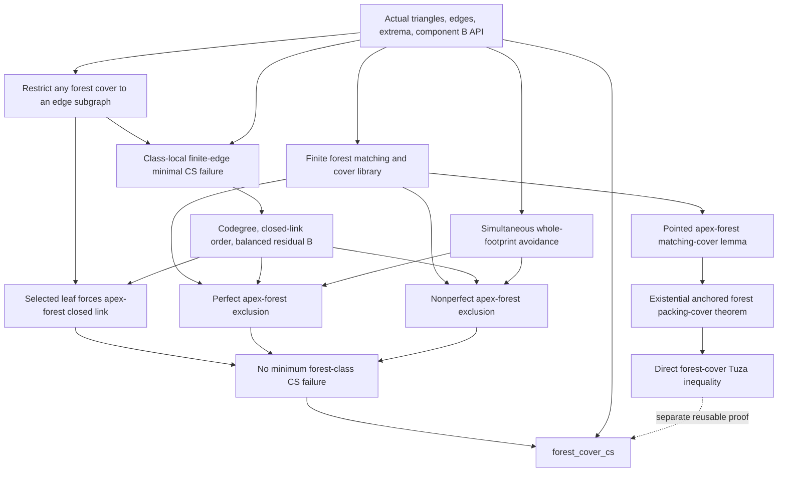

> Historical research record, curated for the 17 November 2026 archive. Read the [final scope, corrections and evidence status](PUBLICATION_STATUS.md) before using any claim. Earlier proposals and future-work decisions are historical; the series is now paused. Internal reviews are AI reviews.

# Forest-cover formalization plan

This is a source-backed plan, not a Lean proof of the forest theorem. The mission's exact stretch target is the forest-only class. The stronger TUZA-22 tree/K3-cover theorem is read for provenance and architecture, but its triangular-cover-component machinery is not a prerequisite for the requested forest target. R2 remains the primary formalization target. Do not begin this stretch development before R2 and its independent verification are secure.

## Exact exported target and representation

For any finite vertex type V, a simple graph G, and a finite family C of unordered two-element vertex sets, define GraphCover(G,C) to mean that every member is an actual G edge and every actual triangle of G contains a member of C. Define selectedGraph(C) on V by adjacency a!=b and {a,b} in C. The forest condition is selectedGraph(C).IsAcyclic. Isolated vertices are retained. This definition is equivalent to acyclicity of the selected edge subgraph and requires no connectedness or spanning support.

Intended statement, with exact API names to follow the approved foundation:

```lean
theorem forest_cover_cs {V : Type u} [Fintype V] [DecidableEq V]
    (G : SimpleGraph V)
    (h : ∃ C : Finset (Finset V), GraphCover G C ∧
      (selectedGraph C).IsAcyclic) : CS G
```

Here CS is the unrestricted inequality-and-B-iff proposition from THEOREM_SPEC.md. There is no minimum-cover hypothesis, bound on graph order or density, assumption that G is a forest, or restriction on components sharing vertices. B counts all actual crossing triangles. The triangle-free/empty cases give tau=nu=0 and vacuous B. An optional sharpened corollary rules out K5 supports and says equality exactly when each nonempty actual triangle component is K4; that refinement is not needed to state CS.

## Dependency graph



The class-local minimum-CS argument can prove both inequality and equality without using the separately proved direct inequality. The direct anchored argument is a valuable independent reusable theorem, not a logically necessary premise of that minimum-CS proof. Do not manufacture a dependency merely because it appears in the stronger mixed-cover assembly.

## Source-to-formal-statement map

| Target | Exact source and planned formal content | Current evidence / difficulty |
|---|---|---|
| Forest-cover heredity | `forest_triangle_cover_cs_v1.md` §1: restrict C to actual edges of H<=G; every surviving triangle still met; acyclicity monotone | Ordinary source; short foundation bridge once actual-edge API exists |
| Forest matching-cover equality | `challenger_forest_anchored_cover_v1.md` §2 and `apex_forest_nonperfect_branch_v2.md`: leaf induction, maximum matching and minimum vertex-cover witnesses | Ordinary-only in mission; matching definitions available in pinned Mathlib, optimizer and leaf induction bridges need work; medium |
| Alternating-reach partition | Same sources: even/odd reachability from unmatched roots, disjointness, matching of A into U, perfect unreached Z, exposure by even-path flips | Ordinary-only; substantial reusable all-size matching library; high |
| Pointed apex-forest lemma | Anchored note §3: if L-w is a forest, there exist matching M and vertex cover Q of L-M with card Q<=card M and incident(M,w) implies w in Q | Ordinary-only; three cases using alternating partition; medium after matching API, high before it |
| Anchored packing-cover | Anchored note §4: GraphCover H C and acyclic C imply exists packing I and actual cover D with C intersect support(I) subset D and card D<=2 card I | Ordinary-only; induction on selected-cover edge count; full link and ALL lost triangles; high but useful standalone target |
| Direct inequality | Anchored theorem and extrema: tau(H)<=card D<=2 card I<=2nu(H) | Short checked corollary once anchored theorem is checked |
| Class-local M0 | Public `MinimalObstruction`, `Critical`, plus same-vertex finite-edge minimum and hereditary forest class | Existing formal sources inspected; final mission rebuild/axiom status determined by theorem ledger; small class wrapper |
| Codegree and robustness | Public `UniqueEdge.minimal_edge_codegree`, `SmallLinks.minimal_link_two_neighbors`, `SmallLinks.minimal_closed_link_size`; old paper §§1–4 | Existing all-size conditional formal declarations to reauthenticate; no five-degeneracy hypothesis in these theorem types; medium integration/closure audit |
| Balanced link deletion | Public `Reduction.balanced_accounting`, `Reducible.minimal_balanced_reduction`, `MatchingReduction` and ordinary apex-forest notes | Existing general formal interfaces; may need a closed-component-specific adapter; medium |
| Perfect branch | `apex_forest_perfect_link_exclusion_v2.md`: forest edge count forces alternating even path, then triangle-free external-page or internal-rim augmentation | Ordinary-only assembled target; high, with path indexing and whole selected-footprint geometry |
| Nonperfect branch | `apex_forest_nonperfect_branch_v2.md`: exposed original leaves preserving/avoiding an edge, universal matching-complement reduction, allowed-edge decomposition and safe augmentation | Ordinary-only; highest new obligation; requires quantified matching choices, not a small finite case split |
| Selected-leaf reduction | `forest_triangle_cover_cs_v1.md` §2: cover leaf v with selected neighbor w forces every link edge away from w into C; other link components would be forests of minimum degree two | Ordinary-only; medium graph/acyclicity bridges |
| Final CS assembly | Forest-only note §§3–4; finite-edge minimal failure contradicted by two apex-forest branches; B=>equality from component API | Ordinary-only; short once exact prior obligations are checked |
| Optional K4-only equality | Forest-only note §4: restricted forest cover of a K5 is bipartite, one color class has >=3 vertices giving an uncovered triangle | Ordinary-only; medium coloring bridge; does not change the CS target |

## Simultaneous compatibility: essential versus optional

The forest equality proof uses simultaneous compatibility in a precise way. After deleting a closed link's hub spokes and a selected rim matching, the proposed enlarged triangle packing must avoid the entire surviving footprint in EACH literal residual clique block. The whole set of selected triangles contributes at most two edges forming a star in each block. The pinned `Tuza06.Footprints.blocks_avoid_edges` is an existing all-size assembly interface for exactly this local shape; every footprint hypothesis must be proved from actual endpoints and ALL selected triangles. The fact that individual triangles have avoidable footprints is insufficient for the union. K4 and K5 avoidance proofs and component additivity must remain in the audited closure.

For the broader tree/K3-cover route, separate compatibility tasks are necessary: partition assigned families by cover components, combine weighted internal and external selections, prove reciprocal cross-conflict components are bipartite, and coordinate q2-core signs, including closed odd-cycle cores. Those are in `challenger_tree_triangle_cover_tuza_v2.md` and `challenger_two_full_apices_packing_v1.md`. The forest-only anchored theorem avoids these global list-assignment tasks entirely. They should not be imported into the primary forest plan as hidden assumptions.

The external-page minmax in `challenger_forest_external_minmax_v1.md` uses bipartite-line-graph coloring, clique gluing, replication and a clique-cover/independent-set minmax. It is useful for weighted tree components in the mixed-cover theorem but not required for the standalone anchored forest inequality or forest-only CS route. It would be a substantial separate perfect-graph development, not a short matching lemma. No outside theorem should be assumed merely because its ordinary proof is included in a note.

## Existing library and trust boundary

The pinned Mathlib contains `SimpleGraph.IsAcyclic`, `IsTree`, acyclicity under subgraph/induced restriction, and matching/perfect-matching definitions and symmetric-difference infrastructure in `Combinatorics/SimpleGraph/Acyclic.lean` and `Matching.lean`. These were source-inventoried; this plan does not claim an exact ready-made forest alternating-reach theorem or that every named optimizer bridge already exists. Prefer an explicit bridge between the mission's finite unordered-edge matching sets and Mathlib subgraph matchings over a wholesale representation change.

Existing public TUZA-06 formal statements include finite triangle-family extrema, additivity, B/decomposition equivalence, clique values, forbidden-star footprint assembly, and class-independent minimality/accounting. Their status for reuse must come from actual clean build and theorem axiom reports, not this plan. The older `CombinedStatement` has a degree hypothesis; use unrestricted `Good` with its proven iff bridge or mission CS. The forest proof's historical local inputs are class-independent, not the final five-degenerate theorem.

## Suggested order after the primary target is secure

1. Prove selected-edge graph, actual-cover, and forest-heredity bridges, including an empty selected cover and an ambient graph with cycles.
2. Define a finite matching/vertex-cover API compatible with pinned Mathlib; prove forest matching-cover equality by leaf induction.
3. Prove a reusable alternating-reach/exposable-vertex theorem with explicit maximum-matching hypotheses. This is the largest shared prerequisite for both anchored and nonperfect arguments.
4. Prove the pointed apex-forest lemma and anchored cover induction; export the direct forest inequality and anchor simultaneously.
5. Reauthenticate class-local codegree/robustness, then formalize the perfect and nonperfect apex-forest exclusions as separate named statements with whole-footprint audits.
6. Complete selected-leaf/minimality assembly and the optional K4-only equality corollary.

Useful controls include a K4 covered by opposite edges, a triangle-free graph with an empty cover, a cyclic ambient graph with an acyclic cover, a nonminimum forest cover, disconnected forests, vertex-sharing equality blocks, and the failed prescribed-packing anchor examples from the archive. The anchor is existential: it does not claim every maximum packing admits the promised cover. Negative controls must target that quantifier rather than silently strengthening it.

This plan contains no new census or conjecture search and no promise of a proportional Lean line count. The next best forest-specific investment, if selected after R2, is the all-size matching/alternating-path interface; an isolated collection of small examples would not close the principal obligation.

## Final verification update

The independent clean build and theorem-level audit subsequently accepted R2, its reusable foundation and the explicitly conditional M0 package; see `review/INDEPENDENT_FINAL_REVIEW.md` and `verification/independent-20261116T092129409939Z/`. The new forest matching, pointed apex-forest, anchored-cover and apex-exclusion obligations above remain unformalized. This update changes evidence labels for the reusable foundation only, not the exact forest theorem or dependency plan.
