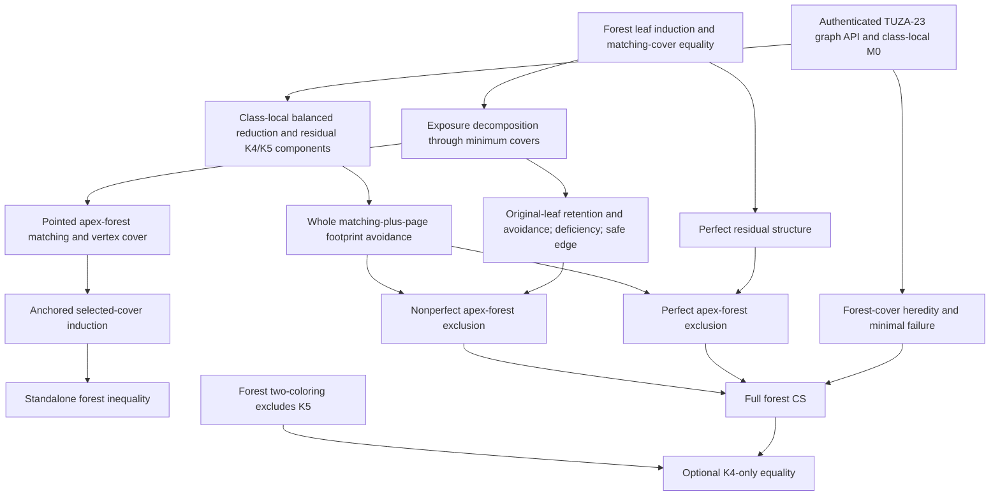

> Historical research record, curated for the 17 November 2026 archive. Read the [final scope, corrections and evidence status](PUBLICATION_STATUS.md) before using any claim. Earlier proposals and future-work decisions are historical; the series is now paused. Internal reviews are AI reviews.

# Proof and dependency boundary

TUZA-24 proves the exact forest-cover CS statement by eliminating a minimum failure within the hereditary forest-cover class. It separately proves the existential anchor by induction on the number of selected cover edges; the standalone inequality is exported from that construction. General B retains literal K4/K5 support for actual shared-edge-connected triangle components. An additional K5 exclusion yields the optional K4-only equality theorem.

The selected cover is any actual forest edge cover of all triangles, including crossing triangles. It need not be minimum, nonempty or connected. The graph may have arbitrary density, background edges and isolated vertices. The graph-side API restricts a cover to a subgraph by intersecting it with actual surviving edges, proves forest heredity, and makes any internally constructed cover actual by trimming nonedges while retaining the supplied-cover anchor.

## Checked route

`Tuza24.ForestAPI` and `LinkAPI` establish actual-edge restriction, selected leaves and full-link-minus-apex forest inclusion. `AnchorLift`, `PointedForest` and `ForestAnchor` supply the existential anchor, including all outside pages on removed matching edges. `ForestMatching` proves minmax by leaf induction. The `AlternatingForest*` modules derive exposure structure from minimum-cover certificates and finite forest leaves rather than assuming a general decomposition theorem. `ForestMatchingUnique`, `LeafRetention`, `LeafAvoidance`, `Deficiency` and `SafeEdge` supply the exact matching choices used by equality.

`PerfectForestStructure` replaces an ordered alternating path with an exact residual matching and two unmatched original leaves. `PerfectForestExclusion` discharges that branch. `ResidualMatching`, `NonperfectLinkReduction` and `NonperfectForestExclusion` discharge the complementary branch. `FootprintGeometry`, `LinkAugmentation`, `InternalPageAugmentation` and `ExternalPageAugmentation` establish the UNION of every added packing edge in EACH old clique, then select one maximum old packing avoiding the entire union. Individual triangle avoidance is never used as a substitute for this compatibility.

The full link is represented on the original vertex type; vertices outside it remain isolated. Perfectness and deficiency refer explicitly to `(peelNeighbors G univ v).erase w`. All its vertices are proved nonisolated in the forest part. The pointed theorem and ordinary minmax allow arbitrary ambient isolates. No closed-component connectedness assumption is needed by the final full-link arguments.

## Authenticated reuse

TUZA-23 commit `1c75228297205295bafa100564bebfe2e216988c`, tree `aed31e2d76a6fc1d3f37e5762dd103e3c66fb908`, supplies actual graph semantics, extrema, class-local M0, literal clique choices, additivity and footprint infrastructure. TUZA-22 ordinary inputs are pinned to commit `d048e6e8207d9dece8ee23af6e5085726d826db4`, tree `e273f3a2f426c9fb92c0f2c2d8ac89cc22541d66`; candidate headers are preserved alongside its later acceptance reviews. The historical public local-reduction sources are copied from commit `4b72b6d5b4f71fcefa3f0314483bf58ce809d7b4`, tree `f6716f2578ba5346960cbb69b9b2e0698b834b4f`.

The public `SmallLinks`, `MatchingReduction`, `Reducible`, and `UniqueEdge` entrypoints contribute a 30-module local import closure. All are copied, source-scanned and rebuilt. Some broad imported files also contain degree-conditioned declarations, Aharoni/HNS proposition definitions, or unused global statements. Their presence in an import is not an assumption in the final theorem. Actual proof references and explicit theorem types, rather than filenames, determine the accepted target closures. No historical finite WKE kernel or census premise is used. The final verifier records the precise accepted module order; copied files outside that order are provenance inputs, not newly accepted claims.

## Native trust boundary

`operations/dependency_pins.json` authenticates the installed native Lean 4.33.1 executable, actual compiler commit `819816b2e0a3bf405af45ae5c7af2491d8f5bee6`, and nine clean package revisions against the inherited manifest, including mathlib `0df444a360eaa60ab8c11dca51a86af692955474`. Every accepted local module is rebuilt in a fresh output tree from copied source. Existing pinned compiler/mathlib/package objects are reused read-only; this is not a cold compiler or mathlib rebuild and not a second kernel implementation. All execution is on Darwin arm64 on the owner's Mac. No installation, updater, cache download, remote computation or publication was used.
